# MoE Executor Cost Model and Prefill Expert Streaming Ring Implementation Plan (llama.cpp-36j0 consumer)

> **Execution:** Use `team-driven-development` in Claude Code, `pi-team-driven-development` in pi.dev, or `codex-team-driven-development` in Codex.

**Goal:** A Qwen3.8-Flash-Next prompt on the Arc Pro B70, with 41 % of its routed experts host-resident, processes at >= 500 tok/s (from 10.5-14.4 today) because each MoE layer's host-resident experts are streamed into a lent VRAM ring one layer ahead and run on the device, chosen per layer per micro-batch by a cost model that still picks the CPU path wherever it is cheaper, with decode, the GPT-OSS B50 gates and the Mistral gate unchanged.

**Amendment (2026-10-23, llama.cpp-bcre, llama.cpp-348c, llama.cpp-3460, llama.cpp-pu8v):** The goal stands, but two
premises changed while it was built. The record below is what was built, task by task.
- The device executor was the larger half of the gap. With every expert in VRAM, Qwen1.5-MoE Q4_0 on the B70 ran
  prompts through the per-row executor at 0.63 TFLOP/s, so the epic gained Task 10-pre (llama.cpp-348c) before Task
  10: a batched f16 executor for every expert type.
- The ring has never engaged on this host. The 10 %-of-resident cap refuses it on both canonical models
  (llama.cpp-bcre, open, P0). Where a model passes the cap (Qwen1.5 at a 33-35 % VRAM budget) the ring is short and
  its loan is refused (llama.cpp-pu8v). The >= 500 and >= 800 tok/s targets therefore move to the tasks that make the
  ring engage, and Task 15's gate reports ring_engaged and loan_exercised instead of scoring a vacuous pass.

**Architecture:** Placement is unchanged: the planner still decides which experts live in VRAM and which live in pinned host memory. What changes is the **executor** of a MUL_MAT_ID whose expert entries are host-resident. A pure cost model (`moe-exec-cost.hpp`, one layer of one micro-batch as its unit, decided before the layer's first MoE op) weighs today's CpuExpertPool path against staging the layer's host experts through a byte-budgeted VRAM ring (slots lent from the tail of the resident expert set for the prompt phase, refilled in the background afterwards) and running them with the same device kernels resident experts use. Streaming is an H2D copy on the cache's BCS queue followed by an AOS-to-SOA reorder on the compute queue, event-chained, the next layer's copies enqueued while this layer computes. The MoE batch resolver (`moe-resolved-batch.hpp`) learns one new transfer kind, `STAGED_RING`, which is the only way a host-resident entry can ever answer `PRIMARY_DEVICE`. Rates (H2D GB/s per device, CPU expert GB/s per type, device expert rate per type) are probed and persisted in the existing tuning cache, env-overridable. The micro-batch comes from the existing auto-ubatch trial with a ring fit term; `-ub` caps it.

**Owner ruling this implements (2026-10-19, amends the 2026-08-16 "placement decides the executor" ruling):** *"Our unified cache is meant to intelligently handle everything automatically, if it's faster to stream host pinned weights to vram it should do that. No idea is too complicated for us to consider."* The brainstorm (llama.cpp-36j0 comments c-rnt5, c-6hvu) fixed: sub-project A first (B = llama.cpp-reba, C = llama.cpp-3kp7 filed); the cache picks the prompt micro-batch and `-ub` caps it; ring slots are lent during prompts and refilled after; rates are probed at load and persisted; layer-ahead ring streaming is the mechanism. The validated design is § 9 of the session brief (scratchpad `research-memarch/brief.md`); the reference engine is Strata at `/Apps/strata` (llama.cpp-tx1s; read-only data, never build or run it).

**Grounding corrections to the approved design (master 9ff0b52c5, four read-only explorers, 2026-10-19).** The design survives, but four facts change how three of its sections are built, and the tasks below are written to the facts, not to § 9's wording:

1. **Dispatch reads residency from the published placement plan, not from the cache entry** (`placement_plan::expert_on_device`, `unified-cache.hpp:1512`; the resolver's HOST answer at `ggml-sycl.cpp:7058-7064` is "cpu_accessible and not device-planned"). So "a lent expert counts as host-resident" means a **plan transaction**: copy the published plan, flip the entries with the existing but unused `placement_plan::update_expert_placement` (`unified-cache.hpp:1298`), republish under `g_tensor_inventory_mutex` through `ggml_sycl_publish_plan_locked` (`ggml-sycl.cpp:16481`). The KV-demotion runtime transaction (`ggml_sycl_run_runtime_context_transaction`, `ggml-sycl.cpp:19682`, copies at `:19778`) is the precedent and the pattern.
2. **Device-planned experts have no host copy**: their only host source is `tensor->data`, normally the GGUF mmap, and the registry calls that "unknown", so an H2D from it takes mem-ops' synchronous staged path (`mem-ops.cpp:1111-1145`). The loan therefore **D2H-copies the lent triplets into pinned host buffers first** (the async-evict path already does exactly this copy, `unified-cache.cpp:12937-12968`, then wrongly frees the host copy at `:13040-13100`), registers them with `register_host_expert` (`unified-cache.cpp:10387`), and refills from those buffers afterwards.
3. **Host-planned expert buffers are outside the qwn5 USM trust scope** (`mem-ops.cpp:155-193`: role WEIGHT pinned-pool memory never enters the pointer registry, so a copy from it is staged and waits on the calling thread). The ring's copies must come from a handle the copy helper trusts, which is Track B's first spike.
4. **A prompt layer with any host expert runs the hybrid world**, where even its device-resident experts go through the per-row `mmvq_moe_batched_dispatch` (`ggml-sycl.cpp:83532-83536`), not the batched oneDNN/XMX prompt executors fully-resident layers use. A fully staged layer must leave the hybrid world to reach the target; a lead-run spike measures the batched executor per expert type before that task is written. Also, **expert ids exist on the host only after the layer's own router runs** (`ggml_sycl_refresh_moe_ids_cache`, `ggml-sycl.cpp:62833`, blocking, once per layer), which is why the p >= 0.9 regime streams every host expert in a fixed order (no ids needed) and the routed-only regime cannot run layer-ahead.

**Precondition:** `task/7fmt` (the per-type CPU expert rate table, `ggml/src/ggml-sycl/kv-room-cost.hpp`, 4 commits over 8b5946b53, worktree `wt-7fmt`) is merged into master first. Task 0 owns that merge. Every rate-related task below includes `kv-room-cost.hpp` and must not add a second rate table.

**Standing rulings that bind this plan:**
- All SYCL memory flows through `unified_allocate` / `unified_allocate_owner` and surfaces as a `mem_handle` or an `alloc_owner` (CLAUDE.md "SYCL Memory Ownership"; `docs/design/sycl-canonical-memory-architecture.md` § 3 at line 329, § 3.1 at 369). No raw `sycl::malloc*`. Every ggml-sycl commit runs `python3.13 -I scripts/check-sycl-alloc-zone-contract.py --root <worktree>` and passes.
- Raw pointers are never ownership tokens; the ring slot a kernel reads is held by a `mem_handle` until the kernel's event completes (`retain_handles_until_event`, `mem-handle.hpp:907`).
- No host waits on the submitting thread (memory `no-host-waits-event-chain-everything`); the one exposed copy per micro-batch is layer 0's.
- Never shrink `n_ctx` or `n_ubatch`; `-ub N` is honoured or refused, never lowered (`docs/plans/2026-09-10-auto-ubatch.md` standing rulings).
- Measure BOTH canonical models before any placement-decision change (memory `the-kv-room-cost-model-is-right-for-qwen-b70-and-wrong-2x-for-gptoss-b50`): every GPU gate here has the Qwen B70 arm and the GPT-OSS B50 arm.
- GPU work is lead-run, serial, under `mkdir /Apps/llama.cpp/GPU.lock`, selector pinned, `Shmem`/`MemAvailable` sampled before and ~5 s after, never two model-loading runs at once, never a looped model-loading binary. Implementers build and run host-only gates only.
- `-ngl` does not exist in this fork's gates (memory `ngl-is-a-legacy-knob-not-a-gate-in-this-fork`). No task adds it.
- The nine owner-dirty tracked files (`src/llama-model-loader.cpp`, `.claude/skills/llm-wiki/SKILL.md`, `.llm-wiki/*`) are never staged, committed or reverted.

**Tech Stack:** C++17 (ggml-sycl backend, `llama_context`), Intel oneAPI SYCL (Level Zero), pytest source-contract gates, bash gate scripts through `scripts/bench-guard.sh`.

**Test Infrastructure:** host-only C++ tests under `ggml/src/ggml-sycl/tests/` registered in `ggml/src/ggml-sycl/CMakeLists.txt` with `add_executable` + `add_test` + `set_tests_properties(LABELS "sycl;...;hostonly" TIMEOUT 60)` (pattern: `test-kv-room-cost` on the 7fmt branch, registered at its `CMakeLists.txt:2233-2244`; `test-zone-sizing` at `:6399-6422`); device tests in the same directory with `ENVIRONMENT "ONEAPI_DEVICE_SELECTOR=level_zero:1;LD_LIBRARY_PATH=/opt/intel/oneapi/redist/lib:$ENV{LD_LIBRARY_PATH}" RUN_SERIAL TRUE SKIP_RETURN_CODE 77` and `sycl_test_require_gpu()` from `tests/sycl-test-skip.hpp:88` (pattern: `test-mem-handle-eviction`, `:2834-2862`); pytest source-contract gates `tests/test-sycl-*-source.py` registered with `llama_test_pytest(... LABEL "sycl;python;source-assert" TIMEOUT 120)` (pattern: `tests/CMakeLists.txt:2521-2526`, template `tests/test-sycl-kv-room-cost-source.py`); pure header tests under `tests/` with `llama_build_and_test` (pattern: `test-tuning-cache-io.cpp`, `tests/CMakeLists.txt:4747-4749`). GPU acceptance through `scripts/bench-guard.sh --log`, scored by exact strings (never `grep -c` of a loose pattern; see CLAUDE.md "GREP THE STRING THE CODE PRINTS").

**Line numbers below were verified at master 9ff0b52c5 on 2026-10-19.** `ggml-sycl.cpp` and `unified-cache.cpp` drift constantly: re-grep before editing, and inside `ggml-sycl.cpp` use `cat file | grep -n` (the codescout index is blind there).

---

## Team Topology

**Recommended implementers:** 3 concurrent (Tracks A, B and C start together; Track D starts when A1 and B4 exist; at most two build-heavy tasks build at once on this host, and nothing builds while the lead holds `GPU.lock` from the same tree).
**Reviewers:** spec + quality, spawned FRESH per review (opus); every merge gets a fresh final integration review; minor findings are not optional.
**Lead-owned:** Task 0 (merge 7fmt), the two spikes' GPU runs (Tasks 5 and 9), every device test and gate, the End-to-End Validation.

### Parallel Tracks

| Track | Tasks | Description |
|-------|-------|-------------|
| L | 0, 9 | Lead: merge `task/7fmt`; measure the batched prompt executor per expert type (the spike Task 10 depends on) |
| A | 1, 2, 3, 4 | Cost model core: the pure decision function, the rates record (seed + env + tuning-cache persistence), the H2D probe at init, the knobs and the `[MOE-EXEC]` log |
| B | 5, 6, 7a, 7b, 8, 10-pre, 10 | Ring and streaming: the copy-path spike, ring reservation with epochs, the per-ubatch layer stream plan (host-only) and its enqueue, the `STAGED_RING` resolver route, the batched f16 prompt executor for every expert type (10-pre, inserted 2026-10-22), the fully-staged layer's exit from the hybrid world |
| C | 11a, 11b, 12, 13 | Loan selection (host-only), the loan and refill transactions on the placement plan, the auto-ubatch ring fit term |
| D | 14, 15 | Docs (memory design, env vars, canonical contract), the gate script and the baselines section |

### Dependency Graph

```dot
digraph dependencies {
    rankdir=LR;
    0  [label="Task 0: merge task/7fmt (lead)"];
    1  [label="Task 1: cost function + fixtures"];
    2  [label="Task 2: rates record: seed, env, tuning cache"];
    3  [label="Task 3: H2D pinned probe at init"];
    4  [label="Task 4: knobs + [MOE-EXEC] log"];
    5  [label="Task 5: spike: trusted H2D from host expert handles"];
    6  [label="Task 6: ring reservation + epochs"];
    "7a" [label="Task 7a: layer stream plan (host-only)"];
    "7b" [label="Task 7b: layer-ahead enqueue + wiring"];
    8  [label="Task 8: STAGED_RING resolver route"];
    9  [label="Task 9: spike: batched prompt executor rates (lead)"];
    "10pre" [label="Task 10-pre: batched f16 prompt executor, every expert type (llama.cpp-348c)"];
    bcre [label="llama.cpp-bcre: ring geometry vs the 10% cap (open, P0)", style=dashed];
    pu8v [label="llama.cpp-pu8v: the loan is refused, host storage too small (open)", style=dashed];
    xr4i [label="llama.cpp-xr4i: probe rate = max over iterations 2..8"];
    10 [label="Task 10: fully staged layer leaves hybrid"];
    "11a" [label="Task 11a: loan selection (host-only)"];
    "11b" [label="Task 11b: loan transaction"];
    12 [label="Task 12: refill transaction"];
    13 [label="Task 13: auto-ubatch ring fit term"];
    14 [label="Task 14: docs + contract"];
    15 [label="Task 15: gate script + baselines"];
    0 -> 1; 0 -> 2;
    1 -> 2; 2 -> 3; 1 -> 4; 2 -> 4;
    1 -> "7a"; "7a" -> "7b"; 5 -> "7b"; 6 -> "7b"; 4 -> "7b"; "7b" -> 8; 8 -> 10; 9 -> "10pre"; "10pre" -> 10;
    8 -> bcre; bcre -> 10 [style=dashed, label="ring-engaged acceptance"];
    12 -> pu8v; pu8v -> 10 [style=dashed, label="loan acceptance"];
    3 -> xr4i; xr4i -> 12;
    "7a" -> "11a"; 6 -> "11b"; "11a" -> "11b"; "11b" -> 12; 6 -> 13; "11b" -> 13;
    1 -> 14; 8 -> 14; "11b" -> 14;
    4 -> 15; 8 -> 15; 10 -> 15; 12 -> 15;
}
```



### File Ownership Map

| File/Directory | Tasks | Conflict Risk |
|----------------|-------|---------------|
| `ggml/src/ggml-sycl/moe-exec-cost.hpp` (new) | 1, 2, 10-pre, 10 | Sequential; Task 10 re-seeded rates |
| `ggml/src/ggml-sycl/tests/test-moe-exec-cost.cpp` (new) | 1, 2 | Sequential (same track) |
| `ggml/src/ggml-sycl/tuning-cache-io.hpp`, `tests/test-tuning-cache-io.cpp` | 2 | None (single task) |
| `ggml/src/ggml-sycl/ubatch-tuning-cache.cpp` | 2 | None (single task) |
| `ggml/src/ggml-sycl/common.hpp` (`sycl_device_info` field) | 3, 10-pre | Sequential |
| `ggml/src/ggml-sycl/mem-ops.cpp` | 5 | None (single task) |
| `ggml/src/ggml-sycl/moe-stream-ring.hpp/.cpp` (new) | 6, 10 | Sequential |
| `ggml/src/ggml-sycl/moe-stream-plan.hpp` (new) | 7a, 7b, 8, 10-pre, 10, 11a | 7a creates it; Track B tasks and 11a (Track C) append; 11a rebases |
| `ggml/src/ggml-sycl/moe-stream-plan.cpp` (new) | 7b, 8, 10-pre, 10 | Sequential (same track) |
| `ggml/src/ggml-sycl/tests/test-moe-stream-*.cpp`, `test-moe-expert-loan-select.cpp` (new) | 6, 7a, 11a | One file per task |
| `ggml/src/ggml-sycl/moe-resolved-batch.hpp` | 8 | None (single task) |
| `ggml/src/ggml-sycl/moe-mmvq-tables.hpp` (new), `moe-layer-plan.hpp`, `gemm.hpp` | 10-pre, 10 | 10-pre creates the tables; 10 edits |
| `tests/test-moe-pp-batched-dequant.cpp`, `tests/test-sycl-moe-mmvq-tables.cpp`, `tests/test-sycl-moe-pp-batched-types-source.py` (new) | 10-pre, 10 | 10-pre creates them; 10 edits the types gate |
| `ggml/src/ggml-sycl/unified-cache.hpp/.cpp` (ring reservation, loan, refill) | 6, 11b, 12 | 6 in Track B, 11b/12 in Track C: distinct regions (ring API next to the PP oneDNN ring at `:7585`, loan/refill next to the retire primitives at `unified-cache.cpp:9927`); Track C rebases on 6 before merge |
| `ggml/src/ggml-sycl/zone-sizing.hpp/.cpp`, `tests/test-zone-sizing.cpp` | 10-pre, 13 | Sequential; 13 adds the ring term |
| `ggml/src/ggml-sycl/ggml-sycl.cpp` | 3 (init probe, ~28559), 4 (knob parse + log, ~17069/29258), 7b, 8 and 10 (mul_mat_id region 78077-87255 and the batch resolver 32180-32283), 11b and 12 (plan transaction next to 19682), 13 (hold fit 18554) | HOTSPOT. Distinct regions per track; every implementer rebases on master before building, commits path-scoped, and the lead merges one lane at a time |
| `ggml/src/ggml-sycl/CMakeLists.txt` | 1, 4, 6, 7a, 11a, 11b | Appended blocks only; rebase |
| `tests/CMakeLists.txt` | 2, 4, 8, 10-pre, 13, 14, 15 | Appended `llama_test_pytest` blocks only; rebase |
| `docs/backend/sycl-memory-design.md`, `docs/backend/sycl-env-vars.md`, `docs/design/sycl-canonical-memory-architecture.md` | 10-pre, 10, 14 | Sequential |
| `scripts/sycl-moe-exec-gate.sh`, `scripts/sycl-moe-exec-prompts/code-2k.txt`, `tests/test-sycl-moe-exec-gate-script.sh` (all new) | 15 | None |
| `docs/backend/sycl-perf-baselines.md` | 15 | None (single task) |

---

## Task 0: Merge `task/7fmt` into master (lead)

**Track:** L
**Depends on:** None
**File scope:** the merge commit only (`git merge --no-ff task/7fmt -F <msgfile>` in the main checkout).

**Description:** Tasks 1 and 2 include `ggml/src/ggml-sycl/kv-room-cost.hpp` for `placement_cpu_expert_rate_measured(ggml_type)` (7fmt `kv-room-cost.hpp:38-57`) and must not add a second CPU rate table. The 7fmt lane (`wt-7fmt`, 7f25c4473, 4 commits over 8b5946b53, `impl-7fmt` idle per the handoff) has its own post-merge gate owed; this task is that lane's close-out, not new work.

**Acceptance Criteria:**
- [ ] `git merge-base --is-ancestor task/7fmt master` exits 0.
- [ ] The 7fmt gate arms (its own Qwen B70 and GPT-OSS B50 default-context room arms, recorded on llama.cpp-7fmt) pass on the merged master build, lead-run.
- [ ] `ctest --test-dir build -R 'kv-room-cost' --output-on-failure -j 1` passes (`sycl-kv-room-cost` and `test-sycl-kv-room-cost-source`).

**Implementation Guide:** the lead's standing merge recipe (freeze the lane, rebase `task/7fmt` on master in `wt-7fmt`, build there, run the gates under `GPU.lock`, merge with `-F` so the trailers survive, record on llama.cpp-7fmt). No implementer work.

**Gotchas:**
- The 7fmt branch moved `PLACEMENT_*_DEFAULT` from `unified-cache.hpp:585-590` into `kv-room-cost.hpp:21-24`; master still has them in `unified-cache.hpp`. Expect that conflict and keep the 7fmt placement.
- The static-storage census (`tests/test-sycl-static-storage-audit.py`) reads `kv-room-cost.hpp` after 7fmt (4c3672810); run it in the merged tree.

---

## Task 1: The cost function and its two model fixtures (host-only)

**Track:** A
**Depends on:** Task 0
**File scope:**
- Create: `ggml/src/ggml-sycl/moe-exec-cost.hpp`
- Create: `ggml/src/ggml-sycl/tests/test-moe-exec-cost.cpp`
- Modify: `ggml/src/ggml-sycl/CMakeLists.txt` (append one registration block after the `test-kv-room-cost` block)

**Description:** The decision is a pure function of plain values so it can be pinned on the measured shapes with no device, exactly as `kv_room_weigh` (7fmt `kv-room-cost.hpp:239-250`) is. It weighs one MoE layer of one micro-batch: `t_cpu` for today's CpuExpertPool path against `t_ring` for staging the layer's host experts through the ring, picks the cheaper, and names the streaming regime (fixed-order layer-ahead when nearly every host expert is touched, routed-only otherwise). The free parameters are the rates record (Task 2 seeds and persists it); this task only consumes a struct of them.

**Acceptance Criteria:**
- [ ] `moe_exec_weigh()` is a pure `static inline` function in a header that includes only `ggml.h`, `kv-room-cost.hpp` and the STL (no SYCL, no unified-cache).
- [ ] Qwen3.8/B70 fixture at T = 256 answers RING with regime STREAM_ALL; at T = 4 answers CPU; at T = 1 (decode) answers CPU; with `ring_bytes_free` = 0 answers CPU with reason `RING_UNAVAILABLE`.
- [ ] GPT-OSS 20B/B50 default-context fixture (12 host layers, ~19 host experts of 37.5 MB per layer) at T = 512 answers RING; its all-VRAM `-c 4096` fixture has no host bytes and answers NOT_CONSULTED.
- [ ] `p_touch(k, E, T)` returns 0.0 for T = 0, 1 - (1 - k/E)^T otherwise, and the fixture pins 0.993 at (10, 512, 256) and 0.27 at (10, 512, 16) to 1e-2.
- [ ] The policy knob is an input (`moe_exec_policy::AUTO/CPU/RING`), not an environment read, so CPU and RING force the answer with the reason `FORCED`.
- [ ] Registered as `sycl-moe-exec-cost`, labels `"sycl;moe;planner;hostonly"`, passes in < 1 s.

**Implementation Guide:**

1. **RED:** write the test with the fixtures below and a stub header that declares the functions and returns zeros; run it; it must fail on the first CHECK ("Qwen/B70 T=256 answers RING").

`ggml/src/ggml-sycl/moe-exec-cost.hpp`:

```cpp
#pragma once

// The MoE executor's cost (llama.cpp-36j0, owner ruling 2026-10-19): for a MUL_MAT_ID whose expert entries are
// host-resident, one layer of one micro-batch is run on the CPU (CpuExpertPool) or its host experts are staged
// through the VRAM ring and run on the device. Plain values, no SYCL: test-moe-exec-cost pins it with no device.

#include "ggml.h"
#include "kv-room-cost.hpp"

#include <algorithm>
#include <cmath>
#include <cstddef>
#include <cstdint>

namespace ggml_sycl {

enum class moe_exec_policy : uint8_t { AUTO, CPU, RING };
enum class moe_exec_choice : uint8_t { NOT_CONSULTED, CPU, RING };
enum class moe_exec_regime : uint8_t { NONE, STREAM_ALL, ROUTED_ONLY };
enum class moe_exec_reason : uint8_t { NONE, FORCED, CHEAPER, RING_UNAVAILABLE, DECODE, NO_HOST_EXPERTS };

// The measured rates the decision divides by. Zero means "not measured": the caller substitutes the seed.
struct moe_exec_rates {
    double h2d_gbps         = 0.0;  // pinned host -> device, this device (Task 3 probe)
    double cpu_gbps         = 0.0;  // CPU expert kernel, the layer's byte-weighted mix (kv-room-cost table seed)
    double reorder_gbps     = 0.0;  // AOS -> SOA on the device
    double dev_gflops       = 0.0;  // device expert GEMM rate for the layer's types
    double cpu_gflops       = 0.0;  // CPU expert GEMM rate (compute bound at large T)
    double cpu_fixed_us     = 0.0;  // per-layer CPU orchestration cost (submit, join, scatter)
    double dev_fixed_us     = 0.0;  // per-layer device cost (ptr table, launches)
    double stream_all_p_min = 0.9;  // p_touch at or above which every host expert streams in fixed order
};

struct moe_exec_layer_inputs {
    uint32_t n_tokens          = 0;  // rows of this micro-batch reaching the layer
    int      n_expert          = 0;
    int      n_expert_used     = 0;
    size_t   host_expert_bytes = 0;  // this layer's host-resident triplet bytes
    int      n_host_experts    = 0;
    int64_t  K                 = 0;  // n_embd for gate/up, n_ff for down (use the larger: an upper bound)
    int64_t  N                 = 0;
    double   window_us         = 0.0;  // the previous layer's compute window the copies can hide under
    size_t   ring_bytes_free   = 0;  // ring bytes the layer may use (0 = no ring)
    size_t   triplet_bytes_max = 0;  // the largest host triplet of the layer
};

struct moe_exec_decision {
    moe_exec_choice choice    = moe_exec_choice::NOT_CONSULTED;
    moe_exec_regime regime    = moe_exec_regime::NONE;
    moe_exec_reason reason    = moe_exec_reason::NONE;
    double          p_touch   = 0.0;
    double          t_cpu_us  = 0.0;
    double          t_ring_us = 0.0;
};

// The share of a layer's experts at least one of T tokens routes to, top-k of E: 1 - (1 - k/E)^T.
static inline double moe_exec_p_touch(int n_expert_used, int n_expert, uint32_t n_tokens) {
    if (n_tokens == 0 || n_expert <= 0 || n_expert_used <= 0) {
        return 0.0;
    }
    const double miss = 1.0 - std::min(1.0, static_cast<double>(n_expert_used) / n_expert);
    return 1.0 - std::pow(miss, static_cast<double>(n_tokens));
}

// 2 * K * N flops per routed row per matrix, three matrices, k rows per token.
static inline double moe_exec_layer_gflop(const moe_exec_layer_inputs & in) {
    return 2.0 * 3.0 * static_cast<double>(in.K) * static_cast<double>(in.N) * in.n_expert_used * in.n_tokens / 1e9;
}

static inline moe_exec_decision moe_exec_weigh(const moe_exec_layer_inputs & in, const moe_exec_rates & r,
                                               moe_exec_policy policy) {
    moe_exec_decision d;
    if (in.host_expert_bytes == 0 || in.n_host_experts == 0) {
        d.reason = moe_exec_reason::NO_HOST_EXPERTS;
        return d;
    }
    if (in.n_tokens <= 1) {  // decode is untouched by this plan
        d.choice = moe_exec_choice::CPU;
        d.reason = moe_exec_reason::DECODE;
        return d;
    }
    d.p_touch = moe_exec_p_touch(in.n_expert_used, in.n_expert, in.n_tokens);
    d.regime  = d.p_touch >= r.stream_all_p_min ? moe_exec_regime::STREAM_ALL : moe_exec_regime::ROUTED_ONLY;
    // Bytes moved: every host expert under STREAM_ALL, the touched share otherwise (GB/s is 1e3 bytes per us).
    const double bytes  = d.regime == moe_exec_regime::STREAM_ALL ? static_cast<double>(in.host_expert_bytes)
                                                                   : d.p_touch * in.host_expert_bytes;
    const double gflop  = moe_exec_layer_gflop(in) * (static_cast<double>(in.n_host_experts) / in.n_expert);
    const double cpu_bw = d.p_touch * in.host_expert_bytes / (r.cpu_gbps * 1e3);
    const double cpu_fl = gflop / r.cpu_gflops * 1e6;
    d.t_cpu_us          = std::max(cpu_bw, cpu_fl) + r.cpu_fixed_us;
    const double copy   = std::max(0.0, bytes / (r.h2d_gbps * 1e3) - in.window_us);
    const double reord  = bytes / (r.reorder_gbps * 1e3);
    const double dev_fl = gflop / r.dev_gflops * 1e6;
    d.t_ring_us         = copy + reord + dev_fl + r.dev_fixed_us;
    if (policy == moe_exec_policy::CPU) {
        d.choice = moe_exec_choice::CPU;
        d.reason = moe_exec_reason::FORCED;
        return d;
    }
    if (in.ring_bytes_free < in.triplet_bytes_max || in.ring_bytes_free == 0) {
        d.choice = moe_exec_choice::CPU;
        d.reason = moe_exec_reason::RING_UNAVAILABLE;
        return d;
    }
    if (policy == moe_exec_policy::RING) {
        d.choice = moe_exec_choice::RING;
        d.reason = moe_exec_reason::FORCED;
        return d;
    }
    d.choice = d.t_ring_us < d.t_cpu_us ? moe_exec_choice::RING : moe_exec_choice::CPU;
    d.reason = moe_exec_reason::CHEAPER;
    return d;
}

}  // namespace ggml_sycl
```

`ggml/src/ggml-sycl/tests/test-moe-exec-cost.cpp` (the fixtures are the measured shapes: Qwen3.8 48 layers, 512 experts top-10, n_embd 2560, n_ff 640, host share 19.7 GB over 48 layers = 410 MiB per layer, 10,189 host entries / 48 = 212 triplets per layer, largest triplet 1.7 MiB; B70 H2D 26.5 GB/s; CPU 22 GB/s per the 7fmt table; GPT-OSS 20B on the B50 with the default-context room held: 687 host experts of 37.5 MB over 36 layers, 32 experts top-4, n_embd 2880, n_ff 2880, CPU 5.6 GB/s, H2D 27.1 GB/s):

```cpp
// test-moe-exec-cost: the MoE executor's per-layer cost (moe-exec-cost.hpp; llama.cpp-36j0) on the measured shapes.
// Host only: no device, no model, no SYCL.
#include "moe-exec-cost.hpp"

#include <cmath>
#include <cstdio>

using namespace ggml_sycl;

static int g_cases = 0, g_failures = 0;
#define CHECK(cond, msg)                                              \
    do {                                                              \
        ++g_cases;                                                    \
        if (!(cond)) {                                                \
            ++g_failures;                                             \
            std::fprintf(stderr, "FAIL %s:%d: %s\n", __FILE__, __LINE__, msg); \
        }                                                             \
    } while (0)

static moe_exec_rates b70_rates() {
    moe_exec_rates r;
    r.h2d_gbps = 26.5; r.cpu_gbps = 22.0; r.reorder_gbps = 200.0; r.dev_gflops = 50000.0;
    r.cpu_gflops = 1000.0; r.cpu_fixed_us = 500.0; r.dev_fixed_us = 800.0;
    return r;
}
static moe_exec_rates b50_rates() {
    moe_exec_rates r = b70_rates();
    r.h2d_gbps = 27.1; r.cpu_gbps = 5.6; r.dev_gflops = 25000.0;
    return r;
}
static moe_exec_layer_inputs qwen_layer(uint32_t T) {
    moe_exec_layer_inputs in;
    in.n_tokens = T; in.n_expert = 512; in.n_expert_used = 10;
    in.host_expert_bytes = 410ull << 20; in.n_host_experts = 212;
    in.K = 2560; in.N = 640; in.window_us = 3000.0;
    in.ring_bytes_free = 820ull << 20; in.triplet_bytes_max = 1741 * 1024;
    return in;
}
static moe_exec_layer_inputs gptoss_layer(uint32_t T, bool host) {
    moe_exec_layer_inputs in;
    in.n_tokens = T; in.n_expert = 32; in.n_expert_used = 4;
    in.host_expert_bytes = host ? 19ull * 37500000ull : 0; in.n_host_experts = host ? 19 : 0;
    in.K = 2880; in.N = 2880; in.window_us = 2000.0;
    in.ring_bytes_free = 1500ull << 20; in.triplet_bytes_max = 37500000ull;
    return in;
}

int main() {
    // p_touch
    CHECK(moe_exec_p_touch(10, 512, 0) == 0.0, "T=0 touches nothing");
    CHECK(std::fabs(moe_exec_p_touch(10, 512, 256) - 0.993) < 1e-2, "T=256 touches 99.3 % (brief section 5)");
    CHECK(std::fabs(moe_exec_p_touch(10, 512, 16) - 0.27) < 1e-2, "T=16 touches 27 %");

    // Qwen3.8 on the B70
    {
        moe_exec_decision d = moe_exec_weigh(qwen_layer(256), b70_rates(), moe_exec_policy::AUTO);
        CHECK(d.choice == moe_exec_choice::RING, "Qwen/B70 T=256 answers RING");
        CHECK(d.regime == moe_exec_regime::STREAM_ALL, "Qwen/B70 T=256 streams every host expert");
        CHECK(d.reason == moe_exec_reason::CHEAPER, "chosen on cost");
        CHECK(d.t_ring_us < d.t_cpu_us, "ring is cheaper at T=256");
    }
    {
        moe_exec_decision d = moe_exec_weigh(qwen_layer(4), b70_rates(), moe_exec_policy::AUTO);
        CHECK(d.choice == moe_exec_choice::CPU, "Qwen/B70 T=4 answers CPU");
        CHECK(d.regime == moe_exec_regime::ROUTED_ONLY, "T=4 is routed-only");
    }
    {
        moe_exec_decision d = moe_exec_weigh(qwen_layer(1), b70_rates(), moe_exec_policy::AUTO);
        CHECK(d.choice == moe_exec_choice::CPU && d.reason == moe_exec_reason::DECODE, "decode is untouched");
    }
    {
        moe_exec_layer_inputs in = qwen_layer(256);
        in.ring_bytes_free       = 0;
        moe_exec_decision d      = moe_exec_weigh(in, b70_rates(), moe_exec_policy::AUTO);
        CHECK(d.choice == moe_exec_choice::CPU && d.reason == moe_exec_reason::RING_UNAVAILABLE, "no ring: CPU");
        d = moe_exec_weigh(in, b70_rates(), moe_exec_policy::RING);
        CHECK(d.choice == moe_exec_choice::CPU, "RING policy cannot force a ring that does not exist");
    }
    {
        moe_exec_decision d = moe_exec_weigh(qwen_layer(256), b70_rates(), moe_exec_policy::CPU);
        CHECK(d.choice == moe_exec_choice::CPU && d.reason == moe_exec_reason::FORCED, "CPU policy forces CPU");
    }
    // GPT-OSS 20B on the B50
    {
        moe_exec_decision d = moe_exec_weigh(gptoss_layer(512, true), b50_rates(), moe_exec_policy::AUTO);
        CHECK(d.choice == moe_exec_choice::RING, "GPT-OSS/B50 default-context host layer at T=512 answers RING");
        d = moe_exec_weigh(gptoss_layer(512, false), b50_rates(), moe_exec_policy::AUTO);
        CHECK(d.choice == moe_exec_choice::NOT_CONSULTED, "all-VRAM -c 4096 layer is not consulted");
    }
    std::printf("test-moe-exec-cost: %d cases, %d failures\n", g_cases, g_failures);
    return g_failures == 0 ? 0 : 1;
}
```

Registration, appended to `ggml/src/ggml-sycl/CMakeLists.txt` right after the `sycl-kv-room-cost` block (7fmt `:2233-2244` once merged):

```cmake
# llama.cpp-36j0: the MoE executor's per-layer cost. Header over ggml.h and kv-room-cost.hpp only: host-only, no
# -fsycl, links nothing. Pins the Qwen3.8/B70 and GPT-OSS/B50 shapes the brief measured.
add_executable(test-moe-exec-cost
    tests/test-moe-exec-cost.cpp
)
target_include_directories(test-moe-exec-cost PRIVATE
    ${CMAKE_CURRENT_SOURCE_DIR}
    ${CMAKE_CURRENT_SOURCE_DIR}/../../include
)
add_test(NAME sycl-moe-exec-cost COMMAND test-moe-exec-cost)
set_tests_properties(sycl-moe-exec-cost PROPERTIES
    LABELS "sycl;moe;planner;hostonly"
    TIMEOUT 60
)
```

Run: `source /opt/intel/oneapi/setvars.sh --force && ./scripts/sycl-build.sh test-moe-exec-cost && ctest --test-dir build -R '^sycl-moe-exec-cost$' --output-on-failure` -> RED (stub returns NOT_CONSULTED).

2. **GREEN:** the header above; run again -> `test-moe-exec-cost: 15 cases, 0 failures`.

**Commit:**

```bash
git add ggml/src/ggml-sycl/moe-exec-cost.hpp ggml/src/ggml-sycl/tests/test-moe-exec-cost.cpp ggml/src/ggml-sycl/CMakeLists.txt
git commit -m "sycl, tests: the MoE executor's per-layer cost weighs the CPU path against the VRAM ring on the measured Qwen and GPT-OSS shapes (llama.cpp-36j0)"
```

**Gotchas:**
- `kv-room-cost.hpp` is only on master after Task 0; a worktree cut before the merge will not find it.
- Keep the header SYCL-free: the test deliberately links nothing (same arrangement as `test-kv-room-cost`), so one `#include <sycl/sycl.hpp>` breaks the build of the test target.
- The fixture rates are the brief's measured values, not tunables; a task that wants a different number cites a measurement.
- `n_tokens <= 1` is the decode guard. The design says decode is untouched; the resolver (Task 8) never consults the model for `rows == 1` either, so this is a belt.

---

## Task 2: The rates record: seed from the 7fmt table, env overrides, tuning-cache persistence (host-only)

**Track:** A
**Depends on:** Task 1
**File scope:**
- Modify: `ggml/src/ggml-sycl/moe-exec-cost.hpp` (append `moe_exec_rates_seed`, `moe_exec_rates_apply_env`)
- Modify: `ggml/src/ggml-sycl/tuning-cache-io.hpp` (new entry kind `MoeExecRatesEntry`, `save_moe_exec_rates` / `load_moe_exec_rates`, file suffix `-moe-exec-rates.json`)
- Modify: `ggml/src/ggml-sycl/ubatch-tuning-cache.cpp` (two public wrappers next to the ubatch store at `:254-284`)
- Modify: `ggml/include/ggml-sycl.h` (two declarations next to `ggml_backend_sycl_ubatch_cache_store_layout1`)
- Modify: `ggml/src/ggml-sycl/tests/test-moe-exec-cost.cpp` (seed + env cases), `tests/test-tuning-cache-io.cpp` (round trip)

**Description:** Three rates the model divides by come from measurement: the per-type CPU rate (the 7fmt table, byte-weighted harmonic mean over the layer's mix exactly as `kv_room_expert_types::add` does at 7fmt `kv-room-cost.hpp:91-112`), the H2D rate (Task 3's probe), the device expert rate (Task 9's spike seeds it per type; first-use measurement is llama.cpp-073y-class follow-up). All are env-overridable with the w013 parsing rule (`ggml_sycl_plan_cost_param`, `ggml-sycl.cpp:17069`: unset, unparsable, non-finite or <= 0 keeps the default) and persisted per device in the tuning cache as a new entry kind, since the store holds only matmul params and the ubatch choice today (`tuning-cache-io.hpp:661-715`; `CACHE_VERSION` 6 at `:115`).

**Acceptance Criteria:**
- [ ] `moe_exec_rates_seed(const std::vector<std::pair<ggml_type,size_t>>& host_mix)` returns `cpu_gbps` = the byte-weighted harmonic mean of `placement_cpu_expert_rate_measured(type).gbps` over the measured types, `PLACEMENT_CPU_EXPERT_GBPS_DEFAULT` (40) when none is measured; `h2d_gbps` 20.0, `reorder_gbps` 200.0, `dev_gflops` 20000.0, `cpu_gflops` 1000.0, `cpu_fixed_us` 500, `dev_fixed_us` 800 as conservative seeds (each with a comment naming the measurement or "seed, replaced by the probe").
- [ ] `moe_exec_rates_apply_env(moe_exec_rates&, getenv_fn)` reads `GGML_SYCL_MOE_EXEC_H2D_GBPS`, `GGML_SYCL_MOE_EXEC_CPU_GBPS`, `GGML_SYCL_MOE_EXEC_DEV_GFLOPS`, `GGML_SYCL_MOE_EXEC_REORDER_GBPS` with the w013 rule, through an injected `const char * (*)(const char *)` so the test needs no real environment.
- [ ] `MoeExecRatesEntry { std::string device_key; double h2d_gbps, reorder_gbps; std::vector<std::pair<int,double>> dev_gflops_by_type; std::string created; }` round-trips through `save_moe_exec_rates(dir, device_name, entries)` / `load_moe_exec_rates(dir, device_name, entries)` in `test-tuning-cache-io`, under the test's `GGML_SYCL_TUNING_CACHE_DIR`; a file with another `version` loads as empty (miss), as the ubatch kind does.
- [ ] `ggml_backend_sycl_moe_exec_rates_lookup(int device, ggml_sycl_moe_exec_rates_record * out)` and `ggml_backend_sycl_moe_exec_rates_store(int device, const ggml_sycl_moe_exec_rates_record *)` exist in `ggml-sycl.h`, honour `GGML_SYCL_TUNING_CACHE=0` (`ubatch-tuning-cache.cpp:53`), and are exported through the proc-address table like the ubatch pair.

**Implementation Guide:**

1. **RED (cost test):** add to `test-moe-exec-cost.cpp`:

```cpp
    // seed: the Qwen GSQ-RCO mix (seven measured types at 22 GB/s) gives 22; a mix with an unmeasured type keeps
    // the measured bytes' mean (the room refuses unmeasured types; the executor just prices them at the default)
    {
        std::vector<std::pair<ggml_type, size_t>> mix = { { GGML_TYPE_IQ3_S, 218 }, { GGML_TYPE_IQ4_NL, 198 },
                                                          { GGML_TYPE_Q2_0, 165 }, { GGML_TYPE_IQ2_S, 125 } };
        moe_exec_rates r = moe_exec_rates_seed(mix);
        CHECK(std::fabs(r.cpu_gbps - 22.0) < 1e-9, "Qwen mix seeds the mix's 22 GB/s");
        CHECK(r.h2d_gbps == 20.0 && r.reorder_gbps == 200.0, "H2D and reorder carry their seeds");
        mix.push_back({ GGML_TYPE_Q4_0, 1000 });
        r = moe_exec_rates_seed(mix);
        CHECK(std::fabs(r.cpu_gbps - 22.0) < 1e-9, "an unmeasured type does not move the measured mean");
        r = moe_exec_rates_seed({ { GGML_TYPE_Q4_0, 1000 } });
        CHECK(r.cpu_gbps == PLACEMENT_CPU_EXPERT_GBPS_DEFAULT, "no measured type: the room's default");
    }
    // env overrides follow the w013 rule
    {
        static const char * fake_env_h2d = "31.5";
        auto getenv_fn = [](const char * name) -> const char * {
            return std::string(name) == "GGML_SYCL_MOE_EXEC_H2D_GBPS" ? fake_env_h2d : nullptr;
        };
        moe_exec_rates r = moe_exec_rates_seed({});
        moe_exec_rates_apply_env(r, getenv_fn);
        CHECK(r.h2d_gbps == 31.5, "H2D override applied");
        fake_env_h2d = "-3";
        r = moe_exec_rates_seed({});
        moe_exec_rates_apply_env(r, getenv_fn);
        CHECK(r.h2d_gbps == 20.0, "a negative override keeps the seed");
        fake_env_h2d = "nan";
        r = moe_exec_rates_seed({});
        moe_exec_rates_apply_env(r, getenv_fn);
        CHECK(r.h2d_gbps == 20.0, "a non-finite override keeps the seed");
    }
```

Run -> RED (functions undeclared).

2. **GREEN (header):** append to `moe-exec-cost.hpp` inside the namespace:

```cpp
typedef const char * (*moe_exec_getenv_fn)(const char * name);

static inline double moe_exec_env_param(moe_exec_getenv_fn getenv_fn, const char * name, double def) {
    const char * env = getenv_fn ? getenv_fn(name) : nullptr;
    if (env == nullptr) {
        return def;
    }
    char *       end   = nullptr;
    const double value = std::strtod(env, &end);
    if (end == env || !std::isfinite(value) || value <= 0.0) {
        return def;
    }
    return value;
}

static inline moe_exec_rates moe_exec_rates_seed(const std::vector<std::pair<ggml_type, size_t>> & host_mix) {
    moe_exec_rates r;
    kv_room_expert_types types;
    for (const auto & tb : host_mix) {
        types.add(tb.first, tb.second);
    }
    const size_t measured = types.bytes - types.unmeasured_bytes;
    r.cpu_gbps     = measured > 0 && types.measured_us > 0.0 ? static_cast<double>(measured) / (types.measured_us * 1e3)
                                                               : PLACEMENT_CPU_EXPERT_GBPS_DEFAULT;
    r.h2d_gbps     = 20.0;     // seed; the Task 3 probe replaces it (measured 26.5 B70 / 27.1 B50, 8bgi c-nn1q)
    r.reorder_gbps = 200.0;    // seed; the on-device AOS->SOA reorder (B70 D2D 870 GB/s, kernel-bound well below)
    r.dev_gflops   = 20000.0;  // seed; Task 9 seeds per type from the batched prompt executor measurement
    r.cpu_gflops   = 1000.0;   // seed; 22 threads of AVX2 vec_dot (cego)
    r.cpu_fixed_us = 500.0;    // seed; per-layer submit/join/scatter (8bgi orchestration map)
    r.dev_fixed_us = 800.0;    // seed; ptr-table upload + per-expert launches
    return r;
}

static inline void moe_exec_rates_apply_env(moe_exec_rates & r, moe_exec_getenv_fn getenv_fn) {
    r.h2d_gbps     = moe_exec_env_param(getenv_fn, "GGML_SYCL_MOE_EXEC_H2D_GBPS", r.h2d_gbps);
    r.cpu_gbps     = moe_exec_env_param(getenv_fn, "GGML_SYCL_MOE_EXEC_CPU_GBPS", r.cpu_gbps);
    r.dev_gflops   = moe_exec_env_param(getenv_fn, "GGML_SYCL_MOE_EXEC_DEV_GFLOPS", r.dev_gflops);
    r.reorder_gbps = moe_exec_env_param(getenv_fn, "GGML_SYCL_MOE_EXEC_REORDER_GBPS", r.reorder_gbps);
}
```

(add `#include <cstdlib>`, `<string>`, `<utility>`, `<vector>`.)

3. **RED (tuning cache):** add to `tests/test-tuning-cache-io.cpp` a case: build two `MoeExecRatesEntry` values (device keys `"Intel(R) Arc(TM) Pro B70@26.31"` and `"...B50@26.31"`, `dev_gflops_by_type` `{{GGML_TYPE_MXFP4, 18000.0}}`), `save_moe_exec_rates(dir, "Intel(R) Arc(TM) Pro B70 Graphics", entries)` then `load_moe_exec_rates(...)` and check both entries and every field are equal; write a file whose `"version"` is 5 and check the load returns true with zero entries. Run -> RED.

4. **GREEN (tuning cache):** in `tuning-cache-io.hpp`, after the ubatch kind (`:715-918`): the struct, `get_moe_exec_rates_cache_file(cache_dir, device_name)` = `<dir>/<sanitize_device_name(name)>-moe-exec-rates.json`, `moe_exec_rates_entry_to_json` / `_from_json` using the existing hand-rolled writer and `parse_int` / `parse_u64` / a `parse_double` (add it next to `parse_int` at `:249` if absent), `save_moe_exec_rates` (per-pid tmp + rename as `save_ubatch_cache` at `:869`), `load_moe_exec_rates` (version check as `load_ubatch_cache` at `:918`). In `ubatch-tuning-cache.cpp`, two wrappers after `:284` using `ubatch_tuning_cache_dir()` (`:83`) and `resolve_file_device_name()` (`:92`), returning false when `GGML_SYCL_TUNING_CACHE=0`. The C record for the ABI in `ggml-sycl.h`:

```c
struct ggml_sycl_moe_exec_rates_record {
    double   h2d_gbps;
    double   reorder_gbps;
    uint32_t n_types;
    int32_t  types[GGML_TYPE_COUNT];
    double   dev_gflops[GGML_TYPE_COUNT];
};
GGML_BACKEND_API bool ggml_backend_sycl_moe_exec_rates_lookup(int device, struct ggml_sycl_moe_exec_rates_record * out);
GGML_BACKEND_API bool ggml_backend_sycl_moe_exec_rates_store(int device, const struct ggml_sycl_moe_exec_rates_record * rec);
```

Export both in the proc-address table next to `ggml_backend_sycl_ubatch_cache_store_layout1` (find it with `cat ggml/src/ggml-sycl/ggml-sycl.cpp | grep -n 'ubatch_cache_store_layout1'`).

5. Run `ctest --test-dir build -R 'sycl-moe-exec-cost|test-tuning-cache-io' --output-on-failure -j 1` -> both pass.

**Commit:**

```bash
git add ggml/src/ggml-sycl/moe-exec-cost.hpp ggml/src/ggml-sycl/tests/test-moe-exec-cost.cpp ggml/src/ggml-sycl/tuning-cache-io.hpp ggml/src/ggml-sycl/ubatch-tuning-cache.cpp ggml/include/ggml-sycl.h ggml/src/ggml-sycl/ggml-sycl.cpp tests/test-tuning-cache-io.cpp
git commit -m "sycl, tests: the MoE executor's rates seed from the per-type CPU table, take env overrides by the w013 rule, and persist per device in the tuning cache (llama.cpp-36j0)"
```

**Gotchas:**
- Do not bump `CACHE_VERSION`: the new kind is a new file, so existing `-ubatch.json` and matmul files stay valid. Pin that in the test (an ubatch file written before the change still loads).
- The 7fmt rates are DECODE effective rates (they fold in the device waiting on the CPU leg, 7fmt `kv-room-cost.hpp:32-37`); for a prompt the CPU kernel runs 30-48 GB/s (cego). The seed is deliberately the lower decode figure: it biases the first decisions toward the ring only where the ring wins by a margin, and Task 9's measurements replace it.
- `ggml-sycl.h` struct ABI crosses the dlopen boundary (memory `extending-a-struct-that-crosses-the-backend-dlopen-boundary`): a static_assert on `sizeof` next to the ubatch key's (`ubatch-tuning-cache.cpp:234-250`).

---

## Task 3: An H2D pinned-bandwidth probe at backend init, per device, persisted

**Track:** A
**Depends on:** Task 2
**File scope:**
- Modify: `ggml/src/ggml-sycl/common.hpp` (`sycl_device_info` at `:1650`: add `double h2d_pinned_gbps = 0.0; bool h2d_probed = false;`)
- Modify: `ggml/src/ggml-sycl/ggml-sycl.cpp` (`ggml_sycl_init`, new `static void ggml_sycl_measure_h2d_pinned(ggml_sycl_device_info &)` next to `ggml_sycl_measure_peer_host_bounce` at `:28559`, called from the post-loop probe region at `~:28935-28953`)
- Create: `tests/test-sycl-h2d-probe-source.py`
- Modify: `tests/CMakeLists.txt` (one appended `llama_test_pytest` block)

**Description:** The cost model's `h2d_gbps` must be the real link rate of each card, measured from PINNED host memory
(pageable DMA is 10.5-19 GB/s against 26.5-27.1 pinned, 8bgi c-nn1q, and the peer-bounce probe at `:28559` uses a
pageable `std::vector` staging buffer, so it cannot be reused as is). The probe copies 64 MiB in 4 MiB chunks, 8
iterations, from a pinned-pool host allocation to a device allocation on the device's default queue, times each
iteration on the host, writes `info.h2d_pinned_gbps` (the maximum over iterations 2..8, llama.cpp-xr4i), and stores it
through Task 2's record when the tuning cache is enabled; a later start with a stored record skips the probe
(`GGML_SYCL_H2D_PROBE=1` forces a re-probe, `=0` skips it and keeps the seed).

**Acceptance Criteria:**
- [ ] Both allocations are `ggml_sycl::unified_allocate(req)` with `req.intent.role = alloc_role::STAGING`, `category = runtime_category::STAGING`, `cohort_id = "h2d_probe_src"` / `"h2d_probe_dst"`, the host one with `constraints.must_host_pinned = true; use_pinned_pool = true;`, the device one with `must_device = true; prefer_vram_zone = vram_zone_id::RUNTIME; forbid_vram_zone_spill = true;` (clauses b and d of `scripts/check-sycl-alloc-zone-contract.py`).
- [ ] The copy is `ggml_sycl::mem_copy(dst_handle, src_handle, chunk, *q)` per chunk, like the peer probe (`:28608-28611`); the probe takes < 100 ms per device (8 x 64 MiB at >= 20 GB/s = 27 ms plus allocation).
- [ ] Logged once at WARN as `[MOE-EXEC] h2d probe device %d: %.1f GB/s (%s)` with `(probed; iterations <lo>-<hi>)`
      (llama.cpp-xr4i; it was `(probed)`) or `(tuning cache)` or `(seed, GGML_SYCL_H2D_PROBE=0)`.
- [ ] The source gate pins: the probe function exists; both requests carry the literal tier flag; `mem_copy(` is the copy; the WARN string; `GGML_SYCL_H2D_PROBE` is read exactly once; `h2d_pinned_gbps` is read by exactly one consumer (Task 7b's rates assembly later changes that count to two and updates the gate).
- [ ] Lead-run verification (recorded in the task's tracker comment): `ONEAPI_DEVICE_SELECTOR=level_zero:0
      ./build/bin/llama-completion -m /models/mistral-7b-v0.1.Q4_0.gguf -p 'hi' -n 1 -lv 4 2>&1 | grep -c
      '\[MOE-EXEC\] h2d probe device 0: 2[0-9]\.[0-9] GB/s (probed; iterations'` = 1 on the first run (it was `2[4-9]`
      and `(probed)`; see the Amendment) and `(tuning cache)` on the second; the same on `level_zero:1`; the Mistral
      gate output unchanged.

**Implementation Guide:**

1. **RED:** `tests/test-sycl-h2d-probe-source.py` (template: `tests/test-sycl-kv-room-cost-source.py`; strip comments with its `strip_comments()`):

```python
def test_probe_allocates_through_unified_allocate_with_literal_tiers():
    src = strip_comments(SRC.read_text())
    fn = src[src.index("static void ggml_sycl_measure_h2d_pinned("):]
    fn = fn[: fn.index("\n}\n") + 3]
    assert fn.count("ggml_sycl::unified_allocate(") == 2
    assert "constraints.must_host_pinned = true" in fn and "constraints.use_pinned_pool = true" in fn
    assert "constraints.must_device = true" in fn
    assert "constraints.prefer_vram_zone = ggml_sycl::vram_zone_id::RUNTIME" in fn
    assert "constraints.forbid_vram_zone_spill = true" in fn
    assert "sycl::malloc" not in fn and "std::vector<uint8_t>" not in fn
    assert fn.count("ggml_sycl::mem_copy(") >= 1

def test_probe_logs_once_at_warn_and_reads_its_switch_once():
    src = strip_comments(SRC.read_text())
    assert src.count('"[MOE-EXEC] h2d probe device %d: %.1f GB/s (%s)\\n"') == 1
    assert src.count('getenv("GGML_SYCL_H2D_PROBE")') == 1
```

Register (append to `tests/CMakeLists.txt` next to `:2521-2526`):

```cmake
llama_test_pytest(
    ${LLAMA_PYTHON3}
    SCRIPT ${CMAKE_CURRENT_SOURCE_DIR}/test-sycl-h2d-probe-source.py
    WORKING_DIRECTORY ${PROJECT_SOURCE_DIR}
    LABEL "sycl;python;source-assert"
    TIMEOUT 120
)
```

Run `ctest --test-dir build -R 'h2d-probe' --output-on-failure` -> RED.

2. **GREEN:** the function (sketch; sizes as constants, timing with `std::chrono::steady_clock` around a loop of `mem_copy` calls, each a chunk at an offset through `mem_copy_async`'s offset overload `mem-ops.hpp:40` followed by `q->wait()` once per iteration, never per chunk):

```cpp
static void ggml_sycl_measure_h2d_pinned(ggml_sycl_device_info & info) {
    const char * sw = std::getenv("GGML_SYCL_H2D_PROBE");
    const bool   skip  = sw != nullptr && std::strcmp(sw, "0") == 0;
    const bool   force = sw != nullptr && std::strcmp(sw, "1") == 0;
    constexpr size_t kBytes = 64ull << 20;
    constexpr int    kIters = 8;
    for (int dev = 0; dev < info.total_gpu_count && dev < GGML_SYCL_MAX_DEVICES; ++dev) {
        ggml_sycl_moe_exec_rates_record rec{};
        if (!force && ggml_backend_sycl_moe_exec_rates_lookup(dev, &rec) && rec.h2d_gbps > 0.0) {
            info.devices[dev].h2d_pinned_gbps = rec.h2d_gbps;
            info.devices[dev].h2d_probed      = true;
            GGML_LOG_WARN("[MOE-EXEC] h2d probe device %d: %.1f GB/s (%s)\n", dev, rec.h2d_gbps, "tuning cache");
            continue;
        }
        if (skip) {
            GGML_LOG_WARN("[MOE-EXEC] h2d probe device %d: %.1f GB/s (%s)\n", dev, 20.0, "seed, GGML_SYCL_H2D_PROBE=0");
            continue;
        }
        try {
            sycl::queue * q = &dpct::dev_mgr::instance().get_device(info.gpu_dpct_ids[dev]).default_queue();
            ggml_sycl::alloc_request src_req{};
            src_req.queue = q; src_req.device = dev; src_req.size = kBytes; src_req.suppress_failure_log = true;
            src_req.intent.role = ggml_sycl::alloc_role::STAGING;
            src_req.intent.category = ggml_sycl::runtime_category::STAGING;
            src_req.intent.cohort_id = "h2d_probe_src";
            src_req.intent.constraints.must_host_pinned = true;
            src_req.intent.constraints.use_pinned_pool = true;
            ggml_sycl::alloc_request dst_req = src_req;
            dst_req.intent.cohort_id = "h2d_probe_dst";
            dst_req.intent.constraints.must_host_pinned = false;
            dst_req.intent.constraints.use_pinned_pool = false;
            dst_req.intent.constraints.must_device = true;
            dst_req.intent.constraints.prefer_vram_zone = ggml_sycl::vram_zone_id::RUNTIME;
            dst_req.intent.constraints.forbid_vram_zone_spill = true;
            ggml_sycl::mem_handle src = ggml_sycl::unified_allocate(src_req);
            ggml_sycl::mem_handle dst = ggml_sycl::unified_allocate(dst_req);
            if (!src.valid() || !dst.valid()) { continue; }
            ggml_sycl::mem_copy(dst, src, kBytes, *q);  // warm
            const auto t0 = std::chrono::steady_clock::now();
            for (int it = 0; it < kIters; ++it) { ggml_sycl::mem_copy(dst, src, kBytes, *q); }
            const double us = std::chrono::duration<double, std::micro>(std::chrono::steady_clock::now() - t0).count();
            const double gbps = us > 0.0 ? static_cast<double>(kBytes) * kIters / us / 1e3 : 0.0;
            info.devices[dev].h2d_pinned_gbps = gbps;
            info.devices[dev].h2d_probed      = gbps > 0.0;
            rec.h2d_gbps = gbps;
            ggml_backend_sycl_moe_exec_rates_store(dev, &rec);
            GGML_LOG_WARN("[MOE-EXEC] h2d probe device %d: %.1f GB/s (%s)\n", dev, gbps, "probed");
        } catch (const std::exception & e) {
            GGML_LOG_WARN("[MOE-EXEC] h2d probe device %d failed: %s\n", dev, e.what());
        }
    }
}
```

Called once after `ggml_sycl_measure_peer_host_bounce(info);` (`:28950`). Build `llama-completion`; run the gate; `clang-format-19 --dry-run -Werror` on the touched region only.

**Commit:**

```bash
git add ggml/src/ggml-sycl/common.hpp ggml/src/ggml-sycl/ggml-sycl.cpp tests/test-sycl-h2d-probe-source.py tests/CMakeLists.txt
git commit -m "sycl, tests: each device probes its pinned host-to-device rate once at init and keeps it in the tuning cache (llama.cpp-36j0)"
```

**Gotchas:**
- `mem_copy` with a pinned-pool SOURCE: this is the qwn5 trust question Task 5 settles for expert buffers. A STAGING-role pinned-pool owner IS in scope (`mem-ops.cpp:155-161`), so the probe's copy is a true DMA; do not change the role to make the alloc-zone contract happier.
- `ggml_sycl_init` runs before any model: the pinned pool must already exist for `use_pinned_pool`; if `unified_allocate` returns invalid, the probe logs the seed and moves on (no abort at init).
- The probe runs on EVERY device the selector exposes, the iGPU included when unpinned: 64 MiB on the iGPU is harmless (host memory to host memory), and the result is not used by any iGPU consumer. Keep the size at 64 MiB; 256 MiB on the iGPU is the TTM shmem story.
- A `catch (const std::exception &)` here needs the `ggml_sycl_fallback_error` handler first or an allowlist entry (clause g of the contract script); copy the peer probe's arrangement at `:28620-28640`.

**Amendment (2026-10-23, llama.cpp-zujy, llama.cpp-xr4i):** The probe merged as 31865e0b0 (llama.cpp-zujy) and was
changed by llama.cpp-xr4i after the first GPU census.
- The census: three of eleven readings sat at 9.x GB/s on both cards and the rest at 23-26, because the probe timed
  the 8 x 64 MiB block as one mean and persisted that single mean, so one slow window stayed in the tuning cache until
  `GGML_SYCL_H2D_PROBE=1`. This replaces the plan's "mean over one 8 x 64 MiB block" and the bare `(probed)` word.
- The probe times each iteration. Iteration 1 is a second warm-up. The persisted rate is the maximum over iterations
  2..8, and the WARN carries the spread: `[MOE-EXEC] h2d probe device %d: %.1f GB/s (probed; iterations <lo>-<hi>)`.
  The `(tuning cache)` and `(seed, GGML_SYCL_H2D_PROBE=0)` strings are unchanged.
- A maximum under MOE_EXEC_H2D_MIN_SEED_FRACTION (0.5) of the seed is RETRY_NO_RATE: the seed stands, the line reads
  `(seed, probe max %.1f GB/s is under half the seed)`, and the device probes again at the next load instead of
  freezing the reading. A copy that took the staged path is never stored either (RETRY_STAGED, `(seed, probe copy was
  staged)`).
- The plan's lead-run grep for `2[4-9].x GB/s (probed)` was too narrow. The direct rate on this host is 22.8-26.6 GB/s
  (B70 22.8-25.3, B50 25.8-26.6), and 9y0p measured 20.2-21.0 for a 64 MiB direct DMA. The acceptance is a `(probed;
  iterations ...)` line at >= 20 GB/s on both cards, then `(tuning cache)` on the second load.

---

## Task 4: The knobs, the `[MOE-EXEC]` decision log, the trace, the teardown summary

**Track:** A
**Depends on:** Tasks 1, 2
**File scope:**
- Create: `ggml/src/ggml-sycl/moe-exec-policy.hpp` (`moe_exec_config` parsed once, memoized; the once-per-change logger)
- Modify: `ggml/src/ggml-sycl/ggml-sycl.cpp` (`sycl_env_settings[]` at `:29258`: three rows; a teardown summary call in the backend free path next to the other `[MOE-*]` teardown lines, find with `cat ggml/src/ggml-sycl/ggml-sycl.cpp | grep -n 'teardown summary'`)
- Create: `ggml/src/ggml-sycl/tests/test-moe-exec-policy.cpp`, `tests/test-sycl-moe-exec-knobs-source.py`
- Modify: `ggml/src/ggml-sycl/CMakeLists.txt`, `tests/CMakeLists.txt`

**Description:** Three knobs, parsed once: `GGML_SYCL_MOE_EXEC=auto|cpu|ring` (default auto; `cpu` reproduces today's
behaviour exactly and is the A/B control arm; `ring` forces the ring wherever one exists),
`GGML_SYCL_MOE_EXEC_TRACE=1` (one INFO line per layer per micro-batch with the decision's terms),
`GGML_SYCL_MOE_RING_LAYERS=N` (NOT BUILT: owner ruling B, c-3bde, removed it; see the Amendment; was: ring bytes = N
layers' host expert bytes instead of the default 2, still capped at 10 % of resident expert bytes, with an unparsable
or 0 value read as 2 and a value above 8 read as 8). One WARN line
`[MOE-EXEC] layer %d: %s (p=%.2f t_cpu=%.0f us t_ring=%.0f us %s)` per DECISION CHANGE (the first decision, and every
layer whose choice differs from its own previous micro-batch's), never per op; and a teardown summary `[MOE-EXEC]
summary: %u layer-ubatches ring, %u cpu, %u forced, %zu MiB streamed`.

**Acceptance Criteria:**
- [ ] `moe_exec_config_parse(getenv_fn)` returns `{policy, trace, bad_policy}` (`ring_layers` was removed, c-3bde):
      `MOE_EXEC` unset or `auto` -> AUTO, `cpu` -> CPU, `ring` -> RING, anything else -> AUTO plus one WARN naming the
      value; there is no `RING_LAYERS` (was: `{policy, trace, ring_layers}`, with `RING_LAYERS` unparsable or 0 -> 2
      and > 8 -> 8).
- [ ] `moe_exec_decision_log` keeps per-(device, layer) the last `moe_exec_choice` and emits the WARN only when it changes; the host-only test drives 48 layers x 3 micro-batches and counts exactly 48 lines when nothing changes after the first, 49 when one layer flips once.
- [ ] The three knobs appear in `sycl_env_settings[]` so `[SYCL] non-default settings in effect` reports them (`tests/test-sycl-env-report.cpp` already checks that table's mechanism).
- [ ] Source gate: each `getenv` literal appears exactly once in `ggml/src/ggml-sycl/` (the catalog's literal-search command in `docs/backend/sycl-env-vars.md:7-14` is the oracle), the WARN format string appears once, and `docs/backend/sycl-env-vars.md` has a row for each (Task 14 writes the rows; this gate's doc assertion is marked `xfail` until Task 14 merges, then flipped: state it in the test's docstring).

**Implementation Guide:**

1. **RED:** `test-moe-exec-policy.cpp` with a fake `getenv_fn` (as in Task 2) and a capturing log sink: `static std::vector<std::string> lines; moe_exec_decision_log log; log.sink_ctx = &lines; log.sink = [](void * ctx, const char * line) { static_cast<std::vector<std::string> *>(ctx)->push_back(line); };` then `log.note(0, layer, decision, bytes)` in the loops above; assert counts. Registration like Task 1's (labels `"sycl;moe;hostonly"`). Run -> RED.
2. **GREEN:** `moe-exec-policy.hpp`:

```cpp
struct moe_exec_config {
    moe_exec_policy policy      = moe_exec_policy::AUTO;
    bool            trace       = false;
    int             ring_layers = 2;
    const char *    bad_policy  = nullptr;  // the rejected GGML_SYCL_MOE_EXEC value, for the one WARN
};
static inline moe_exec_config moe_exec_config_parse(moe_exec_getenv_fn getenv_fn);

struct moe_exec_decision_log {
    void (*sink)(void * ctx, const char * line) = nullptr;  // tests capture through ctx; production is GGML_LOG_WARN
    void * sink_ctx = nullptr;
    int8_t last[GGML_SYCL_MAX_DEVICES][512] = {};  // -1 = none, else moe_exec_choice
    uint32_t n_ring = 0, n_cpu = 0, n_forced = 0; size_t bytes_streamed = 0;
    void note(int device, int layer, const moe_exec_decision & d, size_t bytes);
    void summary(char * buf, size_t cap) const;
};
```

(`512` is a layer cap with a `GGML_ASSERT(layer < 512)`; Qwen3.8 has 48, DeepSeek V4.1 61.) The production config is a function-local static in `ggml-sycl.cpp` (`const moe_exec_config & ggml_sycl_moe_exec_config()`) reading `std::getenv`. The teardown summary prints through the same sink.

**Commit:**

```bash
git add ggml/src/ggml-sycl/moe-exec-policy.hpp ggml/src/ggml-sycl/tests/test-moe-exec-policy.cpp ggml/src/ggml-sycl/ggml-sycl.cpp ggml/src/ggml-sycl/CMakeLists.txt tests/test-sycl-moe-exec-knobs-source.py tests/CMakeLists.txt
git commit -m "sycl, tests: GGML_SYCL_MOE_EXEC, its trace and ring-layers knobs, and the [MOE-EXEC] line that prints once per decision change (llama.cpp-36j0)"
```

**Gotchas:**
- WARN, not INFO: INFO never reaches a default-verbosity run (CLAUDE.md llama-bench trap 1, `common/log.cpp:444`). The trace line is INFO on purpose (opt-in, `-lv 4` or `-v`).
- The gate scores `[MOE-EXEC] layer` lines with `grep -c '^\[MOE-EXEC\] layer'`; a per-op emission would turn 48 into thousands and the gate fails. Positive control in the host test: a flip produces exactly one more line.
- Do not add a `GGML_SYCL_MOE_EXEC_PP_SPLIT`-style sibling "for later"; YAGNI.

**Amendment (2026-10-23, llama.cpp-pa1s, llama.cpp-oj8d):** Two facts about the knobs as built.
- `GGML_SYCL_MOE_RING_LAYERS` is read by no code and has no catalog row. Owner ruling B (c-3bde, from the Task 6
  review) fixed the ring at two regions that each hold a whole layer, so there is no ring-size knob and
  `moe_stream_ring_size` takes the region's slot count, not a layer count. llama.cpp-bcre names a ring-size knob as
  its option (c); it is not built.
- `moe_exec_config` is `{policy, trace, bad_policy}` with `trace` an int level: 0 off, 1 one INFO line per layer per
  micro-batch, 2 also the load-time copy probe; `bad_policy` is a `char[48]` copy of the rejected value.

---

## Task 5: Spike: a trusted H2D copy from a host-planned expert's handle (no staged path)

**Track:** B
**Depends on:** None
**File scope:**
- Modify: `ggml/src/ggml-sycl/mem-ops.cpp` (`host_endpoint_owner_in_scope`, `:155-161`; `host_endpoint_is_usm_accessible`, `:186-193`)
- Modify: `ggml/src/ggml-sycl/tests/test-mem-ops.cpp` (one new case)
- Create: `tests/test-sycl-mem-ops-host-scope-source.py`; modify `tests/CMakeLists.txt`

**Description:** The ring copies read host-planned expert buffers: pinned-pool USM host memory allocated at S1-PRELOAD with role WEIGHT (`ggml-sycl.cpp:37969-37977`, `register_host_expert` `unified-cache.cpp:10387`). `host_endpoint_owner_in_scope` trusts a host owner only for role STAGING / EXPERT_STAGING or category EXPERT_CACHE and never while a graph records (qwn5), so today a `mem_copy_async` from such a buffer falls back to `ggml_sycl_get_alloc_type`, which returns unknown for pinned-pool memory, and takes the staged branch (`:1111-1145`: a 64 MB stage and a wait on the calling thread). That would make every ring copy a host wait. The spike extends the scope to any owner whose tier is `alloc_tier::HOST_PINNED` and whose role is WEIGHT, proves it with a device test that counts the staged-copy kinds, and the lead measures the rate from a real host-planned expert handle on the B70. If the measured rate is below 20 GB/s, the ring design's `h2d_gbps` seed and Task 7b's chunking change; that is the risk this spike retires before Task 7b is written to a number.

**Acceptance Criteria:**
- [ ] `host_endpoint_owner_in_scope` returns true for an owner with `tier == alloc_tier::HOST_PINNED` and `role == alloc_role::WEIGHT` outside graph recording; unchanged otherwise (the graph-recording exclusion stays).
- [ ] `test-mem-ops` new case: allocate 16 MiB with `must_host_pinned + use_pinned_pool + role WEIGHT + category EXPERT_CACHE`, a device buffer, `mem_copy_async(dst, src, bytes, q)`; with the mem-copy site census enabled (`GGML_SYCL_MEMCPY_CENSUS`, th86) assert zero `H2D_CHUNK` / `H2D_DEPS` / `H2D_FINAL` records and one direct H2D record; the event completes.
- [ ] Source gate pins the new clause's literal (`tier == alloc_tier::HOST_PINNED && role == alloc_role::WEIGHT`) and that the recording exclusion line is unchanged.
- [ ] Lead-run (recorded on the tracker): on the B70 with Qwen3.8 loaded (`-c 4096`, `-n 1`), `GGML_SYCL_MEMCPY_CENSUS=1` and a one-off debug copy of one host-planned expert handle (add behind `GGML_SYCL_MOE_EXEC_TRACE=2`, removed before merge or left as the probe Task 7b uses) shows `direct` kind and >= 20 GB/s over 64 MiB.

**Implementation Guide:**

1. **RED:** the `test-mem-ops` case (pattern: the existing cases in that file; `sycl_test_require_gpu()`), run under `ctest -R '^mem-ops$'` (lead-run, `level_zero:1`) -> fails with staged records > 0.
2. **GREEN:** in `host_endpoint_owner_in_scope` add the clause; keep the comment at `:166-170` and extend it with the reason (host-planned experts are the ring's source, llama.cpp-36j0).
3. Run the alloc-zone contract, the source gate, and `test-mem-ops` (lead).

**Commit:**

```bash
git add ggml/src/ggml-sycl/mem-ops.cpp ggml/src/ggml-sycl/tests/test-mem-ops.cpp tests/test-sycl-mem-ops-host-scope-source.py tests/CMakeLists.txt
git commit -m "sycl, tests: a pinned-pool WEIGHT-role host owner is a trusted USM endpoint, so a copy from a host-planned expert is a direct DMA and never the staged path (llama.cpp-36j0)"
```

**Gotchas:**
- qwn5 excluded owners during graph recording for a reason (a recorded copy must not depend on an owner that can be released before replay). The ring copies are NOT recorded (prompt graphs with host experts set `ctx.moe_graphs_disabled_once = true`, `ggml-sycl.cpp` mul_mat_id hybrid block); keep the exclusion.
- The th86 census is opt-in (`GGML_SYCL_MEMCPY_CENSUS`); the test sets it through `setenv` before the first copy, or the registration's ENVIRONMENT does.
- Do not widen to `HOST_MMAP` or unregistered pointers: an mmap source is pageable and must stay staged.

---

## Task 6: Ring reservation: byte-budgeted expert slots in the WEIGHT zone with two epochs

**Track:** B
**Depends on:** None (Task 11b provides the lent bytes later; this task reserves from whatever the zone has and from a caller-supplied byte budget)
**File scope:**
- Create: `ggml/src/ggml-sycl/moe-stream-ring.hpp`, `ggml/src/ggml-sycl/moe-stream-ring.cpp`
- Modify: `ggml/src/ggml-sycl/unified-cache.hpp` (three public functions next to the PP MoE oneDNN ring at `:7585-7610`), `unified-cache.cpp` (their bodies next to `unified_cache_reserve_pp_moe_onednn_scratch`)
- Create: `ggml/src/ggml-sycl/tests/test-moe-stream-ring-sizing.cpp` (host-only), `ggml/src/ggml-sycl/tests/test-moe-stream-ring.cpp` (device)
- Modify: `ggml/src/ggml-sycl/CMakeLists.txt`

**Description:** The ring is N equal slots of `slot_bytes` = the largest host triplet's `dst_size` (entries are not equal-sized: `maybe_upgrade_moe_*_to_i8` and the PP alternates change sizes after the pack, `unified-cache.cpp:33082-33090`), carved as ONE allocation from the WEIGHT zone (`unified_cache_zone_allocate_owner(device, vram_zone_id::WEIGHT, bytes)`, `unified-cache.hpp:8047`, falling back to `unified_allocate_owner` with role `EXPERT_STAGING`, category `EXPERT_CACHE`, `must_device`, `prefer_vram_zone WEIGHT`, `forbid_vram_zone_spill`, exactly as the scratch pool does at `unified-cache.cpp:24935-24976`), sliced into slots through `mem_handle::slice` (`mem-handle.hpp:467`) so every slot is a `mem_handle` and no raw pointer leaves the module. Two epoch regions (the scratch pool's shape, `unified-cache.hpp:5995-6001`, `kScratchPoolRegionCount = 2`): a layer's slots are acquired from the current region; `epoch_boundary(down_gemm_event)` flips regions and the previous region is reusable only after that event, which is what gates layer l+2's copies on layer l's down GEMM (depth 2). The pure sizing (budget rule, slot count, depth) is a separate header function with a host-only test.

**Acceptance Criteria:**
- [ ] **Superseded by the Amendment (c-3bde B, c-fjx1 D): the signature, the `ring_layers` term and the slot size
      changed.** `moe_stream_ring_size(size_t host_bytes_per_layer_max, size_t resident_expert_bytes, size_t
      triplet_bytes_max, int ring_layers) -> moe_stream_ring_geometry {slot_bytes, n_slots, bytes}` with `bytes =
      min(ring_layers * host_bytes_per_layer_max, resident_expert_bytes / 10)` rounded down to whole slots; `n_slots =
      0` when fewer than one layer's slots fit (the caller then answers RING_UNAVAILABLE).
- [ ] **Superseded by the Amendment (c-3bde B, c-fjx1 D): `ring_layers` does not exist and the pins moved.** Host test
      pins Qwen/B70: 2 x 410 MiB vs 10 % of 22 GiB -> 820 MiB -> 482 slots of 1741 KiB; GPT-OSS/B50 default-ctx: 2 x
      712 MB vs 10 % of ~12 GB -> 1.2 GB -> 32 slots of 37.5 MB; `ring_layers` 1 -> half.
- [ ] `moe_stream_ring::reserve(int device, const moe_stream_ring_geometry &)` returns false (no throw, one WARN) when the zone cannot give `bytes`; `acquire_slot()` returns a `mem_handle` slice or an invalid handle when the current region is exhausted; `epoch_boundary(sycl::event)` flips; `release()` frees the owner only after both regions' events are complete (`retain_handles_until_event`).
- [ ] Device test (`level_zero:1`, label `"sycl;moe;ring;cache;tdd"`, `SKIP_RETURN_CODE 77`, `RUN_SERIAL`): reserve 8 slots of 1 MiB; acquire 4, fill each with a distinct byte on the queue, boundary with the fill event, acquire 4 more (other region), boundary, acquire again and assert the slot returned is the first region's first slot and its handle resolves on device; release; `unified_cache_raw_device_held_bytes` returns to its pre-reserve value.
- [ ] Alloc-zone contract passes (the request literals; no raw allocator).

**Implementation Guide:**

1. **RED (host-only):** `test-moe-stream-ring-sizing.cpp` over `moe-stream-ring.hpp`'s pure function (registration as Task 1's, labels `"sycl;moe;ring;hostonly"`). -> RED.
2. **GREEN:** the geometry function.
3. **RED (device):** `test-moe-stream-ring.cpp` (pattern `test-mem-handle-eviction` registration `:2834-2862`, without the private-fixtures link; `sycl_test_require_gpu("the MoE stream ring")`). Lead runs it. -> RED (class missing).
4. **GREEN:** `moe-stream-ring.hpp`:

```cpp
namespace ggml_sycl {
struct moe_stream_ring_geometry { size_t slot_bytes = 0; uint32_t n_slots = 0; size_t bytes = 0; };
moe_stream_ring_geometry moe_stream_ring_size(size_t host_bytes_per_layer_max, size_t resident_expert_bytes,
                                              size_t triplet_bytes_max, int ring_layers);

class moe_stream_ring {
  public:
    bool reserve(int device, const moe_stream_ring_geometry & geo);   // one WEIGHT-zone allocation, sliced
    mem_handle acquire_slot();                                          // from the current region; invalid = full
    void epoch_boundary(sycl::event region_done);                       // flips; the old region reusable after it
    void release();                                                     // after both regions' events
    const moe_stream_ring_geometry & geometry() const { return geo_; }
    uint32_t slots_free() const;
  private:
    struct region { uint32_t first = 0, next = 0, count = 0; sycl::event done; bool has_done = false; };
    moe_stream_ring_geometry geo_;
    int        device_ = -1;
    alloc_owner owner_;            // the one allocation
    mem_handle  base_;             // from_owned_alloc(owner_)
    region      regions_[2];
    int         current_ = 0;
};
}  // namespace ggml_sycl
```

`reserve` splits `n_slots` across the two regions (`count = n_slots / 2` each); `acquire_slot` is
`base_.slice(slot_index * slot_bytes, slot_bytes)`; `epoch_boundary` stores the event on the current region, flips,
and before handing out the new current region's first slot waits NOTHING on the host: it asks
`region.done.get_info<sycl::info::event::command_execution_status>()` (**superseded by the Amendment, c-3bde A: no
host status query; the device gates reuse**) and, if not complete, returns an invalid handle (the caller then falls
back to CPU for that layer with the RING_UNAVAILABLE reason; memory `sycl-runtime-facts-from-the-th32-ht-probes`: a
status query on an in-flight event busy-waits, so query once per acquire, never loop).
5. Alloc-zone contract, format dry-run, both tests.

**Commit:**

```bash
git add ggml/src/ggml-sycl/moe-stream-ring.hpp ggml/src/ggml-sycl/moe-stream-ring.cpp ggml/src/ggml-sycl/unified-cache.hpp ggml/src/ggml-sycl/unified-cache.cpp ggml/src/ggml-sycl/tests/test-moe-stream-ring-sizing.cpp ggml/src/ggml-sycl/tests/test-moe-stream-ring.cpp ggml/src/ggml-sycl/CMakeLists.txt
git commit -m "sycl, tests: a byte-budgeted ring of expert slots in the WEIGHT zone, two epoch regions, every slot a mem_handle (llama.cpp-36j0)"
```

**Gotchas:**
- `*.cpp` under `ggml/src/ggml-sycl/` is globbed (`CMakeLists.txt:86`), so `moe-stream-ring.cpp` joins `libggml-sycl` without a list edit; a test that compiles it directly (like `test-zone-sizing` compiles `zone-sizing.cpp`) must not also link `ggml-sycl`.
- In single-chunk mode the WEIGHT zone allocator is nullptr and delegates to the KV allocator (`unified-cache.hpp:108-109`): the reserve must go through `unified_cache_zone_allocate_owner`, never touch the zone allocator directly.
- The scratch pool hands out raw pointers (`get_scratch`, `unified-cache.cpp:25035`); do not copy that. The design doc says the epoch_region struct is deliberately not extracted (`sycl-memory-design.md:1132`); copy the POLICY, not the code.
- No host waits: `epoch_boundary` never calls `.wait()`.

**Amendment (2026-10-23, llama.cpp-mo41; lead rulings c-3bde A, B and c-fjx1 D from the Task 6 quality reviews):**
These rulings supersede the acceptance text and the geometry above. They bind Tasks 4, 7b, 9, 11b, 12 and 14.
- A. Slot reuse is gated on the device, not by a host status query. The sketch's `get_info<command_execution_status>`
  on every acquire busy-waits up to 5 s on an in-flight profiling-queue event (every backend stream is one) and has
  lied (memory sycl-runtime-facts-from-the-th32-ht-probes, facts 2 and 5). `acquire_slot()` is invalid only when the
  ring is unreserved or the current region is exhausted. `current_region_gate()` returns the event the region's last
  use ended with, and the caller chains every copy into that region with `depends_on(gate)`. Task 7b's call is
  `mem_copy_async(aos, host, bytes, bcs, { ring_.current_region_gate() }, ...)`, and the RING_UNAVAILABLE reason
  "prior epoch incomplete" no longer exists: the device orders it, and only "ring unreserved/exhausted" remains.
- B. The slot unit is one matrix and a region holds a whole layer: `moe_stream_ring_size(uint32_t
  host_matrices_per_layer_max, size_t matrix_bytes_max, size_t resident_expert_bytes)`. `layer_slots` is 2 x the host
  matrices (an AOS and a SOA slot per matrix, as Task 7b spends them), and `n_slots` is 0 when two regions do not fit
  under resident / 10 (no partial ring). `ring_layers` and `GGML_SYCL_MOE_RING_LAYERS` are not built: the regions are
  fixed at two (Task 4's amendment). GPT-OSS on the B50 at the default context is RING_UNAVAILABLE under the 10 % cap
  until the loan supplies bytes, and the Qwen/B70 case fits on paper (llama.cpp-bcre found it does not under
  whole-layer host placement).
- D. Ring slots are aligned. `slot_bytes` = the largest dst_size gave unaligned slots (Qwen's 594262 B is 2 mod 4;
  IQ3_XXS at 98 B per block and MXFP4 at 17 B per block are not 4-aligned either), which Task 7b's MMVQ and oneDNN
  consumers would read with wide loads from misaligned USM. `MOE_STREAM_RING_SLOT_ALIGN = 256` (the zone allocator's
  default) lives in `moe-stream-ring.hpp`. `moe_stream_ring_size` rounds `slot_bytes` up to it and the 10 % cap counts
  the padding. `reserve()` refuses a `slot_bytes` that is not a multiple of it and refuses every geometry except
  `n_slots == 2 x region_slots` with `bytes == n_slots x slot_bytes`, with no silent trimming. Re-pinned: Qwen/B70
  594432 B x 2892 = 1719097344 B (under the 2362232012 B cap), GPT-OSS/B50 12500224 B x 228 = 2850051072 B (no ring
  under the cap, as before).
- `release()` and the destructor carry no gate for the current region. The caller calls `epoch_boundary(<event of the
  last use>)` before `release()`, or holds its slot handles until that device work completes, on every exit including
  exception unwind (c-fjx1, quality minor 5).

---

## Task 7a: The per-ubatch layer stream plan (host-only)

**Track:** B
**Depends on:** Task 1
**File scope:**
- Create: `ggml/src/ggml-sycl/moe-stream-plan.hpp` (the pure plan builder and the `moe_stream_phase` class declaration)
- Create: `ggml/src/ggml-sycl/tests/test-moe-stream-plan.cpp` (host-only: plan building over a fake placement)
- Modify: `ggml/src/ggml-sycl/CMakeLists.txt`

**Description:** The list of what a layer streams is a pure function of the published plan, the regime and (for ROUTED_ONLY) the ids: STREAM_ALL lists every host-planned triplet of the layer in `plan.entries` order (the pack-group order after `reorder_plan_entries_for_moe_materialization`, `unified-cache.cpp:28565`), ROUTED_ONLY lists the distinct ids' host triplets. Separating it from the enqueue (Task 7b) makes the ordering and the host-only predicate `moe_stream_layer_fully_staged` (Task 10 reads it) testable with no device.

**Acceptance Criteria:**
- [ ] `moe_stream_plan_build(const placement_plan &, int device, int layer, moe_exec_regime, const int32_t * ids, size_t n_ids) -> std::vector<moe_stream_item>` as declared below; host test over a 4-layer, 8-expert fake plan with 3 host experts per layer pins: STREAM_ALL ignores ids and lists 3 triplets (9 items, gate/up/down order within each) in entries order; ROUTED_ONLY with ids `{1, 1, 5, 7}` where 1 and 5 are host lists 2 triplets; a layer with no host experts lists nothing.
- [ ] `moe_stream_layer_fully_staged(const std::vector<moe_stream_item> & staged, const placement_plan &, int device, int layer, const int32_t * ids, size_t n_ids)` is true iff every distinct id that is host-planned has all three roles in `staged`; the test pins true for the STREAM_ALL list, false when one item is removed.
- [ ] Registered as `sycl-moe-stream-plan`, labels `"sycl;moe;ring;hostonly"`, built like `tests/test-sycl-placement-residency-summary.cpp` (a `placement_plan` built by hand; `NOT GGML_BACKEND_DL` guard as at `tests/CMakeLists.txt:4949-4954`).

**Implementation Guide:**

1. **RED:** the test over the two functions -> RED (undeclared).
2. **GREEN:** `moe-stream-plan.hpp`:

```cpp
struct moe_stream_item {
    int                layer;
    int                expert_id;
    expert_tensor_role role;
    ggml_sycl_cache_id key;
    size_t             dst_bytes;
    size_t             src_bytes;
    ggml_type          type;
    int64_t            ncols, nrows;
};
std::vector<moe_stream_item> moe_stream_plan_build(const placement_plan & plan, int device, int layer,
                                                   moe_exec_regime regime, const int32_t * ids, size_t n_ids);
bool moe_stream_layer_fully_staged(const std::vector<moe_stream_item> & staged, const placement_plan & plan,
                                   int device, int layer, const int32_t * ids, size_t n_ids);
```

Both iterate `plan.entries` (`placement_entry`, `unified-cache.hpp:428-475`: `layer_id`, `expert_id`, `expert_role`, `on_device`, `target_device`, `dst_size`, `src_size`, `layout`) and keep `expert_id >= 0 && layer_id == layer && !on_device`.

**Commit:**

```bash
git add ggml/src/ggml-sycl/moe-stream-plan.hpp ggml/src/ggml-sycl/tests/test-moe-stream-plan.cpp ggml/src/ggml-sycl/CMakeLists.txt
git commit -m "sycl, tests: a prompt layer's stream list is a pure function of the plan, the regime and the ids (llama.cpp-36j0)"
```

**Gotchas:**
- `placement_entry` has no `type`/`ncols`/`nrows`; take them from the `placement_tensor_info` the plan was built from or from `src0` at enqueue time (Task 7b fills them; the host test leaves them 0 and pins the key fields only).
- Host-planned entries are forced to AOS in the plan (`unified-cache.cpp:33067-33071`); the item's `src_bytes` is the AOS size, `dst_bytes` the SOA size the device route wants.

---

## Task 7b: The layer-ahead enqueue (BCS copy, CCS reorder, event-chained) wired into `ggml_sycl_mul_mat_id`

**Track:** B
**Depends on:** Tasks 4, 5, 6, 7a
**File scope:**
- Create: `ggml/src/ggml-sycl/moe-stream-plan.cpp` (the `moe_stream_phase` bodies: the per-device prompt-phase state with ring, stage table, rates, decisions)
- Modify: `ggml/src/ggml-sycl/ggml-sycl.cpp` (`ggml_sycl_mul_mat_id`: at the point where `prompt_ids_snapshot` is known, `:78446-78478`, and before `moe_hybrid_with_plan` is read at `:81689`; `ggml_backend_sycl_context` gains `std::unique_ptr<ggml_sycl::moe_stream_phase> moe_stream;`)
- Create: `tests/test-sycl-moe-stream-enqueue-source.py`; modify `tests/CMakeLists.txt`

**Description:** At the FIRST MoE op of layer l in a prompt micro-batch (gate; identified as today by `prompt_batch` at `:81654` and the ids refresh at `:78446-78478`), the backend (a) assembles the rates (`moe_exec_rates_seed` over the layer's host mix from the plan's entries + `info.h2d_pinned_gbps` + the tuning-cache record + env), (b) weighs layer l+1 with `moe_exec_weigh` (its `window_us` is the measured wall time between layer l-1's and layer l's first MoE op, a host clock, no device query), (c) if RING: builds layer l+1's stream list (STREAM_ALL: every host-planned expert of layer l+1 in plan.entries order; ROUTED_ONLY: not available layer-ahead since ids are not known, so ROUTED_ONLY stages layer l's OWN touched host experts after its router, with the copy exposed) and enqueues, per expert, `mem_copy_async(slot, host_handle, dst_bytes, bcs_queue)` for the AOS bytes into a ring slot (Task 5 made it a direct DMA) and `ggml_sycl_reorder_weight_gpu(ccs_queue, aos_slot, soa_slot, type, ncols, nrows, src_bytes, {copy_event})` (`ggml-sycl.cpp:30845`; the pair is the body of `ggml_sycl_fill_reordered_gpu` at `:30898`, which this task refactors into a reusable static taking explicit handles), recording `{layer, expert, soa_slot_handle, reorder_event}` in the device's `moe_stream_stage_table`; (d) layer 0 of each micro-batch is staged at its own first op (the one exposed copy); (e) at layer l's down op completion event, `ring.epoch_boundary(down_event)`.

**Acceptance Criteria:**
- [ ] **Superseded by the Amendment (c-3bde B): there is no `config.ring_layers`; the call is
      `moe_stream_ring_size(host_matrices_per_layer_max, matrix_bytes_max, resident_expert_bytes)` (Task 6's
      amendment).** The ring geometry comes from `moe_stream_ring_size(host_bytes_per_layer_max,
      resident_expert_bytes, triplet_bytes_max, config.ring_layers)` (Task 4's knob, Task 6's function) at
      `begin_ubatch`; the loan (Task 11b) supplies the bytes once it exists, until then the reserve draws on free
      WEIGHT-zone bytes and `RING_UNAVAILABLE` is the expected answer on a full card.
- [ ] Each matrix of a triplet uses TWO ring slots, one AOS (the copy's destination) and one SOA (the reorder's destination, the slot the kernel reads); the reorder's event is the entry's ready event; the stage table holds both handles until that event completes (`retain_handles_until_event`). The reorder temp buffer (`cache->get_reorder_temp_buffer()`, `unified-cache.hpp:4622`) is not used.
- [ ] A failed copy or reorder submission (a throw from `mem_copy_async` / `ggml_sycl_reorder_weight_gpu`) aborts through `GGML_ABORT("[MOE-EXEC] stream enqueue failed: %s")` (design § 9.3: DMA/reorder failure aborts; a ring-ALLOCATION failure is the soft path, RING_UNAVAILABLE).
- [ ] Source gate: in `ggml_sycl_mul_mat_id` the plan is consulted exactly once per (layer, micro-batch) (`->moe_stream->begin_layer(` appears once, inside the `prompt_batch` branch, before `moe_hybrid_with_plan` is computed); the copy call is `mem_copy_async(` with `get_bcs_queue()`; the reorder call is `ggml_sycl_reorder_weight_gpu(` with a `{ copy }` dependency; the count of `.wait()` / `wait_and_throw()` in `moe-stream-plan.cpp` is 0 and in `ggml_sycl_mul_mat_id` is unchanged from master.
- [ ] The stage table is cleared at the first decode graph after the prompt and at every new prompt's first layer; cleared entries release their handles only through the ring's epoch events.
- [ ] Trace (`GGML_SYCL_MOE_EXEC_TRACE=1`) prints per layer: `[MOE-EXEC-TRACE] stage layer %d ubatch %u: %s regime=%s
      p=%.2f t_cpu=%.0f t_ring=%.0f window=%.0f staged=%d/%d bytes=%zu unowned=%d untyped=%d exhausted=%d` (the prefix
      and the last three fields are as built; was: `[MOE-EXEC] trace layer %d ubatch %u: %s regime=%s p=%.2f
      t_cpu=%.0f t_ring=%.0f window=%.0f staged=%d/%d bytes=%zu`; see the Task 7b amendment).

**Implementation Guide:**

1. **RED:** the source gate (`tests/test-sycl-moe-stream-enqueue-source.py`, assertions as in the acceptance list, template `tests/test-sycl-kv-room-cost-source.py`) -> RED.
2. **GREEN:** the class in `moe-stream-plan.hpp` (declared in Task 7a's header, bodies in `moe-stream-plan.cpp`):

```cpp
struct moe_stream_staged { mem_handle soa; mem_handle aos; sycl::event ready; };
class moe_stream_phase {           // one per device, owned by the backend context's extra_gpu
  public:
    void begin_ubatch(uint32_t n_tokens);
    // Called at layer `layer`'s first MoE op; weighs and enqueues layer+1 (and layer 0 itself at layer 0).
    moe_exec_decision begin_layer(int layer, const placement_plan & plan, int device, unified_cache & cache,
                                  sycl::queue & ccs, const int32_t * ids, size_t n_ids);
    const moe_stream_staged * find(int layer, int expert_id, expert_tensor_role role) const;
    void layer_done(int layer, sycl::event down_done);   // ring.epoch_boundary
    void end_prompt();                                   // first decode graph: clear
  private:
    moe_stream_ring ring_;
    moe_exec_rates  rates_;
    std::unordered_map<uint64_t, moe_stream_staged> table_;   // key = (layer << 32) | (expert << 8) | role (role < 256)
    std::chrono::steady_clock::time_point last_layer_tp_;
    moe_exec_decision_log log_;
};
```

The enqueue, per item (with `h = cache.resolve_expert(req)` for the host AOS handle, `req` keyed by `layout_specific_moe_expert_cache_key(key, GGML_LAYOUT_AOS)`):

```cpp
mem_handle aos = ring_.acquire_slot();
mem_handle soa = ring_.acquire_slot();
if (!aos.valid() || !soa.valid()) { /* ring exhausted: this layer falls back to CPU, RING_UNAVAILABLE */ }
sycl::event copy = mem_copy_async(aos, host, item.src_bytes, cache.get_bcs_queue(), {}, __FILE__, __LINE__, __func__);
sycl::event reorder = ggml_sycl_reorder_weight_gpu(ccs, aos.resolve().ptr, soa.resolve().ptr, item.type,
                                                   item.ncols, item.nrows, item.src_bytes, { copy });
retain_handles_until_event({ aos, host }, reorder);
table_[key(item)] = { std::move(soa), std::move(aos), reorder };
```

(The raw pointers passed to the reorder kernel are transient views of handles the table retains: the canonical contract's "raw pointer for immediate submission" case.)

3. Wire `begin_layer` into `ggml_sycl_mul_mat_id` after the ids refresh and before `:81689`, and `layer_done` after the down op's dispatch returns its event (the hybrid block's last device event); `end_prompt` from the graph-phase flip (`ggml_sycl_graph_is_decode`, `:96700`). Build `llama-completion`, run the source gate, format dry-run. The lead runs the Qwen B70 trace arm (Task 15's script, `GGML_SYCL_MOE_EXEC=ring GGML_SYCL_MOE_EXEC_TRACE=1`) to confirm `staged=212/212` per layer with zero `wait()` additions. Correctness of what the staged experts compute is Task 8's (nothing consumes the table yet in this task).

**Commit:**

```bash
git add ggml/src/ggml-sycl/moe-stream-plan.hpp ggml/src/ggml-sycl/moe-stream-plan.cpp ggml/src/ggml-sycl/ggml-sycl.cpp tests/test-sycl-moe-stream-enqueue-source.py tests/CMakeLists.txt
git commit -m "sycl, tests: a prompt layer's host experts are weighed before its first MoE op and the next layer's are copied on the BCS queue and reordered on the compute queue a layer ahead (llama.cpp-36j0)"
```

**Gotchas:**
- The "BCS" queue is a plain in-order queue with no copy-engine ordinal (`unified-cache.cpp:6361-6366`); whether it lands on the copy engine is the runtime's choice. Strata measured 0 of 2,000 plain-queue copies overlapping a kernel on the L0 v2 adapter (its `copy_queue.hpp`). If the trace shows `window` never hiding the copy, the fix is a copy-engine queue in the unified cache (a follow-up ticket to file from the measurement, not a change in this task).
- The reorder temp buffer is shared with `moe_prestage_popular_experts` (`:4952-4963`, `:5363-5380`); prestage runs at load, the ring at prompt time, but do not assume: use ring slots for the AOS side (two slots per matrix) and leave the temp alone.
- `moe_graphs_disabled_once` is already set for hybrid prompt layers; the ring copies must not be recorded into a command graph (Task 5's gotcha).
- `window_us` is a host clock between two host events; it is a lower bound on the device window and that is the safe direction.

**Amendment (2026-10-23, llama.cpp-xod7; epic ruling c-las5 on llama.cpp-36j0):** Task 7b merged with these
deviations, rulings and carry-forwards. The text above is the plan; this is the build.
- Deviations #1-#5, #7 and #11 of xod7 c-kkbs were accepted (c-0bw3): `begin_layer` takes a `const moe_stream_op &`;
  `fully_staged()` and `region_open()` are public; there is no `rates_` member and the rates are assembled per layer;
  the phase is held as `unique_ptr<moe_stream_phase, moe_stream_phase_deleter>` in common.hpp;
  `ggml_sycl_reorder_weight_gpu` was made non-static instead of refactoring the fill; `layer_done`'s event is a
  compute-queue barrier after the down op; the n_host == 0 skip reads the plan index.
- Staging gate (c-3skf): as merged, staging happened only when the policy was RING, and AUTO recorded its decision and
  moved nothing, "until Task 8 lands a consumer". Task 10 (llama.cpp-3460) lifted it: AUTO stages when the cost model
  chooses the ring. `moe_stream_stage_now` is the one predicate. Task 7b's hardware arms therefore ran under
  `GGML_SYCL_MOE_EXEC=ring`.
- `reserve_failed_` lasts one micro-batch: it is cleared with the per-micro-batch table clear (c-i8rz).
- The per-prompt ring-unavailable WARN (c-kcyf): `[MOE-EXEC] device %d: stream ring unavailable: %s
  (host_matrices_per_layer_max=%u matrix_bytes_max=%zu resident_expert_bytes=%zu n_slots=%u bytes=%zu)`, one of five
  rule names, and Task 10 inserted `region_slots_max=%u` after the first field. It prints under
  `GGML_SYCL_MOE_EXEC=ring` or the trace and never under auto at default verbosity, so a gate cannot read ring
  engagement from its absence (Task 15 reads the teardown summary instead).
- The hardware acceptance was re-scoped (c-kcyf, c-tquu): a forced-ring Qwen3.8 run prints the diagnostic and its
  tokens equal AUTO's, Mistral is unchanged, and the GPT-OSS B50 AUTO count gate is unchanged with the ring
  unavailable. The staged=N/N proof moved to the integration arm.
- The ring is sized over streamable host matrices only: matrices of an untyped expert are listed but not counted
  (04a7260d1).
- The phase's trace line carries the prefix `[MOE-EXEC-TRACE] stage layer`, not the plan's `[MOE-EXEC] trace layer`
  (xod7 c-phbo, c-o68c). The not-in-order WARN was dropped: `warn_ring_unavailable` names "queue not in order" as one
  of its rules. Task 8 added a separate `[MOE-EXEC-TRACE] stage layouts layer %d ubatch %u: soa=%d aos_only=%d` line.
- Carry-forwards (c-las5): the look-ahead stops at a graph split. IQ types count as untyped, which Task 10's AOS-only
  staging supersedes for claimed tensors. SOA write-after-read across a region's reuse is ordered only by the in-order
  compute queue, so a library consumer of staged SOA slots would need the reader-done event (Task 8 added the read
  gate for AOS-only slots). "Per prompt" means between decode graphs, so a prompt-only workload (llama-bench -n 0,
  perplexity, embeddings) never reaches `end_prompt`: the c-kcyf WARN prints once per context and a forced ring stays
  reserved until a decode graph or teardown.
- c-las5 item 4: this lane is the first caller of `note()`, so under AUTO the change-only `[MOE-EXEC] layer N: ...`
  WARN lines and the `[MOE-EXEC] summary:` line print at default verbosity whenever host experts exist.
- c-3bde A and C, c-fjx1 D (Task 6's rulings, binding this task): every copy into a ring region chains on
  `depends_on(ring_.current_region_gate())` and nothing asks the event for a host status; every slice inherits the
  base allocation's `GGML_LAYOUT_AOS` tag (`from_owned_alloc`), so the SOA slot a kernel reads must not be dispatched
  from the slice's tag (one fact, two sources). Either the reorder's output handle carries its layout or dispatch
  takes it from the stage-table entry, which Task 8 settled as the entry's layout and `slice(off, size, layout)`
  (c-o9uw-1). A small rotating AOS staging set instead of a full AOS slot per matrix would halve the ring's demand, as
  a measured follow-up and not now (c-3bde C). The slots are 256-byte aligned (Task 6's amendment), and teardown calls
  `epoch_boundary(<last event>)` before `release()` or holds the slot handles until that work completes, on every exit
  including exception unwind.

---

## Task 8: `STAGED_RING`: the resolver route from a host-resident entry to the device

**Track:** B
**Depends on:** Task 7b
**File scope:**
- Modify: `ggml/src/ggml-sycl/moe-resolved-batch.hpp` (`moe_recipe_transfer` at `:96`; `moe_batch_route` at `:347-391` gains `bool staged_ring = false;`; `validate_moe_execution_recipe` at `:247-343`)
- Modify: `ggml/src/ggml-sycl/ggml-sycl.cpp` (the production resolver lambda inside `ggml_sycl_build_moe_resolved_batch`, `:32180-32283`: the phase at `:32231-32234`, the HOST mapping at `:32204-32205`, the recipe build at `:32237-32269`; the remember-handle site at `:6616`)
- Create: `tests/test-sycl-staged-ring-route-source.py`; modify `tests/CMakeLists.txt`
- Modify: `ggml/src/ggml-sycl/tests/test-resolver-host-return-count.cpp` (one case: a staged entry answers PRIMARY_DEVICE)

**Description:** The route core (`ggml_sycl_resolve_moe_expert_route_core`, `:6779`, signature `(src0, current_device, expert_id, requested_layout, allow_materialize)`) does not know the phase, so the stage table is consulted one level up, in the resolver lambda of `ggml_sycl_build_moe_resolved_batch` (`:32191`, `[&](int32_t expert_id)`), which knows `rows` (`:32231-32234`) and the `invocation_backend` (the `ggml_backend_sycl_context` that owns `moe_stream`). For a prompt row count (`rows > 1`) it asks `ctx->moe_stream->find(layer, expert_id, role)` first; a hit yields a `moe_batch_route` with residency `PRIMARY_DEVICE`, `transient_ptr` = the SOA slot handle, `ready_event` = the reorder event, planned device = submit device, `staged_ring = true`, and a recipe `{kind PRIMARY_DEVICE, kernel = the device route capability's kernel for (type, SOA), queue SUBMIT, transfer STAGED_RING, layout SOA, owner_device = submit_device, valid}`; a miss falls through to today's route core, whose HOST answer (`moe_expert_route_kind::HOST`, `:7064`) maps to `moe_batch_residency::HOST` at `:32204-32205` exactly as before. The validator accepts `PRIMARY_DEVICE` with `transfer == STAGED_RING` only when the route carries a ready event and the handle resolves on the submit device; `STAGED_RING` is the ONLY value under which a plan-host entry may answer `PRIMARY_DEVICE` (source gate). The partition at `:82743-82775` then puts the entry in `gpu_entries`, and the ptr table upload (`ggml_sycl_upload_moe_transient_ptr_table`, `:61336`) accepts the slot handle (it accepts any handle that resolves on device in the layout, `:61410`, and keeps it alive in `moe_expert_handles[]`).

**Acceptance Criteria:**
- [ ] `enum class moe_recipe_transfer : uint8_t { NONE, HOST_ACTIVATION, PEER_DIRECT, HOST_BOUNCE, STAGED_RING };` and `bool staged_ring = false;` on `moe_batch_route`.
- [ ] `validate_moe_execution_recipe`: a `PRIMARY_DEVICE` recipe on a route with `staged_ring` is valid iff `transfer == STAGED_RING && has_ready_event && resolved.on_device && owner_device == submit_device`; `transfer == STAGED_RING` on a route without `staged_ring` is `RECIPE_MISMATCH`.
- [ ] The resolver lambda consults the stage table BEFORE calling the route core, and only when `rows > 1` (never on decode); the lookup takes `src0`'s layer id and role from `extra` the way `ggml_sycl_get_moe_expert_cache_key` (`:4496`) derives them.
- [ ] `test-resolver-host-return-count`: with a `moe_stream_phase` holding one fake staged entry (a device test; the existing file already needs a device), the operand's `residency()` is `PRIMARY_DEVICE` and `recipe().transfer == STAGED_RING`; without it, HOST (unchanged).
- [ ] Source gate: `moe_recipe_transfer::STAGED_RING` is assigned exactly once in `ggml-sycl.cpp`, inside `ggml_sycl_build_moe_resolved_batch`, guarded by a `moe_stream->find(` call and a `rows > 1` test; the `remember_moe_storage_handle(` call at `:6616` is unreachable for a staged route (the staged branch returns before the route core, so the gate asserts the staged branch contains no `remember_moe_storage_handle`).
- [ ] **Not reachable as written, moved to llama.cpp-bcre (see the Amendment).** Lead-run: Qwen B70 `llama-completion`
      with `GGML_SYCL_MOE_EXEC=ring` on a 2k-token prompt (Task 15's prompt file) produces the same `-n 32` tokens as
      `GGML_SYCL_MOE_EXEC=cpu` (md5 of the output equal), and `[MOE-EXEC] trace` shows every prompt layer `RING`.
      Prompt rate recorded, not yet gated (the hybrid world's per-row matvec is Task 10's subject).

**Implementation Guide:**

1. **RED:** the resolver test case and the source gate -> RED.
2. **GREEN:** the enum value and the route flag; in the validator add the branch before the `WRONG_DEVICE` check at `:326-329`; in the resolver lambda at `:32191`, before the call into `ggml_sycl_resolve_moe_expert_route_for_dispatch`:

```cpp
const bool prompt_rows = count / slots_per_token > 1;
auto * sctx = static_cast<const ggml_backend_sycl_context *>(invocation_backend);
if (prompt_rows && sctx && sctx->moe_stream) {
    if (const moe_stream_staged * s = sctx->moe_stream->find(layer_id, expert_id, role)) {
        moe_batch_route route;
        route.residency       = moe_batch_residency::PRIMARY_DEVICE;
        route.transient_ptr   = s->soa;             // the mem_handle; resolved per submission
        route.ready_event     = s->ready;
        route.has_ready_event = true;
        route.planned_device  = submit_device;
        route.layout          = GGML_LAYOUT_SOA;
        route.staged_ring     = true;
        route.recipe          = ggml_sycl_build_device_recipe(src0, submit_device, GGML_LAYOUT_SOA, /*rows*/ count / slots_per_token);
        route.recipe.transfer = moe_recipe_transfer::STAGED_RING;
        route.recipe_reason   = "staged-ring";
        return route;
    }
}
```

where `ggml_sycl_build_device_recipe` is the existing device-recipe construction at `:32255-32269` hoisted into a static (the capability query `ggml_sycl_moe_query_route_capability`, `:31622`, with the `requires_host_staging ? HOST_BOUNCE : NONE` transfer it sets today, overwritten here).
3. Build, gates, format.

**Commit:**

```bash
git add ggml/src/ggml-sycl/moe-resolved-batch.hpp ggml/src/ggml-sycl/ggml-sycl.cpp ggml/src/ggml-sycl/tests/test-resolver-host-return-count.cpp tests/test-sycl-staged-ring-route-source.py tests/CMakeLists.txt
git commit -m "sycl, tests: STAGED_RING is the one route by which a host-resident expert answers the primary device, carrying the ring slot and its reorder event (llama.cpp-36j0)"
```

**Gotchas:**
- `recipe.transfer` has no downstream consumer today (its only reads are the validator's `:320-322`); `STAGED_RING` gets its first consumer in the validator and its second in Task 10. Do not add a third "for later".
- The remembered-handle fast path (`extra->remember_moe_storage_handle`, `common.hpp:3841`; call sites `ggml-sycl.cpp:6616`, `:10174-10254`) must NOT remember a ring slot: it is per micro-batch. The staged branch returns before the route core, so none of those sites sees it; the gate pins that.
- The route core's own HOST answer is unchanged; `moe_layer_route_residency` (`common.hpp:55397`: MISSING, DEVICE, HOST) and `moe_expert_route_kind` (LOCAL_DEVICE, SECONDARY_DEVICE, HOST, UNAVAILABLE, REFUSED) gain no value: the staged route is built at the batch level, not the expert-route level.
- One layout per weight (memory `one-layout-per-weight-all-consumers-must-support-it`): the ring slot is SOA; the layer's device route must advertise a kernel for (type, SOA), which MMVQ_COMPAT / XMX_TILED do for Qwen's types in the hybrid world; a type with no SOA kernel stays HOST (the capability query returns it) and the trace says why.

**Amendment (2026-10-23, llama.cpp-o9uw, llama.cpp-bcre, llama.cpp-v7np):** Task 8 merged as a5ef0f347. The sketch
above differs from the build in these ways.
- llama.cpp-bcre supersedes "every prompt layer RING". Under whole-layer host placement the ring is 2 regions x 1536
  matrices x 921600 B = 2.83 GB on Qwen3.8/B70, and `moe-stream-ring.cpp` refuses anything over resident_expert_bytes
  / 10 = 1.29 GB. GPT-OSS on the B50 at a 90 % budget asks 1.69 GB against 887 MB. So `GGML_SYCL_MOE_EXEC=ring` ran 0
  layer-ubatches on the ring in every Qwen B70 run and the staged route has executed only in device ctests. bcre is
  open (P0). The lead recommends sizing the ring per executor group window (two regions of 68 experts x 3 matrices x
  921600 B = 188 MB, 376 MB in all, under the cap with no cap change); the owner decision is pending as of 2026-10-23.
  This task's ring-engaged arm and E2E step 4 move to whichever task decides it.
- No route flag: `moe_batch_route` gains no `staged_ring` field; `STAGED_RING` is a transfer kind only, and its
  validator clause also requires the submit queue. `test-resolver-host-return-count` is unchanged; the device vehicle
  is `ggml/src/ggml-sycl/tests/test-moe-staged-ring-route.cpp`. The prompt builds pass `&ctx` and `ctx.stream()` with
  a null queue capability. The resolver takes `moe_stream` only when rows > 1 and asks for the library claim lazily,
  at the first stage-table hit.
- Lifetime: a staged slot never enters `moe_expert_handles[]`, `remember_moe_storage_handle` or the persistent leases.
  The fused path refuses a bundle that names one. An admission entry that names a staged slot is keyed on the
  micro-batch, and another epoch is a miss.
- Slice with layout (ruling c-o9uw-1): `mem_handle::slice(off, size, layout)` is allowed only on an owned allocation
  (refused on a weight lease, whose layout is a cache-key fact), `moe_stream_ring::acquire_slot` takes the layout with
  no default, and the phase tags each slot by its layout, so the tag and the stage entry agree by construction.
- SOA only for MXFP4 (ruling c-o9uw-2): the prompt kernel tables have no SOA kernel for Q4_0, Q8_0, Q4_K or Q6_K. An
  item is SOA-staged (two slots) iff it is reorderable and (type, SOA) has a prompt kernel, else AOS-only (one slot)
  iff (type, AOS) has one, else untyped. On Qwen3.8 Q4_K, Q6_K, IQ3_XXS and IQ3_S stage AOS-only, IQ4_XS stays
  untyped, and only MXFP4 stages SOA (as ruled in c-ned2, before the step 0 census; 3460 c-g7y7 found the e2e model's
  expert types are Q2_0/IQ4_NL/IQ3_S/IQ2_S/IQ2_XS/IQ2_XXS/IQ3_XXS, all of which take the AOS table row, so every one
  stages AOS-only and none stages SOA).
- Read gate (c-o9uw-1): AOS-only slots are read by matmuls, so the phase records each region's occupant layer and
  `layer_done(L)` records `down_done` as that region's read gate. A copy into a region whose previous occupant held
  AOS-only slots depends on it, with a stage-time compute-queue barrier as the fallback when no `layer_done` arrived.
  A SOA-only region relies on queue order alone.
- Refusals carry a cause: the `moe_staged_route_refusal` enum, tallied per device, reported on `[MOE-EXEC-TRACE]
  staged route device %d: served=%zu handed_off=%zu refused=%zu` and a refusals line, and printed at WARN under an
  explicit ring.
- STAGED_RING was served only to a plain kernel (MMVQ_COMPAT) and refused CLAIMED for any tensor the batched f16
  executor claims, because a library reader needs ring rewrites ordered after it (c-las5). Task 10 narrowed this
  (llama.cpp-v7np, c-v31d): a claimed weight's slots are AOS-only and read by the executor's own dequant kernel on the
  in-order compute queue, a weight staged whole is counted as a handoff and not a refusal, and CLAIMED stays only for
  a claimed weight the ring stages partly.

---

## Task 9: Spike (lead): the batched prompt executor's rate per expert type on an all-VRAM MoE model

**Track:** L
**Depends on:** None (runs any time; Task 10 waits for its numbers)
**File scope:** a tracker comment on llama.cpp-36j0 and `docs/backend/sycl-perf-baselines.md` (Task 15 folds the table in); no code.

**Description:** Grounding found that a prompt layer with any host expert runs the hybrid world's per-row `mmvq_moe_batched_dispatch`, while fully resident layers run the batched oneDNN/XMX executors. The target (>= 500 tok/s) needs each staged expert's rows multiplied as a block, not per row. Before Task 10 routes a fully staged layer to the batched executor, measure what that executor does per expert type on this hardware, with a model whose experts ALL fit in VRAM so no host experts exist: Qwen3.6-35B-A3B Q4_0 (`/models/Qwen_Qwen3.6-35B-A3B-Q4_0.gguf`, ~20 GB, B70) and GPT-OSS 20B MXFP4 (B50, `-c 4096`). Also measure the hybrid world's per-row rate on the same model by forcing one expert to the host (`GGML_SYCL_PLAN_*` cannot do that; use the Qwen3.8 B70 default run, where it is the only world, and `GGML_SYCL_MOE_EXEC=ring` after Task 8 lands, as the second data point).

**Acceptance Criteria:**
- [ ] `llama-bench -p 512,2048 -n 0 -r 3 -v` through `bench-guard.sh --log` for the two all-VRAM pairs; `GGML_SYCL_KERNEL_PROFILE=1` once per pair to attribute expert GEMM time per label; a table `type | executor | GFLOP/s effective | source log` recorded on llama.cpp-36j0.
- [ ] From the table: `dev_gflops` seeds per type entered in `moe_exec_rates_seed` (Task 2's comment names the measurement); if MXFP4 or Q4_0 batched rates are below 10 TFLOP/s effective, the e2e target is re-derived from the measured number and the owner is told before Task 10 starts.
- [ ] Shmem/MemAvailable sampled; journal clean.

**Implementation Guide:** lead-run only, under `GPU.lock`, one process at a time; `-r 3` and `-p 2048` at `RssAnon` sampled (memory `foreground-gpu-bench-hits-the-10min-kill`: run detached with a marker).

**Gotchas:**
- `llama-bench` drops INFO without `-v`; the kernel profiler is runtime-off by default (`sycl-kernel-profiler.cpp:723`); both must be set.
- Qwen3.6-35B-A3B is a different architecture (no QSA, no hyper-connections); its number is the EXECUTOR's rate per type, not a Qwen3.8 prediction; say so in the table.

**Amendment (2026-10-23, llama.cpp-g4uy):** The spike ran on 2026-10-21; its table and the re-derived target are on
llama.cpp-36j0.
- Qwen1.5-MoE-A2.7B Q4_0 on the B70 with every expert in VRAM: pp512 293.7 t/s, pp2048 333.5 t/s. 98 % of kernel time
  is `mulmat.mmvq.id_aos_q4_0` (1404 calls, 18.8 ms mean; 0.63 TFLOP/s on gate/up, 0.59 on down).
- The batched mul_mat_id executor existed only for MXFP4 (10 TFLOP/s). Qwen3.8 needs >= 2.36 TFLOP/s effective for 500
  t/s, and the per-row executor caps it near 133 t/s even with every expert on the device, so the ring alone would
  reach about 100 t/s. Under the CLAUDE.md corollary that is a support gap to close, which became Task 10-pre.

---

## Task 10-pre: A batched f16 prompt executor for every expert type (inserted 2026-10-22, llama.cpp-348c)

**Track:** B
**Depends on:** Task 9 (the spike, llama.cpp-g4uy)
**Status:** merged as d52110c80 (task/348c, 54 first-parent commits). Inserted by owner decision. Spec FAIL r1 then
PASS r2; quality FAIL r1, FAIL r2, PASS r3.
**File scope (the main files; the range touched 30):**
- Create: `ggml/src/ggml-sycl/moe-mmvq-tables.hpp`, `ggml/src/ggml-sycl/tests/test-moe-pp-batched-dequant.cpp` (device),
  `tests/test-sycl-moe-mmvq-tables.cpp`, `tests/test-sycl-moe-pp-batched-types-source.py`
- Modify: `ggml/src/ggml-sycl/ggml-sycl.cpp`, `common.hpp`, `gemm.hpp`, `moe-layer-plan.hpp`, `moe-exec-cost.hpp`,
  `moe-stream-plan.hpp/.cpp`, `zone-sizing.hpp/.cpp`, `tests/CMakeLists.txt`

**Description:** Every expert type in the executor's support table runs the prompt through the batched f16 executor at
the materialized layout: Q4_0, Q8_0, Q4_K and Q6_K at AOS and SOA, and the AOS-only types (IQ3_XXS, IQ3_S, IQ4_XS,
IQ4_NL, IQ1_M among them). The log line is `[PP-MOE] device=%d type=%s layout=%s arm=f16 experts=%d groups=%d
planned_weight_slot=%zu`. The executor runs a layer's active experts in event-chained groups that fit the planner's
EXISTING weight slot, double-buffered across two halves (136 f16 experts per group on Qwen3.8 against the 425 MB slot).
The design that widened the slot was measured at -6.6 % B70 decode on Qwen3.8 (ABBA) and removed under the room rulings
(8ecj, w013).

**As built:**
- `GGML_SYCL_MOE_PP_F16_GROUP_EXPERTS_MAX` is a debugging knob that caps the experts per group.
- A decline after the executor claimed a tensor warns once per (device, cause) at default verbosity, as
  `[PP-MOE] refused device=%d cause=%s detail=%s tensor=%s type=%s layout=%s staged=%zu`. Precheck causes are trace-only
  (item 9, "plan amendment, Task 15" in 6721ce088).
- The planner's per-row device seeds were stale. They were re-measured on d52110c80 (Q4_0 about 9000 GFLOP/s for the
  whole executor, the f16-arm mix about 5000) and re-seeded in Task 10.
- Measured: Qwen1.5-MoE Q4_0 on the B70 pp512 1713 and pp2048 1620 against 270-287 and 322-325 on master. Qwen3.8 B70
  ABBA pp512 +7 % and tg128 6.26 against 6.32-6.44 on master with the same arena sequence. GPT-OSS MXFP4 is untouched.
  The Mistral gate and the GPT-OSS count gate are unchanged, with zero `[PP-MOE]` refusals and no widening line.

**Decode gaps left open:** q8_0 and q6_K experts materialized SOA have no decode kernel (llama.cpp-wkdi, owner choice
a or b). IQ4_XS, IQ1_S and IQ1_M lack decode kernels (llama.cpp-w4qk). Decode launches per expert (llama.cpp-cl5q).
Follow-ups folded elsewhere: llama.cpp-v7np into Task 10, the in-graph loan request (c-0tmn) into Task 10.

---

## Task 10: A fully staged prompt layer leaves the hybrid world and takes the batched prompt executor

**Track:** B
**Depends on:** Tasks 8, 10-pre (and 9 through it)
**File scope:**
- Modify: `ggml/src/ggml-sycl/ggml-sycl.cpp` (`plan_has_cpu_experts` at `:81200`, `selected_hybrid_route` at `:81668-81672`, `moe_hybrid_with_plan` at `:81689`; the retained prompt batch build at `:79518-79551`)
- Modify: `tests/test-sycl-staged-ring-route-source.py` (extend), `tests/test-sycl-moe-exec-gate.sh` is Task 15's

**Description:** When Task 7b's decision for layer l is RING and every host-planned expert of layer l that this micro-batch routes to is in the stage table (STREAM_ALL guarantees it; ROUTED_ONLY by construction), `plan_has_cpu_experts` is false FOR THIS OP: the layer is all-device for this micro-batch, `selected_hybrid_route` is false, and the op takes the same prompt route a fully resident layer takes (`pp_onednn_batched_route_claims_prompt`, `:81666`, or the XMX retained prompt executor), whose resolver already accepts `PRIMARY_DEVICE` operands with ready events (Task 8's validator branch covers them). A layer with any un-staged host expert (ring exhausted, a type with no SOA kernel) stays hybrid, exactly as today.

**Acceptance Criteria:**
- [ ] **As built differently, see the Amendment.** `const bool plan_has_cpu_experts =
      plan_owner->has_host_experts(src0->name, n_exp, ctx.device) && !(ctx.moe_stream &&
      ctx.moe_stream->layer_fully_staged(layer, ids, n_ids))` where `moe_stream_phase::layer_fully_staged` wraps Task
      7a's pure `moe_stream_layer_fully_staged` over the phase's own stage table (every distinct id that is
      host-planned has all three roles staged, ready or pending).
- [ ] **No longer true as written (3460 c-vrmr, see the Amendment): the gate pins `->fully_staged(` on the bool's own
      line, not `->layer_fully_staged(` on the `plan_has_cpu_experts` line.** Source gate: `->layer_fully_staged(`
      appears exactly once in `ggml_sycl_mul_mat_id`, on the line that computes `plan_has_cpu_experts`;
      `moe_hybrid_with_plan` keeps its `ne12 == 1 ||` term (decode untouched).
- [ ] **The ring-engaged half moved to llama.cpp-bcre and llama.cpp-pu8v (see the Amendment).** Lead-run: Qwen B70
      `llama-bench -p 512,2048 -n 0 -r 3` with no `-ub` (auto) and `GGML_SYCL_MOE_EXEC=auto`: pp512 >= 500 tok/s,
      pp2048 >= 800 tok/s, `[MOE-EXEC] trace` (one `-v` run) shows every prompt layer RING and the batched route's own
      log line (`[PP-MOE]` or the XMX route's, whichever the all-VRAM pair printed in Task 9) per layer; the 2k-prompt
      `llama-completion` md5 equals the `GGML_SYCL_MOE_EXEC=cpu` arm's; GPT-OSS B50 `-c 4096` pp512/tg128 and the
      count gate unchanged (no host experts: NOT_CONSULTED, zero `[MOE-EXEC] layer` lines).

**Implementation Guide:**

1. **RED:** extend the source gate with the two assertions -> RED.
2. **GREEN:** the `layer_fully_staged` member on `moe_stream_phase` (one line over Task 7a's function and `table_`) and the one-line change at `:81200`; the retained prompt batch build at `:79549` passes `allow_materialize=false` unchanged (the ring is not a materialization).
3. Build; host gates; the lead runs the acceptance arms through Task 15's script.

**Commit:**

```bash
git add ggml/src/ggml-sycl/ggml-sycl.cpp ggml/src/ggml-sycl/moe-stream-plan.hpp tests/test-sycl-staged-ring-route-source.py
git commit -m "sycl, tests: a prompt layer whose host experts are all staged in the ring takes the batched prompt executor instead of the hybrid per-row path (llama.cpp-36j0)"
```

**Gotchas:**
- The batched prompt executors group rows by expert; they read `src0`'s per-expert pointers through the same ptr table / route table (`moe_route_table`, `moe-route-table.hpp:55`), which Task 8 feeds. Confirm with `GGML_SYCL_NAN_CHECK=1` once on the lead's first run.
- This is the task where the e2e number is made or missed. If Task 9's measured batched rate puts the target out of reach at `-ub 512` but in reach at 2048, the auto-ubatch trial (Task 13's fit term) is what gets there, not a bigger ring.

**Amendment (2026-10-23, llama.cpp-3460, llama.cpp-v7np; lead ruling c-mvqc):** Task 10 merged as 8c44f3b3c. Its
premise was wrong, and its acceptance could not run.
- Premise correction (c-mvqc): the sketch above assumed the executor claims hybrid tensors. It does not.
  `primary_layout` returns false unless all_experts_on_device and the claim reads it, so llama.cpp-v7np's CLAIMED
  refusal was unreachable for a real staged slot, and under `GGML_SYCL_MOE_EXEC=ring` the staged experts were served
  by MMVQ in the hybrid world (o9uw).
- As built: a predicate "the executor claims this weight once its host experts are staged" (experts planned on the
  device or the host, a device layout the executor accepts, an f16 table row at AOS, MXFP4 excluded). The ring's
  library hook answers it. Executor-consumer slots stage AOS_ONLY. The resolver refuses by the entry's consumer, and
  the executor's resolve takes staged entries through `find()`. One bool read after `begin_layer` (the predicate and
  `fully_staged`) leaves the hybrid world. Its gate pins `->fully_staged(` on the bool's own line, not on the
  `plan_has_cpu_experts` line, and not the plan's `->layer_fully_staged(` (3460 c-vrmr: the bool is set after the
  payload release, because the claim-release gate pins the release directly after `begin_layer`).
  llama.cpp-v7np closed with this merge.
- Auto stages: `GGML_SYCL_MOE_EXEC=auto` stages a layer's host experts when the cost model chooses the ring, which
  lifts c-3skf (Task 7b's amendment). The per-type device seeds were re-seeded from the re-measured executor rates
  (Task 10-pre).
- A short reserve asks for an expert loan (c-0tmn): when the WEIGHT zone cannot give the ring's bytes, the phase asks
  for a loan of the shortfall once per micro-batch, until a loan this prompt asked for is refused. Before this nothing
  in production originated a loan. Strings: `[MOE-EXEC-TRACE] executor device %d tensor=%s experts=%zu staged=%zu
  arm=%s` (trace), `[PP-MOE] refused device=%d cause=%s detail=%s tensor=%s type=%s layout=%s staged=%zu` (default
  verbosity), `[MOE-EXEC] loan device %d refused: %s` (once per prompt under auto), `[MOE-STREAM-RING] reserve: the
  WEIGHT zone cannot give %.1f MB` (per micro-batch), and `[MOE-EXEC] device %d: stream ring %.1f MiB short and its
  expert loan refused: no further loan this prompt` (ring or trace only).
- The acceptance arms: the ring never engaged on this host (the bcre cap on Qwen3.8; Qwen1.5 at a 33-35 % VRAM budget
  passes the cap, is short, and its loan fires and is refused "host storage too small", llama.cpp-pu8v). The pp512 >=
  500, pp2048 >= 800 and every-layer-RING targets move to bcre and pu8v's re-probe. Measured: Qwen3.8 B70 ABBA neutral
  (pp512 about 14, pp2048 about 31.5 on both trees), the md5 of auto equals cpu equals NAN_CHECK, and the GPT-OSS B50
  and Mistral controls are green. The GPT-OSS B50 pp512 reads about 770 against the 871-894 floor on master itself
  (llama.cpp-zuze), so Task 15's GO_pp window cites zuze until it is bisected.
- Limits: the REFUSED loan latch and `warned_unavailable_` reset only in `end_prompt`, so a prompt-only workload keeps
  one refusal for the process (the c-las5 "per prompt" carry-forward). `route_layout` is re-derived at dispatch
  (llama.cpp-8f7x). A forced-decline arm on a staged layer is owed to pu8v's re-probe (c-58j8).

---

## Task 11a: Loan selection: the lendable tail of the resident expert set (host-only)

**Track:** C
**Depends on:** Task 7a (the header)
**File scope:**
- Modify: `ggml/src/ggml-sycl/moe-stream-plan.hpp` (append `moe_expert_loan_select`)
- Create: `ggml/src/ggml-sycl/tests/test-moe-expert-loan-select.cpp` (host-only: tail selection over a fake plan)
- Modify: `ggml/src/ggml-sycl/CMakeLists.txt`

**Description:** Which triplets a loan takes is a pure function of the plan: the LAST on-device expert triplets in `plan.entries` (the pack-group order after `reorder_plan_entries_for_moe_materialization`, `unified-cache.cpp:28565`; by popularity rank when ranks exist, `:28532-28549`, so the tail is the least popular) until their `vram_charge_size` sum covers `bytes_wanted`, skipping triplets that are not lendable: any entry whose storage is a shared bulk allocation (bulk-staged tensors are views into ONE WEIGHT allocation, `ggml-sycl.cpp:38053-38075`; the plan records this as the tensor having every expert on one device), and any entry whose device layout is not AOS and whose type has no SOA-to-AOS reverse reorder (v1: only AOS-layout entries and types with `ggml_sycl_reorder_weight_gpu`'s inverse are lendable; the predicate `moe_expert_triplet_lendable(const placement_plan &, layer, expert)` encodes it and the test pins both skips).

**Acceptance Criteria:**
- [ ] `std::vector<expert_placement_key> moe_expert_loan_select(const placement_plan &, int device, size_t bytes_wanted, size_t * bytes_selected)` returns whole triplets (gate, up, down keys of one (layer, expert)) in reverse `entries` order until `*bytes_selected >= bytes_wanted`, or everything lendable when the plan is smaller.
- [ ] Host test over a fake 3-layer, 6-expert plan (4 device, 2 host per layer; one layer's tensor fully on device = bulk, one device triplet in SOA layout of a type without the inverse): pins the order (last entries first), the sum, the bulk skip, the layout skip, and `bytes_selected < bytes_wanted` when the lendable set is too small.
- [ ] Registered as `sycl-moe-expert-loan-select`, labels `"sycl;moe;ring;hostonly"`, same build arrangement as Task 7a's test.

**Implementation Guide:** RED the test; GREEN the two functions in the header (pure over `placement_plan`, `placement_entry::vram_charge_size`, `expert_placement_key{layer_id, expert_id, role}` at `unified-cache.hpp:330`).

**Commit:**

```bash
git add ggml/src/ggml-sycl/moe-stream-plan.hpp ggml/src/ggml-sycl/tests/test-moe-expert-loan-select.cpp ggml/src/ggml-sycl/CMakeLists.txt
git commit -m "sycl, tests: the loan takes the lendable tail of the resident expert set, whole triplets, least popular first (llama.cpp-36j0)"
```

**Gotchas:**
- "Every expert of the tensor on one device" is how bulk staging is chosen at load (`ggml-sycl.cpp:38065-38075`); the selection must use the same predicate over the plan, not guess from entry sizes. On Qwen3.8/B70 the expert tensors are split across tiers, so nothing is bulk; on GPT-OSS/B50 at `-c 4096` everything is bulk and nothing is lendable, which is fine (no host experts, the ring is never needed).

---

## Task 11b: The loan transaction: lend the selected triplets to the ring for a prompt phase

**Track:** C
**Depends on:** Tasks 6, 11a
**File scope:**
- Modify: `ggml/src/ggml-sycl/unified-cache.hpp/.cpp` (new `unified_cache::loan_expert_triplet` next to the retire/drop primitives at `unified-cache.cpp:9927`; the D2H copy reuses `evict_one`'s copy step at `:12937-12968` without its finalize)
- Modify: `ggml/src/ggml-sycl/ggml-sycl.cpp` (a new runtime transaction `ggml_sycl_run_expert_loan_transaction(backend, bytes_wanted, probe)` next to `ggml_sycl_run_runtime_context_transaction` at `:19682`, using its copy-flip-publish pattern at `:19778` and `ggml_sycl_publish_plan_locked` at `:16481`)
- Create: `ggml/src/ggml-sycl/tests/test-moe-expert-loan.cpp` (device)
- Modify: `ggml/src/ggml-sycl/CMakeLists.txt`

**Description:** The ring needs bytes the packer gave to experts. For each triplet Task 11a selected: (1) D2H-copies its three device entries into pinned host buffers (the evict path's copy, `:12937-12968`, on `get_dma_queue()`), (2) `register_host_expert(key, ptr, size, AOS, &handle, owner)` for each (`:10387`; the loan keeps the owner), (3) flips the plan copy with `update_expert_placement(layer, expert, role, on_device=false, target_device=-1)` (`unified-cache.hpp:1298`), (4) after the copy events complete (chained on the DMA queue, a host_task completion, never a wait on the submitting thread) retires the device entries with `retire_expert_entry_exact(key, layout, "loan")` (`:9927`), which is DEFERRED while a lease is live, so (5) the remembered storage handles for those keys are forgotten first (`extra->forget_moe_storage_handle`, the inverse of `remember_moe_storage_handle` at `common.hpp:3841`; add it if absent); (6) publishes the plan copy. Device entries whose `layout` is SOA are AOS on the host (the plan forces host entries to AOS, `:33067-33071`), so the D2H of such a triplet goes through the device's SOA-to-AOS reorder first (Task 11a already excluded types without it).

**Acceptance Criteria:**
- [ ] `ggml_sycl_run_expert_loan_transaction(backend, bytes, probe_mode, ggml_sycl_expert_loan_result * out)` fills `{accepted, bytes_freed, n_triplets, reason}`; in probe mode nothing is copied or published.
- [ ] Device test (`level_zero:1`, `cache` label, serial): no MoE model fixture exists host-side, so the test builds a synthetic 2-layer, 4-expert plan over 1 MiB entries materialized through `begin_planned_materialization` + `direct_stage_expert` (the pattern `test-mem-handle-eviction` uses with the private fixtures, `ggml/src/ggml-sycl/CMakeLists.txt:2834-2862`), lends 2 triplets, and asserts: the plan snapshot now has them `on_device=false`; `resolve_expert` for them returns `location HOST_PINNED` with the bytes equal to the originals; the device entries are gone after the retire's deferred completion (poll `in_use_count` through the test seam, max 2 s); `unified_cache_raw_device_held_bytes` dropped by their charge.
- [ ] One WARN per loan: `[MOE-EXEC] loan device %d: %u triplets, %zu MiB lent to the ring (%s)`; one per refusal naming the reason.
- [ ] `GGML_SYCL_STRICT_LEASES=1` on the device test: no ownerless-lease abort (the lent entries have an owner until retire).

**Implementation Guide:**

1. **RED:** the device test (lead-run). -> RED.
2. **GREEN:** the cache-side `unified_cache::loan_expert_triplet(const expert_placement_key keys[3], loan_record &)` doing steps 1, 2, 4, 5; the backend transaction doing 3 and 6 with the KV transaction's lock discipline (`g_tensor_inventory_mutex` held for the copy-flip-publish; the D2H is enqueued before the publish and the retire is chained after the copies through a `host_task` on the DMA queue that calls `retire_expert_entry_exact`).
3. Alloc-zone contract; `test-sycl-placement-residency-summary` still passes (it is the only other `update_expert_placement` user).

**Commit:**

```bash
git add ggml/src/ggml-sycl/unified-cache.hpp ggml/src/ggml-sycl/unified-cache.cpp ggml/src/ggml-sycl/ggml-sycl.cpp ggml/src/ggml-sycl/tests/test-moe-expert-loan.cpp ggml/src/ggml-sycl/CMakeLists.txt
git commit -m "sycl, tests: the selected triplets are lent to the ring for a prompt phase: copied to pinned host buffers, flipped in the plan, retired on the device (llama.cpp-36j0)"
```

**Gotchas:**
- Bulk-staged tensors are views into ONE allocation (`unified_cache_entry::storage_owner` shared): retiring one expert frees nothing. Task 11a's selection already skips them; this task asserts it (`GGML_ASSERT(!entry.storage_owner_shared())` or the equivalent field test) rather than trusting the caller.
- The async-evict path's finalize FREES the host copy and ERASES the entry (`:13040-13100`): do not route the loan through `evict_one`; reuse only its copy step.
- The loan runs at the first prompt graph of a phase, under the process-global `g_sycl_graph_compute_mutex` already held by graph compute; the transaction must not take it again. The KV transaction is called from `llama_context` outside compute; this one is called from inside `mul_mat_id`'s first prompt op, so it takes only `g_tensor_inventory_mutex` and the cache's own locks (lock order: inventory mutex first, then `rw_mutex_`; this is the order `direct_stage_expert` establishes at `:8683` and `:8852`).
- `retire_expert_entry_exact` returns DEFERRED while `last_write_event` or a lease is live (`unified-cache.hpp:2783-2791`): the D2H copy's event IS a write event on the source; chain the retire after it, never spin.

**Amendment (2026-10-23, llama.cpp-mwmr):** Task 11b merged with one accepted deviation (ruling c-mwmr-2).
- The transaction holds a lease on each device entry from just before its retire until the host registration finishes,
  where the brief's c-tdra ruling 1 said to drop the leases before the retire. The retire is deferred under a live
  lease either way, the held lease never outlives the transaction, and it makes a late registration failure (an
  allocation) restorable through `restore_expert_entry_at_locked`, which the "no partial state" requirement needs.
- The test fixture defect behind c-uv67 (case 1's teardown published an empty plan, so every later direct stage was
  refused) was a fixture bug, and the fixture now restores the publication it found.

---

## Task 12: The refill transaction: re-admit lent experts after the prompt, in the background, cancellable

**Track:** C
**Depends on:** Task 11b
**File scope:**
- Modify: `ggml/src/ggml-sycl/unified-cache.hpp/.cpp` (`unified_cache::refill_lent_triplet`), `ggml/src/ggml-sycl/ggml-sycl.cpp` (`ggml_sycl_run_expert_refill_transaction`, called at the first decode graph after a prompt phase, from the graph-phase flip at `ggml_sycl_graph_is_decode`, `:96700`)
- Modify: `ggml/src/ggml-sycl/tests/test-moe-expert-loan.cpp` (refill cases)

**Description:** At the first decode graph after a prompt phase (`graph_phase_is_decode` flips, `:97117-97120`), the ring is released (its epochs complete with the last prompt layer's events) and each lent triplet is re-admitted: under a `begin_planned_materialization` scope (`unified-cache.cpp:8162-8181`; the gate `planned_materialization_allowed` at `:8184` otherwise rejects runtime staging), `direct_stage_expert(key, host_ptr, src_size, dst_size, layout, fill_fn, fill_ctx, &cache.get_bcs_queue(), &handle, deps)` (`:8649`) stages from the pinned copy (a direct DMA after Task 5), the plan copy is flipped back with `update_expert_placement(..., on_device=true, target_device=device)`, and on the stage's ready event the host entry is dropped (`drop_expert_entry`) and its pinned owner released. The refill is background work on the BCS queue, one triplet per decode graph (so a decode token never pays more than one triplet's copy, ~1.7 MiB at 26 GB/s = 65 us, hidden by the token's own 50+ ms), and a new prompt phase cancels the remaining refills (they stay lent; the ring reuses their bytes).

**Acceptance Criteria:**
- [ ] `ggml_sycl_run_expert_refill_transaction(backend, max_triplets_per_call)`: re-admits up to N lent triplets, flips and publishes once per call, returns how many remain; N = 1 by default, `GGML_SYCL_MOE_REFILL_PER_GRAPH` overrides (documented by Task 14).
- [ ] Device test: after the loan of Task 11b's test, call refill twice with N = 1: after the first, one triplet is `on_device=true` again with its bytes equal to the originals and its host entry gone; after the second, both; `raw_device_held_bytes` back to the pre-loan value; a loan issued between the two calls cancels the second (the remaining triplet stays lent, `refill` returns 0 remaining because the new loan owns it).
- [ ] The decode gate (Qwen B70 `-c 4096` `-n 60`, Task 15) prints `[MOE-EXEC] refill device 0: %u/%u triplets re-admitted` once at teardown with equal counts, and its tokens/s stays within 10 % of the pre-plan 11.9 (B70 tg is the noisy axis).
- [ ] `GGML_SYCL_STRICT_LEASES=1` clean on the device test.

**Implementation Guide:** RED the refill cases in the device test; GREEN the two functions; the plan flip-and-publish reuses Task 11b's transaction body with the direction inverted (one static body, a `direction` enum, as the KV probe/publish pair shares one body).

**Commit:**

```bash
git add ggml/src/ggml-sycl/unified-cache.hpp ggml/src/ggml-sycl/unified-cache.cpp ggml/src/ggml-sycl/ggml-sycl.cpp ggml/src/ggml-sycl/tests/test-moe-expert-loan.cpp
git commit -m "sycl, tests: lent experts are re-admitted one triplet per decode graph after the prompt and a new prompt cancels the rest (llama.cpp-36j0)"
```

**Gotchas:**
- `acquire_bound_load_effect()` (`unified-cache.cpp:8659`) gates `direct_stage_expert`; the cache explorer could not verify it succeeds outside a model load. The first implementation step is a 5-line probe test: call it from the device test outside a load and record the answer on the ticket; if it refuses, the refill goes through `unified_cache_zone_allocate_owner` + `mem_copy_async` + `publish_expert_entry` directly (the body `direct_stage_expert` runs after its gates, `:8731-9081`), under the same materialization scope.
- The lent triplet's pinned copy is the SOURCE of the refill AND of any ring copy during the next prompt; never free it before both are done (the owner is released only on the refill's ready event).
- Never promote through `promote_to_device`: it is a stub returning nullptr (`:13126-13133`).

**Amendment (2026-10-23, llama.cpp-sif1; llama.cpp-xr4i blocks this task):** Task 12 merged as 40ab270d2.
- The probe answer (sif1 c-qxjr): `acquire_bound_load_effect` does not refuse outside a load, but
  `direct_stage_expert`'s built-in copy goes through staging, so the refill supplies its own owner-to-owner copy on
  the BCS queue.
- The loan and the refill are plan-republishing transactions, one body with a direction (`ggml_sycl_expert_txn_run`
  with LOAN and REFILL). The refill runs at the decode boundary and re-admits at most `GGML_SYCL_MOE_REFILL_PER_GRAPH`
  triplets per decode graph. A loan refuses by name when the host zones are not configured (`[MOE-EXEC] loan device 0
  refused: host zones not configured`). The teardown line is `[MOE-EXEC] refill device %d: %u/%u triplets
  re-admitted`.
- Nothing in production originated a loan until Task 10 wired the in-graph request at a short reserve (c-0tmn), and
  pu8v refuses that loan on the models tried. So Task 15's gate must say whether the loan and the refill ran
  (`loan_exercised`, `refill=not_exercised`) rather than score a vacuous pass.
- The task depends on llama.cpp-xr4i (the probe's rate is bimodal until it lands), as the graph above now shows.

---

## Task 13: The auto-ubatch trial's ring fit term

**Track:** C
**Depends on:** Tasks 6, 11b
**File scope:**
- Modify: `ggml/src/ggml-sycl/zone-sizing.hpp` (`zone_hold_fit_inputs` at `:524`: add `size_t ring_bytes = 0;`), `zone-sizing.cpp` (`zone_hold_fit_demand` adds it; `zone_hold_fit_largest_ub` unchanged in shape)
- Modify: `ggml/src/ggml-sycl/ggml-sycl.cpp` (`ggml_sycl_hold_spill_fit` at `:18554-18603`: `in.ring_bytes = ring bytes the loan would NOT cover`), `ggml/src/ggml-sycl/tests/test-zone-sizing.cpp` (one case next to `:1613-1627`)

**Description:** The trial judges a rung by `zone_hold_fit` over `free_before`, the KV room, the planned dense scratch and the rung's compute-buffer request against the 256 MiB headroom (`:18575-18598`). The ring is lent bytes, so it costs the card nothing extra EXCEPT the part the loan cannot supply (no lendable triplets, or the resident set is smaller than the ring): that remainder is a demand on free memory and enters `zone_hold_fit_demand`. With Qwen on the B70 the loan covers the ring and the term is 0; the term exists so a model with few lendable experts (GPT-OSS at a context where only bulk-staged tensors remain) refuses honestly rather than spilling the ring to host.

**Acceptance Criteria:**
- [ ] `zone_hold_fit_demand(in, n_ubatch)` = today's value + `in.ring_bytes`; `test-zone-sizing` new case: the `:1613`
      inputs plus `ring_bytes = 400 MiB` turn "512 fits" into "512 does not fit, largest_ub names 256".
- [ ] `ggml_sycl_hold_spill_fit` computes `in.ring_bytes = max(0, ring_geometry.bytes - loan_probe.bytes_freed)` using Task 11b's probe mode, only when the plan has host experts (`has_host_experts`), else 0.
- [ ] `tests/test-sycl-auto-ubatch-source.py` extended: the fit query mentions `ring_bytes` exactly once.

**Implementation Guide:** RED the zone-sizing case; GREEN the field and the two lines; RED/GREEN the source gate line.

**Commit:**

```bash
git add ggml/src/ggml-sycl/zone-sizing.hpp ggml/src/ggml-sycl/zone-sizing.cpp ggml/src/ggml-sycl/ggml-sycl.cpp ggml/src/ggml-sycl/tests/test-zone-sizing.cpp tests/test-sycl-auto-ubatch-source.py
git commit -m "sycl, tests: the hold-spill fit charges the ring bytes a loan cannot cover, so a rung that needs them is refused with a figure (llama.cpp-36j0)"
```

**Gotchas:**
- `zone_hold_fit` is a pure function three callers share so they cannot disagree (`zone-sizing.hpp:505-511`); add the term in `zone_hold_fit_demand` only, never in a caller.
- Never lower `-ub`: the term can only make a rung refuse with `largest_ub`, which is the existing contract.

**Amendment (2026-10-23, llama.cpp-kjef):** Task 13 merged as cd4e334f4.
- Acceptance arithmetic (ruling c-qc5y): 200 MiB does not flip 512 on the Case 24 inputs. A 512 rung demands 471 MiB,
  200 MiB more leaves 426 MiB of 1097 against the 256 MiB headroom, and it still fits. 400 MiB leaves 226 MiB, so 512
  is refused and `largest_ub` names 256 (test-zone-sizing Case 24b).
- The fit charges only the ring bytes no loan would cover, `ggml_sycl_hold_ring_uncovered`, through the shared
  `moe_stream_plan_ring_geometry` that `moe_stream_phase::prepare` also calls. The fit passes nullptr
  `library_claims`, an upper bound by construction, because the thread-local claims scan outlives graphs and models
  and a fit after a model switch would read freed tensors.
- Knife edge (c-ani9): one Qwen3.8 load picked `n_ubatch` 256 for a 9.9 MB shortfall under the 256 MB driver headroom,
  from a transient stale-low driver free-memory reading, and the same tree picked 512 on eight further loads. The ring
  fit term must not be sized to the last MB, and per-ubatch counts compare only at the same auto `-ub`.

---

## Task 14: Documentation and the canonical contract

**Track:** D
**Depends on:** Tasks 1, 8, 11b
**File scope:**
- Modify: `docs/backend/sycl-memory-design.md` (§ "Placement decides the executor", lines 52-90: an amendment paragraph after line 80 and a new `### The executor cost model and the prefill ring (owner ruling 2026-10-19)` subsection before line 91)
- Modify: `docs/backend/sycl-env-vars.md` (rows for `GGML_SYCL_MOE_EXEC`, `GGML_SYCL_MOE_RING_LAYERS` in "Memory budget and pressure hierarchy" after line 361; `GGML_SYCL_MOE_EXEC_TRACE` in "Debugging" after line 412; `GGML_SYCL_MOE_EXEC_H2D_GBPS`, `_CPU_GBPS`, `_DEV_GFLOPS`, `_REORDER_GBPS`, `GGML_SYCL_H2D_PROBE`, `GGML_SYCL_MOE_REFILL_PER_GRAPH` next to the w013 rows 359-361, same format: bold ticket id, rule, "Unparsable ... keeps N")
- Modify: `docs/design/sycl-canonical-memory-architecture.md` (§ 3 table at line 331: one row for `moe_stream_ring::reserve` -> `unified_cache_zone_allocate_owner`, returns `alloc_owner` sliced into `mem_handle`; § 5 at 485: a paragraph that the ring is per device per prompt phase and the loan is a plan transaction)
- Modify: `tests/test-sycl-moe-exec-knobs-source.py` (flip the doc assertion from xfail to live)

**Description:** The 2026-08-16 ruling's "No weight streaming" bullet (line 78: "the fix is placement, never a streaming path") is amended, not deleted: placement still decides where weights LIVE; the executor cost model decides, per layer per micro-batch, whether a host-resident expert is computed where it lives or staged through the ring and computed on the device, and the memory note `placement-decides-executor-no-weight-streaming` already records the amendment. The env-var rows follow the w013 rows' format exactly (`sycl-env-vars.md:359`).

**Acceptance Criteria:**
- [ ] The memory-design section states: the ruling, the amendment with date and the owner's sentence, the decision unit, the two regimes, the ring (lent, two epochs, every slot a handle), the loan/refill transactions as plan republishes, the three gates (`STAGED_RING` only route; no raw allocator; alloc-zone contract), and the e2e numbers from Task 15.
- [ ] Every knob Tasks 2, 3, 4, 12 read has a row; the catalog's literal-search command (`sycl-env-vars.md:7-14`) lists no `GGML_SYCL_MOE_EXEC*` or `GGML_SYCL_H2D_PROBE` literal that lacks a row (the knobs gate checks this).
- [ ] The contract's § 3 row cites `moe-stream-ring.cpp` by function, not by line.

**Commit:**

```bash
git add docs/backend/sycl-memory-design.md docs/backend/sycl-env-vars.md docs/design/sycl-canonical-memory-architecture.md tests/test-sycl-moe-exec-knobs-source.py
git commit -m "docs: the executor cost model and the prefill expert ring amend the placement ruling; every MoE executor knob has its catalog row (llama.cpp-36j0)"
```

**Gotchas:**
- The contract's existing line numbers for the allocator entry points are stale (`unified-cache.hpp:4330` for a function now at `:7073`); do not add line numbers to that table.
- Do not touch `.llm-wiki/` (owner-dirty).

**Amendment (2026-10-23, llama.cpp-oj8d, llama.cpp-3460):** Task 14 merged as 5d5abe057.
- The docs were written with "auto only records" and a forward pointer to Task 10; Task 10 (llama.cpp-3460) then
  rewrote those sentences in `sycl-memory-design.md` and the `GGML_SYCL_MOE_EXEC` catalog row, so the docs describe
  the final behaviour.
- `GGML_SYCL_MOE_RING_LAYERS`, named in this task's file scope, is read by no code and has no catalog row (Task 4's
  amendment). `GGML_SYCL_MOE_STREAM_RING_SIZING_ONLY` is a compile-time define for test builds and its row says so.
  The catalog literal-search finds eight in-scope literals, each with a row.
- The memory design states that nothing in production originates a loan (c-0tmn), which Task 10 changed.

---

## Task 15: The gate script and the baselines section

**Track:** D
**Depends on:** Tasks 4, 8, 10, 12
**File scope:**
- Create: `scripts/sycl-moe-exec-gate.sh`, `scripts/sycl-moe-exec-prompts/code-2k.txt`
- Modify: `docs/backend/sycl-perf-baselines.md` (new section `## MoE executor: Qwen3.8 B70 prefill and the GPT-OSS B50 control (2026-10, llama.cpp-36j0)` before "Correctness gates" at line 458)
- Create: `tests/test-sycl-moe-exec-gate-script.sh` (GPU-free parse test of the script's scoring, pattern `tests/test-sycl-prefill-scaling.sh`), modify `tests/CMakeLists.txt`

**Description:** A lead-run script, modelled on the q0xu post-merge gate (scratchpad `merge/gates-q0xu-post/run.sh`: preflights refuse, `GPU.lock` taken after builders = 0, Shmem < 30 GB and MemAvailable > 150 GB, `settle()` between arms, every verdict an exact string), with these arms and scores:

| arm | command | score |
|---|---|---|
| Q_pp | `ONEAPI_DEVICE_SELECTOR=level_zero:0 llama-bench -m $Q -p 512,2048 -n 0 -r 3 -fa 1 -o csv -v` (no `-ub`, no `-ngl`) | pp512 >= 500, pp2048 >= 800; `[MOE-EXEC] layer` lines = 48 at the first ubatch; `[MOE-EXEC] summary` once |
| Q_pp_cpu | same with `GGML_SYCL_MOE_EXEC=cpu` | the before-number (13.5-14.4 at `-ub 256`); recorded, not gated |
| Q_tok | `llama-completion -m $Q -f scripts/sycl-moe-exec-prompts/code-2k.txt -n 32 --seed 42 --temp 0 -no-cnv --no-display-prompt -lv 4 -t 4` | md5 of the output |
| Q_tok_cpu | same with `GGML_SYCL_MOE_EXEC=cpu`, two loads per arm | some auto md5 equals some cpu md5 and every auto output shares >= 64 bytes with its best cpu match (was: md5 equal to Q_tok; the greedy near-tie flips in both policies, see the amendment) |
| Q_tg | `llama-completion -m $Q -f $P -n 60 -c 4096 ... -ub 256` (the q0xu Q_c4096 arm verbatim) | tg >= 11.0, md5 25b7738a or a flip (>= 128 bytes shared with the reference text), `[MOE-EXEC] refill` re-admitted = lent |
| Q_noc | the q0xu Q_noc arm | tg >= 9.5, md5 as Q_tg; the place line is recorded, and scored only against a reference the lead passes |
| GO_gate | the CLAUDE.md GPT-OSS B50 count gate | `grep -cx '1, 2, 3, 4, 5'` = 1; `[MOE-EXEC] layer` lines = 0 |
| GO_pp | `level_zero:1 llama-bench -m $GO -p 512 -n 128 -r 3` | pp512 within 5 % of 871, tg128 within 3 % of 32.0 (was: within 2 % of 33.7, and `-c 4096`, which `llama-bench` does not have) |
| GO_noc | `llama-cli` GPT-OSS gate without `-c` | count gate = 1; `[MOE-EXEC] layer` line count recorded, not gated (was: = 12, "the demoted layers"; run 2 measured 0, see the amendment) |
| MI | the Mistral gate on both cards | `grep -c '1, 2, 3, 4, 5, 6, 7, 8, 9, 10'` = 1 |
| resets | `journalctl -k --since $T0 \| grep -icE 'GT reset\|guc_id\|CAT error\|Engine reset\|exec queue reset'` | 0 |

`code-2k.txt` is a deterministic ~2k-token prompt generated by the script's `--make-prompt` mode from `docs/backend/gpt-oss-testing.md` (first 8 KiB, committed so the md5 is reproducible). The baselines section records the table the first green run produces, the driver, the load, and the `-ub` the trial chose.

**Acceptance Criteria:**
- [ ] `bash scripts/sycl-moe-exec-gate.sh --help` prints the arms; `--arm Q_pp` runs one; `--dry-run` prints the commands and the scoring greps without running (the GPU-free test exercises this and a fixture log).
- [ ] `tests/test-sycl-moe-exec-gate-script.sh` feeds a fixture log with a passing and a failing Q_pp and asserts the verdict strings `Q_pp=PASS` / `Q_pp=FAIL(pp512=412<500)`.
- [ ] The script never passes `-ngl`; it pins the selector in every arm; it ends with one line `verdicts_pass=N GATE_DONE`.
- [ ] The baselines section has the Qwen row and the GPT-OSS control rows with the spread from `-r 3`.

**Commit:**

```bash
git add scripts/sycl-moe-exec-gate.sh scripts/sycl-moe-exec-prompts/code-2k.txt tests/test-sycl-moe-exec-gate-script.sh tests/CMakeLists.txt docs/backend/sycl-perf-baselines.md
git commit -m "scripts, tests, docs: the MoE executor gate runs the Qwen B70 prefill arms and the GPT-OSS B50 and Mistral controls and the baselines carry its first table (llama.cpp-36j0)"
```

**Gotchas:**
- Score the exact strings, with a negative control for each grep (the GPT-OSS echo line trap, CLAUDE.md).
- `llama-bench` drops INFO without `-v`; the `[MOE-EXEC] layer` WARN survives without it, the trace does not.
- The Qwen load is ~70 GB from `/models` (bcachefs over NVMe + SATA + USB): a cold load is minutes; the script's timeouts are 900 s per Qwen arm as q0xu's were.
- The decode arms are the q0xu arms verbatim so their floors and md5 carry over; a changed md5 there is a regression, not a new baseline.

**Amendment (2026-10-23, llama.cpp-x6zo):** The gate as built (`scripts/sycl-moe-exec-gate.sh`,
`tests/test-sycl-moe-exec-gate-script.sh`, 150 GPU-free cases). It differs from the table above here.
- Fifteen arms, eleven of them verdict-bearing: the table's arms plus `Q_staged`, `Q_tok_2` and `Q_tok_cpu_1`. The
  final line is `verdicts_pass=N GATE_DONE`, where N counts PASS verdicts, and a refusal prints the same line with N =
  0. Exit codes: 0 all PASS, 1 a FAIL, 2 refused or usage, 3 nothing failed but an arm was NOT_EXERCISED or
  NOT_SCORED, or a ring-scoring arm ran and no arm engaged the ring (the summary line says `ring_engaged_any=no`; a
  `Q_pp` that passes its floors without the ring is still not the ring working), 143 the gate was stopped by a
  signal. The summary line carries `ring_engaged_any=yes|no|na` beside `loan_exercised_any`. `<sha>` must be 7 to 40
  lowercase hex characters.
- `llama-bench` has no `-c` option (its context is n_prompt + n_gen), so `GO_pp` carries none and runs at 640. Its csv
  is parsed by header name and the verdict carries the auto `ub=`.
- The `staged_experts=K` field of the Task 10 brief does not exist. The strings are the executor's trace line
  (`staged=%zu`, trace only) and `[PP-MOE] refused ... staged=%zu`. A separate arm, `Q_staged`, runs with
  `GGML_SYCL_MOE_EXEC_TRACE=1`. The executor prints that trace line for every dispatch, resident layers included
  (576 `staged=0 arm=f16` lines on Qwen3.8 in llama.cpp-3460 c-7kr6, from resident layers), so the arm scores only
  the layers the ring served: a layer with a `[MOE-EXEC] layer N: ring` line in the run is a host layer, and every
  `blk.N.*` dispatch of it must have staged > 0 and arm=f16, with at least one such dispatch. The arm also needs at
  least one `[PP-MOE] ... arm=f16` line and zero `[PP-MOE] refused`. It reports NOT_EXERCISED, neither pass nor fail,
  with exit 3, when the ring did not engage.
- `ring_engaged` is yes only when the `[MOE-EXEC] summary: K layer-ubatches ring` lines add up to K > 0, and the
  verdict carries `ring_layer_ubatches=K`. It is not read from the `stream ring unavailable` WARN, which auto does not
  print at default verbosity. `loan_exercised` is a `[MOE-EXEC] loan device N: K triplets` line. `refill` is balanced,
  unbalanced or not_exercised from the teardown `R/L` lines.
- Layer and summary counts: `[MOE-EXEC] layer N:` lines exist only for layers with host experts (24 on the Task 10
  run, not 48) and `llama-bench` prints one summary per context (two for `-p 512,2048`). `Q_pp` needs at least one of
  each, and `--q-layers N` makes the layer count exact. `GO_noc` records its layer count and does not gate it (the
  plan's 12 was wrong: run 2 measured 0, because GPT-OSS without `-c` keeps every expert on the device and what
  overflows at the default context is KV, which the planner demotes to host tiers per llama.cpp-uize, so no executor
  decision prints; `--go-noc-layers N` makes it an exact check).
- Qwen3.8 on the B70 flips under greedy decoding about one load in five to eight (c-ani9). The md5 row scores two
  loads per arm on stdout only. Run 2 showed two loads per arm cannot enumerate the flip (four loads, three distinct
  32-token outputs, every divergence at byte 106-116 after an identical prefix, in both policies). `Q_tok_cpu`
  therefore passes when at least one auto md5 equals at least one cpu md5 and every auto output is identical to a cpu
  output or shares a prefix of at least 64 bytes with its best-matching cpu output, and prints `distinct_auto`,
  `distinct_cpu`, `pairs_equal` and `min_prefix`: a defect is `pairs_equal=0` with an early `min_prefix`, a flip is
  `pairs_equal` of 1 or more with a late one. `Q_tg` and `Q_noc` follow the same idea: an md5 equal to the reference is
  a PASS, a different md5 is a PASS with `flip=yes` when the output shares at least 128 bytes with the reference text
  (`scripts/sycl-moe-exec-prompts/code-ref-25b7738a.txt`), and a FAIL with `flip=no` below that. The placement
  references default to `-` (recorded): Qwen3.8's `Q_noc` places 25950 on device and 47778 on host on this tree, not
  the q0xu reference 38163/35565, because the cost-based KV room (llama.cpp-w013) demotes more experts at the default
  context.
- Placement: the baselines section sits after the Correctness gates subsection and before the MMVQ section, because
  inserting it before would re-parent that subsection. Its table is pending the lead's first run.
- `GO_pp` compares against 871 (5 %) and 32.0 (3 %; the plan's 33.7 contradicted the baselines document's B50 TG128
  of about 32), and master reads pp512 about 770 on the B50 (llama.cpp-zuze), so a pp512 within 15 % below 871 is that
  open regression, expected to FAIL until zuze lands, and the verdict names it.
- A complete run of all 15 arms takes about 45 minutes with the ring off (run 2: Q_pp 9.5 min, Q_pp_cpu 9.3,
  Q_staged 3.5, each Q_tok load about 2, Q_tg and Q_noc about 2.5 each, the GPT-OSS and Mistral arms about 1 each);
  Q_pp and Q_pp_cpu carry a 1500 s timeout.

---

## End-to-End Validation (on the user's machine) — MANDATORY

> Run AFTER all task tests pass, BEFORE declaring the work done. Owned by the lead at teardown. Every step is a shell command the lead issues on this host, serially under `GPU.lock`, with `Shmem`/`MemAvailable` sampled before and 5 s after each model-loading run, never two GPU workloads at once, never a looped model-loading binary, builders = 0 for every decode arm (memory `cpu-hostpath-decode-collapses-under-a-concurrent-build`).

**Environment:** this host, master after the final merge, Intel stack 26.31 (or 26.35 with `GGML_SYCL_MMQ_ESIMD=OFF` per memory `intel-stack-26-35-breaks-the-sycl-device-link`), Arc Pro B70 (`level_zero:0`) and Arc Pro B50 (`level_zero:1`), models `/models/Qwen3.8-Flash-Next-GSQ-RCO-GGUF/IQ3_XXS/Qwen3.8-Flash-Next-GSQ-RCO-IQ3_XXS-00001-of-00002.gguf`, `/models/gpt-oss-20b-mxfp4.gguf`, `/models/mistral-7b-v0.1.Q4_0.gguf`; ambient load ~30 with the codescout daemon (memory `the-host-load-is-the-pi-codescout-daemon-in-a-sibling-equal-weight-cgroup`), never deferred for a quiet host, recorded with each arm.

**Steps the coding agent runs itself:**

1. Host family on the merged build: `ctest --test-dir build -R 'moe-exec|moe-stream|expert-loan|zone-sizing|tuning-cache-io|h2d-probe|staged-ring|moe-exec-knobs|kv-room-cost' --output-on-failure -j 1` -> all pass; `python3.13 -I scripts/check-sycl-alloc-zone-contract.py --root /Apps/llama.cpp` -> pass; `bash scripts/check-ctest-safety-net.sh --build-dir build` -> "safety net intact".
2. Device tests, lead-run, one at a time: `ctest --test-dir build -R '^(mem-ops|moe-stream-ring|moe-expert-loan)$' --output-on-failure -j 1` on `level_zero:1`, then the same with `ONEAPI_DEVICE_SELECTOR=level_zero:0` -> pass on both cards, no 77.
3. The probe: first start of `llama-completion` on each card logs `[MOE-EXEC] h2d probe device N: 2x.x GB/s (probed)`; the second logs `(tuning cache)`; `ls ~/.cache/llama.cpp/sycl-tuning/*-moe-exec-rates.json` lists one file per device.
4. The gate: `nohup bash scripts/sycl-moe-exec-gate.sh <merge sha> > <scratchpad>/gate.log 2>&1 &` (detached, marker `GATE_DONE`, waiter armed on that word; memory `a-waiter-armed-on-the-wrong-marker-word...`) -> `verdicts_pass=11 GATE_DONE`; the Q_pp arm's table shows pp512 >= 500 and pp2048 >= 800 with the auto-chosen `n_ubatch` in the CSV; Q_tok md5 == Q_tok_cpu md5; Q_tg >= 11.0 with `refill ... 100/100`-style equal counts; GO_gate, GO_pp, GO_noc, MI all green; resets = 0.
5. The decision is a decision: `GGML_SYCL_MOE_EXEC=cpu` on Q_pp reproduces the before-number (13.5-14.4 at `-ub 256`, higher at auto `-ub`) and prints 48 `[MOE-EXEC] layer ... CPU (forced)` lines; `GGML_SYCL_MOE_EXEC_TRACE=1` on one Q_pp run shows `regime=STREAM_ALL p=0.99` for every layer at `-ub >= 256`, and a `-p 16` run shows `ROUTED_ONLY` with `CPU` chosen.
6. Loan and refill are visible and balanced: the Q_pp `-v` log has one `[MOE-EXEC] loan device 0: N triplets, M MiB` line per prompt phase and the teardown summary's `re-admitted` count equals the lent count; `MoE experts: X on device, Y on host` (the place line) at the next load is unchanged from the pre-plan run.
7. Memory: `Shmem` after each Qwen arm settles under 30 GB within 10 s; `RssAnon` of the bench pid at pp2048 sampled and within the pre-plan envelope (memory `multi-ubatch-prefill-leaks-host-memory-per-decode`).
8. The journal: `journalctl -k --since "<gate start>" --no-pager | grep -icE 'GT reset|guc_id|CAT error|Engine reset|exec queue reset'` = 0.

**Steps requiring the user (minimize — ideally none):** none.

**Observed success:** the Qwen3.8 B70 prompt at auto micro-batch processes at >= 500 tok/s pp512 and >= 800 tok/s pp2048 (from 13.5-14.4 at `-ub 256`) with tokens identical to the CPU arm; decode (Q_tg, Q_noc) within its floors and the place line unchanged; every GPT-OSS B50 arm and the Mistral gate unchanged with zero `[MOE-EXEC] layer` lines where no host expert exists; loan and refill counts equal; no kernel resets; the baselines section carries the first green table.

**Amendment (2026-10-23, llama.cpp-bcre, llama.cpp-pu8v, llama.cpp-x6zo):** The ring-engaged targets above move; the
steps otherwise stand.
- Step 3: the probe line reads `(probed; iterations <lo>-<hi>)` at >= 20 GB/s on both cards (Task 3's amendment).
- Step 4: `verdicts_pass=11` needs the pp512 >= 500 and pp2048 >= 800 floors, which need the ring. On a tree where the
  ring does not engage, `Q_pp` fails its floors and says `ring_engaged=no`, so the failure names its cause. The floors
  are not lowered, and `Q_staged` reports NOT_EXERCISED. The gate exits 3, not 0, when no arm engaged the ring, even
  if nothing failed. The Qwen md5 row is scored across two loads per arm on stdout only.
- Step 5: the number of `[MOE-EXEC] layer ... CPU (forced)` lines is the number of layers with host experts, not 48.
- Step 6: the loan and the refill appear only when a reserve falls short and the loan is granted. The gate reports
  `loan_exercised` and `refill`, and `no` and `not_exercised` are the honest answer until llama.cpp-pu8v lands.
- Observed success: the Qwen3.8 B70 targets (pp512 >= 500, pp2048 >= 800, tokens identical to the CPU arm) and the
  loan and refill counts are owned by llama.cpp-bcre and llama.cpp-pu8v. Until they land, success is the gate
  reporting `ring_engaged=no` with the neutral numbers, every GPT-OSS B50 arm (with zuze's pp512 caveat) and the
  Mistral gate unchanged, and no kernel resets.
