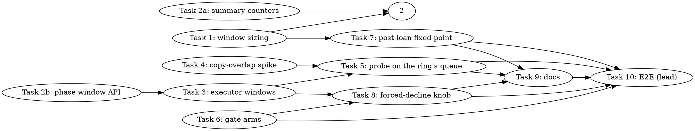

# Prefill Window Ring Implementation Plan (llama.cpp-bcre resolution; follows llama.cpp-36j0)

> **Execution:** Use `team-driven-development` in Claude Code, `pi-team-driven-development` in pi.dev, or
> `codex-team-driven-development` in Codex.

**Goal:** A Qwen3.8-Flash-Next prompt on the Arc Pro B70, with 60 % of its routed experts host-resident, runs every MoE
layer's host experts through the batched oneDNN f16 executor from ring slots the cache's copy queue filled one executor
phase ahead, so pp512 rises from 12.9 tok/s (the CPU executor today) toward the PCIe ceiling of about 300 tok/s and
pp2048 from 31 toward 800, with the ring engaged on every host layer (`ring_engaged=yes`, `misses=0`) and the output
byte-identical to the CPU policy.

**Architecture:** The expert streaming ring of `docs/plans/2026-10-19-moe-executor-cost-model-prefill-ring.md` is
re-sized from "two whole layers" to "two executor windows". A window is one phase of the batched executor for one
(layer, role): the host experts among `active_experts[p*G, (p+1)*G)`, where `G` is the per-phase expert count the
executor already derives from its planned f16 weight slot (`moe_pp_batched_f16_plan_groups`). The ring's two regions
hold the current window and the prefetched next one; the executor asks the phase for each window right before it
dequantizes it and tells the phase when the window's dequants are behind a barrier, so the region can be refilled. The
copies stay on the cache's existing in-order copy queue: the Task 4 spike measured, on both cards, that a 64 MiB pinned
copy on that queue finishes in 2.5-3.5 ms while a full-EU spin kernel holds the card for 110-130 ms, so the copies
already overlap the executor's dequant and GEMM kernels and no copy-engine queue is built. Placement is unchanged: the
planner still decides which experts live in VRAM; the ring moves bytes to where the executor runs them, which is the
amended 2026-10-19 ruling ("stream host-pinned weights to VRAM when the cost model says it is faster").

**Tech Stack:** C++17, SYCL (oneAPI 2026.1, icpx), oneDNN batched GEMM, CMake + Ninja (`scripts/sycl-build.sh`), ctest,
Python 3 (`pytest`) source-contract gates, bash gate script.

**Test Infrastructure:** Host-only C++ tests in `ggml/src/ggml-sycl/tests/` registered in
`ggml/src/ggml-sycl/CMakeLists.txt` (`test-moe-stream-plan`, `test-moe-stream-phase`, `test-moe-exec-cost`,
`test-moe-exec-policy`, `test-moe-stream-ring-sizing`); one device test family (`sycl-moe-stream-ring`,
`test-moe-staged-ring-route`, selector `level_zero:1`, SKIP 77) that only the lead runs; Python source-contract gates
in `tests/` (`test-sycl-moe-stream-enqueue-source.py`, `test-sycl-auto-ubatch-source.py`,
`test-sycl-moe-exec-knobs-source.py`, `test-sycl-lifecycle-source-contract.py`); the GPU-free gate-script test
`tests/test-sycl-moe-exec-gate-script.sh`; the device gate `scripts/sycl-moe-exec-gate.sh` (lead-run). Every
ggml-sycl commit also passes `python3 -I scripts/check-sycl-alloc-zone-contract.py --root <tree>`,
`scripts/audit-sycl-static-storage.py --check-classification --repo <tree>` and `--check`, and
`python3 -I tests/test-sycl-lifecycle-source-contract.py`.

---

## Why this plan exists (the measured gap)

Read the tracker comments this section cites before changing any number here; the plan quotes them, it is not the
record.

1. **The ring has never engaged on this host** (llama.cpp-bcre c-r279, c-s8az, c-aerm; read them). The ring is sized
   as two regions of the heaviest layer's slots (`moe_stream_ring_size`, `ggml/src/ggml-sycl/moe-stream-ring.cpp:23-54`),
   and refused when `bytes > resident_expert_bytes / 10` (`:44`). Qwen3.8 on the B70: 1536 host matrices per layer
   times 921600 bytes, two regions, is 2.83 GB against a 1.29 GB cap. GPT-OSS on the B50 at `PCT=90`: 1.69 GB against
   887 MB. Where a model passes the cap (Qwen1.5-MoE at a 33-35 % budget) the ring was short and the loan covered at
   most 190 of 557 MiB, because `moe_loan_triplet_is_lendable` refuses bulk-staged tensors.
2. **A whole layer is the wrong unit.** The executor never reads a whole layer at once: it dequantizes `G` experts per
   phase into a double-buffered f16 slot (`ggml/src/ggml-sycl/ggml-sycl.cpp:90360-90378`, `moe_pp_batched_f16_plan_groups`
   at `ggml/src/ggml-sycl/moe-mmvq-tables.hpp:400`). The bytes the ring must hold at once are one window plus the next
   one, about 68 experts times 921600 bytes, two regions: **~125 MB**, under the cap by an order of magnitude.
3. **The copies never overlap compute today.** Both cache side queues are plain in-order `sycl::queue`s on the same
   device and context (`ggml/src/ggml-sycl/unified-cache.cpp:6346`, `:6365`); nothing selects a copy engine. The Strata
   reference tree (`/Apps/strata`, read-only) measured on this toolchain's v2 Level Zero adapter that every SYCL queue
   lands on the compute engine (0 of 2000 copies overlapped) and that an immediate command list on the copy-only
   ordinal took a 4K prompt from 3.82 s to 3.25 s (`/Apps/strata/docs/INTEL.md`; the queue construction is
   `/Apps/strata/sycl/src/core/copy_queue.cpp:60-142`).
4. **The bus bounds the target.** Qwen3.8 on the B70 places 44091 of 73728 experts on the host. A 512-token ubatch
   touches almost every expert of a host layer: about 29 fully-host layers times 1536 matrices times 0.92 MB is about
   41 GB per ubatch. At the probed ~25 GB/s that is about 1.6 s per ubatch, a **pp512 ceiling near 312 tok/s**. The
   previous plan's `>= 500` pp512 target is above that ceiling for this placement and is retired here; pp2048 can reach
   800 only with `-ub 2048` (the same bytes carry four times the tokens), which is llama.cpp-dfo0's measurement arm.
   The gate floors below are set from this arithmetic, not from the old targets.

## Design (the window ring)

**W1. Window.** One executor phase of one (layer, role): the host experts among `active_experts[p*G, (p+1)*G)`, in
ascending expert id (`i02`), `G` from the executor's group plan capped by the ring's `window_experts()`. The two ring
regions hold two windows. The role order inside a layer is the graph builder's UP, GATE, DOWN
(`src/llama-graph.cpp:2202`, `:2215`, `:2316`). At the last phase of a role, the next window is phase 0 of the next role
(UP to GATE, GATE to DOWN). There is **no cross-layer prefetch** in this plan: the first UP window of each layer is an
exposed copy, counted as `exposed`, never as a `miss`. Cross-layer look-ahead is a follow-up ticket this plan creates
but does not implement.

**W2. Phase API.** `moe_stream_phase` gains `window_begin(req, cache, op, &misses)` (stages the window's missing host
experts now and the next window into the other region) and `window_done(layer, role, readers_done)` (records the
region's read gate). `executor_staged(layer, role, ids, n, n_expert)` becomes `executor_claims(layer, role)`: the
executor takes the weight when every host item of the role has consumer EXECUTOR, the layer has no untriplet item,
and the ring can be reserved. `stage()` becomes `stage_window(items)`. The SOA/ROUTE-consumer staging path is
retired from the index build: an item the executor does not claim is `NONE`; a layer the executor does not claim
answers RING_UNAVAILABLE with the rule name `executor does not claim`. The `moe_stream_staged.soa`/`layout` fields
and the resolver's STAGED_RING route stay (they are read by code this plan does not touch).

**W3. Sizing.** The index gains `role_items_max` (the most host items one role of one layer has) and `window_slots`;
the geometry call becomes `moe_stream_ring_size(index.window_slots, index.matrix_bytes_max, index.resident_expert_bytes)`.
`window_slots = min(role_items_max, G_plan)`, `G_plan = fit >= 2 ? fit / 2 : fit`, `fit = weight_slot_bytes / (K*N*2)`,
capped by `GGML_SYCL_MOE_PP_F16_GROUP_EXPERTS_MAX` when set; the slot bytes come from
`unified_cache_get_planned_pp_moe_onednn_weight_slot_bytes(device)` through a new hints struct. The executor caps its
phase at `window_experts()` so a phase never exceeds the region (W4), which is why the sizing need not know the active
count. The cost model's `triplet_bytes_max` becomes `stage_unit_bytes_max` (one matrix), and `weigh` passes
`window_us = 0.0`: there is no layer-ahead copy to discount.

**W4. Executor.** `ggml_sycl_mul_mat_id`'s batched f16 arm: the stream call is hoisted to function scope; the early
expert loop marks a claimed layer's HOST experts `deferred` instead of calling `find`; `phase_experts` is
`min(G, window_experts())` on a ring layer; each phase runs `window_begin`, then the deferred experts' `find` and the
existing checks, the ready-event barrier, the dequants, `readers_done = submit_barrier()`, `window_done`, then the
GEMMs. The WOQ (MXFP4) arm is unchanged: the claim predicate (`moe_pp_batched_takes_staged_type`) does not admit MXFP4,
so it never sees a ring layer; admitting it is a follow-up ticket. A layer declined at claim time stays in the hybrid
world (`enqueue_host_expert_rows`), which is what llama.cpp-8p5x c-0blp expects (read it). A stage failure **after** a
claim is an invariant violation (the window fits the region by construction) and aborts with a message.

**W5. Copy queue (amended 2026-10-24 from the Task 4 rows).** The ring copies on the cache's BCS queue
(`cache.get_bcs_queue()`, a plain in-order queue on the compute queue's context, `unified-cache.cpp:6365`) as it does
today. The plan first proposed a Level Zero immediate command list on the device's copy-only engine, built through a
`dlopen`ed ze_loader behind a `GGML_SYCL_COPY_ENGINE` knob, on the Strata premise that an in-order SYCL queue's copies
queue behind compute under the v2 adapter. The Task 4 spike (lead-run, llama.cpp-efck c-0cu6, read it) refuted the
premise on this host: on the B70 and the B50, adapter v2, a 64 MiB pinned H2D copy on either cache queue takes 2.5-2.7
ms alone and 2.5-3.5 ms while a ~100 ms one-work-group spin kernel **or** a 110-130 ms full-EU spin kernel runs on the
compute queue, every row `overlap=yes`, `staged_h2d=0`. A copy that completes in 3 ms under a kernel occupying every EU
for 120 ms is not EU work queued behind compute, so a second queue would buy nothing; the plan's own decision rule
("both `queue=bcs` rows `overlap=yes`: default off") is applied as "not built". The DRM fdinfo engine counters cannot
name the engine on this stack (a resident exec queue reads 100 % busy whether or not it executes), so the row's timing
is the evidence, not the counters. What W5 keeps is the kp1l mismatch: the load-time H2D probe
(`ggml_sycl_measure_h2d_pinned`, `ggml-sycl.cpp:32006`) times the cache's **compute** queue while the ring copies on the
BCS queue; Task 5 moves the probe to the BCS queue so `h2d_gbps` is the rate of the queue the ring uses. If a later card
or driver shows `overlap=no`, the 94e1b0666 revision of this plan holds the copy-engine design in full.

**W6. Gate.** The teardown summary line grows `, %u windows, %u exposed, %u misses`; the gate's Q_pp scores
`ring_engaged=yes` and `misses=0` and carries floors from the bus arithmetic (`PP512_MIN=200`, `PP2048_MIN=500`) and a
`-ub 2048` control arm. Decode floors, md5 identity and the GPT-OSS and Mistral controls are unchanged.

**Standing rulings that bind this plan** (unchanged from the 2026-10-19 plan): all SYCL memory flows through
`unified_allocate` / `unified_allocate_owner` and surfaces as a `mem_handle`; raw pointers are never ownership tokens
(a slot a kernel reads is held until the kernel's event, `retain_handles_until_event`); no host waits on the submitting
thread; never shrink `n_ctx` or `n_ubatch`; `-ngl` is not a gate and new gate arms omit it; GPU and model-loading work
is lead-only, serial, under `GPU.lock`, selector pinned.

---

## Team Topology

**Recommended implementers:** 4 concurrent in wave 1 (Tasks 1, 2a, 4, 6), then 2-3 as the tracks converge. Execution
spawns one fresh implementer per task in its own worktree under the session scratchpad (`git worktree add $S/wt-<id>
-b task/<id> master`). Model and effort per task are in each task's header (memory `agent-model-policy`).
**Reviewers:** spec + quality, spawned fresh per review (not a standing pair). Spec reviews of Tasks 2b, 3 and 5 run
at xhigh effort (lifetime and concurrency work).
**Lead:** every GPU run (Task 4 spike rows, Task 10), every merge through the merge tree with `$S/merge-gate.sh`,
the tracker, and the owner-facing status on the epic.

### Parallel Tracks

| Track | Tasks | Description |
|-------|-------|-------------|
| A | 1, 2b, 3, 8 | Ring sizing, phase window API, executor windows, forced-decline knob (same files, sequential) |
| B | 4, 5 | Copy-overlap spike, H2D probe on the ring's queue (5 also waits for 3: both edit `ggml-sycl.cpp`) |
| C | 2a, 6, 9 | Decision-log window counters, gate arms, docs |
| D | 7 | Post-loan geometry fixed point (after 1) |
| lead | 10 | End-to-end validation |

### Dependency Graph



### File Ownership Map

| File/Directory | Tasks | Conflict Risk |
|----------------|-------|---------------|
| `ggml/src/ggml-sycl/moe-stream-plan.hpp`, `moe-stream-plan.cpp` | 1, 2b, 8 | Sequential (A) |
| `ggml/src/ggml-sycl/moe-exec-cost.hpp`, `tests/test-moe-exec-cost.cpp` | 1 | None |
| `ggml/src/ggml-sycl/moe-exec-policy.hpp`, `tests/test-moe-exec-policy.cpp` | 2a, 8 (reason enum) | Sequential (8 after 2a via 3) |
| `ggml/src/ggml-sycl/ggml-sycl.cpp` | 1 (`:35997-36020`), 2b (`:36120-36140`), 3 (`:82904-82997`, `:89722-89812`, `:90115-90121`, `:90360-90378`, `:90486-90570`, `:90895-90911`), 5 (`:32068-32080`) | Sequential (A; 5 after 3) |
| `ggml/src/ggml-sycl/common.hpp` | 8 (knob) | None |
| `ggml/src/ggml-sycl/moe-stream-ring.cpp`, `tests/test-moe-stream-ring-sizing.cpp` | 7 | None |
| `ggml/src/ggml-sycl/tests/test-moe-stream-plan.cpp` | 1 | None |
| `ggml/src/ggml-sycl/tests/test-moe-stream-phase.cpp` | 2b, 8 | Sequential (A) |
| `ggml/src/ggml-sycl/tests/test-sycl-copy-overlap.cpp` (new), `ggml/src/ggml-sycl/CMakeLists.txt` | 4 | None |
| `tests/test-sycl-moe-stream-enqueue-source.py` | 1 (ring-size pin), 2b (stage pins) | Sequential (A) |
| `tests/test-sycl-auto-ubatch-source.py` | 1 (ring-size pin), 7 (fixed-point pin) | Sequential (7 after 1) |
| `tests/test-sycl-moe-exec-knobs-source.py` | 2a (summary literal), 8 (DECLINE name) | Sequential by merge order (2a, 8) |
| `tests/test-sycl-moe-exec-window-source.py` (new) | 3 | None |
| `tests/test-sycl-h2d-probe-queue-source.py` (new), `tests/CMakeLists.txt` (its registration) | 5 | None |
| `scripts/sycl-moe-exec-gate.sh`, `tests/test-sycl-moe-exec-gate-script.sh` | 6, 8 (decline arm) | Sequential (8 after 6) |
| `docs/backend/sycl-env-vars.md`, `docs/backend/sycl-memory-design.md`, `docs/design/sycl-canonical-memory-architecture.md`, `docs/backend/sycl-perf-baselines.md`, `docs/plans/2026-10-19-moe-executor-cost-model-prefill-ring.md` | 9 | None (single task, last) |

**Shared-checkout rule:** nothing is edited in `/Apps/llama.cpp` by an implementer. Every task is a worktree. The
nine owner-dirty paths there (`src/llama-model-loader.cpp`, `.claude/skills/llm-wiki/SKILL.md`, `.llm-wiki/*`) are
never staged, committed or reverted by anyone.

---

## Common instructions for every task

- **Build** only your targets, detached, after `cat /Apps/llama.cpp/GPU.lock/holder` shows no lead HOLD:
  `setsid nohup bash -c 'cd <worktree> && ./scripts/sycl-build.sh <targets> > build.log 2>&1; echo BUILD_DONE rc=$? >> build.log' < /dev/null > /dev/null 2>&1 &`
  then poll `build.log` for `BUILD_DONE` (`for i in $(seq 1 40); do grep -q BUILD_DONE build.log && break; sleep 60; done`).
  A ggml-sycl change relinks `libggml-sycl` (a device link, 5-11 min with a warm ocloc cache). Host-only tests
  (`test-moe-stream-plan`, `test-moe-exec-cost`, `test-moe-exec-policy`, `test-moe-stream-ring-sizing`) do not need it;
  `test-moe-stream-phase` links `ggml-sycl` and does.
- **Run** host tests with `ctest --test-dir build -R '<name>' --output-on-failure -j 1` after
  `source /opt/intel/oneapi/setvars.sh --force`. Never run a device test, `llama-bench`, `llama-completion` or anything
  that loads a model: report what you need verified and the lead runs it.
- **Source gates on every ggml-sycl commit:** `python3 -I scripts/check-sycl-alloc-zone-contract.py --root <worktree>`;
  `python3 -I scripts/audit-sycl-static-storage.py --check-classification --repo <worktree>` and
  `python3 -I scripts/audit-sycl-static-storage.py --check --repo <worktree>` (a new static needs the CSV regenerated
  with the script and no flags; never pipe its output into `tail`); `python3 -I tests/test-sycl-lifecycle-source-contract.py`
  (a new `ggml_sycl_global_plan_snapshot()` read must be registered there; today's count is 5 at `:682`);
  `python3 -I -m pytest -q tests/test-sycl-moe-stream-enqueue-source.py tests/test-sycl-auto-ubatch-source.py tests/test-sycl-moe-exec-knobs-source.py`.
- **Format:** `clang-format-19 --dry-run -Werror <your file>` on each file you touched; never `-i` on a whole file.
- **Commit** path-scoped (`git commit -- <paths>`), subject naming the reason (never a round or finding number), body
  ending with `Co-Authored-By: Claude <Model> 5.5 <noreply@anthropic.com>` and
  `Claude-Session: https://claude.ai/code/session_01E89YuMAT5yHFv3Hcf1eK7F`. Never amend a commit you reported.
- **codescout:** your worktree is not the session root; pass `root="<worktree>"` on every call. `ggml-sycl.cpp` is
  under-indexed: confirm with `cat ggml/src/ggml-sycl/ggml-sycl.cpp | grep -n '<pattern>'`.
- **Grep the string the code prints,** never the macro name (`GGML_ABORT` never reaches a log). Every new probe in a
  Python gate needs a positive control (a mutation that makes it fail).

---

## Tasks

### Task 1: Size the ring to one executor window

**Track:** A **Depends on:** None **Model/effort:** opus, high
**File scope:**
- Modify: `ggml/src/ggml-sycl/moe-stream-plan.hpp:202-228` (layer info and index fields), `:258-362`
  (`moe_stream_plan_index_build`), `:371-387` (`moe_stream_plan_ring_geometry`)
- Modify: `ggml/src/ggml-sycl/moe-stream-plan.cpp:174-176` (`prepare`), `:206-230` (`weigh`)
- Modify: `ggml/src/ggml-sycl/moe-exec-cost.hpp:47` (`triplet_bytes_max`), `:127`
- Modify: `ggml/src/ggml-sycl/ggml-sycl.cpp:35997-36020` (`ggml_sycl_hold_ring_uncovered`)
- Modify: `ggml/src/ggml-sycl/tests/test-moe-exec-cost.cpp:59`, `:78`
- Modify: `tests/test-sycl-moe-stream-enqueue-source.py:587`, `:632`; `tests/test-sycl-auto-ubatch-source.py:2919`
- Test: `ggml/src/ggml-sycl/tests/test-moe-stream-plan.cpp` (host-only, existing fixture `make_plan()` at `:36`)

**Description:** The geometry is computed from the window, not the layer. The index learns how many host items one
role of one layer has and how many experts one executor phase holds, and the sizing call takes their minimum. The
cost model's per-layer unit becomes one matrix, because the ring no longer needs a whole triplet free to stage a
layer. Nothing about staging changes in this task: `stage()` still stages whole layers into a region that is now
smaller, so after this task alone a layer whose host items exceed `window_slots` stages partly (`exhausted`); that
is why Task 2b follows immediately on the same track and why the lead does not run the Qwen arms between them.

**Acceptance Criteria:**
- [ ] `moe_stream_plan_index` has `role_items_max` and `window_slots`; `moe_stream_layer_info` has `matrix_bytes_max`.
- [ ] `moe_stream_plan_index_build` takes `const moe_stream_window_hints &` and computes `window_slots` as W3 says.
- [ ] The one sizing call is `moe_stream_ring_size(index.window_slots, index.matrix_bytes_max, index.resident_expert_bytes)`,
      and both Python pins name it.
- [ ] `moe_exec_layer_inputs::stage_unit_bytes_max` replaces `triplet_bytes_max` everywhere (`cat -r` finds no
      `triplet_bytes_max` under `ggml/src/ggml-sycl/`).
- [ ] `test-moe-stream-plan` has the window cases below and passes; `test-moe-exec-cost` passes; both Python gates pass.
- [ ] All source gates in "Common instructions" pass.

**Implementation Guide:**

1. **Test: a window is the smaller of the role's host items and the executor phase.** Append to
   `ggml/src/ggml-sycl/tests/test-moe-stream-plan.cpp` before `main` returns (the file's `make_plan()` builds 4 layers
   of 8 experts with host experts 1, 5, 6 on layers 0-2, so `role_items_max == 3`; `kSrc == 4096`):

```cpp
// Task 1 (2026-10-24 plan): the ring is sized to one executor window, min(role_items_max, G_plan).
static void test_window_sizing() {
    const placement_plan plan = make_plan();
    // K*N*2 is the f16 bytes of one expert. The fixture's entries carry ne[0]=ne[1]=0, so the build falls back to
    // the item's src bytes as the f16 size (moe_stream_window_hints::expert_f16_bytes, below): 4096 bytes per expert.
    ggml_sycl::moe_stream_window_hints hints;
    hints.weight_slot_bytes = 10 * kSrc;  // fit = 10 -> G_plan = 5
    hints.group_cap         = 0;
    auto idx = ggml_sycl::moe_stream_plan_index_build(plan, /*device*/ 0, nullptr, nullptr, nullptr, hints);
    CHECK(idx.role_items_max == 3);
    CHECK(idx.window_slots == 3);  // min(3 host items per role, G_plan 5)
    hints.weight_slot_bytes = 4 * kSrc;  // fit = 4 -> G_plan = 2
    idx                     = ggml_sycl::moe_stream_plan_index_build(plan, 0, nullptr, nullptr, nullptr, hints);
    CHECK(idx.window_slots == 2);
    hints.weight_slot_bytes = 1 * kSrc;  // fit = 1 -> G_plan = 1 (one buffer)
    idx                     = ggml_sycl::moe_stream_plan_index_build(plan, 0, nullptr, nullptr, nullptr, hints);
    CHECK(idx.window_slots == 1);
    hints.weight_slot_bytes = 10 * kSrc;
    hints.group_cap         = 2;  // GGML_SYCL_MOE_PP_F16_GROUP_EXPERTS_MAX caps G_plan
    idx                     = ggml_sycl::moe_stream_plan_index_build(plan, 0, nullptr, nullptr, nullptr, hints);
    CHECK(idx.window_slots == 2);
    // A down matrix transposed relative to gate/up must not inflate the unit: with the same slot the window is 3
    // when the per-matrix unit is used, 2 when the layer-wide K*N is (the defect spec-eeim-1 found).
    hints.weight_slot_bytes = 0;  // no planned slot (inventory globals not yet published at load): no window, no ring
    idx                     = ggml_sycl::moe_stream_plan_index_build(plan, 0, nullptr, nullptr, nullptr, hints);
    CHECK(idx.window_slots == 0);
    // The geometry is sized from the window: 2 regions x 3 slots x 4096 (already 256-aligned) = 24576 bytes.
    hints.weight_slot_bytes = 10 * kSrc;
    const auto geo = ggml_sycl::moe_stream_plan_ring_geometry(plan, 0, nullptr, nullptr, nullptr, hints);
    CHECK(geo.region_slots == 3);
    CHECK(geo.n_slots == 6);
    CHECK(geo.bytes == 6 * kSrc);
    // The per-layer matrix maximum the cost model now reads as its stage unit.
    CHECK(idx.layers.at(0).matrix_bytes_max == kSrc);
}
```

   and call `test_window_sizing();` from `main`. Run:
   `cmake --build build --target test-moe-stream-plan && ctest --test-dir build -R '^test-moe-stream-plan$' --output-on-failure -j 1`
   Expected: FAIL to compile (`moe_stream_window_hints` undeclared).

2. **Implement: hints, per-role counts, window.** In `moe-stream-plan.hpp` add before `moe_stream_plan_index_build`:

```cpp
// What the ring's sizing needs from the executor (W3 of docs/plans/2026-10-24-prefill-window-ring.md): the planned
// f16 weight slot the batched executor dequantizes a phase into, and the group cap it honours. A phase holds
// G_plan = fit >= 2 ? fit / 2 : fit experts (fit = slot / expert f16 bytes), the executor's own two-buffer rule
// (moe_pp_batched_f16_plan_groups), capped. 0 slot bytes (no prompt planned yet) means no window and no ring.
struct moe_stream_window_hints {
    size_t weight_slot_bytes = 0;  // unified_cache_get_planned_pp_moe_onednn_weight_slot_bytes(device)
    size_t group_cap         = 0;  // ggml_sycl_moe_pp_f16_group_experts_max(); 0 = none
};

static inline uint32_t moe_stream_window_experts(const moe_stream_window_hints & h, size_t expert_f16_bytes) {
    if (h.weight_slot_bytes == 0 || expert_f16_bytes == 0) {
        return 0;
    }
    const size_t fit = h.weight_slot_bytes / expert_f16_bytes;
    size_t       g   = fit >= 2 ? fit / 2 : fit;
    if (h.group_cap != 0 && g > h.group_cap) {
        g = h.group_cap;
    }
    return g > UINT32_MAX ? UINT32_MAX : static_cast<uint32_t>(g);
}
```

   Add to `moe_stream_layer_info`: `size_t matrix_bytes_max = 0;  // the largest one streamable matrix's slot bytes`
   and `int role_items[3] = { 0, 0, 0 };  // streamable items per role: GATE, UP, DOWN`. Add to
   `moe_stream_plan_index`: `uint32_t role_items_max = 0;  // the most streamable items one role of one layer has`
   and `uint32_t window_slots = 0;  // min(role_items_max, G_plan): a region's size`. Give `moe_stream_plan_index_build`
   and `moe_stream_plan_ring_geometry` a trailing `const moe_stream_window_hints & hints` parameter (ring_geometry
   keeps `index_out` as the last parameter: insert `hints` before it). In the build loop, after
   `li.region_slots += ...`:

```cpp
        li.role_items[detail::moe_stream_role_slot(item.role)] += 1;
        li.matrix_bytes_max = std::max(li.matrix_bytes_max, item.staging == moe_stream_staging::SOA ?
                                                                 std::max(e.src_size, e.dst_size) :
                                                                 e.src_size);
```

   with `detail::moe_stream_role_slot` returning 0/1/2 for GATE/UP/DOWN (`GGML_ASSERT` otherwise; untriplet items
   never reach here). After the per-layer loop:

```cpp
    size_t expert_f16_bytes = 0;
    for (const auto & kv : idx.layers) {
        for (int r = 0; r < 3; ++r) {
            idx.role_items_max = std::max(idx.role_items_max, static_cast<uint32_t>(kv.second.role_items[r]));
        }
        // One matrix's f16 bytes, the executor's dequant unit (ggml-sycl.cpp:90019 feeds ne00*ne01*2 to
        // plan_groups): the max over the layer's streamable items of item.ncols * item.nrows * 2. NOT the layer's
        // K*N: li.K/li.N are the maxima over all entries, and gate/up [2560,640] with down [640,2560] would give
        // 2560^2, a unit four times too large and a window a quarter of the executor's phase (spec-eeim-1 finding 1).
        expert_f16_bytes = std::max(expert_f16_bytes, kv.second.matrix_f16_bytes_max);
    }
    idx.window_slots = std::min(idx.role_items_max, moe_stream_window_experts(hints, expert_f16_bytes));
```

   In `moe_stream_plan_ring_geometry` replace the sizing call with
   `moe_stream_ring_size(index.window_slots, index.matrix_bytes_max, index.resident_expert_bytes)` and pass `hints`
   to the build. Keep `region_slots_max` and `host_matrices_per_layer_max` (the unavailable-rule text and the trace
   print them).

3. **Implement: the callers.** `moe-stream-plan.cpp:174` `prepare`: build the hints from the cache the op carries:

```cpp
    moe_stream_window_hints hints;
    hints.weight_slot_bytes = op.planned_weight_slot_bytes;  // new moe_stream_op field, set by the backend
    hints.group_cap         = op.group_cap;
    const moe_stream_ring_geometry geo = moe_stream_plan_ring_geometry(plan, device, op.prompt_kernel, op.graph_ctx,
                                                                       op.library_claims, hints, &index_);
```

   Add `size_t planned_weight_slot_bytes = 0;` and `size_t group_cap = 0;` to `moe_stream_op` (`moe-stream-plan.hpp:606-625`).
   In `ggml-sycl.cpp:32810` `ggml_sycl_moe_stream_prepare` set
   `call.op.planned_weight_slot_bytes = ggml_sycl::unified_cache_get_planned_pp_moe_onednn_weight_slot_bytes(ctx.device);`
   and `call.op.group_cap = ggml_sycl_moe_pp_f16_group_experts_max();`. In `ggml_sycl_hold_ring_uncovered`
   (`:35997`) set the same two fields on `call.op` and pass `hints` built from them to `moe_stream_plan_ring_geometry`.
   The read of `ggml_sycl_global_plan_snapshot()` there is unchanged (the lifecycle census count stays 5).

4. **Implement: the cost unit.** `moe-exec-cost.hpp:47`: rename to `size_t stage_unit_bytes_max = 0;  // the largest
   one matrix the ring stages for the layer (one slot)`, `:127` to `in.stage_unit_bytes_max`. `moe-stream-plan.cpp:220`:
   `in.stage_unit_bytes_max = li.matrix_bytes_max;  // one slot: a window is staged a matrix at a time`.
   `test-moe-exec-cost.cpp:59`: `in.stage_unit_bytes_max = 2048 * 1024 / 3;  // one matrix of the triplet` and `:78`
   `in.stage_unit_bytes_max = 13200000ull / 3;`. The expectations the file asserts do not move: the field only gates
   RING_UNAVAILABLE, and every case's `ring_bytes_free` exceeds both values.

5. **Implement: the pins.** `tests/test-sycl-moe-stream-enqueue-source.py:587` and `:632`:
   `RING_SIZE_CALL = "moe_stream_ring_size(index.window_slots, index.matrix_bytes_max, index.resident_expert_bytes)"`
   (and the `direct` literal at `:632`); the mutation witness at `:589` stays a different string (it already is).
   `tests/test-sycl-auto-ubatch-source.py:2919`: the same literal. Run both gates.

   Run: `ctest --test-dir build -R '^(test-moe-stream-plan|test-moe-exec-cost)$' --output-on-failure -j 1` then
   `python3 -I -m pytest -q tests/test-sycl-moe-stream-enqueue-source.py tests/test-sycl-auto-ubatch-source.py`.
   Expected: PASS, PASS, and both pytest runs green.

**Commit:**
```bash
git add ggml/src/ggml-sycl/moe-stream-plan.hpp ggml/src/ggml-sycl/moe-stream-plan.cpp ggml/src/ggml-sycl/moe-exec-cost.hpp \
        ggml/src/ggml-sycl/ggml-sycl.cpp ggml/src/ggml-sycl/tests/test-moe-exec-cost.cpp \
        ggml/src/ggml-sycl/tests/test-moe-stream-plan.cpp tests/test-sycl-moe-stream-enqueue-source.py \
        tests/test-sycl-auto-ubatch-source.py
git commit -- <the same paths> -m "sycl: size the expert stream ring to one executor window, not one layer"
```

**Gotchas:**
- The test fixture's entries have `ne[0] == ne[1] == 0` (`make_plan()` uses the brace initializer without `ne`), so
  `K*N*2 == 0`; the fallback to `matrix_bytes_max` in step 2 exists for that, and the test relies on it. Do not
  "fix" the fixture to carry shapes instead: the Qwen numbers below depend on the real K*N path, and the fallback
  keeps the host test independent of a type table.
- `moe_stream_plan_ring_geometry` is called from four places: `prepare`, `ggml_sycl_hold_ring_uncovered`, the
  auto-ubatch fit (find it with codescout `find_references`), and the tests. Every caller gets `hints`; the
  auto-ubatch caller passes the same two accessors.
- `tests/test-sycl-moe-stream-enqueue-source.py` has 202 module-level pins and 65 tests; only the two ring-size
  literals change in this task. If another pin breaks, your change went past this task's scope.
- Expected Qwen3.8/B70 figures for the lead's trace (not asserted here): `role_items_max 512`, `fit ~137`, `G_plan 68`,
  `window_slots 68`, `region bytes ~62.7 MB`, `ring ~125 MB` against the 1.29 GB cap.

---

### Task 2a: Window counters in the decision log

**Track:** C **Depends on:** None **Model/effort:** sonnet, medium
**File scope:**
- Modify: `ggml/src/ggml-sycl/moe-exec-policy.hpp:80-158` (`moe_exec_decision_log`)
- Modify: `tests/test-sycl-moe-exec-knobs-source.py:86`
- Test: `ggml/src/ggml-sycl/tests/test-moe-exec-policy.cpp:160-170`

**Description:** The teardown summary gains the three window counters the gate scores (W6): windows served, exposed
windows (the first UP window of a layer, copied with nothing to hide under) and misses (a window the executor asked
for that was not already staged, other than an exposed one). The phase (Task 2b) feeds them through one new method.

**Acceptance Criteria:**
- [ ] `moe_exec_decision_log::note_window(bool exposed, uint32_t misses)` exists, locks `mu`, and counts.
- [ ] `take_summary` prints `[MOE-EXEC] summary: %u layer-ubatches ring, %u cpu, %u forced, %zu MiB streamed, %u windows, %u exposed, %u misses`
      and resets all seven counters.
- [ ] The literal appears exactly once in `ggml/src/ggml-sycl/` outside `tests/` (knobs gate).
- [ ] `test-moe-exec-policy` passes with the new expectation.

**Implementation Guide:**

1. **Test.** In `test-moe-exec-policy.cpp:165` change the expected string to
   `"[MOE-EXEC] summary: 2 layer-ubatches ring, 0 cpu, 2 forced, 8 MiB streamed, 0 windows, 0 exposed, 0 misses"`,
   and add after `:167`:

```cpp
        log.note(0, 3, ring_decision, 4 << 20);
        log.note_window(/*exposed*/ true, /*misses*/ 0);
        log.note_window(false, 0);
        log.note_window(false, 2);
        CHECK(log.take_summary(buf, sizeof(buf)) &&
                  std::strcmp(buf, "[MOE-EXEC] summary: 1 layer-ubatches ring, 0 cpu, 1 forced, 4 MiB streamed, "
                                   "3 windows, 1 exposed, 2 misses") == 0,
              "window counters in the summary");
        CHECK(!log.take_summary(buf, sizeof(buf)), "window counters reset with the summary");
```

   (`ring_decision` is whatever decision the surrounding block already uses for its RING FORCED notes; read `:150-164`.)
   Run: `cmake --build build --target test-moe-exec-policy && ctest --test-dir build -R '^test-moe-exec-policy$' --output-on-failure -j 1`
   Expected: FAIL to compile (`note_window` undeclared).

2. **Implement.** In `moe_exec_decision_log` add after `bytes_streamed`:

```cpp
    uint32_t n_windows = 0;  // executor windows the ring served this prompt (Task 2b window_begin)
    uint32_t n_exposed = 0;  // of them, a layer's first UP window: copied with no earlier phase to hide under
    uint32_t n_misses  = 0;  // experts a window asked for that were not staged ahead, exposed windows excluded

    void note_window(bool exposed, uint32_t misses) {
        std::lock_guard<std::mutex> lock(mu);
        ++n_windows;
        n_exposed += exposed ? 1 : 0;
        n_misses += exposed ? 0 : misses;
    }
```

   and in `take_summary` (`:148-156`) extend the format and arguments with `, %u windows, %u exposed, %u misses`,
   `n_windows, n_exposed, n_misses`, and reset them with the others. The `n_ring + n_cpu == 0` early return is
   unchanged (a prompt with no consulted layer prints nothing, windows or not).

3. **Pin.** `tests/test-sycl-moe-exec-knobs-source.py:86`: the new literal. Run
   `python3 -I -m pytest -q tests/test-sycl-moe-exec-knobs-source.py`. Expected: green.

**Commit:**
```bash
git commit -- ggml/src/ggml-sycl/moe-exec-policy.hpp ggml/src/ggml-sycl/tests/test-moe-exec-policy.cpp \
              tests/test-sycl-moe-exec-knobs-source.py \
  -m "sycl: the MoE executor summary counts ring windows, exposed windows and misses"
```

**Gotchas:**
- `scripts/sycl-moe-exec-gate.sh:232` matches the summary by prefix (`RE_SUMMARY_RING`), so the longer line still
  scores; Task 6 parses the new fields. Do not touch the script here.
- The `tline[224]` buffer of the per-layer trace is unrelated; the summary's `buf` is the caller's (`:~32710`,
  256 bytes): the new line is 96 characters at the widest `%u`, well inside it.

---

### Task 2b: The phase stages windows, not layers

**Track:** A **Depends on:** 1, 2a **Model/effort:** opus, xhigh
**File scope:**
- Modify: `ggml/src/ggml-sycl/moe-stream-plan.hpp:110-116` (`moe_stream_staged`), `:160-195` (staging predicates),
  `:323-336` (index build: non-claimed items), `:392-414` (unavailable rule), `:440-466` (`moe_stream_executor_staged`),
  `:606-625` (`moe_stream_op`), `:670-704` (`moe_stream_region_reads`), `:745-880` (`moe_stream_phase`)
- Modify: `ggml/src/ggml-sycl/moe-stream-plan.cpp:55-115` (`begin_layer`), `:117-135` (`find`, `executor_staged`),
  `:142-148` (`layer_done`), `:239-262` (`resolve`), `:264-418` (`stage`), `:494-560` (`report`)
- Modify: `ggml/src/ggml-sycl/ggml-sycl.cpp:36131-36140` (the resolver's `executor_takes_weight`)
- Modify: `tests/test-sycl-moe-stream-enqueue-source.py` (the `stage()` pins), `tests/test-sycl-staged-ring-route-source.py`
- Test: `ggml/src/ggml-sycl/tests/test-moe-stream-phase.cpp` (host-only; drives `moe_stream_region_reads` and the
  pure helpers without a device)

**Description:** The phase's staging unit becomes the window (W1, W2). `begin_layer` still weighs and decides (and
reserves the ring at the first RING layer) but stages nothing; `window_begin` stages a window's missing items into
the current region and the next window into the other region; `window_done` records the region's read gate; the
resolver asks `executor_claims`. The index build marks every item the executor does not claim `NONE`, so the ring
serves the executor only. The decision log's window counters (Task 2a) are fed from `window_begin`.

**Acceptance Criteria:**
- [ ] `moe_stream_phase` has `window_begin`, `window_done`, `executor_claims`, `window_experts`; `executor_staged`
      and the free function `moe_stream_executor_staged` are gone; `stage` is `stage_window`.
- [ ] `begin_layer` neither stages nor resolves a layer ahead; `weigh` is called with `window_us 0.0`; `resolve_ahead`
      and the `layer_state::window_us` field are removed.
- [ ] `moe_stream_region_reads` is keyed by a window id (`uint32_t window[2]`), with `refill(region, window_id)`,
      `window_done(window_id, event)` and `reset()`; `aos_only[2]` is removed (every slot is AOS now).
- [ ] An item the executor does not claim has `staging NONE`; a layer with any `NONE` streamable-shaped host item or
      any untriplet item answers RING_UNAVAILABLE with rule name `executor does not claim`.
- [ ] `window_begin` returns the count of host experts of the window that are staged after the call; `*misses` is the
      count it had to stage now; exposed is `layer != prev_layer_of_window_ || role == UP && p == 0`, passed to
      `log_->note_window`.
- [ ] `test-moe-stream-phase` covers the four behaviours below and passes; both Python gates pass with pins moved to
      the new sites, each with a mutation witness.

**Implementation Guide:**

1. **Test: region reads by window.** In `test-moe-stream-phase.cpp` (the file drives
   `moe_stream_region_reads<int>` today; find its block with `cat ... | grep -n region_reads`) replace the layer-keyed
   cases with:

```cpp
static void test_region_reads_by_window() {
    ggml_sycl::moe_stream_region_reads<int> rr;
    rr.refill(0, /*window*/ 7);
    rr.refill(1, 8);
    CHECK(!rr.read_gate[0] && !rr.read_gate[1]);
    rr.window_done(7, 41);  // the executor's barrier behind window 7's dequants
    CHECK(rr.read_gate[0] && *rr.read_gate[0] == 41);
    CHECK(!rr.read_gate[1]);
    rr.window_done(9, 42);  // a window no region holds: nothing recorded
    CHECK(*rr.read_gate[0] == 41 && !rr.read_gate[1]);
    rr.refill(0, 9);        // region 0 refilled: window 7's gate is gone with it
    CHECK(!rr.read_gate[0] && rr.window[0] == 9);
    rr.reset();
    CHECK(rr.window[0] == UINT32_MAX && rr.window[1] == UINT32_MAX);
}
```

2. **Test: the window request maps to items.** Add a pure helper the phase uses to pick a window's items and test it:

```cpp
// moe_stream_window_items(li, role, experts, n): the layer's items of `role` whose expert id is in `experts`, in the
// order of `experts`; an expert with no host item of that role (device-resident) is skipped.
static void test_window_items() {
    const placement_plan plan = make_plan();  // layers 0-2 host experts 1, 5, 6
    ggml_sycl::moe_stream_window_hints hints;
    hints.weight_slot_bytes = 10 * kSrc;
    const auto idx = ggml_sycl::moe_stream_plan_index_build(plan, 0, nullptr, nullptr, claims_all, hints);
    const int32_t experts[4] = { 0, 1, 5, 7 };
    const auto items = ggml_sycl::moe_stream_window_items(idx.layers.at(1), expert_tensor_role::UP, experts, 4);
    CHECK(items.size() == 2);
    CHECK(items[0].expert_id == 1 && items[0].role == expert_tensor_role::UP);
    CHECK(items[1].expert_id == 5);
}
```

   (`make_plan`, `kSrc` and a `claims_all` callback returning `true` are copied from `test-moe-stream-plan.cpp:36-56`;
   the phase test already links `ggml-sycl`, so the index build is available.)

3. **Test: the unavailable rule names the claim.** Build the index with `library_claims == nullptr` (nothing claimed)
   and `CHECK(std::string(ggml_sycl::moe_stream_unavailable_rule(idx, idx.layers.at(1), geo)) == "executor does not claim");`
   then with `claims_all` and a positive `geo` `CHECK(... == "")` (or whatever the existing "available" answer is;
   read `:392-414`).

4. **Test: exposed vs miss accounting.** The phase itself needs a queue, so the accounting lives in a pure helper:

```cpp
// moe_stream_window_exposed(layer, role, phase_index, prev_layer): a layer's first UP window is exposed; every other
// window had a predecessor to prefetch under.
static void test_window_exposed() {
    using ggml_sycl::moe_stream_window_exposed;
    CHECK(moe_stream_window_exposed(3, expert_tensor_role::UP, 0, 2));
    CHECK(!moe_stream_window_exposed(3, expert_tensor_role::UP, 1, 3));
    CHECK(!moe_stream_window_exposed(3, expert_tensor_role::GATE, 0, 3));
    CHECK(!moe_stream_window_exposed(3, expert_tensor_role::DOWN, 0, 3));
}
```

   Run: `cmake --build build --target test-moe-stream-phase && ctest --test-dir build -R '^test-moe-stream-phase$' --output-on-failure -j 1`
   Expected: FAIL to compile (`window_done`, `moe_stream_window_items`, `moe_stream_window_exposed` undeclared).

5. **Implement: the header.** `moe-stream-plan.hpp`:
   - `moe_stream_region_reads<event_t>`: `uint32_t window[2] = { UINT32_MAX, UINT32_MAX }; std::optional<event_t> read_gate[2];`
     with `refill(int region, uint32_t w)`, `window_done(uint32_t w, const event_t & e)` (sets the gate of the region
     whose `window[r] == w`), `reset()`.
   - Pure helpers next to `moe_stream_select` (`:416-435`):

```cpp
static inline std::vector<moe_stream_item> moe_stream_window_items(const moe_stream_layer_info & li,
                                                                   expert_tensor_role            role,
                                                                   const int32_t *               experts,
                                                                   size_t                        n) {
    std::vector<moe_stream_item> out;
    out.reserve(n);
    for (size_t i = 0; i < n; ++i) {
        for (const moe_stream_item & it : li.items) {
            if (it.role == role && it.expert_id == experts[i] && it.staging != moe_stream_staging::NONE) {
                out.push_back(it);
                break;
            }
        }
    }
    return out;
}

static inline bool moe_stream_window_exposed(int layer, expert_tensor_role role, size_t phase_index, int prev_layer) {
    return role == expert_tensor_role::UP && phase_index == 0 && layer != prev_layer;
}

// The executor takes `layer`'s weights whole when every streamable-shaped host item of the layer is its (consumer
// EXECUTOR), the layer has no untriplet item, and a ring can exist (geo.n_slots > 0).
static inline bool moe_stream_executor_claims(const moe_stream_layer_info & li, const moe_stream_ring_geometry & geo) {
    if (li.n_untriplet != 0 || geo.n_slots == 0 || li.items.empty()) {
        return false;
    }
    for (const moe_stream_item & it : li.items) {
        if (it.staging == moe_stream_staging::NONE || it.consumer != moe_stream_consumer::EXECUTOR) {
            return false;
        }
    }
    return true;
}
```

   - Index build (`:323-336`): an item the claim does not take gets `item.staging = moe_stream_staging::NONE;`
     (replace the "keeps the kernels' answer" branch: `moe_stream_item_staging` is still called to learn whether an
     AOS slot can hold the matrix, since the claim predicate needs `moe_stream_item_aos_fits`, but its SOA answer is
     no longer used). `li.soa_bytes` is always 0 after this; keep the field for the cost model's signature.
   - Unavailable rule (`:392-414`): add the first rule `if (!moe_stream_executor_claims(li, geo)) return "executor does not claim";`.
   - `moe_stream_op`: add `expert_tensor_role next_role` is **not** needed (the request carries it); add nothing else.
   - The request and the class:

```cpp
struct moe_stream_window_request {
    int                layer   = -1;
    expert_tensor_role role    = expert_tensor_role::UNKNOWN;
    size_t             phase   = 0;        // index of this phase within the role (0 = first)
    const int32_t *    experts = nullptr;  // the phase's active experts, ascending id (host and device mixed)
    size_t             n       = 0;
    expert_tensor_role next_role = expert_tensor_role::UNKNOWN;  // the role whose phase 0 is prefetched; UNKNOWN = none
    const int32_t *    next    = nullptr;  // that phase's experts
    size_t             n_next  = 0;
};

class moe_stream_phase {
  public:
    ...
    // Before the executor dequantizes one phase of (layer, role): every host expert of the window is staged after
    // this returns (the ones not already in the table are copied now, on the copy queue, behind the region's read
    // gate), and the next window is copied into the other region. Returns the staged host expert count; *misses is
    // how many it had to stage now. Only on a layer executor_claims() answered true for.
    uint32_t window_begin(const moe_stream_window_request & req, unified_cache & cache, const moe_stream_op & op,
                          uint32_t * misses);
    // readers_done follows every dequant that read the window: the region holding it may be refilled behind it.
    void     window_done(int layer, expert_tensor_role role, size_t phase, sycl::event readers_done);
    bool     executor_claims(int layer) const;   // moe_stream_executor_claims over the index and geo_
    uint32_t window_experts() const { return geo_.region_slots; }
    ...
  private:
    stage_counts stage_window(const std::vector<moe_stream_item> & items, uint32_t window_id, unified_cache & cache,
                              const moe_stream_op & op);
    uint32_t window_id(int layer, expert_tensor_role role, size_t phase) const;  // dense id for region_reads_
    int      prev_window_layer_ = -1;
    uint32_t next_window_id_    = UINT32_MAX;  // the window prefetched into the other region, or none
```

6. **Implement: the source.** `moe-stream-plan.cpp`:
   - `begin_layer`: delete the `if (!st.resolved) resolve(...)` call and the whole "next layer" block (`:97-110`);
     `weigh(cur->second, op, 0.0)` stays. Delete `resolve()` (`:239-262`) and `moe_stream_resolve_ahead`; keep
     `layer_state::decided/decision`; the `[MOE-EXEC] layer` WARN still fires from `log_->note` as today.
   - `executor_claims(int layer)`: `const auto it = index_.layers.find(layer); return it != index_.layers.end() &&
     decision_of(layer).choice == moe_exec_choice::RING && moe_stream_executor_claims(it->second, geo_) && ring_ready();`
     (ring_ready reserves at the first claim; a refused reserve makes the claim false and the layer stays hybrid,
     which is the forced-decline path Task 8 drives).
   - `window_begin`:

```cpp
uint32_t moe_stream_phase::window_begin(const moe_stream_window_request & req, unified_cache & cache,
                                        const moe_stream_op & op, uint32_t * misses) {
    GGML_ASSERT(ring_ && req.layer == cur_layer_);
    const moe_stream_layer_info & li  = index_.layers.at(req.layer);
    const uint32_t                wid = window_id(req.layer, req.role, req.phase);
    std::vector<moe_stream_item>  items = moe_stream_window_items(li, req.role, req.experts, req.n);
    uint32_t                      missing = 0;
    for (const moe_stream_item & it : items) {
        missing += find(it.layer, it.expert_id, it.role) == nullptr ? 1 : 0;
    }
    if (wid != next_window_id_) {
        // Not the window prefetched last time: stage it whole into the region the prefetch did not take.
        stage_counts n = stage_window(items, wid, cache, op);
        GGML_ASSERT(n.exhausted == 0 && "a window exceeds its region: sizing invariant broken");
    } else {
        GGML_ASSERT(missing == 0 && "a prefetched window lost entries");
    }
    const bool exposed = moe_stream_window_exposed(req.layer, req.role, req.phase, prev_window_layer_);
    if (log_ != nullptr) {
        log_->note_window(exposed, missing);
    }
    if (misses != nullptr) {
        *misses = exposed ? 0 : missing;
    }
    prev_window_layer_ = req.layer;
    // Prefetch: the next phase of this role, or phase 0 of next_role at the last phase, into the other region.
    next_window_id_ = UINT32_MAX;
    if (req.next != nullptr && req.n_next != 0) {
        const expert_tensor_role nrole  = req.next_role == expert_tensor_role::UNKNOWN ? req.role : req.next_role;
        const size_t             nphase = req.next_role == expert_tensor_role::UNKNOWN ? req.phase + 1 : 0;
        const uint32_t           nwid   = window_id(req.layer, nrole, nphase);
        std::vector<moe_stream_item> nitems = moe_stream_window_items(li, nrole, req.next, req.n_next);
        if (!nitems.empty()) {
            stage_counts n = stage_window(nitems, nwid, cache, op);
            GGML_ASSERT(n.exhausted == 0);
            next_window_id_ = nwid;
        }
    }
    return static_cast<uint32_t>(items.size());
}
```

   - `stage_window(items, wid, cache, op)` is `stage()` (`:264-418`) with: no `moe_stream_select`, no regime, no SOA
     branch (every item is AOS-only: one `acquire_slot(GGML_LAYOUT_AOS)`, `mem_copy_async(aos, host, item.src_bytes,
     cache.get_bcs_queue(), deps)`, `retain_handles_until_event({ aos, host }, copy)`,
     `table_[key] = { mem_handle(), aos, copy, GGML_LAYOUT_AOS, moe_stream_consumer::EXECUTOR }`); the region close
     and table erase at the top stay (`close_region(region_last_)` then erase `region_keys_[cur_region_]`); the reuse
     gate is `region_reads_.read_gate[cur_region_]` or `ccs_->ext_oneapi_submit_barrier()` as today; at the end
     `region_reads_.refill(cur_region_, wid)`. The copy stays on `cache.get_bcs_queue()` (W5 as amended).
   - `window_done(layer, role, phase, e)`: `if (layer != cur_layer_) return; region_reads_.window_done(window_id(layer,
     role, phase), e);`. `layer_done` keeps calling `close_region(down_done)` for an open region and additionally
     `region_reads_.window_done` for nothing (a layer id is not a window id): remove its `region_reads_.layer_done` call.
   - `window_id`: `static_cast<uint32_t>(layer) * 3u * 4096u + role_slot(role) * 4096u + static_cast<uint32_t>(phase)`
     (phase < 4096 asserted; 512 layers x 3 x 4096 fits `uint32_t`).
   - `report()` (`:494-560`): drop the `soa`/`aos_only` layout line; the per-stage trace line becomes
     `[MOE-EXEC-TRACE] stage window layer %d role %s phase %zu: %d items %zu bytes` (Task 9 updates the catalog).
   - `ggml-sycl.cpp:36131-36140`: `executor_takes = moe_stream->executor_claims(stream_layer);` (drop the ids args).

7. **Implement: the pins.** `tests/test-sycl-moe-stream-enqueue-source.py` pins "the phase's one stage() call sits
   under a guard that needs the RING choice", "resolve ahead", `moe_stream_resolve_ahead` and the SOA reorder
   (`ggml_sycl_reorder_weight_gpu` in `stage`). Move each to its new site: the one `stage_window` call chain is
   reached only from `window_begin`, which the executor calls only after `executor_claims` (RING choice); delete the
   resolve-ahead and reorder pins and their mutation witnesses; add a pin that `stage_window` contains no
   `ggml_sycl_reorder_weight_gpu` and exactly one `mem_copy_async`, with a witness that inserts a second copy.
   `tests/test-sycl-staged-ring-route-source.py:406` pins the resolver's `executor_staged(` call: change to
   `executor_claims(`. Run both gates and `test-moe-staged-ring-route` builds (the lead runs it).

   Run: `ctest --test-dir build -R '^(test-moe-stream-phase|test-moe-stream-plan)$' --output-on-failure -j 1` and
   `python3 -I -m pytest -q tests/test-sycl-moe-stream-enqueue-source.py tests/test-sycl-staged-ring-route-source.py`.
   Expected: PASS; green.

**Commit:** two commits on the branch: `sycl: the stream phase stages executor windows and retires the SOA route
staging` (plan hpp/cpp, phase test, resolver call) and `tests: the stream-enqueue and staged-route source pins
follow the window phase` (the two Python files).

**Gotchas:**
- The `[MOE-EXEC] layer %d: %s (...)` WARN and `[MOE-EXEC-TRACE] dev %d layer %d: ...` formats are pinned by the
  knobs gate; `begin_layer` keeps calling `log_->note` exactly as today.
- `ring_ready()` is now reached from `executor_claims` (asked by the backend's claim at `ggml-sycl.cpp:82990` and by
  the resolver). The loan request on a short reserve, its latch and `warn_loan_refused` are unchanged; the pins that
  say "the request is made once, in ring_ready()'s reserve-failed branch" still hold.
- `test_insert_staged` / `test_reserve_ring` / `test_acquire_slot` (PRIVATE_TESTING) stay; `test-moe-staged-ring-route`
  reads `layout` from the entry and is unaffected by the SOA retirement (its fixture inserts AOS entries).
- Every slot a kernel reads is held until the kernel's event: the table's `aos` handle plus `retain_handles_until_event`
  on the copy; the executor keeps `expert.lease = staged->aos` until its done marker (`retain_expert_leases_until`).
  Do not free a region on `window_done`: the gate only permits a later refill behind the event.
- `region_reads_.read_gate[r]` must be the **executor's** barrier (window_done), never the down op's: a region now
  turns over several times per layer.

---

### Task 3: The batched executor reads ring windows

**Track:** A **Depends on:** 2b **Model/effort:** opus, xhigh
**File scope:**
- Modify: `ggml/src/ggml-sycl/ggml-sycl.cpp:82904` (`pp_onednn_batched_claims_staged_layer`), `:82983-82997` (claim
  block), `:89722-89812` (expert loop), `:90115-90121` (groups), `:90360-90378` (phases), `:90486-90570` (phase loop),
  `:90895-90911` (trace lines)
- Create: `tests/test-sycl-moe-exec-window-source.py` (host-only source gate), register in `tests/CMakeLists.txt`
  next to `test-sycl-moe-exec-knobs-source.py` (find the registration with `cat tests/CMakeLists.txt | grep -n knobs-source`)

**Description:** The executor becomes the ring's consumer per window (W4). It defers a claimed layer's host experts,
caps its phase at the window, and brackets each phase's dequants with `window_begin` and `window_done`. Nothing in the
GEMM path, the WOQ arm, the scratch claim or the done marker changes. The line numbers above are master 4e839f1a1;
Tasks 1 and 2b shift them by a few lines: re-read before editing.

**Acceptance Criteria:**
- [ ] `ggml_sycl_moe_stream_call stream_call;` is declared once at `ggml_sycl_mul_mat_id` function scope (before the
      `ne12 != 1` admission branch), and `ggml_sycl_moe_stream_release_payload(ctx)` runs after the executor lambda
      returns (an RAII guard at function scope, not inside the claim block).
- [ ] The claim is `pp_onednn_batched_claims_staged_layer = ctx.moe_stream->executor_claims(stream_call.layer);`.
- [ ] In the early loop a HOST-routed expert of a claimed layer is recorded with `expert.deferred = true` and no `find`.
- [ ] On a claimed layer `phase_experts = std::min(f16_groups.experts_per_group, (size_t) ctx.moe_stream->window_experts())`
      and `phases` are rebuilt from it (`half_elems` uses the capped value).
- [ ] Each phase: `window_begin` (with `next`/`next_role` per W1), then per deferred expert `find` + the existing
      checks, `ready_events` barrier, dequants, `readers_done = stream->ext_oneapi_submit_barrier()`, `window_done`,
      GEMMs. `pp_staged_experts` is the sum of `window_begin` returns.
- [ ] The `[PP-MOE]` first-run line gains ` windows=%zu`; the `[MOE-EXEC-TRACE] executor` line gains ` misses=%u`.
- [ ] The new source gate passes with a positive control for every pin; all common gates pass; `libggml-sycl` builds.

**Implementation Guide:**

1. **Test (source gate).** Create `tests/test-sycl-moe-exec-window-source.py`:

```python
#!/usr/bin/env python3
"""Source contract for the batched executor's ring windows (docs/plans/2026-10-24-prefill-window-ring.md Task 3).
Host-only. Each pin is a literal the code must contain, each with a mutation witness that must fail the pin."""
import re
from pathlib import Path

import pytest

ROOT = Path(__file__).resolve().parent.parent
SYCL = (ROOT / "ggml" / "src" / "ggml-sycl" / "ggml-sycl.cpp").read_text()

CLAIM        = "pp_onednn_batched_claims_staged_layer = ctx.moe_stream->executor_claims(stream_call.layer);"
DEFERRED     = "expert.deferred = true;"
PHASE_CAP    = ("phase_experts = std::min(f16_groups.experts_per_group, "
                "static_cast<size_t>(ctx.moe_stream->window_experts()));")
WINDOW_BEGIN = "pp_staged_experts += ctx.moe_stream->window_begin(window_req, *stream_call.cache, stream_call.op, &window_misses);"
READERS_DONE = "const sycl::event readers_done = stream->ext_oneapi_submit_barrier();"
WINDOW_DONE  = "ctx.moe_stream->window_done(pp_stream_layer, pp_stream_role, p, readers_done);"


def executor_body():
    begin = SYCL.index("auto try_pp_onednn_f16_batched = ")
    end   = SYCL.index("[MOE-EXEC-TRACE] executor device", begin)
    return SYCL[begin:end]


@pytest.mark.parametrize("pin", [CLAIM, DEFERRED, PHASE_CAP, WINDOW_BEGIN, READERS_DONE, WINDOW_DONE])
def test_pin_present_once(pin):
    assert SYCL.count(pin) == 1, pin


def test_window_begin_precedes_dequant_and_done_precedes_gemm():
    body = executor_body()
    loop = body[body.index("for (size_t p = 0; p < phases.size()"):]
    assert loop.index(WINDOW_BEGIN) < loop.index("dequant_expert_f16(")
    assert loop.index("dequant_expert_f16(") < loop.index(READERS_DONE) < loop.index(WINDOW_DONE)
    assert loop.index(WINDOW_DONE) < loop.index("gemm_batch_strided(")


def test_no_find_in_the_early_loop():
    body  = executor_body()
    early = body[body.index("for (int64_t i02 = 0; i02 < n_as; ++i02)"):body.index("active_experts.push_back(")]
    assert "moe_stream->find(" not in early


def test_stream_call_at_function_scope():
    fn = SYCL[SYCL.index("static void ggml_sycl_mul_mat_id("):SYCL.index("auto try_pp_onednn_f16_batched = ")]
    assert fn.count("ggml_sycl_moe_stream_call stream_call;") == 1
    assert "ggml_sycl_moe_stream_release_payload(ctx);" not in fn[fn.index("executor_claims("):]  # not in the claim block


@pytest.mark.parametrize("pin,mutant", [
    (WINDOW_BEGIN, WINDOW_BEGIN.replace("window_begin", "window_begin_removed")),
    (WINDOW_DONE, ""),
])
def test_mutation_witness(pin, mutant):
    mutated = SYCL.replace(pin, mutant, 1)
    assert mutated.count(pin) == 0
```

   Register it in `tests/CMakeLists.txt` the way `test-sycl-moe-exec-knobs-source.py` is (same `add_test` shape,
   `python3 -I -m pytest -q`). Run: `python3 -I -m pytest -q tests/test-sycl-moe-exec-window-source.py`.
   Expected: 6 pins FAIL (none present yet); the two witnesses pass vacuously (that is why the pins exist).

2. **Implement: function-scope call and claim.** At the top of `ggml_sycl_mul_mat_id` (after the `ids` admission
   locals, before the `ne12 != 1` branch) declare:

```cpp
    ggml_sycl_moe_stream_call stream_call;  // plain data; the payload it acquires is released at function exit
    struct release_stream_payload {
        ggml_backend_sycl_context & ctx;
        ~release_stream_payload() { ggml_sycl_moe_stream_release_payload(ctx); }
    } release_stream_payload_guard{ ctx };
```

   and in the claim block (`:82983-82997`) delete the nested `ggml_sycl_moe_stream_call stream_call;` and the inline
   `ggml_sycl_moe_stream_release_payload(ctx);`; the block becomes:

```cpp
            if (ids->ne[1] > 1 && ggml_sycl_moe_stream_prepare(ctx, src0, ids, stream_call)) {
                ctx.moe_stream->begin_layer(stream_call.layer, *stream_call.plan, ctx.device, *stream_call.cache,
                                            *ctx.stream(), prompt_ids_snapshot.data(), prompt_ids_snapshot.size(),
                                            stream_call.op);
                pp_onednn_batched_claims_staged_layer = ctx.moe_stream->executor_claims(stream_call.layer);
            }
```

   (`ggml_sycl_moe_stream_release_payload` must be idempotent for a call that acquired nothing; read `:32907` and
   make it so if it is not.)

3. **Implement: the early loop.** Add `bool deferred = false;` to `pp_onednn_batched_expert` (find the struct with
   `cat ... | grep -n 'struct pp_onednn_batched_expert'`). Replace the `else` branch at `:89763-89810` with:

```cpp
                } else if (pp_onednn_batched_claims_staged_layer && route.kind == moe_expert_route_kind::HOST) {
                    // A host expert of a claimed layer: the ring stages it one window ahead (Task 3 of the 2026-10-24
                    // plan); its slot is read in the phase loop, after window_begin, with the same checks as before.
                    expert.deferred = true;
                } else {
                    return reject_batched(moe_pp_batched_refusal::EXPERT_NOT_LOCAL,
                                          ggml_sycl_expert_resolve_reason_name(route.reason), i02);
                }
```

   Keep `max_rows_per_expert` and the push. Move the deleted block's body (find, consumer check, HOST check, AOS
   assert, resolve, tag check, `ready_events.push_back`, `ptr/layout/lease`) into a lambda
   `resolve_deferred_expert(pp_onednn_batched_expert & expert)` declared right after the loop, returning `bool` and
   using `reject_batched` the same way (it runs inside the phase loop, before any GEMM of the phase; a rejection
   there is `return reject_batched(...)` out of the executor exactly as today, because no GEMM has written `dst`:
   the groups before wrote only the batched scratch buffers, as the existing `gemm_declined` comment says).

4. **Implement: the phase cap.** After `f16_groups` is computed (`:90115-90119`):

```cpp
            size_t phase_experts = pp_woq_arm ? active_count : f16_groups.experts_per_group;
            if (pp_onednn_batched_claims_staged_layer) {
                phase_experts = std::min(f16_groups.experts_per_group,
                                         static_cast<size_t>(ctx.moe_stream->window_experts()));
                GGML_ASSERT(phase_experts > 0);
            }
```

   and make the `phases` build at `:90368-90378` use this `phase_experts` (delete its own `const size_t phase_experts`).
   `half_elems = phase_experts * weight_elems` follows.

5. **Implement: the phase loop.** At the top of each iteration (`:90488`, before the half-readers barrier):

```cpp
                uint32_t window_misses = 0;
                if (pp_onednn_batched_claims_staged_layer) {
                    ggml_sycl::moe_stream_window_request window_req;
                    window_req.layer   = pp_stream_layer;
                    window_req.role    = pp_stream_role;
                    window_req.phase   = p;
                    window_req.experts = phase_ids.data() + phase.begin;  // active expert ids, ascending
                    window_req.n       = phase.end - phase.begin;
                    if (p + 1 < phases.size()) {
                        window_req.next   = phase_ids.data() + phases[p + 1].begin;
                        window_req.n_next = phases[p + 1].end - phases[p + 1].begin;
                    } else if (pp_stream_role != ggml_sycl::expert_tensor_role::DOWN) {
                        window_req.next_role = pp_stream_role == ggml_sycl::expert_tensor_role::UP ?
                                                   ggml_sycl::expert_tensor_role::GATE :
                                                   ggml_sycl::expert_tensor_role::DOWN;
                        window_req.next      = phase_ids.data() + phases[0].begin;
                        window_req.n_next    = phases[0].end - phases[0].begin;
                    }
                    pp_staged_experts += ctx.moe_stream->window_begin(window_req, *stream_call.cache, stream_call.op,
                                                                      &window_misses);
                    std::vector<sycl::event> window_ready;
                    for (size_t i = phase.begin; i < phase.end; ++i) {
                        if (active_experts[i].deferred && !resolve_deferred_expert(active_experts[i], window_ready)) {
                            return false;  // resolve_deferred_expert already printed through reject_batched
                        }
                    }
                    if (!window_ready.empty()) {
                        stream->ext_oneapi_submit_barrier(window_ready);
                    }
                    pp_window_misses += window_misses;
                }
```

   where `phase_ids` is a `std::vector<int32_t>` of `active_experts[i].expert_id` built once after the early loop,
   and `pp_window_misses` a `uint32_t` next to `pp_staged_experts`. After the dequant loop (`:90500-90502`) and before
   the `try {` of the GEMMs:

```cpp
                if (pp_onednn_batched_claims_staged_layer) {
                    const sycl::event readers_done = stream->ext_oneapi_submit_barrier();
                    ctx.moe_stream->window_done(pp_stream_layer, pp_stream_role, p, readers_done);
                }
```

6. **Implement: the trace.** `:90899` add ` windows=%zu` with `phases.size()` (on a claimed layer every phase is a
   window; on a resident layer the count is informational); `:90905-90911` add ` misses=%u` with `pp_window_misses`.
   The gate's `RE_TRACE_EXEC` is a prefix match on `arm=[a-z0-9]+` and still scores; Task 6 reads `misses=`.

   Build: `./scripts/sycl-build.sh ggml-sycl llama-bench` detached (see common instructions). Run the source gate and
   `python3 -I tests/test-sycl-lifecycle-source-contract.py` (no new plan-snapshot reads: count stays 5). Expected:
   gate green; `BUILD_DONE rc=0`.

**Commit:**
```bash
git commit -- ggml/src/ggml-sycl/ggml-sycl.cpp tests/test-sycl-moe-exec-window-source.py tests/CMakeLists.txt \
  -m "sycl: the batched prompt executor reads its host experts from ring windows one phase ahead"
```

**Gotchas:**
- Never call `find` in the early loop on a claimed layer: the window is not staged yet; that is the whole change.
- `resolve_deferred_expert` runs after `window_begin`, so `find` must succeed; a `nullptr` there is a phase defect:
  `GGML_ABORT("[PP-MOE] window %zu of %s: expert %d not staged after window_begin", ...)`, not a reject.
- The ready-event barrier for deferred experts is **per window** (inside the loop), not the pre-loop one at `:90133`;
  the pre-loop barrier still covers the device experts' events.
- The WOQ arm never has `pp_onednn_batched_claims_staged_layer == true` (the claim predicate refuses MXFP4); add
  `GGML_ASSERT(!pp_woq_arm || !pp_onednn_batched_claims_staged_layer);` after the arm selection so a future claim
  change fails loudly here instead of staging a window the WOQ arm never reads.
- `phase_experts` at the window cap means a layer that would have been one group of 100 experts becomes two phases
  of 68 and 32; the half-readers double buffering already handles any phase count.
- The retained-prompt validator orders a STAGED_RING operand by the entry's ready event; the executor path does the
  same through `window_ready`. Do not drop `ready_events.push_back(staged->ready)` from the moved body.
- `stream_call` at function scope: `ggml_sycl_moe_stream_call` is non-copyable and `op.graph_ctx` points at itself;
  declaring it once at function scope keeps that pointer valid for the whole op, which the nested block did not
  (the executor lambda is invoked after the block ended, so today it reads a dangling `graph_ctx` only because
  nothing dereferences it after `begin_layer`; with `window_begin` something does).

---

### Task 4: Copy-overlap spike (does an H2D copy overlap a compute kernel on this host?)

**Track:** B **Depends on:** None **Model/effort:** opus, high
**File scope:**
- Create: `ggml/src/ggml-sycl/tests/test-sycl-copy-overlap.cpp`
- Modify: `ggml/src/ggml-sycl/CMakeLists.txt` (register after `sycl-moe-stream-ring`, `:3126`, copying its block)

**Description:** The copy-engine queue (Task 5) rests on a claim this fork has never measured: that the cache's BCS
queue does not overlap compute on the v2 Level Zero adapter (Strata measured it on its own tree). This device test
measures it directly and prints one row per queue the lead can read at default verbosity. Task 5's scope is
decided from the rows (W5). The implementer builds it; **only the lead runs it**, on both cards.

**Result (lead-run 2026-10-24, binary from 98c496ae7, rows on llama.cpp-efck c-0cu6):** eight rows, two queues x two
spin shapes x two cards, every one `overlap=yes`, `staged_h2d=0`, `rc=0`; `alone_ms` 2.5-2.7, `with_kernel_ms` 2.5-3.5
under kernels of 88.9-131.3 ms. The copy-engine queue is not built; Task 5 is the probe alignment below.

**Acceptance Criteria:**
- [ ] The test times 16 x 4 MiB pinned H2D copies alone, then the same copies submitted while a ~100 ms spin kernel
      runs on the compute queue, for (a) the cache's BCS queue and (b) the cache's compute queue, and prints
      `[COPY-OVERLAP] queue=%s alone_ms=%.1f with_kernel_ms=%.1f kernel_ms=%.1f overlap=%s adapter=%s`.
- [ ] `overlap=yes` iff `with_kernel_ms < alone_ms + 0.5 * kernel_ms` (the copies did not queue behind the kernel).
- [ ] `adapter=` is `v2` when `/proc/self/maps` contains `libur_adapter_level_zero_v2.so`, `v1` when it contains
      `libur_adapter_level_zero.so`, else `unknown`.
- [ ] No device: exit 77. Every allocation goes through `unified_allocate_owner` (pinned host, RUNTIME device zone),
      never `sycl::malloc_*`; the alloc-zone contract passes.
- [ ] Registered as `sycl-copy-overlap` with labels `sycl;copy;tdd`, selector `level_zero:1`, `RUN_SERIAL`, SKIP 77,
      timeout 120; no host wait on a copy-queue event (poll `kernel_done` with `get_info<command_execution_status>`
      only on the compute queue's event; the copies are waited with `q.wait()` on the copy queue itself, which is a
      queue wait, not an event wait).

**Implementation Guide:**

1. **Test shape.** The test *is* the measurement; its RED is "the binary does not exist". Create the file:

```cpp
// test-sycl-copy-overlap: do H2D copies on a cache queue overlap a compute kernel? (2026-10-24 plan, Task 4 spike)
// Prints one [COPY-OVERLAP] row per queue. Lead-run only (it takes the device); exits 77 without one.
#include "ggml-sycl/common.hpp"
#include "ggml-sycl/mem-ops.hpp"
#include "ggml-sycl/unified-cache.hpp"
#include "sycl-test-skip.hpp"

#include <chrono>
#include <cstdio>
#include <fstream>
#include <string>
#include <vector>

using ggml_sycl::alloc_owner;
using ggml_sycl::mem_handle;

static const char * adapter_name() {
    std::ifstream maps("/proc/self/maps");
    std::string   line;
    bool          v1 = false, v2 = false;
    while (std::getline(maps, line)) {
        v2 |= line.find("libur_adapter_level_zero_v2.so") != std::string::npos;
        v1 |= line.find("libur_adapter_level_zero.so") != std::string::npos;
    }
    return v2 ? "v2" : v1 ? "v1" : "unknown";
}

// ~100 ms of device busy work on `q`: one work-group spinning on a volatile counter.
static sycl::event spin_kernel(sycl::queue & q, uint32_t * counter, uint64_t iters) {
    return q.submit([&](sycl::handler & h) {
        h.parallel_for(sycl::nd_range<1>(256, 256), [=](sycl::nd_item<1> it) {
            uint32_t acc = it.get_global_id(0);
            for (uint64_t i = 0; i < iters; ++i) {
                acc = acc * 1664525u + 1013904223u;
            }
            if (it.get_global_id(0) == 0) {
                *counter = acc;
            }
        });
    });
}

static double ms_since(std::chrono::steady_clock::time_point t0) {
    return std::chrono::duration<double, std::milli>(std::chrono::steady_clock::now() - t0).count();
}

// 16 x 4 MiB pinned H2D on `copy_q`; returns wall ms from first submit to copy_q.wait().
static double time_copies(sycl::queue & copy_q, int device, const mem_handle & dst, const mem_handle & src) {
    const size_t chunk = 4u << 20;
    const auto   t0    = std::chrono::steady_clock::now();
    for (size_t i = 0; i < 16; ++i) {
        ggml_sycl::mem_copy_async(dst, i * chunk, src, i * chunk, chunk, copy_q);
    }
    copy_q.wait();
    (void) device;
    return ms_since(t0);
}

int main() {
    const std::optional<sycl::device> dev = sycl_test_require_gpu();
    if (!dev) {
        return SYCL_TEST_SKIP;
    }
    const int      device = 0;
    auto &         cache  = *ggml_sycl::get_unified_cache_for_device(device);
    sycl::queue &  ccs    = ggml_sycl_get_gpu_device(device).default_queue();
    const size_t   bytes  = 64u << 20;
    // Pinned source and RUNTIME-zone destination through the sanctioned owner surface.
    alloc_owner    src_o  = ggml_sycl::unified_allocate_owner(ggml_sycl::alloc_request::host_pinned(bytes, "copy-overlap:src"));
    alloc_owner    dst_o  = ggml_sycl::unified_allocate_owner(ggml_sycl::alloc_request::device_runtime(device, bytes, "copy-overlap:dst"));
    alloc_owner    ctr_o  = ggml_sycl::unified_allocate_owner(ggml_sycl::alloc_request::device_runtime(device, 64, "copy-overlap:ctr"));
    const mem_handle src = mem_handle::from_owned_alloc(std::move(src_o));
    const mem_handle dst = mem_handle::from_owned_alloc(std::move(dst_o));
    const mem_handle ctr = mem_handle::from_owned_alloc(std::move(ctr_o));
    uint32_t * counter   = static_cast<uint32_t *>(ctr.resolve(device).ptr);

    // Calibrate the spin to ~100 ms.
    uint64_t iters = 1u << 24;
    double   kernel_ms;
    for (;;) {
        const auto t0 = std::chrono::steady_clock::now();
        spin_kernel(ccs, counter, iters).wait();
        kernel_ms = ms_since(t0);
        if (kernel_ms >= 80.0 || iters > (1ull << 36)) {
            break;
        }
        iters *= 2;
    }

    struct arm { const char * name; sycl::queue * q; } arms[] = { { "bcs", &cache.get_bcs_queue() },
                                                                   { "compute", &cache.get_queue() } };
    for (const arm & a : arms) {
        time_copies(*a.q, device, dst, src);  // warm-up
        const double alone = time_copies(*a.q, device, dst, src);
        const auto   t0    = std::chrono::steady_clock::now();
        sycl::event  k     = spin_kernel(ccs, counter, iters);
        const double with  = time_copies(*a.q, device, dst, src);
        k.wait();
        const double total = ms_since(t0);
        const bool   overlap = with < alone + 0.5 * kernel_ms;
        std::printf("[COPY-OVERLAP] queue=%s alone_ms=%.1f with_kernel_ms=%.1f kernel_ms=%.1f total_ms=%.1f overlap=%s adapter=%s\n",
                    a.name, alone, with, kernel_ms, total, overlap ? "yes" : "no", adapter_name());
    }
    return 0;
}
```

   The exact `alloc_request` constructors are the ones `test-moe-stream-ring.cpp:334-380` and `test-mem-ops`
   (`CMakeLists.txt:3027`) use; read them and substitute the real factory names (the alloc-zone contract names the
   allowlisted forms; `python3 -I scripts/check-sycl-alloc-zone-contract.py --root <worktree>` fails on a wrong one).

2. **Register** in `ggml/src/ggml-sycl/CMakeLists.txt` after `:3126`, a copy of the `test-moe-stream-ring` block with
   the target/test names `test-sycl-copy-overlap` / `sycl-copy-overlap`, `LABELS "sycl;copy;tdd"`, the same
   `ENVIRONMENT`, `RUN_SERIAL TRUE`, `TIMEOUT 120`, `SKIP_RETURN_CODE 77`. The private-fixtures link gives it the
   cache and `mem_copy_async`.

3. **Build** `test-sycl-copy-overlap` only (`./scripts/sycl-build.sh test-sycl-copy-overlap`, detached). Do not run it.
   Report to the lead: binary path, and that `ONEAPI_DEVICE_SELECTOR=level_zero:1 ./build/bin/test-sycl-copy-overlap`
   and `level_zero:0` are the two runs.

**Commit:**
```bash
git commit -- ggml/src/ggml-sycl/tests/test-sycl-copy-overlap.cpp ggml/src/ggml-sycl/CMakeLists.txt \
  -m "sycl: a device test that measures whether cache-queue H2D copies overlap a compute kernel"
```

**Gotchas:**
- A test binary run without `source /opt/intel/oneapi/setvars.sh --force` prints SKIP and exits 77; the lead sources
  it. The registration's `ENVIRONMENT` pins the B50; the lead runs the B70 arm directly with the same env.
- Both queues are the cache's own; do not construct a `sycl::queue` in the test (nothing in the fork may build one
  outside the cache, and the measurement is about the cache's queues).
- `mem_copy_async` from pinned-pool memory used to fall to a staged synchronous copy (memory
  `an-async-copy-can-be-silently-synchronous`); if `alone_ms` for a 64 MiB copy is far above ~3 ms (25 GB/s) the copy
  was staged, and the row is not evidence. Print `GGML_SYCL_STAGE_TRACE=1` output in that case rather than
  "fixing" the test.
- The spin kernel must run on `ccs` (the backend's compute queue), not `cache.get_queue()`: the cache's compute
  queue is a different `sycl::queue` object on the same device; the question is whether a copy queue overlaps the
  queue the executor's dequant and GEMMs use.

---

### Task 5: The H2D probe rates the queue the ring copies on

**Track:** B **Depends on:** 4 (its rows), 3 (`ggml-sycl.cpp`) **Model/effort:** sonnet, medium
**File scope:**
- Modify: `ggml/src/ggml-sycl/ggml-sycl.cpp:32073` (`sycl::queue * q = &cache->get_queue();` →
  `sycl::queue * q = &cache->get_bcs_queue();`) and the probe's comment above it
- Create: `tests/test-sycl-h2d-probe-queue-source.py`
- Modify: `tests/CMakeLists.txt:975` (register it by copying the `test-sycl-moe-exec-knobs-source` block)

**Description:** W5 as amended. The Task 4 rows (llama.cpp-efck c-0cu6, read it) show the cache's BCS queue already
overlaps compute on both cards, so no copy-engine queue is built. What remains is the mismatch the queue survey found:
the load-time probe (`ggml_sycl_measure_h2d_pinned`, `ggml-sycl.cpp:32006`) times the cache's compute queue
(`get_queue()`, in-order, profiling) while `stage_window` copies on `get_bcs_queue()` (`moe-stream-plan.cpp:364`). The
cost model reads the probed rate through `ggml_sycl_h2d_probed_gbps` into `moe_stream_rates_assemble`
(`moe-stream-plan.cpp:437-441`), so `h2d_gbps` must be the rate of the queue the ring uses. On this host both queues
measured ~25 GB/s (64 MiB in 2.5 ms), so this corrects the attribution, not the number.

**Descoped, recorded here so nobody rebuilds it by accident:** `unified_cache::get_stream_copy_queue()`, the
`GGML_SYCL_COPY_ENGINE` knob and its `sycl_env_settings[]` row, the `dlopen`ed ze_loader immediate command list, the
`stream` spike arm, the `Q_pp_nocopyq` gate arm, the static-storage CSV regeneration and
`tests/test-sycl-copy-engine-source.py`. The full design is in this plan's 94e1b0666 revision
(`git show 94e1b0666:docs/plans/2026-10-24-prefill-window-ring.md`, Task 5), to be revived only if a card or driver
prints `overlap=no`.

**Acceptance Criteria:**
- [ ] The probe copies on `cache->get_bcs_queue()`; its comment says why (the probe rates the queue the ring copies
      on; the two cache queues are both in-order on one context and the driver decides which engine each lands on).
- [ ] `tests/test-sycl-h2d-probe-queue-source.py` pins `sycl::queue * q = &cache->get_bcs_queue();` inside
      `ggml_sycl_measure_h2d_pinned` and the single `cache.get_bcs_queue()` call in `moe-stream-plan.cpp`, and is
      registered as a ctest named `test-sycl-h2d-probe-queue-source`.
- [ ] Nothing else about the probe changes: 64 MiB per iteration as 4 MiB chunks, one warm-up plus eight timed
      iterations, the staged-path discard, the tuning-cache record (`ggml-sycl.cpp:32006-32140`).

**Implementation Guide:**

1. **Test.** Create `tests/test-sycl-h2d-probe-queue-source.py`:

```python
#!/usr/bin/env python3
"""The load-time H2D probe and the expert stream ring copy on the same cache queue (2026-10-24 plan, W5 / Task 5)."""
from pathlib import Path

ROOT = Path(__file__).resolve().parents[1]
SYCL = ROOT / "ggml" / "src" / "ggml-sycl"
GGML_SYCL = (SYCL / "ggml-sycl.cpp").read_text()
PLAN = (SYCL / "moe-stream-plan.cpp").read_text()


def probe_body() -> str:
    start = GGML_SYCL.index("ggml_sycl_measure_h2d_pinned(")
    end = GGML_SYCL.index("\n}\n", start)
    return GGML_SYCL[start:end]


def test_probe_times_the_bcs_queue():
    body = probe_body()
    assert "sycl::queue * q = &cache->get_bcs_queue();" in body
    assert "&cache->get_queue();" not in body


def test_ring_copies_on_the_bcs_queue():
    assert PLAN.count("cache.get_bcs_queue()") == 1
```

   Register it in `tests/CMakeLists.txt` after the `test-sycl-moe-exec-knobs-source` block (`:975`), same form.
   Run: `python3 -I -m pytest -q tests/test-sycl-h2d-probe-queue-source.py`. Expected: 1 FAIL
   (`test_probe_times_the_bcs_queue`), 1 PASS.

2. **Implement.** `ggml-sycl.cpp:32073` becomes `sycl::queue * q = &cache->get_bcs_queue();` with this comment
   above it:

```cpp
    // The expert stream ring copies on the cache's BCS queue (moe-stream-plan.cpp stage_window), so the probe rates
    // that queue, not the compute queue: h2d_gbps is the rate the ring sees. Both are in-order queues on one context
    // and the driver picks the engine (the 2026-10-24 copy-overlap spike measured ~25 GB/s on both, overlapping compute).
```

   Run the test (2 PASS), then `python3 -I scripts/check-sycl-alloc-zone-contract.py --root <worktree>`,
   `python3 -I scripts/audit-sycl-static-storage.py --check-classification --repo <worktree>` and `--check`,
   `python3 -I tests/test-sycl-lifecycle-source-contract.py`. Build `ggml-sycl llama-bench` detached (the probe is
   in `ggml-sycl.cpp`: a device link). Expected: `BUILD_DONE rc=0`.

**Commit:** `sycl: the H2D probe times the cache queue the expert stream ring copies on` (`ggml-sycl.cpp`, the test,
`tests/CMakeLists.txt`).

**Gotchas:**
- `get_bcs_queue()` falls back to the DMA queue and then to `queue_` (`unified-cache.cpp:12652`); on this host the BCS
  queue exists, and the fallback keeps the probe correct where it does not.
- The probe discards the run if any copy took the staged path. The BCS queue shares the cache queue's context
  (`unified-cache.cpp:6365`) and the device lookup goes by device (`common.cpp:277`), so the pinned source still copies
  directly; the spike's `staged_h2d=0` rows on that queue are the proof.
- codescout is blind inside `ggml-sycl.cpp`: find the probe with
  `cat ggml/src/ggml-sycl/ggml-sycl.cpp | grep -n 'ggml_sycl_measure_h2d_pinned'`, never from the index alone.
- The probe's comment cites the reason, not this task number.
- Lead gate (not yours): a Qwen3.8 load with the rebuilt `llama-bench -v` still reports a probed rate near 25 GB/s.

---

### Task 6: Gate arms score the window ring

**Track:** C **Depends on:** None (reads the Task 2a/3 strings from this plan) **Model/effort:** sonnet, medium
**File scope:**
- Modify: `scripts/sycl-moe-exec-gate.sh:12-78` (arm table), `:200-201` (floors), `:222` (`RING_ARMS`), `:229-240`
  (regexes), `:447-453` (`ring_*` helpers), `:484-512` (`score_q_pp`), `:329-330` (flags)
- Modify: `tests/test-sycl-moe-exec-gate-script.sh` (fixtures and expected verdicts)

**Description:** W6. The gate reads the three new summary fields and the executor trace's `misses=`, fails Q_pp when
the ring did not engage or any window missed, carries honest floors with the arithmetic beside them, and gains one
arm: `Q_pp_ub2048` (`-ub 2048`, the pp2048 floor's natural setting and llama.cpp-dfo0's measurement). The script never
runs here; its scoring is a pure
function of fixture files, which the GPU-free test drives.

**Acceptance Criteria:**
- [ ] `RE_SUMMARY_RING` still matches the longer summary; new `RE_SUMMARY_WINDOWS='\[MOE-EXEC\] summary: .*, [0-9]+ windows, [0-9]+ exposed, [0-9]+ misses'`.
- [ ] `summary_windows`, `summary_exposed`, `summary_misses` helpers **sum** the fields over every summary line of the
      run's stderr (a miss in the first llama-bench context must not be hidden by a clean last one; a summary without
      the fields makes the result `NA`); `trace_misses` sums `misses=` over `RE_TRACE_EXEC` lines and is reported
      separately as `trace_misses=N` (the same events as the summary's misses, so never added into `misses=`), failing
      the arm when N > 0.
- [ ] `score_q_pp` fails with `ring_engaged=no` when `ring_layer_ubatches == 0`, with `misses=N` when N > 0, and
      prints `windows= exposed= misses=` in its verdict line.
- [ ] `PP512_MIN=200`, `PP2048_MIN=500`, each with a comment deriving it (41 GB per 512-token ubatch at the probed
      25 GB/s is ~1.6 s, a ~312 tok/s ceiling; 200 is 64 % of it; pp2048 at `-ub 2048` carries four times the tokens
      per copy, 500 is the compute-bound floor the 2026-10-19 plan already defended). `--pp512-min` / `--pp2048-min`
      still override.
- [ ] `Q_pp_ub2048` runs `llama-bench ... -ub 2048 -p 2048` and is scored by `score_q_pp` with only the pp2048 floor.
      It is in `RING_ARMS`, pins the selector, and does not pass `-ngl`.
- [ ] Every new regex has a positive and a decoy control in `check_controls` (the gate header promises it).
- [ ] `--dry-run` lists fifteen device arms (fourteen today plus one) with the selector pinned; the fixture test
      asserts the exact verdict strings for: engaged pass, `ring_engaged=no` fail, `misses=3` fail, the old
      short summary line (no window fields) scoring `windows=NA` and failing `summary_windows=missing`.

**Implementation Guide:**

1. **Test.** In `tests/test-sycl-moe-exec-gate-script.sh`, next to the existing Q_pp cases (find them with
   `cat tests/test-sycl-moe-exec-gate-script.sh | grep -n 'Q_pp='`), add fixtures:

```bash
# Task 6 (2026-10-24 plan): the window fields of the summary and the executor trace's misses.
mk_err_engaged() {  # 24 host layers, ring choice, one summary with windows, no misses
    { for l in $(seq 0 23); do echo "[MOE-EXEC] layer $l: ring (p=0.98 t_cpu=52000 us t_ring=9000 us cheaper)"; done
      echo "[MOE-EXEC-TRACE] executor device 0 tensor=blk.0.ffn_up_exps.weight experts=480 staged=300 arm=f16 misses=0"
      echo "[MOE-EXEC] summary: 24 layer-ubatches ring, 0 cpu, 0 forced, 41000 MiB streamed, 216 windows, 24 exposed, 0 misses"; } > "$1"
}
mk_err_engaged "$T/engaged.err"; mk_csv "$T/ok.csv" 512 260 2048 610
assert_eq "$(score_q_pp "$T/ok.csv" "$T/engaged.err" 0)" \
    "Q_pp=PASS pp512=260.0 sd512=... pp2048=610.0 sd2048=... ub=512 layers=24 summary=1 pp_moe_refused=0 ring_engaged=yes ring_layer_ubatches=24 loan_exercised=no windows=216 exposed=24 misses=0"
sed -i 's/0 misses/3 misses/' "$T/engaged.err"
assert_contains "$(score_q_pp "$T/ok.csv" "$T/engaged.err" 0)" "Q_pp=FAIL(misses=3)"
sed -i 's/, 216 windows, 24 exposed, 3 misses//' "$T/engaged.err"
assert_contains "$(score_q_pp "$T/ok.csv" "$T/engaged.err" 0)" "Q_pp=FAIL(summary_windows=missing)"
```

   (`mk_csv`, `assert_eq`, `assert_contains`, `$T` are the file's existing helpers; match their argument order by
   reading them. The `sd512=...` placeholders above must be the exact values the existing passing fixture prints.)
   Run: `bash tests/test-sycl-moe-exec-gate-script.sh`. Expected: the new assertions FAIL (no `windows=` in the verdict).

2. **Implement.** In `scripts/sycl-moe-exec-gate.sh`:

```bash
RE_SUMMARY_WINDOWS='\[MOE-EXEC\] summary: .*, [0-9]+ windows, [0-9]+ exposed, [0-9]+ misses'
RE_TRACE_MISSES='\[MOE-EXEC-TRACE\] executor device [0-9]+ .* misses=[0-9]+'

# The window fields of the run's last summary line, or NA when the summary has none (an older binary).
summary_field() {  # $1 err, $2 field name
    local line
    line="$(grep -E "$RE_SUMMARY_WINDOWS" "$1" | tail -n 1)"
    [ -n "$line" ] || { echo NA; return; }
    sed -E "s/.*, ([0-9]+) $2.*/\1/" <<< "$line"
}
summary_windows() { summary_field "$1" windows; }
summary_exposed() { summary_field "$1" exposed; }
summary_misses()  { summary_field "$1" misses; }
```

   In `score_q_pp` after the `refused` check:

```bash
    local windows exposed misses
    windows="$(summary_windows "$err")"; exposed="$(summary_exposed "$err")"; misses="$(summary_misses "$err")"
    [ "$(ring_layer_ubatches "$err")" -gt 0 ] || fails+=("ring_engaged=no")
    if [ "$windows" = NA ]; then
        fails+=("summary_windows=missing")
    elif [ "$misses" -ne 0 ]; then
        fails+=("misses=$misses")
    fi
```

   and append ` windows=$windows exposed=$exposed misses=$misses` to the verdict echo. Floors at `:200-201` with their
   derivation comments. An arm table row for `Q_pp_ub2048` copied from `Q_pp`'s row with the `-ub 2048 -p 2048`
   difference; a `score_q_pp_ub2048` that reuses `score_q_pp` with `PP512_MIN=0` (no pp512 row in a `-p 2048`-only
   run: pass `PP512_SKIP=1` and make `score_q_pp` skip the row when set). Add it to `RING_ARMS` (`:222`).

   Run: `bash tests/test-sycl-moe-exec-gate-script.sh`. Expected: all cases pass, including the existing ones (the
   previous passing fixtures must grow the window fields or they now fail with `summary_windows=missing`: update
   every Q_pp fixture that is meant to pass; the "real default-verbosity auto run" fixture is a documented
   `ring_engaged=no` failure and stays).

**Commit:**
```bash
git commit -- scripts/sycl-moe-exec-gate.sh tests/test-sycl-moe-exec-gate-script.sh \
  -m "scripts: the MoE executor gate scores ring windows and misses and carries bus-derived floors"
```

**Gotchas:**
- Score the string the code prints: the fixture lines above are byte-for-byte the Task 2a and Task 3 formats. If
  either task's final literal differs, the fixture follows the code, never the other way round.
- `grep -c` on the summary counts lines; `tail -n 1` picks the last context's summary (llama-bench prints one per
  context). The `-ub 2048` arm has one.
- No `-ngl` anywhere (memory `ngl-is-a-legacy-knob-not-a-gate-in-this-fork`); the dry-run test already asserts it.
- The `-ub 2048` arm needs ~2 GB more VRAM for activations on the B70; if the lead's run shows a KV or scratch
  re-placement WARN, that is a finding for Task 10, not a reason to lower `-ub` (never shrink `n_ubatch`).

---

### Task 7: The loan-sized geometry has a fixed point

**Track:** D **Depends on:** 1 **Model/effort:** opus, medium
**File scope:**
- Modify: `ggml/src/ggml-sycl/moe-stream-ring.cpp:44` (the cap test), `ggml/src/ggml-sycl/moe-stream-ring.hpp:48-53`
  (doc comment)
- Modify: `tests/test-sycl-auto-ubatch-source.py` (a pin on the cap expression)
- Test: `ggml/src/ggml-sycl/tests/test-moe-stream-ring-sizing.cpp`

**Description:** llama.cpp-8p5x (read c-0blp and the ticket body): the loan a short reserve requests is sized from
the geometry computed before the loan, and the loan evicts resident experts, which lowers the 10 % cap, which can
refuse the same geometry after the loan it asked for. The fix is to test the cap against the resident bytes that
remain once the ring itself is carved out: `bytes > (resident - bytes) / 10`, equivalently `11 * bytes > resident`.
With the window ring (~125 MB against ~12.9 GB resident) the cap is far away, but the fixed point must hold in the
tight case (Qwen1.5-MoE at a 33-35 % budget) or the loan is wasted exactly where it is needed.

**Acceptance Criteria:**
- [ ] `moe_stream_ring_size` refuses iff `bytes > resident_expert_bytes / 11` (overflow-guarded: compare
      `bytes > resident / 11` with integer division, documented as the post-loan form).
- [ ] `test-moe-stream-ring-sizing` has the three cases below and passes.
- [ ] The auto-ubatch source gate pins the new expression with a mutation witness.

**Implementation Guide:**

1. **Test.** Append to `test-moe-stream-ring-sizing.cpp` before the summary print in `main`:

```cpp
    // Task 7 (2026-10-24 plan, llama.cpp-8p5x): the cap is tested against the resident bytes left once the ring is
    // lent out of them, so a geometry that passes before the loan passes after it (a fixed point).
    {
        const size_t slot = 256;
        // 2 regions x 4 slots x 256 = 2048 bytes. Old cap: resident >= 20480. New cap: resident >= 22528.
        check_geometry("fixed point: just inside the post-loan cap", moe_stream_ring_size(4, slot, 22528), slot, 8,
                       2048, 4);
        check_geometry("fixed point: inside the old cap, outside the post-loan cap", moe_stream_ring_size(4, slot, 22527),
                       0, 0, 0, 0);
        const moe_stream_ring_geometry before = moe_stream_ring_size(4, slot, 22528);
        // The post-loan resident set is resident - bytes; the sizing's cap test is written against THAT set
        // (11 * bytes <= resident  <=>  bytes <= (resident - bytes) / 10), so a geometry the pre-loan call accepts is
        // also accepted by a cap test on the post-loan set with the ORIGINAL 10 % rule: the two agree by construction.
        const size_t resident_after = 22528 - before.bytes;
        if (!(before.bytes <= resident_after / 10)) {
            std::printf("FAIL: fixed point: the accepted geometry violates the 10 %% rule on the post-loan set\n");
            ++g_failures;
        }
```

   Run: `cmake --build build --target test-moe-stream-ring-sizing && ctest --test-dir build -R '^test-moe-stream-ring-sizing$' --output-on-failure -j 1`
   Expected: FAIL on "inside the old cap, outside the post-loan cap": today's rule computes 22527 / 10 = 2252 >= 2048
   and accepts the geometry; the first case passes under both rules.

2. **Implement.** `moe-stream-ring.cpp:44`:

```cpp
    // The cap is 10 % of the resident expert set AFTER the ring's bytes are lent out of it (llama.cpp-8p5x): a
    // geometry accepted before the loan it requests is accepted after it. bytes <= (resident - bytes) / 10 is
    // 11 * bytes <= resident; the division form cannot overflow.
    if (bytes > resident_expert_bytes / 11) {
        return {};
    }
```

   Update the header comment at `moe-stream-ring.hpp:48-53` and the file comment at the top of the sizing test (it
   says "10 %"). Existing model-pin cases in the test whose resident bytes sit between 10x and 11x the ring bytes
   flip: recompute each with the new rule and fix its expectation (the file's figures re-derive the plan's base
   numbers; keep the derivations and change only the 10 to 11).

3. **Pin.** `tests/test-sycl-auto-ubatch-source.py` next to the ring-size pin: `assert "if (bytes > resident_expert_bytes / 11)" in RING_CPP`
   with a witness replacing `/ 11` by `/ 10`.

**Commit:**
```bash
git commit -- ggml/src/ggml-sycl/moe-stream-ring.cpp ggml/src/ggml-sycl/moe-stream-ring.hpp \
              ggml/src/ggml-sycl/tests/test-moe-stream-ring-sizing.cpp tests/test-sycl-auto-ubatch-source.py \
  -m "sycl: the stream ring cap is tested against the resident set left after its own loan"
```

**Gotchas:**
- The file compiles `moe-stream-ring.cpp` with `GGML_SYCL_MOE_STREAM_RING_SIZING_ONLY` and no `-fsycl`
  (`CMakeLists.txt:6971-6985`): keep the change inside the sizing function.
- The ticket's second half (the *backend* sizing the loan request from the pre-loan geometry,
  `ggml_sycl_hold_ring_uncovered` at `ggml-sycl.cpp:35997`) is unchanged by this task: with the cap in the post-loan
  form, the request computed before the loan is the one the sizing will accept after it. Say so in the commit body.

---

### Task 8: A forced-decline knob proves the hybrid fallback

**Track:** A (after 3) and C (after 6) **Depends on:** 3, 6 **Model/effort:** opus, high
**File scope:**
- Modify: `ggml/src/ggml-sycl/common.hpp` (knob reader next to `ggml_sycl_moe_pp_f16_group_experts_max`)
- Modify: `ggml/src/ggml-sycl/moe-exec-policy.hpp:59-74` (`moe_exec_reason::DECLINED`, name `declined`)
- Modify: `ggml/src/ggml-sycl/moe-stream-plan.cpp` (`executor_claims`)
- Modify: `ggml/src/ggml-sycl/ggml-sycl.cpp` (`sycl_env_settings[]` row)
- Modify: `scripts/sycl-moe-exec-gate.sh` (arm `Q_decline`), `tests/test-sycl-moe-exec-gate-script.sh`,
  `tests/test-sycl-moe-exec-knobs-source.py` (`NAMES` gains the knob)
- Test: `ggml/src/ggml-sycl/tests/test-moe-stream-phase.cpp`

**Description:** llama.cpp-8p5x c-0blp (read it) asks for an arm that forces the executor to decline a claimed layer
and shows the layer runs on the CPU rows path with identical output. With W4 the decline point is the claim:
`GGML_SYCL_MOE_EXEC_DECLINE_LAYER=<n>` makes `executor_claims(n)` answer false and the decision log record reason
`declined`, so the layer stays hybrid (`enqueue_host_expert_rows`). The gate arm `Q_decline` runs Q_pp's command on
Qwen1.5-MoE Q4_0 on the B50 at `PCT=34` with layer 3 declined and scores: `[MOE-EXEC] layer 3: cpu (... declined)`
present, md5 equal to the Q_pp reference, summary `cpu >= 1`.

**Acceptance Criteria:**
- [ ] `ggml_sycl_moe_exec_decline_layer()` returns -1 unset, else the parsed layer (0..511), warning once on garbage.
- [ ] `executor_claims(layer)` returns false for that layer; `begin_layer` logs the layer with reason DECLINED (choice
      CPU) through `log_->note`, so the WARN line prints `declined`.
- [ ] `test-moe-stream-phase` covers: the free function `moe_stream_executor_claims` is unaffected; a new pure helper
      `moe_stream_layer_declined(layer, knob)` is true iff `knob == layer`.
- [ ] `Q_decline` arm in the gate with the three scores; fixture test cases for pass, missing decline line, md5
      mismatch; the knobs gate passes with the fourth name; `--dry-run` lists seventeen device arms.

**Implementation Guide:**

1. **Test.** `test-moe-stream-phase.cpp`:

```cpp
static void test_declined_layer() {
    CHECK(ggml_sycl::moe_stream_layer_declined(3, 3));
    CHECK(!ggml_sycl::moe_stream_layer_declined(4, 3));
    CHECK(!ggml_sycl::moe_stream_layer_declined(3, -1));
}
```

   and the knobs gate `NAMES` + a `test-sycl-moe-exec-gate-script.sh` case with a fixture containing
   `[MOE-EXEC] layer 3: cpu (p=0.98 t_cpu=52000 us t_ring=9000 us declined)`. Expected: FAIL (helper undeclared;
   arm unknown).

2. **Implement.** `common.hpp`: `GGML_SYCL_MOE_EXEC_DECLINE_LAYER_ENV` + `ggml_sycl_moe_exec_decline_layer()` modelled
   on `ggml_sycl_moe_pp_f16_group_experts_max` (`:1485-1500`). `moe-stream-plan.hpp`:
   `static inline bool moe_stream_layer_declined(int layer, int knob) { return knob >= 0 && knob == layer; }`.
   `moe-stream-plan.cpp` `begin_layer`: after `st.decision = weigh(...)`, `if (moe_stream_layer_declined(layer, op.decline_layer)) { st.decision.choice = moe_exec_choice::CPU; st.decision.reason = moe_exec_reason::DECLINED; }`
   (`op.decline_layer` is a new `moe_stream_op` field the backend fills from the knob in `ggml_sycl_moe_stream_prepare`);
   `executor_claims` already answers false for a CPU choice. `moe-exec-policy.hpp`: enum value + `"declined"` name.
   Gate: `Q_decline` arm (`GGML_SYCL_MOE_EXEC_DECLINE_LAYER=3 GGML_SYCL_UNIFIED_VRAM_PCT=34`, model
   `/models/Qwen1.5-MoE-A2.7B-Wikihow.Q4_0.gguf`, selector `level_zero:1`), scorer `score_q_decline` reusing
   `score_q_tok`'s md5 comparison against Q_pp's output and `count_re 'layer 3: cpu .* declined'`.

**Commit:** `sycl: GGML_SYCL_MOE_EXEC_DECLINE_LAYER forces one layer off the executor so the gate proves the hybrid
fallback` (one commit, all paths).

**Gotchas:**
- The `[MOE-EXEC] layer %d: %s (...)` format literal does not change (the reason is a `%s` argument).
- The knob is a debugging knob like `GGML_SYCL_MOE_PP_F16_GROUP_EXPERTS_MAX`: catalog row in Task 9, `sycl_env_settings`
  row here.
- The decline happens before the hybrid gate (`plan_has_cpu_experts`, `ggml-sycl.cpp:85725`), so the declined layer's
  resident experts also run the hybrid path, as every hybrid layer does today. That is the expected behaviour c-0blp
  describes; do not special-case it.

---

### Task 9: Docs follow the window ring

**Track:** C **Depends on:** 5, 7, 8 **Model/effort:** sonnet, low
**File scope:**
- Modify: `docs/backend/sycl-env-vars.md:365-372` (MOE_EXEC rows: add `GGML_SYCL_MOE_EXEC_DECLINE_LAYER`), `:422` (the MOE_EXEC_TRACE line catalog: the summary's three fields, the
  `stage window` line, the executor line's `misses=`), `:423`
- Modify: `docs/backend/sycl-memory-design.md:136-163` (the ring paragraph: windows, two regions, the BCS queue the
  ring and the probe share and why no copy-engine queue was built, no SOA staging, the 11x cap)
- Modify: `docs/design/sycl-canonical-memory-architecture.md:340` (the §3 ring row: cohort `moe_stream_ring`,
  WEIGHT zone, window-sized)
- Modify: `docs/backend/sycl-perf-baselines.md:485+` ("MoE executor" section: a dated placeholder table the lead fills
  from Task 10 with `ring_engaged`, `windows/exposed/misses`, pp512, pp2048 at `-ub 512` and `-ub 2048`, and the
  eight copy-overlap rows; marked *record, not baseline* until a second clean run)
- Modify: `docs/plans/2026-10-19-moe-executor-cost-model-prefill-ring.md:1-20` (amendment pointer: "superseded for
  the ring by `2026-10-24-prefill-window-ring.md`; the `>= 500` pp512 target is retired for this placement, see its
  gap section")

**Description:** Every user-visible string, knob and rule the earlier tasks added gets its catalog entry, and the two
design documents describe the ring as built. Nothing here is asserted by a test except the env-var rows (the knobs
gate checks a row exists for each `NAMES` entry: the `GGML_SYCL_MOE_EXEC_DECLINE_LAYER` row makes
`test_catalog_has_row` pass once Task 8 adds the name).

**Acceptance Criteria:**
- [ ] Each listed file changed as described; the trace-line catalog lists every `[MOE-EXEC*]` format the code prints
      after Tasks 2a, 2b, 3 (copy the literals from the code, not from this plan).
- [ ] `python3 -I -m pytest -q tests/test-sycl-moe-exec-knobs-source.py` passes.
- [ ] Lines wrapped at 120 columns (`awk 'length > 120' <file>` prints nothing for the touched files).

**Implementation Guide:** RED is the knobs gate's `test_catalog_has_row[GGML_SYCL_MOE_EXEC_DECLINE_LAYER]` failing
before the row exists (run it first; it fails once Task 8 is merged). GREEN is the rows and prose. No code.

**Commit:** `docs: the SYCL env-var catalog, memory design and canonical contract describe the window ring` (all five
files).

**Gotchas:**
- The catalog's literal-search command (`sycl-env-vars.md:11-14`) is the oracle for names; run it and check every
  `GGML_SYCL_*` literal added by this plan has a row.
- Do not edit the baselines' numbers: the placeholder is for the lead's Task 10 figures.

---

### Task 10: End-to-end validation (lead)

See the section below. Tracked as its own task so the epic's coverage is complete; owned by the lead, never
delegated, serial, under `GPU.lock`.

---

## End-to-End Validation (on the user's machine) — MANDATORY

> Run AFTER all task tests pass and the branches are merged, BEFORE declaring the work done. Owned by the lead at
> teardown. Every step is agent-executable; nothing needs the user. One GPU process at a time; `GPU.lock` held
> (`mkdir /Apps/llama.cpp/GPU.lock && echo "lead window-ring E2E" > /Apps/llama.cpp/GPU.lock/holder`); selector
> pinned; `grep -E '^(Shmem|MemAvailable):' /proc/meminfo` before and ~5 s after each run; builders noted
> (`pgrep -af 'ninja|icpx' | wc -l`); never loop a model-loading binary.

**Environment:** this host (Arrow Lake-S, 20 cores, 247 GB, load ~28 permanent), Arc Pro B70 (`level_zero:0`, 32 GB)
and Arc Pro B50 (`level_zero:1`, 16 GB), Intel GPU stack 26.35, oneAPI 2026.1; models in `/models`; the merge tree's
`build/bin` (`$M`, built by `$S/merge-gate.sh`).

**Steps the coding agent runs itself:**

1. **Backend present** (never trust a gate before this): `grep -E '^GGML_SYCL:' $M/build/CMakeCache.txt` prints
   `BOOL=ON`; `ldd $M/build/bin/llama-bench | grep -cE 'libggml-sycl|libsycl'` prints >= 2.
2. **Copy-overlap spike, both cards** (Task 4/5): `ONEAPI_DEVICE_SELECTOR=level_zero:1 $M/build/bin/test-sycl-copy-overlap`
   then `level_zero:0`. Expected: four `[COPY-OVERLAP]` rows each (`bcs`/`compute` x `spin=1wg`/`spin=full`), every
   one `overlap=yes` and `staged_h2d=0`; `rc=0`. Record all eight rows in the baselines placeholder (the 2026-10-24
   rows are on llama.cpp-efck c-0cu6).
3. **Probe on the ring's queue:** `python3 -I -m pytest -q tests/test-sycl-h2d-probe-queue-source.py` on the merge
   tree passes (2 passed), and the Qwen3.8 load in step 4 reports a probed H2D rate near 25 GB/s.
4. **The gate, ring arms:** `bash scripts/sycl-moe-exec-gate.sh <merge sha> --arms Q_pp,Q_staged,Q_pp_ub2048`
   (its own lock helper takes `GPU.lock`; release ours first). Expected: `Q_pp=PASS ... ring_engaged=yes
   ring_layer_ubatches>=24 misses=0 trace_misses=0`, `Q_staged=PASS`, `Q_pp_ub2048=PASS` (pp2048 >= 500).
   Read `exposed` (== host layers x ubatches) and the pp512 value.
5. **Correctness:** gate arms `Q_tok,Q_tok_cpu` (two loads each; md5 equality or the documented >= 64-byte common
   prefix) and `Q_decline` (Task 8). Expected: all PASS.
6. **Decode unchanged:** `Q_tg,Q_noc` (floors, refill balanced). Expected: PASS.
7. **Controls:** the GPT-OSS B50 chat gate (CLAUDE.md, `grep -cx '1, 2, 3, 4, 5'` == 1) and the Mistral B50
   completion gate (`1, 2, 3, 4, 5, 6, 7, 8, 9, 10`). Expected: both pass; the GPT-OSS run logs `stream copy queue`
   and no ring (`ring-unavailable`: `executor does not claim`, since MXFP4 is not claimed), which is the expected
   state this plan documents.
8. **Memory:** `Shmem` after each run within 1 GB of before; `journalctl -k --since "2 hours ago" --no-pager | grep -iE 'GT reset|guc_id|CAT error'`
   empty.
9. **Record** the figures in `docs/backend/sycl-perf-baselines.md` (Task 9's placeholder) and on the epic.

**Steps requiring the user:** none.

**Observed success:** `ring_engaged=yes`, `misses=0` and `Q_pp=PASS` with pp512 >= 200 on Qwen3.8/B70 (up from 12.9),
`Q_pp_ub2048` pp2048 >= 500, `Q_tok` md5 identical across ring and CPU policies, `queue=stream overlap=yes` on both
cards, GPT-OSS and Mistral controls unchanged, `Shmem` flat, kernel log clean. Automated tests passing is necessary but
not sufficient; the gate run on this host is the evidence, recorded with the merge SHA.

---

## Tracker

Epic: `llama.cpp-a2xb`, parent of Tasks 1-10 (`eeim`, `2399`, `9433`, `8epx`, `efck`, `a64a`, `fthf`, `7999`, `ny6i`, `477m`, `qov5`). Linked (not owned):
- llama.cpp-bcre — the ring never engages; this plan is the owner's decision (a), the window ring. Closed by Task 10.
- llama.cpp-8p5x — loan sized by pre-loan geometry (Task 7) and the forced-decline arm (Task 8).
- llama.cpp-xkcx — `test-moe-expert-loan` 1-in-7 segfault; the loan path is exercised by `Q_pp` only when the ring is
  short, which the window ring makes rare; fix before relying on `loan_exercised=yes` as evidence.
- llama.cpp-dfo0 — multi-ubatch prefill; `Q_pp_ub2048` is its measurement arm.
- llama.cpp-zuze — GPT-OSS B50 pp512 bisect; the control arm here must not be read as its gate.
Follow-ups this plan creates and does not implement: cross-layer window prefetch (the exposed first UP window);
admitting MXFP4 to the executor claim so the WOQ arm gets a window (GPT-OSS ring).
