# th32 Storage Tier for Lazy Tables Implementation Plan (llama.cpp-th32 with llama.cpp-5efe C4-C6; lands impl/lane-t)

> **Execution:** Use `team-driven-development` in Claude Code, `pi-team-driven-development` in pi.dev, or
> `codex-team-driven-development` in Codex.

**Goal:** Qwen3.8-Flash-Next's 50.66 GiB (Q8_0) / 27.5 GiB (IQ3_XXS) `per_layer_token_embd.weight` table stops being an
mmap-backed tensor whose page faults halve prefill (llama.cpp-8ucb: pp2048 77 t/s against 266 at `-lzm off`) and becomes
a unified-cache-owned `lazy_table` that the planner places in locked host RAM (HOST) or leaves on the file behind a
hot-row cache and an O_DIRECT IO engine (STORAGE), with no environment variable deciding the residency, every byte
planned, and the gather run as a SYCL-owned op whose rows arrive by an event-ordered H2D copy; alongside it, 5efe's
file-mapped host tier (C1-C4) finishes so that host-resident weights are one published fact and the two designs reach
master in the one merge their rulings require.

**Architecture:** The reviewed designs are the specification. th32's is `docs/design/sycl-storage-tier-lazy-tables.md`
(branch `task/th32`, rev 3aj, 7261 lines; §11 is the ticket table T1-T11) and 5efe's is
`docs/design/sycl-mmap-host-tier.md` (branch `keep/5efe`, rev 3aa, 6776 lines; §7 is the commit plan C1-C6). Both are
merged into `impl/lane-t`, which already carries 5efe C1, C2, C3, C4 parts a and b (with every review fold), C4 part c's
RED, and th32 T1a, T1b and T6a, all reviewed to PASS in October (verdicts in the October session's scratchpad; the
commits are the record). This plan is the execution order for what remains: first the 1709-commit master drift is merged
into the lane, then 5efe C4 parts d-h, C5 and C6 on one track, and th32 rnh3, T2 phase (a), 7v5c, T3, T4, T5, T6, T6b,
T7 and T8 on a second track, with the lead running every GPU arm and the T9q acceptance last. T9d (DeepSeek) stays
behind llama.cpp-9g22, llama.cpp-yl3v and llama.cpp-s4ip and is out of this plan.

**Tech Stack:** C++17, SYCL (oneAPI 2026.1, icpx, Intel stack 26.35 so `GGML_SYCL_MMQ_ESIMD=OFF`), Level Zero host
events, POSIX `mmap`/`mlock`/`pread` with `O_DIRECT`, CMake + Ninja (`scripts/sycl-build.sh`), ctest, Python 3 source
gates (`pytest` and `python3 -I`), bash gate scripts.

**Test Infrastructure:** Host-only C++ tests under `ggml/src/ggml-sycl/tests/` (target `ggml-sycl-private-fixtures`,
registered in `ggml/src/ggml-sycl/CMakeLists.txt`) and under `tests/` (`llama_build_and_test`); Python source-contract
gates under `tests/test-sycl-*-source*.py`; device tests labelled `gpu-serial` (plus `model` when they load a model),
`RUN_SERIAL`, `SKIP_RETURN_CODE 77`, selector pinned in `ENVIRONMENT`, which only the lead runs; the static-storage
audit (`scripts/audit-sycl-static-storage.py`, CSV `docs/backend/sycl-static-storage-inventory.csv`); the zone contract
(`scripts/check-sycl-alloc-zone-contract.py`); the lifecycle source contract
(`tests/test-sycl-lifecycle-source-contract.py`). Every ggml-sycl commit passes all four before it is reported.

---

## Spec of record, and how this plan uses it

This plan does not restate the designs. Each task below names the design row or commit paragraph that is its complete
specification (`th32 §11 row T5`, `5efe §7 C4`), the files the row names, the RED tests the row names, the lead-run arms,
and the plan-level rulings that resolve what the two designs left to the lead. The designs carry the code-level detail
(function names, signatures, line pins, mutants, pre-registered observables) at a depth this file cannot duplicate
without drift, so **the implementer reads the row and its cited sections before writing anything**. Copies of both
design heads are in the lead's scratchpad for reading without a checkout:

- `/home/kainlan/.claude/tmp/claude-1000/-Apps-llama-cpp/d1d40610-bc78-403a-9635-1c9e14b13800/scratchpad/th32-design.md`
- `/home/kainlan/.claude/tmp/claude-1000/-Apps-llama-cpp/d1d40610-bc78-403a-9635-1c9e14b13800/scratchpad/5efe-design.md`
- the th32 §11 rows, one file each: `.../scratchpad/th32-row-T5.txt`, `th32-row-T6.txt`, `th32-row-T7.txt` (and T6a,
  T6b, T8, T9q, T10); T1-T4 are in the lead's persisted tool output
  `/home/kainlan/.claude/projects/-Apps-llama-cpp/d1d40610-bc78-403a-9635-1c9e14b13800/tool-results/b1pdhy9nv.txt`.

Line pins in the designs (`gs:`, `uc:`, `lm:`) are at the bases the designs state (`d8a67422d`, `e2461d4fb`,
`c69d5774d`, `fefb92980`, `76c7f6548`); master has moved 1709 commits since the lane's base. **Re-derive every site by
`cat <file> | grep -n '<symbol>'`** (codescout's index is blind inside `ggml-sycl.cpp`); a pin is a hint about what to
look for, never where it is.

## Owner decisions and lead rulings in force

- **Scope** (owner, 2026-11-01, th32 c-rz3q): "Full th32 as designed". Merge the lane onto master first, then 5efe C4c-C6
  and th32 T2-T8 with T9q acceptance (Qwen, §8.2-8.3). T9d waits for 9g22, yl3v, s4ip.
- **Merge unit** (th32 c-0elm, 5efe c-q50c): 5efe C1-C4 and th32 T6 and T7 reach master in **one merge**. Nothing in this
  plan lands on master before Task 30. The integration branch merges master in at every wave boundary instead.
- **Owner's uncommitted loader edit** (`src/llama-model-loader.cpp`, +24/-3: `selected_layer_dev`, hooks resolved from the
  layer device, OUTPUT-duplicated to TOKEN_EMBD op mapping, `register_host_weight` guarded on the final device's hooks;
  the ir18 SIGBUS fix). It is one of the nine owner-dirty paths nobody but the owner touches. The lane changes the same
  file (C1, C3, T6), so `git merge` into the main checkout refuses while that file is dirty. **The owner commits it
  before Task 30**, and preferably before Task 1 so the merge carries it; until then every build and gate runs in
  worktrees, never in `/Apps/llama.cpp`'s own tree.
- **R-A, direction of the merge:** merge `master` into a branch cut from `impl/lane-t` (no rebase: 166 reviewed commits
  replayed over 1709 would lose their shape and their review record).
- **R-B, the indexer-width conflict:** master's per-layer `layer_idx_k_width` / `kv_idx_size_for_layer` (llama.cpp-8ecj)
  is canonical; lane-t's scalar `kv_idx_width` / `kv_demand_for_layer` (C4 part b) is re-expressed over it. One fact, one
  source: if master's `kv_size_for_layer` already charges the indexer, C4 part b's demand collapses to it and its test is
  re-pointed; the commit message says which.
- **R-C, lazy AUTO:** master's `llama_lazy_auto_enabled` (`src/llama-lazy-mode.h`, llama.cpp-z5fn) stays the AUTO
  resolver; lane-t's `lazy_mode_pre` capture (C1, "the taker reads the lazy mode as requested") and T6a's eligibility
  predicate `llama_lazy_eligible` are kept. Both test families pass after the merge.
- **R-D, T2 arm classification** (the row's two columns disagree): arms (a)-(i) are host-only, as the RED cell states
  ("none constructs a cache or pool"); (j)-(o) are lead-run `gpu-serial`.
- **R-E, external prerequisites inside the plan:** llama.cpp-rnh3 (exact WEIGHT bytes) and llama.cpp-7v5c (host-only plan
  dry-run) are tasks here, since T2 and T3 cannot land without them and the owner chose the full design.
- **R-F, the cold set stays yl3v's:** T3 implements §4.3 step 5 for a model with no cold-expert class (Qwen: the STORAGE
  caches take what is left above P3 as a yieldable tenant). The cold-expert branch is an entry point that refuses by
  name (`cold-set-not-implemented`) until yl3v lands; T3's DeepSeek-shaped both-branches fixture declares no cold-expert
  class, so its two tables exercise step 4.
- **R-G, T7's two cross-design seams:** zhcn (33 commits on master since the lane's base) and 23mk (85) have partly
  landed. T7 checks whether `ggml_sycl_node_is_host_dispatched` already distinguishes "sources not staged" from
  "intercepted by the funnel" and adds the split itself if not (th32 §7.2); T7 adds the `CHECK_TRY_ERROR` classifier on
  whatever rethrow master has, as one change to the macro (the C-2 order: 23mk first, th32 on top).
- **R-H, 5efe C4's remaining items are grouped by file into parts d-h** (Tasks 3-8). The grouping is this plan's; the
  coverage rule is the design's: every test name 5efe §7 C4 lists is registered and green by the end of Task 8.
- **R-I, VOID arms:** C4 steps 2 and 3 (the Qwen loads) are VOID until T6 and T7 are on the tree (5efe C4 precondition),
  so the lead runs C4 steps 1, 4, 5, 6 at Task 8 and steps 2, 3 with the C5/C6 reruns in Task 30.
- **R-J, storage facts moved under the design:** `/models` is XFS per drive under mergerfs since 2026-11-01, not the bcachefs pool over two USB SSDs that th32 §2.4, §5.1, §6.2
  and §8 measured. The restore placed the Qwen3.8 Q8_0 (176 GiB, the th32 vehicle) on the UGREEN USB SSD because it
  did not fit beside the hot set; the owner decided (2026-11-01) that the whole Q8_0 moves to the Kingston NVMe at
  `/mnt/models-nvme`, displacing gpt-oss-120b and the three Qwen1.5-MoE files to the UGREEN (the lead's
  `04-move-qwen38-to-nvme.sh`, run after the restore's `RESTORE_RC=0`, before Task 27). The lead re-measures (Task 27)
  before any T9q arm and the design's figures are re-pinned; T9q's row already requires the §4.5 re-pin.

## Rules for every task (the brief repeats them)

- **Workspace:** every implementer works in its own worktree cut from `integ/th32` at the lead's named commit, on a task
  branch `task/th32-<n>-<slug>`; never in `/Apps/llama.cpp` and never in another task's tree. One build per tree, at
  most three trees building at once. The lead merges task branches into `integ/th32` serially (fast-forward or
  `--no-ff` merge with a message file) and resolves nothing silently: a conflict goes back to the implementer.
- **Implementers never run GPU work**: no `llama-bench`, `llama-completion`, `llama-cli`, no binary that links
  `ggml-sycl`, no ctest labelled `gpu-serial`, `model`, `cache` or `mem-handle`. They build (`./scripts/sycl-build.sh
  <targets>` in their tree, detached, `echo BUILD_RC=$?` as the marker) and run host-only tests and Python gates. They
  report, by name, every lead-run test their task adds and the exact command to run it.
- **The §11 rule** (th32): any test that constructs a `unified_cache`, calls `unified_allocate_owner`/`unified_alloc` for
  any tier, initialises SYCL, loads the SYCL module, or loads a model by any path is `gpu-serial` (plus `model` if it
  loads one), `RUN_SERIAL`, `SKIP_RETURN_CODE 77`, selector pinned in `ENVIRONMENT`, and lead-run.
- **Gates per ggml-sycl commit:** `python3 -I scripts/check-sycl-alloc-zone-contract.py --root .`,
  `python3 scripts/audit-sycl-static-storage.py --check-classification --repo .` and `--check --repo .`,
  `python3 -I tests/test-sycl-lifecycle-source-contract.py`; `clang-format-19 --dry-run -Werror <file>` on each changed
  C++ file (never `-i`). A new static needs its CSV row in the same commit.
- **TDD and commits:** RED commit (test fails for the stated reason, output quoted in the report), GREEN commit, folds.
  Subjects name the reason, never a round or a reviewer. Path-scoped `git add`; `git commit` with the trailer
  `Co-Authored-By: Claude <model> 5.5 <noreply@anthropic.com>` for the implementer's model. Never amend a reported
  commit; fix forward. Comments cite reasons, not ticket ids or review rounds.
- **Reviews:** fresh spec reviewer (opus) then fresh quality reviewer (opus) per task; narrow re-reviews on sonnet;
  Minors are not optional. Reviewers deliver to `main` by `SendMessage`.
- **Codescout in a worktree:** pass `root="<absolute worktree>"` on every codescout call; `search_text` is live,
  everything index-backed may lag; in `ggml-sycl.cpp` use `cat | grep -n`.

---

## Team Topology

**Recommended implementers:** 3 concurrent at most (the build cap), typically 2: one on Track A (5efe) and one on
Track B (th32), with Track C's doc tasks on haiku between builds. Execution spawns one fresh implementer per task.
**Reviewers:** spec + quality, spawned fresh per review.

### Parallel Tracks

| Track | Tasks | Description |
|-------|-------|-------------|
| M | 1 | Merge master into the lane: `integ/th32`; the base every other task branches from |
| A | 2, 3, 4, 5, 6, 7, 8, 28, 29 | 5efe C4 parts c-h, then C5 and C6 |
| B | 9, 10, 11, 12, 13, 14, 15, 16, 17, 18, 19, 20, 21, 22, 23, 24, 25 | th32: rnh3, T2a, 7v5c, T3, T4, T5, T6, T6b, T7, T8 |
| C | 26, 27 | Docs for the storage move; lead-run storage re-measurement and §4.5 re-pin |
| L | 30 | Lead acceptance: T9q, the VOID-until-now C4/C5/C6 arms, both gates on both cards, the one merge |

Tracks A and B both edit `ggml/src/ggml-sycl/unified-cache.cpp`, `unified-cache.hpp` and `ggml-sycl.cpp`. They run
concurrently in separate worktrees because their regions differ (A: planner `host_backing`, zones, pinned pool, loader
buft, llama-context notify path; B: ledger, lazy tables, IO pool, gather), and the lead's serial merge into `integ/th32`
resolves the CSV and the shared headers. Inside each track the order is strict.

### Dependency Graph

```dot
digraph dependencies {
    rankdir=LR;
    1  [label="1 merge master -> integ/th32"];
    2  [label="2 C4c GREEN accounting split"];
    3  [label="3 C4d llama_mmap lazy exclusion"];
    4  [label="4 C4e published fact + SYCL_Mapped + loader"];
    5  [label="5 C4f1 host zones/scratch/plan-walk/attn staging"];
    6  [label="6 C4f2 pinned-pool footprint + lock-order gates"];
    7  [label="7 C4g notify path + host_scratch_trial"];
    8  [label="8 C4h cleanup + file-mapped device REDs"];
    9  [label="9 rnh3 exact WEIGHT bytes"];
    10 [label="10 T2a host ledger phase (a)"];
    11 [label="11 7v5c plan dry-run"];
    12 [label="12 T3 residency decision + coverage pin + lazy-io-pool"];
    13 [label="13 T4a lazy_table object"];
    14 [label="14 T4b row cache"];
    15 [label="15 T5a IO engine + ring + leases"];
    16 [label="16 T5b witnessed_mutex + reap/shutdown fixtures"];
    17 [label="17 T5c strands, epochs, read-fault seam"];
    18 [label="18 T6-1 loader branch + executor query"];
    19 [label="19 T6-2 graph side + CPU gather"];
    20 [label="20 T6-3 context plumbing"];
    21 [label="21 T6b load_all_data skip + breakdown"];
    22 [label="22 T7-1 probe lift, gather, epoch ring, class C"];
    23 [label="23 T7-2 cancel, mark, poison, classifier, watchdog"];
    24 [label="24 T7-3 record-mode boundary + controls"];
    25 [label="25 T8 counters + hash harnesses"];
    26 [label="26 docs: storage layout"];
    27 [label="27 lead: storage re-measure + 4.5 re-pin"];
    28 [label="28 C5 monotone budget"];
    29 [label="29 C6 retire unowned host registration"];
    30 [label="30 lead acceptance + the one merge"];
    1 -> 2 -> 3 -> 4 -> 5 -> 6 -> 7 -> 8;
    1 -> 9 -> 10 -> 11 -> 12 -> 13 -> 14 -> 15 -> 16 -> 17 -> 18 -> 19 -> 20 -> 21;
    4 -> 18;
    10 -> 28; 8 -> 28; 8 -> 29;
    21 -> 22 -> 23 -> 24 -> 25;
    12 -> 22; 13 -> 22;
    1 -> 26; 1 -> 27;
    25 -> 30; 27 -> 30; 28 -> 30; 29 -> 30; 26 -> 30;
}
```



### File Ownership Map

| File/Directory | Tasks | Conflict Risk |
|----------------|-------|---------------|
| `ggml/src/ggml-sycl/unified-cache.cpp`, `.hpp` | 1, 4, 5, 6, 9, 10, 12, 13, 14, 15, 16, 17, 22, 23, 28, 29 | Two tracks, different regions; lead-merged serially; CSV regenerated at every merge |
| `ggml/src/ggml-sycl/ggml-sycl.cpp` | 1, 4, 5, 7, 8, 10, 12, 15, 16, 17, 22, 23, 24 | As above; `cat \| grep -n` only |
| `ggml/include/ggml-sycl.h` | 1, 4, 12, 15, 22 | Exports only; additive |
| `ggml/src/ggml-sycl/pinned-pool.cpp`, `.hpp` | 6 only (th32 edits nothing there, §M128) | None |
| `ggml/src/ggml-sycl/lazy-io-pool.hpp`, `.cpp` (new) | 12 creates; 15, 16, 17 extend | Same track, sequential |
| `ggml/src/ggml-sycl/witnessed-mutex.hpp` (new) | 16 | None |
| `ggml/src/ggml-sycl/host-budget.hpp` (new) | 28 | None |
| `ggml/src/ggml-sycl/common.hpp` | 4, 22, 23 (`CHECK_TRY_ERROR`) | Sequential across tracks via the lead merge |
| `src/llama-mmap.cpp`, `.h` | 3 | None |
| `src/llama-model-loader.cpp`, `.h` | 1, 4, 18, 21; owner's dirty edit | A/B overlap in `create_tensor`/`load_all_data`; Task 18 starts after Task 4 is merged |
| `src/llama-model.cpp`, `.h` | 1, 4, 18, 19, 21 | Same |
| `src/llama-context.cpp`, `.h` | 7, 19, 20 | Task 19/20 start after Task 7 is merged |
| `src/llama-kv-cache.cpp` | 20 | None |
| `src/models/gemma4.cpp`, `src/models/qwen4exp.cpp` | 19 | None |
| `docs/backend/sycl-static-storage-inventory.csv`, `scripts/audit-sycl-static-storage.py` | 1, 10, 12, 15, 16, 22, 23 | Regenerated by the lead at every merge |
| `docs/design/sycl-canonical-memory-architecture.md` | 12, 16, 6 | Additive sections |
| `docs/backend/sycl-env-vars.md` | 17, 24, 28 | Additive rows |
| `docs/backend/sycl-perf-baselines.md`, `CLAUDE.md`, `docs/design/sycl-storage-tier-lazy-tables.md` | 26, 27 | None |
| `tests/CMakeLists.txt`, `ggml/src/ggml-sycl/CMakeLists.txt` | every task adding a test | Additive blocks; conflicts are mechanical |

---

## Task 1: Merge master into the lane and cut `integ/th32`

**Track:** M
**Depends on:** None (the owner's loader commit is preferred first, see the ruling above)
**Model/effort:** opus, xhigh (eight conflicted files across two subsystems; lifetime code in two of them).
**File scope:**
- Modify (conflicts, counts measured 2026-11-01 by `git merge --no-commit --no-ff impl/lane-t` on master): `docs/backend/sycl-static-storage-inventory.csv` (1 region, the whole file: regenerate), `ggml/include/ggml-sycl.h` (2 regions, 207 lines), `ggml/src/ggml-sycl/CMakeLists.txt` (1 region, 49 lines: two adjacent test blocks, keep both), `ggml/src/ggml-sycl/ggml-sycl.cpp` (3 regions, 372 lines), `ggml/src/ggml-sycl/unified-cache.cpp` (2 regions, 10 lines: the idx-width field), `ggml/src/ggml-sycl/unified-cache.hpp` (4 regions, 61 lines: include, the idx-width field twice, `kv_demand_for_layer` vs `kv_idx_size_for_layer`), `src/llama-model.cpp` (6 regions, 72 lines), `src/llama-model.h` (1 region, 5 lines: keep both includes). 68 files auto-merge.
- The full conflict dump is `.../scratchpad/lane-t-conflicts.txt` (3866 lines), handed to the implementer.

**Description:** Create `integ/th32` from `impl/lane-t` in a fresh worktree and merge `master` into it, resolving the eight
files under rulings R-B and R-C, then build and make every lane-t test and every master test the touched files gate
pass. This is the base for every other task; nothing else starts until it is merged and the lead's gates are green.

**Acceptance Criteria:**
- [ ] `git merge-base --is-ancestor master integ/th32` is true and `impl/lane-t` is an ancestor too.
- [ ] `src/llama-model.cpp`: master's `llama_model_sycl_compute_early_plan` call under the guard **and** lane-t's `lazy_taker = sycl_model_loading_guard.active` both survive; the AUTO block keeps master's `llama_lazy_auto_enabled(...)` resolver and lane-t's `lazy_mode_pre` capture before it; the planner call sites take master's `(n_ctx_hint, n_ubatch_hint)` signature and master's per-layer `kv_layer_arrays.idx_k_width`, dropping lane-t's scalar `kv_idx_width` parameter.
- [ ] `unified-cache.hpp/.cpp`: master's `layer_idx_k_width` vector and `kv_idx_size_for_layer` stay; lane-t's `kv_demand_for_layer` either delegates to `kv_size_for_layer` (if master already charges the indexer there) or sums the per-layer indexer width; `test-sycl-kv-demand-idx` and `tests/test-sycl-kv-idx-width-source.py` are re-pointed accordingly, with the reason in the commit subject.
- [ ] The CSV is regenerated with `python3 scripts/audit-sycl-static-storage.py --regenerate --repo .` (read the script's own flag names first) and both `--check-classification` and `--check` pass.
- [ ] Build: `./scripts/sycl-build.sh` (full; this is a new path so the device links run, 20-40 min) exits 0 and `grep -E '^GGML_SYCL:' build/CMakeCache.txt` reads `BOOL=ON`.
- [ ] Host tests green in the tree: `ctest --test-dir build -R 'test-llama-lazy-eligible|test-llama-lazy-range-record|test-llama-lazy-range-prefill|test-llama-mlock-ranged|test-lazy-mode-resolve|test-mmap-lazy-hugepage|test-sycl-file-mapping-host|test-sycl-file-mapping-unsupported|test-sycl-file-mapping-segments|test-sycl-file-mapping-residency|test-sycl-host-cpu-mapping|test-sycl-host-cpu-unsupported|test-sycl-file-mapped-tier|test-sycl-host-cpu-tier|sycl-kv-demand-idx|sycl-getrows-refusal-terminal|sycl-runtime-registry-containment' --output-on-failure -j 1` all pass (`sycl-host-backing-accounting` is C4c's RED and stays red until Task 2); every lane-t Python gate under `tests/test-*-source*.py` touching lazy, mmap, host-cpu, file-mapped, kv-idx, seg-forward, stream-dma, raw-mmap-allowlist and alloc-tier-census passes under `python3 -I`; `tests/test-llama-model-lazy-auto-source.py` (master, z5fn) passes.
- [ ] The four per-commit gates pass; `clang-format-19 --dry-run -Werror` clean on every file the resolution touched.

**Implementation Guide:**

1. Cut the branch and merge:

```bash
S=/home/kainlan/.claude/tmp/claude-1000/-Apps-llama-cpp/d1d40610-bc78-403a-9635-1c9e14b13800/scratchpad
cd /Apps/llama.cpp && git worktree add -b integ/th32 "$S/wt-integ-th32" impl/lane-t
cd "$S/wt-integ-th32" && git merge --no-ff master          # stops with the 8 conflicts listed above
git diff --name-only --diff-filter=U                         # must print exactly those 8 paths
```

2. Resolve under R-B and R-C, file by file, reading each region in `lane-t-conflicts.txt`; `git add` each resolved file;
   regenerate the CSV last. Commit the merge with a message file (backticks vanish in `-m`) whose subject is
   `Merge master into integ/th32: the lane rebased onto 1709 master commits, idx width per layer, lazy AUTO from
   llama-lazy-mode.h (llama.cpp-th32, llama.cpp-5efe)`.
3. Build detached (`setsid nohup bash -c './scripts/sycl-build.sh; echo BUILD_RC=$?' < /dev/null > "$S/build-integ-1.log"
   2>&1 &`), wait on `BUILD_RC=`, then run the ctest and Python gates above.
4. Fix-forward commits for anything the merge broke (a conflict-free merge can still not compile), each with its reason.

**Lead-run after merge (GPU, serial, `GPU.lock`, Shmem sampled):** `ONEAPI_DEVICE_SELECTOR=level_zero:1` Mistral gate
(`1, 2, 3, 4, 5, 6, 7, 8, 9, 10`), the same on `level_zero:0`; the GPT-OSS 20B `llama-cli` gate on `level_zero:1`
(`grep -cx '1, 2, 3, 4, 5'` = 1); `ONEAPI_DEVICE_SELECTOR=level_zero:0,1 ./build/bin/test-llama-archs -a llama; echo rc=$?`
(rc 0); `ctest -R '^test-sycl-file-mapped-tier$'` and the `cache|mem-handle` tests the lane added, one at a time. Also
`llama-cli` must be among the built targets (merge-gate rule).

**Commit:** the merge commit plus fix-forward commits; paths as resolved. **Gotchas:** the owner's dirty
`src/llama-model-loader.cpp` is in the main checkout, not in this worktree, so the merge itself is unaffected, but the
final landing (Task 30) is; `ggml-sycl.cpp`'s three regions sit near the lifecycle hook table and
`compute_and_store_plan_for_inventory`, which moua (150 master commits) reshaped: read the master side first, then fit
the lane's additions in; the CSV conflict is never resolved by hand.

---

## Task 2: 5efe C4 part c GREEN, the planner's host-weight accounting split by backing

**Track:** A **Depends on:** 1 **Model/effort:** opus, high.
**Spec:** 5efe §4.4 (the planner's split, `host_backing`), §7 C4 bullets around `test-sycl-host-backing-plan`
(5efe-design.md:5582) and the RED already on the lane: `ggml/src/ggml-sycl/tests/test-sycl-host-backing-accounting.cpp`
(279 lines) and `tests/test-sycl-host-backing-source.py` (266 lines), commit fb473daa2.
**File scope:** Modify `ggml/src/ggml-sycl/unified-cache.cpp` (the planner's host accounting: `host_planned_bytes`
terms split into mapped and pinned backing), `unified-cache.hpp` (the plan's host fields). Test: the two RED files.
**Acceptance:** `ctest -R sycl-host-backing-accounting` and `python3 -I tests/test-sycl-host-backing-source.py` pass;
the RED's recorded failure reason is quoted in the report; every other lane test still passes; four gates green.
**Guide:** read the RED's assertions first; they are the specification of the split (which `[HOST-PLAN]` fields carry
`mapped=` and `pinned=`, which totals they sum to). Implement the smallest change in `unified-cache.cpp` that makes
them pass; no new statics without a CSV row. **Commit:** `sycl: the planner reports host weight bytes by backing,
mapped apart from pinned (llama.cpp-5efe C4 part c)`. **Gotchas:** the 7v5c dry-run (Task 11) later reads these fields;
name them as the design does, not as the test's local variables do.

## Task 3: 5efe C4 part d, `llama_mmap` excludes the lazy ranges and SYCL loads with prefetch 0

**Track:** A **Depends on:** 2 **Model/effort:** sonnet, high.
**Spec:** 5efe §4.6 and §7 C4's first two bullets (5efe-design.md:4512-4530): `init_mappings` called with prefetch 0 on a
SYCL load; `llama_mmap` excludes the record's deferred ranges with the both-edge `MADV_RANDOM` window and the 2 MiB
widened `NOHUGEPAGE` window whatever the prefetch value; RED `test-llama-mmap-lazy-exclusion` (`host;lazy`), prefetch arm
and HUGEPAGE arm with their mutants and the 77 exit when the folio band cannot be read.
**File scope:** Modify `src/llama-mmap.cpp`, `src/llama-mmap.h`, `src/llama-model-loader.cpp` (the `init_mappings`
call); Create `tests/test-llama-mmap-lazy-exclusion.cpp`; register in `tests/CMakeLists.txt` with labels `host;lazy`.
**Acceptance:** the RED fails first with the empty-record mutant reading resident; GREEN passes both arms on this host
(THP `madvise`, kernel 7.1.2); `test-llama-lazy-range-*` still pass. **Commit:** RED then
`llama: a mapping leaves the lazy ranges cold, both edges advised, hugepages off around them (llama.cpp-5efe C4 part d)`.
**Gotchas:** read `/sys/kernel/mm/transparent_hugepage/enabled` in the test and exit 77 when it is `never`; the
lane's `test-llama-mlock-ranged` and C3's ranged lock sit in the same file.

## Task 4: 5efe C4 part e, one published fact, `SYCL_Mapped`, the loader change and the inventory field

**Track:** A **Depends on:** 3 **Model/effort:** opus, xhigh (a dlopen ABI change and the loader's buft selection).
**Spec:** 5efe §4.3 (the fact, the buffer type, the loader change), §4.7 (the th32 interface), §7 C4 bullets for
`test-sycl-mapped-loader-source` (5efe-design.md:5571) and `test-sycl-host-backing-plan` (:5582); the new
`ggml_sycl_tensor_inventory` field and the new proc name that make both libraries rebuild together (5efe:1347-1349,
1476).
**File scope:** Modify `ggml/include/ggml-sycl.h` (inventory field, the new export), `ggml/src/ggml-sycl/ggml-sycl.cpp`
(the published fact, `SYCL_Mapped` buffer type, proc table entry, `get_max_size` ownership per 5efe:1386-1402),
`ggml/src/ggml-sycl/unified-cache.cpp/.hpp` (the fact's store), `src/llama-model-loader.cpp` (`select_weight_buft`,
`weight_buft_supported`, the mapped branch), `src/llama-model.cpp` (buft list). Create
`tests/test-sycl-mapped-loader-source.py`, `ggml/src/ggml-sycl/tests/test-sycl-host-backing-plan.cpp`.
**Acceptance:** source gate passes; `test-sycl-host-backing-plan` is registered `gpu-serial` (it runs the planner on a
shaped inventory, which initialises SYCL, §11) and the lead runs it; a stale pair (old libllama with new libggml-sycl)
refuses by name; Mistral and GPT-OSS gates unchanged (lead). **Commit:** RED, then `sycl: host-resident weights are one
published fact, the loader binds SYCL_Mapped from it (llama.cpp-5efe C4 part e)`. **Gotchas:** the owner's dirty loader
edit touches `register_host_weight` in the same file; do not re-implement it, and do not touch the main checkout;
`GGML_BACKEND_DL=ON` builds resolve the new export through the proc table only.

## Task 5: 5efe C4 part f1, host zone select, host scratch demand, plan-walk scheduling, attention host staging plan

**Track:** A **Depends on:** 4 **Model/effort:** opus, high.
**Spec:** 5efe §7 C4 bullets for `test-sycl-host-zone-select` (5efe-design.md:4969), `test-sycl-host-scratch-demand`
(:5001), `test-sycl-plan-walk-sched` (:5028), `test-sycl-attn-host-staging-plan` (:5064), and the §4.4 text they cite.
**File scope:** Modify `ggml/src/ggml-sycl/unified-cache.cpp/.hpp` (zone selection and host scratch demand from the
plan), `ggml/src/ggml-sycl/zone-sizing.hpp`, `ggml/src/ggml-sycl/ggml-sycl.cpp` (plan walk). Create the four host-only
tests under `ggml/src/ggml-sycl/tests/` (private-fixtures, `sycl;host` labels unless a case constructs a cache, which
makes it `gpu-serial`).
**Acceptance:** each RED fails for its design-stated reason; GREEN; the C4 `[HOST-PLAN]` lines carry the fields the
design pre-registers; four gates green. **Commit:** one RED/GREEN pair per test, subjects naming the behaviour.
**Gotchas:** `populate_host_zone_sizing` is rnh3's (Task 9) target too; coordinate through the lead's merge order (Task 9
merges first if ready), never by editing the other track's tree.

## Task 6: 5efe C4 part f2, the pinned pool's footprint and marked set, and the lock-order gates

**Track:** A **Depends on:** 5 **Model/effort:** opus, xhigh (locks).
**Spec:** 5efe §7 C4 bullets for `test-sycl-host-role-routing-source` (the 12-clause lock-order gate, 5efe-design.md:4531)
and `test-sycl-marked-set-lock-order-gate` (:4595), item 10's caller counts (5efe:4620-4622, 4732), the canon §12.5 rows
for `marked_set_mutex_`, `pinned_chunk_pool::mutex_`, `deferred_frees_mutex_`.
**File scope:** Modify `ggml/src/ggml-sycl/pinned-pool.cpp`, `pinned-pool.hpp` (footprint, carrier, marked set,
`footprint_locked()` reconcile), `ggml/src/ggml-sycl/cpu-expert-pool.cpp`, `pinned-buffer-pool.cpp`, `cpu-dispatch.cpp`
(host role routing), `docs/design/sycl-canonical-memory-architecture.md` §12.5. Create
`tests/test-sycl-host-role-routing-source.py`, `tests/test-sycl-marked-set-lock-order-gate.py`.
**Acceptance:** both gates pass and each clause has a positive-control mutant recorded in the test; the lock rank table
in the canon lists the three new mutexes with their rank; T2a (Task 10) later adds one lock-free caller of the pinned
committed accessor, so the caller list in the gate is written as a count the next commit can raise by one with its
reason. **Commit:** RED, GREEN, canon doc. **Gotchas:** this is the only task that edits `pinned-pool.*`; a brief's
lock-order claim is checked against the rank table, never asserted.

## Task 7: 5efe C4 part g, the notify path, host holders and `host_scratch_trial`

**Track:** A **Depends on:** 6 **Model/effort:** opus, xhigh (llama-context lifetime).
**Spec:** 5efe §4.3-4.4 notify path (`notify_host_buffer_sizes`, `plan_host_holders`/`_begin`/`_commit`,
`host_scratch_trial` OPEN/KEEP/RETURN at `output_reserve`, `sched_reserve`, `try_candidate`; 5efe:1436-1500,
1934-1964, 4563-4600), §7 C4 device REDs `test-sycl-scratch-trial-return` (5efe-design.md:5157),
`test-sycl-configure-refusal` (:5241, fork/execve, 77 on VOID), `test-sycl-scratch-owner-end` (:5500).
**File scope:** Modify `src/llama-context.cpp`, `src/llama-context.h`, `ggml/include/ggml-sycl.h`,
`ggml/src/ggml-sycl/ggml-sycl.cpp` (the host half of the notify, deleting `unified_cache_grow_host_scratch_zone` per
5efe:1420-1440), `ggml/src/ggml-sycl/unified-cache.cpp/.hpp`, `ggml/src/ggml-sycl/model-lifecycle.cpp`. Create the three
device tests (`sycl;cache;mem-handle`, `level_zero:1`, lead-run) and their host source pins.
**Acceptance:** the host pins pass; the three device REDs are registered and the lead runs them red then green; the
Mistral gate and GPT-OSS gate (both arms, `-c 4096` and no `-c`) unchanged (lead). **Commit:** per behaviour.
**Gotchas:** zhcn's `sched_reserve_impl` split landed on master (check `src/llama-context.cpp` on `integ/th32` before
designing the hook points); `-c` is never shrunk, KV is placed.

## Task 8: 5efe C4 part h, catch-path cleanup, `dma_streamed=0`, the file-mapped device REDs, and C4's coverage

**Track:** A **Depends on:** 7 **Model/effort:** opus, high.
**Spec:** 5efe §5.3-5.4 and §7 C4 device REDs `test-sycl-seg-refusal-cleanup` (5efe-design.md:5601),
`test-sycl-file-mapped-stream-refusal` (:5765), `test-sycl-file-mapped-bounce` (:5768),
`test-sycl-file-mapped-expert-owner` (:5772), `test-sycl-file-mapped-resolve-abort` (:5775),
`test-sycl-pinned-meminfo-control` (:5778, the lead runs it before the others); the catch-path cleanup order (th32's
cancel step, Task 23, sits before it: th32:4118-4160, 5efe:2813-2825); the six `compute_forward` discards
(llama.cpp-573t) are part a's and must be verified closed.
**File scope:** Modify `ggml/src/ggml-sycl/ggml-sycl.cpp` (catch paths, `dma_streamed=0`), `unified-cache.cpp`. Create
the six device tests (`sycl;cache;mem-handle`, `level_zero:1`).
**Acceptance:** every test name in 5efe §7 C4 (the 23 names listed at 5efe-design.md:4522-5778) is registered in a
CMakeLists and passes (host-only by the implementer, device by the lead); `ctest -N | grep -c <name>` is 1 for each; the
lead runs C4 steps 1, 4, 5 and 6 (steps 2-3 VOID until Task 24, ruling R-I). **Commit:** per behaviour, then
`tests: every C4 test of the design is registered (llama.cpp-5efe C4 part h)`. **Gotchas:** `test-sycl-configure-refusal`
and the others that fork do so before SYCL init only; nothing forks after.

## Task 9: llama.cpp-rnh3, the host WEIGHT zone sized from exact bytes plus named terms

**Track:** B **Depends on:** 1 **Model/effort:** opus, high.
**Spec:** the rnh3 ticket (description, 2026-09-26) and th32 §4.2 (th32-design.md:2861-2870, 2988, 3161): replace the
`k_weight_headroom_ratio` 1.2 in `populate_host_zone_sizing` (two sites, near `uc:27089` and `:27670` at `76c7f6548`;
re-derive) with the exact materialized bytes of every host-resident weight computed by the same function as
`ggml_sycl_weight_alloc_bytes`, layout padding included, plus one named term per real extra (the 64 MiB WEIGHT reserve,
`HOST_COMPUTE` runtime requests, repack copies when both are kept, a TLSF bound from the block count, not a percentage).
**File scope:** Modify `ggml/src/ggml-sycl/unified-cache.cpp`, `unified-cache.hpp`. Create
`ggml/src/ggml-sycl/tests/test-sycl-host-weight-zone-terms.cpp` (host-only where it sizes from a synthetic inventory;
the census arm that attributes every WEIGHT-zone allocation to a named term constructs a cache and is `gpu-serial`).
**Acceptance:** RED: a Q2_K-shaped inventory's WEIGHT size equals exact bytes plus the named terms and not 1.2x (fails
on master's ratio); GREEN; the lead's regression arms: GPT-OSS 120B (host experts, `level_zero:0`, `timeout 900`), the
`glkg` 1 % VRAM fixture, the Mistral gate, all still admitted. **Commit:** `sycl: the host WEIGHT zone is exact bytes and
named terms, the 1.2x ratio goes (llama.cpp-rnh3)`. **Gotchas:** the two sizing sites must call one function (one fact,
one source); a `[HOST-PLAN]` line prints each term by name so Task 11's dry-run can print the same.

## Task 10: th32 T2 phase (a), the process-global host ledger, WARN-only

**Track:** B **Depends on:** 9 (and T1, already on the lane) **Model/effort:** opus, xhigh (lock-free CAS, 15 arms).
**Spec:** th32 §11 row T2 in full (b1pdhy9nv.txt; §3.3, §4.2; lead rulings §D6 I-3, §T3 (c), §T6 m-2, §D5, §M128,
§M130, §M135) with ruling R-D for the arm classification. Phase (a) only: the single ledger logs what it would refuse
and refuses nothing.
**File scope:** Modify `ggml/src/ggml-sycl/unified-cache.cpp/.hpp` (the atomics, `host_ledger_*`,
`host_budget_pass_scope`, the charge at the top of `unified_allocate_owner`, `charged_bytes` on
`runtime_alloc_record`, the credit in `unified_free_record`, the `must_host_cpu` rules, the yielder registration),
`ggml/src/ggml-sycl/ggml-sycl.cpp` (`host_ledger_store_budget` from the first pass scope of a load transaction, keyed on
`g_sycl_plan_load_effect_txn`), `ggml/include/ggml-sycl.h` (the `_for_testing` exports), the CSV rows for the atomics
and the hook table. Create `ggml/src/ggml-sycl/tests/test-sycl-host-ledger.cpp` (arms (a)-(i), host-only) and
`test-sycl-host-ledger-device.cpp` (arms (j)-(o), `gpu-serial`, selector `level_zero:0,1`), and the PRIVATE_TESTING hook
table `ggml_sycl_test_host_ledger_hook(point, fn)` with the points the row names.
**Acceptance:** every arm (a)-(o) exists with its engagement check and its named mutant, VOID counting as failed;
`over-budget fixture` logs one would-refuse WARN carrying each term and loads; the `host_planned_bytes` equality is
derived from `populate_host_zone_sizing` and `configure_host_zones`, never a literal; the plan-against-committed mutant
gives `[HOST-PLAN-BUG]` naming both numbers; the pinned share is read through `pinned_pool_committed()` sums with **no
edit to `pinned-pool.cpp`** (and Task 6's caller count raised by one with the reason). **Commit:** RED per arm group,
GREEN, census. **Gotchas:** `g_runtime_alloc_mutex` is a plain `std::mutex`, so the nested arm must fire with no
allocator lock held; the budget function saturates (arm (i)); `may_yield` defaults to false everywhere but the loader
sites of §4.2.

## Task 11: llama.cpp-7v5c, the host-only plan dry-run over the GGUF inventory

**Track:** B **Depends on:** 10 **Model/effort:** opus, high.
**Spec:** th32 §4.2 "One source for the number" (th32-design.md:2964-2984), §4.3 (the joint placement is its
computation), the 7v5c ticket title; T3's row says the dry-run takes `lazy_coverage_scope` and `scope.pin()` once T5
lands (Task 15), so here it plans with a null pin.
**File scope:** Create `tools/sycl-plan-dry-run/sycl-plan-dry-run.cpp` and its CMake (a `llama-sycl-plan-dry-run`
binary that reads only the GGUF header through gguf-py's C counterpart `gguf_init_from_file(..., no_alloc=true)`,
builds the `ggml_sycl_tensor_inventory` exactly as `llama_model_sycl_apply_inventory` does, takes the device budgets and
a `MemAvailable` reading (live or `--mem-available <GiB>`), and runs `compute_multi_device_plan`,
`populate_host_zone_sizing` and the `configure_host_zones` sizing, printing every term by name, `expected_host`, the
residency per lazy table, and the budget it would store, **without storing**: "the dry-run and the candidates do not
store", th32:2489); Modify `ggml/include/ggml-sycl.h`, `ggml/src/ggml-sycl/ggml-sycl.cpp` for one export
`ggml_backend_sycl_plan_dry_run(const ggml_sycl_tensor_inventory *, const ggml_sycl_plan_dry_run_opts *,
ggml_sycl_plan_dry_run_result *)`; Modify `src/llama-model.cpp` only to share the inventory builder (no behaviour
change). Create `tests/test-sycl-plan-dry-run-source.py` (the dry-run calls the same three functions the stage calls,
pinned by name) and `ggml/src/ggml-sycl/tests/test-sycl-plan-dry-run.cpp` (`gpu-serial`: the planner initialises SYCL).
**Acceptance:** on a Qwen3.8-shaped synthetic inventory the dry-run's `expected_host` equals the stage's for the same
inventory (the row's equality, lead-run); the stored budget is unchanged after a dry-run (T2 arm (j)); the lead runs it
once on the real Qwen3.8 Q8_0 header on this host and records the printout on th32 (this replaces §4.5's hand figures).
**Commit:** `tools: a host-only plan dry-run prints every host term from the planner's own functions (llama.cpp-7v5c)`.
**Gotchas:** no model is loaded, but SYCL is initialised (`layout_policy::get_optimal` calls `ggml_sycl_info()`), so the
binary is lead-run too; never add a second computation of any term.

## Task 12: th32 T3, the residency decision, the coverage pin, and `lazy-io-pool` with its static census

**Track:** B **Depends on:** 11 **Model/effort:** opus, xhigh.
**Spec:** th32 §11 row T3 in full (b1pdhy9nv.txt), §4.1, §4.3 (with ruling R-F), §10, lead rulings §M112, §M115,
§M117, 2026-09-30 interface clause.
**File scope:** Create `ggml/src/ggml-sycl/lazy-io-pool.hpp`, `lazy-io-pool.cpp` (`ggml_sycl::ring_lease`, pool state
and registry, `take`, `clone() noexcept`, drop, park with preallocated `reap_node`, DYING, `ggml_sycl_lazy_ring_reap`
`FULL` only, `lazy_coverage_scope`, the leaf mutex and `shut_down`, the `_for_testing` registry accessor and the hold
hook). Modify `ggml/src/ggml-sycl/unified-cache.hpp/.cpp` (`placement_lazy_table_info`, excluded from `max_tensor`;
the decision; the `coverage_pin` parameter on the four planner entry points; `ring_lease` forward-declared),
`ggml/src/ggml-sycl/ggml-sycl.cpp` (the slot, its reader in `compute_and_store_plan_for_inventory`,
`lazy_plan_slot_scope`, the C test pairs `ggml_sycl_test_plan_effect_begin/_end`, `ggml_sycl_test_lazy_slot_begin/_end`,
`ggml_sycl_test_coverage_pin_make/_release`, the export `ggml_sycl_plan_lazy_tables_for_testing`),
`ggml/include/ggml-sycl.h`, `scripts/audit-sycl-static-storage.py` (`FILES` gains the two new files), the CSV rows,
`docs/design/sycl-canonical-memory-architecture.md` §12.5 (the registry mutex; `g_lifecycle_plan_mutex` classified),
`ggml/src/ggml-sycl/CMakeLists.txt`. Create `ggml/src/ggml-sycl/tests/test-sycl-lazy-residency-plan.cpp` (Qwen flip pair,
DeepSeek-shaped both branches on 1 and 2 devices, STAGING/SCRATCH equality, all `gpu-serial`, two registrations for the
one- and two-device arms with `level_zero:0` and `level_zero:0,1`, the two-device arm exits 77 below two GPUs),
`test-sycl-lazy-plan-interface.cpp` (the backend-level clause, through-stage early/late two-device),
`test-sycl-lazy-coverage-wrapper.cpp` (the wrapper arm with the hold hook).
**Acceptance:** every arm of the row with its mutants; the static-storage audit is green at this commit with every new
static classified; a stub that never returns HOST fails the flip pair's second and third arms. **Commit:** RED per
fixture, GREEN, census. **Gotchas:** the hold hook is defined beside the reap so T5 reuses it; the dry-run (Task 11)
and the stage adopt the wrapper only in Task 15; nothing is taken under the registry lock.

## Task 13: th32 T4a, the `lazy_table` object, descriptor buffer type and guards, HOST body, STORAGE fd, activation check

**Track:** B **Depends on:** 12 **Model/effort:** opus, xhigh.
**Spec:** th32 §11 row T4 (b9ybajwlo.txt first row), §3.2, §3.3, lead rulings r26 M-2, r27 n-4, r28 n-2, r37 m-4.
**File scope:** Create `ggml/src/ggml-sycl/lazy-table.hpp`, `lazy-table.cpp` (refcounted `lazy_table`,
`lazy_table_desc`, `ggml_sycl::lazy_table_create_host(const lazy_table_desc &)` which T7 (10b) reuses, HOST eager locked
O_DIRECT fill, STORAGE fd, the activation check). Modify `ggml/src/ggml-sycl/ggml-sycl.cpp` (the descriptor buffer type
with its own interface, null `init_tensor`, aborting data calls, the guard at `ggml_sycl_get_data_ptr_slow`'s entry,
`ggml_sycl_is_device_vram_buffer`'s descriptor test before its cast with `ggml_backend_sycl_buffer_is_lazy`
forward-declared; nb87's UB cast is fixed by this), `unified-cache.cpp/.hpp` (the object's registration through the
owner surfaces). Create `ggml/src/ggml-sycl/tests/test-sycl-lazy-table.cpp` (activation-check mismatch names both
numbers; the descriptor-guard arm in its own process prints exactly one `[LAZY-PLAN-BUG] data pointer requested for
lazy table` and exits 134; `gpu-serial`).
**Acceptance:** the row's three fixtures; no other buffer type's `is_device_vram_buffer` answer changes (a table-driven
check over every buft the backend exposes). **Commit:** RED, GREEN. **Gotchas:** the raw pointer the table resolves is
a transient view; the `mem_handle` stays the owner; the descriptor's `set_tensor` aborts naming the table (T6b's RED
relies on it).

## Task 14: th32 T4b, the hot-row cache (CLOCK, sharded, 13.3 B/slot index, 256 MiB yieldable chunks)

**Track:** B **Depends on:** 13 **Model/effort:** opus, high.
**Spec:** th32 §6.3, §6.4, row T4's yield fixture. **File scope:** Create `ggml/src/ggml-sycl/lazy-row-cache.hpp`,
`lazy-row-cache.cpp`; Modify `lazy-table.cpp` (STORAGE residency owns a cache). Create
`ggml/src/ggml-sycl/tests/test-sycl-lazy-row-cache.cpp` (host-only on fixture memory: CLOCK replacement, shard
independence, the index width; the yield arm frees a chunk with no wait while rows remain gatherable).
**Acceptance:** the row's yield fixture; the hit-rate harness of Appendix B reproduces §6.2's prose/mixed hit rates on
its recorded traces (the harness lands in Task 25, so here the cache exposes the counters it needs). **Commit:** RED,
GREEN. **Gotchas:** chunks are planned `HOST_CPU` allocations through the owner entry (charged in the ledger as
yieldable); a yield never runs under a witnessed lock (Task 16 adds the assert).

## Task 15: th32 T5a, the IO engine, the block ring, the leases and the stage's adoption of the coverage wrapper

**Track:** B **Depends on:** 14 **Model/effort:** opus, xhigh.
**Spec:** th32 §11 row T5 (`th32-row-T5.txt` lines 1-58): the pread pool, §5.2.1 ordering (classes, `(epoch,
deadline)` key, per-context round-robin, chunking, promotion, dispatch log, dedup with joins, FIFO within a key, the
test-only FIFO override), tickets with epochs, gather requests with cancel flags, landing slabs, `block_ring_ensure`
with its `ensuring` state and hooks, `lifecycle_plan_record` holding the lease, the stage's and the dry-run's
`lazy_coverage_scope` (Task 11's binary and Task 12's stage adopt it here), the stage's assert, the `WORKER` scope,
`ggml_sycl_test_make_coverage_pin` widened, `lazy_io_pool_shutdown()`, `ggml_sycl_lazy_block_ring_bytes_for_testing`,
`lazy_ring_coverage_reads`, the five lifecycle edits moving a displaced lease out.
**File scope:** Modify `ggml/src/ggml-sycl/lazy-io-pool.hpp/.cpp` (extend, never a second lease type),
`unified-cache.cpp/.hpp` (the record, the five lifecycle functions, the planner's live-ring input),
`ggml/src/ggml-sycl/ggml-sycl.cpp` (the stage, `ggml_backend_sycl_shutdown`), `tools/sycl-plan-dry-run/`,
`ggml/include/ggml-sycl.h`, the CSV. Create `ggml/src/ggml-sycl/tests/test-sycl-lazy-ring.cpp` (ring-plan, wider-model
three arms, lease, window, staging-pass, no-STORAGE, all-HOST, two-device, partial-failure, empty-slot, dry-run, ensure
arms with the strict child), registered `gpu-serial` with `level_zero:0,1`.
**Acceptance:** every arm of the row's first half with its mutant and engagement check. **Commit:** RED per arm group,
GREEN, census. **Gotchas:** the record's lease lives in the staged candidate and the published record, never the
shared snapshot (the model-swap RED of Task 16 catches it); T3's slot RED is rerun here against the stage's assert.

## Task 16: th32 T5b, `witnessed_mutex`, the lock REDs, the reap points, model swap, shutdown, the race and worker-drop fixtures

**Track:** B **Depends on:** 15 **Model/effort:** opus, xhigh.
**Spec:** `th32-row-T5.txt` lines 59-108: `witnessed_mutex` in `ggml/src/ggml-sycl/witnessed-mutex.hpp`, applied at
the 21 `ggml-sycl.cpp` sites and 9 `unified-cache.cpp` sites (re-derive; the row lists the pins at `d8a67422d`), the
`condition_variable_any` check, the four gate regexes (`tests/test-sycl-host-zone-config-source-contract.py`,
`tests/test-sycl-kv-layer-sizing-source.py`, `tests/test-sycl-moe-discovery-owner-contract.py`,
`tests/test-sycl-nonfa-attn-scratch-guard-source.py`), the CSV classification, `registry_mutex_held()`, the reap's
five-depth assert, `ggml_sycl_test_lazy_ring_reap_holding(int)`, the race fixture (drop-first, take-first), the
worker-drop RED, the reap-point REDs, the model-swap RED, the shutdown fixture with the leaked-record arm.
**File scope:** Create `ggml/src/ggml-sycl/witnessed-mutex.hpp`; Modify `ggml-sycl.cpp`, `unified-cache.cpp`,
`lazy-io-pool.cpp`, the four Python gates, `scripts/audit-sycl-static-storage.py` (`FILES` gains the header), the CSV,
`docs/design/sycl-canonical-memory-architecture.md` §12.5 (the five witnessed locks). Create
`ggml/src/ggml-sycl/tests/test-sycl-lazy-lock-witness.cpp`, `test-sycl-lazy-reap-points.cpp` (`gpu-serial`).
**Acceptance:** the lock REDs and the positive control; every fixture of the row's middle section; the four edited gates
still pass and still fail their own mutants; release-build layout unchanged (a `static_assert(sizeof(witnessed_mutex)
== sizeof(std::mutex))` outside PRIVATE_TESTING). **Commit:** the guard edit and the four gate edits in **one** commit
(the row requires it), then the fixtures. **Gotchas:** the header is included only by backend TUs with the same
`GGML_SYCL_PRIVATE_TESTING` setting as the library they link; hooks release on observed events, never timers; a hang is
VOID and counts as failed.

## Task 17: th32 T5c, the per-(table, context) strands, epochs, the marker watcher, the heartbeat and the read-fault seam

**Track:** B **Depends on:** 16 **Model/effort:** opus, xhigh.
**Spec:** `th32-row-T5.txt` lines 18-25 (strands on their own stage executor, the retire of a cancelled epoch, the single
resume claim, the marker watcher with event-pool references, the watchdog heartbeat on class-0 completions,
`GGML_SYCL_LAZY_READ_FAULT=<k>` and its mock hook) and lines 108-123 (the cancelled-epoch fixture, the single-signal RED,
the join-source RED, the three ordering witnesses of §5.2.1 on the dispatch log, the shared-block RED, the teardown
fixtures); §5.3.
**File scope:** Modify `lazy-io-pool.cpp/.hpp`, `ggml-sycl.cpp`, `unified-cache.cpp`, `docs/backend/sycl-env-vars.md`
(the `GGML_SYCL_LAZY_READ_FAULT` row, "fault injection for tests, announced by one WARN at init"), the CSV. Create
`ggml/src/ggml-sycl/tests/test-sycl-lazy-io-ordering.cpp` (mock engine, CPU-only arms) and
`test-sycl-lazy-io-epochs.cpp` (the arms that allocate a real `HOST_CPU` slot are `gpu-serial`).
**Acceptance:** the head-of-line, separating, epoch and shared-block witnesses on the dispatch log with their positive
controls (the FIFO override); the single-signal and join-source REDs with their pre-registered engagement checks; ASAN
clean on the teardown fixtures (`-fsanitize=address` configuration of the host-only target). **Commit:** RED per
witness, GREEN. **Gotchas:** no completion logic reads `sycl::event` status (HT results, §M158); the marker is a
system-scope release fence then a plain store.

## Task 18: th32 T6-1, the loader's SYCL branch for `TENSOR_READ_LAZY`, the executor query and the split-expert predicate

**Track:** B **Depends on:** 17, 4 **Model/effort:** opus, xhigh.
**Spec:** `th32-row-T6.txt` lines 1-17 and 31-37 (the branch takes a table exactly when the record entry's `deferral` is
`STORAGE`; never re-evaluates T6a's predicate; refuses an entry without `rows_per_token`/`consumer_layer`; reads
attributes from `llama_model_lazy_tensor_attrs`; `ggml_backend_sycl_weight_executor(name, buft)` and
`llama_model_sycl_layer_executor` (30h4's `dev_layer` sync changed to call it); `ggml_backend_sycl_planned_target_device`
as a second entry point; `ggml_backend_sycl_weight_is_split_expert(name)` through `infer_tensor_usage` only; the source
pin forbidding `MOE_EXPERT_WEIGHT` in the two `placement_tensor_info` bodies; `lazy_ctx` materialized inline on the
loader thread; identity-only registration; the descriptor bound after the late replan; the `no_alloc` dummy;
`lazy-range-missing`); REDs (a), (j), (k), (n) both halves (`test-sycl-split-expert-predicate`), (o), (r) (lines
37-38, 75-106, 162-218, 229-234).
**File scope:** Modify `src/llama-model-loader.cpp`, `src/llama-model-loader.h`, `src/llama-model.cpp`,
`src/llama-model.h`, `ggml/include/ggml-sycl.h`, `ggml/src/ggml-sycl/ggml-sycl.cpp` (the query, the predicate, the
proc entries, `ggml_backend_sycl_lazy_host_buffer_type()`), `unified-cache.cpp` (the two planner bodies' split gate call
`ggml_sycl_usage_is_moe_expert(`). Create `tests/test-llama-lazy-loader-branch.cpp` (the stub `"SYCL"` registration
fixture after `tests/test-sycl-lifecycle-runtime-wrapper.cpp`; arms (a), (j), (k), (o), (r); `gpu-serial;model`),
`tests/test-llama-weight-executor.cpp` ((n) first half, `gpu-serial;model`),
`ggml/src/ggml-sycl/tests/test-sycl-split-expert-predicate.cpp` ((n) second half, private fixtures, `gpu-serial`,
non-DL only), `tests/test-sycl-placement-split-gate-source.py` (the pin).
**Acceptance:** each arm's pre-registered observables and its REDs as the row states; the `lazy-range record:` INFO line
C1 prints is the engagement witness for (k); `lazy-range-missing` unreachable on GREEN behind the drift check.
**Commit:** RED per arm, GREEN. **Gotchas:** the owner's `selected_layer_dev` edit (once committed) is in the same
function family; read the merged file first. The inventory's byte ranges come from the record by value, never from
`llama_tensor_weight::offs` or `ggml_nbytes`.

## Task 19: th32 T6-2, the graph side: `build_lazy_get_rows`, the CPU gather lifecycle, the post-build scan, the builders

**Track:** B **Depends on:** 18 **Model/effort:** opus, xhigh.
**Spec:** `th32-row-T6.txt` lines 12-21 (the CPU-executed consumer's gather with its own lifecycle: classification in
`prefetch` from the rows input, one landing slot, the carrier check and ticket wait on ggml-cpu thread 0, release
stores at the end point, backstop, catch step, teardown, the wrapped CPU abort callback, `process_ubatch`'s
`GGML_STATUS_ABORTED` to `FAILED` mapping; `build_lazy_get_rows`, arm C's `GGML_OP_CUSTOM`, `lazy_expand_for_layer`,
`lazy_prefetch()`, `lazy_cancel_unenqueued()`, the backstop, the lazy teardown as `~llama_context`'s first statement, the
post-build consumer scan, gemma4's const-row input class, the qwen4exp and gemma4 builders' declared gather lists); REDs
(b), (i), (q) (lines 38-41, 67-75, 224-229).
**File scope:** Modify `src/llama-graph.cpp`, `src/llama-graph.h` (`build_lazy_get_rows`), `src/llama-context.cpp`
(`process_ubatch`, `~llama_context`, the scan), `src/models/gemma4.cpp`, `src/models/qwen4exp.cpp`,
`ggml/src/ggml-sycl/ggml-sycl.cpp` (the CPU-form carrier hooks). Create `tests/test-llama-lazy-graph-scan.cpp` ((b), each
failing case its own process, `gpu-serial;model`), `tests/test-llama-lazy-backstop.cpp` ((i) with the one-shot hook and
the `llama_memory_seq_rm` rollback), `tests/test-llama-lazy-cpu-failure.cpp` ((q) on T5's mock engine).
**Acceptance:** per the row; `lazy_epochs_cancelled{backstop}` rises by 1 in (i) and the `D + 1` follow-up decodes
succeed with `epoch_ring_exhausted == 0`. **Commit:** RED per arm, GREEN. **Gotchas:** the throw hook is armed around
`process_ubatch`'s own `graph_compute` so the K-shift path never throws; a view of a lazy tensor fails the build.

## Task 20: th32 T6-3, the ubatch delimiter and end point, the guard declaration, the context-serial registry, the allocation scope, the training refusal

**Track:** B **Depends on:** 19 **Model/effort:** opus, xhigh.
**Spec:** `th32-row-T6.txt` lines 21-31 (the guard-input declaration; `ggml_backend_sycl_ubatch_begin(backend, k, guard
inputs)` on every SYCL backend in scheduler order after `set_inputs()` and before `graph_compute()`, failing the ubatch
with -3 when a witness fails; the RAII end point calling `ggml_backend_sycl_ubatch_end`; `lazy-hook-unresolved`;
`llama_opt_init`'s `lazy-plan-training-unsupported` ERROR then `GGML_ABORT`; the context-serial registry under one mutex
with the transaction hook; the `thread_local` RAII context allocation scope at `graph_reserve()` and both
`ggml_backend_sched_alloc_graph` sites); REDs (c), (d), (e), (f), (g), (h), (p) (lines 41-67, 218-224).
**File scope:** Modify `src/llama-context.cpp`, `src/llama-context.h`, `src/llama-kv-cache.cpp` (the alloc-graph site),
`ggml/include/ggml-sycl.h` (`ubatch_begin`/`ubatch_end` exports), `ggml/src/ggml-sycl/ggml-sycl.cpp` (stubs that count,
completed by Task 22). Create `tests/test-llama-lazy-delimiter.cpp` ((c), (d), (g), (h) with two counting stub SYCL
backends; `gpu-serial;model`), `tests/test-llama-lazy-opt-refusal.cpp` ((e), own process, synchronous default sinks,
no `common_init()`), `tests/test-llama-context-alloc-scope.cpp` ((f), host-only).
**Acceptance:** per the row, including (e)'s engagement (`graph_compute_calls` rises during `llama_opt_epoch`) and its
placement mutant made silent; (p) is lead-run on `llama-cli` with `GGML_SYCL_LAZY_READ_FAULT=2` and the pinned
`Compute error ... ret = -3$` scorer. **Commit:** RED per arm, GREEN. **Gotchas:** death tests are scored on rc 134 plus
the line, never a counter; every setter of `sched_need_reserve` yields one new allocation serial.

## Task 21: th32 T6b, `load_all_data`'s one skip for the table and the memory breakdown

**Track:** B **Depends on:** 20 **Model/effort:** sonnet, high.
**Spec:** `th32-row-T6b.txt` (the skip at the top of the per-tensor loop after the weight lookup and the progress
callback, keyed on the SYCL branch's inventory entry and never on `lazy.has()`/`use_mmap`/the record, adding the bytes
to `size_done`; `memory_breakdown`'s `no_alloc` branch reports 0 for `lazy_ctx`).
**File scope:** Modify `src/llama-model-loader.cpp`, `src/llama-model.cpp`. Create `tests/test-llama-lazy-load-skip.cpp`
(the load arm, `gpu-serial;model`; RED 1 and RED 2 in their own processes, scored on rc 134 plus the descriptor's line).
**Acceptance:** model size equals resident bytes; the progress callback last reports 1.0; both REDs fail as stated; on
this tree the arm also runs under `-lm mmap`. **Commit:** RED, GREEN. **Gotchas:** the skip is one place; the last-call
cleanup and final progress callback still run.

## Task 22: th32 T7-1, the probe lifted into the repo, the SYCL-owned gather, the epoch ring, class C

**Track:** B **Depends on:** 21, 12, 13 **Model/effort:** opus, xhigh.
**Spec:** `th32-row-T7.txt` lines 1-10, 19-25 (block-exec's `lazy-table-leaf` decline; lazy `GET_ROWS` recognition; the
carrier (posted `k`, `consumed`) with `none` sentinels and the check-and-consume at every gather; `ubatch_end`
`noexcept` with its counter and the `ubatch delimiter missing` line naming the branch; the epoch ring with ids captures,
marker words, `lazy_event_pool`, the per-copy wrapper, the reset rule; `D = in_flight_depth + 2` at the context
transaction with the class-C charge, `probe_mode` evaluation only, `ggml_sycl_class_c_charged_bytes_for_testing`,
`ggml_sycl_plan_input_raw_guard_present()` with `lazy-work-off-guarded-stream` and its causes, the guard witness keyed on
(allocation serial, count), the two-card report; the worker's dequant and signal; the explicit H2D copy; the counters of
line 21-24), and the first deliverable: **lift `ht.cpp` (HT-1..HT-6, all passed) into the repo** as
`ggml/src/ggml-sycl/tests/test-sycl-host-task-probes.cpp`, `LABELS "sycl;placement;gpu-serial;cache;mem-handle"`,
`RUN_SERIAL`, `SKIP_RETURN_CODE 77`, on `test-fattn-packed-k-lifecycle.cpp`'s gate class; fixtures (1), (2), (3), (9),
(10a), (10b), the direct-drive arms (i)-(iv) and the delimiter arms (lines 38-45, 141-167, 190-270).
**File scope:** Modify `ggml/src/ggml-sycl/ggml-sycl.cpp`, `unified-cache.cpp/.hpp`, `ggml/include/ggml-sycl.h`,
`src/llama-context.cpp` (`llama_context_last_graph_for_test()` in an internal header only the test links), the CSV.
Create the probe target, `tests/test-sycl-lazy-gather-dense.cpp` ((1), (2), (3), delimiter and direct-drive arms,
`gpu-serial;model`), `ggml/src/ggml-sycl/tests/test-sycl-block-exec-lazy-leaf.cpp` ((9)),
`tests/test-llama-lazy-class-c.cpp` ((10a), `gpu-serial;model`), `ggml/src/ggml-sycl/tests/test-sycl-class-c-probe.cpp`
((10b), private fixtures, non-DL only).
**Acceptance:** the lifted probe passes on both cards first (lead; a failure "goes to the lead before anything else is
built"); then every fixture of this task's list with its pre-registered RED and engagement check; (10a)'s (C) minus (A)
equals §3.3's formulas figure by figure. **Commit:** the probe lift alone first, then RED/GREEN per fixture. **Gotchas:**
no fixture forks after SYCL init; every fixture runs under a 60 s timeout with `GGML_SYCL_OP_TIMEOUT_MS=120000` and
`GGML_SYCL_DISABLE_GRAPH=1` unless about record mode; reaching `prefetch(e+D)` with a copy held needs the sync-removal
hook, single-token deferred-exit decodes and `GGML_SYCL_DRAIN_INTERVAL=0`.

## Task 23: th32 T7-2, the cancel step, the failed-graph mark, poison, the classifier and the watchdog scope

**Track:** B **Depends on:** 22 **Model/effort:** opus, xhigh.
**Spec:** `th32-row-T7.txt` lines 10-18, 24-30 (the cancel step before `ggml_sycl_cpu_tg_flush_pending()` in both
`graph_compute` catch paths, in `synchronize()` and at `graph_compute`'s entry under the mark; the mark's epoch scope
and its three clearing points; the device-written cancellation marker, `drain` force-signal and stage re-post; the
cancelled-first order; the poison flag and its three sources; the catch-path waits recording their exception; the
`[LAZY-PLAN-BUG]` lines whose abort reads `ggml_sycl_strict_enabled()`; the non-graph watchdog scope on the host
buffer's sync engaged through the context-serial registry; the host buffer's stamp; `ggml_sycl_exception_classify` at
its four site classes with `[SYCL-FAULT] device lost`, `device_lost_faults`, the inverse device map lookup, the ambient
guard, and the census source gate; the poison check over every scope epoch; the test-only hooks (sync-removal,
incomplete step, backstop off, `ggml_sycl_test_queue_override` TP/FOREIGN)); fixtures (4) all arms incl. the mark arms
(a), (a2), (b), (b2), the retire arm, the poison arm with the classifier controls and the drained-poisoned sub-arm, the
watchdog arm with its input-sync, regression and re-reserve sub-arms; (5) with the plan-time and unstamped REDs and the
queue REDs (lines 45-141, 163-167). Ruling R-G for the `CHECK_TRY_ERROR` change.
**File scope:** Modify `ggml/src/ggml-sycl/ggml-sycl.cpp`, `ggml/src/ggml-sycl/common.hpp` (`CHECK_TRY_ERROR`, one
change), `unified-cache.cpp`, `src/llama-context.cpp` (the stamp at `alloc_buffer`), the CSV. Create
`tests/test-sycl-lazy-failure-paths.cpp` (every arm its own process; `gpu-serial;model`),
`tests/test-sycl-exception-classifier-source.py` (the census gate, comment-stripping, per function).
**Acceptance:** each arm's pre-registered observable and its RED; class 2 is a death test on rc 134 plus
`site=check_try_error`; the regression sub-arm on the Mistral gate model prints no `[SYCL-WATCHDOG]` with the 2 s
engagement check. **Commit:** RED/GREEN per arm family. **Gotchas:** `GGML_ABORT` never appears in a log; score the
printed strings; the poison check runs before the ring evaluation.

## Task 24: th32 T7-3, the record-mode boundary set, the direct reasons, fusion exclusion, the engram controls

**Track:** B **Depends on:** 23 **Model/effort:** opus, high.
**Spec:** `th32-row-T7.txt` lines 17-21 (the "sources not staged" predicate split, ruling R-G; fusion exclusion; the
record-mode boundary set taking 9g22's cold first readers by the same predicate; the widened decode triggers with the
early return keyed on the boundary set; the named direct reasons; `GGML_SYCL_LAZY_CONTROL*` in `sycl-env-vars.md`;
T7's tag added to uwlx's strict family list if absent); fixtures (6) all three graphs at every FA mode with the cap arm,
(7) the consumer-copy submit check with `hold`/`hold_blocking` (lines 167-180); and the lead-run (8), the SYCL form's
registry check on gemma4 E4B on the B70 (lines 180-190).
**File scope:** Modify `ggml/src/ggml-sycl/ggml-sycl.cpp` (segment policy, `lazy_graph_direct` reasons),
`docs/backend/sycl-env-vars.md`. Create `tests/test-sycl-lazy-record-mode.cpp` ((6), (7); `gpu-serial;model`, each arm
its own process with `GGML_SYCL_GRAPH_DIAG=1`).
**Acceptance:** the MoE arm replays with zero futility WARNs and `lazy_boundary_dispatches == graphs`; the dense gemma4
arm counts `lazy_graph_direct{not_profitable}` or `{fa_not_engaged}` by FA mode after its warm-up; the cap arm's RED is
the early return keyed on the `MUL_MAT_ID` count; (8) passes on the lead's run with the S1-PRELOAD "one less" count.
**Commit:** RED/GREEN per arm. **Gotchas:** score decodes from counters, never from the once-per-process `[SYCL-GRAPH]`
INFO line; `--chat-template gpt-oss` is never passed anywhere.

## Task 25: th32 T8, the counters, their unit tests, and the two Appendix B hash harnesses

**Track:** B **Depends on:** 24 **Model/effort:** sonnet, medium.
**Spec:** `th32-row-T8.txt`; §10 (the counter table, unconditional under §M74 (a), (h)); Appendix B's harness sources
(th32-design.md:7215 on) as fixtures. **File scope:** Modify `ggml/src/ggml-sycl/ggml-sycl.cpp` (any counter §10 lists
that Tasks 15-24 did not define), `ggml/include/ggml-sycl.h` (their `_for_testing` reads). Create
`ggml/src/ggml-sycl/tests/test-sycl-lazy-counters.cpp` (on the mock engine's memory, host-only, where a repeated row in
one ubatch counts as a join and a hit and a same-block different row counts as a miss with no extra read),
`tests/lazy-hash-harness/` (the two harnesses from Appendix B, with their recorded traces checked in under `tests/data/`
if under 1 MiB, else regenerated by the harness from the GGUF header). **Acceptance:** every §10 counter exists, is
unconditional, and has one test that moves it; the harness reproduces §6.2's hit rates within the spread the appendix
records. **Commit:** `tests: every lazy-table counter of the design has a test that moves it (llama.cpp-th32 T8)`.

## Task 26: Docs for the storage move (bcachefs to XFS + mergerfs) and the design's measurement caveat

**Track:** C **Depends on:** 1 **Model/effort:** haiku, low.
**File scope:** Modify `CLAUDE.md` ("Model Locations": `/models` is a mergerfs union of `/mnt/models-nvme` (Kingston
OM3PDP3512B, 477 G), `/mnt/models-ugreen` (894 G) and `/mnt/models-t7` (932 G), each XFS, `category.create=ff` so new
files fill the NVMe first, `minfreespace=20G`; the T7 must stay on the Thunderbolt port; the NAS backup is
`/Storage/GenAI/models-backup-2026-11-01/`; both Qwen3.8-Flash-Next GGUFs (Q8_0 and GSQ-RCO IQ3_XXS), Mistral, GPT-OSS
20B, gemma4 and the small Qwen models are on the NVMe, while gpt-oss-120b, the Qwen1.5-MoE files and DeepSeek-V4-Flash
are on the UGREEN; a `/models` path says nothing about the branch, so check with `getfattr --only-values -n user.mergerfs.fullpath <file>` before a storage claim (`df` on a `/models` path reports the pool, not the branch)), `docs/backend/sycl-perf-baselines.md` (lines near 705-707 and the second
"degraded array" passage the lead noted near 1749: the array is history; a reader of the 8ucb attribution needs to know
the page-fault stall was measured against the degraded bcachefs pool and the new layout has not been re-measured),
`docs/design/sycl-storage-tier-lazy-tables.md` (a dated note at the top of §2.4 and §8: figures measured on bcachefs
over USB; Task 27 re-pins them). **Acceptance:** `cat docs/backend/sycl-perf-baselines.md | grep -n bcachefs` shows
only history-marked lines; no number is changed by this task. **Commit:** `docs: /models is XFS per drive under mergerfs
since 2026-11-01, the bcachefs figures are marked as history (llama.cpp-th32)`.

## Task 27: Lead-run storage re-measurement on the new layout and the §4.5 re-pin

**Track:** C **Depends on:** 1 (measurement), 8 and 11 (the re-pin uses the dry-run on the C4 tree)
**Who:** the lead measures; a haiku implementer writes the numbers into the design from the lead's log.
**Precondition (met 2026-11-01, th32 c-0hsa):** the move log `$W/04-move.log` ends `MOVE_VERIFIED_BY_LEAD=0` (the script's own
`MOVE_RC=0` line was lost to a `grep -c` zero-count exit under pipefail; the lead verified the layout by hand), and
`getfattr --only-values -n user.mergerfs.fullpath /models/Qwen3.8-Flash-Next-GGUF/Q8_0/Qwen3.8-Flash-Next-Q8_0-00003-of-00006.gguf`
starts `/mnt/models-nvme/`. Do not use `df` on a `/models` path for this: mergerfs reports the pool (`models`), never a branch
device. A probe run against a UGREEN copy measures the wrong device; probe the branch path `/mnt/models-nvme/...` directly.
**Steps (lead, `GPU.lock` not needed for the storage probes, which are read-only and each under 25 s):** rerun th32
Appendix A.2's probes (sequential 512 KiB QD16 read, random 4 KiB O_DIRECT QD16/QD64 IOPS, the 16-row batch latency) on
`/models/<Qwen3.8 Q8_0>` now on the NVMe, with `fincore` showing the file cold first (`POSIX_FADV_DONTNEED`), recording
`T_ticket` mean and p99 for a batch of 16 and the control IOPS §8.3 uses (r1 control 9124); then, on the Task 8 tree
with Task 11's binary, run the dry-run on the real Qwen3.8 Q8_0 header at the live `MemAvailable` and record the
printout. **Deliverable:** the lead posts the figures on llama.cpp-th32; the implementer updates §2.4, §5.1, §8.2, §8.3
and §4.5 of `docs/design/sycl-storage-tier-lazy-tables.md` on `integ/th32` with the new figures and the date, keeping
the old ones in a "measured on bcachefs" column. **Acceptance:** T9q's targets (§8.2-8.3) are re-derived from the new
measurements by the same formulas before any T9q arm runs. **Gotchas:** absolute numbers under this host's permanent
load are what they are; the probes are compared against their own controls, not against a quiet-host figure.

## Task 28: 5efe C5, the monotone host budget, the headroom and the working-set WARN

**Track:** A **Depends on:** 8, 10 **Model/effort:** opus, high.
**Spec:** 5efe §7 C5 (5efe-design.md:6168-6213), §4.5. **File scope:** Create `ggml/src/ggml-sycl/host-budget.hpp`
(the pure function); Modify `ggml/src/ggml-sycl/unified-cache.cpp` (T2a has landed, so `host_ledger_budget()` reads the
new function; the WARN at `resident_room < mapped_ws` and the plan-report line), `docs/backend/sycl-env-vars.md`
(`GGML_SYCL_HOST_RESERVE_MB` composes: above the formula it is the formula, below it the override). Create
`ggml/src/ggml-sycl/tests/test-sycl-host-budget.cpp`, `test-sycl-host-working-set-warn.cpp` (`sycl;host`).
**Acceptance:** every §4.5 table row; the 64 MiB sweep never decreases for 32, 62 and 246.9 GiB; the override composes;
today's formula fails all three as the design states. **Lead (R-I):** the C4 step-2 and step-3 Qwen arms and the step-5
GPT-OSS no-`-c` arm are rerun in Task 30. **Commit:** RED, GREEN.

## Task 29: 5efe C6, retire unowned host registration

**Track:** A **Depends on:** 8 **Model/effort:** sonnet, high.
**Spec:** 5efe §7 C6 (5efe-design.md:6214-6249), §4.8. **File scope:** Modify `ggml/src/ggml-sycl/unified-cache.cpp`
(`register_host_expert` and `register_host_weight` refuse a `malloc`ed `UNREGISTERED` pointer). Create
`ggml/src/ggml-sycl/tests/test-sycl-unregistered-host-refusal.cpp` (`sycl;cache;mem-handle`, `level_zero:1`, lead-run).
**Acceptance:** the RED succeeds today as `HOST_MMAP`/`non_owning_external_host` and refuses after; the refusal never
fires on a real load (the lead's Mistral, GPT-OSS both arms and Qwen both arms in Task 30). **Commit:** RED, GREEN.

## Task 30: Lead acceptance and the one merge to master

**Track:** L **Depends on:** 25, 26, 27, 28, 29 **Who:** the lead, serially, `GPU.lock` held, `holder` file written,
selector pinned, `Shmem`/`MemAvailable` sampled before and about 5 s after every run, never two model loads at once.
**Preconditions:** the owner's loader edit is committed on master (or the owner says how to carry it); `integ/th32` has
master merged in at this wave's start; a full build of the integration tree with `llama-cli`, `llama-completion`,
`llama-bench` and every test target; `bash scripts/check-ctest-safety-net.sh --build-dir build` prints "safety net
intact".
**Arms, in order:**
1. Form 2 ctest sweep on the integration tree, `-j 1`, verbatim from CLAUDE.md.
2. Every `gpu-serial` test this plan added, one at a time (`ctest -R '^<name>$' --output-on-failure -j 1`), each red
   result named with its reason in the report.
3. 5efe C4 steps 1-6 (steps 2 and 3 now valid: T6 and T7 are on the tree), then C5's and C6's reruns with their literal
   commands and trace-live checks (5efe-design.md:5790-5830, 6168-6249).
4. th32 T6 (l), (l-D), (l-sync) on gemma4 E4B on the B70, (m) on Qwen3.8 on the B50 with the 40 GB `MemAvailable`
   watchdog, (p) on `llama-cli`; T7 (8) on gemma4 E4B on the B70.
5. T9q: H, S-cold, S-warm, S-hot, the correctness gate, the engine ratio, the negative control (`--lazy-mode off` fails
   the engagement check), against the targets Task 27 re-derived; every arm a 177 GiB load under the watchdog.
6. The Mistral gate on `level_zero:0` and `level_zero:1`; the GPT-OSS gate both arms on `level_zero:1`;
   `ONEAPI_DEVICE_SELECTOR=level_zero:0,1 ./build/bin/test-llama-archs -a llama` (rc 0); `llama-bench` Mistral Q4_0 and
   GPT-OSS on both cards against `docs/backend/sycl-perf-baselines.md` (B70 tg within its 10 % noise; the B50 steady).
7. The qov5 closure check (owner c-yihi): a post-th32 Qwen gate run with pp512 >= 200, `ring_engaged=yes`, `misses=0`
   closes qov5 with bcre.
**Then:** a fresh final reviewer over the whole `master..integ/th32` diff; findings become tracked fix tasks with the
normal loop; the one merge into master in the main checkout (`git merge --no-ff integ/th32 -F <msgfile>`), after
checking the nine owner paths before and after; the th32 and 5efe tracker tasks updated with the acceptance record.

---

## End-to-End Validation (on the user's machine) — MANDATORY

> Run AFTER all task tests pass, BEFORE declaring the work done. Owned by the lead at teardown (Task 30 is this
> section's checklist in order).

**Environment:** this host: Arc Pro B70 (`level_zero:0`, 32.6 GB) and Arc Pro B50 (`level_zero:1`, 16 GB), 246.9 GiB
RAM under permanent ambient load (~60), Intel stack 26.35, `/models` on XFS + mergerfs with the Qwen3.8-Flash-Next GGUFs
on the NVMe, gemma4 E4B at `/models/stock-gemma-4-E4B-it.Q8_0.gguf`, Mistral 7B Q4_0 and GPT-OSS 20B in `/models`.

**Steps the coding agent runs itself (the lead, serially):**
1. `ONEAPI_DEVICE_SELECTOR=level_zero:1 ./build/bin/llama-completion -m /models/mistral-7b-v0.1.Q4_0.gguf -p '1, 2, 3, 4, 5,' -n 15 --seed 42 --temp 0` prints `1, 2, 3, 4, 5, 6, 7, 8, 9, 10`; the same on `level_zero:0`.
2. The GPT-OSS `llama-cli` gate from CLAUDE.md on `level_zero:1`: `grep -cx '1, 2, 3, 4, 5'` prints 1 (negative control on the echo line prints 0).
3. Qwen3.8 Q8_0 on `level_zero:0`, `llama-completion -no-cnv -v -c 4096 -p 'The capital of France is' -n 32 --seed 42 --temp 0` with `GGML_SYCL_HOST_ZONE_ALLOC_TRACE=1`: the answer anchor prints 1, the word-run check at most 3, the `[PLACEMENT] lazy ... residency=` line names HOST or STORAGE with no environment variable set, `[HOST-PLAN]` prints every term by name, and the same run with no `-c` passes its VOID guard and places KV without shrinking the context.
4. The S arm of the same run with `GGML_SYCL_HOST_RESERVE_MB` set by §8.1's recipe: `residency=STORAGE`, `T_ticket` mean and p99 within Task 27's re-derived targets, output token-identical to the `--lazy-mode off` run of the same build.
5. `llama-bench -m <Qwen3.8> -p 512 -n 128` on the B70 at `--lazy-mode off` and at the default: pp512 within 1 % under H, and no run reads the table through page faults (the state+wchan sampler shows no D-state on `dequantize_row` during prefill; `MemAvailable` never drops below 40 GB).
6. `journalctl -k --since "4 hours ago" --no-pager | grep -iE 'GT reset|guc_id|CAT error'` is empty after the runs.

**Steps requiring the user:** none, except the owner's commit of `src/llama-model-loader.cpp` before the final merge.

**Observed success:** the lead records each step's output lines (not summaries) on llama.cpp-th32 and in the merge
commit message; a step that prints nothing where a line is pre-registered is VOID and counts as failed.

---

## Follow-ons outside this plan

- th32 T10 (`peek_rows` lookahead, after T9q), T11 (optional `io_uring` engine), T2 phase (b) (enforcing; after sgc5,
  s4ip, zhcn's host compute tenant and moua's lifetime order), T9d (DeepSeek, inside 9g22 P0-P7 after yl3v).
- llama.cpp-9ils and llama.cpp-nuyh (th32 v1 limits, deferred by design).
- llama.cpp-o01c (`MADV_DONTDUMP` on `HOST_CPU` mappings).
- llama.cpp-zuze's bisect (llama.cpp-1vac), independent of this plan; its B50 benches queue behind this plan's lead arms.
