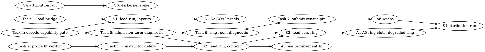

# Qwen3.8 on the B70: load, fit and attribution (fmcp plan 1) Implementation Plan

> **Execution:** Use `team-driven-development` in Claude Code, `pi-team-driven-development` in pi.dev, or `codex-team-driven-development` in Codex.

**Goal:** Both target packs (unsloth UD-Q4_K_XL and our exps-IQ4_NL pack) load, create a context and decode at default flags on the B70, the prefill ring engages, and one prompt ubatch is fully attributed.

**Architecture:** Three independent defect groups, each "one fact, two sources", are closed at the source that owns the fact: the lazy-range record (loader), the auto-ubatch fitter and its admission arithmetic (context), and the MoE window ring and decode capability tables (SYCL backend). Work whose code depends on a measurement starts with a spike; the tasks behind a spike are written as an addendum to this plan after the spike reports, and the owner reviews the addendum before they are spawned.

**Tech Stack:** C++17, SYCL (oneAPI icpx), oneDNN, CMake + Ninja via `scripts/sycl-build.sh`, CTest, Python source pins.

**Test Infrastructure:** Host tests are `llama_build_and_test(...)` targets in `tests/CMakeLists.txt` and `ggml/src/ggml-sycl/tests/`; source pins are Python scripts registered with `NAME ... SCRIPT ...`. Implementers run host tests and pins only. Every device or model-loading run is the lead's: serial, under `/Apps/llama.cpp/GPU.lock`, B70 pinned with `ONEAPI_DEVICE_SELECTOR=level_zero:0`, `Shmem` sampled before and 5 s after, kill only on `Shmem > 100 GB`.

**Base:** branch `integ/th32` at `d9ccd545b`. Nothing in this plan lands on master; integ/th32 still merges through th32 Task 30.

**Tracker:** epic llama.cpp-fmcp (design record c-ozc3). Per-ticket design records: llama.cpp-yu5l c-i7yz, llama.cpp-gjji c-h5xe, llama.cpp-5pkp c-yb48, llama.cpp-cjbz c-sxkk.

**Rules every task inherits:**
- Builds only on the lead's literal `GO` bound to a sha. Detached form:
  `setsid nohup bash -c 'cd <wt> && source /opt/intel/oneapi/setvars.sh --force >/dev/null && ./scripts/sycl-build.sh <targets>; echo BUILD_RC=$?' < /dev/null > <log> 2>&1 &` and wait on the `BUILD_RC=` line.
- Never run a binary that links ggml-sycl against a device, never `set -u` with `setvars.sh`, never amend a reported commit, never `clang-format-19 -i`; check with `clang-format-19 --dry-run -Werror <file>`.
- Comments cite reasons, not ticket ids or review rounds.
- Mutant registrations never carry `SKIP_RETURN_CODE` and are scored on a line only the mutant can print.
- No "run it N times" criterion on a model-loading binary.
- Each task's worktree is not the codescout session root: pass `root="<worktree>"` on every codescout call. In `ggml/src/ggml-sycl/ggml-sycl.cpp` verify with `cat <file> | grep -n '<pattern>'`.

---

## Team Topology

**Recommended implementers:** 3 concurrent (three tracks with disjoint files), one per task.
**Reviewers:** spec then quality, fresh per review. Opus for Tasks 3, 5, 6 and every addendum task; Sonnet first reviews for Tasks 1, 2, 4, 7.

### Parallel Tracks

| Track | Tasks | Description |
|-------|-------|-------------|
| A (loader) | 1 | Default-mode load bridge |
| B (context fitter) | 2, 3 | Probe fit verdict, constructor defers to the fitter |
| C (SYCL backend) | 4, 5, 6, 7 | Decode capability gate, two diagnostics, submit census |
| L (lead) | S1 to S6 | Device runs and spikes |
| Addendum | A1 to A8 | Written after the spikes; listed at the end |

### Dependency Graph



Tasks 4 to 7 are sequential only because they share `ggml-sycl.cpp` or its test registration block; none depends logically on the one before.

### File Ownership Map

| File/Directory | Tasks | Conflict Risk |
|----------------|-------|---------------|
| `src/llama-lazy-range-record.{h,cpp}`, `tests/test-llama-lazy-range-prefill.cpp`, `tests/test-llama-lazy-range-record-source.py` | 1 | None |
| `src/llama-auto-ubatch.h`, `src/llama-context.cpp`, `tests/test-auto-ubatch-ladder.cpp`, `tests/test-sycl-auto-ubatch-source.py` | 2, 3 | Sequential (Track B) |
| `ggml/src/ggml-sycl/moe-mmvq-tables.hpp`, `tests/test-sycl-moe-mmvq-tables.cpp` | 4 | None |
| `ggml/src/ggml-sycl/ggml-sycl.cpp` | 5, 6 | Sequential (Track C) |
| `ggml/src/ggml-sycl/moe-stream-ring.cpp` | 6 | None |
| `tests/test-sycl-window-path-submit-census-source.py` (new) | 7 | None |
| `tests/CMakeLists.txt` | 1, 2, 7 | Different blocks (lines ~4160, ~5030, new); merge-tree every round |

---

### Task 1: The default lazy mode loads a SYCL-owned table eagerly while no STORAGE consumer exists

**Track:** A
**Depends on:** None
**File scope:**
- Modify: `src/llama-lazy-range-record.h:95-121` (comment and one new inline function)
- Modify: `src/llama-lazy-range-record.cpp:166-181`
- Modify: `tests/test-llama-lazy-range-prefill.cpp:158-211`
- Modify: `tests/test-llama-lazy-range-record-source.py` (one new test function)

**Description:**
The pre-fill marks every table over 4 GiB as STORAGE when SYCL owns the weights, and `create_tensor` then refuses the load because this tree has no STORAGE consumer. Every Qwen3.8 pack fails at default flags. While the consumer is absent, `-lzm auto` records such a row as an ordinary eager weight (what `-lzm off` does) and warns once per table. `-lzm on` keeps the refusal. A pin ties the bridge to the refusal text so the task that adds the consumer must delete both.

**Acceptance Criteria:**
- [ ] Taker, AUTO, 5 GiB table: `lazy_eligible == false`, `deferral == EAGER`, the early-plan filter does not exclude it, `llama_lazy_range_check_storage` does not throw, and one WARN names the table.
- [ ] Taker, ON: unchanged (STORAGE, the check throws naming the tensor).
- [ ] Off the taker: unchanged in every mode.
- [ ] The pin fails if the bridge exists without the refusal text, or the refusal text without the bridge.
- [ ] `test-llama-lazy-range-prefill`, `test-llama-lazy-range-record`, `test-llama-lazy-range-record-source` pass.

**Implementation Guide:**

1. **Test (RED): edit `tests/test-llama-lazy-range-prefill.cpp`.**

Add a log capture above `main` (after `passes`):

```cpp
static std::string g_warns;

static void capture_log(enum ggml_log_level level, const char * text, void *) {
    if (level == GGML_LOG_LEVEL_WARN) {
        g_warns += text;
    }
}
```

Replace the "early plan, with the taker" loop (`:158-166`) with:

```cpp
    // the early plan, with the taker: no row is excluded under OFF or AUTO. Under AUTO the 5 GiB table would be
    // STORAGE, and with no STORAGE consumer in the tree it is the ordinary weight OFF makes it.
    for (llama_lazy_mode mode : { LLAMA_LAZY_MODE_OFF, LLAMA_LAZY_MODE_AUTO }) {
        llama_lazy_range_record rec;
        g_warns.clear();
        llama_log_set(capture_log, nullptr);
        llama_lazy_range_record_prefill(rec, arch, hp, declared, fx.finder(), mode, mode, true, true);
        llama_log_set(nullptr, nullptr);
        CHECK(!llama_lazy_early_plan_excludes(rec, unflagged), "taker, mode %d: the filter excluded an ineligible row",
              (int) mode);
        CHECK(!llama_lazy_early_plan_excludes(rec, lazy), "taker, mode %d: the filter excluded the 5 GiB table",
              (int) mode);
        CHECK(rec.deferral(lazy) == LLAMA_LAZY_DEFERRAL_EAGER && !rec.eligible(lazy),
              "taker, mode %d: the 5 GiB table is %s, eligible=%d", (int) mode,
              llama_lazy_deferral_name(rec.deferral(lazy)), rec.eligible(lazy) ? 1 : 0);
        const bool warned = g_warns.find(lazy) != std::string::npos && g_warns.find("-lzm on") != std::string::npos;
        CHECK(warned == (mode == LLAMA_LAZY_MODE_AUTO), "taker, mode %d: the bridge WARN %s", (int) mode,
              warned ? "fired" : "did not fire");
    }
```

In the `cells` table (`:175-181`) change the AUTO taker row to:

```cpp
            { "AUTO, the taker (EAGER: no STORAGE consumer in the tree)", LLAMA_LAZY_MODE_AUTO, true,  false },
```

Update the file header comment's two bullets about the taker to say the same.

Run (after the lead's GO for targets `test-llama-lazy-range-prefill`): `ctest --test-dir build -R '^test-llama-lazy-range-prefill$' --output-on-failure`
Expected: FAIL with `taker, mode 1: the filter excluded the 5 GiB table`, `the 5 GiB table is STORAGE`, `the bridge WARN did not fire`, and `AUTO, the taker (EAGER...): the STORAGE refusal fired`. Commit the RED with those four lines quoted.

2. **Implement (GREEN).**

`src/llama-lazy-range-record.h`, before the pre-fill declaration:

```cpp
// Whether this tree can consume a STORAGE row. It cannot: the loader has no SYCL STORAGE branch, so
// llama_lazy_range_check_storage() refuses one. While that holds, the pre-fill does not make a STORAGE row
// from the default mode (see below). The change that adds the consumer deletes this function, the bridge in
// the pre-fill and the refusal together.
inline bool llama_lazy_storage_consumer_present() {
    return false;
}
```

Extend the pre-fill comment block with:

```cpp
//   with the taker, mode AUTO and no STORAGE consumer in the tree, an eligible row is recorded
//   ineligible and EAGER, with one WARN: the default mode must load. Mode ON is the caller asking
//   for the storage tier by name, so it keeps the STORAGE row and the refusal.
```

`src/llama-lazy-range-record.cpp`, replace `:166`:

```cpp
            bool eligible = llama_lazy_eligible(mode, src.size, taker ? true : mmap_supported);

            // the default mode must load: without a STORAGE consumer the table is the ordinary weight
            // `-lzm off` makes it
            if (taker && eligible && mode == LLAMA_LAZY_MODE_AUTO && !llama_lazy_storage_consumer_present()) {
                eligible = false;
                LLAMA_LOG_WARN("%s: tensor %s (size = %zu MiB) is loaded into host memory in full: this build has no "
                               "storage tier for a SYCL-owned table; -lzm on asks for it by name and is refused\n",
                               __func__, name.c_str(), src.size / 1024 / 1024);
            }
```

Leave `:179-181` as it is: an ineligible row is EAGER.

3. **Pin: add to `tests/test-llama-lazy-range-record-source.py`** (after `test_the_storage_refusal_function_throws_on_exactly_a_storage_row`), and add the call wherever the file lists its tests at the bottom:

```python
def test_the_auto_bridge_lives_exactly_as_long_as_the_refusal():
    cpp = read_code(ROOT / "src" / "llama-lazy-range-record.cpp")
    hdr = read_code(ROOT / "src" / "llama-lazy-range-record.h")
    refusal = "no STORAGE consumer" in (ROOT / "src" / "llama-lazy-range-record.cpp").read_text()
    bridge_fn = "llama_lazy_storage_consumer_present" in hdr
    bridge_use = "!llama_lazy_storage_consumer_present()" in cpp
    assert bridge_fn == refusal and bridge_use == refusal, (
        f"the AUTO bridge and the STORAGE refusal must be added and deleted together: "
        f"refusal={refusal} bridge_fn={bridge_fn} bridge_use={bridge_use}"
    )
    if bridge_use:
        body = function_body(cpp, r"void\s+llama_lazy_range_record_prefill\s*\(")
        assert re.search(r"taker\s*&&\s*eligible\s*&&\s*mode\s*==\s*LLAMA_LAZY_MODE_AUTO\s*&&\s*!llama_lazy_storage_consumer_present\(\)", body), (
            "the bridge is not conditioned on exactly taker, eligible, AUTO and the absent consumer"
        )
```

`ROOT` is the file's own repository-root name (`:48`).

Run: `python3 tests/test-llama-lazy-range-record-source.py` and the two ctests. Expected: PASS.

**Commit:**

```bash
git commit -m "llama: the default lazy mode loads a SYCL-owned table eagerly while the tree has no storage tier" -- \
  src/llama-lazy-range-record.h src/llama-lazy-range-record.cpp \
  tests/test-llama-lazy-range-prefill.cpp tests/test-llama-lazy-range-record-source.py
```

**Gotchas:**
- The existing pin `test_eligibility_arguments_are_pinned` (`test-llama-lazy-range-record-source.py:189-198`) reads the `llama_lazy_eligible(` call's arguments and the line `mode = taker ? mode_pre : mode_post;`. Keep both exactly. If it rejects `bool eligible` (it may expect `const bool`), report it; do not loosen it silently.
- `LLAMA_LOG_WARN` reaches `llama_log_set`'s callback; check how the callback receives a multi-part line (text may arrive with a function prefix).
- The record is read by other consumers that "keep no copy of the decision"; do not add a second place that decides.
- This is a bridge for th32 Task 18 (the loader's SYCL STORAGE branch) to delete.

---

### Task 2: A probe that refuses the plan is a fit verdict, so the downward walk continues

**Track:** B
**Depends on:** None
**File scope:**
- Modify: `src/llama-auto-ubatch.h` (new enum and inline function after `llama_auto_ubatch_fit_refusal`, `:14-18`)
- Modify: `src/llama-context.cpp:2633-2649` (`try_candidate` inside `llama_context::sycl_select_auto_ubatch`)
- Modify: `tests/test-auto-ubatch-ladder.cpp` (new cases before the summary in `main`, `:293`)
- Modify: `tests/test-sycl-auto-ubatch-source.py:2659-2680` (`_fit_flag_is_set_only_on_fit_refusals`)
- Modify: `tests/CMakeLists.txt:5030` (mutant registration)

**Description:**
The probe returns `GGML_SYCL_LIFECYCLE_PLAN_REJECTED` for a candidate the transaction refused (`ggml-sycl.cpp`, the probe's `switch (result)`), so `try_candidate` returns at `if (rc != GGML_SYCL_LIFECYCLE_OK)` before the branch that sets `rung_fit_refused`. The descent then reads the loss as a lifecycle failure and stops at the first refused rung ("tried 512,256"). The publish path already treats `PLAN_REJECTED` as a fit verdict (`llama-context.cpp:2041-2044`); the probe must agree. The classification moves into the host-testable header.

**Acceptance Criteria:**
- [ ] `llama_auto_ubatch_probe_classify` returns FIT for `PLAN_REJECTED`, and for OK with `accepted == false`.
- [ ] A descent driven by the classifier over a probe that rejects 256 and accepts 128 settles on 128 having tried `{256, 128}`.
- [ ] BUSY, STALE_IDENTITY and any other non-OK code still end the walk.
- [ ] The mutant (PLAN_REJECTED read as a lifecycle failure) prints `FAIL probe-refusal descent` and its registration passes on that line.

**Implementation Guide:**

1. **Test (RED): `tests/test-auto-ubatch-ladder.cpp`, add before the final summary in `main`:**

```cpp
    // A probe that refuses the plan is a fit verdict: the walk goes on to the next rung. Any other
    // loss (busy, stale identity, another lifecycle code) is no verdict and ends it.
    {
        using O = llama_auto_ubatch_probe_outcome;
        struct probe_case {
            const char * name;
            bool         ok, busy, stale, plan_rejected, accepted;
            O            want;
        };
        const probe_case cases[] = {
            { "ok, accepted",            true,  false, false, false, true,  O::LLAMA_AUTO_UBATCH_PROBE_ACCEPTED  },
            { "ok, not accepted",        true,  false, false, false, false, O::LLAMA_AUTO_UBATCH_PROBE_FIT       },
            { "plan rejected",           false, false, false, true,  false, O::LLAMA_AUTO_UBATCH_PROBE_FIT       },
            { "busy",                    false, true,  false, false, false, O::LLAMA_AUTO_UBATCH_PROBE_BUSY      },
            { "stale identity",          false, false, true,  false, false, O::LLAMA_AUTO_UBATCH_PROBE_STALE     },
            { "another lifecycle code",  false, false, false, false, false, O::LLAMA_AUTO_UBATCH_PROBE_LIFECYCLE },
        };
        for (const probe_case & c : cases) {
            const O got = llama_auto_ubatch_probe_classify(c.ok, c.busy, c.stale, c.plan_rejected, c.accepted);
            if (got != c.want) {
                std::fprintf(stderr, "FAIL probe classify %s: got %d (expected %d)\n", c.name, (int) got, (int) c.want);
                g_failures++;
            }
        }

        // the descent as sycl_select_auto_ubatch runs it: 256 is refused by the plan, 128 fits
        std::vector<uint32_t> tried;
        bool                  aborted = false;
        const uint32_t        ended   = llama_auto_ubatch_descend(512, 4096, [&](uint32_t c) {
            tried.push_back(c);
            const bool plan_rejected = c == 256;
            const O    o = llama_auto_ubatch_probe_classify(!plan_rejected, false, false, plan_rejected, !plan_rejected);
            if (o == O::LLAMA_AUTO_UBATCH_PROBE_ACCEPTED) {
                return true;
            }
            aborted = o != O::LLAMA_AUTO_UBATCH_PROBE_FIT;
            return aborted;  // a non-fit loss ends the walk, as the trial's own lambda does
        });
        if (aborted || ended != 128 || tried != std::vector<uint32_t>({ 256, 128 })) {
            std::fprintf(stderr, "FAIL probe-refusal descent: got %u after %zu rung(s), aborted=%d (expected 128 after 2)\n",
                         ended, tried.size(), aborted ? 1 : 0);
            g_failures++;
        } else {
            std::printf("ok   probe-refusal descent: got 128 after 2 rungs\n");
        }
    }
```

Run after GO (target `test-auto-ubatch-ladder`): the build fails with `llama_auto_ubatch_probe_outcome` undeclared. That compile error is the RED; quote it in the RED commit.

2. **Implement (GREEN): `src/llama-auto-ubatch.h`, after the `llama_auto_ubatch_fit_refusal` struct:**

```cpp
// What one probe of a rung says. FIT is the only loss that is a verdict on the rung: the transaction ran and
// refused the candidate plan. The probe reports that either as a rejected plan or as OK with accepted == false,
// and the publish path reads a rejected plan the same way. Everything else is no verdict and never lowers -ub.
enum class llama_auto_ubatch_probe_outcome {
    LLAMA_AUTO_UBATCH_PROBE_ACCEPTED,
    LLAMA_AUTO_UBATCH_PROBE_FIT,
    LLAMA_AUTO_UBATCH_PROBE_BUSY,
    LLAMA_AUTO_UBATCH_PROBE_STALE,
    LLAMA_AUTO_UBATCH_PROBE_LIFECYCLE,
};

inline llama_auto_ubatch_probe_outcome llama_auto_ubatch_probe_classify(bool rc_ok,
                                                                        bool rc_busy,
                                                                        bool rc_stale,
                                                                        bool rc_plan_rejected,
                                                                        bool accepted) {
    using O = llama_auto_ubatch_probe_outcome;
    if (rc_busy) {
        return O::LLAMA_AUTO_UBATCH_PROBE_BUSY;
    }
    if (rc_stale) {
        return O::LLAMA_AUTO_UBATCH_PROBE_STALE;
    }
#ifdef LLAMA_AUTO_UBATCH_MUTANT_REJECTED_IS_LIFECYCLE
    if (rc_plan_rejected) {
        return O::LLAMA_AUTO_UBATCH_PROBE_LIFECYCLE;
    }
#else
    if (rc_plan_rejected) {
        return O::LLAMA_AUTO_UBATCH_PROBE_FIT;
    }
#endif
    if (!rc_ok) {
        return O::LLAMA_AUTO_UBATCH_PROBE_LIFECYCLE;
    }
    return accepted ? O::LLAMA_AUTO_UBATCH_PROBE_ACCEPTED : O::LLAMA_AUTO_UBATCH_PROBE_FIT;
}
```

`src/llama-context.cpp`, replace the four `if` statements from `if (rc == GGML_SYCL_LIFECYCLE_BUSY)` through the `if (!probe.accepted) {...}` block (`:2635-2648`) with:

```cpp
            // BUSY is the module-admission refusal, not lock contention, so the probe is not retried: the
            // candidate simply loses. A plan the transaction refused is the probe's verdict on the rung.
            switch (llama_auto_ubatch_probe_classify(rc == GGML_SYCL_LIFECYCLE_OK, rc == GGML_SYCL_LIFECYCLE_BUSY,
                                                     rc == GGML_SYCL_LIFECYCLE_STALE_IDENTITY,
                                                     rc == GGML_SYCL_LIFECYCLE_PLAN_REJECTED, probe.accepted)) {
                case llama_auto_ubatch_probe_outcome::LLAMA_AUTO_UBATCH_PROBE_BUSY:
                    return "transaction busy";
                case llama_auto_ubatch_probe_outcome::LLAMA_AUTO_UBATCH_PROBE_STALE:
                    return "not the published model";
                case llama_auto_ubatch_probe_outcome::LLAMA_AUTO_UBATCH_PROBE_LIFECYCLE:
                    return "transaction refused";
                case llama_auto_ubatch_probe_outcome::LLAMA_AUTO_UBATCH_PROBE_FIT:
                    rung_fit_refused = true;
                    return "transaction refused";
                case llama_auto_ubatch_probe_outcome::LLAMA_AUTO_UBATCH_PROBE_ACCEPTED:
                    break;
            }
```

Keep the `if (probe.would_demote_kv)` statement that follows.

3. **Pin: `tests/test-sycl-auto-ubatch-source.py`, in `_fit_flag_is_set_only_on_fit_refusals`:** replace the regex that requires `if (!probe.accepted) { rung_fit_refused = true; return "transaction refused"; }` with one that requires the FIT case:

```python
    # the probe's refusal is a fit refusal exactly on the classifier's FIT outcome
    if not re.search(
        r"case llama_auto_ubatch_probe_outcome::LLAMA_AUTO_UBATCH_PROBE_FIT: rung_fit_refused = true; return \"transaction refused\";",
        tc,
    ):
        return False
    if "rc == GGML_SYCL_LIFECYCLE_PLAN_REJECTED, probe.accepted" not in tc:
        return False
```

The count `tc.count("rung_fit_refused = true;") != 2` stays true (FIT case and hold spill). The pin normalises whitespace with `_normalize_ws` (`:113`); match its form.

4. **Mutant registration, `tests/CMakeLists.txt` after line 5030:**

```cmake
# The probe-verdict mutant reads a rejected plan as a lifecycle failure, which is the defect the
# descent case exists to catch. Scored on the line only that defect prints; no skip code.
add_executable(test-auto-ubatch-ladder-mutant-rejected-is-lifecycle test-auto-ubatch-ladder.cpp)
target_compile_definitions(test-auto-ubatch-ladder-mutant-rejected-is-lifecycle PRIVATE LLAMA_AUTO_UBATCH_MUTANT_REJECTED_IS_LIFECYCLE)
target_include_directories(test-auto-ubatch-ladder-mutant-rejected-is-lifecycle PRIVATE ${PROJECT_SOURCE_DIR}/src)
add_test(NAME test-auto-ubatch-ladder-mutant-rejected-is-lifecycle
         COMMAND test-auto-ubatch-ladder-mutant-rejected-is-lifecycle)
set_tests_properties(test-auto-ubatch-ladder-mutant-rejected-is-lifecycle PROPERTIES
    LABELS "sycl;host"
    PASS_REGULAR_EXPRESSION "FAIL probe-refusal descent: got 0 after 1 rung")
```

`test-auto-ubatch-ladder` is a bare `llama_build_and_test(test-auto-ubatch-ladder.cpp)` at `:5030`; read that macro for the include path and link libraries it adds and mirror them on the mutant target.

Run: `ctest --test-dir build -R '^test-auto-ubatch-ladder' --output-on-failure` and `python3 tests/test-sycl-auto-ubatch-source.py`. Expected: 2 ctests PASS, pin PASS.

**Commit:**

```bash
git commit -m "llama: a probe that refuses the plan is a fit verdict, so the auto n_ubatch walk continues below it" -- \
  src/llama-auto-ubatch.h src/llama-context.cpp tests/test-auto-ubatch-ladder.cpp \
  tests/test-sycl-auto-ubatch-source.py tests/CMakeLists.txt
```

**Gotchas:**
- `PLAN_REJECTED` also covers a few refusals that are not about size (`"invalid arguments"`, `"no plan currently published"`, `"publication ID exhausted"`, `"concurrent transaction won the CAS"` in `ggml_sycl_run_runtime_context_transaction`). The publish path already has the same imprecision. Do not widen this task to split them; note it in the report so the lead files it.
- The gate audit has a registration-count floor; if `scripts` gates complain about test counts after adding the mutant, report the suggested floor, do not edit it unasked.
- `test-sycl-auto-ubatch-source.py` is ~2700 lines of pins on this function. Run the whole file, not only the edited helper.

---

### Task 3: With auto `-ub`, a constructor publish refused for fit hands over to the fitter

**Track:** B
**Depends on:** Task 2
**File scope:**
- Modify: `src/llama-auto-ubatch.h` (one inline predicate)
- Modify: `src/llama-context.cpp:1499` (constructor), `:1788-1792` (trial gate), `:2057-2062`
- Modify: `src/llama-context.h` (two members beside the other `sycl_auto_ubatch` state)
- Modify: `tests/test-auto-ubatch-ladder.cpp`, `tests/test-sycl-auto-ubatch-source.py`

**Description:**
The constructor publishes the runtime context at the default 512 (`llama-context.cpp:1499`) and throws on any refusal, before `sycl_select_auto_ubatch()` runs (`:1873`). Observed on exps-IQ4_NL at n_ctx 2048: the PP MoE scratch ring is 0.4 MB over the RUNTIME zone, the context fails, and the log has no `auto n_ubatch candidate` line. When `-ub` is auto and the refusal is a fit verdict, the constructor must not throw; the fitter then tries 512, loses by fit, and walks down.

**Acceptance Criteria:**
- [ ] `llama_auto_ubatch_ctor_defers(n_ubatch_auto, causal, fit_refusal)` is true only when all three are true.
- [ ] Constructor: a refused publish with a deferral records the reason and continues; without one it throws the same `std::runtime_error(result.reason)` as today.
- [ ] If the trial then does not run (`sycl_auto_ubatch_trial == false`), the recorded reason is thrown at the trial gate.
- [ ] The commit message lists every statement between `:1499` and `:1873` that reads state the refused publish would have set, and says for each why it is safe or what was changed.
- [ ] Lead run S2 passes.

**Implementation Guide:**

1. **Test (RED), `tests/test-auto-ubatch-ladder.cpp`:**

```cpp
    // The constructor's own publish at the default -ub: only an auto -ub on a causal model, refused
    // for fit, is handed to the trial. A pinned -ub or a lifecycle failure still fails the context.
    {
        struct defer_case { bool auto_ub, causal, fit, want; };
        const defer_case cases[] = {
            { true,  true,  true,  true  },
            { false, true,  true,  false },
            { true,  false, true,  false },
            { true,  true,  false, false },
        };
        for (const defer_case & c : cases) {
            if (llama_auto_ubatch_ctor_defers(c.auto_ub, c.causal, c.fit) != c.want) {
                std::fprintf(stderr, "FAIL ctor defers: auto=%d causal=%d fit=%d (expected %d)\n", c.auto_ub, c.causal,
                             c.fit, c.want);
                g_failures++;
            }
        }
    }
```

RED is the compile error naming `llama_auto_ubatch_ctor_defers`.

2. **Implement (GREEN).**

`src/llama-auto-ubatch.h`:

```cpp
// True iff the constructor's publish at the default -ub may lose without failing the context: the caller did not
// pin -ub, the model is causal (the trial never runs otherwise) and the loss is a fit verdict. The trial then asks
// the default rung again and walks down from it.
inline bool llama_auto_ubatch_ctor_defers(bool n_ubatch_auto, bool causal_attn, bool fit_refusal) {
    return n_ubatch_auto && causal_attn && fit_refusal;
}
```

`src/llama-context.h`, beside the trial's other members:

```cpp
    // the constructor's publish at the default -ub was refused for fit and left to the auto n_ubatch trial
    bool        sycl_ctor_publish_deferred = false;
    std::string sycl_ctor_publish_reason;
```

`src/llama-context.cpp:1499`, replace `sycl_resync_runtime_context_flash_attn();` with:

```cpp
        {
            const sched_reserve_result published = sycl_publish_runtime_context(cparams.flash_attn);
            if (published.status != sched_reserve_status::OK) {
                if (!llama_auto_ubatch_ctor_defers(params.n_ubatch_auto, cparams.causal_attn, published.fit_refusal)) {
                    throw std::runtime_error(published.reason);
                }
                sycl_ctor_publish_deferred = true;
                sycl_ctor_publish_reason   = published.reason;
                LLAMA_LOG_WARN("%s: the default n_ubatch=%u does not fit this context (%s); the auto n_ubatch trial "
                               "looks for one that does\n",
                               __func__, cparams.n_ubatch, published.reason.c_str());
            }
        }
```

After `sycl_auto_ubatch_trial = llama_auto_ubatch_trial_runs(...)` and its `#endif` (`:1788-1790`):

```cpp
        if (sycl_ctor_publish_deferred && !sycl_auto_ubatch_trial) {
            throw std::runtime_error(sycl_ctor_publish_reason);
        }
```

3. **Read-through (part of GREEN, not optional).** Read `:1499-1873` and `sycl_select_auto_ubatch` up to its first `try_candidate`. For each statement that assumes a runtime context is published (the hold-epoch refresh at `:1869`, memory-module construction, `sycl_auto_ubatch_prepare`, the tuning-cache revalidation, the settle's `llama_auto_ubatch_settle_needs_publish`), decide whether a missing constructor publish changes it. Known case to handle: the settle skips its republish when nothing was published and `n_ubatch == fallback_ubatch`; with a deferred constructor publish that publish never stood, so pass `publish_dirty = publish_dirty || sycl_ctor_publish_deferred` into the settle. Write the list in the commit message.

4. **Pin**, `tests/test-sycl-auto-ubatch-source.py`, new function registered like its neighbours:

```python
def test_the_constructor_publish_defers_only_through_the_predicate():
    src = _normalize_ws((ROOT / "src" / "llama-context.cpp").read_text())
    assert "llama_auto_ubatch_ctor_defers(params.n_ubatch_auto, cparams.causal_attn, published.fit_refusal)" in src
    assert "if (sycl_ctor_publish_deferred && !sycl_auto_ubatch_trial) { throw std::runtime_error(sycl_ctor_publish_reason); }" in src
```

`_normalize_ws` is defined at `:113`; check how neighbouring tests strip comments before normalising and do the same.

**Commit:**

```bash
git commit -m "llama: with auto n_ubatch, a constructor publish refused for fit is left to the trial instead of failing the context" -- \
  src/llama-auto-ubatch.h src/llama-context.h src/llama-context.cpp \
  tests/test-auto-ubatch-ladder.cpp tests/test-sycl-auto-ubatch-source.py
```

**Gotchas:**
- `sycl_resync_runtime_context_flash_attn()` has other callers (`:2683`, `:3089`); leave the function and those callers alone.
- `params.n_ubatch_auto` and `cparams.causal_attn` must both be set before `:1499`; verify, and if `causal_attn` is assigned later, move nothing: report it.
- The `:1499` block sits inside `#if defined(GGML_USE_SYCL) || defined(GGML_BACKEND_DL)`; the members in the header must compile in a non-SYCL build too.
- A context that is never published computes no graph (decode returns -2). The acceptance is the lead's device run, not the host test.

---

### Task 4: A gate lists every expert layout the planner materializes that decode cannot run

**Track:** C
**Depends on:** None
**File scope:**
- Modify: `tests/test-sycl-moe-mmvq-tables.cpp` (new section before the summary in `main`)
- Read only: `ggml/src/ggml-sycl/soa-reorder-types.hpp`, `ggml/src/ggml-sycl/moe-mmvq-tables.hpp:179-208`

**Description:**
`moe_mmvq_capability_supports_layout` reads every non-MXFP4 type as AOS only, while the planner materializes Q4_0, Q4_K, Q6_K and Q8_0 experts SOA (`ggml_sycl_soa_reorder_supported_type`) and prefill runs them (`moe_pp_batched_f16_supports_layout`). UD-Q4_K_XL's five Q8_0 down tensors are SOA and decode refuses them. This task turns the gap into a table: an explicit list of (type, SOA) pairs with a prefill executor and no decode executor. The list starts with the four and each kernel task (addendum A1, A2) deletes one entry.

**Acceptance Criteria:**
- [ ] The test fails naming the pair if a type gains a SOA reorder and a prefill executor without a decode executor and is not on the list.
- [ ] The test fails naming the pair if a listed pair gains a decode executor (the list must shrink in the same change).
- [ ] `ctest -R '^test-sycl-moe-mmvq-tables$'` passes.

**Implementation Guide:**

1. **Test.** Add `#include "../ggml/src/ggml-sycl/soa-reorder-types.hpp"` and, before the summary:

```cpp
    // Decode must run every expert layout the planner materializes. A type the planner reorders to SOA and
    // the prompt executor runs there needs a decode executor at SOA too. The pairs below are the known
    // support gaps: each is a missing kernel, and the change that writes it deletes its line.
    {
        const ggml_type decode_soa_gaps[] = { GGML_TYPE_Q4_0, GGML_TYPE_Q4_K, GGML_TYPE_Q6_K, GGML_TYPE_Q8_0 };
        for (int t = 0; t < GGML_TYPE_COUNT; ++t) {
            const ggml_type type = (ggml_type) t;
            if (!ggml_sycl_soa_reorder_supported_type(type) || !moe_pp_batched_f16_supports_layout(type, GGML_LAYOUT_SOA)) {
                continue;
            }
            bool listed = false;
            for (ggml_type g : decode_soa_gaps) {
                listed = listed || g == type;
            }
            const bool decodes = moe_mmvq_capability_supports_layout(type, GGML_LAYOUT_SOA);
            if (!decodes && !listed) {
                std::printf("FAIL: %s experts are materialized SOA and run in prefill, but decode has no SOA executor "
                            "and the pair is not a listed gap\n", ggml_type_name(type));
                ++failures;
            }
            if (decodes && listed) {
                std::printf("FAIL: %s SOA has a decode executor now; delete it from decode_soa_gaps\n", ggml_type_name(type));
                ++failures;
            }
        }
    }
```

RED evidence: build once with `decode_soa_gaps` holding only `GGML_TYPE_Q4_0`; the test must print three `FAIL: ... not a listed gap` lines (Q4_K, Q6_K, Q8_0). Quote them in the commit message, then commit the four-entry list.

**Commit:**

```bash
git commit -m "sycl: the MoE tables test lists every SOA expert type that prefill runs and decode cannot" -- tests/test-sycl-moe-mmvq-tables.cpp
```

**Gotchas:**
- If `soa-reorder-types.hpp` needs a SYCL include, the test target is host-only (`tests/CMakeLists.txt:433`); report it instead of adding `-fsycl`.
- MXFP4 is SOA-reordered and already decodes at SOA; the loop must leave it silent. Verify by reading the output, not by assumption.
- `ggml_type_name` on a removed type id returns null for some ids; skip `t` where it is null.

---

### Task 5: The admission refusal prints both sums term by term

**Track:** C
**Depends on:** Task 4 (shared registration area only)
**File scope:**
- Modify: `ggml/src/ggml-sycl/ggml-sycl.cpp` (the PP MoE ring admission in `ggml_sycl_run_runtime_context_transaction`, around the `"PP MoE oneDNN scratch ring does not fit"` refusals, and the `runtime_pending_bytes` sum)
- Modify: `ggml/src/ggml-sycl/zone-sizing.hpp:484` area only if a term is not otherwise reachable (prefer not)

**Description:**
The RUNTIME zone is sized at plan time as `round256(max(floor, fixed + dense + ring))`; admission asks for the ring against `zone_available(RUNTIME) - runtime_pending_bytes`. They disagree by 0.4 MB on exps-IQ4_NL at n_ctx 2048. This task adds one WARN, printed only on that refusal, with every term of both sums in bytes, so lead run S2 can name the differing term. It changes no decision.

**Acceptance Criteria:**
- [ ] On the ring refusal one extra WARN line starts `[SYCL-PLAN] RUNTIME zone terms:` and carries, in bytes: zone size, zone used, zone available, each summand of `runtime_pending_bytes` by name, the plan-time `fixed`, `dense`, `ring` and `floor`, and the ring request.
- [ ] No output and no arithmetic change on an accepted candidate.
- [ ] Existing pins `test-sycl-pp-moe-ring-kv-zone-source` and `test-pp-moe-ring-admission` pass.

**Implementation Guide:**
Find the sites with `cat ggml/src/ggml-sycl/ggml-sycl.cpp | grep -n 'PP MoE oneDNN scratch ring does not fit\|runtime_pending_bytes'`. At the refusal that prints `needs %.1f MB ... but the RUNTIME zone has %.1f MB available`, add directly after the existing log call a `GGML_LOG_WARN` with the terms listed above, each `%zu`. Read each summand from the variable the existing code already sums; if the pending sum is computed in a helper that returns only the total, add an out-parameter struct `runtime_pending_terms { size_t dense_scratch, compute, state, host_scatter, mmid_pools; }` filled where the helper adds each term, defaulted to null for other callers.

RED: none is possible on the host for a log line; the evidence is lead run S2's capture. State that in the report.

**Commit:** `sycl: the PP MoE ring refusal prints the RUNTIME zone's plan-time and admission-time terms`

**Gotchas:**
- WARN, not INFO: INFO is dropped at default verbosity in every tool.
- Do not round to MB; the question is 0.4 MB.
- This line is diagnostic and stays until addendum A3 makes the two sums one function; A3 decides whether it remains.

---

### Task 6: A short ring reserve names what holds the WEIGHT zone

**Track:** C
**Depends on:** Task 5 (same file)
**File scope:**
- Modify: `ggml/src/ggml-sycl/moe-stream-ring.cpp:140-155` (the `cannot give` WARN)
- Modify: `ggml/src/ggml-sycl/unified-cache.{hpp,cpp}` only to expose an existing per-tag zone census if none is callable from the ring

**Description:**
The plan holds the ring's room as accounting (`hold_moe_stream_ring_room`, `unified-cache.cpp:36131`), the reserve allocates slot by slot at run time and comes up 1 to 24 slots short. A device test shows a free room funds every slot, so something takes the bytes between plan and reserve. This task makes the short reserve print who: the WEIGHT zone's size, free bytes, largest free block, and its live allocations grouped by tag with count and bytes, largest first, top 12.

**Acceptance Criteria:**
- [ ] On a short reserve one extra WARN starts `[MOE-STREAM-RING] WEIGHT zone at the short reserve:` followed by the figures above.
- [ ] Printed once per context, not once per refused layer.
- [ ] No behaviour change; `sycl-moe-stream-ring-sizing`, `sycl-moe-stream-phase` and the ring source pins pass.

**Implementation Guide:**
Search `unified-cache.hpp` for an existing zone census or audit call (`search_text "zone_audit|zone_census|dump_zone|largest_free"` with `root=`); reuse it. If none returns per-tag totals, add `unified_cache_zone_tag_census(device, vram_zone_id zone, std::vector<zone_tag_total> & out)` beside `unified_cache_zone_allocate_owner` (`unified-cache.cpp:28687`), walking the same registry the zone's ownership audit walks, under the lock that audit takes. Check the lock rank against the contract's rank table before calling it from the ring; state the rank in the report.

**Commit:** `sycl: a short MoE window ring reserve prints the WEIGHT zone's holders by tag`

**Gotchas:**
- The ring source pin (`tests/test-sycl-moe-stream-ring-room-source.py`) pins text around the reserve; run it.
- Three test targets compile `unified-cache.cpp` without every sibling TU; a new function called under `PRIVATE_TESTING` must link in all of them.
- Once per context: the reserve is attempted per micro-batch.

---

### Task 7: A census pin lists every unprofiled submit on the window path

**Track:** C
**Depends on:** Task 6 (registration block only)
**File scope:**
- Create: `tests/test-sycl-window-path-submit-census-source.py`
- Modify: `tests/CMakeLists.txt` (register beside `test-sycl-kernel-profiler-source-mmvq`)

**Description:**
The kernel profiler labels 434 ms of a 1.93 s prompt ubatch. Before wrapping anything, list what is unwrapped. The pin scans the files the window path runs through for raw `->submit(` / `.submit(` sites not lexically inside a `ggml_sycl_profile_submit(` call and compares the set with a checked-in allowlist that addendum task A6 drives to empty.

**Acceptance Criteria:**
- [ ] Prints `file:line function` for every unwrapped site, and fails if the set differs from the allowlist in either direction.
- [ ] Positive control inside the script: a synthetic source string with one wrapped and one raw submit yields exactly the raw one.
- [ ] Registered with the same form and labels as the neighbouring profiler source pins.

**Implementation Guide:**

```python
#!/usr/bin/env python3
"""Every device submit on the MoE window (prefill) path is either wrapped by the kernel profiler or listed.

A row the profiler cannot see lands in "device idle" or in nothing, so the attribution table is only as
complete as this list is short. The allowlist shrinks to empty; it never grows without a reason beside the entry.
"""
import re
import sys
from pathlib import Path

ROOT = Path(__file__).resolve().parents[1]
SYCL = ROOT / "ggml" / "src" / "ggml-sycl"

# the translation units a prompt ubatch runs through on the window path
FILES = [
    "moe-stream-ring.cpp", "moe-stream-plan.cpp", "moe-scratch-admission.cpp", "gemm.hpp",
    "norm.cpp", "fattn.cpp", "fattn-onednn.cpp", "mmq.cpp", "mmvq.cpp", "ggml-sycl.cpp",
]

# "file:function" -> why it is not wrapped yet
ALLOW: dict[str, str] = {}

SUBMIT = re.compile(r"(?:->|\.)submit\s*\(")
FUNC = re.compile(r"^[A-Za-z_][\w:<>,\s\*&]*?\b([A-Za-z_]\w*)\s*\([^;{}]*\)\s*(?:const\s*)?\{", re.M)


def strip(src: str) -> str:
    src = re.sub(r"//[^\n]*", "", src)
    return re.sub(r"/\*.*?\*/", lambda m: "\n" * m.group(0).count("\n"), src, flags=re.S)


def raw_submits(src: str) -> list[tuple[int, str]]:
    code = strip(src)
    out = []
    for m in SUBMIT.finditer(code):
        head = code[max(0, m.start() - 400) : m.start()]
        # wrapped when the nearest unclosed call before the submit is the profiler's
        depth, i, wrapped = 0, len(head) - 1, False
        while i >= 0:
            c = head[i]
            if c == ")":
                depth += 1
            elif c == "(":
                if depth == 0:
                    wrapped = head[:i].rstrip().endswith("ggml_sycl_profile_submit")
                    break
                depth -= 1
            i -= 1
        if wrapped:
            continue
        funcs = [f for f in FUNC.finditer(code, 0, m.start())]
        out.append((code.count("\n", 0, m.start()) + 1, funcs[-1].group(1) if funcs else "?"))
    return out


def self_test() -> None:
    sample = (
        "void a(sycl::queue * q) { ggml_sycl_profile_submit(label, [&] { return q->submit([](sycl::handler &) {}); }); }\n"
        "void b(sycl::queue * q) { q->submit([](sycl::handler &) {}); }\n"
    )
    got = raw_submits(sample)
    assert [f for _, f in got] == ["b"], f"positive control: expected only b, got {got}"


def main() -> int:
    self_test()
    found: dict[str, list[int]] = {}
    for name in FILES:
        path = SYCL / name
        assert path.exists(), f"{name} is gone: update FILES"
        for line, func in raw_submits(path.read_text()):
            found.setdefault(f"{name}:{func}", []).append(line)
    for key in sorted(found):
        print(f"unwrapped {key} at line(s) {found[key]}")
    new = sorted(set(found) - set(ALLOW))
    gone = sorted(set(ALLOW) - set(found))
    if new or gone:
        print(f"FAIL: unlisted unwrapped submits: {new}; listed but wrapped or gone: {gone}")
        return 1
    print(f"PASS: {len(found)} unwrapped site group(s), all listed")
    return 0


if __name__ == "__main__":
    sys.exit(main())
```

Steps: (1) read how `ggml_sycl_profile_submit` is actually called at two existing sites (`gemm.hpp`, `norm.cpp`) and adjust `wrapped` detection and the self-test sample to that real shape; (2) confirm the `FILES` list against the window path by reading `moe_stream_stage_now`'s callers and the prompt MoE executor, add any TU that submits; (3) run with `ALLOW = {}`: the failure output is the RED and the first census, quote its count in the commit; (4) fill `ALLOW` with every reported key, reason `"not yet wrapped"`, and register.

Registration: copy the block of `test-sycl-kernel-profiler-source-mmvq` in `tests/CMakeLists.txt` (find with `cat tests/CMakeLists.txt | grep -n 'kernel-profiler-source-mmvq'`), changing only the name and script.

**Commit:** `tests: a census pin lists every device submit on the MoE window path the kernel profiler does not wrap`

**Gotchas:**
- Script pins run as scripts, not under pytest; the registered form must match its neighbours.
- `ggml-sycl.cpp` is ~60k lines; the regex function finder will mislabel some lambdas. Keys only need to be stable, and the line numbers are printed for humans.
- Stage the new file with `git add -N` before running any gate that reads `git ls-files`.

---

## Lead tasks (device runs and spikes)

Each runs once, from a fresh build of the named sha, under `GPU.lock`, B70 only, `-v`, with `Shmem`/`MemAvailable` sampled before and 5 s after and the kernel log checked for `GT reset|guc_id|CAT error`. Results go on the named ticket.

| Id | After | Run | Records on | Decides |
|----|-------|-----|-----------|---------|
| S1 | 1, 4 | `llama-cli` on UD-Q4_K_XL at default flags, count prompt, `-n 48 --seed 42 --temp 0` | llama.cpp-gjji | Load passes (yu5l). Census of `[MOE-LAYOUT]` (type, layout) for gate, up and down experts; every decode refusal. Fixes the kernel list for A1/A2. Also read `mmvq.cpp`'s dense Q8_0 SOA kernel and state whether its row loop can take an expert offset |
| S2 | 3, 5 | `llama-bench -p 2048 -n 0 -r 1` on exps-IQ4_NL; `llama-cli` default context on UD-Q4_K_XL | llama.cpp-5pkp | Both contexts are created; the settled `-ub`; the differing term from Task 5's line. Writes A3 |
| S3 | 6, S2 | `llama-bench -p 2048 -n 0 -r 1` on both packs | llama.cpp-cjbz | Who holds the room's bytes. Writes A4/A5 |
| S4 | A4, A5, A6 | `llama-bench -p 2048 -n 0 -r 1` on UD-Q4_K_XL at `-ub 512` with `GGML_SYCL_KERNEL_PROFILE=1 GGML_SYCL_KERNEL_PROFILE_RAW=1 GGML_SYCL_KERNEL_PROFILE_FORMAT=csv` | llama.cpp-qp3v | The attribution table; rows plus derived idle within 5 % of wall |
| S5 | any time | Read every use of `MOE_GPU_UBATCH_MAX` (`cat ggml/src/ggml-sycl/ggml-sycl.cpp \| grep -n MOE_GPU_UBATCH_MAX`: the definition, the exported accessor, the `n_ubatch >` guard, two control-layout sizings) and `llama_auto_ubatch_cap` | llama.cpp-ohkx | What each use needs once the constant goes. Writes A7 |
| S6 | S4 | The integer expert kernel spike per llama.cpp-4qf6: one layer, one role, paired interleaved A/B against dequant plus oneDNN, correctness first | llama.cpp-4qf6 | Go or no-go for plan 2 |

## Addendum tasks (written after their spike, reviewed by the owner before spawning)

These are owned work with a fixed done-condition. Their RED/GREEN code is not written here because it depends on a measurement this plan produces; writing it now would be guessing.

| Id | Needs | Done when | Ticket |
|----|-------|-----------|--------|
| A1 | S1 | A `MUL_MAT_ID` decode kernel reads Q8_0 SOA experts; Q8_0 leaves `decode_soa_gaps`; device test against the CPU reference; UD-Q4_K_XL decodes the count prompt | llama.cpp-gjji |
| A2 | S1 | The same for each further SOA expert type S1 finds loaded (Q4_K if its gate/up experts are SOA) | llama.cpp-gjji |
| A3 | S2 | Zone sizing and admission call one requirement function; a host test sweeps `-ub` and asserts equality at both call sites; 512 is admitted on exps-IQ4_NL at n_ctx 2048 | llama.cpp-5pkp |
| A4 | S3 | The ring's slots are real allocations taken when the context is published, after KV is placed, and the prefill phase adopts them; new phase test with an allocation landing between plan and reserve; log shows all slots held | llama.cpp-cjbz |
| A5 | A4 | A short ring runs with the slots it has (at least 2, even count); phase tests at 2, 4 and an odd held count | llama.cpp-nuas |
| A6 | 7 | Task 7's allowlist is empty or every remaining entry has a stated reason; idle is derived as wall minus the union of device intervals, tested on a synthetic capture; a bytes-read/written counter on the expert path | llama.cpp-qp3v |
| A7 | S5 | The 512-row MoE constants are gone; the fitter decides the rung by fit; a 512 run is unchanged in a paired A/B | llama.cpp-ohkx |
| A8 | A1, A3, A4 | `docs/backend/sycl-env-vars.md` and `docs/backend/sycl-memory-design.md` state the new behaviour (bridge, ring slots at publish, degraded ring) | llama.cpp-fmcp |

---

## End-to-End Validation (on the user's machine) — MANDATORY

> Run by the lead after every task and addendum task has passed review and merged into `integ/th32`, from a fresh build of the merged sha. No step needs the user.

**Environment:** this host, Arc Pro B70 alone (`ONEAPI_DEVICE_SELECTOR=level_zero:0`), oneAPI sourced, `/models/Qwen3.8-Flash-Next-GGUF/` packs UD-Q4_K_XL and exps-IQ4_NL, default flags (no `-lzm`, no `-ub`, no `-c`, no `-ngl`).

**Steps the coding agent runs itself (each once, serial, under `GPU.lock`):**

1. Backend present: `grep -E '^GGML_SYCL:' build/CMakeCache.txt` shows `BOOL=ON`; `ldd build/bin/llama-cli | grep -cE 'libggml-sycl|libsycl'` is at least 2.
2. For each pack: `llama-cli -m <pack> -st --simple-io --no-display-prompt -p 'Count from 1 to 5. Answer with only: 1, 2, 3, 4, 5' -n 48 --seed 42 --temp 0 -v > cli.out 2> cli.err`. Pass: rc 0; `cat cli.out | grep -cx '1, 2, 3, 4, 5'` is 1; no `no STORAGE consumer`, no `local-layout-unsupported`, no `failed to create context` in `cli.err`.
3. For each pack: `llama-bench -m <pack> -p 2048 -n 128 -r 1 -v`. Pass: rc 0; a pp and a tg figure are printed; the `[MOE-STREAM-RING]` summary shows ring layer-ubatches above zero; no `cannot give` line with a held count under 2.
4. Scorer control: `echo '> Count from 1 to 5. Answer with only: 1, 2, 3, 4, 5' | grep -cx '1, 2, 3, 4, 5'` prints 0.
5. Host state: `grep -E '^(Shmem|MemAvailable):' /proc/meminfo` before and 5 s after each run; `journalctl -k --since "1 hour ago" --no-pager | grep -iE 'GT reset|guc_id|CAT error'` is empty.

**Steps requiring the user:** none.

**Observed success:** both packs answer the count prompt at default flags, both complete pp2048 with the ring engaged, and the attribution table from S4 is on llama.cpp-qp3v with its residual under 5 %. Throughput figures are recorded as the new stage baselines, not gated here: the success numbers (about 1000 t/s prefill, about 40 t/s decode) belong to plan 2.
