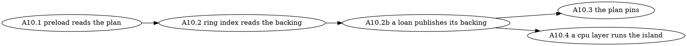

# fmcp addendum A10 (revision 2): a mapped load copies its routed host experts into pinned memory for the window ring

> **Execution:** `team-driven-development` in Claude Code. Addendum to
> `docs/plans/2026-11-13-fmcp-plan-1-qwen38-b70.md`, under epic llama.cpp-fmcp, ticket llama.cpp-gzzq.
> **Revision 2, 2026-11-14.** It replaces the text approved on 2026-11-14. That text pinned the experts through the
> loader, and its cost figure was wrong: the implementer's census stopped it before any code. This revision was
> written after addendum A12 merged, a re-measure, a code census and a spike.
> The owner approved revision 2 on 2026-11-14 (opt-out kept, no ring for mapped experts).
> **Amendment 1, 2026-11-14: task A10.2b is new.** Task A10.2's census found that an expert loan publishes its
> lent triplets with the wrong backing on a mapping load. The owner approved A10.2b on 2026-11-14 ("Do A10.2b
> now"), ticket llama.cpp-hqz7. Tasks A10.1 (merged, `93d00fbbe`), A10.2 and A10.3 are unchanged.
> **Amendment 2, 2026-11-14: task A10.4 is new.** The lead's early run of A10.2 and A10.2b gave 14.5 t/s at pp2048
> on a mapped load, against 58 to 80 on today's tree. A `cpu` decision takes a prompt path about 5 times slower
> than the one a mapped load takes today. The owner ruled "Fix the cpu path first" on 2026-11-14, ticket
> llama.cpp-ibg2. A10.4 awaits the owner's review. Tasks A10.2, A10.2b and A10.3 are unchanged. The merge waits
> for A10.4.

**Goal:** on a normal load (`-lm auto`, which maps the file), the host-executed routed experts are held once, in
pinned memory, when the device has a window ring and the host budget holds them. Prompts then take the ring without
`-lm none`. When they do not fit, they stay mapped, and the exec policy stops printing `ring` for layers it cannot
stream.

**Architecture:** the loader does not change. Every tensor stays in a `SYCL_Mapped` buffer. The single-device plan
marks the routed experts `PINNED` before it sizes the ring's room, and keeps that answer when room is held and the
host plan fits its budget. All of them or none. The preload, which today serves a mapped expert in place, reads the
plan's answer and copies a `PINNED` expert from the mapping into a WEIGHT-zone allocation. That is the copy a
`-lm none` load already makes. The ring's plan index stages a host expert only when its backing is pinned memory, so
a plan that left the experts mapped sizes no ring and runs those layers on the CPU.

**Tech stack:** C++ (ggml-sycl planner, preload, ring index), three C++ tests, one Python source pin, two docs.

**Test infrastructure:**
- `tests/test-sycl-layout-choice.cpp`, namespace `ring_room_case` (`:1564`): the real planner on a small MoE
  inventory with a staged type and a planned weight slot. It is the only test whose plans hold ring room. Its ctest
  registration pins `level_zero:1`, so the lead runs it.
- `ggml/src/ggml-sycl/tests/test-sycl-host-backing-plan.cpp`: the real planner on the Qwen3.8 inventory under a
  mocked device table. Its plans hold **no** ring room (`kv_for` leaves `moe_stream_staged_types` 0). Lead runs it.
- `ggml/src/ggml-sycl/tests/test-moe-stream-plan.cpp`: host test of the ring's plan index.
- `tests/test-sycl-host-backing-source.py`: source pins, pytest style (`def test_...`).

---

## Evidence (lead runs, 2026-11-14, B70 `level_zero:0`, exps-IQ4_NL pack, driver 26.44, tuning cache off)

All runs are `llama-bench -p 2048 -n 0`, one arm at a time. The host load was 10 to 44 and no builder ran. The
figures are not baselines. The full records are on llama.cpp-gzzq.

**The first look no longer describes the tree.** At `e47ab5a60` the mapped arm gave 11.48 t/s and `-lm none` gave
200.19 t/s. A9, A11 and A12 have merged since.

**Re-measure at `integ/th32` `20e4361e0`, quiet (`-r 5 -o json`), order mapped, pinned, pinned, mapped:**

| Arm | pp2048 t/s | Wall | Min `MemAvailable` |
|-----|-----------:|-----:|-------------------:|
| mapped | 79.93 ± 0.92 | 5:27 | 176.5 GB |
| `-lm none` | 159.64 ± 2.85 | 12:07 | 51.3 GB |
| `-lm none` | 159.55 ± 3.40 | 5:54 | 50.7 GB |
| mapped, after the pinned arms | 50.31 ± 3.10 | 11:28 | 173.0 GB |

- The mapped arm also gave 112.41 and 109.14 t/s at `-r 3` in A12's end-to-end, an hour earlier.
- A mapped arm that follows a pinned arm loads in 11 to 13 minutes and is slow for the whole run. The simplest
  reading is that the pinned allocation pushed the model's pages out of the file cache. It is not proven.

**What each load holds** (`-v` runs of the same pair):

| | mapped | `-lm none` |
|---|---|---|
| loader buffers | four `SYCL_Mapped` | one `SYCL_Host`, 70,014.66 MiB |
| host experts | `mapped=48723.9 MB` | `pinned/host_cpu=48721.3 MB` |
| pinned pool at load end | 6 GB | 124 GB (`WEIGHT=115.95/117.66`) |
| ledger | `host_expert_copy_cumulative=0.00` | `sycl_host_buffers=68.37 host_expert_copy_cumulative=47.58` |
| `[MOE-EXEC]` summary | 576 ring, 0 MiB streamed, 76,270 misses | 576 ring, 224,624 MiB streamed, 0 misses |

So `-lm none` holds each host expert twice: once in the loader's whole-model buffer and once as the preload's copy.

**Spike** (evidence branch `spike/a10-copy-pin` at `d7d30d127`, 11 lines, env-gated, never to be merged). With the
variable set, the plan answers `PINNED` for a routed expert on a mapping load and the preload copies it. One binary,
two arms by environment, quiet, order pin, map, map, pin:

| Arm | pp2048 t/s | Wall | Min `MemAvailable` |
|-----|-----------:|-----:|-------------------:|
| copy-pin | 160.79 ± 3.10 | 5:04 | 123.9 GB |
| mapped, after a pinned arm | 47.81 ± 0.69 | 13:06 | 173.5 GB |
| mapped | 81.92 ± 0.88 | 5:19 | 175.4 GB |
| copy-pin | 161.21 ± 3.74 | 4:53 | 124.6 GB |

- The copy-pin load keeps four `SYCL_Mapped` buffers and no `SYCL_Host` buffer.
- Load end: `pinned pool: 54.00 GB ... WEIGHT=47.58/47.66 ... sycl_host_buffers=0.00
  host_expert_copy_cumulative=47.58`.
- The plan's ledger line: `host_budget=162056695808 host_planned_bytes=55836673600 weight=48895977472`. The plan
  uses 55.8 GB of a 150.9 GiB budget.
- `[SYCL-PLAN] MoE window ring room on device 0: held 119.5 MB` and `DMA staging pool: 900.0 MB`. The pool is
  device memory. A mapped plan sizes it 0.
- `[MOE-EXEC] summary: 288 layer-ubatches ring, 0 cpu, 0 forced, 111931 MiB streamed, 2316 windows, 288 exposed,
  0 misses` on the `-r 1 -v` run, which gave 166.22 t/s.
- The count gate under copy-pin (`llama-cli`, default flags): rc 0, `grep -cx '1, 2, 3, 4, 5'` = 1.

**Reading.** Copy-pin gives the `-lm none` throughput with a 54 GB pinned pool in place of 124 GB. It is 2.0 times
the warm mapped arm and 3.4 times the cold one.

**Correction (amendment 2).** The two mapped figures are not a warm and a cold file cache. A mapped arm that ran
directly after two mapped arms still gave 49.48 t/s. What the verbose logs show at `20e4361e0`:
- The plan budget comes out 29898.0 MB or 29900.0 MB at the same reported free VRAM. The larger one leaves the
  WEIGHT zone one ring slot short. The first prompt graph then decides `cpu (ring-unavailable)`, one triplet is
  lent (`loan device`), and the run gives about 49 t/s (llama.cpp-az3g). Without a loan it gives 58 t/s verbose and
  80 quiet.
- A run that lent spends about 6 minutes in `reclaim_weight_entries` at unload (llama.cpp-ewu1). That is the long
  wall, and it is after the timing.
- A mapped load streams nothing in either mode: `0 MiB streamed`. Its summary counts the host layers under `ring`
  because the decision was `ring`; the executor then declines each op (`window-not-staged`) and the retained
  per-expert path runs the host experts on the prompt CPU island. Task A10.4 has the measurements.

Read "warm" in this addendum as "no loan" and "cold" as "with a loan".

**Not measured:** the B50, GPT-OSS, a load that does not fit, and the copy's cost in load time. The count-gate run
took 5:07 under copy-pin against 2:55 by default in A12's end-to-end, one sample each on different builds.

## What the code does today (read at `20e4361e0`; verify each anchor before editing)

**Plan, single device (`compute_placement_plan`, `unified-cache.cpp:36520`).**
- `placement_host_backing_when_host` (`:35067`) gives every routed expert `FILE_MAPPED` on a mapping load. It runs
  when the entry is made (`:36643`), before any expert is placed.
- `hold_moe_stream_ring_room` (`:36407`) is called once, at `:36948`. It returns with no room when
  `kv_info.moe_stream_staged_types == 0`, when the planned weight slot is 0, or when there is no MoE group. It
  sizes the room with `moe_stream_plan_ring_geometry`, which builds the ring's plan index.
- The expert pack follows. A group left on the host is charged at `:37001`, at its entries' `src_size`, each by its
  own backing. No routed expert is charged to a host term before that line.
- Then, at `:37065-37067`: `placement_mark_device_entries_file_mapped`, `populate_host_zone_sizing`,
  `record_host_ledger_plan`.
- `populate_host_zone_sizing` (`:35094`) assigns the plan's fields and never accumulates into them. It logs its
  `[SYCL-PLAN]` lines on every call. It holds the only reader of `has_pinned_backing()` (`:35568`), which sizes
  the DMA staging pool.
- `record_host_ledger_plan` (`:35000`) sets `plan.host_budget` and `plan.host_zone_terms`, then calls
  `placement_plan_decide_lazy_residency` (`:34777`). That pass clears the lazy tables first, decides them against
  what the budget leaves after the zone terms, and sets `plan.host_planned_bytes`. It logs WARN lines and counts
  its ring coverage reads. A plan over budget logs a would-refuse WARN and is kept.

**Plan, multi device (`compute_multi_device_plan`, `:37989`).** It never calls `hold_moe_stream_ring_room`. Its
host charges use other size bases (`:38258`, `:38509`). The same three calls end it at `:39115-39117`.

**Plan helpers (`unified-cache.hpp`).**
- `host_backing_sizes_weight_zone` (`:1515`) is true for `PINNED` and `HOST_CPU` only.
- `charge_host_weight` (`:1529`) and `uncharge_host_weight` (`:1549`) are exact inverses per backing.
- `placement_entry::host_backing` defaults to `PINNED` (`:449`).
- `lookup_expert_placement` (`:1701`) returns an `expert_placement_result` (`:378`) with no `host_backing`.

**Preload (`ggml-sycl.cpp`).** The lambda `register_host_aos_expert` (`:44477`) has one caller, at `:44822`, where
`placement` from `lookup_expert_placement` (`:44752`) is in scope.
- `served_in_place = !tensor_source_is_device && ggml_sycl_mapped_buffer_owner(tensor->buffer, &host_owner)`
  (`:44508`). In place, the entry points at the mapping and holds the mapping's owner.
- Otherwise `ggml_sycl_host_expert_alloc` allocates in the WEIGHT zone, `mem_copy` fills it from the source, and
  `host_expert_copy_cumulative_bytes` counts it (`:44534`).
- When that allocation fails and the source is host memory, the branch at `:44535` registers the source pointer
  with **no** owner.

**Ring (`moe-stream-plan.hpp`).**
- `moe_stream_plan_index_build` (`:234`) lists every host routed-expert entry as an item and reads no backing. An
  item the executor claims stages `AOS_ONLY`; any other stages `NONE`.
- `moe_stream_layer_claimed` (`:387`) is false when any item of the layer stages `NONE`.
- `moe_stream_owner_streamable` (`:505`) accepts only a `HOST_PINNED` `WEIGHT` owner in a host zone of the device.
  A mapped expert has none, so the stager skips it and the window counts a miss.

**Loader.** `ggml_backend_sycl_planned_host_backing` (`ggml-sycl.cpp:54713`) answers `FILE_MAPPED` for a
routed-expert tensor on a mapping load. **This revision leaves it and the loader alone.**

**Tests that stay true.** `test-sycl-host-weight-zone-terms.cpp` arm 3a (no weight answers a backing that keeps
`SYCL_Host` on a mapping plan) and arm 3b (the WEIGHT zone does not grow for the mapped buffer) both hold, because
the loader keeps mapping. Arm 3b builds the buffer and binds no tensor, so no existing device test runs the preload
over a mapped buffer. The lead's end-to-end runs 4 and 5 are the preload's device test.

## Decisions this addendum takes (owner to confirm by approving it)

1. **The copy is made from the mapping, by the preload.** The loader's answer for a routed-expert tensor stays
   `FILE_MAPPED`. No whole-model host buffer exists on a mapping load.
2. **All or none per plan.** Either every host-executed routed expert of the plan is pinned, or none is.
3. **The fit rule is the ledger's own figure.** The plan is sized with the experts pinned. It is kept when ring
   room is held, `host_planned_bytes` is at most the host budget, and no lazy table refuses. Otherwise the experts
   go back to `FILE_MAPPED`, the host zones are sized again, and one WARN line says why. The ledger lines print
   twice in that case only.
4. **Pinned experts come before lazy tables.** The lazy pass already decides tables against what the zone terms
   leave. A pinned plan can therefore read a table from storage that a mapped plan would have held in RAM.
5. **One opt-out, default on:** `GGML_SYCL_MOE_PIN_HOST_EXPERTS=0` keeps the experts mapped. It is read when the
   plan is made. It lets the end-to-end compare the two paths in one binary, and it is the user's way back.
6. **`-lm mlock` and `mmap+mlock` keep their experts mapped.** The user asked for a locked mapping; pinning as
   well would hold the bytes twice. With task A10.2 those layers run on the CPU and print `cpu`, not `ring`.
7. **A mapped host expert is never ring-staged.** A plan that left the experts mapped sizes no ring and holds no
   ring room. Today such a load holds 119.5 MB of device room for a ring that streams nothing.
8. **Multi-device plans are unchanged.** They hold no ring room today. Holding it per device is its own change.
9. **The mapping's pages are left to the kernel.** After the copy they are clean file cache. No `madvise` call is
   added here.
10. **`-lm none` is unchanged.** Its double holding is a separate defect and gets its own ticket.
11. **The storage path is separate.** Reading experts from the NVMe straight into pinned windows, for packs whose
    experts do not fit in RAM, is the owner's second request. It gets its own spike and addendum after this one.
12. **A `cpu` decision runs the CPU island where the staged claim covers the layer (amendment 2).** Decisions 6
    and 7 turn mapped layers to `cpu`. Task A10.4 makes that path the one a mapped load takes today.

---

## Team Topology

**Implementers:** 2. One (Opus: ownership and placement code) takes track F in order, in one worktree. A second
(Opus: dispatch routing in `ggml_sycl_mul_mat_id`) takes track G in its own worktree, on a branch cut from the
reviewed head of A10.2b (`18d6e11e1`).
**Reviewers:** spec then quality, fresh each round, Opus. Each task is reviewed on its own commit range.
**Merge:** A10.1 changes no behaviour and merges when it passes. A10.2, A10.2b, A10.3 and A10.4 merge together,
after the lead's end-to-end. The lead merges track F's branch into track G's for that run, and builds the result.

| Track | Tasks | Description |
|-------|-------|-------------|
| F | A10.1, A10.2, A10.2b, A10.3 | the preload reads the plan; the ring index reads the backing; a loan publishes its backing; the plan pins |
| G | A10.4 | a prompt layer decided for the CPU runs the CPU island |



### File Ownership Map

| File | Task | Change |
|------|------|--------|
| `ggml/src/ggml-sycl/unified-cache.hpp` | A10.1 | `expert_placement_result` carries `host_backing` |
| `ggml/src/ggml-sycl/ggml-sycl.cpp` | A10.1 | `register_host_aos_expert` and its one call site |
| `ggml/src/ggml-sycl/tests/test-sycl-host-backing-plan.cpp` | A10.1 | one check in arms 1 and 2 |
| `tests/test-sycl-host-backing-source.py` | A10.1, A10.3 | one clause each; A10.3 also updates the pinned-site list |
| `ggml/src/ggml-sycl/moe-stream-plan.hpp` | A10.2 | `moe_stream_plan_index_build` reads `host_backing` |
| `ggml/src/ggml-sycl/tests/test-moe-stream-plan.cpp` | A10.2, A10.2b | one new test function each |
| `tests/test-sycl-moe-stream-enqueue-source.py` | A10.2 | the claim-guard pin follows the new guard (found by the census) |
| `ggml/src/ggml-sycl/unified-cache.hpp` | A10.2b | `placement_plan::set_expert_host_backing` |
| `ggml/src/ggml-sycl/ggml-sycl.cpp` | A10.2b | one call in the loan transaction's publication loop |
| `ggml/src/ggml-sycl/moe-stream-plan.hpp` | A10.2b | two comments that describe the loan |
| `ggml/src/ggml-sycl/tests/test-sycl-host-backing-accounting.cpp` | A10.2b | one new arm |
| `tests/test-sycl-moe-expert-loan-source.py` | A10.2b | one clause beside `FLIP` |
| `ggml/src/ggml-sycl/unified-cache.cpp` | A10.3 | three helpers; one call before the ring room; one call ends each builder |
| `tests/test-sycl-layout-choice.cpp` | A10.3 | one new test function in `ring_room_case` |
| `docs/backend/sycl-env-vars.md` | A10.3 | one row |
| `docs/design/sycl-mmap-host-tier.md` | A10.3 | §4.4: the expert row (`:1188`) and the sentence at `:1195` |
| `ggml/src/ggml-sycl/moe-stream-plan.hpp` | A10.4 | one predicate, one phase method's declaration, two comments |
| `ggml/src/ggml-sycl/moe-stream-plan.cpp` | A10.4 | `moe_stream_phase::runs_cpu_island`; one comment in `begin_layer` |
| `ggml/src/ggml-sycl/ggml-sycl.cpp` | A10.4 | six sites inside `ggml_sycl_mul_mat_id` |
| `ggml/src/ggml-sycl/tests/test-moe-stream-phase.cpp` | A10.4 | checks in the claimed block and the mapped block; one comment |
| `tests/test-sycl-staged-ring-route-source.py` | A10.4 | one new claim with eight mutants; two constants and two mutants follow |
| `docs/backend/sycl-memory-design.md` | A10.4 | the "Two regimes" paragraph |
| `docs/backend/sycl-env-vars.md` | A10.4 | the `GGML_SYCL_MOE_EXEC` and `GGML_SYCL_MOE_EXEC_DECLINE_LAYER` text |
| `scripts/sycl-moe-exec-gate.sh` | A10.4 | the `Q_decline` header comment (`:69-70`), which says the layer runs the hybrid path |

Tracks F and G both touch `ggml-sycl.cpp`, `moe-stream-plan.hpp` and `docs/backend/sycl-env-vars.md`, in different
places. A10.3's `ggml-sycl.cpp` hunks are near `:434` and `:35366`; A10.4's are inside `ggml_sycl_mul_mat_id`
(`:85769` on). A10.4 runs `git merge-tree` against `task/a10-host-expert-pin` each round as well.

Run `git merge-tree` against `integ/th32` each round.

**Rules for every task.**
- No device binary, no model load, no `ctest`: the lead runs those.
- Build only on the lead's literal GO, bound to a sha. Syntax-only compile every changed `.cpp` after the last
  edit, with its own command from the worktree's `compile_commands.json`.
- Never amend a reported commit. Path-scoped commits. One trailer: `Co-Authored-By: Claude Opus 5.5
  <noreply@anthropic.com>`.
- Comments give reasons. No ticket ids, task numbers or review rounds in code.
- `clang-format-19 --dry-run -Werror` on the lines you wrote only. Comment lines are 120 columns or fewer.
- codescout is blind inside `ggml-sycl.cpp`. Search it with `cat <file> | grep -n`.
- STOP and message the lead when a census answer contradicts this addendum. Do not design around it.

---

### Task A10.1: the preload serves a host expert in place only when the plan left it mapped

**Track:** F. **Depends on:** none. Branch from `integ/th32` at `20e4361e0` or later.

**Description:** the preload decides in place or copy from the buffer's kind alone. This task makes it read the
plan's backing for that expert. No plan pins a mapped expert yet, so nothing changes at run time.

**Acceptance criteria:**

- [ ] `lookup_expert_placement` returns the entry's `host_backing`.
- [ ] `register_host_aos_expert` serves in place only when the plan's backing holds no WEIGHT-zone block.
- [ ] A failed pinned allocation over a `SYCL_Mapped` source registers the mapping **with its owner** and warns
      once per tensor.
- [ ] Every existing test and pin is green. Behaviour on today's plans is unchanged.

#### Step 1: census

1. `cat ggml/src/ggml-sycl/ggml-sycl.cpp | grep -n 'register_host_aos_expert('`: confirm one caller.
2. Read `ggml_sycl_mapped_buffer_owner`. Does it write `*owner` when it returns false? The code below assumes it
   may, and clears the handle.
3. Where is `logged_host_layout` declared? The new once-per-tensor flag goes beside it.

#### Step 2: RED

In `test-sycl-host-backing-plan.cpp`, a helper after `take_census` (`:251`):

```cpp
// Routed-expert entries whose lookup result does not carry the entry's own backing.
size_t lookup_backing_mismatches(const placement_plan & plan) {
    size_t n = 0;
    for (const placement_entry & e : plan.entries) {
        if (e.expert_id < 0 || e.layer_id < 0) {
            continue;
        }
        const auto found = plan.lookup_expert_placement(e.layer_id, e.expert_id, e.expert_role);
        n += !found.found() || found.host_backing != e.host_backing;
    }
    return n;
}
```

- In `arm1_mapping_load`, after the census checks:
  `check_eq("routed experts whose lookup result does not carry their backing", lookup_backing_mismatches(plan), 0);`
- The same line in `arm2_copying_load`.
- RED evidence: the syntax-only compile of the test TU fails on `host_backing` not being a member of
  `expert_placement_result`. Report the error lines.

In `tests/test-sycl-host-backing-source.py`, one test in the file's style, built on its `read`, `strip_comments`
and `balanced` helpers:

```python
def test_the_preload_serves_in_place_only_what_the_plan_left_mapped():
    src = strip_comments(read("ggml/src/ggml-sycl/ggml-sycl.cpp"))
    start = src.index("auto register_host_aos_expert = [&](")
    body = balanced(src, src.index("{", start))
    cond = body[body.index("served_in_place ="):]
    cond = cond[:cond.index(";")]
    assert "host_backing_sizes_weight_zone(planned_backing)" in cond, cond
    assert cond.index("host_backing_sizes_weight_zone") < cond.index("ggml_sycl_mapped_buffer_owner"), cond
    assert "getenv" not in body
```

Run it and show it failing on the first assertion.

**Commit:** `test(sycl): the preload reads the plan's backing for a host expert (RED)`, staging the two test files.

#### Step 3: GREEN

`unified-cache.hpp`, in `expert_placement_result` (`:378`), after `on_device`:

```cpp
    // The plan's host backing for this expert. For a host-executed expert, a backing that sizes the WEIGHT zone means
    // the preload holds it there; FILE_MAPPED means the CPU reads the mapping in place.
    placement_host_backing host_backing = placement_host_backing::PINNED;
```

and in `lookup_expert_placement` (`:1701`), beside the `src_size` assignment (`:1717`):
`result.host_backing = e.host_backing;`. If `placement_host_backing` is declared after the struct, move nothing:
report it and STOP.

`ggml-sycl.cpp`, the lambda's signature (`:44477`):

```cpp
                    auto register_host_aos_expert = [&](int64_t e, const uint8_t * expert_aos,
                                                        ggml_sycl::placement_host_backing planned_backing,
                                                        const char * reason) -> bool {
```

the decision (`:44503-44509`):

```cpp
                        // A SYCL_Mapped source is served in place when the plan left the expert mapped: the CPU
                        // executes the file layout (host experts are AOS), and the entry holds the mapping's owner.
                        // When the plan gave it a WEIGHT-zone block, the window ring streams it, and the ring copies
                        // only from pinned memory, so it is copied out of the mapping as any other source is.
                        ggml_sycl::mem_handle host_owner;
                        const bool            served_in_place =
                            !tensor_source_is_device &&
                            !ggml_sycl::placement_plan::host_backing_sizes_weight_zone(planned_backing) &&
                            ggml_sycl_mapped_buffer_owner(tensor->buffer, &host_owner);
```

the allocation-failure branch (`:44535-44538`):

```cpp
                        } else if (!tensor_source_is_device) {
                            // No pinned room: the source is served in place. A SYCL_Mapped source keeps its mapping's
                            // owner, as a planned in-place expert does; the window ring cannot stream this expert, so
                            // the load says so once per tensor. Any other host source is registered unowned.
                            host_owner = {};
                            if (ggml_sycl_mapped_buffer_owner(tensor->buffer, &host_owner)) {
                                if (!logged_pin_alloc_failed) {
                                    GGML_LOG_WARN("[MOE-LAYOUT] tensor=%s device=%d expert=%lld: no pinned room for "
                                                  "%zu bytes the plan pinned; served from the mapping, and the "
                                                  "window ring will not stream it\n",
                                                  tensor->name ? tensor->name : "?", device,
                                                  static_cast<long long>(e), expert_size);
                                    logged_pin_alloc_failed = true;
                                }
                            } else {
                                host_owner = {};
                            }
                            host_ptr = const_cast<uint8_t *>(expert_aos);
                        } else {
```

- Declare `bool logged_pin_alloc_failed = false;` beside `logged_host_layout`.
- The caller (`:44822`): `register_host_aos_expert(e, expert_aos, placement.host_backing, "planner-host")`.

Run the Python pin: green. Syntax-only compile `ggml-sycl.cpp` and the test TU.

**Commit:** `sycl: the preload serves a host expert in place only when the plan left it mapped`.

#### Gotchas

- **Operand order matters.** The plan test comes before `ggml_sycl_mapped_buffer_owner`, so a pinned expert never
  takes the mapping's owner into `host_owner` before the allocation replaces it.
- On a `-lm none` load every entry is `PINNED` and the source is not `SYCL_Mapped`. Both old and new conditions
  are false there.
- Do not touch the loader or `ggml_backend_sycl_planned_host_backing`.
- **Build** only on the lead's GO: targets `test-sycl-host-backing-plan llama-bench llama-cli`.
- Lead's check before review: `test-sycl-host-backing-plan` rc 0, and the count gate on the B70 with default
  flags still shows `mapped=` host experts and passes.

---

### Task A10.2: the ring's plan index stages a host expert only from pinned memory

**Track:** F. **Depends on:** A10.1.

**Description:** the index lists a mapped host expert as streamable, so the planner sizes a ring for it, the
policy prints `ring`, and the stager then skips it. This task makes the index read the backing. A plan with mapped
host experts then sizes no ring, holds no room, and runs those layers on the CPU.

**Acceptance criteria:**

- [ ] A host-planned entry whose backing does not size the WEIGHT zone stages `NONE`.
- [ ] A layer with such an entry is not claimed (`moe_stream_layer_claimed` false), and a plan made only of such
      layers has ring geometry 0.
- [ ] Entries lent from the device (`as_host`) are read exactly as today.
- [ ] Every existing case in `test-moe-stream-plan.cpp` is green unchanged: its entries default to `PINNED`.

#### Step 1: census

1. Every caller of `moe_stream_plan_index_build` and `moe_stream_plan_ring_geometry`. For each, say whether the
   plan it passes can hold `FILE_MAPPED` host experts, and what the caller does with a geometry of 0.
2. `begin_layer` in `moe-stream-plan.cpp`: name the branch a host layer takes when `moe_stream_layer_claimed` is
   false, and the `[MOE-EXEC]` counter it lands in.
3. Source pins under `tests/` naming `moe_stream_plan_index_build`, `moe_stream_layer_claimed` or
   `moe_stream_owner_streamable`. Run each and its `--self-test` before editing. Report the rc.

#### Step 2: RED

In `test-moe-stream-plan.cpp`, after `test_window_sizing`, and called from `main` beside it:

```cpp
// The ring copies only from pinned memory, so a host expert the plan left mapped stages nothing: its layer is not
// claimed and takes no slot. A lent device triplet is read as before.
void test_mapped_host_experts_are_not_staged() {
    ggml_sycl::moe_stream_window_hints hints;
    hints.weight_slot_bytes = 10 * kSrc;

    placement_plan mapped = make_typed_plan();
    for (ggml_sycl::placement_entry & e : mapped.entries) {
        if (e.expert_id >= 0 && !e.on_device) {
            e.host_backing = ggml_sycl::placement_host_backing::FILE_MAPPED;
        }
    }
    auto idx = ggml_sycl::moe_stream_plan_index_build(mapped, 0, nullptr, claims_all, hints);
    CHECK(idx.role_items_max == 0);
    CHECK(idx.window_slots == 0);
    CHECK(idx.layers.count(0) == 1 && !ggml_sycl::moe_stream_layer_claimed(idx.layers.at(0)));
    CHECK(ggml_sycl::moe_stream_plan_ring_geometry(mapped, 0, nullptr, claims_all, hints).bytes == 0);

    // One mapped expert in a pinned layer leaves the layer unclaimed, and the ring is sized over the others.
    placement_plan mixed = make_typed_plan();
    for (ggml_sycl::placement_entry & e : mixed.entries) {
        if (e.layer_id == 0 && e.expert_id == 1) {
            e.host_backing = ggml_sycl::placement_host_backing::FILE_MAPPED;
        }
    }
    idx = ggml_sycl::moe_stream_plan_index_build(mixed, 0, nullptr, claims_all, hints);
    CHECK(!ggml_sycl::moe_stream_layer_claimed(idx.layers.at(0)));
    CHECK(ggml_sycl::moe_stream_layer_claimed(idx.layers.at(2)));

    // The control: the same plan with every host expert pinned is claimed, as test_window_sizing sizes it.
    const placement_plan pinned = make_typed_plan();
    idx = ggml_sycl::moe_stream_plan_index_build(pinned, 0, nullptr, claims_all, hints);
    CHECK(idx.window_slots == 3);
    CHECK(ggml_sycl::moe_stream_layer_claimed(idx.layers.at(0)));
}
```

- Layer 1 of `make_plan` holds a fused `GATE_UP` host entry and is never claimed. The test uses layers 0 and 2.
- If `idx.layers` is not a map with `count` and `at`, use the container's own lookup and say so.
- RED evidence: the lead builds `test-moe-stream-plan` at the RED commit and runs it. Report the `CHECK failed
  line` lines you expect: the four checks on `mapped` and the first on `mixed`.

**Commit:** `test(sycl): a mapped host expert is not ring-staged (RED)`.

#### Step 3: GREEN

In `moe_stream_plan_index_build`, where the claim is asked (`if (library_claims != nullptr &&
moe_stream_item_aos_fits(item, SIZE_MAX))`):

```cpp
        // The ring copies a host expert only out of pinned memory (moe_stream_owner_streamable). A host-planned
        // expert whose backing holds no WEIGHT-zone block is read in place from its mapping, so it stages NONE and
        // its layer runs on the CPU. A lent device triplet is not asked: its host copy is the loan's business.
        const bool mapped_host = !e.on_device && !placement_plan::host_backing_sizes_weight_zone(e.host_backing);
        if (!mapped_host && library_claims != nullptr && moe_stream_item_aos_fits(item, SIZE_MAX)) {
```

Nothing else changes. Run the pins from the census again.

**Commit:** `sycl: the window ring's plan index stages a host expert only from pinned memory`.

#### Gotchas

- **This changes today's mapped load.** It holds no ring room and its host layers print `cpu`. That is the path
  decision 7 names, and the lead measures it as the opt-out arm. It does not merge before the end-to-end.
- **The planner sizes the ring's room through this index.** After this task a mapping load holds no room until
  A10.3 marks the experts pinned before the room is sized. That order is why A10.3 pins first and checks after.
- `tests/test-sycl-moe-stream-enqueue-source.py` pins the text of the owner check. This task does not edit that
  check.
- **Build** only on the lead's GO: targets `test-moe-stream-plan test-moe-stream-phase test-sycl-layout-choice
  llama-bench llama-cli`.

---

### Task A10.2b: a lent expert's plan entry reads `PINNED` while it is lent

**Track:** F. **Depends on:** A10.2. **Added by amendment 1.**

**Description:** the expert loan lends device-resident triplets to the host so the window ring has room, then
streams them through the ring like any host expert. The transaction copies each lent member into a pinned
WEIGHT-zone block (`ggml_sycl_host_expert_alloc`, `ggml-sycl.cpp:22688`) and publishes a plan whose entry says
host. On a load that maps files every device entry reads `FILE_MAPPED`, its staging source
(`placement_mark_device_entries_file_mapped`), and `update_expert_placement` flips `on_device` and the target only.
So the published plan says `FILE_MAPPED` for bytes that are in pinned memory. After A10.2 the index would stage
nothing for the triplets the loan was sized to stream. This task makes the published plan say what the loan did.

It is the same rule as A10.1 and A10.2, applied to the one writer they missed: the plan's backing is the fact.

**Evidence that loans are live:** a default (mapped) Qwen3.8 load on the B70 at pp2048 prints
`[MOE-EXEC] loan device 0: 1 triplets, 2 MiB lent to the ring (OK)` (lead runs `a10-remeasure/mapped-2`,
`a11-merged/qwen-mapped`). The copy-pin spike printed none at that prompt size.

**Acceptance criteria:**

- [ ] `placement_plan::set_expert_host_backing(layer, expert, role, backing)` changes one entry's backing and moves
      its `src_size` between the host terms. Every term equals a recount afterwards.
- [ ] After a loan each lent entry reads `PINNED`. After a refill it reads `FILE_MAPPED` when the plan's
      `host_backing_maps_files` is set, and `PINNED` otherwise.
- [ ] On a mapping plan, the index of the published post-loan plan stages the lent triplet exactly as the `as_host`
      read sized it.
- [ ] `update_expert_placement` is unchanged, and arm (h) of `test-sycl-host-backing-accounting.cpp` is green
      unchanged.
- [ ] A `-lm none` load publishes the same backings as today (`PINNED` before, during and after a loan).

#### Step 1: census

1. The refill path that leaves a triplet on the host (`[MOE-EXEC] refill device %d: layer %d expert %d stays on the
   host`, `ggml-sycl.cpp:22745`): confirm its entry is not flipped, so it keeps `PINNED` from the loan. Cite lines.
2. The `if (loaned)` block (`ggml-sycl.cpp:22834-22850`): confirm nothing between the flip and the publication can
   run for one member and not the others, so a triplet is never published half set.
3. Name the test binary that runs the in-tree loan fixtures (`ggml-sycl.cpp:~25400-26100`) and say whether any
   fixture plan sets `host_backing_maps_files`. That binary joins the build targets.
4. Run before editing, and report the rc: `tests/test-sycl-moe-expert-loan-source.py`,
   `tests/test-sycl-host-backing-source.py` (its `test_only_the_helpers_write_the_host_terms` and
   `test_update_expert_placement_moves_bytes_through_the_helpers` may name the writers of the host terms),
   `tests/test-sycl-moe-stream-enqueue-source.py`. A pin that must follow GREEN is edited in the GREEN commit; say
   which and why before touching one that is not on the ownership map.
5. Report only, no code: where the host WEIGHT zone is sized, what a loan's copy allocates from on a mapping load
   today (the 2 MiB loan above succeeds), and whether a loan larger than the zone's reserve can grow it or stops
   with `host pinned pool exhausted`.

#### Step 2: RED

(a) In `ggml/src/ggml-sycl/tests/test-sycl-host-backing-accounting.cpp`, after
`test_an_expert_moving_between_tiers_follows_its_backing`, and called from `main` after it:

```cpp
static void test_a_lent_expert_reads_pinned_until_it_is_refilled() {
    printf("(i) set_expert_host_backing moves one entry's bytes between its backings' terms\n");
    placement_plan plan{};
    plan.host_backing_maps_files = true;
    plan.entries.push_back(
        make_entry("blk.0.ffn_gate_exps.weight", 64 * MiB, 80 * MiB, placement_host_backing::FILE_MAPPED, true, 0, 5));
    plan.entries[0].vram_charge_size = 80 * MiB;
    plan.entries[0].target_device    = 0;
    plan.weight_vram_bytes           = 80 * MiB;
    plan.vram_bytes                  = 80 * MiB;
    plan.build_index();
    plan.recount_host_mapped_source_bytes();
    const expert_tensor_role gate = expert_tensor_role::GATE;

    // The loan: the transaction flips the entry to the host, then says its copy is pinned.
    check_true("lend: flip", plan.update_expert_placement(0, 5, gate, false, -1));
    check_true("lend: backing", plan.set_expert_host_backing(0, 5, gate, placement_host_backing::PINNED));
    check_true("lent: the entry reads PINNED", plan.entries[0].host_backing == placement_host_backing::PINNED);
    check_eq("lent: weight_host", plan.weight_host_bytes, 64 * MiB);
    check_eq("lent: host_mapped", plan.host_mapped_bytes, 0);
    check_eq("lent: host_bytes", plan.host_bytes, 64 * MiB);
    check_eq("lent: no mapped source", plan.host_mapped_source_bytes, 0);

    // The refill: back on the device, it is staged from the mapping again.
    check_true("refill: flip", plan.update_expert_placement(0, 5, gate, true, 0));
    check_true("refill: backing", plan.set_expert_host_backing(0, 5, gate, placement_host_backing::FILE_MAPPED));
    check_true("refilled: FILE_MAPPED", plan.entries[0].host_backing == placement_host_backing::FILE_MAPPED);
    check_eq("refilled: weight_host", plan.weight_host_bytes, 0);
    check_eq("refilled: host_bytes", plan.host_bytes, 0);
    check_eq("refilled: weight_vram", plan.weight_vram_bytes, 80 * MiB);
    check_eq("refilled: the mapped source again", plan.host_mapped_source_bytes, 64 * MiB);
    plan.recount_host_mapped_source_bytes();
    check_eq("refilled: the running source equals a recount", plan.host_mapped_source_bytes, 64 * MiB);

    // The same backing again changes nothing, and an expert the plan does not hold is refused.
    check_true("no-op", plan.set_expert_host_backing(0, 5, gate, placement_host_backing::FILE_MAPPED));
    check_eq("no-op: the mapped source", plan.host_mapped_source_bytes, 64 * MiB);
    check_true("unknown expert", !plan.set_expert_host_backing(0, 6, gate, placement_host_backing::PINNED));
}
```

(b) In `ggml/src/ggml-sycl/tests/test-moe-stream-plan.cpp`, after `test_ring_cap_is_loan_invariant`, and called from
`main` after it:

```cpp
// A loan on a load that maps files. Every device entry there reads FILE_MAPPED, its staging source. The transaction
// copies a lent triplet into pinned memory and publishes it as a host entry with that backing, so the index stages it
// as it did when it sized the loan through as_host. Published still FILE_MAPPED, the index would stage nothing for it.
void test_a_lent_triplet_on_a_mapping_load_is_staged() {
    ggml_sycl::moe_stream_window_hints hints;
    hints.weight_slot_bytes = 10 * kSrc;

    placement_plan plan          = make_typed_plan();
    plan.host_backing_maps_files = true;
    for (ggml_sycl::placement_entry & e : plan.entries) {
        if (e.expert_id >= 0 && e.on_device) {
            e.host_backing = ggml_sycl::placement_host_backing::FILE_MAPPED;
        }
    }
    const std::unordered_set<uint64_t> as_host{ ggml_sycl::moe_stream_table_key(0, 0, expert_tensor_role::UNKNOWN) };
    ggml_sycl::moe_stream_plan_index   sized;
    (void) ggml_sycl::moe_stream_plan_ring_geometry(plan, 0, nullptr, claims_all, hints, &sized, &as_host);
    CHECK(sized.role_items_max == 4);  // layer 0: host experts 1, 5 and 6, and the lent expert 0
    CHECK(ggml_sycl::moe_stream_layer_claimed(sized.layers.at(0)));

    const expert_tensor_role roles[3] = { expert_tensor_role::GATE, expert_tensor_role::UP, expert_tensor_role::DOWN };

    // The control: the flip alone publishes a mapped host triplet, and layer 0 is no longer claimed.
    placement_plan flipped = plan;
    for (expert_tensor_role role : roles) {
        CHECK(flipped.update_expert_placement(0, 0, role, false, -1));
    }
    ggml_sycl::moe_stream_plan_index unstaged;
    (void) ggml_sycl::moe_stream_plan_ring_geometry(flipped, 0, nullptr, claims_all, hints, &unstaged);
    CHECK(!ggml_sycl::moe_stream_layer_claimed(unstaged.layers.at(0)));

    // The transaction's two steps per member.
    for (expert_tensor_role role : roles) {
        CHECK(plan.update_expert_placement(0, 0, role, false, -1));
        CHECK(plan.set_expert_host_backing(0, 0, role, ggml_sycl::placement_host_backing::PINNED));
    }
    ggml_sycl::moe_stream_plan_index published;
    (void) ggml_sycl::moe_stream_plan_ring_geometry(plan, 0, nullptr, claims_all, hints, &published);
    CHECK(published.role_items_max == sized.role_items_max);
    CHECK(published.window_slots == sized.window_slots);
    CHECK(ggml_sycl::moe_stream_layer_claimed(published.layers.at(0)));
}
```

- Verify against the tree before writing: `make_entry`'s parameter order in the accounting test, that
  `make_typed_plan` builds its index (the flips need it), and the argument order of
  `moe_stream_plan_ring_geometry` (`plan, device, graph_ctx, library_claims, hints, index out, as_host`). STOP if one
  does not fit.
- RED evidence: both files fail to compile at the RED commit, on `no member named 'set_expert_host_backing'`.
  Report the syntax-only compile output. The control block in (b) is the behavioural half: it shows the state this
  task removes, and it stays in the test.

**Commit:** `test(sycl): a lent expert's plan entry reads PINNED while it is lent (RED)`.

#### Step 3: GREEN

`ggml/src/ggml-sycl/unified-cache.hpp`, directly after `update_expert_placement` (`:1736-1797`):

```cpp
    // Says whose memory an expert's host bytes live in now, and moves its file bytes between the backings' terms so
    // each term stays equal to a recount in O(1). The loan transaction calls it beside update_expert_placement: a lent
    // expert's host copy is a pinned block the transaction minted, whatever backed the entry while it was on the
    // device, and a re-admitted one is staged from the load's own source again.
    bool set_expert_host_backing(int layer_id, int expert_id, expert_tensor_role role, placement_host_backing backing) {
        const expert_placement_key key{ layer_id, expert_id, role };
        auto                       it = expert_placement_index_.find(key);
        if (it == expert_placement_index_.end()) {
            return false;
        }

        placement_entry & e = entries[it->second];
        if (e.host_backing == backing) {
            return true;
        }
        if (e.on_device) {
            // A device-planned entry is charged to no host term. Its file bytes count as a mapped staging source
            // exactly while its backing is FILE_MAPPED.
            if (e.host_backing == placement_host_backing::FILE_MAPPED) {
                saturating_sub(host_mapped_source_bytes, e.src_size);
            }
            if (backing == placement_host_backing::FILE_MAPPED) {
                host_mapped_source_bytes += e.src_size;
            }
        } else {
            uncharge_host_weight(e.host_backing, e.src_size);
            charge_host_weight(backing, e.src_size);
        }
        e.host_backing = backing;
        return true;
    }
```

`ggml/src/ggml-sycl/ggml-sycl.cpp`, in the loan transaction's publication loop (`:22840-22844`), directly after the
`update_expert_placement` call and inside the same `for`:

```cpp
                // The plan says whose memory the host bytes are. A lent member's are the pinned copy this transaction
                // minted. A re-admitted member is staged from the load's source again: the mapping when the load maps
                // files. The ring's plan index reads this to decide what it can stage.
                (void) next_plan->set_expert_host_backing(
                    k.layer_id, k.expert_id, k.role,
                    refill && next_plan->host_backing_maps_files ? ggml_sycl::placement_host_backing::FILE_MAPPED :
                                                                   ggml_sycl::placement_host_backing::PINNED);
```

`ggml/src/ggml-sycl/moe-stream-plan.hpp`, two comments only:

- above `moe_stream_plan_index_build` (`:230-233`): "the transaction's update_expert_placement flips on_device and
  the target only" becomes "the transaction flips on_device and the target, and publishes the backing of the pinned
  copy it made".
- in the claim guard A10.2 added: the sentence "A lent device triplet is not asked: its host copy is the loan's
  business." becomes "A device triplet read through as_host is asked as before: its backing is not read, because
  the loan copies it into pinned memory and publishes it PINNED." (The old sentence said "not asked", which the
  code does not do; A10.2's spec review found it.)

`tests/test-sycl-moe-expert-loan-source.py`: a `BACKING` constant for the new call beside `FLIP` (`:637`),
`b.count(BACKING) == 1`, and `ordered(..., FLIP, BACKING, PUBLISH, ...)` in every sequence that names `FLIP`. Two
mutants: the call removed, and the two enumerators swapped.

**Commit:** `sycl: a loan publishes its lent triplets as pinned, and a refill gives them their source back`.

#### Gotchas

- **`update_expert_placement` does not change.** It still charges by the entry's current backing, so the order in
  the transaction matters only for readability: flip, then set. Both orders give the same terms.
- **No ledger change.** The refill does not restore a recorded backing. A device-planned expert's backing follows
  one rule everywhere in the tree: `FILE_MAPPED` when the load maps files, else `PINNED`.
- **The lifecycle snapshot's `planned_host_bytes` and `charged_host_bytes` are not recomputed by a loan** today.
  This task does not change that. Say so in the report if a test reads them.
- **The loan transaction is shared with the paused th32 plan.** Change the one loop named above and nothing else in
  `ggml_sycl_expert_txn_run`.
- **Build** only on the lead's GO: targets `test-sycl-host-backing-accounting test-moe-stream-plan llama-bench
  llama-cli` and the loan fixture binary the census names.

---

### Task A10.3: a mapping load pins its routed host experts when ring room is held and the host plan fits

**Track:** F. **Depends on:** A10.2.

**Description:** the single-device plan marks the routed experts `PINNED` before it sizes the ring's room, so the
room is sized for experts the ring can stream. The pack then charges each host group as pinned. When the plan is
finished, the pin is kept if room was held and the host plan fits; otherwise the experts go back to `FILE_MAPPED`.

**Acceptance criteria:**

- [ ] Mapping load, staged type, room held, budget fits: every host routed expert is `PINNED`, every device entry
      is `FILE_MAPPED`, `host_mapped_bytes` is 0, and `weight_host_bytes` is the host experts' `src_size` sum.
- [ ] The same load with a host budget between the mapped plan's and the pinned plan's `host_planned_bytes`:
      no host routed expert is `PINNED`, and the host zones are the mapped plan's.
- [ ] `GGML_SYCL_MOE_PIN_HOST_EXPERTS=0`, a locked mapping, or no staged type: no host routed expert is `PINNED`
      and no ring room is held.
- [ ] A `-lm none` plan and every multi-device plan are unchanged.
- [ ] The opt-out is in `docs/backend/sycl-env-vars.md`, and §4.4 of the design doc says what the code does.

#### Step 1: census

1. Between the entry loop and `:36948`, confirm no routed-expert entry is charged to a host term. Use
   `awk 'NR>=36520 && NR<=36948 && /charge_host_weight/' ggml/src/ggml-sycl/unified-cache.cpp` and read each hit.
   The addendum's reading: `:36770`, `:36829` and `:36862` charge dense weights only.
2. Is `:36948` reached on every single-device plan with MoE groups? Name the conditions around it.
3. The load plans more than once (the spike's log shows two `[HOST-LEDGER]` lines per load with one budget).
   Which plan does the preload read, and which does the ring's runtime index read? Can the two differ on the pin?
   If they can, say what each consumer then does. STOP if a mismatch can hand the stager a mapped expert as
   streamable or leave a pinned copy unowned.
4. `tests/test-sycl-host-backing-source.py`: read `test_the_planner_sites_are_the_pinned_list` (`:168`) and
   `test_only_the_helpers_write_the_host_terms` (`:146`). Say what each requires of a new site that assigns
   `PINNED`.
5. Six source pins name the three closing calls: `test-sycl-host-zone-config-source-contract.py`,
   `test-sycl-lazy-plan-slot-source.py`, `test-sycl-mapped-loader-source.py`, `test-sycl-plan-dry-run-source.py`,
   `test-sycl-moe-control-plan-contract.py`, `test-sycl-nonfa-attn-scratch-guard-source.py`. Run each before
   editing. Report which pin the calls' position inside a builder.
6. How does `ggml_check_sycl`'s non-default-settings line learn of a variable, and does
   `tests/test-sycl-env-report.cpp` list them? The opt-out follows that pattern.

#### Step 2: RED

In `tests/test-sycl-layout-choice.cpp`, inside `namespace ring_room_case`, before its closing brace (`:1681`):

```cpp
struct backing_count {
    size_t host         = 0;  // host-planned routed-expert entries
    size_t host_pinned  = 0;  // of those, PINNED
    size_t host_src     = 0;  // their src_size sum
    size_t device_other = 0;  // device-planned routed-expert entries that are not FILE_MAPPED
};

static backing_count count_backings(const ggml_sycl::placement_plan & plan) {
    backing_count c;
    for (const auto & e : plan.entries) {
        if (e.expert_id < 0) {
            continue;
        }
        if (e.on_device) {
            c.device_other += e.host_backing != ggml_sycl::placement_host_backing::FILE_MAPPED;
            continue;
        }
        c.host++;
        c.host_src += e.src_size;
        c.host_pinned += e.host_backing == ggml_sycl::placement_host_backing::PINNED;
    }
    return c;
}

// A load that maps files, as the loader's staging proc reports it.
static ggml_sycl::placement_plan plan_mapping(size_t   budget,
                                              size_t   host_budget,
                                              uint64_t staged_types = q4_0_bit,
                                              bool     locks        = false) {
    ggml_sycl::placement_kv_info kv = kv_info(staged_types, 0);
    kv.load_maps_files              = true;
    kv.load_locks_files             = locks;
    return ggml_sycl::compute_placement_plan(inventory(), budget, 0, kv, nullptr, n_exps, host_budget);
}
```

and after `run_moe_stream_ring_room_before_experts_test` (`:1686-1754`), called from `main` beside it (`:4153`):

```cpp
// A mapping load pins its routed host experts when the plan holds ring room and the host plan fits its budget, all of
// them or none. The opt-out, a budget the pinned plan exceeds, a locked mapping and a type nothing stages each leave
// them mapped.
static bool run_moe_stream_ring_pins_host_experts_test() {
    using namespace ring_room_case;
    bool ok = true;
    ggml_sycl::unified_cache_set_planned_pp_moe_onednn_scratch(0, weight_slot, 0, 0, 1);
    const size_t roomy_host = size_t(64) << 30;
    const auto   roomy      = plan_for(base + 2 * static_cast<size_t>(n_triplets) * ring_bytes, q4_0_bit);
    const size_t charge     = triplet_charge(roomy);
    const size_t budget     = base + 40 * charge;

    setenv("GGML_SYCL_MOE_PIN_HOST_EXPERTS", "0", 1);
    const auto          off = plan_mapping(budget, roomy_host);
    const backing_count oc  = count_backings(off);
    unsetenv("GGML_SYCL_MOE_PIN_HOST_EXPERTS");
    if (oc.host == 0 || oc.host_pinned != 0 || off.moe_stream_ring_reserve_bytes != 0 ||
        off.host_mapped_bytes != oc.host_src || off.weight_host_bytes != 0) {
        printf("FAIL: the opt-out keeps the host experts mapped with no ring room: host %zu, pinned %zu, room %zu, "
               "mapped %zu (want %zu), weight %zu\n",
               oc.host, oc.host_pinned, off.moe_stream_ring_reserve_bytes, off.host_mapped_bytes, oc.host_src,
               off.weight_host_bytes);
        ok = false;
    }

    const auto          pin = plan_mapping(budget, roomy_host);
    const backing_count pc  = count_backings(pin);
    if (pin.moe_stream_ring_reserve_bytes == 0 || pc.host == 0 || pc.host_pinned != pc.host || pc.device_other != 0 ||
        pin.host_mapped_bytes != 0 || pin.weight_host_bytes != pc.host_src ||
        pin.host_planned_bytes > pin.host_budget) {
        printf("FAIL: a mapping load with ring room and host budget pins every host expert: room %zu, host %zu, "
               "pinned %zu, device entries not mapped %zu, mapped %zu, weight %zu (want %zu), planned %zu of %zu\n",
               pin.moe_stream_ring_reserve_bytes, pc.host, pc.host_pinned, pc.device_other, pin.host_mapped_bytes,
               pin.weight_host_bytes, pc.host_src, pin.host_planned_bytes, pin.host_budget);
        ok = false;
    }
    if (pin.host_planned_bytes < off.host_planned_bytes + pc.host_src ||
        pin.host_zone_weight_bytes < off.host_zone_weight_bytes + pc.host_src) {
        printf("FAIL: the pinned plan's host figures hold the experts: planned %zu (mapped %zu), WEIGHT zone %zu "
               "(mapped %zu), experts %zu\n",
               pin.host_planned_bytes, off.host_planned_bytes, pin.host_zone_weight_bytes, off.host_zone_weight_bytes,
               pc.host_src);
        ok = false;
    }

    // A budget the mapped plan fits and the pinned plan does not: the experts go back, and the host zones are sized
    // for the mapped plan. The ring room, already taken out of the device pack, stays held.
    const size_t        tight = off.host_planned_bytes + pc.host_src / 2;
    const auto          back  = plan_mapping(budget, tight);
    const backing_count bc    = count_backings(back);
    if (bc.host == 0 || bc.host_pinned != 0 || back.weight_host_bytes != 0 || back.host_mapped_bytes != bc.host_src ||
        back.host_zone_weight_bytes != off.host_zone_weight_bytes || back.dma_staging_pool_bytes != 0 ||
        back.host_planned_bytes > back.host_budget) {
        printf("FAIL: a host budget the pinned plan exceeds leaves the experts mapped: host %zu, pinned %zu, weight "
               "%zu, mapped %zu (want %zu), WEIGHT zone %zu (want %zu), DMA pool %zu, planned %zu of %zu\n",
               bc.host, bc.host_pinned, back.weight_host_bytes, back.host_mapped_bytes, bc.host_src,
               back.host_zone_weight_bytes, off.host_zone_weight_bytes, back.dma_staging_pool_bytes,
               back.host_planned_bytes, back.host_budget);
        ok = false;
    }

    const backing_count lc = count_backings(plan_mapping(budget, roomy_host, q4_0_bit, /*locks=*/true));
    const backing_count nc = count_backings(plan_mapping(budget, roomy_host, /*staged_types=*/0));
    if (lc.host == 0 || lc.host_pinned != 0 || nc.host == 0 || nc.host_pinned != 0) {
        printf("FAIL: a locked mapping and a type nothing stages keep the host experts mapped: locked %zu of %zu "
               "pinned, unstaged %zu of %zu pinned\n",
               lc.host_pinned, lc.host, nc.host_pinned, nc.host);
        ok = false;
    }

    ggml_sycl::unified_cache_set_planned_pp_moe_onednn_scratch(0, 0, 0, 0, 0);
    if (ok) {
        printf("PASS: a mapping load pins its routed host experts when ring room is held and the host plan fits\n");
    }
    return ok;
}
```

- The `back` plan and the `off` plan can place different expert counts, because `back` held ring room. Each plan
  is checked against its own count. If `back.host_zone_weight_bytes` differs from `off`'s for that reason, report
  both figures and the cause; do not loosen the check without the lead.
- RED evidence: the lead builds `test-sycl-layout-choice` at the RED commit (on top of A10.2) and runs it. State
  which `FAIL:` lines you expect: the `pin` plan's two.

**Commit:** `test(sycl): a mapping load pins the routed host experts its ring will stream (RED)`.

#### Step 3: GREEN

`unified-cache.cpp`, beside `placement_mark_device_entries_file_mapped` (`:35083`):

```cpp
// GGML_SYCL_MOE_PIN_HOST_EXPERTS=0 keeps routed host experts mapped on a load that maps files. Read on every call, so
// a plan made after the variable changes sees it.
static bool placement_pin_host_experts_enabled() {
    const char * env = std::getenv("GGML_SYCL_MOE_PIN_HOST_EXPERTS");
    return env == nullptr || std::strcmp(env, "0") != 0;
}

// Marks every routed expert PINNED on a load that maps files, before the window ring's room is sized and before any
// expert is placed or charged. The ring copies a host expert only out of pinned memory, so its room is sized over
// pinned experts, and the pack then charges each host group as pinned. A locked mapping keeps its experts mapped: the
// load already holds them resident. Returns whether anything was marked; placement_plan_size_host_side keeps or
// withdraws the answer once the plan is whole.
static bool placement_pin_routed_experts_for_ring(placement_plan & plan, const placement_kv_info & kv_info) {
    if (!plan.host_backing_maps_files || plan.host_mapped_locked || kv_info.moe_stream_staged_types == 0 ||
        !placement_pin_host_experts_enabled()) {
        return false;
    }
    bool any = false;
    for (placement_entry & e : plan.entries) {
        if (e.expert_id >= 0 && e.host_backing == placement_host_backing::FILE_MAPPED) {
            e.host_backing = placement_host_backing::PINNED;
            any            = true;
        }
    }
    return any;
}

// Moves every host-executed routed expert from one backing to another with its charge, at src_size, the size the
// expert pack charges a host group. Returns the bytes moved.
static size_t placement_move_host_expert_backing(placement_plan &       plan,
                                                 placement_host_backing from,
                                                 placement_host_backing to) {
    size_t moved = 0;
    for (placement_entry & e : plan.entries) {
        if (e.expert_id >= 0 && !e.on_device && e.host_backing == from) {
            plan.uncharge_host_weight(from, e.src_size);
            e.host_backing = to;
            plan.charge_host_weight(to, e.src_size);
            moved += e.src_size;
        }
    }
    return moved;
}
```

After `record_host_ledger_plan`'s definition, the one sequence that ends both builders:

```cpp
// The host side of a finished placement: the device entries' staging source, the host zones, the ledger. Both builders
// end with it. `ring_pin` says the routed experts were marked PINNED for the window ring. That answer is kept when the
// plan holds ring room, its host bytes fit the budget and no lazy table refuses; otherwise the host experts go back to
// the mapping, all of them, and the zones and the ledger are sized again for the plan that results. The fit is the
// ledger's own figure, so a plan that keeps the pin never also logs the would-refuse line.
static void placement_plan_size_host_side(placement_plan &                           plan,
                                          const std::vector<placement_tensor_info> & tensor_inventory,
                                          int                                        n_experts,
                                          const placement_kv_info &                  kv_info,
                                          size_t                                     host_budget,
                                          const ring_lease *                         coverage_pin,
                                          bool                                       ring_pin) {
    const double mb = 1024.0 * 1024.0;
    if (ring_pin && plan.moe_stream_ring_reserve_bytes == 0) {
        // No ring exists for this plan, so nothing would stream the copies.
        placement_move_host_expert_backing(plan, placement_host_backing::PINNED, placement_host_backing::FILE_MAPPED);
        ring_pin = false;
    }
    placement_mark_device_entries_file_mapped(plan);
    populate_host_zone_sizing(plan, tensor_inventory, n_experts, kv_info.n_expert_used);
    record_host_ledger_plan(plan, kv_info, host_budget, coverage_pin);
    if (!ring_pin) {
        return;
    }
    const size_t pinned = plan.weight_host_bytes;
    if (plan.host_planned_bytes <= plan.host_budget && plan.lazy_refusal.empty()) {
        GGML_LOG_INFO("[PLACEMENT] routed host experts pinned for the window ring: %.1f MB, host plan %.1f MB of "
                      "%.1f MB\n",
                      pinned / mb, plan.host_planned_bytes / mb, plan.host_budget / mb);
        return;
    }
    GGML_LOG_WARN("[PLACEMENT] routed host experts stay mapped, so prompts run them on the CPU: pinning %.1f MB "
                  "plans %.1f MB of host memory against a budget of %.1f MB (lazy refusal: %s). The host zones "
                  "are sized again without them\n",
                  pinned / mb, plan.host_planned_bytes / mb, plan.host_budget / mb,
                  placement_lazy_refusal_text(plan).c_str());
    placement_move_host_expert_backing(plan, placement_host_backing::PINNED, placement_host_backing::FILE_MAPPED);
    populate_host_zone_sizing(plan, tensor_inventory, n_experts, kv_info.n_expert_used);
    record_host_ledger_plan(plan, kv_info, host_budget, coverage_pin);
}
```

In `compute_placement_plan`:
- after `placement_plan_copy_host_backing_fact(plan, kv_info);` (`:36535`): `bool ring_pin = false;`
- immediately before `hold_moe_stream_ring_room(...)` (`:36948`), inside the same comment block:
  `ring_pin = placement_pin_routed_experts_for_ring(plan, kv_info);`
- replace the three lines at `:37065-37067` with
  `placement_plan_size_host_side(plan, tensor_inventory, n_experts, kv_info, host_budget, coverage_pin, ring_pin);`

In `compute_multi_device_plan`, replace the three lines at `:39115-39117` with the same call and
`/*ring_pin=*/false`.

Then:
- Update the pins the census named, in this commit, and say which. A pin that listed the planner's `PINNED` sites
  gains `placement_pin_routed_experts_for_ring`.
- `docs/backend/sycl-env-vars.md`: a row for `GGML_SYCL_MOE_PIN_HOST_EXPERTS`, default ON: "`=0` keeps routed
  host experts mapped on a load that maps files; prompts then run them on the CPU and no window ring is sized".
- `docs/design/sycl-mmap-host-tier.md` §4.4: the host MoE expert row (`:1188`) gains "`PINNED`, copied from the
  mapping by the preload, when the plan holds window-ring room and the host plan fits". Correct the sentence at
  `:1195` that says no host weight needs pinned memory: the window ring copies only from pinned memory. Give the
  measured cost, 48.7 GB on the Qwen3.8 exps-IQ4_NL pack. Change nothing else in the section.

**Commit:** `sycl: a mapping load pins its routed host experts when ring room is held and the host plan fits`.

#### Gotchas

- **`weight_host_bytes` is the pinned experts' figure here** because a mapping load's host dense weights are
  `CPU_OWNED` or `FILE_MAPPED`. If the census finds a `PINNED` or `HOST_CPU` dense weight on a mapping load, sum
  the experts in the move helper's style for the log lines and say so.
- **The withdrawn pin leaves the ring's room held.** The room came out of the device pack before the fit was
  known. It is the cost of not planning twice, and the WARN line is the only place it shows.
- **The multi-device builder gets no pin**, because its host charges use other size bases and it sizes no ring.
- **Three test targets compile `unified-cache.cpp` privately.** A new symbol it calls must link in each.
- The spike's hunks (`git show d7d30d127`) show the two places the answer is read. Do not copy its `getenv`
  placement or its variable name.
- **Build** only on the lead's GO: targets `test-sycl-layout-choice test-sycl-host-backing-plan
  test-sycl-host-weight-zone-terms test-moe-stream-plan llama-bench llama-cli`.

---

### Task A10.4: a layer decided `cpu` at prefill runs its host experts on the prompt CPU island

**Track:** G. **Depends on:** A10.2b (branch base `18d6e11e1`). **Added by amendment 2.** Ticket llama.cpp-ibg2.
**File scope:**
- Modify: `ggml/src/ggml-sycl/moe-stream-plan.hpp`, `ggml/src/ggml-sycl/moe-stream-plan.cpp`
- Modify: `ggml/src/ggml-sycl/ggml-sycl.cpp`, inside `ggml_sycl_mul_mat_id` only
- Test: `ggml/src/ggml-sycl/tests/test-moe-stream-phase.cpp`, `tests/test-sycl-staged-ring-route-source.py`
- Docs: `docs/backend/sycl-memory-design.md`, `docs/backend/sycl-env-vars.md`
- Comment only: `scripts/sycl-moe-exec-gate.sh:69-70`

**Description:** a prompt layer with host experts can reach the CPU two ways today, and they differ about 5x.

- **Decision `ring`, executor declines.** The op leaves the hybrid world, the batched executor refuses it
  (`window-not-staged` on a mapped load), and the retained per-expert path runs: one `ggml_sycl_mul_mat` per device
  expert, and the host experts on the **PP CPU island** (`enqueue_host_expert_rows`, `dispatch_host_expert_groups`),
  grouped per expert. This is what every mapped load does on today's tree. Its summary says `ring`, but
  `0 MiB streamed`.
- **Decision `cpu`.** The op stays in the hybrid world (`moe_hybrid_with_plan`) and its host rows run one
  (token, slot) row at a time (`do_cpu_dispatch`).

Task A10.2 stops sizing a ring for mapped experts, so a mapped load now decides `cpu` on those layers and lands on
the slow path. This task sends a `cpu` decision to the island when the staged claim covers every host matrix of the
layer. That is exactly the set of layers the retained path already serves when the executor declines, so no new
(type, layout) pair reaches it. Any other layer keeps the hybrid route. GPT-OSS MXFP4 is never staged-claimed
(`moe-mmvq-tables.hpp:312`, `:374`), so its host layers do not move.

For a mapped layer the island is today's default path. For a pinned layer it is the path the code already gives a
batch the executor declines: the retained batch build leaves an executor's stage entry to the route core, whose
answer for the expert is HOST (the `s->consumer == moe_stream_consumer::EXECUTOR` branch of the staged route). No
default load takes it today, so the lead's run 18 is its first device run on pinned experts.

Placement decides the executor here as before: the host experts run on the CPU either way. Only the CPU path changes.

**Evidence (lead runs, 2026-11-14, B70, mapped exps-IQ4_NL, tuning cache off, driver 26.44):**

| Tree and arm | Decisions | pp2048 t/s |
|---|---|---:|
| `20e4361e0` default, no loan | ring (executor declines, island) | 58.49 verbose, 79.93 quiet |
| `20e4361e0` default, with a loan | ring after one `cpu (ring-unavailable)` graph | 49.48, 49.09 |
| `20e4361e0` `GGML_SYCL_MOE_EXEC=cpu` | cpu (hybrid) | 14.30, 14.25 |
| `5f1202df4` (A10.2 + A10.2b) default | cpu (hybrid), 0 ring | 14.50 verbose, 14.51 quiet |

- Placement on this pack: layers 0-10 all on the device, layer 11 mixed, layers 12-46 all host.
- Per op of 5120 rows on an all-host layer, first graph, `GGML_SYCL_MOE_ROW_AGG_DEBUG=1` with wall-clock
  timestamps: 0.18-0.36 s on the hybrid path, 0.07-0.17 s on the island path. Layers 0-10 take the batched executor
  in both arms and cost the same.
- `GGML_SYCL_MOE_PP_PROFILE=1` on a `cpu` graph of 512 tokens: 41.7 s, of which CPU expert compute is 8.59 s
  (15.9 us per row). The profile books the rest of each op under `GPU expert compute`, a timer that spans
  `ids_done` to `moe_gpu_compute_done()` whatever runs there. It is host-side work before the CPU dispatch.
- No `dispatch-reject` line prints in any run. The hybrid route's batched device kernel is not being refused.

**Acceptance criteria:**

- [ ] `moe_stream_layer_runs_cpu_island(decision, layer_info)` is true exactly when the decision is `CPU` and
      `moe_stream_layer_claimed` or `moe_stream_layer_mapped_only` holds.
- [ ] `ggml_sycl_mul_mat_id` asks the phase once per prompt op, beside `executor_claims`, and one bool carries the
      answer. That bool is written at one site and read at four: the MMVQ-probe skip, `plan_has_cpu_experts`,
      `planner_needs_prompt_route`, and the head of `try_pp_onednn_f16_batched`.
- [ ] The existing bool `pp_onednn_batched_claims_staged_layer` gains no writer and no new reader.
- [ ] Decode is unchanged: the block runs only for `ids->ne[1] > 1`, and `moe_hybrid_with_plan` keeps `ne12 == 1 ||`.
- [ ] The decision log and the summary are unchanged. A rerouted layer still prints and counts as `cpu`.
- [ ] Lead's device runs (rows 16 to 20 of the end-to-end) pass.

#### Step 1: census (report before editing; STOP if an answer contradicts this task)

Line numbers are at `18d6e11e1`. `ggml_sycl_mul_mat_id` starts at `ggml-sycl.cpp:85769`.

1. Confirm the six edit sites below still read as quoted. Cite each line.
2. `pp_onednn_batched_claims_staged_layer`: list every read and write in `ggml-sycl.cpp`
   (`cat ggml/src/ggml-sycl/ggml-sycl.cpp | grep -n pp_onednn_batched_claims_staged_layer`). Expected: declared
   `:86113`, written `:86204`, read `:87928`, `:88934`, `:89407`, and inside the executor lambda `:92829`, `:92980`.
3. The retained per-expert path between the executor's try (`:94279`) and `dispatch_host_expert_groups` (`:95337`):
   name every read of state that only a `ring` decision or a reserved ring sets. Expected: none besides the
   staged-ring refusal at `:94289`. If you find one, STOP.
4. A `cpu`-decided layer and the stage table: the retained prompt batch is built with `allow_materialize=false` and
   the staged route refuses an entry whose consumer is the executor. Confirm a layer that was `ring` in one
   micro-batch and `cpu` in the next cannot hand the per-expert path a `STAGED_RING` route (it would throw at
   `:94289`). Cite the refusal's lines. If it can, STOP.
5. The island's type support: say where the island picks its CPU kernel for a host expert and what it does for a
   type with none. Confirm every type `moe_pp_batched_takes_staged_type` names has one.
6. Confirm no staged type can plan `GGML_LAYOUT_XMX_TILED` for its device experts
   (`ggml_sycl_moe_pp_batched_takes_layout`). The per-expert path cannot read tiled bytes.
7. Run every pin that names a changed statement, before editing, and report each rc:
   `tests/test-sycl-staged-ring-route-source.py`, `tests/test-sycl-moe-exec-window-source.py`,
   `tests/test-sycl-moe-pp-batched-types-source.py`, `tests/test-sycl-moe-resolved-batch-source.py`,
   `tests/test-sycl-moe-host-island-source.py`, `tests/test-sycl-pp-moe-scratch-admission-contract.py`,
   `tests/test-sycl-moe-stream-enqueue-source.py`. Run each as `python3 <file>`.

#### Step 2: RED

(a) `ggml/src/ggml-sycl/tests/test-moe-stream-phase.cpp`. In the block that starts
`// ---- the executor takes a layer's weights whole, or not at all (moe_stream_executor_claims) ----` (`:743`),
directly after `CHECK(!ggml_sycl::moe_stream_layer_claimed(routed));` (`:777`):

```cpp
            // ---- a CPU decision runs the host experts on the prompt CPU island where the staged claim covers them
            // ----
            moe_exec_decision cpu_d;
            cpu_d.choice = moe_exec_choice::CPU;
            moe_exec_decision ring_d;
            ring_d.choice = moe_exec_choice::RING;
            const moe_exec_decision unconsulted_d;
            // Every host matrix is the executor's: the island takes the layer, whatever made the decision CPU.
            for (ggml_sycl::moe_exec_reason reason :
                 { ggml_sycl::moe_exec_reason::FORCED, ggml_sycl::moe_exec_reason::CHEAPER,
                   ggml_sycl::moe_exec_reason::RING_UNAVAILABLE, ggml_sycl::moe_exec_reason::DECLINED }) {
                cpu_d.reason = reason;
                CHECK(ggml_sycl::moe_stream_layer_runs_cpu_island(cpu_d, *c0));
                CHECK(ggml_sycl::moe_stream_layer_runs_cpu_island(cpu_d, *p2));
            }
            // A RING decision is the executor's, and a layer never weighed has no decision.
            CHECK(!ggml_sycl::moe_stream_layer_runs_cpu_island(ring_d, *c0));
            CHECK(!ggml_sycl::moe_stream_layer_runs_cpu_island(unconsulted_d, *c0));
            // A layer the claim does not cover whole keeps the hybrid route: a fused entry, no item, an unclaimed
            // role, no claim at all, and each half of one item's claim.
            CHECK(!ggml_sycl::moe_stream_layer_runs_cpu_island(cpu_d, *c1));
            CHECK(!ggml_sycl::moe_stream_layer_runs_cpu_island(cpu_d, *c4));
            CHECK(!ggml_sycl::moe_stream_layer_runs_cpu_island(cpu_d, *p0));
            CHECK(!ggml_sycl::moe_stream_layer_runs_cpu_island(cpu_d, *u0));
            CHECK(!ggml_sycl::moe_stream_layer_runs_cpu_island(cpu_d, unstaged));
            CHECK(!ggml_sycl::moe_stream_layer_runs_cpu_island(cpu_d, routed));
```

In the mapped block, directly after `CHECK(mf1 != nullptr && !ggml_sycl::moe_stream_layer_mapped_only(*mf1));`
(`:895`):

```cpp
        // The island reads a mapped expert in place, so a layer that only the plan's backing keeps from the executor
        // takes it too. A mapped layer the claim does not cover whole does not.
        moe_exec_decision mapped_cpu;
        mapped_cpu.choice             = moe_exec_choice::CPU;
        mapped_cpu.reason             = ggml_sycl::moe_exec_reason::RING_UNAVAILABLE;
        moe_exec_decision mapped_ring = mapped_cpu;
        mapped_ring.choice            = moe_exec_choice::RING;
        CHECK(m0 != nullptr && ggml_sycl::moe_stream_layer_runs_cpu_island(mapped_cpu, *m0));
        CHECK(o0 != nullptr && ggml_sycl::moe_stream_layer_runs_cpu_island(mapped_cpu, *o0));
        CHECK(m0 != nullptr && !ggml_sycl::moe_stream_layer_runs_cpu_island(mapped_ring, *m0));
        CHECK(mu0 != nullptr && !ggml_sycl::moe_stream_layer_runs_cpu_island(mapped_cpu, *mu0));
        CHECK(mp0 != nullptr && !ggml_sycl::moe_stream_layer_runs_cpu_island(mapped_cpu, *mp0));
        CHECK(mn0 != nullptr && !ggml_sycl::moe_stream_layer_runs_cpu_island(mapped_cpu, *mn0));
        CHECK(mf1 != nullptr && !ggml_sycl::moe_stream_layer_runs_cpu_island(mapped_cpu, *mf1));
```

If a name above is out of scope at the line given, STOP and report the scope; do not rebuild the fixtures.

RED evidence: the syntax-only compile of `test-moe-stream-phase.cpp` fails with
`no member named 'moe_stream_layer_runs_cpu_island' in namespace 'ggml_sycl'`. Paste the error line.

(b) `tests/test-sycl-staged-ring-route-source.py`. Above `STAGED_LAYER_SITE` (`:831`) add the two constants it now
names, and change it:

```python
CPU_ISLAND_DECL = "bool pp_layer_runs_cpu_island = false;"
CPU_ISLAND_SET = "pp_layer_runs_cpu_island = ctx.moe_stream->runs_cpu_island(stream_call.layer);"
# The release site stays directly after begin_layer (claim_staged_pointer_released_with_ring); the two bools follow it,
# inside the same block, the claim's own (stream_call lives at function scope since llama.cpp-8epx).
STAGED_LAYER_SITE = ("*ctx.stream(), stream_call.op); ggml_sycl_moe_stream_release_payload(ctx); "
                     + STAGED_LAYER_SET + " " + CPU_ISLAND_SET + " }")
```

Change `PLAN_HAS_CPU` (`:840`):

```python
PLAN_HAS_CPU = ("plan_has_cpu_experts = plan_owner->has_host_experts(src0->name, n_exp, ctx.device) && "
                "!pp_onednn_batched_claims_staged_layer && !pp_layer_runs_cpu_island;")
```

Two mutants of `test_fully_staged_layer_leaves_hybrid_mutants` name text that moves. Replace them:

```python
    # The phase asked before begin_layer decided the layer, so the first op of a layer always stays hybrid.
    m = mutate(SYCL, " " + STAGED_LAYER_SET + " " + CPU_ISLAND_SET + " }", " " + CPU_ISLAND_SET + " }")
```

```python
    # The plan's host experts keep the op hybrid: plan_has_cpu_experts is not cleared.
    assert not c(mutate(SYCL, " && !pp_onednn_batched_claims_staged_layer && !pp_layer_runs_cpu_island;",
                        " && !pp_layer_runs_cpu_island;"))
```

After `test_fully_staged_layer_leaves_hybrid_mutants` (before `claim_decode_builds_skip_the_phase`, `:925`) add:

```python
# ---- a prompt layer decided for the CPU runs the retained per-expert path and its CPU island -------------------------

CPU_ISLAND_PROBE = ("if (!prompt_down_has_planned_specialized_layout && !pp_onednn_batched_claims_op && "
                    "!pp_layer_runs_cpu_island) {")
CPU_ISLAND_NEEDS_ROUTE = ("const bool planner_needs_prompt_route = has_placement_plan && placement_planned_moe && "
                          "prompt_batch && !exact_layout_override && !pp_onednn_batched_route_claims_prompt && "
                          "!pp_layer_runs_cpu_island;")
CPU_ISLAND_EXECUTOR = ("auto try_pp_onednn_f16_batched = [&]() -> bool { if (pp_layer_runs_cpu_island) { "
                       "return false; }")
CPU_ISLAND_PHASE_SIG = "bool moe_stream_phase::runs_cpu_island(int layer) const"
CPU_ISLAND_PHASE_BODY = ("const auto it = index_.layers.find(layer); return it != index_.layers.end() && "
                         "moe_stream_layer_runs_cpu_island(decision_of(layer), it->second);")


def claim_cpu_layer_runs_the_island(sycl: str, phase: str) -> bool:
    """A prompt op whose layer the phase decided for the CPU, and whose every host matrix the staged claim covers,
    takes the retained per-expert path, whose CPU island runs the host experts grouped per expert; the hybrid route
    would run the same rows one at a time. ggml_sycl_mul_mat_id asks the phase once (`->runs_cpu_island(`), beside
    executor_claims and for the same layer, and one bool carries the answer: written at that one site and read at
    four. It skips the MMVQ probes, clears plan_has_cpu_experts and drops the planner's prompt route, as a staged
    layer does, and the batched executor declines the op at its head, since the decision gave the layer to the CPU.
    The phase answers from the layer's decision and its index entry, through the pure predicate the host test
    covers."""
    m = body(norm(sycl), MMID_SIG)
    p = body(norm(phase), CPU_ISLAND_PHASE_SIG)
    return (m != "" and m.count("pp_layer_runs_cpu_island") == 6 and m.count("pp_layer_runs_cpu_island =") == 2
            and m.count("->runs_cpu_island(") == 1 and m.count(CPU_ISLAND_DECL) == 1
            and m.count(STAGED_LAYER_SITE) == 1 and m.count(CPU_ISLAND_PROBE) == 1 and m.count(PLAN_HAS_CPU) == 1
            and m.count(CPU_ISLAND_NEEDS_ROUTE) == 1 and m.count(CPU_ISLAND_EXECUTOR) == 1
            and ordered(m, STAGED_LAYER_DECL, CPU_ISLAND_DECL, STAGED_LAYER_BEGIN, STAGED_LAYER_SITE, PROBE_CLAIM,
                        CPU_ISLAND_PROBE, PLAN_HAS_CPU, ROUTE_CLAIM, CPU_ISLAND_NEEDS_ROUTE, HYBRID_WITH_PLAN,
                        CPU_ISLAND_EXECUTOR, PER_EXPERT_ANCHOR)
            and CPU_ISLAND_PHASE_BODY in p)


def test_cpu_layer_runs_the_island():
    assert claim_cpu_layer_runs_the_island(SYCL, PHASE), first_missing(
        "ggml/src/ggml-sycl/ggml-sycl.cpp: body of ggml_sycl_mul_mat_id (the phase's answer is searched in the body "
        "of moe_stream_phase::runs_cpu_island, moe-stream-plan.cpp)",
        body(norm(SYCL), MMID_SIG),
        STAGED_LAYER_DECL, CPU_ISLAND_DECL, STAGED_LAYER_BEGIN, STAGED_LAYER_SITE, PROBE_CLAIM, CPU_ISLAND_PROBE,
        PLAN_HAS_CPU, ROUTE_CLAIM, CPU_ISLAND_NEEDS_ROUTE, HYBRID_WITH_PLAN, CPU_ISLAND_EXECUTOR, PER_EXPERT_ANCHOR,
        signature=MMID_SIG)


def test_cpu_layer_runs_the_island_mutants():
    c = claim_cpu_layer_runs_the_island
    # The MMVQ probes run for the op, which a staged layer skips.
    assert not c(mutate(SYCL, " && !pp_layer_runs_cpu_island) {", ") {"), PHASE)
    # The plan's host experts keep the op hybrid.
    assert not c(mutate(SYCL, "!pp_onednn_batched_claims_staged_layer && !pp_layer_runs_cpu_island;",
                        "!pp_onednn_batched_claims_staged_layer;"), PHASE)
    # The planner's prompt route keeps the op hybrid.
    assert not c(mutate(SYCL, "!pp_onednn_batched_route_claims_prompt && !pp_layer_runs_cpu_island;",
                        "!pp_onednn_batched_route_claims_prompt;"), PHASE)
    # The batched executor is asked for a layer the decision gave to the CPU.
    assert not c(mutate(SYCL, "-> bool { if (pp_layer_runs_cpu_island) { return false; }", "-> bool {"), PHASE)
    # The phase asked before begin_layer decided the layer.
    m = mutate(SYCL, " " + CPU_ISLAND_SET + " }", " }")
    early = STAGED_LAYER_BEGIN.replace("ctx.moe_stream->begin_layer(",
                                       CPU_ISLAND_SET + " ctx.moe_stream->begin_layer(")
    assert not c(m.replace(STAGED_LAYER_BEGIN, early, 1), PHASE)
    # Keyed by another layer than the one the phase decides under.
    assert not c(mutate(SYCL, "runs_cpu_island(stream_call.layer)",
                        "runs_cpu_island(moe_cache_layer_id(src0->name))"), PHASE)
    # A second writer of the bool.
    assert not c(mutate(SYCL, PLAN_HAS_CPU, "pp_layer_runs_cpu_island = false; " + PLAN_HAS_CPU), PHASE)
    # Any CPU decision takes the island, so a layer the staged claim does not cover reaches the per-expert path.
    assert not c(SYCL, mutate(PHASE, "moe_stream_layer_runs_cpu_island(decision_of(layer), it->second);",
                              "decision_of(layer).choice == moe_exec_choice::CPU;"))
```

The lead checked this claim and its eight mutants against scratch copies of the sources with the GREEN edits below
applied: the claim is false before, true after, and every mutant is caught.

RED evidence: `python3 tests/test-sycl-staged-ring-route-source.py` fails, and the failures are
`test_fully_staged_layer_leaves_hybrid` and `test_cpu_layer_runs_the_island` (plus their mutant tests, whose
preconditions no longer hold). Paste the summary line. Commit RED:
`test(sycl): a prompt layer decided for the CPU runs the CPU island (RED)`.

#### Step 3: GREEN

(1) `ggml/src/ggml-sycl/moe-stream-plan.hpp`, directly after `moe_stream_executor_claims` (`:434-436`):

```cpp
// True iff a prompt layer the phase decided for the CPU runs its host experts on the prompt CPU island, the retained
// per-expert path's CPU dispatch, which groups a layer's rows per expert. The hybrid route runs the same rows one at a
// time. It needs the staged claim to hold for every host matrix of the layer, staged or left in its mapping: that is
// the layer the retained path already serves when the executor declines it, so the claim's type and layout checks are
// the island's too. A layer the claim does not cover whole keeps the hybrid route.
static inline bool moe_stream_layer_runs_cpu_island(const moe_exec_decision & d, const moe_stream_layer_info & li) {
    return d.choice == moe_exec_choice::CPU && (moe_stream_layer_claimed(li) || moe_stream_layer_mapped_only(li));
}
```

(2) Same file, in `moe_stream_phase`, directly after `bool     executor_claims(int layer);` (`:1096`):

```cpp
    // True iff `layer`'s decision is CPU and the staged claim covers every host matrix of it
    // (moe_stream_layer_runs_cpu_island). Its prompt ops then take the retained per-expert path, whose CPU island runs
    // the host experts, and the batched executor declines them. False for a layer with no host entry.
    bool     runs_cpu_island(int layer) const;
```

(3) `ggml/src/ggml-sycl/moe-stream-plan.cpp`, directly after `executor_claims` (`:153-157`):

```cpp
bool moe_stream_phase::runs_cpu_island(int layer) const {
    const auto it = index_.layers.find(layer);
    return it != index_.layers.end() && moe_stream_layer_runs_cpu_island(decision_of(layer), it->second);
}
```

(4) `ggml/src/ggml-sycl/ggml-sycl.cpp`, six sites in `ggml_sycl_mul_mat_id`:

a. After `bool pp_onednn_batched_claims_staged_layer = false;` (`:86113`):

```cpp
    // True when the phase decided this prompt op's layer for the CPU and the staged claim covers every host matrix of
    // it (moe_stream_phase::runs_cpu_island). Set once, beside the staged claim. Such an op leaves the hybrid world at
    // the same three places a staged layer does, and the batched executor declines it: the retained per-expert path
    // multiplies the device experts and its CPU island the host ones, grouped per expert. The hybrid route would run
    // the same host rows one at a time.
    bool pp_layer_runs_cpu_island = false;
```

b. After `pp_onednn_batched_claims_staged_layer = ctx.moe_stream->executor_claims(stream_call.layer);` (`:86204`):

```cpp
            pp_layer_runs_cpu_island = ctx.moe_stream->runs_cpu_island(stream_call.layer);
```

c. The probe gate (`:87939`) becomes:

```cpp
                if (!prompt_down_has_planned_specialized_layout && !pp_onednn_batched_claims_op &&
                    !pp_layer_runs_cpu_island) {
```

   Add one comment line above it: the probes are skipped for a layer the CPU island runs, as for a claimed one.

d. `plan_has_cpu_experts` (`:88933-88934`) becomes:

```cpp
        plan_has_cpu_experts =
            plan_owner->has_host_experts(src0->name, n_exp, ctx.device) && !pp_onednn_batched_claims_staged_layer &&
            !pp_layer_runs_cpu_island;
```

   Extend the comment above it: a layer the CPU island runs leaves the hybrid world too, and its host experts
   still run on the CPU.

e. `planner_needs_prompt_route` (`:89408-89409`) becomes:

```cpp
    const bool planner_needs_prompt_route = has_placement_plan && placement_planned_moe && prompt_batch &&
                                            !exact_layout_override && !pp_onednn_batched_route_claims_prompt &&
                                            !pp_layer_runs_cpu_island;
```

f. The head of the executor lambda (`:92781`), before `#if GGML_SYCL_DNNL`:

```cpp
        auto try_pp_onednn_f16_batched = [&]() -> bool {
            // The phase decided this layer for the CPU: the per-expert path below and its CPU island run it. Not a
            // refusal to report; the decision log already says cpu.
            if (pp_layer_runs_cpu_island) {
                return false;
            }
#if GGML_SYCL_DNNL
```

(5) Comments that the change makes false. Edit each to say what now happens; keep them reasons, not history:
- `ggml-sycl.cpp:86105-86112`, last sentence ("A layer the executor does not claim whole stays hybrid as before"):
  still true; add that a claimed layer decided for the CPU takes the island.
- `moe-stream-plan.cpp`, in `begin_layer`: "so the ring is neither reserved nor claimed for it and the layer runs
  the hybrid path".
- `moe-stream-plan.hpp:424-426` (`moe_stream_layer_declined`) and `:1093-1095` ("A refused reserve answers false,
  and the layer stays hybrid").
- `tests/test-moe-stream-phase.cpp:270-272` ("so executor_claims answers false and the layer stays hybrid").
- `scripts/sycl-moe-exec-gate.sh:69-70` (`Q_decline`: "so the executor does not claim it and it runs the hybrid
  path"). Comment only. Run `bash -n scripts/sycl-moe-exec-gate.sh` after the edit. If a pin quotes the line,
  follow the pin in the same commit and report it.

#### Step 4: pins and docs that follow

- `tests/test-sycl-staged-ring-route-source.py`: the edits of Step 2 (b), and the module docstring's bullet on the
  claimed layer gains one sentence for the island.
- Any other pin Step 1.7 shows failing after GREEN: edit it in the GREEN commit, and say which and why in the
  report. A pin outside the ownership map needs the lead's yes first.
- `docs/backend/sycl-memory-design.md`, the "Two regimes" paragraph (`:114-139`). Replace the sentence "A layer
  that the executor does not claim, or whose ring cannot exist, stays whole in the hybrid world and runs its host
  experts on the CPU from their host leases." with:
  "A layer the executor does not claim stays whole in the hybrid world and runs its host experts on the CPU from
  their host leases. A layer the claim covers but the phase decides for the CPU (the cost model, a refused ring, a
  plan that left the experts mapped, or `GGML_SYCL_MOE_EXEC=cpu`) leaves the hybrid world as well: the retained
  per-expert path runs it, with the host experts on its CPU island, grouped per expert
  (`moe_stream_layer_runs_cpu_island`)."
  In the last sentence of the paragraph, "so a gate can prove that hybrid fallback" becomes "so a gate can prove
  the CPU island".
- `docs/backend/sycl-env-vars.md`: the `GGML_SYCL_MOE_EXEC` row (`:365`), the `GGML_SYCL_MOE_EXEC_DECLINE_LAYER`
  row (`:423`, "Forces one layer to the hybrid path") and its section (`:437-443`, "its host experts run on the CPU
  in the hybrid world"). Each says where a `cpu` layer runs: on the retained per-expert path's CPU island when the
  staged claim covers the layer, in the hybrid world otherwise. Task A10.3 adds one row to this file elsewhere;
  touch no other row.

#### Gotchas

- `ggml-sycl.cpp` is about 96k lines and codescout is blind in it. Find each site with `cat <file> | grep -n`.
- Do not add a writer or a reader to `pp_onednn_batched_claims_staged_layer`. Pins count its two `=` sites, and
  it drives `pp_stream_windowed` inside the executor.
- Do not change the call site `if (try_pp_onednn_f16_batched()) { return; }` (`:94279`). Two pins quote it. The
  decline goes inside the lambda, before the `#if`.
- Do not touch the unreachable `else` of the duplicated `if (moe_hybrid_with_plan)` (`:91497-92170`). A pin fixes
  its position (`claim_c_q4k_fallback`). It has its own ticket.
- The island waits on its copies on the host (`sycl::event::wait`). Leave that; it has its own ticket.
- Syntax-only compile `ggml-sycl.cpp` twice (plain and with `GGML_SYCL_PRIVATE_TESTING`), `moe-stream-plan.cpp`
  and `test-moe-stream-phase.cpp`, each with its own command from `compile_commands.json`. Never while
  `/Apps/llama.cpp/GPU.lock` exists.
- `git merge-tree` against `integ/th32` and against `task/a10-host-expert-pin` each round. Both branches touch
  `ggml-sycl.cpp` and `docs/backend/sycl-env-vars.md`, in different places.

**Commit (GREEN):** `sycl: a prompt layer decided for the CPU runs its host experts on the CPU island`, paths:
the two `moe-stream-plan` files, `ggml-sycl.cpp`, the host test, the pin(s), the two docs, the gate script.

**Build** (lead only): `test-moe-stream-phase test-moe-stream-plan llama-bench llama-cli`.

---

## End-to-End Validation (on the user's machine): lead only

One run at a time, under `GPU.lock`, selector pinned, `GGML_SYCL_TUNING_CACHE=0`, the VRAM preflight first, `Shmem`
sampled before and 5 s after (kill above 100 GB), the kernel log checked after. Read the driver version first.
Build the combined tree: the reviewed head of A10.4 with the reviewed head of A10.3 merged in. "Opt-out" means
`GGML_SYCL_MOE_PIN_HOST_EXPERTS=0` on the same binary. "Today's tree" means the `integ/th32` binaries built at
`20e4361e0`. Every arm of today's tree is reported with its mode (loan or no loan, from `loan device` in a verbose
arm or from the wall time) and its wall time.

| # | Command | Card | Pass when |
|---|---------|------|-----------|
| 1 | `test-sycl-layout-choice`, `test-sycl-host-backing-plan`, `test-moe-stream-plan`, `test-moe-stream-phase` | B50 selector for the first, as registered | rc 0 each |
| 2 | `test-sycl-host-weight-zone-terms` | B70 | rc 0, arms 3a and 3b pass |
| 3 | The source pins A10.1 to A10.3 touched or named, each with `--self-test` where it has one | none | rc 0 each |
| 4 | `llama-cli -m <exps-IQ4_NL>` count prompt, **default flags**, `-v` | B70 | `grep -cx '1, 2, 3, 4, 5'` = 1. `host weights by backing` shows the host experts under `pinned`. No `SYCL_Host model buffer` line. `host_expert_copy_cumulative` equals the WEIGHT term of the plan the preload read, within 1 GiB. Every `[HOST-LEDGER]` plan line of the load is a pinned plan. `[MOE-EXEC] summary` shows MiB streamed above 0 and 0 misses |
| 5 | Run 4 with the opt-out | B70 | the gate passes. The experts are under `mapped`. No `MoE window ring room ... held` line. `[MOE-EXEC] summary` counts the host layers under `cpu`, none under `ring`. `DMA staging pool: 0.0 MB` |
| 6 | `llama-bench -m <exps-IQ4_NL> -p 2048 -n 0 -r 5 -o json`: default, opt-out, opt-out, default | B70 | record all four with wall times and min `MemAvailable`. Row 16 is the opt-out arm's verdict against today's tree |
| 7 | Device experts: the `device-resident routed experts` figure of the ring-room line in runs 4 and 5 | B70 | record both. The default arm pays the ring's room and the 900 MB DMA pool |
| 8 | Run 4 with `-lm mlock` | B70 | the gate passes; the experts stay mapped; host layers under `cpu` |
| 9 | Run 4 with `-lm none` | B70 | unchanged from today's pinned arm: the ring streams, 0 misses |
| 10 | Load time: `/usr/bin/time -v` on run 4 and run 5 | B70 | record both wall times |
| 11 | GPT-OSS 20B chat gate from CLAUDE.md, default flags, `-v`, then with the opt-out | B50 `level_zero:1` | `grep -cx '1, 2, 3, 4, 5'` = 1 in both. Record whether its experts were pinned, and why if not |
| 12 | Mistral completion gate from CLAUDE.md | B50 | output starts `1, 2, 3, 4, 5, 6, 7, 8, 9, 10` |
| 13 | `llama-bench` GPT-OSS 20B `-p 512 -n 128`: default, opt-out, opt-out, default | B50, then B70 | within the spread of `docs/backend/sycl-perf-baselines.md`, or explained by the opt-out pair and by today's tree measured the same way |
| 14 | Kernel log over the whole run | both | no `GT reset`, `guc_id` or `CAT error` line on the card an arm was using, during that arm |
| 15 | Loans: `grep -a 'MOE-EXEC\] loan device'` in the verbose logs of runs 4, 5, 8, 9 and 11 | both | record every loan line. In a default-flag run that lent, the summary shows MiB streamed above 0 and 0 misses, and no host layer prints `ring-unavailable` after the loan. If no default-flag run lends, say so: the loan under a pinned mapping plan is then covered by the unit tests only |
| 16 | `llama-bench -m <exps-IQ4_NL> -p 2048 -n 0 -r 5 -o json`, mapped: today's tree, opt-out, opt-out, today's tree. One `-r 1 -v` arm of each tree first | B70 | **Blocking (owner).** In each pair the opt-out mean is at or above today's arm, or below it by no more than the two arms' summed standard deviations. Today's arm is scored in the mode it ran in, and both modes are reported. The opt-out verbose arm prints no `loan device` line and counts every host layer under `cpu` |
| 17 | Run 16's opt-out verbose arm at `-p 512`, with `GGML_SYCL_MOE_ROW_AGG_DEBUG=1 GGML_SYCL_MOE_ROUTE_LOG=1` | B70 | `grep -ac 'path=planner_hybrid'` = 0 and `grep -ac 'path=pp_planned_route'` > 0. `[MOE-CPU-ISLAND]` lines print. Control, already measured at `20e4361e0` with the same switches: forced `cpu` gives 63 `planner_hybrid` and 0 `pp_planned_route`; the default gives 0 and 63 |
| 18 | Run 4 with `GGML_SYCL_MOE_EXEC=cpu` (default pinned load), then `llama-bench -p 2048 -n 0 -r 3 -o json` with the same variable | B70 | `grep -cx '1, 2, 3, 4, 5'` = 1. The summary counts every host layer under `cpu`, `0 MiB streamed`, and no `staged ring slot` refusal prints. The bench is at or above today's forced-`cpu` arm (14.30). This is the island's first device run on pinned host experts |
| 19 | `scripts/sycl-moe-exec-gate.sh` arm `Q_decline` with its references | B70 | `Q_decline=PASS`. The declined layer now runs the island, and its text must still equal the references' |
| 20 | GPT-OSS 20B `llama-bench -p 512 -n 0 -r 1 -v` with `GGML_SYCL_MOE_ROW_AGG_DEBUG=1` | B50 | `path=planner_hybrid` lines print for its host layers, as on today's tree: the staged claim does not cover MXFP4, so A10.4 must not move them. Record both counts |

Run 4 is the acceptance: the default load takes the ring, answers correctly, and holds the experts once. Runs 11
and 13 matter because GPT-OSS also has host experts on the B50, so both the pin and A10.2's change can move it.
A regression there against today's tree blocks the merge. Run 16 blocks the merge by the owner's ruling: the
mapped path must not be slower than today's tree.

## Follow-ups left out

- **`-lm none` holds each host expert twice** (124 GB for 48.7 GB). Its own ticket.
- **Multi-device plans hold no ring room.** Its own ticket, behind the `GGML_SYCL_MOE_MULTI_GPU` opt-in.
- ~~A loan on a mapping load~~: moved into this addendum as task A10.2b (amendment 1). The line that stood here
  said a lent triplet's host bytes are the mapping. They are a pinned copy the loan makes.
- **A loan's pinned copies are in no plan term.** The host WEIGHT zone is sized from the plan plus a 64 MiB
  reserve, and a loan allocates from it. A10.2b's census reports whether a larger loan can outgrow it. Its own
  ticket if it can.
- **The DMA staging pool** is sized for any plan with pinned host weights (900 MB of device memory here), though
  the window ring does not use it. Its own ticket.
- **A withdrawn pin keeps the ring's room** (119.5 MB of device memory on this pack). Its own ticket if a host
  that small matters.
- **The mapping's pages after the copy.** The copy-pin load's peak RSS was 76.8 GB against 56.5 GB mapped, the
  difference being file pages the kernel may reclaim. An explicit release is left out until it is shown to matter.
- **The mapped path's two modes** (about 49 t/s with a loan, 58 to 80 without): llama.cpp-az3g and
  llama.cpp-ewu1. With A10.2 a mapped plan sizes no ring, so it has no loan to take; row 16 records what is left.
- **The storage path** for packs that do not fit: the owner's second request, next spike.
- **The CPU island waits on its copies on the host** (`sycl::event::wait`). It is the mapped path's hot loop after
  A10.4, and the first thing the storage-path work should chain. Its own ticket.
- **The hybrid route spends about 0.2 s per 5120-row op on the host before its CPU dispatch**, more than the CPU
  compute itself. GPT-OSS host layers on the B50 still take that route. Its own ticket.
- **The cost model's CPU rate** was fitted on the hybrid route. After A10.4 a claimed layer's CPU cost is the
  island's. Its own ticket: re-fit, or keep two rates.
- **The second `if (moe_hybrid_with_plan)` has an unreachable `else`** of about 670 lines, which a pin holds in
  place. Its own ticket.
- **Temp-0 completions on this pack vary run to run** (llama.cpp-fd88). The count gate is unaffected.
