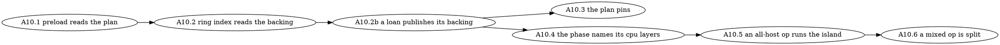

# fmcp addendum A10 (revision 2): a mapped load copies its routed host experts into pinned memory for the window ring

> **Execution:** `team-driven-development` in Claude Code. Addendum to
> `docs/plans/2026-11-13-fmcp-plan-1-qwen38-b70.md`, under epic llama.cpp-fmcp, ticket llama.cpp-gzzq.
> **Revision 2, 2026-11-14.** It replaces the text approved on 2026-11-14. That text pinned the experts through the
> loader, and its cost figure was wrong: the implementer's census stopped it before any code. This revision was
> written after addendum A12 merged, a re-measure, a code census and a spike.
> The owner approved revision 2 on 2026-11-14 (opt-out kept, no ring for mapped experts).
> **Amendment 1, 2026-11-14: task A10.2b is new.** Task A10.2's census found that an expert loan publishes its
> lent triplets with the wrong backing on a mapping load. The owner approved A10.2b on 2026-11-14 ("Do A10.2b
> now"), ticket llama.cpp-hqz7. Tasks A10.1 (merged, `93d00fbbe`), A10.2 and A10.3 are unchanged.
> **Amendment 2, 2026-11-14: task A10.4 is new.** The lead's early run of A10.2 and A10.2b gave 14.5 t/s at pp2048
> on a mapped load, against 58 to 80 on today's tree. A `cpu` decision takes a prompt path about 5 times slower
> than the one a mapped load takes today. The owner ruled "Fix the cpu path first" on 2026-11-14, ticket
> llama.cpp-ibg2. A10.4 awaits the owner's review. Tasks A10.2, A10.2b and A10.3 are unchanged. The merge waits
> for A10.4.
> **Amendment 3, 2026-11-15: task A10.4 is rewritten, and tasks A10.5 and A10.6 are new.** The owner approved
> A10.4 with the wider scope on 2026-11-14 ("Approve, wider scope": every `cpu` decision goes to the island), and
> ruled "Full wide before merge" on 2026-11-15: A10 stays unmerged until a mixed layer also runs on the fast path.
> A census and a device spike on GPT-OSS 120B and on the mapped Qwen pack came first ("Evidence for amendment 3").
> The owner approved the three tasks on 2026-11-15 ("Split, as written"). Tasks A10.2, A10.2b and A10.3 are
> unchanged. The merge waits for A10.6.

**Goal:** on a normal load (`-lm auto`, which maps the file), the host-executed routed experts are held once, in
pinned memory, when the device has a window ring and the host budget holds them. Prompts then take the ring without
`-lm none`. When they do not fit, they stay mapped, and the exec policy stops printing `ring` for layers it cannot
stream.

**Architecture:** the loader does not change. Every tensor stays in a `SYCL_Mapped` buffer. The single-device plan
marks the routed experts `PINNED` before it sizes the ring's room, and keeps that answer when room is held and the
host plan fits its budget. All of them or none. The preload, which today serves a mapped expert in place, reads the
plan's answer and copies a `PINNED` expert from the mapping into a WEIGHT-zone allocation. That is the copy a
`-lm none` load already makes. The ring's plan index stages a host expert only when its backing is pinned memory, so
a plan that left the experts mapped sizes no ring and runs those layers on the CPU.

**Tech stack:** C++ (ggml-sycl planner, preload, ring index), three C++ tests, one Python source pin, two docs.

**Test infrastructure:**
- `tests/test-sycl-layout-choice.cpp`, namespace `ring_room_case` (`:1564`): the real planner on a small MoE
  inventory with a staged type and a planned weight slot. It is the only test whose plans hold ring room. Its ctest
  registration pins `level_zero:1`, so the lead runs it.
- `ggml/src/ggml-sycl/tests/test-sycl-host-backing-plan.cpp`: the real planner on the Qwen3.8 inventory under a
  mocked device table. Its plans hold **no** ring room (`kv_for` leaves `moe_stream_staged_types` 0). Lead runs it.
- `ggml/src/ggml-sycl/tests/test-moe-stream-plan.cpp`: host test of the ring's plan index.
- `tests/test-sycl-host-backing-source.py`: source pins, pytest style (`def test_...`).

---

## Evidence (lead runs, 2026-11-14, B70 `level_zero:0`, exps-IQ4_NL pack, driver 26.44, tuning cache off)

All runs are `llama-bench -p 2048 -n 0`, one arm at a time. The host load was 10 to 44 and no builder ran. The
figures are not baselines. The full records are on llama.cpp-gzzq.

**The first look no longer describes the tree.** At `e47ab5a60` the mapped arm gave 11.48 t/s and `-lm none` gave
200.19 t/s. A9, A11 and A12 have merged since.

**Re-measure at `integ/th32` `20e4361e0`, quiet (`-r 5 -o json`), order mapped, pinned, pinned, mapped:**

| Arm | pp2048 t/s | Wall | Min `MemAvailable` |
|-----|-----------:|-----:|-------------------:|
| mapped | 79.93 ± 0.92 | 5:27 | 176.5 GB |
| `-lm none` | 159.64 ± 2.85 | 12:07 | 51.3 GB |
| `-lm none` | 159.55 ± 3.40 | 5:54 | 50.7 GB |
| mapped, after the pinned arms | 50.31 ± 3.10 | 11:28 | 173.0 GB |

- The mapped arm also gave 112.41 and 109.14 t/s at `-r 3` in A12's end-to-end, an hour earlier.
- A mapped arm that follows a pinned arm loads in 11 to 13 minutes and is slow for the whole run. The simplest
  reading is that the pinned allocation pushed the model's pages out of the file cache. It is not proven.

**What each load holds** (`-v` runs of the same pair):

| | mapped | `-lm none` |
|---|---|---|
| loader buffers | four `SYCL_Mapped` | one `SYCL_Host`, 70,014.66 MiB |
| host experts | `mapped=48723.9 MB` | `pinned/host_cpu=48721.3 MB` |
| pinned pool at load end | 6 GB | 124 GB (`WEIGHT=115.95/117.66`) |
| ledger | `host_expert_copy_cumulative=0.00` | `sycl_host_buffers=68.37 host_expert_copy_cumulative=47.58` |
| `[MOE-EXEC]` summary | 576 ring, 0 MiB streamed, 76,270 misses | 576 ring, 224,624 MiB streamed, 0 misses |

So `-lm none` holds each host expert twice: once in the loader's whole-model buffer and once as the preload's copy.

**Spike** (evidence branch `spike/a10-copy-pin` at `d7d30d127`, 11 lines, env-gated, never to be merged). With the
variable set, the plan answers `PINNED` for a routed expert on a mapping load and the preload copies it. One binary,
two arms by environment, quiet, order pin, map, map, pin:

| Arm | pp2048 t/s | Wall | Min `MemAvailable` |
|-----|-----------:|-----:|-------------------:|
| copy-pin | 160.79 ± 3.10 | 5:04 | 123.9 GB |
| mapped, after a pinned arm | 47.81 ± 0.69 | 13:06 | 173.5 GB |
| mapped | 81.92 ± 0.88 | 5:19 | 175.4 GB |
| copy-pin | 161.21 ± 3.74 | 4:53 | 124.6 GB |

- The copy-pin load keeps four `SYCL_Mapped` buffers and no `SYCL_Host` buffer.
- Load end: `pinned pool: 54.00 GB ... WEIGHT=47.58/47.66 ... sycl_host_buffers=0.00
  host_expert_copy_cumulative=47.58`.
- The plan's ledger line: `host_budget=162056695808 host_planned_bytes=55836673600 weight=48895977472`. The plan
  uses 55.8 GB of a 150.9 GiB budget.
- `[SYCL-PLAN] MoE window ring room on device 0: held 119.5 MB` and `DMA staging pool: 900.0 MB`. The pool is
  device memory. A mapped plan sizes it 0.
- `[MOE-EXEC] summary: 288 layer-ubatches ring, 0 cpu, 0 forced, 111931 MiB streamed, 2316 windows, 288 exposed,
  0 misses` on the `-r 1 -v` run, which gave 166.22 t/s.
- The count gate under copy-pin (`llama-cli`, default flags): rc 0, `grep -cx '1, 2, 3, 4, 5'` = 1.

**Reading.** Copy-pin gives the `-lm none` throughput with a 54 GB pinned pool in place of 124 GB. It is 2.0 times
the warm mapped arm and 3.4 times the cold one.

**Correction (amendment 2).** The two mapped figures are not a warm and a cold file cache. A mapped arm that ran
directly after two mapped arms still gave 49.48 t/s. What the verbose logs show at `20e4361e0`:
- The plan budget comes out 29898.0 MB or 29900.0 MB at the same reported free VRAM. The larger one leaves the
  WEIGHT zone one ring slot short. The first prompt graph then decides `cpu (ring-unavailable)`, one triplet is
  lent (`loan device`), and the run gives about 49 t/s (llama.cpp-az3g). Without a loan it gives 58 t/s verbose and
  80 quiet.
- A run that lent spends about 6 minutes in `reclaim_weight_entries` at unload (llama.cpp-ewu1). That is the long
  wall, and it is after the timing.
- A mapped load streams nothing in either mode: `0 MiB streamed`. Its summary counts the host layers under `ring`
  because the decision was `ring`; the executor then declines each op (`window-not-staged`) and the retained
  per-expert path runs the host experts on the prompt CPU island. Task A10.4 has the measurements.

Read "warm" in this addendum as "no loan" and "cold" as "with a loan".

**Not measured:** the B50, GPT-OSS, a load that does not fit, and the copy's cost in load time. The count-gate run
took 5:07 under copy-pin against 2:55 by default in A12's end-to-end, one sample each on different builds.

## Evidence for amendment 3 (lead runs, 2026-11-15, B70 `level_zero:0`, driver 26.44, tuning cache off)

All arms ran from the evidence branch `spike/a10-4-cpu-island` at `19a5aa9a1` (base `18d6e11e1`, env-gated, never
to be merged), under host load 12 to 34 with no build running, and the kernel log stayed clean. One binary, by
`GGML_SYCL_SPIKE_CPU_ISLAND`: 0 is today's routing. 1 is the task as amendment 2 wrote it (a CPU-decided layer the
staged claim covers runs whole on the retained per-expert path). 3 sends every all-host op of a type the island
runs to the island and leaves a mixed op hybrid. 4 is mode 3 plus the split of a mixed op. Absolute figures are
under load and are not baselines.

**Which loads the wider scope reaches.**
- GPT-OSS 20B on the B50: none of it. `weights=11536.5 MB device + 0.0 MB host`, no `[MOE-EXEC] layer` line, at
  the bench context and at the gate's default context (which demotes KV only).
- GPT-OSS 120B MXFP4 on the B70: `25959.5 MB device + 34479.6 MB host`, all host weight mapped. Layers 0 to 13
  are all on the device (gate and up `xmx_tiled`, down `soa`), layer 14 is mixed, layers 15 to 34 are all host.
  Every host layer decides `cpu (ring-unavailable)`: MXFP4 is never staged. Today each of them takes the hybrid
  route (54 `path=planner_hybrid`, no island line).
- The mapped Qwen pack: one mixed layer (7 at the gate's context, 12 at the bench's), all-host layers after it.

**Correctness.**

| Load and vehicle | today's routing | all-host ops on the island | plus the mixed split |
|---|---:|---:|---:|
| 120B, `llama-perplexity` on `docs/build.md`, `-c 512 --chunks 4 -b 512`, final estimate | 5.4112 | 5.4063 | 5.4064 |
| Qwen mapped, count gate (`grep -cx '1, 2, 3, 4, 5'`) | 1 | 1 (mode 1) | 1 |

- Anchor for the perplexity vehicle: GPT-OSS 20B, every expert on the device, gives 6.5310, and its prompt and
  decode paths differ by 3.7% on chunk 1. The 120B's three figures are within 0.1% of each other.
- 120B split: 6 ops split (layer 14: gate and up `xmx_tiled` through the WOQ arm, down `soa`), 114 ops on the
  island, no refusal, no fallback, no abort line. Path tags: 0 `planner_hybrid`, 45 `pp_onednn_f16_batched`, 51
  `pp_planned_route`.
- Qwen split: 3 ops at the gate (layer 7: 55 device experts, 457 host, device layout `aos`), 6 at pp512 (layer
  12: 14 device, 498 host). No refusal, no fallback, no abort line, no leaked lease line.
- So the split has run on three device layouts: WOQ tiled and SOA for MXFP4, and AOS on the f16 arm for IQ4_NL.
- The census's two open questions are answered yes on the device: on a mixed tiled op the route layout is the
  device operands' layout, and the retained batch and the planned scratch admit the device subset.

**Timing, GPT-OSS 120B, `llama-bench -p 2048 -n 0 -r 3 -o json`, mirror order.**

| Mode | first | mirror |
|---|---:|---:|
| 0, hybrid | 70.01 ± 0.43 | 69.96 ± 0.43 |
| 3, island, mixed op hybrid | 115.89 ± 1.25 | 114.63 ± 0.79 |
| 3 with a lease per island task | 105.81 ± 19.1 | 93.39 ± 0.66 |
| 4, island and split | 117.44 ± 0.56 | 114.25 ± 1.81 |

**Timing, mapped Qwen.**

Mode 1 and mode 4 differ only on the mixed layer (layer 12 at the bench's context: 14 experts on the device, 498
on the host). Mode 1 runs the whole op on the retained per-expert path, so the 14 device experts run with the
per-expert kernels. Mode 4 splits it.

`llama-bench -p 2048 -n 0 -r 3 -o json`, two runs of four arms, each arm with its mode:

| Run | arm 1 | arm 2 | arm 3 | arm 4 |
|---|---:|---:|---:|---:|
| first | mode 1: 88.67 ± 0.39 | mode 4: 87.44 ± 0.88 | mode 4: 93.33 ± 3.25 | mode 1: 104.41 ± 0.47 |
| second | mode 4: 85.25 ± 0.80 | mode 1: 86.60 ± 0.70 | mode 1: 108.20 ± 0.48 | mode 4: 102.01 ± 3.72 |

In both runs the host moved from about 86 t/s to about 105 t/s between the second and the third arm, whatever
the mode. Mode 4 is below mode 1 in all four neighbouring pairs: by 1.4% and 1.6% in the two pairs that sat in
one host state, by 5.7% in the fast state, and by 10.6% in the pair that straddled the change.

`llama-bench -p 512 -n 0 -r 1 -v` with `GGML_SYCL_MOE_ROW_AGG_DEBUG=1`, every stderr line stamped on arrival;
the time of an op is the gap between two row-agg lines:

| Arm | pp512 | mixed layer's op, median | all-host op, median | all-device op, median |
|---|---:|---:|---:|---:|
| mode 1 | 26.00 | 155 ms | 104 to 109 ms | 160 to 177 ms |
| mode 4 | 30.81 | 65 ms | same | same |
| mode 4 | 31.69 | 69 ms | same | same |
| mode 1 | 22.68 | 160 ms | same | same |

Under the debug switch the order is the other way round. That regime runs about three times slower per token
than the quiet one (30 t/s against 87), so it does not time the path a user runs. The quiet pairs are the
verdict.

**Readings.**
1. The island is 1.65 times the hybrid route on the 120B's all-host layers. On Qwen the narrow reroute was
   already measured above today's tree (68.46 and 66.63 against 62.42 and 53.76, pp2048, 2026-11-14).
2. The split is correct on both models. On the 120B its whole-run gain over the hybrid route is inside the
   spread, because one layer in 36 is mixed. On the mapped Qwen pack it costs 1.4% to 5.7% of pp2048 against
   mode 1 (four of four pairs), because that pack's mixed layer has few device experts and the per-expert
   kernels run them cheaper than the batched executor does. Both modes are far above today's tree there (53.76
   to 62.42). The 120B has no such comparison: its mixed layer's gate and up are tiled, and the per-expert
   kernels cannot read a tiled expert. Decision 14 carries the choice.
3. A lease per island task is slower. Not adopted.
4. The 120B cannot be scored by the budget-0 chat gate: it answers wrong on today's tree as well
   (llama.cpp-wx93). With reasoning left on it answers `1, 2, 3, 4, 5`, and its raw completion and perplexity are
   sound. Row 24 of the end-to-end uses the reasoning-on form.

**Reference patch.** The three tasks' GREEN was applied by the lead to a scratch copy of `18d6e11e1` before this
amendment was written. The source pin of each task is false on the stage before the task and true after it, and
every mutant is caught (`48 passed` at the base, then `50`, `52` and `54`). The three changed translation units
compile syntax-only, `ggml-sycl.cpp` in both its plain and its private-testing form, with no warning on a patched
line, and the six other source pins that name a changed statement keep their results. It was not built or run:
the spike binary above carries the same routing behind its switch, written separately.

## What the code does today (read at `20e4361e0`; verify each anchor before editing)

**Plan, single device (`compute_placement_plan`, `unified-cache.cpp:36520`).**
- `placement_host_backing_when_host` (`:35067`) gives every routed expert `FILE_MAPPED` on a mapping load. It runs
  when the entry is made (`:36643`), before any expert is placed.
- `hold_moe_stream_ring_room` (`:36407`) is called once, at `:36948`. It returns with no room when
  `kv_info.moe_stream_staged_types == 0`, when the planned weight slot is 0, or when there is no MoE group. It
  sizes the room with `moe_stream_plan_ring_geometry`, which builds the ring's plan index.
- The expert pack follows. A group left on the host is charged at `:37001`, at its entries' `src_size`, each by its
  own backing. No routed expert is charged to a host term before that line.
- Then, at `:37065-37067`: `placement_mark_device_entries_file_mapped`, `populate_host_zone_sizing`,
  `record_host_ledger_plan`.
- `populate_host_zone_sizing` (`:35094`) assigns the plan's fields and never accumulates into them. It logs its
  `[SYCL-PLAN]` lines on every call. It holds the only reader of `has_pinned_backing()` (`:35568`), which sizes
  the DMA staging pool.
- `record_host_ledger_plan` (`:35000`) sets `plan.host_budget` and `plan.host_zone_terms`, then calls
  `placement_plan_decide_lazy_residency` (`:34777`). That pass clears the lazy tables first, decides them against
  what the budget leaves after the zone terms, and sets `plan.host_planned_bytes`. It logs WARN lines and counts
  its ring coverage reads. A plan over budget logs a would-refuse WARN and is kept.

**Plan, multi device (`compute_multi_device_plan`, `:37989`).** It never calls `hold_moe_stream_ring_room`. Its
host charges use other size bases (`:38258`, `:38509`). The same three calls end it at `:39115-39117`.

**Plan helpers (`unified-cache.hpp`).**
- `host_backing_sizes_weight_zone` (`:1515`) is true for `PINNED` and `HOST_CPU` only.
- `charge_host_weight` (`:1529`) and `uncharge_host_weight` (`:1549`) are exact inverses per backing.
- `placement_entry::host_backing` defaults to `PINNED` (`:449`).
- `lookup_expert_placement` (`:1701`) returns an `expert_placement_result` (`:378`) with no `host_backing`.

**Preload (`ggml-sycl.cpp`).** The lambda `register_host_aos_expert` (`:44477`) has one caller, at `:44822`, where
`placement` from `lookup_expert_placement` (`:44752`) is in scope.
- `served_in_place = !tensor_source_is_device && ggml_sycl_mapped_buffer_owner(tensor->buffer, &host_owner)`
  (`:44508`). In place, the entry points at the mapping and holds the mapping's owner.
- Otherwise `ggml_sycl_host_expert_alloc` allocates in the WEIGHT zone, `mem_copy` fills it from the source, and
  `host_expert_copy_cumulative_bytes` counts it (`:44534`).
- When that allocation fails and the source is host memory, the branch at `:44535` registers the source pointer
  with **no** owner.

**Ring (`moe-stream-plan.hpp`).**
- `moe_stream_plan_index_build` (`:234`) lists every host routed-expert entry as an item and reads no backing. An
  item the executor claims stages `AOS_ONLY`; any other stages `NONE`.
- `moe_stream_layer_claimed` (`:387`) is false when any item of the layer stages `NONE`.
- `moe_stream_owner_streamable` (`:505`) accepts only a `HOST_PINNED` `WEIGHT` owner in a host zone of the device.
  A mapped expert has none, so the stager skips it and the window counts a miss.

**Loader.** `ggml_backend_sycl_planned_host_backing` (`ggml-sycl.cpp:54713`) answers `FILE_MAPPED` for a
routed-expert tensor on a mapping load. **This revision leaves it and the loader alone.**

**Tests that stay true.** `test-sycl-host-weight-zone-terms.cpp` arm 3a (no weight answers a backing that keeps
`SYCL_Host` on a mapping plan) and arm 3b (the WEIGHT zone does not grow for the mapped buffer) both hold, because
the loader keeps mapping. Arm 3b builds the buffer and binds no tensor, so no existing device test runs the preload
over a mapped buffer. The lead's end-to-end runs 4 and 5 are the preload's device test.

## Decisions this addendum takes (owner to confirm by approving it)

1. **The copy is made from the mapping, by the preload.** The loader's answer for a routed-expert tensor stays
   `FILE_MAPPED`. No whole-model host buffer exists on a mapping load.
2. **All or none per plan.** Either every host-executed routed expert of the plan is pinned, or none is.
3. **The fit rule is the ledger's own figure.** The plan is sized with the experts pinned. It is kept when ring
   room is held, `host_planned_bytes` is at most the host budget, and no lazy table refuses. Otherwise the experts
   go back to `FILE_MAPPED`, the host zones are sized again, and one WARN line says why. The ledger lines print
   twice in that case only.
4. **Pinned experts come before lazy tables.** The lazy pass already decides tables against what the zone terms
   leave. A pinned plan can therefore read a table from storage that a mapped plan would have held in RAM.
5. **One opt-out, default on:** `GGML_SYCL_MOE_PIN_HOST_EXPERTS=0` keeps the experts mapped. It is read when the
   plan is made. It lets the end-to-end compare the two paths in one binary, and it is the user's way back.
6. **`-lm mmap+mlock` keeps its experts mapped.** The user asked for a locked mapping; pinning as
   well would hold the bytes twice. With task A10.2 those layers run on the CPU and print `cpu`, not `ring`.
   *Corrected 2026-11-15:* this line also named `-lm mlock`. That mode reads the file and locks the buffer; it has
   no mapping, so the plan pins as it does under `-lm none`. It also aborts at load on this pack, before and after
   this addendum (llama.cpp-phse).
7. **A mapped host expert is never ring-staged.** A plan that left the experts mapped sizes no ring and holds no
   ring room. Today such a load holds 119.5 MB of device room for a ring that streams nothing.
8. **Multi-device plans are unchanged.** They hold no ring room today. Holding it per device is its own change.
9. **The mapping's pages are left to the kernel.** After the copy they are clean file cache. No `madvise` call is
   added here.
10. **`-lm none` is unchanged.** Its double holding is a separate defect and gets its own ticket.
11. **The storage path is separate.** Reading experts from the NVMe straight into pinned windows, for packs whose
    experts do not fit in RAM, is the owner's second request. It gets its own spike and addendum after this one.
12. ~~A `cpu` decision runs the CPU island where the staged claim covers the layer (amendment 2).~~ Replaced by
    decisions 13 to 17.
13. **Every `cpu` decision runs the CPU island where the island can run the op (amendment 3; owner: "Approve,
    wider scope").** The choice is made per prompt op (`moe_pp_cpu_split_choose`), from the phase's decision and
    the plan's residency counts. It does not ask the staged claim, so MXFP4 host layers move as well.
14. **A mixed op is split (owner: "Full wide before merge").** The batched executor runs its device experts, as
    it runs an all-device layer's, and the island runs its host experts, one after the other. On the mapped Qwen
    pack the split measured 1.4% to 5.7% below amendment 2's narrow mode at pp2048. That mode runs the mixed
    layer's few device experts (14 of 512) with the per-expert kernels. The split is the drafted choice because
    it is one rule for every layout (the per-expert kernels cannot read a tiled expert) and its cost at a low
    device share is small. The owner chose it on 2026-11-15 ("Split, as written") over keeping the per-expert
    kernels for a mixed op whose device experts are in AOS. Running the two halves at the same time is a
    follow-up (llama.cpp-peww).
15. **What keeps the hybrid route at prefill:** a fused or chunked matrix; a type that needs its direct kernel
    (Q1_0, NVFP4) or has no CPU `vec_dot`; an expert the plan does not place, or places on another device; a load
    that routes experts to a second device (`GGML_SYCL_MOE_MULTI_GPU`, in line with decision 8); and a mixed op
    whose device experts the executor does not take in their planned layout, or under one of three opt-in layout
    knobs. Decode is unchanged.
16. **The island's leases are unchanged.** Copying a group's lease into every island task was measured slower.
17. **No new environment variable.** No switch brings the hybrid route back for an op the split takes. The
    end-to-end compares against today's tree's binaries.

---

## Team Topology

**Implementers:** 2. One (Opus: ownership and placement code) takes track F in order, in one worktree. A second
(Opus: dispatch routing in `ggml_sycl_mul_mat_id`) takes track G in order (A10.4, A10.5, A10.6), in its own
worktree, on a branch cut from the reviewed head of A10.2b (`18d6e11e1`).
**Reviewers:** spec then quality, fresh each round, Opus. Each task is reviewed on its own commit range.
**Merge:** A10.1 changes no behaviour and merges when it passes. A10.2, A10.2b, A10.3, A10.4, A10.5 and A10.6
merge together, after the lead's end-to-end. The lead merges track F's branch into track G's for that run, and
builds the result.

| Track | Tasks | Description |
|-------|-------|-------------|
| F | A10.1, A10.2, A10.2b, A10.3 | the preload reads the plan; the ring index reads the backing; a loan publishes its backing; the plan pins |
| G | A10.4, A10.5, A10.6 | the phase names its CPU-decided layers; an all-host op runs the island; a mixed op is split |



### File Ownership Map

| File | Task | Change |
|------|------|--------|
| `ggml/src/ggml-sycl/unified-cache.hpp` | A10.1 | `expert_placement_result` carries `host_backing` |
| `ggml/src/ggml-sycl/ggml-sycl.cpp` | A10.1 | `register_host_aos_expert` and its one call site |
| `ggml/src/ggml-sycl/tests/test-sycl-host-backing-plan.cpp` | A10.1 | one check in arms 1 and 2 |
| `tests/test-sycl-host-backing-source.py` | A10.1, A10.3 | one clause each; A10.3 also updates the pinned-site list |
| `ggml/src/ggml-sycl/moe-stream-plan.hpp` | A10.2 | `moe_stream_plan_index_build` reads `host_backing` |
| `ggml/src/ggml-sycl/tests/test-moe-stream-plan.cpp` | A10.2, A10.2b | one new test function each |
| `tests/test-sycl-moe-stream-enqueue-source.py` | A10.2 | the claim-guard pin follows the new guard (found by the census) |
| `ggml/src/ggml-sycl/unified-cache.hpp` | A10.2b | `placement_plan::set_expert_host_backing` |
| `ggml/src/ggml-sycl/ggml-sycl.cpp` | A10.2b | one call in the loan transaction's publication loop |
| `ggml/src/ggml-sycl/moe-stream-plan.hpp` | A10.2b | two comments that describe the loan |
| `ggml/src/ggml-sycl/tests/test-sycl-host-backing-accounting.cpp` | A10.2b | one new arm |
| `tests/test-sycl-moe-expert-loan-source.py` | A10.2b | one clause beside `FLIP` |
| `ggml/src/ggml-sycl/unified-cache.cpp` | A10.3 | three helpers; one call before the ring room; one call ends each builder |
| `tests/test-sycl-layout-choice.cpp` | A10.3 | one new test function in `ring_room_case` |
| `docs/backend/sycl-env-vars.md` | A10.3 | one row |
| `docs/design/sycl-mmap-host-tier.md` | A10.3 | §4.4: the expert row (`:1188`) and the sentence at `:1195` |
| `ggml/src/ggml-sycl/moe-stream-plan.hpp` | A10.4 | `moe_pp_cpu_split`, its facts and `moe_pp_cpu_split_choose`; one phase method's declaration |
| `ggml/src/ggml-sycl/moe-stream-plan.cpp` | A10.4 | `moe_stream_phase::cpu_decided` |
| `ggml/src/ggml-sycl/tests/test-moe-stream-phase.cpp` | A10.4 | one new test function and its call |
| `tests/test-sycl-staged-ring-route-source.py` | A10.4, A10.5, A10.6 | one new claim with its mutants each; A10.5 also moves two constants and two mutants |
| `ggml/src/ggml-sycl/ggml-sycl.cpp` | A10.5 | two helpers; six sites inside `ggml_sycl_mul_mat_id` |
| `docs/backend/sycl-memory-design.md` | A10.5, A10.6 | the "Two regimes" paragraph |
| `docs/backend/sycl-env-vars.md` | A10.5 | the `GGML_SYCL_MOE_EXEC` and `GGML_SYCL_MOE_EXEC_DECLINE_LAYER` text |
| `scripts/sycl-moe-exec-gate.sh` | A10.5 | the `Q_decline` header comment (`:69-70`), which says the layer runs the hybrid path |
| `ggml/src/ggml-sycl/ggml-sycl.cpp` | A10.6 | one claim; one line in the helper; five sites inside the executor lambda |

Tracks F and G both touch `ggml-sycl.cpp`, `moe-stream-plan.hpp` and `docs/backend/sycl-env-vars.md`, in different
places. A10.3's `ggml-sycl.cpp` hunks are near `:434` and `:35366`; track G's are after `:85046` and inside
`ggml_sycl_mul_mat_id` (`:85769` on). Track G runs `git merge-tree` against `task/a10-host-expert-pin` each round
as well.

Run `git merge-tree` against `integ/th32` each round.

**Rules for every task.**
- No device binary, no model load, no `ctest`: the lead runs those.
- Build only on the lead's literal GO, bound to a sha. Syntax-only compile every changed `.cpp` after the last
  edit, with its own command from the worktree's `compile_commands.json`.
- Never amend a reported commit. Path-scoped commits. One trailer: `Co-Authored-By: Claude Opus 5.5
  <noreply@anthropic.com>`.
- Comments give reasons. No ticket ids, task numbers or review rounds in code.
- `clang-format-19 --dry-run -Werror` on the lines you wrote only. Comment lines are 120 columns or fewer.
- codescout is blind inside `ggml-sycl.cpp`. Search it with `cat <file> | grep -n`.
- STOP and message the lead when a census answer contradicts this addendum. Do not design around it.

---

### Task A10.1: the preload serves a host expert in place only when the plan left it mapped

**Track:** F. **Depends on:** none. Branch from `integ/th32` at `20e4361e0` or later.

**Description:** the preload decides in place or copy from the buffer's kind alone. This task makes it read the
plan's backing for that expert. No plan pins a mapped expert yet, so nothing changes at run time.

**Acceptance criteria:**

- [ ] `lookup_expert_placement` returns the entry's `host_backing`.
- [ ] `register_host_aos_expert` serves in place only when the plan's backing holds no WEIGHT-zone block.
- [ ] A failed pinned allocation over a `SYCL_Mapped` source registers the mapping **with its owner** and warns
      once per tensor.
- [ ] Every existing test and pin is green. Behaviour on today's plans is unchanged.

#### Step 1: census

1. `cat ggml/src/ggml-sycl/ggml-sycl.cpp | grep -n 'register_host_aos_expert('`: confirm one caller.
2. Read `ggml_sycl_mapped_buffer_owner`. Does it write `*owner` when it returns false? The code below assumes it
   may, and clears the handle.
3. Where is `logged_host_layout` declared? The new once-per-tensor flag goes beside it.

#### Step 2: RED

In `test-sycl-host-backing-plan.cpp`, a helper after `take_census` (`:251`):

```cpp
// Routed-expert entries whose lookup result does not carry the entry's own backing.
size_t lookup_backing_mismatches(const placement_plan & plan) {
    size_t n = 0;
    for (const placement_entry & e : plan.entries) {
        if (e.expert_id < 0 || e.layer_id < 0) {
            continue;
        }
        const auto found = plan.lookup_expert_placement(e.layer_id, e.expert_id, e.expert_role);
        n += !found.found() || found.host_backing != e.host_backing;
    }
    return n;
}
```

- In `arm1_mapping_load`, after the census checks:
  `check_eq("routed experts whose lookup result does not carry their backing", lookup_backing_mismatches(plan), 0);`
- The same line in `arm2_copying_load`.
- RED evidence: the syntax-only compile of the test TU fails on `host_backing` not being a member of
  `expert_placement_result`. Report the error lines.

In `tests/test-sycl-host-backing-source.py`, one test in the file's style, built on its `read`, `strip_comments`
and `balanced` helpers:

```python
def test_the_preload_serves_in_place_only_what_the_plan_left_mapped():
    src = strip_comments(read("ggml/src/ggml-sycl/ggml-sycl.cpp"))
    start = src.index("auto register_host_aos_expert = [&](")
    body = balanced(src, src.index("{", start))
    cond = body[body.index("served_in_place ="):]
    cond = cond[:cond.index(";")]
    assert "host_backing_sizes_weight_zone(planned_backing)" in cond, cond
    assert cond.index("host_backing_sizes_weight_zone") < cond.index("ggml_sycl_mapped_buffer_owner"), cond
    assert "getenv" not in body
```

Run it and show it failing on the first assertion.

**Commit:** `test(sycl): the preload reads the plan's backing for a host expert (RED)`, staging the two test files.

#### Step 3: GREEN

`unified-cache.hpp`, in `expert_placement_result` (`:378`), after `on_device`:

```cpp
    // The plan's host backing for this expert. For a host-executed expert, a backing that sizes the WEIGHT zone means
    // the preload holds it there; FILE_MAPPED means the CPU reads the mapping in place.
    placement_host_backing host_backing = placement_host_backing::PINNED;
```

and in `lookup_expert_placement` (`:1701`), beside the `src_size` assignment (`:1717`):
`result.host_backing = e.host_backing;`. If `placement_host_backing` is declared after the struct, move nothing:
report it and STOP.

`ggml-sycl.cpp`, the lambda's signature (`:44477`):

```cpp
                    auto register_host_aos_expert = [&](int64_t e, const uint8_t * expert_aos,
                                                        ggml_sycl::placement_host_backing planned_backing,
                                                        const char * reason) -> bool {
```

the decision (`:44503-44509`):

```cpp
                        // A SYCL_Mapped source is served in place when the plan left the expert mapped: the CPU
                        // executes the file layout (host experts are AOS), and the entry holds the mapping's owner.
                        // When the plan gave it a WEIGHT-zone block, the window ring streams it, and the ring copies
                        // only from pinned memory, so it is copied out of the mapping as any other source is.
                        ggml_sycl::mem_handle host_owner;
                        const bool            served_in_place =
                            !tensor_source_is_device &&
                            !ggml_sycl::placement_plan::host_backing_sizes_weight_zone(planned_backing) &&
                            ggml_sycl_mapped_buffer_owner(tensor->buffer, &host_owner);
```

the allocation-failure branch (`:44535-44538`):

```cpp
                        } else if (!tensor_source_is_device) {
                            // No pinned room: the source is served in place. A SYCL_Mapped source keeps its mapping's
                            // owner, as a planned in-place expert does; the window ring cannot stream this expert, so
                            // the load says so once per tensor. Any other host source is registered unowned.
                            host_owner = {};
                            if (ggml_sycl_mapped_buffer_owner(tensor->buffer, &host_owner)) {
                                if (!logged_pin_alloc_failed) {
                                    GGML_LOG_WARN("[MOE-LAYOUT] tensor=%s device=%d expert=%lld: no pinned room for "
                                                  "%zu bytes the plan pinned; served from the mapping, and the "
                                                  "window ring will not stream it\n",
                                                  tensor->name ? tensor->name : "?", device,
                                                  static_cast<long long>(e), expert_size);
                                    logged_pin_alloc_failed = true;
                                }
                            } else {
                                host_owner = {};
                            }
                            host_ptr = const_cast<uint8_t *>(expert_aos);
                        } else {
```

- Declare `bool logged_pin_alloc_failed = false;` beside `logged_host_layout`.
- The caller (`:44822`): `register_host_aos_expert(e, expert_aos, placement.host_backing, "planner-host")`.

Run the Python pin: green. Syntax-only compile `ggml-sycl.cpp` and the test TU.

**Commit:** `sycl: the preload serves a host expert in place only when the plan left it mapped`.

#### Gotchas

- **Operand order matters.** The plan test comes before `ggml_sycl_mapped_buffer_owner`, so a pinned expert never
  takes the mapping's owner into `host_owner` before the allocation replaces it.
- On a `-lm none` load every entry is `PINNED` and the source is not `SYCL_Mapped`. Both old and new conditions
  are false there.
- Do not touch the loader or `ggml_backend_sycl_planned_host_backing`.
- **Build** only on the lead's GO: targets `test-sycl-host-backing-plan llama-bench llama-cli`.
- Lead's check before review: `test-sycl-host-backing-plan` rc 0, and the count gate on the B70 with default
  flags still shows `mapped=` host experts and passes.

---

### Task A10.2: the ring's plan index stages a host expert only from pinned memory

**Track:** F. **Depends on:** A10.1.

**Description:** the index lists a mapped host expert as streamable, so the planner sizes a ring for it, the
policy prints `ring`, and the stager then skips it. This task makes the index read the backing. A plan with mapped
host experts then sizes no ring, holds no room, and runs those layers on the CPU.

**Acceptance criteria:**

- [ ] A host-planned entry whose backing does not size the WEIGHT zone stages `NONE`.
- [ ] A layer with such an entry is not claimed (`moe_stream_layer_claimed` false), and a plan made only of such
      layers has ring geometry 0.
- [ ] Entries lent from the device (`as_host`) are read exactly as today.
- [ ] Every existing case in `test-moe-stream-plan.cpp` is green unchanged: its entries default to `PINNED`.

#### Step 1: census

1. Every caller of `moe_stream_plan_index_build` and `moe_stream_plan_ring_geometry`. For each, say whether the
   plan it passes can hold `FILE_MAPPED` host experts, and what the caller does with a geometry of 0.
2. `begin_layer` in `moe-stream-plan.cpp`: name the branch a host layer takes when `moe_stream_layer_claimed` is
   false, and the `[MOE-EXEC]` counter it lands in.
3. Source pins under `tests/` naming `moe_stream_plan_index_build`, `moe_stream_layer_claimed` or
   `moe_stream_owner_streamable`. Run each and its `--self-test` before editing. Report the rc.

#### Step 2: RED

In `test-moe-stream-plan.cpp`, after `test_window_sizing`, and called from `main` beside it:

```cpp
// The ring copies only from pinned memory, so a host expert the plan left mapped stages nothing: its layer is not
// claimed and takes no slot. A lent device triplet is read as before.
void test_mapped_host_experts_are_not_staged() {
    ggml_sycl::moe_stream_window_hints hints;
    hints.weight_slot_bytes = 10 * kSrc;

    placement_plan mapped = make_typed_plan();
    for (ggml_sycl::placement_entry & e : mapped.entries) {
        if (e.expert_id >= 0 && !e.on_device) {
            e.host_backing = ggml_sycl::placement_host_backing::FILE_MAPPED;
        }
    }
    auto idx = ggml_sycl::moe_stream_plan_index_build(mapped, 0, nullptr, claims_all, hints);
    CHECK(idx.role_items_max == 0);
    CHECK(idx.window_slots == 0);
    CHECK(idx.layers.count(0) == 1 && !ggml_sycl::moe_stream_layer_claimed(idx.layers.at(0)));
    CHECK(ggml_sycl::moe_stream_plan_ring_geometry(mapped, 0, nullptr, claims_all, hints).bytes == 0);

    // One mapped expert in a pinned layer leaves the layer unclaimed, and the ring is sized over the others.
    placement_plan mixed = make_typed_plan();
    for (ggml_sycl::placement_entry & e : mixed.entries) {
        if (e.layer_id == 0 && e.expert_id == 1) {
            e.host_backing = ggml_sycl::placement_host_backing::FILE_MAPPED;
        }
    }
    idx = ggml_sycl::moe_stream_plan_index_build(mixed, 0, nullptr, claims_all, hints);
    CHECK(!ggml_sycl::moe_stream_layer_claimed(idx.layers.at(0)));
    CHECK(ggml_sycl::moe_stream_layer_claimed(idx.layers.at(2)));

    // The control: the same plan with every host expert pinned is claimed, as test_window_sizing sizes it.
    const placement_plan pinned = make_typed_plan();
    idx = ggml_sycl::moe_stream_plan_index_build(pinned, 0, nullptr, claims_all, hints);
    CHECK(idx.window_slots == 3);
    CHECK(ggml_sycl::moe_stream_layer_claimed(idx.layers.at(0)));
}
```

- Layer 1 of `make_plan` holds a fused `GATE_UP` host entry and is never claimed. The test uses layers 0 and 2.
- If `idx.layers` is not a map with `count` and `at`, use the container's own lookup and say so.
- RED evidence: the lead builds `test-moe-stream-plan` at the RED commit and runs it. Report the `CHECK failed
  line` lines you expect: the four checks on `mapped` and the first on `mixed`.

**Commit:** `test(sycl): a mapped host expert is not ring-staged (RED)`.

#### Step 3: GREEN

In `moe_stream_plan_index_build`, where the claim is asked (`if (library_claims != nullptr &&
moe_stream_item_aos_fits(item, SIZE_MAX))`):

```cpp
        // The ring copies a host expert only out of pinned memory (moe_stream_owner_streamable). A host-planned
        // expert whose backing holds no WEIGHT-zone block is read in place from its mapping, so it stages NONE and
        // its layer runs on the CPU. A lent device triplet is not asked: its host copy is the loan's business.
        const bool mapped_host = !e.on_device && !placement_plan::host_backing_sizes_weight_zone(e.host_backing);
        if (!mapped_host && library_claims != nullptr && moe_stream_item_aos_fits(item, SIZE_MAX)) {
```

Nothing else changes. Run the pins from the census again.

**Commit:** `sycl: the window ring's plan index stages a host expert only from pinned memory`.

#### Gotchas

- **This changes today's mapped load.** It holds no ring room and its host layers print `cpu`. That is the path
  decision 7 names, and the lead measures it as the opt-out arm. It does not merge before the end-to-end.
- **The planner sizes the ring's room through this index.** After this task a mapping load holds no room until
  A10.3 marks the experts pinned before the room is sized. That order is why A10.3 pins first and checks after.
- `tests/test-sycl-moe-stream-enqueue-source.py` pins the text of the owner check. This task does not edit that
  check.
- **Build** only on the lead's GO: targets `test-moe-stream-plan test-moe-stream-phase test-sycl-layout-choice
  llama-bench llama-cli`.

---

### Task A10.2b: a lent expert's plan entry reads `PINNED` while it is lent

**Track:** F. **Depends on:** A10.2. **Added by amendment 1.**

**Description:** the expert loan lends device-resident triplets to the host so the window ring has room, then
streams them through the ring like any host expert. The transaction copies each lent member into a pinned
WEIGHT-zone block (`ggml_sycl_host_expert_alloc`, `ggml-sycl.cpp:22688`) and publishes a plan whose entry says
host. On a load that maps files every device entry reads `FILE_MAPPED`, its staging source
(`placement_mark_device_entries_file_mapped`), and `update_expert_placement` flips `on_device` and the target only.
So the published plan says `FILE_MAPPED` for bytes that are in pinned memory. After A10.2 the index would stage
nothing for the triplets the loan was sized to stream. This task makes the published plan say what the loan did.

It is the same rule as A10.1 and A10.2, applied to the one writer they missed: the plan's backing is the fact.

**Evidence that loans are live:** a default (mapped) Qwen3.8 load on the B70 at pp2048 prints
`[MOE-EXEC] loan device 0: 1 triplets, 2 MiB lent to the ring (OK)` (lead runs `a10-remeasure/mapped-2`,
`a11-merged/qwen-mapped`). The copy-pin spike printed none at that prompt size.

**Acceptance criteria:**

- [ ] `placement_plan::set_expert_host_backing(layer, expert, role, backing)` changes one entry's backing and moves
      its `src_size` between the host terms. Every term equals a recount afterwards.
- [ ] After a loan each lent entry reads `PINNED`. After a refill it reads `FILE_MAPPED` when the plan's
      `host_backing_maps_files` is set, and `PINNED` otherwise.
- [ ] On a mapping plan, the index of the published post-loan plan stages the lent triplet exactly as the `as_host`
      read sized it.
- [ ] `update_expert_placement` is unchanged, and arm (h) of `test-sycl-host-backing-accounting.cpp` is green
      unchanged.
- [ ] A `-lm none` load publishes the same backings as today (`PINNED` before, during and after a loan).

#### Step 1: census

1. The refill path that leaves a triplet on the host (`[MOE-EXEC] refill device %d: layer %d expert %d stays on the
   host`, `ggml-sycl.cpp:22745`): confirm its entry is not flipped, so it keeps `PINNED` from the loan. Cite lines.
2. The `if (loaned)` block (`ggml-sycl.cpp:22834-22850`): confirm nothing between the flip and the publication can
   run for one member and not the others, so a triplet is never published half set.
3. Name the test binary that runs the in-tree loan fixtures (`ggml-sycl.cpp:~25400-26100`) and say whether any
   fixture plan sets `host_backing_maps_files`. That binary joins the build targets.
4. Run before editing, and report the rc: `tests/test-sycl-moe-expert-loan-source.py`,
   `tests/test-sycl-host-backing-source.py` (its `test_only_the_helpers_write_the_host_terms` and
   `test_update_expert_placement_moves_bytes_through_the_helpers` may name the writers of the host terms),
   `tests/test-sycl-moe-stream-enqueue-source.py`. A pin that must follow GREEN is edited in the GREEN commit; say
   which and why before touching one that is not on the ownership map.
5. Report only, no code: where the host WEIGHT zone is sized, what a loan's copy allocates from on a mapping load
   today (the 2 MiB loan above succeeds), and whether a loan larger than the zone's reserve can grow it or stops
   with `host pinned pool exhausted`.

#### Step 2: RED

(a) In `ggml/src/ggml-sycl/tests/test-sycl-host-backing-accounting.cpp`, after
`test_an_expert_moving_between_tiers_follows_its_backing`, and called from `main` after it:

```cpp
static void test_a_lent_expert_reads_pinned_until_it_is_refilled() {
    printf("(i) set_expert_host_backing moves one entry's bytes between its backings' terms\n");
    placement_plan plan{};
    plan.host_backing_maps_files = true;
    plan.entries.push_back(
        make_entry("blk.0.ffn_gate_exps.weight", 64 * MiB, 80 * MiB, placement_host_backing::FILE_MAPPED, true, 0, 5));
    plan.entries[0].vram_charge_size = 80 * MiB;
    plan.entries[0].target_device    = 0;
    plan.weight_vram_bytes           = 80 * MiB;
    plan.vram_bytes                  = 80 * MiB;
    plan.build_index();
    plan.recount_host_mapped_source_bytes();
    const expert_tensor_role gate = expert_tensor_role::GATE;

    // The loan: the transaction flips the entry to the host, then says its copy is pinned.
    check_true("lend: flip", plan.update_expert_placement(0, 5, gate, false, -1));
    check_true("lend: backing", plan.set_expert_host_backing(0, 5, gate, placement_host_backing::PINNED));
    check_true("lent: the entry reads PINNED", plan.entries[0].host_backing == placement_host_backing::PINNED);
    check_eq("lent: weight_host", plan.weight_host_bytes, 64 * MiB);
    check_eq("lent: host_mapped", plan.host_mapped_bytes, 0);
    check_eq("lent: host_bytes", plan.host_bytes, 64 * MiB);
    check_eq("lent: no mapped source", plan.host_mapped_source_bytes, 0);

    // The refill: back on the device, it is staged from the mapping again.
    check_true("refill: flip", plan.update_expert_placement(0, 5, gate, true, 0));
    check_true("refill: backing", plan.set_expert_host_backing(0, 5, gate, placement_host_backing::FILE_MAPPED));
    check_true("refilled: FILE_MAPPED", plan.entries[0].host_backing == placement_host_backing::FILE_MAPPED);
    check_eq("refilled: weight_host", plan.weight_host_bytes, 0);
    check_eq("refilled: host_bytes", plan.host_bytes, 0);
    check_eq("refilled: weight_vram", plan.weight_vram_bytes, 80 * MiB);
    check_eq("refilled: the mapped source again", plan.host_mapped_source_bytes, 64 * MiB);
    plan.recount_host_mapped_source_bytes();
    check_eq("refilled: the running source equals a recount", plan.host_mapped_source_bytes, 64 * MiB);

    // The same backing again changes nothing, and an expert the plan does not hold is refused.
    check_true("no-op", plan.set_expert_host_backing(0, 5, gate, placement_host_backing::FILE_MAPPED));
    check_eq("no-op: the mapped source", plan.host_mapped_source_bytes, 64 * MiB);
    check_true("unknown expert", !plan.set_expert_host_backing(0, 6, gate, placement_host_backing::PINNED));
}
```

(b) In `ggml/src/ggml-sycl/tests/test-moe-stream-plan.cpp`, after `test_ring_cap_is_loan_invariant`, and called from
`main` after it:

```cpp
// A loan on a load that maps files. Every device entry there reads FILE_MAPPED, its staging source. The transaction
// copies a lent triplet into pinned memory and publishes it as a host entry with that backing, so the index stages it
// as it did when it sized the loan through as_host. Published still FILE_MAPPED, the index would stage nothing for it.
void test_a_lent_triplet_on_a_mapping_load_is_staged() {
    ggml_sycl::moe_stream_window_hints hints;
    hints.weight_slot_bytes = 10 * kSrc;

    placement_plan plan          = make_typed_plan();
    plan.host_backing_maps_files = true;
    for (ggml_sycl::placement_entry & e : plan.entries) {
        if (e.expert_id >= 0 && e.on_device) {
            e.host_backing = ggml_sycl::placement_host_backing::FILE_MAPPED;
        }
    }
    const std::unordered_set<uint64_t> as_host{ ggml_sycl::moe_stream_table_key(0, 0, expert_tensor_role::UNKNOWN) };
    ggml_sycl::moe_stream_plan_index   sized;
    (void) ggml_sycl::moe_stream_plan_ring_geometry(plan, 0, nullptr, claims_all, hints, &sized, &as_host);
    CHECK(sized.role_items_max == 4);  // layer 0: host experts 1, 5 and 6, and the lent expert 0
    CHECK(ggml_sycl::moe_stream_layer_claimed(sized.layers.at(0)));

    const expert_tensor_role roles[3] = { expert_tensor_role::GATE, expert_tensor_role::UP, expert_tensor_role::DOWN };

    // The control: the flip alone publishes a mapped host triplet, and layer 0 is no longer claimed.
    placement_plan flipped = plan;
    for (expert_tensor_role role : roles) {
        CHECK(flipped.update_expert_placement(0, 0, role, false, -1));
    }
    ggml_sycl::moe_stream_plan_index unstaged;
    (void) ggml_sycl::moe_stream_plan_ring_geometry(flipped, 0, nullptr, claims_all, hints, &unstaged);
    CHECK(!ggml_sycl::moe_stream_layer_claimed(unstaged.layers.at(0)));

    // The transaction's two steps per member.
    for (expert_tensor_role role : roles) {
        CHECK(plan.update_expert_placement(0, 0, role, false, -1));
        CHECK(plan.set_expert_host_backing(0, 0, role, ggml_sycl::placement_host_backing::PINNED));
    }
    ggml_sycl::moe_stream_plan_index published;
    (void) ggml_sycl::moe_stream_plan_ring_geometry(plan, 0, nullptr, claims_all, hints, &published);
    CHECK(published.role_items_max == sized.role_items_max);
    CHECK(published.window_slots == sized.window_slots);
    CHECK(ggml_sycl::moe_stream_layer_claimed(published.layers.at(0)));
}
```

- Verify against the tree before writing: `make_entry`'s parameter order in the accounting test, that
  `make_typed_plan` builds its index (the flips need it), and the argument order of
  `moe_stream_plan_ring_geometry` (`plan, device, graph_ctx, library_claims, hints, index out, as_host`). STOP if one
  does not fit.
- RED evidence: both files fail to compile at the RED commit, on `no member named 'set_expert_host_backing'`.
  Report the syntax-only compile output. The control block in (b) is the behavioural half: it shows the state this
  task removes, and it stays in the test.

**Commit:** `test(sycl): a lent expert's plan entry reads PINNED while it is lent (RED)`.

#### Step 3: GREEN

`ggml/src/ggml-sycl/unified-cache.hpp`, directly after `update_expert_placement` (`:1736-1797`):

```cpp
    // Says whose memory an expert's host bytes live in now, and moves its file bytes between the backings' terms so
    // each term stays equal to a recount in O(1). The loan transaction calls it beside update_expert_placement: a lent
    // expert's host copy is a pinned block the transaction minted, whatever backed the entry while it was on the
    // device, and a re-admitted one is staged from the load's own source again.
    bool set_expert_host_backing(int layer_id, int expert_id, expert_tensor_role role, placement_host_backing backing) {
        const expert_placement_key key{ layer_id, expert_id, role };
        auto                       it = expert_placement_index_.find(key);
        if (it == expert_placement_index_.end()) {
            return false;
        }

        placement_entry & e = entries[it->second];
        if (e.host_backing == backing) {
            return true;
        }
        if (e.on_device) {
            // A device-planned entry is charged to no host term. Its file bytes count as a mapped staging source
            // exactly while its backing is FILE_MAPPED.
            if (e.host_backing == placement_host_backing::FILE_MAPPED) {
                saturating_sub(host_mapped_source_bytes, e.src_size);
            }
            if (backing == placement_host_backing::FILE_MAPPED) {
                host_mapped_source_bytes += e.src_size;
            }
        } else {
            uncharge_host_weight(e.host_backing, e.src_size);
            charge_host_weight(backing, e.src_size);
        }
        e.host_backing = backing;
        return true;
    }
```

`ggml/src/ggml-sycl/ggml-sycl.cpp`, in the loan transaction's publication loop (`:22840-22844`), directly after the
`update_expert_placement` call and inside the same `for`:

```cpp
                // The plan says whose memory the host bytes are. A lent member's are the pinned copy this transaction
                // minted. A re-admitted member is staged from the load's source again: the mapping when the load maps
                // files. The ring's plan index reads this to decide what it can stage.
                (void) next_plan->set_expert_host_backing(
                    k.layer_id, k.expert_id, k.role,
                    refill && next_plan->host_backing_maps_files ? ggml_sycl::placement_host_backing::FILE_MAPPED :
                                                                   ggml_sycl::placement_host_backing::PINNED);
```

`ggml/src/ggml-sycl/moe-stream-plan.hpp`, two comments only:

- above `moe_stream_plan_index_build` (`:230-233`): "the transaction's update_expert_placement flips on_device and
  the target only" becomes "the transaction flips on_device and the target, and publishes the backing of the pinned
  copy it made".
- in the claim guard A10.2 added: the sentence "A lent device triplet is not asked: its host copy is the loan's
  business." becomes "A device triplet read through as_host is asked as before: its backing is not read, because
  the loan copies it into pinned memory and publishes it PINNED." (The old sentence said "not asked", which the
  code does not do; A10.2's spec review found it.)

`tests/test-sycl-moe-expert-loan-source.py`: a `BACKING` constant for the new call beside `FLIP` (`:637`),
`b.count(BACKING) == 1`, and `ordered(..., FLIP, BACKING, PUBLISH, ...)` in every sequence that names `FLIP`. Two
mutants: the call removed, and the two enumerators swapped.

**Commit:** `sycl: a loan publishes its lent triplets as pinned, and a refill gives them their source back`.

#### Gotchas

- **`update_expert_placement` does not change.** It still charges by the entry's current backing, so the order in
  the transaction matters only for readability: flip, then set. Both orders give the same terms.
- **No ledger change.** The refill does not restore a recorded backing. A device-planned expert's backing follows
  one rule everywhere in the tree: `FILE_MAPPED` when the load maps files, else `PINNED`.
- **The lifecycle snapshot's `planned_host_bytes` and `charged_host_bytes` are not recomputed by a loan** today.
  This task does not change that. Say so in the report if a test reads them.
- **The loan transaction is shared with the paused th32 plan.** Change the one loop named above and nothing else in
  `ggml_sycl_expert_txn_run`.
- **Build** only on the lead's GO: targets `test-sycl-host-backing-accounting test-moe-stream-plan llama-bench
  llama-cli` and the loan fixture binary the census names.

---

### Task A10.3: a mapping load pins its routed host experts when ring room is held and the host plan fits

**Track:** F. **Depends on:** A10.2.

**Description:** the single-device plan marks the routed experts `PINNED` before it sizes the ring's room, so the
room is sized for experts the ring can stream. The pack then charges each host group as pinned. When the plan is
finished, the pin is kept if room was held and the host plan fits; otherwise the experts go back to `FILE_MAPPED`.

**Acceptance criteria:**

- [ ] Mapping load, staged type, room held, budget fits: every host routed expert is `PINNED`, every device entry
      is `FILE_MAPPED`, `host_mapped_bytes` is 0, and `weight_host_bytes` is the host experts' `src_size` sum.
- [ ] The same load with a host budget between the mapped plan's and the pinned plan's `host_planned_bytes`:
      no host routed expert is `PINNED`, and the host zones are the mapped plan's.
- [ ] `GGML_SYCL_MOE_PIN_HOST_EXPERTS=0`, a locked mapping, or no staged type: no host routed expert is `PINNED`
      and no ring room is held.
- [ ] A `-lm none` plan and every multi-device plan are unchanged.
- [ ] The opt-out is in `docs/backend/sycl-env-vars.md`, and §4.4 of the design doc says what the code does.

#### Step 1: census

1. Between the entry loop and `:36948`, confirm no routed-expert entry is charged to a host term. Use
   `awk 'NR>=36520 && NR<=36948 && /charge_host_weight/' ggml/src/ggml-sycl/unified-cache.cpp` and read each hit.
   The addendum's reading: `:36770`, `:36829` and `:36862` charge dense weights only.
2. Is `:36948` reached on every single-device plan with MoE groups? Name the conditions around it.
3. The load plans more than once (the spike's log shows two `[HOST-LEDGER]` lines per load with one budget).
   Which plan does the preload read, and which does the ring's runtime index read? Can the two differ on the pin?
   If they can, say what each consumer then does. STOP if a mismatch can hand the stager a mapped expert as
   streamable or leave a pinned copy unowned.
4. `tests/test-sycl-host-backing-source.py`: read `test_the_planner_sites_are_the_pinned_list` (`:168`) and
   `test_only_the_helpers_write_the_host_terms` (`:146`). Say what each requires of a new site that assigns
   `PINNED`.
5. Six source pins name the three closing calls: `test-sycl-host-zone-config-source-contract.py`,
   `test-sycl-lazy-plan-slot-source.py`, `test-sycl-mapped-loader-source.py`, `test-sycl-plan-dry-run-source.py`,
   `test-sycl-moe-control-plan-contract.py`, `test-sycl-nonfa-attn-scratch-guard-source.py`. Run each before
   editing. Report which pin the calls' position inside a builder.
6. How does `ggml_check_sycl`'s non-default-settings line learn of a variable, and does
   `tests/test-sycl-env-report.cpp` list them? The opt-out follows that pattern.

#### Step 2: RED

In `tests/test-sycl-layout-choice.cpp`, inside `namespace ring_room_case`, before its closing brace (`:1681`):

```cpp
struct backing_count {
    size_t host         = 0;  // host-planned routed-expert entries
    size_t host_pinned  = 0;  // of those, PINNED
    size_t host_src     = 0;  // their src_size sum
    size_t device_other = 0;  // device-planned routed-expert entries that are not FILE_MAPPED
};

static backing_count count_backings(const ggml_sycl::placement_plan & plan) {
    backing_count c;
    for (const auto & e : plan.entries) {
        if (e.expert_id < 0) {
            continue;
        }
        if (e.on_device) {
            c.device_other += e.host_backing != ggml_sycl::placement_host_backing::FILE_MAPPED;
            continue;
        }
        c.host++;
        c.host_src += e.src_size;
        c.host_pinned += e.host_backing == ggml_sycl::placement_host_backing::PINNED;
    }
    return c;
}

// A load that maps files, as the loader's staging proc reports it.
static ggml_sycl::placement_plan plan_mapping(size_t   budget,
                                              size_t   host_budget,
                                              uint64_t staged_types = q4_0_bit,
                                              bool     locks        = false) {
    ggml_sycl::placement_kv_info kv = kv_info(staged_types, 0);
    kv.load_maps_files              = true;
    kv.load_locks_files             = locks;
    return ggml_sycl::compute_placement_plan(inventory(), budget, 0, kv, nullptr, n_exps, host_budget);
}
```

and after `run_moe_stream_ring_room_before_experts_test` (`:1686-1754`), called from `main` beside it (`:4153`):

```cpp
// A mapping load pins its routed host experts when the plan holds ring room and the host plan fits its budget, all of
// them or none. The opt-out, a budget the pinned plan exceeds, a locked mapping and a type nothing stages each leave
// them mapped.
static bool run_moe_stream_ring_pins_host_experts_test() {
    using namespace ring_room_case;
    bool ok = true;
    ggml_sycl::unified_cache_set_planned_pp_moe_onednn_scratch(0, weight_slot, 0, 0, 1);
    const size_t roomy_host = size_t(64) << 30;
    const auto   roomy      = plan_for(base + 2 * static_cast<size_t>(n_triplets) * ring_bytes, q4_0_bit);
    const size_t charge     = triplet_charge(roomy);
    const size_t budget     = base + 40 * charge;

    setenv("GGML_SYCL_MOE_PIN_HOST_EXPERTS", "0", 1);
    const auto          off = plan_mapping(budget, roomy_host);
    const backing_count oc  = count_backings(off);
    unsetenv("GGML_SYCL_MOE_PIN_HOST_EXPERTS");
    if (oc.host == 0 || oc.host_pinned != 0 || off.moe_stream_ring_reserve_bytes != 0 ||
        off.host_mapped_bytes != oc.host_src || off.weight_host_bytes != 0) {
        printf("FAIL: the opt-out keeps the host experts mapped with no ring room: host %zu, pinned %zu, room %zu, "
               "mapped %zu (want %zu), weight %zu\n",
               oc.host, oc.host_pinned, off.moe_stream_ring_reserve_bytes, off.host_mapped_bytes, oc.host_src,
               off.weight_host_bytes);
        ok = false;
    }

    const auto          pin = plan_mapping(budget, roomy_host);
    const backing_count pc  = count_backings(pin);
    if (pin.moe_stream_ring_reserve_bytes == 0 || pc.host == 0 || pc.host_pinned != pc.host || pc.device_other != 0 ||
        pin.host_mapped_bytes != 0 || pin.weight_host_bytes != pc.host_src ||
        pin.host_planned_bytes > pin.host_budget) {
        printf("FAIL: a mapping load with ring room and host budget pins every host expert: room %zu, host %zu, "
               "pinned %zu, device entries not mapped %zu, mapped %zu, weight %zu (want %zu), planned %zu of %zu\n",
               pin.moe_stream_ring_reserve_bytes, pc.host, pc.host_pinned, pc.device_other, pin.host_mapped_bytes,
               pin.weight_host_bytes, pc.host_src, pin.host_planned_bytes, pin.host_budget);
        ok = false;
    }
    if (pin.host_planned_bytes < off.host_planned_bytes + pc.host_src ||
        pin.host_zone_weight_bytes < off.host_zone_weight_bytes + pc.host_src) {
        printf("FAIL: the pinned plan's host figures hold the experts: planned %zu (mapped %zu), WEIGHT zone %zu "
               "(mapped %zu), experts %zu\n",
               pin.host_planned_bytes, off.host_planned_bytes, pin.host_zone_weight_bytes, off.host_zone_weight_bytes,
               pc.host_src);
        ok = false;
    }

    // A budget the mapped plan fits and the pinned plan does not: the experts go back, and the host zones are sized
    // for the mapped plan. The ring room, already taken out of the device pack, stays held.
    const size_t        tight = off.host_planned_bytes + pc.host_src / 2;
    const auto          back  = plan_mapping(budget, tight);
    const backing_count bc    = count_backings(back);
    if (bc.host == 0 || bc.host_pinned != 0 || back.weight_host_bytes != 0 || back.host_mapped_bytes != bc.host_src ||
        back.host_zone_weight_bytes != off.host_zone_weight_bytes || back.dma_staging_pool_bytes != 0 ||
        back.host_planned_bytes > back.host_budget) {
        printf("FAIL: a host budget the pinned plan exceeds leaves the experts mapped: host %zu, pinned %zu, weight "
               "%zu, mapped %zu (want %zu), WEIGHT zone %zu (want %zu), DMA pool %zu, planned %zu of %zu\n",
               bc.host, bc.host_pinned, back.weight_host_bytes, back.host_mapped_bytes, bc.host_src,
               back.host_zone_weight_bytes, off.host_zone_weight_bytes, back.dma_staging_pool_bytes,
               back.host_planned_bytes, back.host_budget);
        ok = false;
    }

    const backing_count lc = count_backings(plan_mapping(budget, roomy_host, q4_0_bit, /*locks=*/true));
    const backing_count nc = count_backings(plan_mapping(budget, roomy_host, /*staged_types=*/0));
    if (lc.host == 0 || lc.host_pinned != 0 || nc.host == 0 || nc.host_pinned != 0) {
        printf("FAIL: a locked mapping and a type nothing stages keep the host experts mapped: locked %zu of %zu "
               "pinned, unstaged %zu of %zu pinned\n",
               lc.host_pinned, lc.host, nc.host_pinned, nc.host);
        ok = false;
    }

    ggml_sycl::unified_cache_set_planned_pp_moe_onednn_scratch(0, 0, 0, 0, 0);
    if (ok) {
        printf("PASS: a mapping load pins its routed host experts when ring room is held and the host plan fits\n");
    }
    return ok;
}
```

- The `back` plan and the `off` plan can place different expert counts, because `back` held ring room. Each plan
  is checked against its own count. If `back.host_zone_weight_bytes` differs from `off`'s for that reason, report
  both figures and the cause; do not loosen the check without the lead.
- RED evidence: the lead builds `test-sycl-layout-choice` at the RED commit (on top of A10.2) and runs it. State
  which `FAIL:` lines you expect: the `pin` plan's two.

**Commit:** `test(sycl): a mapping load pins the routed host experts its ring will stream (RED)`.

#### Step 3: GREEN

`unified-cache.cpp`, beside `placement_mark_device_entries_file_mapped` (`:35083`):

```cpp
// GGML_SYCL_MOE_PIN_HOST_EXPERTS=0 keeps routed host experts mapped on a load that maps files. Read on every call, so
// a plan made after the variable changes sees it.
static bool placement_pin_host_experts_enabled() {
    const char * env = std::getenv("GGML_SYCL_MOE_PIN_HOST_EXPERTS");
    return env == nullptr || std::strcmp(env, "0") != 0;
}

// Marks every routed expert PINNED on a load that maps files, before the window ring's room is sized and before any
// expert is placed or charged. The ring copies a host expert only out of pinned memory, so its room is sized over
// pinned experts, and the pack then charges each host group as pinned. A locked mapping keeps its experts mapped: the
// load already holds them resident. Returns whether anything was marked; placement_plan_size_host_side keeps or
// withdraws the answer once the plan is whole.
static bool placement_pin_routed_experts_for_ring(placement_plan & plan, const placement_kv_info & kv_info) {
    if (!plan.host_backing_maps_files || plan.host_mapped_locked || kv_info.moe_stream_staged_types == 0 ||
        !placement_pin_host_experts_enabled()) {
        return false;
    }
    bool any = false;
    for (placement_entry & e : plan.entries) {
        if (e.expert_id >= 0 && e.host_backing == placement_host_backing::FILE_MAPPED) {
            e.host_backing = placement_host_backing::PINNED;
            any            = true;
        }
    }
    return any;
}

// Moves every host-executed routed expert from one backing to another with its charge, at src_size, the size the
// expert pack charges a host group. Returns the bytes moved.
static size_t placement_move_host_expert_backing(placement_plan &       plan,
                                                 placement_host_backing from,
                                                 placement_host_backing to) {
    size_t moved = 0;
    for (placement_entry & e : plan.entries) {
        if (e.expert_id >= 0 && !e.on_device && e.host_backing == from) {
            plan.uncharge_host_weight(from, e.src_size);
            e.host_backing = to;
            plan.charge_host_weight(to, e.src_size);
            moved += e.src_size;
        }
    }
    return moved;
}
```

After `record_host_ledger_plan`'s definition, the one sequence that ends both builders:

```cpp
// The host side of a finished placement: the device entries' staging source, the host zones, the ledger. Both builders
// end with it. `ring_pin` says the routed experts were marked PINNED for the window ring. That answer is kept when the
// plan holds ring room, its host bytes fit the budget and no lazy table refuses; otherwise the host experts go back to
// the mapping, all of them, and the zones and the ledger are sized again for the plan that results. The fit is the
// ledger's own figure, so a plan that keeps the pin never also logs the would-refuse line.
static void placement_plan_size_host_side(placement_plan &                           plan,
                                          const std::vector<placement_tensor_info> & tensor_inventory,
                                          int                                        n_experts,
                                          const placement_kv_info &                  kv_info,
                                          size_t                                     host_budget,
                                          const ring_lease *                         coverage_pin,
                                          bool                                       ring_pin) {
    const double mb = 1024.0 * 1024.0;
    if (ring_pin && plan.moe_stream_ring_reserve_bytes == 0) {
        // No ring exists for this plan, so nothing would stream the copies.
        placement_move_host_expert_backing(plan, placement_host_backing::PINNED, placement_host_backing::FILE_MAPPED);
        ring_pin = false;
    }
    placement_mark_device_entries_file_mapped(plan);
    populate_host_zone_sizing(plan, tensor_inventory, n_experts, kv_info.n_expert_used);
    record_host_ledger_plan(plan, kv_info, host_budget, coverage_pin);
    if (!ring_pin) {
        return;
    }
    const size_t pinned = plan.weight_host_bytes;
    if (plan.host_planned_bytes <= plan.host_budget && plan.lazy_refusal.empty()) {
        GGML_LOG_INFO("[PLACEMENT] routed host experts pinned for the window ring: %.1f MB, host plan %.1f MB of "
                      "%.1f MB\n",
                      pinned / mb, plan.host_planned_bytes / mb, plan.host_budget / mb);
        return;
    }
    GGML_LOG_WARN("[PLACEMENT] routed host experts stay mapped, so prompts run them on the CPU: pinning %.1f MB "
                  "plans %.1f MB of host memory against a budget of %.1f MB (lazy refusal: %s). The host zones "
                  "are sized again without them\n",
                  pinned / mb, plan.host_planned_bytes / mb, plan.host_budget / mb,
                  placement_lazy_refusal_text(plan).c_str());
    placement_move_host_expert_backing(plan, placement_host_backing::PINNED, placement_host_backing::FILE_MAPPED);
    populate_host_zone_sizing(plan, tensor_inventory, n_experts, kv_info.n_expert_used);
    record_host_ledger_plan(plan, kv_info, host_budget, coverage_pin);
}
```

In `compute_placement_plan`:
- after `placement_plan_copy_host_backing_fact(plan, kv_info);` (`:36535`): `bool ring_pin = false;`
- immediately before `hold_moe_stream_ring_room(...)` (`:36948`), inside the same comment block:
  `ring_pin = placement_pin_routed_experts_for_ring(plan, kv_info);`
- replace the three lines at `:37065-37067` with
  `placement_plan_size_host_side(plan, tensor_inventory, n_experts, kv_info, host_budget, coverage_pin, ring_pin);`

In `compute_multi_device_plan`, replace the three lines at `:39115-39117` with the same call and
`/*ring_pin=*/false`.

Then:
- Update the pins the census named, in this commit, and say which. A pin that listed the planner's `PINNED` sites
  gains `placement_pin_routed_experts_for_ring`.
- `docs/backend/sycl-env-vars.md`: a row for `GGML_SYCL_MOE_PIN_HOST_EXPERTS`, default ON: "`=0` keeps routed
  host experts mapped on a load that maps files; prompts then run them on the CPU and no window ring is sized".
- `docs/design/sycl-mmap-host-tier.md` §4.4: the host MoE expert row (`:1188`) gains "`PINNED`, copied from the
  mapping by the preload, when the plan holds window-ring room and the host plan fits". Correct the sentence at
  `:1195` that says no host weight needs pinned memory: the window ring copies only from pinned memory. Give the
  measured cost, 47.6 GiB (48723.9 MiB) on the Qwen3.8 exps-IQ4_NL pack. Change nothing else in the section.

**Commit:** `sycl: a mapping load pins its routed host experts when ring room is held and the host plan fits`.

#### Gotchas

- **`weight_host_bytes` is the pinned experts' figure here** because a mapping load's host dense weights are
  `CPU_OWNED` or `FILE_MAPPED`. If the census finds a `PINNED` or `HOST_CPU` dense weight on a mapping load, sum
  the experts in the move helper's style for the log lines and say so.
- **The withdrawn pin leaves the ring's room held.** The room came out of the device pack before the fit was
  known. It is the cost of not planning twice, and the WARN line is the only place it shows.
- **The multi-device builder gets no pin**, because its host charges use other size bases and it sizes no ring.
- **Three test targets compile `unified-cache.cpp` privately.** A new symbol it calls must link in each.
- The spike's hunks (`git show d7d30d127`) show the two places the answer is read. Do not copy its `getenv`
  placement or its variable name.
- **Build** only on the lead's GO: targets `test-sycl-layout-choice test-sycl-host-backing-plan
  test-sycl-host-weight-zone-terms test-moe-stream-plan llama-bench llama-cli`.

---

### Task A10.4: the phase names the layers it decided for the CPU, and one predicate chooses each op's executors

**Track:** G. **Depends on:** A10.2b (branch base `18d6e11e1`). **Rewritten by amendment 3.** Ticket llama.cpp-ibg2.
**File scope:**
- Modify: `ggml/src/ggml-sycl/moe-stream-plan.hpp`, `ggml/src/ggml-sycl/moe-stream-plan.cpp`
- Test: `ggml/src/ggml-sycl/tests/test-moe-stream-phase.cpp`, `tests/test-sycl-staged-ring-route-source.py`

**Description:** a prompt layer with host experts gets one decision per micro-batch from `begin_layer`: `RING` or
`CPU`. Today a `CPU` decision leaves every op of the layer in the hybrid world, which runs host rows one (token,
slot) row at a time. The retained per-expert path runs the same rows grouped per expert on the prompt CPU island,
1.65 times faster on GPT-OSS 120B (see "Evidence for amendment 3") and about 4 times faster on the mapped Qwen
pack (14.5 t/s against 58 to 80, amendment 2's header).

This task adds the two pure pieces the next two tasks call. Nothing calls them yet, so no behaviour changes.

1. `moe_stream_phase::cpu_decided(layer)`: whether the decision `begin_layer` made for the layer in this
   micro-batch is `CPU`, whatever its reason.
2. `moe_pp_cpu_split_choose(facts)`: which executors run one prompt op of such a layer. `NONE` keeps the op's
   route as it is. `ISLAND` gives every expert to the island. `EXECUTOR_AND_ISLAND` gives the device experts to
   the batched executor and the host experts to the island.

The choice is per op, not per layer, because a layer's three matrices can differ in type and layout (the 120B's
gate and up are `xmx_tiled` on the device, its down is `soa`).

**Acceptance criteria:**

- [ ] `moe_pp_cpu_split_choose` answers `NONE` unless `cpu_decided`, `triplet_role` and `island_runs_type` all
      hold and the counts say every expert is planned, at least one on the host, and none on another device
      (`experts > 0`, `found == experts`, `host > 0`, `on_device == on_target`).
- [ ] With those holding it answers `ISLAND` when `on_target == 0`, `EXECUTOR_AND_ISLAND` when `on_target > 0`
      and `executor_takes_part`, and `NONE` when `on_target > 0` without it.
- [ ] `moe_stream_phase::cpu_decided` is `const`, reads only `decision_of(layer)`, and reserves nothing.
- [ ] `test_pp_cpu_split` in the host test passes (lead's build). The new pin claim is true and its four mutants
      are false.
- [ ] No caller exists yet: `git grep -n 'cpu_decided(\|moe_pp_cpu_split' -- ggml/src/ggml-sycl/ggml-sycl.cpp`
      prints nothing.

#### Step 1: census (report before editing; STOP if an answer contradicts this task)

Line numbers are at `18d6e11e1`.

1. `moe_stream_phase::decision_of` (`moe-stream-plan.cpp`): confirm it is private, and that it answers a default
   `moe_exec_decision` (choice `NOT_CONSULTED`) for a layer `begin_layer` has not decided. Cite the lines.
2. `begin_ubatch` clears `layers_`, and `begin_layer` writes `layers_[layer]` only for a layer in `index_.layers`.
   Cite both. So a layer with no host entry has no decision in any micro-batch.
3. `expert_residency_counts` (`unified-cache.hpp:979`): confirm its four fields `found`, `host`, `on_device`,
   `on_target`, and that `on_device` counts an expert on any device while `on_target` counts the asked device.
4. Confirm `moe-stream-plan.hpp` already sees `expert_residency_counts` (which include brings it).
5. The host test covers pure predicates only and builds no phase object. Confirm, and say so in the report: the
   phase method is then held by the source pin alone.
6. Run `python3 tests/test-sycl-staged-ring-route-source.py` before editing. Expected: `48 passed`.

#### Step 2: RED

(a) Host test, `ggml/src/ggml-sycl/tests/test-moe-stream-phase.cpp`:

```diff
--- a/ggml/src/ggml-sycl/tests/test-moe-stream-phase.cpp
+++ b/ggml/src/ggml-sycl/tests/test-moe-stream-phase.cpp
@@ -281,6 +281,74 @@ void test_declined_layer(const moe_stream_layer_info & claimed, const ggml_sycl:
     CHECK(ggml_sycl::moe_stream_executor_claims(claimed, geo));
 }
 
+// Which executor runs a prompt op of a layer decided for the CPU (moe_pp_cpu_split_choose). The counts are the plan's
+// for one (layer, role) of 32 experts: found, host, on_device (any device), on_target (the op's device).
+ggml_sycl::moe_pp_cpu_split_facts split_facts(int64_t found, int64_t host, int64_t on_device, int64_t on_target) {
+    ggml_sycl::moe_pp_cpu_split_facts f;
+    f.cpu_decided      = true;
+    f.triplet_role     = true;
+    f.island_runs_type = true;
+    f.experts          = 32;
+    f.counts.found     = found;
+    f.counts.host      = host;
+    f.counts.on_device = on_device;
+    f.counts.on_target = on_target;
+    return f;
+}
+
+void test_pp_cpu_split() {
+    using ggml_sycl::moe_pp_cpu_split;
+    using ggml_sycl::moe_pp_cpu_split_choose;
+    using ggml_sycl::moe_pp_cpu_split_facts;
+    // Every expert on the host: the island runs the op, whether or not the executor would take a device part.
+    const moe_pp_cpu_split_facts all_host = split_facts(32, 32, 0, 0);
+    CHECK(moe_pp_cpu_split_choose(all_host) == moe_pp_cpu_split::ISLAND);
+    moe_pp_cpu_split_facts f = all_host;
+    f.executor_takes_part    = true;
+    CHECK(moe_pp_cpu_split_choose(f) == moe_pp_cpu_split::ISLAND);
+    // Each of the three gates alone keeps the op hybrid: no CPU decision, a role outside the triplet, a type the
+    // island has no kernel for.
+    f             = all_host;
+    f.cpu_decided = false;
+    CHECK(moe_pp_cpu_split_choose(f) == moe_pp_cpu_split::NONE);
+    f              = all_host;
+    f.triplet_role = false;
+    CHECK(moe_pp_cpu_split_choose(f) == moe_pp_cpu_split::NONE);
+    f                  = all_host;
+    f.island_runs_type = false;
+    CHECK(moe_pp_cpu_split_choose(f) == moe_pp_cpu_split::NONE);
+    // A mixed op is split only when the executor takes its device experts.
+    const moe_pp_cpu_split_facts mixed = split_facts(32, 12, 20, 20);
+    CHECK(moe_pp_cpu_split_choose(mixed) == moe_pp_cpu_split::NONE);
+    f                     = mixed;
+    f.executor_takes_part = true;
+    CHECK(moe_pp_cpu_split_choose(f) == moe_pp_cpu_split::EXECUTOR_AND_ISLAND);
+    f.cpu_decided = false;
+    CHECK(moe_pp_cpu_split_choose(f) == moe_pp_cpu_split::NONE);
+    // An expert the plan has no entry for, on an all-host op and on a mixed one.
+    CHECK(moe_pp_cpu_split_choose(split_facts(31, 31, 0, 0)) == moe_pp_cpu_split::NONE);
+    f                     = split_facts(31, 11, 20, 20);
+    f.executor_takes_part = true;
+    CHECK(moe_pp_cpu_split_choose(f) == moe_pp_cpu_split::NONE);
+    // An expert on a device other than the op's.
+    f                     = split_facts(32, 12, 20, 19);
+    f.executor_takes_part = true;
+    CHECK(moe_pp_cpu_split_choose(f) == moe_pp_cpu_split::NONE);
+    f                     = split_facts(32, 31, 1, 0);
+    f.executor_takes_part = true;
+    CHECK(moe_pp_cpu_split_choose(f) == moe_pp_cpu_split::NONE);
+    // No host expert: the op is resident, and the executor's resident claim owns it.
+    f                     = split_facts(32, 0, 32, 32);
+    f.executor_takes_part = true;
+    CHECK(moe_pp_cpu_split_choose(f) == moe_pp_cpu_split::NONE);
+    // No expert count.
+    f         = all_host;
+    f.experts = 0;
+    CHECK(moe_pp_cpu_split_choose(f) == moe_pp_cpu_split::NONE);
+    // The default facts choose nothing.
+    CHECK(moe_pp_cpu_split_choose(moe_pp_cpu_split_facts()) == moe_pp_cpu_split::NONE);
+}
+
 // The decision log prints a declined layer through the change line's fixed format, with the reason "declined", which is
 // the line the gate's Q_decline arm scores; the summary counts it as a cpu layer-ubatch and not as a forced one.
 void capture_line(void * ctx, const char * line) {
@@ -787,6 +855,9 @@ int main() {
         test_declined_line();
     }
 
+    // ---- which executor runs a prompt op of a layer decided for the CPU (moe_pp_cpu_split_choose) ----
+    test_pp_cpu_split();
+
     // ---- why a layer answered RING_UNAVAILABLE: the first rule that holds, in a fixed order ----
     {
         const auto rule = [](const moe_stream_plan_index & ix, const moe_stream_layer_info * li,
```

RED evidence: the syntax-only compile of the test fails on `moe_pp_cpu_split_facts`.

(b) Source pin, `tests/test-sycl-staged-ring-route-source.py`. The new section goes directly before
`def claim_decode_builds_skip_the_phase`:

```diff
--- a/tests/test-sycl-staged-ring-route-source.py
+++ b/tests/test-sycl-staged-ring-route-source.py
@@ -922,6 +922,42 @@ def test_fully_staged_layer_leaves_hybrid_mutants():
     assert not c(mutate(SYCL, PLAN_HAS_CPU, "pp_onednn_batched_claims_staged_layer = false; " + PLAN_HAS_CPU))
 
 
+# ---- a prompt op of a layer decided for the CPU: the phase says which layers those are -------------------------------
+
+CPU_DECIDED_SIG = "bool moe_stream_phase::cpu_decided(int layer) const"
+CPU_DECIDED_BODY = "return decision_of(layer).choice == moe_exec_choice::CPU;"
+
+
+def claim_phase_names_cpu_decided_layers(phase: str) -> bool:
+    """moe_stream_phase::cpu_decided answers from the layer's decision alone, the one begin_layer made in this
+    micro-batch: true exactly for a CPU choice, whatever its reason. A layer begin_layer has not decided, and a
+    layer with no host entry, has no decision and answers false (decision_of gives NOT_CONSULTED). It reads no ring
+    state and no index entry, so it is const and cannot reserve."""
+    b = body(norm(phase), CPU_DECIDED_SIG)
+    return b != "" and b.count("return ") == 1 and CPU_DECIDED_BODY in b and "ring_ready(" not in b
+
+
+def test_phase_names_cpu_decided_layers():
+    assert claim_phase_names_cpu_decided_layers(PHASE), first_missing(
+        "ggml/src/ggml-sycl/moe-stream-plan.cpp: body of moe_stream_phase::cpu_decided",
+        body(norm(PHASE), CPU_DECIDED_SIG), CPU_DECIDED_BODY, signature=CPU_DECIDED_SIG)
+
+
+def test_phase_names_cpu_decided_layers_mutants():
+    c = claim_phase_names_cpu_decided_layers
+    # A RING decision named as the CPU's.
+    assert not c(mutate(PHASE, CPU_DECIDED_BODY, "return decision_of(layer).choice == moe_exec_choice::RING;"))
+    # Every layer the executor does not take, an undecided one included.
+    assert not c(mutate(PHASE, CPU_DECIDED_BODY, "return decision_of(layer).choice != moe_exec_choice::RING;"))
+    # Only one reason counted: a forced or a declined layer would stay hybrid.
+    assert not c(mutate(PHASE, CPU_DECIDED_BODY,
+                        "return decision_of(layer).reason == moe_exec_reason::RING_UNAVAILABLE;"))
+    # A second answer ahead of the decision.
+    assert not c(mutate(PHASE, CPU_DECIDED_BODY,
+                        "if (index_.layers.find(layer) == index_.layers.end()) { return true; } "
+                        + CPU_DECIDED_BODY))
+
+
 def claim_decode_builds_skip_the_phase(sycl: str) -> bool:
     """A decode build never takes the phase: `rows > 1` is the first term of the phase pointer's condition, ahead of
     the layer, the role and the stage-table lookup, which all read it. The refusal lambda runs only at a stage-table
```

Run: `python3 tests/test-sycl-staged-ring-route-source.py`
Expected: `2 failed, 48 passed`: `test_phase_names_cpu_decided_layers`, whose message names `moe-stream-plan.cpp`
and the missing signature, and its mutants test, which stops at a mutant's precondition.

**Commit (RED):** `test(sycl): the phase names its CPU-decided layers and one predicate splits a prompt op (RED)`,
staging the two test files.

#### Step 3: GREEN

```diff
--- a/ggml/src/ggml-sycl/moe-stream-plan.cpp
+++ b/ggml/src/ggml-sycl/moe-stream-plan.cpp
@@ -156,6 +156,12 @@ bool moe_stream_phase::executor_claims(int layer) {
            moe_stream_executor_claims(it->second, geo_) && ring_ready(nullptr);
 }
 
+// The decision alone answers: begin_layer decides only a layer the index names, and decision_of answers NOT_CONSULTED
+// for any other layer and for one this micro-batch has not reached.
+bool moe_stream_phase::cpu_decided(int layer) const {
+    return decision_of(layer).choice == moe_exec_choice::CPU;
+}
+
 // A window the last call prefetched is staged already; any other is staged now, whole, into a region of its own. Then
 // the next window goes into the other region, where its copies overlap this window's dequants.
 uint32_t moe_stream_phase::window_begin(const moe_stream_window_request & req,
--- a/ggml/src/ggml-sycl/moe-stream-plan.hpp
+++ b/ggml/src/ggml-sycl/moe-stream-plan.hpp
@@ -435,6 +435,40 @@ static inline bool moe_stream_executor_claims(const moe_stream_layer_info & li,
     return geo.n_slots != 0 && moe_stream_layer_claimed(li);
 }
 
+// Which executor runs one prompt op of a layer the cost model decided for the CPU. NONE keeps the hybrid route. ISLAND
+// sends the op to the retained per-expert path, whose CPU island runs the host experts grouped per expert.
+// EXECUTOR_AND_ISLAND runs the op's device experts on the batched executor and its host experts on the island.
+enum class moe_pp_cpu_split : uint8_t { NONE, ISLAND, EXECUTOR_AND_ISLAND };
+
+// What moe_pp_cpu_split_choose reads about one prompt op. `counts` is the plan's for the op's (layer, role) over
+// `experts`, asked for the op's device.
+struct moe_pp_cpu_split_facts {
+    bool                    cpu_decided         = false;  // the layer's decision is CPU
+    bool                    triplet_role        = false;  // the weight is a GATE, UP or DOWN matrix
+    bool                    island_runs_type    = false;  // the CPU island has a kernel for the weight's type
+    bool                    executor_takes_part = false;  // the batched executor takes the op's device experts
+    int64_t                 experts             = 0;      // the weight's expert count
+    expert_residency_counts counts;
+};
+
+// The op leaves the hybrid route only when the island can run every host expert and nothing else is left over: each
+// expert is planned, on the host or on the op's own device, and at least one is on the host. With no device expert
+// the island runs the whole op. With some, the op is split only if the batched executor takes the device experts;
+// otherwise it stays hybrid, since the retained per-expert path cannot read every device layout.
+static inline moe_pp_cpu_split moe_pp_cpu_split_choose(const moe_pp_cpu_split_facts & f) {
+    if (!f.cpu_decided || !f.triplet_role || !f.island_runs_type) {
+        return moe_pp_cpu_split::NONE;
+    }
+    const expert_residency_counts & c = f.counts;
+    if (f.experts <= 0 || c.found != f.experts || c.host <= 0 || c.on_device != c.on_target) {
+        return moe_pp_cpu_split::NONE;
+    }
+    if (c.on_target == 0) {
+        return moe_pp_cpu_split::ISLAND;
+    }
+    return f.executor_takes_part ? moe_pp_cpu_split::EXECUTOR_AND_ISLAND : moe_pp_cpu_split::NONE;
+}
+
 // Why a layer answered RING_UNAVAILABLE, for the phase's once-per-prompt WARN (lead ruling c-kcyf): the first rule that
 // holds, in this order. A layer only the plan's backing keeps from the executor comes first
 // (moe_stream_layer_mapped_only): the executor would claim it once its mapped experts were pinned, so the plan's choice
@@ -1094,6 +1128,9 @@ class moe_stream_phase {
     // which begin_layer gives only to a layer the executor claims (moe_stream_executor_claims, asked again here), and
     // the ring is reserved (ring_ready()). A refused reserve answers false, and the layer stays hybrid.
     bool     executor_claims(int layer);
+    // True iff begin_layer weighed `layer` in this micro-batch and chose the CPU, for any reason. A layer with no
+    // host entry, and one begin_layer has not decided, answer false.
+    bool     cpu_decided(int layer) const;
     // Before the executor dequantizes one phase of (layer, role), on a layer executor_claims answered true for: every
     // host matrix of the window that the ring can take is in the stage table after this returns. One not there yet is
     // copied now, with the rest of its window, into a region of its own, on the copy queue behind the region's read
```

Run: `python3 tests/test-sycl-staged-ring-route-source.py`. Expected: `50 passed`.
Syntax-only compile `moe-stream-plan.cpp` and `tests/test-moe-stream-phase.cpp`. Expected: rc 0, no new warning on
a line you wrote.

**Commit (GREEN):** `sycl: the stream phase names its CPU-decided layers, and one predicate splits a prompt op`,
paths: the two `moe-stream-plan` files.

**Build** (lead only): `test-moe-stream-phase`. The lead runs it: rc 0.

#### Gotchas

- `decision_of` is private. Do not make it public: the phase's callers ask named questions.
- `cpu_decided` must not look the layer up in `index_`. An undecided layer already answers `NOT_CONSULTED`, and a
  second source for that fact is what the pin's fourth mutant plants.
- The predicate does not ask the reason of the decision. A forced, a declined, a priced and a ring-unavailable
  `CPU` decision all take the same route.
- `executor_takes_part` is a fact the predicate is handed. Task A10.5 leaves it false, so a mixed op stays `NONE`
  until task A10.6 sets it.
- Comments give reasons. No ticket ids, task numbers or review rounds in code.

---

### Task A10.5: a prompt op of a CPU-decided layer whose experts are all on the host runs the CPU island

**Track:** G. **Depends on:** A10.4. **Added by amendment 3.** Ticket llama.cpp-r3ja.
**File scope:**
- Modify: `ggml/src/ggml-sycl/ggml-sycl.cpp`: two helpers after
  `ggml_sycl_moe_pp_onednn_batched_claims_staged_tensor`, and six sites inside `ggml_sycl_mul_mat_id`
- Test: `tests/test-sycl-staged-ring-route-source.py`
- Docs: `docs/backend/sycl-memory-design.md`, `docs/backend/sycl-env-vars.md`
- Comment only: `scripts/sycl-moe-exec-gate.sh:69-70`

**Description:** `ggml_sycl_mul_mat_id` asks the phase once per prompt op whether the op's layer was decided for
the CPU, beside the staged claim, and one helper reads the rest of the facts from the plan and the weight. One
variable, `pp_cpu_split`, carries the predicate's answer. Anything but `NONE` takes the op out of the hybrid
world the same way a staged layer's op leaves it: three readers. `ISLAND` also makes the batched executor decline
at its head, so the retained per-expert path runs the op and `dispatch_host_expert_groups` runs every expert on
the island.

After this task every all-host op of a CPU-decided layer takes the island: the mapped Qwen layers (which
amendment 2 covered), a declined or forced layer of a pinned load, and the all-host MXFP4 layers of a load that
does not fit (GPT-OSS 120B, 20 of its 21 host layers). A mixed op still answers `NONE` and stays hybrid: task
A10.6 moves it.

The island's type test is the retained batch's own condition for a host recipe (a CPU `vec_dot` whose activation
type has `from_float`), less the two types that need their direct kernel (`moe_type_needs_direct_kernel`: Q1_0 and
NVFP4, which the island's batched CPU kernel asserts on).

A load that routes experts to a second device (`GGML_SYCL_MOE_MULTI_GPU`, opt-in) answers `NONE` before any fact
is read. The island has only run where one device's queue serves the whole op.

**Acceptance criteria:**

- [ ] `pp_cpu_split` is declared once, written at one site (beside `executor_claims`, after `begin_layer`, for
      `stream_call.layer`, from `*stream_call.plan`), and compared with `NONE` at exactly three sites: the
      MMVQ-probe skip, `plan_has_cpu_experts`, `planner_needs_prompt_route`.
- [ ] `try_pp_onednn_f16_batched` returns false for `ISLAND` at its head, before `#if GGML_SYCL_DNNL`.
- [ ] `pp_onednn_batched_claims_staged_layer` gains no writer and no new reader.
- [ ] Decode is unchanged: the writer sits in the block that runs only for `ids->ne[1] > 1`.
- [ ] The decision log and the summary are unchanged. A rerouted layer still prints and counts as `cpu`.
- [ ] The pin file passes: `52 passed` after this task. Every other pin of census item 6 keeps its rc.
- [ ] Lead's device rows 5 and 16 to 23 of the end-to-end pass on this task's head merged with A10.3 (the lead
      may run them once, after A10.6).

#### Step 1: census (report before editing; STOP if an answer contradicts this task)

Line numbers are at `18d6e11e1`. `ggml_sycl_mul_mat_id` starts at `ggml-sycl.cpp:85769`.

1. Confirm the seven hunks of Step 3 apply to text that reads as their context lines. Cite each line.
2. The retained per-expert path between the executor's try (`:94279`) and `dispatch_host_expert_groups`
   (`:95337`): name every read of state that only a `RING` decision or a reserved ring sets. Expected: none
   besides the staged-ring refusal at `:94289`. If you find one, STOP.
3. A layer that was `RING` in one micro-batch and `CPU` in the next: the retained prompt batch is built with
   `allow_materialize=false`, and the staged route refuses an entry whose consumer is the executor. Confirm the
   per-expert path cannot be handed a `STAGED_RING` route for a CPU-decided op (it would throw at `:94289`).
   Cite the refusal's lines. If it can, STOP.
4. The host recipe: cite the condition in `ggml_sycl_build_moe_resolved_batch` (`:38672-38686`) that gives a
   HOST operand a `HOST_CPU` recipe, and confirm `ggml_sycl_moe_pp_cpu_island_runs_type` is that condition's
   type half plus the direct-kernel exclusion. Cite the island's assert (`cpu-dispatch.cpp:955-957`).
5. `g_moe_multi_gpu_active` (`:2775`) and `ggml_sycl_get_type_traits_cpu` (`cpu-traits-support.hpp`) are both
   visible at the helpers' site. Cite the include.
6. Run every pin that names a changed statement, before editing, and report each rc:
   `tests/test-sycl-staged-ring-route-source.py`, `tests/test-sycl-moe-exec-window-source.py`,
   `tests/test-sycl-moe-pp-batched-types-source.py`, `tests/test-sycl-moe-resolved-batch-source.py` (about three
   minutes), `tests/test-sycl-moe-host-island-source.py`, `tests/test-sycl-pp-moe-scratch-admission-contract.py`,
   `tests/test-sycl-moe-stream-enqueue-source.py`. Run each as `python3 <file>`.

#### Step 2: RED

`tests/test-sycl-staged-ring-route-source.py`. Two existing constants (`STAGED_LAYER_SITE`, `PLAN_HAS_CPU`) and
two existing mutants follow the moved text, the module docstring gains one bullet, and one new section goes
directly before `def claim_decode_builds_skip_the_phase`:

```diff
--- a/tests/test-sycl-staged-ring-route-source.py
+++ b/tests/test-sycl-staged-ring-route-source.py
@@ -37,6 +37,11 @@ What this gate pins:
     layer begin_layer was given, and the one bool clears plan_has_cpu_experts and joins the resident claim at the
     MMVQ-probe skip and the prompt route; decode keeps `ne12 == 1 ||` and the retained prompt batch keeps
     allow_materialize=false. The resolver asks the same question, once per build, for the executor's handoff;
+  - a prompt op of a layer the phase decided for the CPU leaves the hybrid world when the CPU island can run it
+    (moe_pp_cpu_split_choose): one variable, written beside the staged claim from moe_stream_phase::cpu_decided and
+    the plan's residency counts, is read at the MMVQ-probe skip, at plan_has_cpu_experts and at the planner's prompt
+    route. An op whose experts are all on the host makes the batched executor decline at its head, so the retained
+    per-expert path runs it and its CPU island runs the host experts;
   - the device recipe is one function shared by a resident expert and a staged slot (one fact, one source);
   - the staged branch keeps no persistent handle: no moe_expert_handles[] write, no remember_moe_storage_handle, no
     handle retention; the transient pointer-table upload clears a staged slot's handle entry and keeps it out of the
@@ -829,16 +834,20 @@ STAGED_LAYER_BEGIN = ("if (ids->ne[1] > 1 && ggml_sycl_moe_stream_prepare(ctx, s
 STAGED_LAYER_SET = "pp_onednn_batched_claims_staged_layer = ctx.moe_stream->executor_claims(stream_call.layer);"
 STAGED_LAYER_ASSIGN = "pp_onednn_batched_claims_staged_layer = ctx.moe_stream->"
 # The release site stays directly after begin_layer (claim_staged_pointer_released_with_ring); the bool follows it,
-# inside the same block, the claim's own (stream_call lives at function scope since llama.cpp-8epx).
+# and the CPU split after the bool, inside the same block, the claim's own (stream_call lives at function scope since
+# llama.cpp-8epx).
+CPU_SPLIT_SET = ("pp_cpu_split = ggml_sycl_moe_pp_cpu_split_for_op(*stream_call.plan, src0, ctx.device, "
+                 "ctx.moe_stream->cpu_decided(stream_call.layer));")
+CPU_SPLIT_NONE = "pp_cpu_split == ggml_sycl::moe_pp_cpu_split::NONE"
 STAGED_LAYER_SITE = ("*ctx.stream(), stream_call.op); ggml_sycl_moe_stream_release_payload(ctx); "
-                     + STAGED_LAYER_SET + " }")
+                     + STAGED_LAYER_SET + " " + CPU_SPLIT_SET + " }")
 RETAINED_BUILD = ("retained_prompt_batch_result = ggml_sycl::ggml_sycl_build_moe_resolved_batch(src0, ctx.device, "
                   "prompt_ids_snapshot.data(), prompt_ids_snapshot.size(), static_cast<size_t>(ids->ne[0]), "
                   "retained_prompt_layout, false, &ctx, ctx.stream());")
 PROBE_CLAIM = ("const bool pp_onednn_batched_claims_op = ne12 > 1 && (pp_onednn_batched_claims_staged_layer || "
                "ggml_sycl_moe_pp_onednn_batched_claims_tensor(src0, ctx.device));")
 PLAN_HAS_CPU = ("plan_has_cpu_experts = plan_owner->has_host_experts(src0->name, n_exp, ctx.device) && "
-                "!pp_onednn_batched_claims_staged_layer;")
+                "!pp_onednn_batched_claims_staged_layer && " + CPU_SPLIT_NONE + ";")
 ROUTE_CLAIM = ("const bool pp_onednn_batched_route_claims_prompt = prompt_batch && "
                "(pp_onednn_batched_claims_staged_layer || "
                "ggml_sycl_moe_pp_onednn_batched_claims_tensor(src0, ctx.device));")
@@ -898,13 +907,14 @@ def test_fully_staged_layer_leaves_hybrid_mutants():
     # Keyed by another layer than the one the phase stages under.
     assert not c(mutate(SYCL, "executor_claims(stream_call.layer)", "executor_claims(moe_cache_layer_id(src0->name))"))
     # The phase asked before begin_layer decided the layer, so the first op of a layer always stays hybrid.
-    m = mutate(SYCL, " " + STAGED_LAYER_SET + " }", " }")
+    m = mutate(SYCL, " " + STAGED_LAYER_SET + " " + CPU_SPLIT_SET + " }", " " + CPU_SPLIT_SET + " }")
     early = STAGED_LAYER_BEGIN.replace("ctx.moe_stream->begin_layer(",
                                        STAGED_LAYER_SET + " ctx.moe_stream->begin_layer(")
     m = m.replace(STAGED_LAYER_BEGIN, early, 1)
     assert not c(m)
     # The plan's host experts keep the op hybrid: plan_has_cpu_experts is not cleared.
-    assert not c(mutate(SYCL, " && !pp_onednn_batched_claims_staged_layer;", ";"))
+    assert not c(mutate(SYCL, " && !pp_onednn_batched_claims_staged_layer && " + CPU_SPLIT_NONE + ";",
+                        " && " + CPU_SPLIT_NONE + ";"))
     # The MMVQ probes may consume a staged op before the executor sees it.
     assert not c(mutate(SYCL, "ne12 > 1 && (pp_onednn_batched_claims_staged_layer || "
                               "ggml_sycl_moe_pp_onednn_batched_claims_tensor(src0, ctx.device));",
@@ -958,6 +968,115 @@ def test_phase_names_cpu_decided_layers_mutants():
                         + CPU_DECIDED_BODY))
 
 
+# ---- a prompt op of a layer decided for the CPU, with every expert on the host, runs the CPU island ------------------
+
+CPU_SPLIT_DECL = "ggml_sycl::moe_pp_cpu_split pp_cpu_split = ggml_sycl::moe_pp_cpu_split::NONE;"
+CPU_SPLIT_PROBE = ("if (!prompt_down_has_planned_specialized_layout && !pp_onednn_batched_claims_op && "
+                   + CPU_SPLIT_NONE + ") {")
+CPU_SPLIT_NEEDS_ROUTE = ("const bool planner_needs_prompt_route = has_placement_plan && placement_planned_moe && "
+                         "prompt_batch && " + CPU_SPLIT_NONE + " && !exact_layout_override && "
+                         "!pp_onednn_batched_route_claims_prompt;")
+CPU_SPLIT_EXECUTOR = ("auto try_pp_onednn_f16_batched = [&]() -> bool { "
+                      "if (pp_cpu_split == ggml_sycl::moe_pp_cpu_split::ISLAND) { return false; }")
+CPU_SPLIT_FOR_OP_SIG = ("static ggml_sycl::moe_pp_cpu_split ggml_sycl_moe_pp_cpu_split_for_op("
+                        "const ggml_sycl::placement_plan & plan, const ggml_tensor * weight, int device, "
+                        "bool cpu_decided)")
+CPU_SPLIT_FACTS = ("f.cpu_decided = cpu_decided; "
+                   "f.triplet_role = role == MOE_TENSOR_GATE || role == MOE_TENSOR_UP || role == MOE_TENSOR_DOWN; "
+                   "f.island_runs_type = ggml_sycl_moe_pp_cpu_island_runs_type(weight->type); "
+                   "f.experts = weight->ne[2] > 0 ? weight->ne[2] : 1; "
+                   "f.counts = plan.count_planned_experts(weight->name, f.experts, device);")
+CPU_SPLIT_CHOOSE = "return ggml_sycl::moe_pp_cpu_split_choose(f);"
+CPU_SPLIT_MULTI = ("if (g_moe_multi_gpu_active.load(std::memory_order_acquire)) { "
+                   "return ggml_sycl::moe_pp_cpu_split::NONE; }")
+ISLAND_TYPE_SIG = "static bool ggml_sycl_moe_pp_cpu_island_runs_type(ggml_type type)"
+ISLAND_TYPE_DIRECT = "if (ggml_sycl::moe_type_needs_direct_kernel(type)) { return false; }"
+ISLAND_TYPE_TRAITS = "return vdt != nullptr && vdt->from_float != nullptr;"
+
+
+def claim_cpu_decided_op_leaves_hybrid(sycl: str) -> bool:
+    """A prompt op whose layer the phase decided for the CPU leaves the hybrid route when the island can run it
+    (moe_pp_cpu_split_choose, which the host test covers). ggml_sycl_mul_mat_id asks once per op, beside the staged
+    claim and for the same layer, after begin_layer decided it: the phase says whether the decision is CPU
+    (`->cpu_decided(`), and one helper reads the rest from the plan the phase decided by and from the weight: the
+    role, whether the island runs the type, and the plan's residency counts for the op's device. One variable
+    carries the answer, written at that one site. Three readers ask whether it is NONE: the MMVQ-probe skip,
+    plan_has_cpu_experts and the planner's prompt route, so any split takes the op out of the hybrid world the way a
+    staged layer's op leaves it. The batched executor declines an ISLAND op at its head, ahead of the build guard,
+    so the retained per-expert path runs it in every build. The island's type test is the retained batch's own
+    condition for a host recipe, less the two types that need their direct kernel. A load that routes experts to a
+    second device answers NONE before any fact is read, so it keeps the route it has."""
+    t = norm(sycl)
+    m = body(t, MMID_SIG)
+    h = body(t, CPU_SPLIT_FOR_OP_SIG)
+    i = body(t, ISLAND_TYPE_SIG)
+    return (m != "" and m.count("pp_cpu_split = ") == 2 and m.count(CPU_SPLIT_DECL) == 1
+            and m.count(CPU_SPLIT_SET) == 1 and m.count("->cpu_decided(") == 1
+            and m.count("ggml_sycl_moe_pp_cpu_split_for_op(") == 1
+            and m.count(STAGED_LAYER_SITE) == 1 and m.count(CPU_SPLIT_PROBE) == 1 and m.count(PLAN_HAS_CPU) == 1
+            and m.count(CPU_SPLIT_NEEDS_ROUTE) == 1 and m.count(CPU_SPLIT_EXECUTOR) == 1
+            and m.count(CPU_SPLIT_NONE) == 3
+            and ordered(m, STAGED_LAYER_DECL, CPU_SPLIT_DECL, STAGED_LAYER_BEGIN, STAGED_LAYER_SITE, PROBE_CLAIM,
+                        CPU_SPLIT_PROBE, PLAN_HAS_CPU, ROUTE_CLAIM, CPU_SPLIT_NEEDS_ROUTE, HYBRID_WITH_PLAN,
+                        CPU_SPLIT_EXECUTOR, PER_EXPERT_ANCHOR)
+            and h != "" and ordered(h, CPU_SPLIT_MULTI, CPU_SPLIT_FACTS, CPU_SPLIT_CHOOSE)
+            and h.count("f.cpu_decided =") == 1
+            and i != "" and ordered(i, ISLAND_TYPE_DIRECT, ISLAND_TYPE_TRAITS))
+
+
+def test_cpu_decided_op_leaves_hybrid():
+    assert claim_cpu_decided_op_leaves_hybrid(SYCL), first_missing(
+        "ggml/src/ggml-sycl/ggml-sycl.cpp: body of ggml_sycl_mul_mat_id (the facts are searched in the body of "
+        "ggml_sycl_moe_pp_cpu_split_for_op, the type test in ggml_sycl_moe_pp_cpu_island_runs_type)",
+        body(norm(SYCL), MMID_SIG),
+        STAGED_LAYER_DECL, CPU_SPLIT_DECL, STAGED_LAYER_BEGIN, STAGED_LAYER_SITE, PROBE_CLAIM, CPU_SPLIT_PROBE,
+        PLAN_HAS_CPU, ROUTE_CLAIM, CPU_SPLIT_NEEDS_ROUTE, HYBRID_WITH_PLAN, CPU_SPLIT_EXECUTOR, PER_EXPERT_ANCHOR,
+        signature=MMID_SIG)
+
+
+def test_cpu_decided_op_leaves_hybrid_mutants():
+    c = claim_cpu_decided_op_leaves_hybrid
+    # The MMVQ probes run for the op, which a staged layer's op skips.
+    assert not c(mutate(SYCL, "!pp_onednn_batched_claims_op && " + CPU_SPLIT_NONE + ") {",
+                        "!pp_onednn_batched_claims_op) {"))
+    # The plan's host experts keep the op hybrid.
+    assert not c(mutate(SYCL, "!pp_onednn_batched_claims_staged_layer && " + CPU_SPLIT_NONE + ";",
+                        "!pp_onednn_batched_claims_staged_layer;"))
+    # The planner's prompt route keeps the op hybrid.
+    assert not c(mutate(SYCL, "prompt_batch && " + CPU_SPLIT_NONE + " && !exact_layout_override",
+                        "prompt_batch && !exact_layout_override"))
+    # The batched executor is asked for an op with no device expert.
+    assert not c(mutate(SYCL, "-> bool { if (pp_cpu_split == ggml_sycl::moe_pp_cpu_split::ISLAND) { return false; }",
+                        "-> bool {"))
+    # The executor declines every split, so a mixed op could never reach it.
+    assert not c(mutate(SYCL, "-> bool { if (pp_cpu_split == ggml_sycl::moe_pp_cpu_split::ISLAND) {",
+                        "-> bool { if (pp_cpu_split != ggml_sycl::moe_pp_cpu_split::NONE) {"))
+    # The phase asked before begin_layer decided the layer.
+    m = mutate(SYCL, " " + CPU_SPLIT_SET + " }", " }")
+    early = STAGED_LAYER_BEGIN.replace("ctx.moe_stream->begin_layer(",
+                                       CPU_SPLIT_SET + " ctx.moe_stream->begin_layer(")
+    assert not c(m.replace(STAGED_LAYER_BEGIN, early, 1))
+    # Keyed by another layer than the one the phase decides under.
+    assert not c(mutate(SYCL, "cpu_decided(stream_call.layer)", "cpu_decided(moe_cache_layer_id(src0->name))"))
+    # The counts asked of another plan than the one the phase decided by.
+    assert not c(mutate(SYCL, "ggml_sycl_moe_pp_cpu_split_for_op(*stream_call.plan, src0,",
+                        "ggml_sycl_moe_pp_cpu_split_for_op(*plan_owner, src0,"))
+    # A second writer of the variable.
+    assert not c(mutate(SYCL, PLAN_HAS_CPU,
+                        "pp_cpu_split = ggml_sycl::moe_pp_cpu_split::NONE; " + PLAN_HAS_CPU))
+    # A two-device load takes the island, which has only run beside one device's queue.
+    assert not c(mutate(SYCL, CPU_SPLIT_MULTI + " ", ""))
+    # The decision ignored: every op with host experts leaves the hybrid route, a RING layer's included.
+    assert not c(mutate(SYCL, "f.cpu_decided = cpu_decided;", "f.cpu_decided = true;"))
+    # The counts asked for every device: an expert on another card would look local.
+    assert not c(mutate(SYCL, "plan.count_planned_experts(weight->name, f.experts, device);",
+                        "plan.count_planned_experts(weight->name, f.experts, -1);"))
+    # The island handed a type that needs its direct kernel.
+    assert not c(mutate(SYCL, ISLAND_TYPE_DIRECT + " const auto * traits", "const auto * traits"))
+    # The island handed a type the retained batch gives no host recipe.
+    assert not c(mutate(SYCL, ISLAND_TYPE_TRAITS, "return true;"))
+
+
 def claim_decode_builds_skip_the_phase(sycl: str) -> bool:
     """A decode build never takes the phase: `rows > 1` is the first term of the phase pointer's condition, ahead of
     the layer, the role and the stage-table lookup, which all read it. The refusal lambda runs only at a stage-table
```

Run: `python3 tests/test-sycl-staged-ring-route-source.py`
Expected: `4 failed, 48 passed`: `test_fully_staged_layer_leaves_hybrid` and its mutants test (their constants
now name the split), `test_cpu_decided_op_leaves_hybrid` and its mutants test.

**Commit (RED):** `test(sycl): an all-host prompt op of a CPU-decided layer leaves the hybrid route (RED)`.

#### Step 3: GREEN

```diff
--- a/ggml/src/ggml-sycl/ggml-sycl.cpp
+++ b/ggml/src/ggml-sycl/ggml-sycl.cpp
@@ -85046,6 +85046,43 @@ static bool ggml_sycl_moe_pp_onednn_batched_claims_staged_tensor(const ggml_sycl
     return ggml_sycl_moe_pp_onednn_batched_claims_tensor(&plan, weight, device, true);
 }
 
+// Whether the prompt CPU island runs a host expert of `type`. The retained batch gives a host operand a HOST_CPU
+// recipe only for a type with a CPU vec_dot whose activation type quantizes from float (the recipe's own condition,
+// ggml_sycl_build_moe_resolved_batch), and the island's batched CPU kernel has no path for a type that needs its direct
+// kernel (moe_type_needs_direct_kernel).
+static bool ggml_sycl_moe_pp_cpu_island_runs_type(ggml_type type) {
+    if (ggml_sycl::moe_type_needs_direct_kernel(type)) {
+        return false;
+    }
+    const auto * traits = ggml_sycl_get_type_traits_cpu(type);
+    const auto * vdt    = traits && traits->vec_dot ? ggml_sycl_get_type_traits_cpu(traits->vec_dot_type) : nullptr;
+    return vdt != nullptr && vdt->from_float != nullptr;
+}
+
+// Which executor runs one prompt op whose layer begin_layer decided (moe_pp_cpu_split_choose): the facts are read here,
+// from the plan the phase decided by and from the weight. `cpu_decided` is the phase's answer for the op's layer.
+static ggml_sycl::moe_pp_cpu_split ggml_sycl_moe_pp_cpu_split_for_op(const ggml_sycl::placement_plan & plan,
+                                                                     const ggml_tensor *               weight,
+                                                                     int                               device,
+                                                                     bool                              cpu_decided) {
+    if (!weight) {
+        return ggml_sycl::moe_pp_cpu_split::NONE;
+    }
+    // A load that routes experts to a second device keeps the hybrid route: the island's copies and its output
+    // fill have only run where one device's queue serves the whole op.
+    if (g_moe_multi_gpu_active.load(std::memory_order_acquire)) {
+        return ggml_sycl::moe_pp_cpu_split::NONE;
+    }
+    const moe_tensor_type             role = moe_classify_tensor(weight->name);
+    ggml_sycl::moe_pp_cpu_split_facts f;
+    f.cpu_decided      = cpu_decided;
+    f.triplet_role     = role == MOE_TENSOR_GATE || role == MOE_TENSOR_UP || role == MOE_TENSOR_DOWN;
+    f.island_runs_type = ggml_sycl_moe_pp_cpu_island_runs_type(weight->type);
+    f.experts          = weight->ne[2] > 0 ? weight->ne[2] : 1;
+    f.counts           = plan.count_planned_experts(weight->name, f.experts, device);
+    return ggml_sycl::moe_pp_cpu_split_choose(f);
+}
+
 // Whether any role of the bundle names a staged ring slot (STAGED_RING, llama.cpp-o9uw).
 static bool ggml_sycl_moe_bundle_names_staged_ring(const ggml_sycl::moe_retained_role_bundle & roles) {
     return ggml_sycl::moe_batch_names_staged_ring(roles.gate.batch) ||
@@ -86111,6 +86148,12 @@ static void ggml_sycl_mul_mat_id(ggml_backend_sycl_context & ctx, ggml_tensor *
     // the executor reads the ring's slots, which it stages a window at a time. A layer the executor does not claim
     // whole stays hybrid as before.
     bool pp_onednn_batched_claims_staged_layer = false;
+    // Which executor runs this prompt op when begin_layer decided its layer for the CPU (moe_pp_cpu_split_choose). Set
+    // once, beside the staged claim. Anything but NONE takes the op out of the hybrid world the way a staged layer's op
+    // leaves it: it skips the MMVQ probes, clears plan_has_cpu_experts and drops the planner's prompt route. ISLAND
+    // also makes the batched executor decline at its head, so the retained per-expert path runs the op and its CPU
+    // island runs the host experts grouped per expert, where the hybrid route runs them a row at a time.
+    ggml_sycl::moe_pp_cpu_split pp_cpu_split = ggml_sycl::moe_pp_cpu_split::NONE;
     // The prompt layer's stream call, filled at the claim below and alive for the whole op (llama.cpp-8epx): the
     // batched executor hands its op to window_begin, whose host_lease reads the call back through op.graph_ctx, which
     // points at the call (so it is neither copied nor moved).
@@ -86202,6 +86245,8 @@ static void ggml_sycl_mul_mat_id(ggml_backend_sycl_context & ctx, ggml_tensor *
             ggml_sycl_moe_stream_release_payload(ctx);
             // The index and the decision are the ones begin_layer just built, for the layer begin_layer was given.
             pp_onednn_batched_claims_staged_layer = ctx.moe_stream->executor_claims(stream_call.layer);
+            pp_cpu_split = ggml_sycl_moe_pp_cpu_split_for_op(*stream_call.plan, src0, ctx.device,
+                                                             ctx.moe_stream->cpu_decided(stream_call.layer));
         }
         // llama.cpp-iikr (B50 residual-pool cycle, mechanism 1): sweep_a/
         // sweep_b below are two independent 32-expert layout-validation
@@ -87936,7 +87981,8 @@ static void ggml_sycl_mul_mat_id(ggml_backend_sycl_context & ctx, ggml_tensor *
                                 src0 && src0->name ? src0->name : "?", ctx.device);
                     }
                 }
-                if (!prompt_down_has_planned_specialized_layout && !pp_onednn_batched_claims_op) {
+                if (!prompt_down_has_planned_specialized_layout && !pp_onednn_batched_claims_op &&
+                    pp_cpu_split == ggml_sycl::moe_pp_cpu_split::NONE) {
                     GGML_SYCL_DEBUG("[MoE] About to try COALESCED layout\n");
                     if (!skip_coalesced_probe && try_mmvq_layout_with_trace(GGML_LAYOUT_COALESCED, "try-coalesced")) {
                         GGML_SYCL_DEBUG("[MoE] GPU-side MMVQ (coalesced) dispatch successful for type %d\n",
@@ -88931,7 +88977,8 @@ static void ggml_sycl_mul_mat_id(ggml_backend_sycl_context & ctx, ggml_tensor *
         // llama.cpp-3460: a weight the ring staged in full for the batched executor has no routed host expert left
         // to send to the CPU (pp_onednn_batched_claims_staged_layer), so it leaves the hybrid world.
         plan_has_cpu_experts =
-            plan_owner->has_host_experts(src0->name, n_exp, ctx.device) && !pp_onednn_batched_claims_staged_layer;
+            plan_owner->has_host_experts(src0->name, n_exp, ctx.device) && !pp_onednn_batched_claims_staged_layer &&
+            pp_cpu_split == ggml_sycl::moe_pp_cpu_split::NONE;
         // An expert planned on a device other than ctx.device (llama.cpp-5tdy: from the summary).
         const ggml_sycl::expert_residency_counts counts =
             plan_owner->count_planned_experts(src0->name, n_exp, ctx.device);
@@ -89406,6 +89453,7 @@ static void ggml_sycl_mul_mat_id(ggml_backend_sycl_context & ctx, ggml_tensor *
         prompt_batch &&
         (pp_onednn_batched_claims_staged_layer || ggml_sycl_moe_pp_onednn_batched_claims_tensor(src0, ctx.device));
     const bool planner_needs_prompt_route = has_placement_plan && placement_planned_moe && prompt_batch &&
+                                            pp_cpu_split == ggml_sycl::moe_pp_cpu_split::NONE &&
                                             !exact_layout_override && !pp_onednn_batched_route_claims_prompt;
     const bool selected_hybrid_route = has_placement_plan ?
                                            (plan_hybrid || planner_needs_decode_route || planner_needs_prompt_route) :
@@ -92779,6 +92827,11 @@ static void ggml_sycl_mul_mat_id(ggml_backend_sycl_context & ctx, ggml_tensor *
         const size_t src1_contiguous_f16_row_bytes = static_cast<size_t>(ne10) * sizeof(sycl::half);
 
         auto try_pp_onednn_f16_batched = [&]() -> bool {
+            // The island runs every expert of this op (moe_pp_cpu_split::ISLAND): the executor has no device expert to
+            // take, and the decision gave the layer to the CPU.
+            if (pp_cpu_split == ggml_sycl::moe_pp_cpu_split::ISLAND) {
+                return false;
+            }
 #if GGML_SYCL_DNNL
             // llama.cpp-dboi: enablement comes from the shared route policy
             // (env override + built-in default), the same predicate that made
```

Run: `python3 tests/test-sycl-staged-ring-route-source.py`. Expected: `52 passed`.
Run the other six pins of census item 6. Expected: each rc as before.
Syntax-only compile `ggml-sycl.cpp` twice (plain and with `GGML_SYCL_PRIVATE_TESTING`). Expected: rc 0, no new
warning on a line you wrote.

#### Step 4: docs that follow

- `docs/backend/sycl-memory-design.md`, the "Two regimes" paragraph (`:114-139`). Replace the sentence "A layer
  that the executor does not claim, or whose ring cannot exist, stays whole in the hybrid world and runs its host
  experts on the CPU from their host leases." with:
  "A layer that the executor does not claim, or whose ring cannot exist, is decided for the CPU. So is a layer
  the cost model prices for the CPU, a layer of a plan that left its experts mapped, and every host layer under
  `GGML_SYCL_MOE_EXEC=cpu`. A prompt op of such a layer whose experts are all on the host leaves the hybrid
  world: the retained per-expert path runs it, with the host experts on its CPU island, grouped per expert
  (`moe_pp_cpu_split_choose`). The op keeps the hybrid route, which runs host rows one at a time from their host
  leases, when the island cannot run it: a fused or chunked matrix, a type that needs its direct kernel, an
  expert the plan does not place or places on another device, or a load that routes experts to a second device.
  A mixed op, with experts on this device and on the host, keeps the hybrid route as well."
  In the last sentence of the paragraph, "so a gate can prove that hybrid fallback" becomes "so a gate can prove
  the CPU island".
- `docs/backend/sycl-env-vars.md`:
  - the `GGML_SYCL_MOE_EXEC` row (`:365`): after "`cpu` never stages and is the A/B control arm." add "A layer
    decided for the CPU runs each prompt op on the CPU island where the island can run it, and in the hybrid
    world otherwise (\"Two regimes\" in `sycl-memory-design.md`)."
  - the `GGML_SYCL_MOE_EXEC_DECLINE_LAYER` row (`:423`): "Forces one layer to the hybrid path." becomes "Forces
    one layer's decision to `cpu`."
  - its section (`:437-443`): "and its host experts run on the CPU in the hybrid world. It exists so a gate can
    prove that fallback" becomes "and its host experts run on the CPU: on the prompt CPU island where the island
    can run the op, in the hybrid world otherwise. It exists so a gate can prove that path".
  Task A10.3 adds one row to this file elsewhere. Touch no other row.
- `scripts/sycl-moe-exec-gate.sh:69-70` (`Q_decline`): "so the executor does not claim it and it runs the hybrid
  path" becomes "so the executor does not claim it and its host experts run on the prompt CPU island". Comment
  only. Run `bash -n scripts/sycl-moe-exec-gate.sh` after the edit. If a pin quotes the line, follow the pin in
  the same commit and report it.

**Commit (GREEN):** `sycl: an all-host prompt op of a CPU-decided layer runs its experts on the CPU island`,
paths: `ggml-sycl.cpp`, the pin, the two docs, the gate script.

**Build** (lead only): `llama-bench llama-cli llama-perplexity test-moe-stream-phase test-moe-stream-plan`.

#### Gotchas

- `ggml-sycl.cpp` is about 96k lines and codescout is blind in it. Find each site with `cat <file> | grep -n`.
- In `planner_needs_prompt_route` the new term goes before `!exact_layout_override`. The pin
  `tests/test-sycl-moe-pp-batched-types-source.py` plants a mutant on the text
  `!exact_layout_override && !pp_onednn_batched_route_claims_prompt;` and needs it whole.
- Do not add a writer or a reader to `pp_onednn_batched_claims_staged_layer`. Pins count its two `=` sites, and
  it drives `pp_stream_windowed` inside the executor.
- Do not change the call site `if (try_pp_onednn_f16_batched()) { return; }` (`:94279`). Two pins quote it. The
  decline goes inside the lambda, before the `#if`, so a build without oneDNN declines as well.
- Do not touch the unreachable `else` of the duplicated `if (moe_hybrid_with_plan)` (`:91497-92170`). A pin
  fixes its position (`claim_c_q4k_fallback`). It has its own ticket (llama.cpp-m3t8).
- The island waits on its copies on the host (`sycl::event::wait`). Leave that (llama.cpp-zz5e).
- Do not copy the group's lease into every island task. It was measured: 93 to 106 t/s against 115 on the 120B.
- Never while `/Apps/llama.cpp/GPU.lock` exists: a syntax-only compile, or any other compile.
- `git merge-tree` against `integ/th32` and against `task/a10-host-expert-pin` each round. Both branches touch
  `ggml-sycl.cpp` and `docs/backend/sycl-env-vars.md`, in different places.

---

### Task A10.6: a mixed prompt op of a CPU-decided layer runs its device experts on the batched executor and its host experts on the CPU island

**Track:** G. **Depends on:** A10.5. **Added by amendment 3** (owner ruling "Full wide before merge"). Ticket
llama.cpp-ord4.
**File scope:**
- Modify: `ggml/src/ggml-sycl/ggml-sycl.cpp`: one new claim before `ggml_sycl_moe_pp_cpu_island_runs_type`, one
  line in `ggml_sycl_moe_pp_cpu_split_for_op`, and five sites inside the `try_pp_onednn_f16_batched` lambda
- Test: `tests/test-sycl-staged-ring-route-source.py`
- Docs: `docs/backend/sycl-memory-design.md` (one sentence)

**Description:** a mixed op has experts on this device and on the host. After A10.5 it still takes the hybrid
route. This task splits it. The batched executor's output is a per-expert scatter straight into `dst`, and the
island takes a list of host experts, so the two halves need nothing to combine them.

- **The claim.** `ggml_sycl_moe_pp_onednn_batched_claims_device_part` says whether the executor takes the op's
  device experts in the one layout the plan gave them. It applies the resident claim's checks to that layout. It
  does not ask the staged claim's type test, which names the types the ring stages: MXFP4 is not one, and nothing
  is staged here. It refuses under three opt-in knobs that change a device expert's bytes or lifetime around the
  executor. The helper sets `executor_takes_part` from it, for a mixed op only.
- **The tiled guard.** `tiled_claimed_op` also holds for a split op. A tiled op the executor then declines throws
  instead of falling to the per-expert path, which cannot read tiled bytes.
- **The expert loop.** A HOST route of a split op is set aside, with its lease, before the executor builds its
  record for the expert. It takes no executor slot.
- **The end of the op.** One lambda, `finish_pp_batched_rows`, runs at both points the executor answers true: a
  micro-batch with no device row, and the success tail, after the done marker holds the device leases. It hands
  the experts set aside to the island (`enqueue_host_expert_rows`, `dispatch_host_expert_groups`) and books the
  rows by where they ran.
- **A decline.** The list lives inside the lambda. A decline drops it with its leases, and the per-expert path
  resolves every expert again and sends the host ones to the island itself.

The two halves run one after the other. Overlapping them is a follow-up (llama.cpp-peww). On the mapped Qwen pack
the serial split measured 1.4% to 5.7% below the per-expert kernels on that pack's mixed layer, which has few
device experts (decision 14). That cost is known and is not this task's to remove.

**Acceptance criteria:**

- [ ] `executor_takes_part` is set only when `counts.host > 0 && counts.on_target > 0`, from the device-part
      claim, which reads the plan the phase decided by.
- [ ] The device-part claim never calls `ggml_sycl_moe_pp_batched_claims_staged_type`, refuses under
      `GGML_SYCL_MOE_DOWN_I8_HOTSET`, `GGML_SYCL_MOE_PROMPT_DOWN_TRANSIENT` and `GGML_SYCL_MOE_GATEUP_BUNDLE4`,
      and never claims a tiled down.
- [ ] `EXECUTOR_AND_ISLAND` is compared at exactly two sites, both inside the lambda: the tiled guard and the
      set-aside.
- [ ] `pp_split_host_experts` is declared inside the lambda and named nowhere outside it.
- [ ] `finish_pp_batched_rows();` is called at exactly two sites. The two inline stats blocks of the success
      tail are gone. Device rows are booked as `row_maps_total` less the island's rows.
- [ ] The call site `if (try_pp_onednn_f16_batched()) { return; }` is unchanged.
- [ ] No host wait is added. The island's existing waits are unchanged.
- [ ] The pin file passes: `54 passed`. Every other pin of A10.5's census item 6 keeps its rc.
- [ ] Lead's device rows 5 and 16 to 24 of the end-to-end pass.

#### Step 1: census (report before editing; STOP if an answer contradicts this task)

Line numbers are for the tree after A10.5.

1. `ggml_sycl_moe_tensor_plan_staged_layout`: cite its contract (every expert planned, at least one on the host,
   every device expert on the asked device, one device layout). The split relies on each part.
2. The lambdas `enqueue_host_expert_rows`, `dispatch_host_expert_groups`, `make_matched_rows`,
   `append_pp_log_entries`, and the names `pp_host_entries_for_log`, `pp_host_groups` and `pp_role`: confirm
   each is defined before the `try_pp_onednn_f16_batched` lambda. Cite the lines.
3. Between the expert loop and the success tail: list every `return` of the lambda. Confirm none of them has
   touched `pp_host_groups` or `pp_host_entries_for_log`. Expected: none has, so a decline leaves the per-expert
   path a clean slate. If one has, STOP.
4. `row_maps_total`: confirm it counts every routed row of the op, the host experts' included.
5. `retained_prompt_group_route_for_expert`: confirm a HOST route carries `ptr`, `lease`, `actual_layout`,
   `has_ready_event` and `ready_event`, and that the route is a local the loop may move from.
6. `pp_stream_windowed` is false for a split op: it needs `pp_onednn_batched_claims_staged_layer`, which is true
   only for a `RING` decision. Cite the lines. So the deferral branch never sees a split op's HOST route.
7. Three existing pin checks quote the expert loop's chain from the deferral to `EXPERT_NOT_LOCAL`:
   `test_early_loop_defers` (`tests/test-sycl-moe-exec-window-source.py`), `test_executor_reads_staged_slots` and
   `test_executor_ring_slot_layout_mutants` (`tests/test-sycl-staged-ring-route-source.py`). Quote the text each
   needs. The set-aside must not sit inside that chain.

#### Step 2: RED

`tests/test-sycl-staged-ring-route-source.py`: one docstring bullet, and one new section directly before
`def claim_decode_builds_skip_the_phase`:

```diff
--- a/tests/test-sycl-staged-ring-route-source.py
+++ b/tests/test-sycl-staged-ring-route-source.py
@@ -42,6 +42,9 @@ What this gate pins:
     the plan's residency counts, is read at the MMVQ-probe skip, at plan_has_cpu_experts and at the planner's prompt
     route. An op whose experts are all on the host makes the batched executor decline at its head, so the retained
     per-expert path runs it and its CPU island runs the host experts;
+  - a mixed op of such a layer is split: the batched executor runs the device experts it claims in their planned
+    layout (ggml_sycl_moe_pp_onednn_batched_claims_device_part) and sets the host experts aside, and the island runs
+    those where the executor answers true;
   - the device recipe is one function shared by a resident expert and a staged slot (one fact, one source);
   - the staged branch keeps no persistent handle: no moe_expert_handles[] write, no remember_moe_storage_handle, no
     handle retention; the transient pointer-table upload clears a staged slot's handle entry and keeps it out of the
@@ -1077,6 +1080,148 @@ def test_cpu_decided_op_leaves_hybrid_mutants():
     assert not c(mutate(SYCL, ISLAND_TYPE_TRAITS, "return true;"))
 
 
+# ---- a mixed prompt op of a layer decided for the CPU: device experts on the executor, host experts on the island ----
+
+DEVICE_PART_SIG = ("static bool ggml_sycl_moe_pp_onednn_batched_claims_device_part("
+                   "const ggml_sycl::placement_plan & plan, const ggml_tensor * weight, int device)")
+DEVICE_PART_TYPE = "if (!weight || !ggml_sycl_moe_pp_batched_takes_type(weight->type)) { return false; }"
+DEVICE_PART_KNOBS = ("if (ggml_sycl_moe_decode_down_i8_hotset_enabled() || "
+                     "ggml_sycl_moe_prompt_down_transient_soa_enabled() || ggml_sycl_moe_gateup_bundle4_enabled()) { "
+                     "return false; }")
+DEVICE_PART_LAYOUT = ("if (!ggml_sycl_moe_tensor_plan_staged_layout(plan, weight, device, &planned_layout)) { "
+                      "return false; }")
+DEVICE_PART_ENTRIES = ("if (!moe_pp_batched_has_expert_entries(weight->type, planned_layout, device_buffer)) { "
+                       "return false; }")
+DEVICE_PART_DOWN = ("if (planned_layout == GGML_LAYOUT_XMX_TILED && "
+                    "moe_classify_tensor(weight->name) == MOE_TENSOR_DOWN) { return false; }")
+DEVICE_PART_TAKES = "return ggml_sycl_moe_pp_batched_takes_layout(weight->type, planned_layout);"
+CPU_SPLIT_TAKES_PART = ("f.executor_takes_part = f.counts.host > 0 && f.counts.on_target > 0 && "
+                        "ggml_sycl_moe_pp_onednn_batched_claims_device_part(plan, weight, device);")
+CPU_SPLIT_BOTH = "pp_cpu_split == ggml_sycl::moe_pp_cpu_split::EXECUTOR_AND_ISLAND"
+SPLIT_TILED = ("const bool tiled_claimed_op = !pp_cpu_reference && route_layout == GGML_LAYOUT_XMX_TILED && "
+               "(ggml_sycl_moe_pp_onednn_batched_claims_tensor(src0, ctx.device) || " + CPU_SPLIT_BOTH + ");")
+SPLIT_LIST = "std::vector<pp_split_host_expert> pp_split_host_experts;"
+SPLIT_FINISH_SIG = "auto finish_pp_batched_rows = [&]()"
+SPLIT_ROUTE = "moe_expert_route route = retained_prompt_group_route_for_expert(static_cast<int>(i02));"
+SPLIT_SET_ASIDE = ("if (" + CPU_SPLIT_BOTH + " && route.kind == moe_expert_route_kind::HOST && route.ptr && "
+                   "route.lease.valid()) { pp_split_host_rows += rows; pp_split_host_experts.push_back({ "
+                   "static_cast<int32_t>(i02), row_begin, row_end, route.ptr, route.actual_layout, "
+                   "std::move(route.lease), route.has_ready_event, route.ready_event }); continue; }")
+SPLIT_ALL_HOST = ("if (active_experts.empty() && !pp_split_host_experts.empty()) { finish_pp_batched_rows(); "
+                  "return true; }")
+SPLIT_NO_ACTIVE = ("if (active_experts.empty() || max_rows_per_expert == 0) { "
+                   "return trace_batched_skip(moe_pp_batched_refusal::NO_ACTIVE_EXPERTS, nullptr); }")
+SPLIT_RETAIN = "retain_expert_leases_until(done);"
+SPLIT_LOG_ENTRY = ("append_pp_log_entries(pp_host_entries_for_log, h.row_begin, h.row_end, h.expert_id, h.ptr, "
+                   "ggml_sycl::mem_handle::HOST_DEVICE, h.layout, &h.lease);")
+SPLIT_ENQUEUE = ("enqueue_host_expert_rows(h.expert_id, make_matched_rows(h.row_begin, h.row_end), "
+                 "std::move(h.lease), h.has_ready_event, h.ready_event);")
+SPLIT_PATH = '"pp_cpu_split_island"'
+SPLIT_DISPATCH = "dispatch_host_expert_groups(pp_host_groups);"
+SPLIT_ROWS = ("const int64_t host_rows = static_cast<int64_t>(pp_split_host_rows); "
+              "const int64_t device_rows = static_cast<int64_t>(row_maps_total) - host_rows;")
+SPLIT_STATS = "g_moe_profile.moe_route_stats(pp_role, device_rows, 0, host_rows, 0, device_rows, host_rows, 0);"
+SPLIT_RESIDENCY = ("stats.record_route_residency(static_cast<int>(device_rows), 0, static_cast<int>(host_rows), 0, 0, "
+                   "0);")
+SPLIT_OLD_STATS = "moe_route_stats(pp_role, static_cast<int64_t>(row_maps_total), 0, 0, 0,"
+
+
+def claim_mixed_cpu_op_is_split(sycl: str) -> bool:
+    """A mixed prompt op of a layer decided for the CPU runs its device experts on the batched executor and its host
+    experts on the CPU island (moe_pp_cpu_split::EXECUTOR_AND_ISLAND). The helper asks the device-part claim only for
+    a mixed op. That claim reads the device experts' one planned layout from the plan and applies the resident
+    claim's checks to it (type, per-expert entries, down never tiled, the executor takes the layout), refuses under
+    the three opt-in layout knobs, and never asks the staged claim's type test. In the executor, the fail-closed
+    tiled guard covers a split op. The expert loop sets a host expert of a split op aside before it builds the
+    executor's record, in a list that lives inside the lambda, so a decline drops it. The op ends through one
+    lambda at both points the executor answers true: a micro-batch with no device row, and the success tail after
+    the done marker holds the device leases. There the island takes the experts set aside, with their leases, and
+    the rows are booked by where they ran. The call site still only returns."""
+    t = norm(sycl)
+    m = body(t, MMID_SIG)
+    lam = body(m, EXEC_SIG)
+    fin = body(lam, SPLIT_FINISH_SIG)
+    h = body(t, CPU_SPLIT_FOR_OP_SIG)
+    dp = body(t, DEVICE_PART_SIG)
+    return (lam != "" and fin != "" and m.count(CPU_SPLIT_BOTH) == 2 and lam.count(CPU_SPLIT_BOTH) == 2
+            and m.count("pp_split_host_experts") == lam.count("pp_split_host_experts")
+            and lam.count(SPLIT_LIST) == 1 and lam.count("finish_pp_batched_rows();") == 2
+            and SPLIT_OLD_STATS not in lam and m.count(PER_EXPERT_ANCHOR) == 1
+            and ordered(lam, SPLIT_TILED, SPLIT_LIST, SPLIT_FINISH_SIG, SPLIT_ROUTE, SPLIT_SET_ASIDE,
+                        "pp_onednn_batched_expert expert;", SPLIT_ALL_HOST, SPLIT_NO_ACTIVE, SPLIT_RETAIN,
+                        "finish_pp_batched_rows();")
+            and lam.count(SPLIT_ROUTE + " " + SPLIT_SET_ASIDE) == 1
+            and ordered(fin, SPLIT_LOG_ENTRY, SPLIT_ENQUEUE, SPLIT_PATH, SPLIT_DISPATCH, SPLIT_ROWS, SPLIT_STATS,
+                        SPLIT_RESIDENCY)
+            and h != "" and ordered(h, CPU_SPLIT_FACTS, CPU_SPLIT_TAKES_PART, CPU_SPLIT_CHOOSE)
+            and dp != "" and "claims_staged_type(" not in dp
+            and ordered(dp, DEVICE_PART_TYPE, DEVICE_PART_KNOBS, DEVICE_PART_LAYOUT, DEVICE_PART_ENTRIES,
+                        DEVICE_PART_DOWN, DEVICE_PART_TAKES))
+
+
+def test_mixed_cpu_op_is_split():
+    assert claim_mixed_cpu_op_is_split(SYCL), first_missing(
+        "ggml/src/ggml-sycl/ggml-sycl.cpp: body of the try_pp_onednn_f16_batched lambda (the claim is searched in "
+        "ggml_sycl_moe_pp_onednn_batched_claims_device_part, the facts in ggml_sycl_moe_pp_cpu_split_for_op)",
+        body(body(norm(SYCL), MMID_SIG), EXEC_SIG),
+        SPLIT_TILED, SPLIT_LIST, SPLIT_FINISH_SIG, SPLIT_ROUTE, SPLIT_SET_ASIDE, SPLIT_ALL_HOST, SPLIT_NO_ACTIVE,
+        SPLIT_RETAIN, signature=EXEC_SIG)
+
+
+def test_mixed_cpu_op_is_split_mutants():
+    c = claim_mixed_cpu_op_is_split
+    # A tiled split op that declines falls to the per-expert path, which cannot read tiled bytes.
+    assert not c(mutate(SYCL, "(ggml_sycl_moe_pp_onednn_batched_claims_tensor(src0, ctx.device) || "
+                        + CPU_SPLIT_BOTH + ");",
+                        "ggml_sycl_moe_pp_onednn_batched_claims_tensor(src0, ctx.device);"))
+    # A host expert without a lease handed to the island.
+    assert not c(mutate(SYCL, "route.kind == moe_expert_route_kind::HOST && route.ptr && route.lease.valid()) { "
+                              "pp_split_host_rows += rows;",
+                        "route.kind == moe_expert_route_kind::HOST && route.ptr) { pp_split_host_rows += rows;"))
+    # Any op's host expert set aside, a windowed op's included.
+    assert not c(mutate(SYCL, "if (" + CPU_SPLIT_BOTH + " && route.kind == moe_expert_route_kind::HOST && route.ptr",
+                        "if (route.kind == moe_expert_route_kind::HOST && route.ptr"))
+    # The island's copy of the lease is a second owner: the list keeps one too.
+    assert not c(mutate(SYCL, "route.actual_layout, std::move(route.lease), route.has_ready_event",
+                        "route.actual_layout, route.lease, route.has_ready_event"))
+    # The set-aside expert also takes an executor slot.
+    assert not c(mutate(SYCL, "route.has_ready_event, route.ready_event }); continue; }",
+                        "route.has_ready_event, route.ready_event }); }"))
+    # A micro-batch with no device row declines, and a tiled op then throws.
+    assert not c(mutate(SYCL, SPLIT_ALL_HOST + " ", ""))
+    # The island skipped when no device row ran.
+    assert not c(mutate(SYCL, "!pp_split_host_experts.empty()) { finish_pp_batched_rows(); return true; }",
+                        "!pp_split_host_experts.empty()) { return true; }"))
+    # The island runs ahead of the device half, which can still decline.
+    m = mutate(SYCL, SPLIT_RETAIN + " } if (ggml_sycl::ggml_sycl_moe_route_log_enabled()) {",
+               SPLIT_RETAIN + " finish_pp_batched_rows(); } if (ggml_sycl::ggml_sycl_moe_route_log_enabled()) {")
+    assert not c(m)
+    # The host experts are enqueued and never dispatched.
+    assert not c(mutate(SYCL, SPLIT_PATH + ", no_local_entries, no_gpu_entries, pp_host_entries_for_log); "
+                        + SPLIT_DISPATCH, SPLIT_PATH + ", no_local_entries, no_gpu_entries, pp_host_entries_for_log);"))
+    # Every row booked to the device, the island's included.
+    assert not c(mutate(SYCL, "static_cast<int64_t>(row_maps_total) - host_rows;",
+                        "static_cast<int64_t>(row_maps_total);"))
+    # The list outlives the lambda: a decline leaves leases behind for the per-expert path's op.
+    m = mutate(SYCL, SPLIT_LIST + " ", "")
+    assert not c(m.replace(EXEC_SIG, SPLIT_LIST + " " + EXEC_SIG, 1))
+    # The claim asked for an op with no device expert, or with no host expert.
+    assert not c(mutate(SYCL, "f.executor_takes_part = f.counts.host > 0 && f.counts.on_target > 0 && ",
+                        "f.executor_takes_part = "))
+    # The staged claim's type test asked: MXFP4 is never staged, so the 120B's mixed layer would stay hybrid.
+    assert not c(mutate(SYCL, DEVICE_PART_LAYOUT,
+                        "if (!ggml_sycl_moe_pp_batched_claims_staged_type(weight->type) || "
+                        "!ggml_sycl_moe_tensor_plan_staged_layout(plan, weight, device, &planned_layout)) { "
+                        "return false; }"))
+    # The split taken under a layout knob it has not run under.
+    assert not c(mutate(SYCL, DEVICE_PART_KNOBS + " ", ""))
+    # A tiled down claimed: nothing repacks it.
+    assert not c(mutate(SYCL, DEVICE_PART_DOWN + " " + DEVICE_PART_TAKES, DEVICE_PART_TAKES))
+    # A layout the executor does not take.
+    assert not c(mutate(SYCL, DEVICE_PART_TAKES + " } static bool ggml_sycl_moe_pp_cpu_island_runs_type",
+                        "return true; } static bool ggml_sycl_moe_pp_cpu_island_runs_type"))
+
+
 def claim_decode_builds_skip_the_phase(sycl: str) -> bool:
     """A decode build never takes the phase: `rows > 1` is the first term of the phase pointer's condition, ahead of
     the layer, the role and the stage-table lookup, which all read it. The refusal lambda runs only at a stage-table
```

Run: `python3 tests/test-sycl-staged-ring-route-source.py`
Expected: `2 failed, 52 passed`: `test_mixed_cpu_op_is_split` and its mutants test.

**Commit (RED):** `test(sycl): a mixed prompt op of a CPU-decided layer is split between the executor and the island (RED)`.

#### Step 3: GREEN

```diff
--- a/ggml/src/ggml-sycl/ggml-sycl.cpp
+++ b/ggml/src/ggml-sycl/ggml-sycl.cpp
@@ -85046,6 +85046,38 @@ static bool ggml_sycl_moe_pp_onednn_batched_claims_staged_tensor(const ggml_sycl
     return ggml_sycl_moe_pp_onednn_batched_claims_tensor(&plan, weight, device, true);
 }
 
+// The batched executor's claim on the device experts of a mixed weight, for a prompt op a CPU decision splits
+// (moe_pp_cpu_split::EXECUTOR_AND_ISLAND). The device experts are resident in the one layout the plan gave them
+// (ggml_sycl_moe_tensor_plan_staged_layout reads it: every expert planned, on `device` or on the host, one at least on
+// the host), so the checks are the resident claim's, on that layout. The staged claim's type test is not asked: it
+// names the types the ring stages, and nothing is staged here. Three opt-in knobs change a device expert's bytes or
+// lifetime around the executor (the decode down hotset, the transient prompt down SOA, the gate/up bundle). The split
+// has not run under them, so the op keeps the hybrid route there.
+static bool ggml_sycl_moe_pp_onednn_batched_claims_device_part(const ggml_sycl::placement_plan & plan,
+                                                               const ggml_tensor *               weight,
+                                                               int                               device) {
+    if (!weight || !ggml_sycl_moe_pp_batched_takes_type(weight->type)) {
+        return false;
+    }
+    if (ggml_sycl_moe_decode_down_i8_hotset_enabled() || ggml_sycl_moe_prompt_down_transient_soa_enabled() ||
+        ggml_sycl_moe_gateup_bundle4_enabled()) {
+        return false;
+    }
+    layout_mode planned_layout = GGML_LAYOUT_AOS;
+    if (!ggml_sycl_moe_tensor_plan_staged_layout(plan, weight, device, &planned_layout)) {
+        return false;
+    }
+    const bool device_buffer = weight->buffer != nullptr && !ggml_backend_buffer_is_host(weight->buffer);
+    if (!moe_pp_batched_has_expert_entries(weight->type, planned_layout, device_buffer)) {
+        return false;
+    }
+    // Down never plans XMX_TILED, and the per-expert path cannot read tiled bytes (the resident claim's reason).
+    if (planned_layout == GGML_LAYOUT_XMX_TILED && moe_classify_tensor(weight->name) == MOE_TENSOR_DOWN) {
+        return false;
+    }
+    return ggml_sycl_moe_pp_batched_takes_layout(weight->type, planned_layout);
+}
+
 // Whether the prompt CPU island runs a host expert of `type`. The retained batch gives a host operand a HOST_CPU
 // recipe only for a type with a CPU vec_dot whose activation type quantizes from float (the recipe's own condition,
 // ggml_sycl_build_moe_resolved_batch), and the island's batched CPU kernel has no path for a type that needs its direct
@@ -85080,6 +85112,9 @@ static ggml_sycl::moe_pp_cpu_split ggml_sycl_moe_pp_cpu_split_for_op(const ggml_
     f.island_runs_type = ggml_sycl_moe_pp_cpu_island_runs_type(weight->type);
     f.experts          = weight->ne[2] > 0 ? weight->ne[2] : 1;
     f.counts           = plan.count_planned_experts(weight->name, f.experts, device);
+    // Asked only for a mixed op: an all-host op has no device part, and an all-device op is the resident claim's.
+    f.executor_takes_part = f.counts.host > 0 && f.counts.on_target > 0 &&
+                            ggml_sycl_moe_pp_onednn_batched_claims_device_part(plan, weight, device);
     return ggml_sycl::moe_pp_cpu_split_choose(f);
 }
 
@@ -92857,7 +92892,8 @@ static void ggml_sycl_mul_mat_id(ggml_backend_sycl_context & ctx, ggml_tensor *
             // deliberate debug override to force CPU-reference computation
             // and is exempted -- it is not a failure of this executor.
             const bool tiled_claimed_op = !pp_cpu_reference && route_layout == GGML_LAYOUT_XMX_TILED &&
-                                          ggml_sycl_moe_pp_onednn_batched_claims_tensor(src0, ctx.device);
+                                          (ggml_sycl_moe_pp_onednn_batched_claims_tensor(src0, ctx.device) ||
+                                           pp_cpu_split == ggml_sycl::moe_pp_cpu_split::EXECUTOR_AND_ISLAND);
             // llama.cpp-348c: every decline names its cause from moe_pp_batched_refusal, reported once per (device,
             // cause) as a WARN beside the capped per-dispatch trace. A post-claim cause
             // (moe_pp_batched_refusal_after_claim) prints at default verbosity: the claim already steered the op past
@@ -93034,6 +93070,53 @@ static void ggml_sycl_mul_mat_id(ggml_backend_sycl_context & ctx, ggml_tensor *
                                             ggml_sycl::detail::moe_expert_role_is_triplet(pp_stream_role) &&
                                             !pp_woq_arm;
 
+            // The host experts of a split op (moe_pp_cpu_split::EXECUTOR_AND_ISLAND), set aside by the expert loop.
+            // The list lives in this lambda: a decline drops it with its leases, and the per-expert path below then
+            // resolves every expert again and sends the host ones to the island itself.
+            struct pp_split_host_expert {
+                int32_t               expert_id;
+                size_t                row_begin;
+                size_t                row_end;
+                const void *          ptr;
+                layout_mode           layout;
+                ggml_sycl::mem_handle lease;
+                bool                  has_ready_event;
+                sycl::event           ready_event;
+            };
+            std::vector<pp_split_host_expert> pp_split_host_experts;
+            size_t                            pp_split_host_rows = 0;
+            // The end of an op this executor answers true for. The island runs the host experts that were set aside,
+            // now that the device half can no longer decline, and the op's rows are booked by where they ran.
+            auto finish_pp_batched_rows = [&]() {
+                if (!pp_split_host_experts.empty()) {
+                    const layout_mode host_layout = pp_split_host_experts.front().layout;
+                    for (pp_split_host_expert & h : pp_split_host_experts) {
+                        append_pp_log_entries(pp_host_entries_for_log, h.row_begin, h.row_end, h.expert_id, h.ptr,
+                                              ggml_sycl::mem_handle::HOST_DEVICE, h.layout, &h.lease);
+                        enqueue_host_expert_rows(h.expert_id, make_matched_rows(h.row_begin, h.row_end),
+                                                 std::move(h.lease), h.has_ready_event, h.ready_event);
+                    }
+                    const std::vector<expert_dispatch_entry>              no_local_entries;
+                    const std::vector<std::vector<expert_dispatch_entry>> no_gpu_entries;
+                    ggml_sycl_moe_row_agg_log_routed(src0, ctx.device, n_ids, ids->ne[1], host_layout,
+                                                     "pp_cpu_split_island", no_local_entries, no_gpu_entries,
+                                                     pp_host_entries_for_log);
+                    dispatch_host_expert_groups(pp_host_groups);
+                }
+                const int64_t host_rows   = static_cast<int64_t>(pp_split_host_rows);
+                const int64_t device_rows = static_cast<int64_t>(row_maps_total) - host_rows;
+                if (g_moe_profile_enabled) {
+                    g_moe_profile.moe_route_stats(pp_role, device_rows, 0, host_rows, 0, device_rows, host_rows, 0);
+                    g_moe_profile.moe_gpu_compute_done();
+                    g_moe_profile.moe_compute_done(static_cast<int>(host_rows), static_cast<int>(device_rows));
+                }
+                if (ggml_sycl::MoeDispatchStats::enabled()) {
+                    auto & stats = ggml_sycl::get_moe_dispatch_stats(ctx.device);
+                    stats.record_route_residency(static_cast<int>(device_rows), 0, static_cast<int>(host_rows), 0, 0,
+                                                 0);
+                }
+            };
+
             for (int64_t i02 = 0; i02 < n_as; ++i02) {
                 const size_t row_begin = row_map_offsets[static_cast<size_t>(i02)];
                 const size_t row_end   = row_map_offsets[static_cast<size_t>(i02) + 1];
@@ -93057,6 +93140,17 @@ static void ggml_sycl_mul_mat_id(ggml_backend_sycl_context & ctx, ggml_tensor *
                 // dequant converts each by it (ggml_get_to_fp16_sycl_for_layout,
                 // below).
                 moe_expert_route         route = retained_prompt_group_route_for_expert(static_cast<int>(i02));
+                if (pp_cpu_split == ggml_sycl::moe_pp_cpu_split::EXECUTOR_AND_ISLAND &&
+                    route.kind == moe_expert_route_kind::HOST && route.ptr && route.lease.valid()) {
+                    // A host expert of a split op: the island runs its rows once the device half has succeeded
+                    // (finish_pp_batched_rows). It takes no executor slot. A split op is never windowed (its layer's
+                    // decision is CPU, a windowed op's is RING), so the deferral below never sees one.
+                    pp_split_host_rows += rows;
+                    pp_split_host_experts.push_back({ static_cast<int32_t>(i02), row_begin, row_end, route.ptr,
+                                                      route.actual_layout, std::move(route.lease),
+                                                      route.has_ready_event, route.ready_event });
+                    continue;
+                }
                 pp_onednn_batched_expert expert;
                 expert.expert_id = static_cast<int32_t>(i02);
                 expert.row_begin = row_begin;
@@ -93093,6 +93187,12 @@ static void ggml_sycl_mul_mat_id(ggml_backend_sycl_context & ctx, ggml_tensor *
                 max_rows_per_expert = std::max(max_rows_per_expert, rows);
             }
 
+            if (active_experts.empty() && !pp_split_host_experts.empty()) {
+                // Every routed row of this micro-batch belongs to a host expert of a split op: the device half has
+                // nothing to run, and the island runs the op.
+                finish_pp_batched_rows();
+                return true;
+            }
             if (active_experts.empty() || max_rows_per_expert == 0) {
                 return trace_batched_skip(moe_pp_batched_refusal::NO_ACTIVE_EXPERTS, nullptr);
             }
@@ -94291,16 +94391,7 @@ static void ggml_sycl_mul_mat_id(ggml_backend_sycl_context & ctx, ggml_tensor *
                         phase_buffers);
                 }
             }
-            if (g_moe_profile_enabled) {
-                g_moe_profile.moe_route_stats(pp_role, static_cast<int64_t>(row_maps_total), 0, 0, 0,
-                                              static_cast<int64_t>(row_maps_total), 0, 0);
-                g_moe_profile.moe_gpu_compute_done();
-                g_moe_profile.moe_compute_done(0, static_cast<int>(row_maps_total));
-            }
-            if (ggml_sycl::MoeDispatchStats::enabled()) {
-                auto & stats = ggml_sycl::get_moe_dispatch_stats(ctx.device);
-                stats.record_route_residency(static_cast<int>(row_maps_total), 0, 0, 0, 0, 0);
-            }
+            finish_pp_batched_rows();
             // llama.cpp-348c: one line per (device, type, layout) saying the executor took this type in this layout,
             // in which arm, how many experts the dispatch batched, in how many groups, and the planned weight slot
             // it ran in, and how many ring windows it began (llama.cpp-8epx: one per phase on a layer the executor
```

Run: `python3 tests/test-sycl-staged-ring-route-source.py`. Expected: `54 passed`.
Run the other six pins of A10.5's census item 6. Expected: each rc as before.
Syntax-only compile `ggml-sycl.cpp` twice (plain and with `GGML_SYCL_PRIVATE_TESTING`). Expected: rc 0, no new
warning on a line you wrote.

#### Step 4: doc that follows

`docs/backend/sycl-memory-design.md`, "Two regimes": the sentence A10.5 wrote, "A mixed op, with experts on this
device and on the host, keeps the hybrid route as well.", becomes:
"A mixed op, with experts on this device and on the host, is split when the batched executor takes its device
experts in their planned layout: the executor runs those and the island runs the rest, one after the other.
Otherwise it keeps the hybrid route."

**Commit (GREEN):** `sycl: a mixed prompt op of a CPU-decided layer is split between the batched executor and the CPU island`,
paths: `ggml-sycl.cpp`, the pin, the doc.

**Build** (lead only): `llama-bench llama-cli llama-perplexity`.

#### Gotchas

- The set-aside goes directly after the `route` line and before `pp_onednn_batched_expert expert;`, as an early
  `continue`. A new branch inside the chain breaks the three pin checks of census item 7.
- Do not move the list out of the lambda. A list that outlives a decline hands the per-expert path leases it
  will take again.
- The island runs in `finish_pp_batched_rows`, never before the device half is submitted: the device half can
  still decline, and a tiled decline throws.
- Do not fold the device-part claim into the four-argument `ggml_sycl_moe_pp_onednn_batched_claims_tensor`. Pins
  quote that function's two modes, and the knob refusal belongs to the split alone.
- A split op's device experts are in the plan's layout for them, and its host experts are the file's AOS. The
  row-agg line for the island's half names the host layout (`path=pp_cpu_split_island`).
- Do not copy the group's lease into every island task (measured slower, see A10.5).
- Per-op times taken with `GGML_SYCL_MOE_ROW_AGG_DEBUG=1` are not a verdict on the split: that regime reverses
  the order the quiet runs show (see the evidence). The lead times it with quiet interleaved pairs.
- Do not change the call site, and do not touch the unreachable `else` (see A10.5).
- Never while `/Apps/llama.cpp/GPU.lock` exists: a syntax-only compile, or any other compile.
- `git merge-tree` against `integ/th32` and against `task/a10-host-expert-pin` each round.

---

## End-to-End Validation (on the user's machine): lead only

One run at a time, under `GPU.lock`, selector pinned, `GGML_SYCL_TUNING_CACHE=0`, the VRAM preflight first, `Shmem`
sampled before and 5 s after (kill above 100 GB), the kernel log checked after. Read the driver version first.
Build the combined tree: the reviewed head of A10.6 with the reviewed head of A10.3 merged in (targets
`llama-bench llama-cli llama-perplexity` and the four test binaries of row 1). "Opt-out" means
`GGML_SYCL_MOE_PIN_HOST_EXPERTS=0` on the same binary. "Today's tree" means the `integ/th32` binaries built at
`20e4361e0`. Every arm of today's tree is reported with its mode (loan or no loan, from `loan device` in a verbose
arm or from the wall time) and its wall time.

| # | Command | Card | Pass when |
|---|---------|------|-----------|
| 1 | `test-sycl-layout-choice`, `test-sycl-host-backing-plan`, `test-moe-stream-plan`, `test-moe-stream-phase` | B50 selector for the first, as registered | rc 0 each |
| 2 | `test-sycl-host-weight-zone-terms` | B70 | rc 0, arms 3a and 3b pass |
| 3 | The source pins A10.1 to A10.3 touched or named, each with `--self-test` where it has one | none | rc 0 each |
| 4 | `llama-cli -m <exps-IQ4_NL>` count prompt, **default flags**, `-v` | B70 | `grep -cx '1, 2, 3, 4, 5'` = 1. `host weights by backing` shows the host experts under `pinned`. No `SYCL_Host model buffer` line. `host_expert_copy_cumulative` equals the WEIGHT term of the plan the preload read, within 1 GiB. Every `[HOST-LEDGER]` plan line of the load is a pinned plan. `[MOE-EXEC] summary` shows MiB streamed above 0 and 0 misses |
| 5 | Run 4 with the opt-out | B70 | the gate passes. The experts are under `mapped`. No `MoE window ring room ... held` line. `[MOE-EXEC] summary` counts the host layers under `cpu`, none under `ring`. `DMA staging pool: 0.0 MB` |
| 6 | `llama-bench -m <exps-IQ4_NL> -p 2048 -n 0 -r 5 -o json`: default, opt-out, opt-out, default | B70 | record all four with wall times and min `MemAvailable`. Row 16 is the opt-out arm's verdict against today's tree |
| 7 | Device experts: the `device-resident routed experts` figure of the ring-room line in runs 4 and 5 | B70 | record both. The default arm pays the ring's room and the 900 MB DMA pool |
| 8 | Run 4 with `-lm mmap+mlock` (corrected 2026-11-15: the row said `-lm mlock`, which has no mapping and aborts at load on today's tree as well, llama.cpp-phse) | B70 | the gate passes; the experts stay mapped; host layers under `cpu` |
| 9 | Run 4 with `-lm none` | B70 | unchanged from today's pinned arm: the ring streams, 0 misses |
| 10 | Load time: `/usr/bin/time -v` on run 4 and run 5 | B70 | record both wall times |
| 11 | GPT-OSS 20B chat gate from CLAUDE.md, default flags, `-v`, then with the opt-out | B50 `level_zero:1` | `grep -cx '1, 2, 3, 4, 5'` = 1 in both. `grep -ac 'routed host experts stay mapped'` = 0 in both: the 20B has no host experts on the B50 (measured 2026-11-15), so there is nothing to pin and nothing to leave mapped |
| 12 | Mistral completion gate from CLAUDE.md | B50 | output starts `1, 2, 3, 4, 5, 6, 7, 8, 9, 10` |
| 13 | `llama-bench` GPT-OSS 20B `-p 512 -n 128`: default, opt-out, opt-out, default | B50, then B70 | within the spread of `docs/backend/sycl-perf-baselines.md`, or explained by the opt-out pair and by today's tree measured the same way |
| 14 | Kernel log over the whole run | both | no `GT reset`, `guc_id` or `CAT error` line on the card an arm was using, during that arm |
| 15 | Loans: `grep -a 'MOE-EXEC\] loan device'` in the verbose logs of runs 4, 5, 8, 9 and 11 | both | record every loan line. In a default-flag run that lent, the summary shows MiB streamed above 0 and 0 misses, and no host layer prints `ring-unavailable` after the loan. If no default-flag run lends, say so: the loan under a pinned mapping plan is then covered by the unit tests only |
| 16 | `llama-bench -m <exps-IQ4_NL> -p 2048 -n 0 -r 5 -o json`, mapped: today's tree, opt-out, opt-out, today's tree. One `-r 1 -v` arm of each tree first | B70 | **Blocking (owner).** In each pair the opt-out mean is at or above today's arm, or below it by no more than the two arms' summed standard deviations. Today's arm is scored in the mode it ran in, and both modes are reported. The opt-out verbose arm prints no `loan device` line and counts every host layer under `cpu` |
| 17 | Run 16's opt-out verbose arm at `-p 512`, with `GGML_SYCL_MOE_ROW_AGG_DEBUG=1 GGML_SYCL_MOE_ROUTE_LOG=1` | B70 | `grep -ac 'path=planner_hybrid'` = 0, `grep -ac 'path=pp_planned_route'` > 0 and `grep -ac 'path=pp_cpu_split_island'` > 0 (the mixed layer's island half). `[MOE-CPU-ISLAND]` lines print. `grep -ac 'PP-MOE\] refused'` = 0. Control, already measured at `20e4361e0` with the same switches: forced `cpu` gives 63 `planner_hybrid` and 0 `pp_planned_route`; the default gives 0 and 63 |
| 18 | Run 4 with `GGML_SYCL_MOE_EXEC=cpu` (default pinned load), then `llama-bench -p 2048 -n 0 -r 3 -o json` with the same variable | B70 | `grep -cx '1, 2, 3, 4, 5'` = 1. The summary counts every host layer under `cpu`, `0 MiB streamed`, and no `staged ring slot` refusal prints. The bench is at or above today's forced-`cpu` arm (14.30). This is the island's first device run on pinned host experts |
| 19 | `scripts/sycl-moe-exec-gate.sh` arm `Q_decline` with its references | B70 | `Q_decline=PASS`. The declined layer now runs the island, and its text must still equal the references' |
| 20 | GPT-OSS 20B `llama-bench -p 512 -n 0 -r 1 -v` with `GGML_SYCL_MOE_ROW_AGG_DEBUG=1` | B50 | As on today's tree: `+ 0.0 MB host` in the `[PLACEMENT] Totals` line, no `[MOE-EXEC] layer` line, `grep -ac 'path=planner_hybrid'` = 0, `grep -ac 'path=pp_cpu_split_island'` = 0, and `path=pp_onednn_f16_batched` lines print. Nothing in track G reaches a load with no host expert |
| 21 | `llama-perplexity -m <gpt-oss-120b-mxfp4> -f <corpus> -c 512 --chunks 4 --seed 42 -b 512 -ub 512`. The corpus is `git show 18d6e11e1:docs/build.md` written to a file (42777 bytes) | B70 | rc 0. The final estimate is within 0.5% of 5.4112, the figure of today's routing (spike mode 0 at `19a5aa9a1`; the spike's island and split modes gave 5.4063 and 5.4064). `grep -ac 'PP-MOE\] refused'` = 0 and no abort line (`ggml-sycl\.cpp:[0-9]+: ` or `GGML_ASSERT`) |
| 22 | `llama-bench -m <gpt-oss-120b-mxfp4> -p 512 -n 0 -r 1 -v` with `GGML_SYCL_MOE_ROW_AGG_DEBUG=1 GGML_SYCL_MOE_ROUTE_LOG=1` | B70 | `grep -ac 'path=planner_hybrid'` = 0 (today's routing: 54). `grep -ac 'path=pp_cpu_split_island'` > 0 (layer 14, the mixed one) and `grep -ac 'path=pp_planned_route'` > 0 (the all-host layers). `[MOE-CPU-ISLAND]` lines print. The summary counts layers 14 to 34 under `cpu`. `grep -ac 'PP-MOE\] refused'` = 0 and no abort line |
| 23 | `llama-bench -m <gpt-oss-120b-mxfp4> -p 2048 -n 0 -r 3 -o json`: today's tree, combined, combined, today's tree | B70 | In each pair the combined mean is above today's arm (spike: 114 to 117 against 70). Record all four with wall times |
| 24 | `llama-cli -m <gpt-oss-120b-mxfp4> -c 4096 -st --simple-io --no-display-prompt --chat-template-kwargs '{"reasoning_effort":"medium"}' --reasoning-format none -p 'Count from 1 to 5. Answer with only: 1, 2, 3, 4, 5' -n 256 --seed 42 --temp 0` | B70 | `grep -c '<\|end\|>1, 2, 3, 4, 5$'` = 1. Reasoning is left on: the budget-0 gate of CLAUDE.md answers wrong on the 120B on today's tree as well (llama.cpp-wx93), so it cannot score this load |

Run 4 is the acceptance: the default load takes the ring, answers correctly, and holds the experts once. Runs 11
and 13 are regression rows. GPT-OSS 20B has no host experts on the B50 (measured 2026-11-15: `0.0 MB host`, no
decision line), so neither the pin nor track G can move it through host experts. A regression there against
today's tree still blocks the merge. Run 16 blocks the merge by the owner's ruling: the mapped path must not be
slower than today's tree. Runs 21 to 24 are the wide scope's acceptance: GPT-OSS 120B on the B70 is the one load
here with host layers the staged claim does not cover, and with a tiled mixed layer.

## As implemented and measured (2026-11-15)

Merged into `integ/th32` on 2026-11-15: `35109b242` (tasks A10.2, A10.2b, A10.3) and `bc495ba42` (tasks A10.4,
A10.5, A10.6). The merged tree is `abff0804`, the tree the end-to-end ran on. Driver 26.44. The full record is on
llama.cpp-ord4. Figures are pp t/s under the host's usual load, and are not baselines.

| Row | Result |
|-----|--------|
| 4, 5, 9 | Pass. Default: 120 ring / 80 cpu layer-ubatches, 24017 MiB streamed, 0 misses. Opt-out: 0 ring / 200 cpu, no ring room, DMA pool 0.0 MB |
| 6 | Qwen pp2048: default 161.6 and 161.6, opt-out 91.9 and 92.1 |
| 7 | The default holds 119.5 MB of ring room, which costs 121.3 MB of device experts (4320 triplets against 4366), and a 900 MB DMA pool |
| 8 | Fails as written: `-lm mlock` aborts at `llama-mmap.cpp:910` on both trees. With `-lm mmap+mlock` the row passes: experts mapped, no ring room, 0 ring / 200 cpu. Today's tree on that flag holds ring room and reads 120 ring / 80 cpu with 12518 misses |
| 13 | B70 1628 to 1639 / 44.3 to 44.7. B50 825 to 839 / 31.3 to 31.6, the same on today's tree in an interleaved control; the gap to the documented ~894 is not from this addendum (llama.cpp-hjju) |
| 15 | No default-flag run lent. The loan under a pinned plan is covered by the unit tests only, and `test-moe-expert-loan` passes on the B50 only (llama.cpp-tvov) |
| 16 | **Pass.** Today's tree 60.2 and 83.4 (one arm in each of its modes), opt-out 83.6 and 89.1 |
| 18 | Count gate passes. Forced cpu 89.9 against 14.3 |
| 19 | The gate's `Q_decline` arm reads `NOT_EXERCISED`: its short prompt now runs every host layer on the CPU, so a decline changes no path (llama.cpp-p1ls). Run 4 with `GGML_SYCL_MOE_EXEC_DECLINE_LAYER=20` is exercised and passes: one decline line, no ring line for layer 20, 117 ring / 83 cpu against 120 / 80, count gate 1 |
| 21 to 24 | Pass. 120B perplexity 5.4111 against 5.4112. No `planner_hybrid` line. pp2048 119.5 and 122.9 against 72.1 and 71.5 |
| 1 to 3, 10 to 12, 14, 17, 20 | Pass or recorded. No GPU line in the kernel log in any phase |

Two things the rows did not foresee:

- **A capped log cannot show absence.** The extra check "no island line during generation" could not be scored from
  the `[MOE-CPU-ISLAND]` lines: the 32-line cap was used up by `llama-cli`'s 2-token warmup batch. The island sits
  behind the multi-token prompt test in source, and every island row-aggregate line carried `batch=2`.
- **The cost model now prefers the CPU for short prompts.** With the island, a layer's `cpu` cost is below its ring
  cost at a small prompt, so a short prompt runs every host layer on the CPU. That is the intended decision, and it
  is why row 19's arm lost its subject.

## Follow-ups left out

- **`-lm none` holds each host expert twice** (124 GB for 47.6 GiB). Its own ticket.
- **Multi-device plans hold no ring room.** Its own ticket, behind the `GGML_SYCL_MOE_MULTI_GPU` opt-in.
- ~~A loan on a mapping load~~: moved into this addendum as task A10.2b (amendment 1). The line that stood here
  said a lent triplet's host bytes are the mapping. They are a pinned copy the loan makes.
- **A loan's pinned copies are in no plan term.** The host WEIGHT zone is sized from the plan plus a 64 MiB
  reserve, and a loan allocates from it. A10.2b's census reports whether a larger loan can outgrow it. Its own
  ticket if it can.
- **The DMA staging pool** is sized for any plan with pinned host weights (900 MB of device memory here), though
  the window ring does not use it. Its own ticket.
- **A withdrawn pin keeps the ring's room** (119.5 MB of device memory on this pack). Its own ticket if a host
  that small matters.
- **The mapping's pages after the copy.** The copy-pin load's peak RSS was 76.8 GB against 56.5 GB mapped, the
  difference being file pages the kernel may reclaim. An explicit release is left out until it is shown to matter.
- **The mapped path's two modes** (about 49 t/s with a loan, 58 to 80 without): llama.cpp-az3g and
  llama.cpp-ewu1. With A10.2 a mapped plan sizes no ring, so it has no loan to take; row 16 records what is left.
- **The storage path** for packs that do not fit: the owner's second request, next spike.
- **The CPU island waits on its copies on the host** (`sycl::event::wait`). It is the hot loop of every CPU-decided
  layer after track G, and the first thing the storage-path work should chain (llama.cpp-zz5e). That ticket also
  proposed a lease per island task: measured slower on the 120B, and not adopted.
- **A split op runs its two halves one after the other.** The island's activation gather could be submitted
  before the executor's device half, so the CPU and the device work at the same time, with no added wait
  (llama.cpp-peww). The same ticket holds the measured cost of the serial split on Qwen (decision 14) and the
  question of which kernel should run a mixed op's device experts when they are few.
- **The hybrid route spends about 0.2 s per 5120-row op on the host before its CPU dispatch**, more than the CPU
  compute itself (llama.cpp-z0j0). After track G only decode and the ops decision 15 lists take that route.
- **Three prompt routes remain for a layer with host experts:** the ring, the island, and the hybrid route for
  what decision 15 lists. Giving each listed case a kernel or a refusal, and retiring the hybrid route at
  prefill, is its own ticket.
- **Two silent failure modes are fenced by the predicate, not by the code they would reach:** the island's
  batched CPU kernel asserts on a type that needs its direct kernel, and the per-expert loop reads a device
  expert's bytes with no layout check. A refusal at each site is its own ticket.
- **The cost model's CPU rate** was fitted on the hybrid route. After track G a CPU-decided layer's cost is the
  island's (llama.cpp-3shl): re-fit, or keep two rates.
- **The second `if (moe_hybrid_with_plan)` has an unreachable `else`** of about 670 lines, which a pin holds in
  place (llama.cpp-m3t8).
- **GPT-OSS 120B answers the budget-0 chat gate wrong on today's tree** (llama.cpp-wx93), and its `llama-cli`
  teardown warns of leased weight entries with no live owner (llama.cpp-scsf). Neither is from this addendum.
- **Temp-0 completions on this pack vary run to run** (llama.cpp-fd88). The count gate is unaffected.
