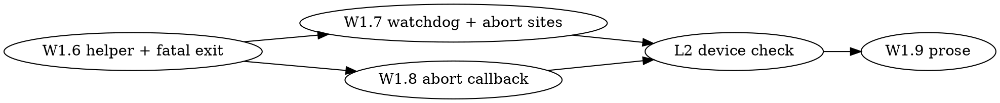

# MoE Prompt Micro-Batches Wider Than 512 Rows: Implementation Plan

> **Execution:** Use `team-driven-development` in Claude Code, `pi-team-driven-development` in pi.dev, or `codex-team-driven-development` in Codex.

**Goal:** A MoE model's prompt runs at micro-batches of 1024, 2048 and 4096 rows as safely and as cheaply in VRAM as
at 512, so that width can later become the automatic choice.

**Architecture:** Four stages, each merged and measured before the next. Stage 1 makes a device loss end the process
at once and leave evidence. Stage 2 lays the prompt executor's activation and output scratch out per GEMM group
instead of as one rectangle, and sizes the planned ring from the same rule. Stage 3 sizes every per-context MoE
structure from the context's own row count. Stage 4 lets the automatic picker climb past 512 rows for a MoE model.

**Tech Stack:** C++17, SYCL (icpx, oneAPI 2025.3), oneDNN, Level Zero on Intel Arc Pro B70 and B50, CMake and Ninja,
Python 3 source pins.

**Test Infrastructure:** ctest. Host-only C++ tests compile one backend source directly
(`ggml/src/ggml-sycl/CMakeLists.txt:7713-7728` is the pattern). Tests that need backend internals link
`ggml-sycl-private-fixtures` (`ggml/src/ggml-sycl/CMakeLists.txt:8106-8150`). Python source pins register through
`llama_test_pytest` (`tests/CMakeLists.txt:4663-4668`). Every device run, every model load and every binary that
links the whole backend is run by the lead, pinned, one at a time.

**Tracker:** epic llama.cpp-fmcp. This plan closes llama.cpp-ohkx and carries the hunt for llama.cpp-ve38. The design
and every owner ruling are on llama.cpp-ohkx (comments c-ikf2 to c-uitg).

**Base tree:** every line number in this plan is at `e2e/a10-combined` 5d3267494, tree
`abff080463434a50cfc038ff4911635738484f61`. The A10 merge into `integ/th32` produces that same tree. No task of this
plan starts before that merge. Task branches fork from `integ/th32` after it.

---

## What the owner approved (2026-11-15)

1. **Plan shape.** Width only. After it lands the lead re-profiles and writes the next two plans (grouped launches,
   then a fused quantized GEMM).
2. **Success bar.** Correct and monotone, with no fixed number:
   - every width from 512 to 4096 passes the real-text perplexity gate;
   - interleaved pairs show no wider rung slower than the one below it;
   - the 512-row baselines hold (GPT-OSS 20B and Mistral, both cards);
   - no routed expert leaves the device for scratch room at 2048 rows.
3. **Approach.** Pack per GEMM group, and MoE joins the dense ladder.
4. **Packing gate.** The freed scratch must show up as more routed experts on the device at 512 rows on Qwen.
5. **Picker rule.** Measured per model and card first. Stage 4's picker task is written after the lead's measurement
   and an owner gate.
6. **Fault gating.** Stage 1 lands the fast exit and the capture. The lead hunts the 1024-row fault while stages 2
   and 3 are implemented. Stage 4 stays blocked until the fault is explained and fixed, or shown to be the driver's
   with a measured rate the owner accepts.
7. **Width gate.** Each width (1024, 2048, 4096) runs the real-text perplexity 5 times with no fault. Every final
   figure is within 1% of the mean of 5 runs at 512 rows.

## Decisions the owner confirmed at the review gate (2026-11-15)

The owner approved this plan for execution after the A10 merge, and confirmed each decision below as written.

| # | Question | Confirmed | Task |
|---|---|---|---|
| D1 | A device loss can also surface at a queue wait (`SYCL_CHECK`, which aborts after forking gdb) or at the graph boundary (which returns `GGML_STATUS_FAILED`, after which the application exits normally into the Level Zero destructor that hung on 2026-11-15). Does stage 1 cover those paths? | Yes. A latch records the loss. `SYCL_CHECK` then leaves through the fast exit instead of gdb and `abort()`. The graph boundary still returns `FAILED`, and an exit handler registered at the loss ends the process through the fast exit when the application leaves. | W1.3 |
| D2 | Exit status of a process ended by a device loss. | 69, distinct from 1. A script can then tell a lost device from a failed test (llama.cpp-4lnb records that 1 is ambiguous today). Every other fatal op error keeps 1. | W1.1 |
| D3 | `ggml_sycl_set_device`'s catch segfaults on purpose (`crash()`, `common.hpp:1123`). | Replace it with the fast exit. A core dump on this path holds VRAM after the message. | W1.2 |
| D4 | The asynchronous handler in `dpct/helper.hpp:150-165` prints an asynchronous device loss and swallows it. | Leave it. That header is compiled into targets that do not link `common.cpp`. A lost device fails the next device call, which reaches a covered path. The gap is recorded as a ticket when stage 1 merges. | none |

---

## Team Topology

**Recommended implementers:** up to 3 concurrent, one per track (owner ruling 2026-11-14: implementers by track, at
most three at once, Opus for ownership and placement code).
**Reviewers:** spec, then quality, spawned fresh per review. Full reviews on Opus.

| Track | Tasks | Implementer | Description |
|-------|-------|-------------|-------------|
| A | W1.1, W1.2, W1.3, W1.4 | Opus, high | Stage 1: the fast exit, the injected device loss, the latch, the capture |
| B | W2.1, W2.2 | Opus, high | Stage 2: the packed layout function and the executor that uses it |
| C | W2.3, W2.4, W2.5 | Opus, xhigh | Stage 2: the packed bound, one sizing source, the planner switch |
| L (lead) | L1, G1, G2, W3.0, W4.0 | lead | The fault hunt, the stage gates, the stage 3 spike, the stage 4 measurement |

Stage 3 and stage 4 tasks are not in this document. Each is written as an amendment after its spike or measurement
and comes to the owner for review before any implementer starts (sections "Stage 3" and "Stage 4").

### Dependency Graph

```dot
digraph dependencies {
    rankdir=LR;
    P0   [label="P0: A10 merged into integ/th32"];
    W11  [label="W1.1 fast-exit helper"];
    W12  [label="W1.2 op failures use it"];
    W13  [label="W1.3 latch for waits and boundary"];
    W14  [label="W1.4 capture at the loss"];
    G1   [label="G1 stage 1 gate (lead)"];
    L1   [label="L1 fault hunt (lead)"];
    W21  [label="W2.1 packed layout function"];
    W22  [label="W2.2 executor packs per group"];
    W23  [label="W2.3 packed bound"];
    W24  [label="W2.4 one sizing source"];
    W25  [label="W2.5 planner sizes the packed ring"];
    G2   [label="G2 stage 2 gate (lead)"];
    W30  [label="W3.0 stage 3 spike, then amendment"];
    W40  [label="W4.0 picker measurement, owner gate"];
    P0 -> W11 -> W12 -> W13 -> W14 -> G1 -> L1;
    P0 -> W21 -> W22;
    P0 -> W23 -> W24 -> W25;
    W22 -> W25;
    G1 -> G2;
    W25 -> G2 -> W30 -> W40;
    L1 -> W40;
}
```



Merge order into `integ/th32`: W1.1 to W1.4 as each passes review, then G1. W2.1, W2.3 and W2.4 may merge as soon
as they pass review, because none changes behaviour. W2.2 merges after G1. W2.5 merges after W2.2. Then G2.

### File Ownership Map

| File/Directory | Tasks | Conflict Risk |
|----------------|-------|---------------|
| `ggml/src/ggml-sycl/common.hpp`, `common.cpp` | W1.1, W1.2, W1.3, W1.4 | Sequential (track A) |
| `ggml/src/ggml-sycl/tests/test-sycl-fatal-exit.cpp` | W1.1, W1.2, W1.3, W1.4 | Sequential (track A) |
| `tests/test-sycl-fatal-exit-source.py`, `tests/test-sycl-unified-private-seams.py` | W1.2, W1.3 | Sequential (track A) |
| `ggml/src/ggml-sycl/cpy.cpp`, `mmq.cpp` | W1.2 | None |
| `ggml/src/ggml-sycl/ggml-sycl.cpp`, catch sites and boundary (35564 to 127533, outside 92884 to 94444) | W1.2, W1.3 | Other regions than track B and C; merges are textual, checked with merge-tree every round |
| `ggml/src/ggml-sycl/ggml-sycl.cpp`, the executor lambda (92884 to 94444) | W2.2 | None |
| `ggml/src/ggml-sycl/ggml-sycl.cpp`, inventory publish and ring re-plan (17385 to 17665, 18024 to 18040, 20537 to 20800) | W2.4, W2.5 | Sequential (track C) |
| `ggml/src/ggml-sycl/moe-pp-pack.hpp`, `tests/test-moe-pp-pack.cpp` | W2.1 | None |
| `ggml/src/ggml-sycl/tests/test-moe-pp-batched-dequant.cpp` | W2.2, W2.5 | W2.5 runs after W2.2 |
| `ggml/src/ggml-sycl/moe-scratch-admission.hpp`, `.cpp`, `tests/test-moe-scratch-admission.cpp` | W2.3, W2.5 | Sequential (track C) |
| `ggml/src/ggml-sycl/unified-cache.cpp`, `unified-cache.hpp` | W2.4, W2.5 | Sequential (track C) |
| `src/llama-model.cpp`, `ggml/include/ggml-sycl.h` | W2.5 | None |
| `ggml/src/ggml-sycl/CMakeLists.txt` | W1.1, W1.2, W1.3, W2.1 | Separate blocks; W2.1 adds beside line 7728, track A beside line 6584 |
| `docs/backend/sycl-env-vars.md`, `docs/backend/sycl-memory-design.md` | W1.4, W2.5 | Separate sections |

### Rules every implementer prompt carries

- Work only in the task's worktree. It is not the codescout session root: pass `root="<worktree>"` on every codescout
  call, and check the echoed `root`. The codescout index is blind inside `ggml-sycl.cpp`: verify there with
  `cat ggml/src/ggml-sycl/ggml-sycl.cpp | grep -n '<pattern>'`.
- Never run a GPU binary, a device test, a model load or any test binary that links the backend. Never build without
  the lead's literal `GO` naming a commit. Report what needs running.
- Python source pins run as `python3 <file>`. Host-only tests that compile one source may be compiled and run with
  the lead's `GO`.
- Commits are path-scoped (`git commit -- <paths>`), never amended once reported, and end with exactly one trailer:
  `Co-Authored-By: Claude Opus 5.5 <noreply@anthropic.com>`.
- Never `clang-format-19 -i`. Check with `clang-format-19 --dry-run -Werror <file>` and leave drift you did not
  introduce.
- Comments state the reason for the code. They cite no ticket id, task number or review round.
- The task is not closed by the implementer.

---

## Stage 1: a device loss ends the process at once

**Why.** On 2026-11-15 an explicit `-ub 1024` run lost the device in MUL_MAT_ID. The catch called `std::exit(1)`.
The Level Zero library's destructor then spun under `_dl_fini`, and the process held 51 GB and `GPU.lock` until it
was killed by pid. `std::exit` runs static destructors; `std::_Exit` does not. The watchdog already leaves through
`std::_Exit` (`common.cpp:746-773`). Stage 1 gives every other fatal path the same exit, and saves the process's
memory map at the moment of the loss, because the fault's page (`0x0000782b60004000`) could not be attributed
afterwards.

### Task W1.1: one fast exit

**Track:** A
**Depends on:** P0
**File scope:**
- Modify: `ggml/src/ggml-sycl/common.hpp:829-831` (insert between the `#endif` at 829 and `#define CHECK_TRY_ERROR` at 831)
- Modify: `ggml/src/ggml-sycl/common.cpp:775` (insert after the closing brace of `watchdog_thread_fn`, before the comment `// Parse GGML_SYCL_OP_TIMEOUT_MS`)
- Create: `ggml/src/ggml-sycl/tests/test-sycl-fatal-exit.cpp`
- Modify: `ggml/src/ggml-sycl/CMakeLists.txt:6584` (insert a block after `endif() # static SYCL backend fixture`)

**Description:**

Adds `ggml_sycl_fatal_exit(code, message)`: print one line, flush, do what the watchdog does before it leaves, and
call `std::_Exit`. Adds the test that tells `_Exit` from `exit`: a child process plants an `atexit` handler and a
static destructor, and neither may run. No caller changes in this task.

**Acceptance Criteria:**

- [ ] `test-sycl-fatal-exit helper` passes: the child ends with status 69, prints the `[SYCL-FATAL]` line, and prints neither marker
- [ ] `test-sycl-fatal-exit control` passes: a child that calls `std::exit(69)` prints both markers (the markers can fire)
- [ ] `test-sycl-fatal-exit classify` passes: the real device-loss text is recognised, an error-39 text and a null are not
- [ ] `python3 tests/test-sycl-moe-cpu-job-device-signal-source.py`, `python3 tests/test-sycl-zone-reset-audit-source.py` and `python3 tests/test-sycl-watchdog-progress-tick-source.py` still pass
- [ ] `clang-format-19 --dry-run -Werror` is clean on the new test file

**Implementation Guide:**

1. **Test first.** Create `ggml/src/ggml-sycl/tests/test-sycl-fatal-exit.cpp`:

```cpp
// A process the backend ends after a fatal error must not run its exit handlers or static destructors: after a
// device loss the Level Zero library's own destructor does not return. Each mode runs this binary again as a child
// that plants an atexit handler and a static destructor, and checks from outside which of them ran.

#include "common.hpp"

#include <sys/wait.h>
#include <unistd.h>

#include <chrono>
#include <cstdio>
#include <cstdlib>
#include <cstring>
#include <string>

namespace {

constexpr const char * k_atexit_marker = "TEST-ATEXIT-RAN";
constexpr const char * k_dtor_marker   = "TEST-STATIC-DTOR-RAN";

void atexit_marker() {
    std::fprintf(stderr, "%s\n", k_atexit_marker);
    std::fflush(stderr);
}

struct dtor_marker {
    ~dtor_marker() {
        std::fprintf(stderr, "%s\n", k_dtor_marker);
        std::fflush(stderr);
    }
};

void plant_markers() {
    static dtor_marker marker;
    std::atexit(atexit_marker);
}

struct child_result {
    bool        exited  = false;
    int         status  = -1;
    int         signal  = 0;
    double      seconds = 0.0;
    std::string err;
};

child_result run_child(const char * self, const char * mode) {
    int fds[2];
    if (pipe(fds) != 0) {
        std::perror("pipe");
        std::exit(1);
    }
    const auto  t0  = std::chrono::steady_clock::now();
    const pid_t pid = fork();
    if (pid < 0) {
        std::perror("fork");
        std::exit(1);
    }
    if (pid == 0) {
        dup2(fds[1], STDERR_FILENO);
        close(fds[0]);
        close(fds[1]);
        execl(self, self, "--child", mode, static_cast<char *>(nullptr));
        _exit(127);
    }
    close(fds[1]);
    child_result r;
    char         buf[4096];
    ssize_t      n = 0;
    while ((n = read(fds[0], buf, sizeof(buf))) > 0) {
        r.err.append(buf, static_cast<size_t>(n));
    }
    close(fds[0]);
    int st = 0;
    waitpid(pid, &st, 0);
    r.seconds = std::chrono::duration<double>(std::chrono::steady_clock::now() - t0).count();
    r.exited  = WIFEXITED(st);
    r.status  = r.exited ? WEXITSTATUS(st) : -1;
    r.signal  = WIFSIGNALED(st) ? WTERMSIG(st) : 0;
    return r;
}

bool has(const child_result & r, const char * needle) {
    return r.err.find(needle) != std::string::npos;
}

int fail(const char * mode, const child_result & r, const char * why) {
    std::fprintf(stderr, "FAIL mode=%s: %s (exited=%d status=%d signal=%d seconds=%.1f)\n--- child stderr ---\n%s\n",
                 mode, why, r.exited ? 1 : 0, r.status, r.signal, r.seconds, r.err.c_str());
    return 1;
}

// The fast exit ran: the given status, its banner, and neither marker.
int check_fast_exit(const char * mode, const child_result & r, int want_status) {
    if (!r.exited || r.status != want_status) {
        return fail(mode, r, "wrong exit status");
    }
    if (!has(r, "[SYCL-FATAL]")) {
        return fail(mode, r, "no [SYCL-FATAL] line");
    }
    if (has(r, k_atexit_marker) || has(r, k_dtor_marker)) {
        return fail(mode, r, "an exit handler or a static destructor ran");
    }
    if (r.seconds > 30.0) {
        return fail(mode, r, "the child took over 30 s to end");
    }
    return 0;
}

int child_main(const char * mode) {
    if (std::strcmp(mode, "helper") == 0) {
        plant_markers();
        ggml_sycl_fatal_exit(GGML_SYCL_EXIT_DEVICE_LOST, "test: helper mode");
    }
    if (std::strcmp(mode, "control") == 0) {
        plant_markers();
        std::exit(GGML_SYCL_EXIT_DEVICE_LOST);
    }
    std::fprintf(stderr, "unknown child mode %s\n", mode);
    return 2;
}

int parent_main(const char * self, const char * mode) {
    if (std::strcmp(mode, "helper") == 0) {
        const child_result r = run_child(self, mode);
        if (!has(r, "[SYCL-FATAL] test: helper mode")) {
            return fail(mode, r, "the message is not on the [SYCL-FATAL] line");
        }
        return check_fast_exit(mode, r, GGML_SYCL_EXIT_DEVICE_LOST);
    }
    if (std::strcmp(mode, "control") == 0) {
        const child_result r = run_child(self, mode);
        if (!r.exited || r.status != GGML_SYCL_EXIT_DEVICE_LOST || !has(r, k_atexit_marker) ||
            !has(r, k_dtor_marker)) {
            return fail(mode, r, "std::exit did not run both markers, so their absence proves nothing");
        }
        return 0;
    }
    if (std::strcmp(mode, "classify") == 0) {
        const char * lost = "level_zero backend failed with error: 20 (UR_RESULT_ERROR_DEVICE_LOST)";
        const char * oom  = "level_zero backend failed with error: 39 (UR_RESULT_ERROR_OUT_OF_DEVICE_MEMORY)";
        const bool   ok   = ggml_sycl_what_is_device_lost(lost) && !ggml_sycl_what_is_device_lost(oom) &&
                            !ggml_sycl_what_is_device_lost(nullptr) &&
                            ggml_sycl_fatal_exit_code(lost) == GGML_SYCL_EXIT_DEVICE_LOST &&
                            ggml_sycl_fatal_exit_code(oom) == 1 && ggml_sycl_fatal_exit_code(nullptr) == 1;
        if (!ok) {
            std::fprintf(stderr, "FAIL mode=classify\n");
            return 1;
        }
        return 0;
    }
    std::fprintf(stderr, "usage: %s helper|control|classify\n", self);
    return 2;
}

}  // namespace

int main(int argc, char ** argv) {
    if (argc == 3 && std::strcmp(argv[1], "--child") == 0) {
        return child_main(argv[2]);
    }
    if (argc != 2) {
        std::fprintf(stderr, "usage: %s helper|control|classify\n", argv[0]);
        return 2;
    }
    const int rc = parent_main(argv[0], argv[1]);
    if (rc == 0) {
        std::fprintf(stderr, "PASS mode=%s\n", argv[1]);
    }
    return rc;
}
```

2. **Register it.** In `ggml/src/ggml-sycl/CMakeLists.txt`, directly after line 6584
   (`endif() # static SYCL backend fixture`, the end of the `test-sycl-orchestrator` block):

```cmake
# The backend's fatal exit: a child process must end without running an exit handler or a static destructor. The
# helper, control and classify modes touch no device.
if (NOT GGML_BACKEND_DL)
add_executable(test-sycl-fatal-exit
    ${CMAKE_CURRENT_SOURCE_DIR}/tests/test-sycl-fatal-exit.cpp
)
target_include_directories(test-sycl-fatal-exit PRIVATE
    ${CMAKE_CURRENT_SOURCE_DIR}
    ${CMAKE_CURRENT_SOURCE_DIR}/..
    ${CMAKE_CURRENT_SOURCE_DIR}/../../include
    ${SYCL_INCLUDE_DIR}
)
target_compile_options(test-sycl-fatal-exit PRIVATE "-fsycl" "-Wno-narrowing")
target_link_options(test-sycl-fatal-exit PRIVATE "-fsycl")
target_compile_definitions(test-sycl-fatal-exit PRIVATE
    GGML_SYCL_WARP_SIZE=32
    GGML_SYCL_DNNL=${GGML_SYCL_DNNL}
    GGML_SYCL_PRIVATE_TESTING=1
)
target_link_libraries(test-sycl-fatal-exit PRIVATE ggml-sycl-private-fixtures)
set_target_properties(test-sycl-fatal-exit PROPERTIES RUNTIME_OUTPUT_DIRECTORY ${CMAKE_BINARY_DIR}/bin)
foreach(_fatal_mode IN ITEMS helper control classify)
    add_test(NAME test-sycl-fatal-exit-${_fatal_mode} COMMAND test-sycl-fatal-exit ${_fatal_mode})
    set_tests_properties(test-sycl-fatal-exit-${_fatal_mode} PROPERTIES
        LABELS "sycl;fatal-exit"
        ENVIRONMENT "LD_LIBRARY_PATH=/opt/intel/oneapi/redist/lib:$ENV{LD_LIBRARY_PATH}"
        TIMEOUT 60
    )
endforeach()
endif() # static SYCL backend fixture
```

   RED: the build fails, because `ggml_sycl_fatal_exit`, `ggml_sycl_what_is_device_lost`,
   `ggml_sycl_fatal_exit_code` and `GGML_SYCL_EXIT_DEVICE_LOST` do not exist. Report the compiler's first error line.

3. **Declare.** In `ggml/src/ggml-sycl/common.hpp`, between line 829 (`#endif` of `GGML_SYCL_KTRACE`) and line 831
   (`#define CHECK_TRY_ERROR(expr)`):

```cpp
// The exit status of a process the backend ended because a device was lost. It differs from 1, which a failed test,
// the watchdog and every other fatal op error use, so a script can tell a lost device from a wrong result.
constexpr int GGML_SYCL_EXIT_DEVICE_LOST = 69;

// True when an exception's text names a lost device, as the Level Zero adapter prints it:
// "level_zero backend failed with error: 20 (UR_RESULT_ERROR_DEVICE_LOST)".
bool ggml_sycl_what_is_device_lost(const char * what) noexcept;

// GGML_SYCL_EXIT_DEVICE_LOST for a lost device's exception text, 1 for any other.
int ggml_sycl_fatal_exit_code(const char * what) noexcept;

// Ends the process at once after a failure it cannot recover from. Prints `message` on one [SYCL-FATAL] line,
// flushes stdout and stderr, does what the watchdog does before its exit, and leaves through std::_Exit: no exit
// handler and no static destructor runs. After a device loss the Level Zero library's destructor does not return,
// and std::exit would run it. The caller prints its own diagnostic first.
[[noreturn]] void ggml_sycl_fatal_exit(int code, const char * message) noexcept;
```

4. **Define.** In `ggml/src/ggml-sycl/common.cpp`, after the closing brace of `watchdog_thread_fn` (line 775):

```cpp
bool ggml_sycl_what_is_device_lost(const char * what) noexcept {
    return what != nullptr && std::strstr(what, "UR_RESULT_ERROR_DEVICE_LOST") != nullptr;
}

int ggml_sycl_fatal_exit_code(const char * what) noexcept {
    return ggml_sycl_what_is_device_lost(what) ? GGML_SYCL_EXIT_DEVICE_LOST : 1;
}

void ggml_sycl_fatal_exit(int code, const char * message) noexcept {
    std::fprintf(stderr, "[SYCL-FATAL] %s: ending the process with _Exit(%d), no teardown\n",
                 message ? message : "(no message)", code);
    std::fflush(stdout);
    std::fflush(stderr);
    // The watchdog's order: release every device command parked on a CPU expert job, then print the zone-reset
    // audit an exit handler would have printed (nothing unless GGML_SYCL_ZONE_RESET_AUDIT is set).
    ggml_sycl::cpu_job_signal_signal_all();
    ggml_sycl::zone_reset_audit_report("sycl-fatal-exit");
    std::_Exit(code);
}
```

5. **GREEN.** Report the commit. The lead builds `test-sycl-fatal-exit` and runs the three modes.

Lead run (after the build):

```bash
source /opt/intel/oneapi/setvars.sh --force >/dev/null
for m in helper control classify; do ./build/bin/test-sycl-fatal-exit $m; echo "rc=$?"; done
```

Expected: `PASS mode=helper`, `PASS mode=control`, `PASS mode=classify`, each `rc=0`.

**Commit:**

```bash
git add ggml/src/ggml-sycl/tests/test-sycl-fatal-exit.cpp
git commit -m "sycl: one fast exit for fatal backend errors, tested from a child process" -- \
    ggml/src/ggml-sycl/common.hpp ggml/src/ggml-sycl/common.cpp \
    ggml/src/ggml-sycl/tests/test-sycl-fatal-exit.cpp ggml/src/ggml-sycl/CMakeLists.txt
```

**Gotchas:**
- The definition must sit **after** `watchdog_thread_fn`, and must not call `ggml_sycl_cleanup_host_allocations()`.
  `tests/test-sycl-moe-cpu-job-device-signal-source.py:532-537` finds the first such call in `common.cpp` and expects
  the watchdog around it. `tests/test-sycl-zone-reset-audit-source.py:417-418` reads the watchdog's body. Leave the
  watchdog body and its banner untouched.
- Print with `fprintf(stderr)`, not `GGML_LOG_ERROR`. The log queue is not flushed by `_Exit`.
- `common.cpp` already includes `<cstring>`, `<cstdio>`, `<cstdlib>` and `unified-cache.hpp` (lines 18 to 25).
- The parent re-executes the binary (`execl`) rather than running the child after a bare `fork`, so the child's
  process image is fresh.
- `noexcept` holds: `cpu_job_signal_signal_all` is `noexcept` with a bounded lock. `zone_reset_audit_report` takes a
  plain mutex only when the audit variable is set.

---

### Task W1.2: an op failure leaves through the fast exit

**Track:** A
**Depends on:** W1.1
**File scope:**
- Modify: `ggml/src/ggml-sycl/common.hpp:317-323` (a second seam directly after the scratchpad hook block) and `:1121-1124`
- Modify: `ggml/src/ggml-sycl/common.cpp` (the seam's definition, after `ggml_sycl_fatal_exit`)
- Modify: `ggml/src/ggml-sycl/ggml-sycl.cpp` at the 33 `std::exit(1)` sites listed below, plus two injection lines
- Modify: `ggml/src/ggml-sycl/cpy.cpp:1532`, `ggml/src/ggml-sycl/mmq.cpp:7756`
- Modify: `ggml/src/ggml-sycl/tests/test-sycl-fatal-exit.cpp`, `ggml/src/ggml-sycl/CMakeLists.txt` (two registrations)
- Create: `tests/test-sycl-fatal-exit-source.py`; Modify: `tests/CMakeLists.txt:4668` (register it after the `test-sycl-auto-ubatch-source` block)
- Modify: `tests/test-sycl-unified-private-seams.py:11-37` and its `guarded`, `forbidden_symbols`, `forbidden_strings` lists

**Description:**

Every catch in the backend that ends the process calls `ggml_sycl_fatal_exit` in place of `std::exit(1)`. A
test-only switch throws the exception a lost device throws, at the top of MUL_MAT_ID or of any op, so the test of
W1.1 can show the catch's own exit no longer runs teardown. Two commits: RED (switch, test modes, source pin), then
GREEN (the sites).

**Acceptance Criteria:**

- [ ] RED commit, lead run: `test-sycl-fatal-exit mmid` and `op` FAIL with "wrong exit status" (status 1) and the child's stderr shows `TEST-ATEXIT-RAN`; `python3 tests/test-sycl-fatal-exit-source.py` fails naming `ggml-sycl.cpp`
- [ ] GREEN commit, lead run: both modes pass with status 69, `[MUL_MAT_ID-FAIL]` (mode `mmid`) or `Error OP` (mode `op`), `Exception caught at file:`, `UR_RESULT_ERROR_DEVICE_LOST`, `[SYCL-FATAL]`, and neither marker
- [ ] `python3 tests/test-sycl-fatal-exit-source.py` passes: no `std::exit(` in `ggml-sycl.cpp`, `cpy.cpp` or `mmq.cpp`; exactly one in `common.hpp`, inside `bad_arch`
- [ ] `python3 tests/test-sycl-unified-private-seams.py` passes (it needs the built ordinary library: lead run) and `python3 tests/test-sycl-lock-audit-source.py` passes
- [ ] Every diagnostic line a site printed before its exit is still printed, unchanged

**Implementation Guide:**

1. **The switch (RED commit).** In `common.hpp`, directly after the `#endif` that closes the scratchpad hook block
   (line 323):

```cpp
#if defined(GGML_SYCL_PRIVATE_TESTING)
// GGML_SYCL_TEST_INJECT_DEVICE_LOST=<site>:<n> throws, from the nth call at `site` onward, the exception a lost
// device throws. It keeps throwing because a lost device stays lost: graph recording rethrows the first one and
// runs the graph again directly.
void ggml_sycl_test_inject_device_lost(const char * site);
#else
inline void ggml_sycl_test_inject_device_lost(const char *) {
}
#endif
```

   In `common.cpp`, after `ggml_sycl_fatal_exit` (add `#include <string>` beside the other standard headers):

```cpp
#if defined(GGML_SYCL_PRIVATE_TESTING)
void ggml_sycl_test_inject_device_lost(const char * site) {
    struct request {
        std::string site;
        long long   n = 0;
    };
    static const request req = [] {
        request      r;
        const char * value = std::getenv("GGML_SYCL_TEST_INJECT_DEVICE_LOST");
        const char * colon = value != nullptr ? std::strchr(value, ':') : nullptr;
        if (colon != nullptr) {
            r.site.assign(value, colon);
            r.n = std::atoll(colon + 1);
        }
        return r;
    }();
    if (req.n <= 0 || site == nullptr || req.site != site) {
        return;
    }
    static std::atomic<long long> calls{ 0 };
    if (calls.fetch_add(1, std::memory_order_relaxed) + 1 >= req.n) {
        throw sycl::exception(sycl::make_error_code(sycl::errc::runtime),
                              "injected test fault: level_zero backend failed with error: 20 "
                              "(UR_RESULT_ERROR_DEVICE_LOST)");
    }
}
#endif
```

   Two call sites in `ggml-sycl.cpp`:
   - first statement of `ggml_sycl_mul_mat_id`, directly after line 85858
     (`static void ggml_sycl_mul_mat_id(ggml_backend_sycl_context & ctx, ggml_tensor * dst) try {`):
     `ggml_sycl_test_inject_device_lost("mmid");`
   - in `ggml_sycl_compute_forward_impl`, directly after the closing brace of `if (!g_sycl_loaded) { ... }`
     (line 98201): `ggml_sycl_test_inject_device_lost("op");`. The call must sit inside the `try` whose handlers are
     at 99062-99091. If the `g_sycl_loaded` check is above that `try`, make the call the first statement inside it.

2. **The private-seam audit (RED commit).** In `tests/test-sycl-unified-private-seams.py`:
   - add to the `guarded` tuple of `SYCL / "common.cpp"`: `"void ggml_sycl_test_inject_device_lost(const char * site) {"`;
   - add to the `guarded` tuple of `SYCL / "common.hpp"`: `"void ggml_sycl_test_inject_device_lost(const char * site);"`;
   - add `"ggml_sycl_test_inject_device_lost"` to `forbidden_symbols` and `"GGML_SYCL_TEST_INJECT_DEVICE_LOST"` to
     `forbidden_strings` (both lists are further down the same file; follow the form of the
     `GGML_SYCL_TEST_DMA_FAIL` entry).

3. **The test modes (RED commit).** In `test-sycl-fatal-exit.cpp`:
   - add the includes `ggml.h`, `ggml-backend.h`, `ggml-cpu.h`, `ggml-sycl.h`, `ggml-quants.h`, `<random>`, `<vector>`;
   - copy `alloc_tensor_buffer`, `fill_random`, `quantize_weights_mxfp4` and `run_mul_mat_id_backend` from
     `tests/test-moe-mul-mat-id.cpp:47-161` into the anonymous namespace, unchanged;
   - add the child and the parent checks:

```cpp
// One small MUL_MAT_ID graph on the SYCL backend. Returns false when the compute reported a failure.
bool run_one_mmid(ggml_backend_t backend) {
    const int          in_dim = 64, out_dim = 32, n_experts = 4, n_used = 2, n_tokens = 8;
    std::mt19937       rng(7);
    std::vector<float> weights(size_t(in_dim) * out_dim * n_experts);
    std::vector<float> input(size_t(in_dim) * n_tokens);
    fill_random(weights, 1.0f, rng);
    fill_random(input, 1.0f, rng);
    std::vector<uint8_t> packed;
    quantize_weights_mxfp4(weights, in_dim, out_dim, n_experts, packed);
    std::vector<int32_t> ids(size_t(n_used) * n_tokens);
    for (int t = 0; t < n_tokens; ++t) {
        for (int i = 0; i < n_used; ++i) {
            ids[size_t(t) * n_used + i] = (t + i) % n_experts;
        }
    }
    std::vector<float> out;
    return run_mul_mat_id_backend(backend, ggml_backend_sycl_host_buffer_type(), packed, input, ids, in_dim, out_dim,
                                  n_experts, n_used, n_tokens, out);
}

// The device modes: the injected loss is in the environment the registration sets.
int child_device(const char * mode) {
    plant_markers();
    ggml_backend_t backend = ggml_backend_sycl_init(0);
    if (backend == nullptr) {
        std::fprintf(stderr, "SKIP: no SYCL backend\n");
        return 77;
    }
    const bool computed = run_one_mmid(backend);
    std::fprintf(stderr, "TEST-CHILD-SURVIVED mode=%s computed=%d\n", mode, computed ? 1 : 0);
    return 3;
}
```

   Match the argument list of `run_one_mmid`'s call to `run_mul_mat_id_backend`'s real signature at
   `tests/test-moe-mul-mat-id.cpp:80-93` and to `quantize_weights_mxfp4`'s at `:66`; the call above shows the values
   to pass, not a verified order.

   In `child_main`, before the `unknown child mode` line:

```cpp
    if (std::strcmp(mode, "mmid") == 0 || std::strcmp(mode, "op") == 0) {
        return child_device(mode);
    }
```

   In `parent_main`, before the usage line:

```cpp
    if (std::strcmp(mode, "mmid") == 0 || std::strcmp(mode, "op") == 0) {
        const child_result r = run_child(self, mode);
        if (r.exited && r.status == 77) {
            std::fprintf(stderr, "%s", r.err.c_str());
            return 77;
        }
        if (has(r, "TEST-CHILD-SURVIVED")) {
            return fail(mode, r, "the injected loss was never thrown: the op did not reach the site");
        }
        const char * site_line = std::strcmp(mode, "mmid") == 0 ? "[MUL_MAT_ID-FAIL]" : "Error OP";
        if (!has(r, site_line) || !has(r, "Exception caught at file:") || !has(r, "UR_RESULT_ERROR_DEVICE_LOST")) {
            return fail(mode, r, "the catch's own diagnostic lines are missing");
        }
        return check_fast_exit(mode, r, GGML_SYCL_EXIT_DEVICE_LOST);
    }
```

   Extend both usage strings with `|mmid|op`. Register the two modes in `ggml/src/ggml-sycl/CMakeLists.txt`, inside
   the block W1.1 added, after its `endforeach()`:

```cmake
# The device modes: the registration injects the loss a lost device throws, once at MUL_MAT_ID and once at any op.
foreach(_fatal_site IN ITEMS mmid op)
    add_test(NAME test-sycl-fatal-exit-${_fatal_site} COMMAND test-sycl-fatal-exit ${_fatal_site})
    set_tests_properties(test-sycl-fatal-exit-${_fatal_site} PROPERTIES
        LABELS "sycl;fatal-exit;device;B50"
        SKIP_RETURN_CODE 77
        RUN_SERIAL TRUE
        ENVIRONMENT "GGML_SYCL_TEST_INJECT_DEVICE_LOST=${_fatal_site}:1;ONEAPI_DEVICE_SELECTOR=level_zero:1;LD_LIBRARY_PATH=/opt/intel/oneapi/redist/lib:$ENV{LD_LIBRARY_PATH}"
        TIMEOUT 120
    )
endforeach()
```

4. **The source pin (RED commit).** Create `tests/test-sycl-fatal-exit-source.py`:

```python
#!/usr/bin/env python3
"""No backend source ends the process with std::exit: a fatal path leaves through ggml_sycl_fatal_exit."""
from pathlib import Path
import re
import sys

ROOT = Path(__file__).resolve().parents[1]
SYCL = ROOT / "ggml/src/ggml-sycl"


def code_of(path: Path) -> str:
    text = path.read_text(encoding="utf-8")
    text = re.sub(r"/\*.*?\*/", lambda m: " " * len(m.group(0)), text, flags=re.S)
    return re.sub(r"//[^\n]*", "", text)


EXIT = re.compile(r"\b(?:std::)?exit\s*\(")
failures = []
for name in ("ggml-sycl.cpp", "cpy.cpp", "mmq.cpp"):
    hits = len(EXIT.findall(code_of(SYCL / name)))
    if hits != 0:
        failures.append(f"{name}: {hits} exit( call(s); a fatal path must call ggml_sycl_fatal_exit")

hpp = code_of(SYCL / "common.hpp")
hpp_hits = [m.start() for m in EXIT.finditer(hpp)]
bad_arch = hpp.find("static inline void bad_arch(")
if len(hpp_hits) != 1 or bad_arch < 0 or not (bad_arch < hpp_hits[0] < bad_arch + 400):
    failures.append(f"common.hpp: expected exactly one exit( call, inside bad_arch; found {len(hpp_hits)}")

cpp = code_of(SYCL / "common.cpp")
watchdog = cpp.find("static void watchdog_thread_fn(")
helper = cpp.find("void ggml_sycl_fatal_exit(int code, const char * message) noexcept {")
if watchdog < 0 or helper < 0 or helper < watchdog:
    failures.append("common.cpp: ggml_sycl_fatal_exit must be defined after watchdog_thread_fn")
body = cpp[helper:helper + 900] if helper >= 0 else ""
if "std::_Exit(code);" not in body or "ggml_sycl_cleanup_host_allocations" in body:
    failures.append("common.cpp: ggml_sycl_fatal_exit must end in std::_Exit(code) and not call the host cleanup")

if failures:
    print("\n".join(failures))
    sys.exit(1)
print("ok")
```

   Register it in `tests/CMakeLists.txt` directly after the `test-sycl-auto-ubatch-source` block (line 4668):

```cmake
if (Python3_Interpreter_FOUND)
    llama_test_pytest(${Python3_EXECUTABLE}
        NAME test-sycl-fatal-exit-source
        SCRIPT ${CMAKE_CURRENT_SOURCE_DIR}/test-sycl-fatal-exit-source.py
        LABEL "sycl;python;source-assert"
        TIMEOUT 120)
endif()
```

   Run: `python3 tests/test-sycl-fatal-exit-source.py`
   Expected (RED): three lines, `ggml-sycl.cpp: 33 exit( call(s)...`, `cpy.cpp: 1 ...`, `mmq.cpp: 1 ...`, and the
   `common.hpp` line (two calls today), exit status 1.

   Commit the RED state and report it. The lead builds and records the device RED.

5. **The sites (GREEN commit).** At each site replace the one statement `std::exit(1);` and keep every line above
   it. The replacement is

```cpp
ggml_sycl_fatal_exit(ggml_sycl_fatal_exit_code(<v>.what()), "<function>");
```

   where `<v>` is the caught variable and `<function>` is the enclosing function's name.

   | # | `ggml-sycl.cpp` line of `std::exit(1)` | enclosing function | caught variable |
   |---|---|---|---|
   | 1 | 35564 | `ggml_check_sycl` | `exc` |
   | 2 | 35598 | `ggml_backend_sycl_get_gpu_list` | `exc` |
   | 3 | 35948 | `ggml_backend_sycl_memcpy_d2h` | `exc` |
   | 4 | 35978 | `ggml_backend_sycl_buffer_free_buffer` | `exc` |
   | 5 | 36771 | `ggml_backend_sycl_buffer_init_tensor` | `exc` |
   | 6 | 47069 | `ggml_backend_sycl_buffer_set_tensor` | `exc` |
   | 7 | 47329 | `ggml_backend_sycl_buffer_get_tensor` | `exc` |
   | 8 | 47714 | `ggml_backend_sycl_buffer_clear` | `exc` |
   | 9 | 48741 | `ggml_backend_sycl_buffer_type_alloc_buffer` | `exc` |
   | 10 | 51220 | `~ggml_backend_sycl_split_buffer_context` | `exc` |
   | 11 | 51352 | `ggml_backend_sycl_split_buffer_init_tensor` | `exc` |
   | 12 | 51411 | `ggml_backend_sycl_split_buffer_set_tensor` | `exc` |
   | 13 | 51471 | `ggml_backend_sycl_split_buffer_get_tensor` | `exc` |
   | 14 | 55203 | `ggml_backend_sycl_host_compute_buffer_alloc` | `exc` |
   | 15 | 57769 | `ggml_sycl_cpy_tensor_2d` | `exc` |
   | 16 | 58712 | `ggml_sycl_op_mul_mat_sycl` | `exc` |
   | 17 | 59832 | `ggml_sycl_op_mul_mat` (first quantize try) | `exc` |
   | 18 | 59963 | `ggml_sycl_op_mul_mat` (second quantize try) | `exc` |
   | 19 | 60508 | `ggml_sycl_op_mul_mat` (outer catch, opened at 60414) | `exc` |
   | 20 | 63309 | `ggml_sycl_mul_mat_vec_p021` | `exc` |
   | 21 | 63352 | `ggml_sycl_mul_mat_vec_nc` | `exc` |
   | 22 | 76986 | `ggml_sycl_mul_mat_bf16_weight` | `exc` |
   | 23 | 95656 | `ggml_sycl_mul_mat_id` | `exc` |
   | 24 | 95733 | `ggml_sycl_set_main_device` | `exc` |
   | 25 | 99062 | `ggml_sycl_compute_forward_impl` (`dnnl::error`) | `e` |
   | 26 | 99083 | `ggml_sycl_compute_forward_impl` (`sycl::exception`) | `e` |
   | 27 | 99091 | `ggml_sycl_compute_forward_impl` (`std::exception`) | `e` |
   | 28 | 99101 | `ggml_backend_sycl_get_device_description` | `exc` |
   | 29 | 99149 | `ggml_backend_sycl_get_device_memory` | `exc` |
   | 30 | 99564 | `ggml_backend_sycl_set_tensor_async` | `exc` |
   | 31 | 99623 | `ggml_backend_sycl_get_tensor_async` | `exc` |
   | 32 | 99675 | `ggml_backend_sycl_cpy_tensor_async` | `exc` |
   | 33 | 127533 | `ggml_backend_sycl_device_event_free` | `exc` |

   Also `cpy.cpp:1532` (`ggml_sycl_cpy`, `exc`) and `mmq.cpp:7756` (`ggml_sycl_op_mul_mat_q`, `exc`). Read each
   catch's own variable name before editing; the table records what the excerpts showed.

   `common.hpp:1121-1124` (`ggml_sycl_set_device`, decision D3): replace the two statements `crash();` and
   `std::exit(1);` with `ggml_sycl_fatal_exit(ggml_sycl_fatal_exit_code(exc.what()), "ggml_sycl_set_device");`.
   `ggml_sycl_fatal_exit` is declared at line 831, above this function. Leave `bad_arch` (`common.hpp:1048-1054`)
   alone. If `crash()` (`common.hpp:897-900`) has no caller left, delete it; check with
   `git grep -n 'crash()' -- ggml/src/ggml-sycl`.

   Run: `python3 tests/test-sycl-fatal-exit-source.py`
   Expected (GREEN): `ok`.

**Commit:**

```bash
# RED
git add tests/test-sycl-fatal-exit-source.py
git commit -m "sycl: a test-only injected device loss, and the tests an op failure's exit must pass (RED)" -- \
    ggml/src/ggml-sycl/common.hpp ggml/src/ggml-sycl/common.cpp ggml/src/ggml-sycl/ggml-sycl.cpp \
    ggml/src/ggml-sycl/tests/test-sycl-fatal-exit.cpp ggml/src/ggml-sycl/CMakeLists.txt \
    tests/test-sycl-fatal-exit-source.py tests/CMakeLists.txt tests/test-sycl-unified-private-seams.py
# GREEN
git commit -m "sycl: every op failure that ends the process leaves through the fast exit" -- \
    ggml/src/ggml-sycl/ggml-sycl.cpp ggml/src/ggml-sycl/cpy.cpp ggml/src/ggml-sycl/mmq.cpp \
    ggml/src/ggml-sycl/common.hpp
```

**Gotchas:**
- The switch must keep throwing. A one-shot throw is consumed by graph recording: the op's catch rethrows through
  `ggml_sycl_try_dispatch_resource_exhaustion_fallback` (`ggml-sycl.cpp:56921-56926`), the recording handler
  disables graphs and runs the graph again directly (`:125080-125092`), and the second run would pass.
- The injected text must not match the resource-exhaustion predicate (`common.hpp:129-187`): it names error 20, not
  39 or 40, so the fallback returns false as it does for a real loss.
- Do not put a throw in `ggml_backend_sycl_graph_compute` in this task. Its catch returns `FAILED` and never exits;
  W1.3 owns that path.
- If the RED device run prints `TEST-CHILD-SURVIVED`, the small graph did not reach the site. Report it. Do not
  move the injection line.
- `ggml-sycl.cpp` is in the static-storage inventory (`docs/backend/sycl-static-storage-inventory.csv`). This task
  adds no static there. The switch's counter lives in `common.cpp`, which is not inventoried.
- The 31 `Exception caught at file:` prints, `[MUL_MAT_ID-FAIL]`, `Error OP` and the tensor dump stay exactly as
  they are; `scripts/parse-sycl-moe-profile.py:268` classifies logs by them.
- The sites are an upstream pattern (the dpct port). Each is a conflict candidate at the next upstream merge.

---

### Task W1.3: a loss seen at a wait or at the graph boundary ends the process too

**Track:** A
**Depends on:** W1.2
**File scope:**
- Modify: `ggml/src/ggml-sycl/common.hpp:831-841` (`CHECK_TRY_ERROR`), `:902-909` (`ggml_sycl_error`), and the declarations W1.1 added
- Modify: `ggml/src/ggml-sycl/common.cpp` (after `ggml_sycl_fatal_exit`)
- Modify: `ggml/src/ggml-sycl/ggml-sycl.cpp:99711-99712`, `:122895`, `:125171-125188`, `:125437-125441`, and the first statement of the outermost `try` of `ggml_backend_sycl_graph_compute` (function at 125472)
- Modify: `ggml/src/ggml-sycl/tests/test-sycl-fatal-exit.cpp`, `ggml/src/ggml-sycl/CMakeLists.txt`, `tests/test-sycl-fatal-exit-source.py`

**Description:**

A device loss caught by `CHECK_TRY_ERROR`, by the graph boundary or by a graph-exit wait sets a process-wide latch.
With the latch set, `SYCL_CHECK` leaves through the fast exit instead of forking gdb and aborting. The graph
boundary still returns `GGML_STATUS_FAILED`; the latch registers an exit handler, which runs before every handler
registered earlier (the Level Zero library's among them) and ends the process through the fast exit.

**Acceptance Criteria:**

- [ ] RED commit, lead run: `test-sycl-fatal-exit sync` fails (the child dies of SIGABRT) and `graph` fails (status 0, `TEST-ATEXIT-RAN` printed)
- [ ] GREEN commit, lead run: `sync` passes with status 69 and no markers; `graph` passes with `TEST-GRAPH-FAILED`, status 69 and no markers
- [ ] `python3 tests/test-sycl-lock-audit-source.py` still passes unchanged: the boundary returns `FAILED` and contains no `std::exit(1)`
- [ ] `python3 tests/test-sycl-fatal-exit-source.py` passes with the two new checks below
- [ ] A `SYCL_CHECK` failure with no device loss still aborts as before (covered by the `classify` mode's new in-process check that the latch starts clear)

**Implementation Guide:**

1. **Injection points (RED commit).** In `ggml-sycl.cpp`:
   - `ggml_backend_sycl_synchronize`, lines 99711-99712. Replace

```cpp
        auto err = use_deferred_decode_event ? CHECK_TRY_ERROR(sycl_ctx->last_graph_event->wait_and_throw()) :
                                               CHECK_TRY_ERROR(stream->wait_and_throw());
```

     with

```cpp
        auto err = CHECK_TRY_ERROR(ggml_sycl_test_inject_device_lost("sync"));
        if (err == 0) {
            err = use_deferred_decode_event ? CHECK_TRY_ERROR(sycl_ctx->last_graph_event->wait_and_throw()) :
                                              CHECK_TRY_ERROR(stream->wait_and_throw());
        }
```

   - `ggml_backend_sycl_graph_compute`: `ggml_sycl_test_inject_device_lost("graph");` as the first statement inside
     the outermost `try` whose handlers are the `catch (const std::exception & exc)` and `catch (...)` at lines
     125632-125640. Find the `try` with
     `sed -n '125472,125640p' ggml/src/ggml-sycl/ggml-sycl.cpp | grep -n 'try {'`.

2. **Test modes (RED commit).** In `test-sycl-fatal-exit.cpp`, change `child_device`:

```cpp
int child_device(const char * mode) {
    plant_markers();
    ggml_backend_t backend = ggml_backend_sycl_init(0);
    if (backend == nullptr) {
        std::fprintf(stderr, "SKIP: no SYCL backend\n");
        return 77;
    }
    const bool computed = run_one_mmid(backend);
    if (std::strcmp(mode, "graph") == 0 && !computed) {
        // The boundary reported the failure and returned. An application would now wind down and return from main.
        std::fprintf(stderr, "TEST-GRAPH-FAILED\n");
        return 0;
    }
    if (std::strcmp(mode, "sync") == 0) {
        ggml_backend_synchronize(backend);
    }
    std::fprintf(stderr, "TEST-CHILD-SURVIVED mode=%s computed=%d\n", mode, computed ? 1 : 0);
    return 3;
}
```

   Route `sync` and `graph` to `child_device` in `child_main`. In `parent_main`:

```cpp
    if (std::strcmp(mode, "sync") == 0 || std::strcmp(mode, "graph") == 0) {
        const child_result r = run_child(self, mode);
        if (r.exited && r.status == 77) {
            std::fprintf(stderr, "%s", r.err.c_str());
            return 77;
        }
        if (has(r, "TEST-CHILD-SURVIVED")) {
            return fail(mode, r, "the injected loss was never thrown");
        }
        if (std::strcmp(mode, "graph") == 0 && !has(r, "TEST-GRAPH-FAILED")) {
            return fail(mode, r, "the graph boundary did not return a failure to its caller");
        }
        if (!has(r, "UR_RESULT_ERROR_DEVICE_LOST")) {
            return fail(mode, r, "the loss was not reported");
        }
        return check_fast_exit(mode, r, GGML_SYCL_EXIT_DEVICE_LOST);
    }
```

   In the `classify` mode add `&& !ggml_sycl_device_lost_latched()` to `ok`. Register `sync` and `graph` by adding
   them to the `foreach(_fatal_site IN ITEMS mmid op)` list W1.2 wrote. Commit RED and report it.

3. **The latch (GREEN commit).** In `common.hpp`, with W1.1's declarations (above `CHECK_TRY_ERROR`):

```cpp
// Records a device loss when `what` names one. The first loss also registers an exit handler that ends the process
// through ggml_sycl_fatal_exit. Exit handlers run latest-registered first, so it runs before the Level Zero
// library's destructor, which does not return once a device is lost. A path that reports the failure to its caller
// instead of ending the process stays that way; the process still cannot hang when the caller exits.
void ggml_sycl_note_exception(const char * what) noexcept;

// True once any thread has recorded a device loss.
bool ggml_sycl_device_lost_latched() noexcept;
```

   In `common.cpp`, after `ggml_sycl_fatal_exit`:

```cpp
static std::atomic<bool> g_sycl_device_lost_latched{ false };

static void ggml_sycl_device_lost_at_exit() {
    ggml_sycl_fatal_exit(GGML_SYCL_EXIT_DEVICE_LOST, "process exit after a device loss");
}

void ggml_sycl_note_exception(const char * what) noexcept {
    if (!ggml_sycl_what_is_device_lost(what)) {
        return;
    }
    if (!g_sycl_device_lost_latched.exchange(true, std::memory_order_acq_rel)) {
        std::fprintf(stderr,
                     "[SYCL-FATAL] device lost: %s\n"
                     "[SYCL-FATAL] this process will leave through _Exit(%d) when it exits or at its next fatal check\n",
                     what, GGML_SYCL_EXIT_DEVICE_LOST);
        std::fflush(stderr);
        std::atexit(ggml_sycl_device_lost_at_exit);
    }
}

bool ggml_sycl_device_lost_latched() noexcept {
    return g_sycl_device_lost_latched.load(std::memory_order_acquire);
}
```

4. **The readers (GREEN commit).**
   - `CHECK_TRY_ERROR` (`common.hpp:836-840`): in the `catch`, add one line before `return dpct::default_error;`:
     `ggml_sycl_note_exception(e.what());` (keep the macro's `\` continuation column).
   - `ggml_sycl_error` (`common.hpp:902-909`): before `GGML_ABORT("SYCL error");` add

```cpp
    if (ggml_sycl_device_lost_latched()) {
        // A backtrace of a lost device says nothing the lines above do not, and gdb plus a core dump keep the
        // process, and its VRAM, alive for the time they take.
        ggml_sycl_fatal_exit(GGML_SYCL_EXIT_DEVICE_LOST, "SYCL_CHECK failed after a device loss");
    }
```

   - `ggml_backend_sycl_graph_boundary_exception_cleanup` (`ggml-sycl.cpp:125437`): first statement of the body,
     `ggml_sycl_note_exception(what);`.
   - The graph-exit catches, each as the first statement of the catch: `ggml-sycl.cpp:125171`
     (`exc`), `:125177` (`wait_exc`), `:125185` (`exc`), and `:122895` (`exc`):
     `ggml_sycl_note_exception(<v>.what());`.

5. **Source pin (GREEN commit).** Append to `tests/test-sycl-fatal-exit-source.py`, before the `if failures:` block:

```python
macro = hpp[hpp.find("#define CHECK_TRY_ERROR(expr)"):]
macro = macro[:macro.find("}()")]
if "ggml_sycl_note_exception(e.what());" not in macro:
    failures.append("common.hpp: CHECK_TRY_ERROR must record a device loss before it returns the error")
sycl_error = hpp[hpp.find("static void ggml_sycl_error("):]
sycl_error = sycl_error[:sycl_error.find("#define SYCL_CHECK(err)")]
if not re.search(r"ggml_sycl_device_lost_latched\(\).*ggml_sycl_fatal_exit\(.*GGML_ABORT", sycl_error, flags=re.S):
    failures.append("common.hpp: ggml_sycl_error must take the fast exit when a device loss is latched")
main = code_of(SYCL / "ggml-sycl.cpp")
cleanup = main[main.find("static void ggml_backend_sycl_graph_boundary_exception_cleanup("):]
cleanup = cleanup[:cleanup.find("static ggml_status ggml_backend_sycl_graph_compute(")]
if "ggml_sycl_note_exception(what);" not in cleanup:
    failures.append("ggml-sycl.cpp: the graph boundary's cleanup must record a device loss")
```

**Commit:**

```bash
# RED
git commit -m "sycl: injected device loss at the synchronize wait and at the graph boundary (RED)" -- \
    ggml/src/ggml-sycl/ggml-sycl.cpp ggml/src/ggml-sycl/tests/test-sycl-fatal-exit.cpp \
    ggml/src/ggml-sycl/CMakeLists.txt
# GREEN
git commit -m "sycl: a device loss seen at a wait or at the graph boundary ends the process through the fast exit" -- \
    ggml/src/ggml-sycl/common.hpp ggml/src/ggml-sycl/common.cpp ggml/src/ggml-sycl/ggml-sycl.cpp \
    tests/test-sycl-fatal-exit-source.py
```

**Gotchas:**
- `tests/test-sycl-lock-audit-source.py:34-39` pins that the graph boundary and `synchronize` return a failure and
  contain no `std::exit(1)`. This task keeps that: the boundary only records the loss.
- `ggml_sycl_error` is `static` in a header included by every backend source. The latch itself must therefore live
  in `common.cpp` behind the two functions, not in the header.
- The exit handler's order is what makes this work: handlers and static destructors run in reverse order of
  registration, and this one is registered at the loss, after every library is loaded. The test's own `atexit`
  marker is registered earlier, at the child's start, which is why it must not run.
- `dpct/helper.hpp:150-165` (the asynchronous handler) is deliberately not touched (decision D4).
- In an ordinary build `ggml_sycl_test_inject_device_lost` is an empty inline, so the added
  `CHECK_TRY_ERROR(ggml_sycl_test_inject_device_lost("sync"))` returns success and costs one empty call.

---

### Task W1.4: the loss leaves a memory map behind

**Track:** A
**Depends on:** W1.3
**File scope:**
- Modify: `ggml/src/ggml-sycl/common.cpp` (`ggml_sycl_fatal_exit`, `ggml_sycl_note_exception`, one new static function)
- Modify: `ggml/src/ggml-sycl/tests/test-sycl-fatal-exit.cpp`, `ggml/src/ggml-sycl/CMakeLists.txt`
- Modify: `docs/backend/sycl-env-vars.md` (one new row in the debugging table, and the sentence at 754-757)

**Description:**

When `GGML_SYCL_FATAL_CAPTURE_DIR` names a directory, the process copies `/proc/self/maps`, `/proc/self/smaps` and
`/proc/self/status` into it once: at the first recorded device loss, or at the fast exit if no loss was recorded.
The kernel's fault record names a faulted address; with the map taken at that moment the address can be assigned
to a mapping. The process is gone at once after stage 1, so nothing outside it can take the map.

**Acceptance Criteria:**

- [ ] `test-sycl-fatal-exit capture` passes: with the variable set the child leaves `sycl-fatal-<pid>.maps` containing a `[stack]` line, plus `.smaps` and `.status`, and prints `[SYCL-FATAL] capture:`; the files are written once
- [ ] `test-sycl-fatal-exit helper` still passes and its child prints no `capture:` line (variable unset)
- [ ] `docs/backend/sycl-env-vars.md` has a row for the variable in its debugging table, and its zone-audit sentence names the fatal exit

**Implementation Guide:**

1. **Test first.** In `test-sycl-fatal-exit.cpp` add a `capture` mode. Parent:

```cpp
    if (std::strcmp(mode, "capture") == 0) {
        char dir[] = "/tmp/sycl-fatal-capture-XXXXXX";
        if (mkdtemp(dir) == nullptr) {
            std::perror("mkdtemp");
            return 1;
        }
        setenv("GGML_SYCL_FATAL_CAPTURE_DIR", dir, 1);
        const child_result r = run_child(self, "helper");
        unsetenv("GGML_SYCL_FATAL_CAPTURE_DIR");
        if (check_fast_exit(mode, r, GGML_SYCL_EXIT_DEVICE_LOST) != 0) {
            return 1;
        }
        const size_t at = r.err.find("[SYCL-FATAL] capture: ");
        if (at == std::string::npos) {
            return fail(mode, r, "no capture line");
        }
        const size_t      begin = at + std::strlen("[SYCL-FATAL] capture: ");
        const std::string base  = r.err.substr(begin, r.err.find('\n', begin) - begin);
        if (base.compare(0, std::strlen(dir), dir) != 0) {
            return fail(mode, r, "the capture is not in the named directory");
        }
        for (const char * ext : { ".maps", ".smaps", ".status" }) {
            std::FILE * f = std::fopen((base + ext).c_str(), "r");
            if (f == nullptr) {
                return fail(mode, r, "a capture file is missing");
            }
            std::string text;
            char        buf[4096];
            size_t      n = 0;
            while ((n = std::fread(buf, 1, sizeof(buf), f)) > 0) {
                text.append(buf, n);
            }
            std::fclose(f);
            if (text.empty() || (std::strcmp(ext, ".maps") == 0 && text.find("[stack]") == std::string::npos)) {
                return fail(mode, r, "a capture file is empty or is not a memory map");
            }
            std::remove((base + ext).c_str());
        }
        rmdir(dir);
        return 0;
    }
```

   In the `helper` parent check add: `if (has(r, "[SYCL-FATAL] capture:")) return fail(...)`. Add `capture` to the
   host `foreach` list in CMake and to the usage strings. RED: the mode fails with "no capture line".

2. **Implement.** In `common.cpp`, above `ggml_sycl_fatal_exit` (add `#include <fcntl.h>` inside the existing
   non-Windows include block at line 33):

```cpp
// GGML_SYCL_FATAL_CAPTURE_DIR=<dir>: copy this process's memory map and status into <dir>, once. The kernel's GPU
// fault record names an address, and only a map taken while the process still exists can say which mapping held it.
static void ggml_sycl_fatal_capture() noexcept {
#if defined(__linux__)
    static std::atomic<bool> done{ false };
    const char *             dir = std::getenv("GGML_SYCL_FATAL_CAPTURE_DIR");
    if (dir == nullptr || dir[0] == '\0' || done.exchange(true, std::memory_order_acq_rel)) {
        return;
    }
    char base[1024];
    std::snprintf(base, sizeof(base), "%s/sycl-fatal-%ld", dir, static_cast<long>(getpid()));
    static const char * const names[] = { "maps", "smaps", "status" };
    for (const char * name : names) {
        char from[64];
        char to[1100];
        std::snprintf(from, sizeof(from), "/proc/self/%s", name);
        std::snprintf(to, sizeof(to), "%s.%s", base, name);
        const int in  = open(from, O_RDONLY | O_CLOEXEC);
        const int out = in >= 0 ? open(to, O_WRONLY | O_CREAT | O_EXCL | O_CLOEXEC, 0644) : -1;
        if (in >= 0 && out >= 0) {
            char    buf[65536];
            ssize_t n = 0;
            while ((n = read(in, buf, sizeof(buf))) > 0) {
                if (write(out, buf, static_cast<size_t>(n)) != n) {
                    break;
                }
            }
        }
        if (in >= 0) {
            close(in);
        }
        if (out >= 0) {
            close(out);
        }
    }
    std::fprintf(stderr, "[SYCL-FATAL] capture: %s\n", base);
    std::fflush(stderr);
#endif
}
```

   Call `ggml_sycl_fatal_capture();` in `ggml_sycl_note_exception` directly after the two-line `fprintf` (inside
   the `if (!...exchange(true...))` block), and in `ggml_sycl_fatal_exit` directly after its `fprintf`. Because
   `ggml_sycl_fatal_capture` is defined above `ggml_sycl_fatal_exit`, move nothing else.

3. **Docs.** `docs/backend/sycl-env-vars.md`: add a row to the debugging table,
   `GGML_SYCL_FATAL_CAPTURE_DIR` | unset | "A directory. At the first device loss, or at a fatal exit, the process
   copies `/proc/self/maps`, `smaps` and `status` to `<dir>/sycl-fatal-<pid>.*`. Linux only." At lines 754-757 add
   "from the fatal exit (`ggml_sycl_fatal_exit`)" to the list of places the zone audit inventory is re-emitted.

**Commit:**

```bash
git commit -m "sycl: a device loss saves the process's memory map when GGML_SYCL_FATAL_CAPTURE_DIR is set" -- \
    ggml/src/ggml-sycl/common.cpp ggml/src/ggml-sycl/tests/test-sycl-fatal-exit.cpp \
    ggml/src/ggml-sycl/CMakeLists.txt docs/backend/sycl-env-vars.md
```

**Gotchas:**
- The capture runs at the loss, not only at the exit. On the latch path the process may run on for a while, and a
  map taken later no longer shows what was mapped when the device faulted.
- `/proc/self/smaps` of a 50 GB process is a few megabytes and takes tens of milliseconds to read. That is why it is
  opt-in.
- `docs/backend/sycl-env-vars.md` is a curated catalog with no gate behind it. The row is the only record of the
  variable outside the source, so write what it does, when it fires and that it is Linux only.
- No gdb stack is taken. The catch's own `Exception caught at file:..., line:...` names the site.

---

### Lead task G1: stage 1 gate

Run after W1.4 merges into `integ/th32`. One device binary at a time, under `GPU.lock`, with the VRAM preflight and
the `Shmem` guard.

1. Build `integ/th32`: `llama-bench llama-cli llama-completion llama-perplexity test-sycl-fatal-exit`.
2. `test-sycl-fatal-exit` modes `helper control classify capture mmid op sync graph`, `level_zero:1` for the last
   four. All pass.
3. `ctest --test-dir build -R 'test-sycl-fatal-exit-source|sycl-unified-private-seams|test-sycl-lock-audit' --output-on-failure`.
4. The Mistral completion gate on the B50 (`1, 2, 3, 4, 5, 6, 7, 8, 9, 10`) and the GPT-OSS 20B chat gate on the B50
   (`grep -cx '1, 2, 3, 4, 5'` gives 1).
5. One interleaved ABBA pair, Mistral Q4_0 `-p 512 -n 128`, B50, stage 1 tree against the tree before W1.1. Stage 1
   touches only failure paths, so the pair must not differ beyond the B50's spread (cv 0.7%).
6. Kernel log: no `GT reset`, `guc_id` or `CAT error` line from these runs.
7. Record the results on llama.cpp-ohkx. File the ticket for decision D4's gap.

### Lead task L1: the 1024-row fault hunt (llama.cpp-ve38)

Runs from G1 until the fault is explained, in the gaps between other lead GPU work. It never has other GPU work
queued behind it.

- **Vehicle:** Qwen3.8 exps-IQ4_NL, B70 (`level_zero:0`), `llama-perplexity -c 2048 -b 2048 -ub N --chunks 2 --seed 42`
  on `fmcp/a10-4/corpus-build-md.txt`, mapped load, `GGML_SYCL_TUNING_CACHE=0`,
  `GGML_SYCL_FATAL_CAPTURE_DIR=<run dir>/cap`.
- **Schedule:** alternate N = 512 and N = 1024, one process each. Every third 1024 run adds
  `NEOReadDebugKeys=1 PrintBOBindingResult=1`.
- **At a fault:** the process ends by itself with status 69. Read the kernel's record first
  (`journalctl -k`, without `audit:` lines), take `Faulted Address`, and find it in `cap/sycl-fatal-<pid>.maps`.
  Save the vmstat delta of the run (`thp_*`, `compact_*`, `numa_pages_migrated`, `pgmigrate_success`).
- **The three candidates** (llama.cpp-ve38 c-uhr5, c-68no): a host page freed or unmapped while a queued command
  used it (the nine stand-alone host USM sites, or the runtime's own); a live userptr page the kernel moved; the
  oneDNN Graph completion marker. The map decides between "the address was mapped at the loss" (moved page) and
  "it was not" (freed).
- **A fault at 512 rows** means the fault is not about width. That is recorded and changes stage 4's gate, not
  stages 2 and 3.
- **Stop:** when one fault is classified. Then either a fix task is written (an amendment, with its own owner
  review), or the measured rate and the evidence that it is the driver's go to the owner.

---

## Stage 2: the scratch is packed per GEMM group

**Why.** The executor (`try_pp_onednn_f16_batched`, `ggml-sycl.cpp:92884-94441`) sorts the active experts by row
count and already issues one strided GEMM batch per group of similar counts. But it lays the activation and output
scratch out as one rectangle: every expert gets a slot padded to the busiest expert's rows. A strided batch needs
equal slots only inside its own group. The planner sizes the ring for the rectangle's worst case,
`n_ubatch * n_expert` rows (`src/llama-model.cpp:546-575`).

| Model | Rows of one micro-batch | Rectangle today | Packed bound | Bytes per ring slot, packed |
|---|---:|---:|---:|---:|
| Qwen3.8 (512 experts, 10 used, 15,360 B a row) | 512 | 262,144 rows, 4,027 MB | 42,496 rows | 653 MB |
| | 2048 | 1,048,576 rows | 73,216 rows | 1,125 MB |
| | 4096 | 2,097,152 rows | 114,176 rows | 1,754 MB |
| GPT-OSS 20B (32 experts, 4 used, 17,280 B a row) | 512 | 16,384 rows, 283 MB | 6,112 rows | 106 MB |

**The bound.** With `n` rows in the micro-batch, `E` experts and `k` used per row: `k' = min(k, E)`,
`A = min(E, n * k')` (experts that can hold a row), and

```
rows(n) = min(2 * n * k' + 63 * A,  align64(n) * A)
```

The first term holds because a group's members have at least half the head's rows, so padding to the head at most
doubles a member, and rounding to 64 adds at most 63 rows per expert. The second term is the rectangle. Both rise
with `n`, so the bound is monotone and can be searched. The lead compiled the function and the layout function
outside the build tree on 2026-11-15 and checked the table above, monotonicity for `n` up to 8192, and 3,000 random
routings (packed layout never above the bound).

### Task W2.1: the packed layout function

**Track:** B
**Depends on:** P0
**File scope:**
- Create: `ggml/src/ggml-sycl/moe-pp-pack.hpp`
- Create: `ggml/src/ggml-sycl/tests/test-moe-pp-pack.cpp`
- Modify: `ggml/src/ggml-sycl/CMakeLists.txt:7728` (a block after the `sycl-moe-scratch-admission` registration)

**Description:**

One header-only function that holds the grouping rule and gives every expert its base row. It has no SYCL or
backend dependency, so its test needs no device. Nothing calls it yet.

**Acceptance Criteria:**

- [ ] The test fails to compile before the header exists (RED), and prints `PASS: packed MoE prompt scratch layout` after (GREEN)
- [ ] The grouping rule is the executor's: a new group where the next expert has under half the head's rows; a group's slot is the head rounded up to 64
- [ ] `clang-format-19 --dry-run -Werror` is clean on both new files

**Implementation Guide:**

1. **Test first.** Create `ggml/src/ggml-sycl/tests/test-moe-pp-pack.cpp`:

```cpp
// The packed layout of the batched MoE prompt executor's scratch (moe-pp-pack.hpp). No device, no backend.

#include "moe-pp-pack.hpp"

#include <algorithm>
#include <cstdint>
#include <cstdio>
#include <functional>
#include <limits>
#include <random>
#include <type_traits>
#include <vector>

using ggml_sycl::moe_pp_gemm_group;
using ggml_sycl::moe_pp_pack_gemm_groups;
using ggml_sycl::moe_pp_packed_layout;

static int g_failures = 0;

static void check(bool ok, const char * what) {
    if (!ok) {
        std::fprintf(stderr, "FAIL: %s\n", what);
        ++g_failures;
    }
}

static size_t align_64(size_t rows) {
    return (rows + 63) & ~static_cast<size_t>(63);
}

// What every layout must satisfy, whatever the routing: the groups cover the experts in order, each expert's slot
// holds its rows, no two slots overlap, the strips are contiguous, and the total is the sum of the slots.
static bool well_formed(const std::vector<size_t> & rows, const moe_pp_packed_layout & layout) {
    if (layout.groups.empty() || layout.expert_base_row.size() != rows.size()) {
        return false;
    }
    size_t next_expert = 0;
    size_t next_row    = 0;
    for (const moe_pp_gemm_group & g : layout.groups) {
        if (g.begin != next_expert || g.end <= g.begin || g.base_row != next_row || g.n_rows % 64 != 0 ||
            g.n_rows != align_64(rows[g.begin])) {
            return false;
        }
        for (size_t i = g.begin; i < g.end; ++i) {
            if (layout.expert_base_row[i] != g.base_row + (i - g.begin) * g.n_rows || rows[i] > g.n_rows ||
                rows[i] * 2 < rows[g.begin]) {
                return false;
            }
        }
        next_expert = g.end;
        next_row    = g.base_row + (g.end - g.begin) * g.n_rows;
    }
    return next_expert == rows.size() && layout.packed_rows == next_row;
}

// 512 experts of 10 rows each: one group, 64 rows a slot. The rectangle is the same size here.
static void test_even_spread() {
    const std::vector<size_t> rows(512, 10);
    moe_pp_packed_layout      layout;
    check(moe_pp_pack_gemm_groups(rows, &layout), "an even spread packs");
    check(well_formed(rows, layout), "an even spread is well formed");
    check(layout.groups.size() == 1 && layout.groups[0].n_rows == 64, "an even spread is one group of 64-row slots");
    check(layout.packed_rows == 512 * 64, "an even spread needs 32768 rows");
    check(layout.expert_base_row[511] == 511 * 64, "the last expert's slot is the last 64 rows");
}

// One expert takes every token, the rest take a few: the rectangle pads all six to 1024 rows, the packed layout pads
// each group to its own head.
static void test_one_hot_expert() {
    const std::vector<size_t> rows = { 1024, 30, 30, 20, 4, 4 };
    moe_pp_packed_layout      layout;
    check(moe_pp_pack_gemm_groups(rows, &layout), "a hot expert packs");
    check(well_formed(rows, layout), "a hot expert is well formed");
    check(layout.groups.size() == 3, "a hot expert gives three groups");
    if (layout.groups.size() == 3) {
        const moe_pp_gemm_group & a = layout.groups[0];
        const moe_pp_gemm_group & b = layout.groups[1];
        const moe_pp_gemm_group & c = layout.groups[2];
        check(a.begin == 0 && a.end == 1 && a.n_rows == 1024 && a.base_row == 0, "group 1 is the hot expert alone");
        check(b.begin == 1 && b.end == 4 && b.n_rows == 64 && b.base_row == 1024, "group 2 is the three mid experts");
        check(c.begin == 4 && c.end == 6 && c.n_rows == 64 && c.base_row == 1216, "group 3 is the two small experts");
    }
    const std::vector<size_t> want_base = { 0, 1024, 1088, 1152, 1216, 1280 };
    check(layout.expert_base_row == want_base, "each expert's base row");
    check(layout.packed_rows == 1344, "a hot expert needs 1344 rows");
    check(layout.packed_rows < align_64(rows[0]) * rows.size(), "which is under the 6144-row rectangle");
}

// The split point: exactly half the head stays in the group, one row under half starts a new one.
static void test_split_boundary() {
    moe_pp_packed_layout layout;
    check(moe_pp_pack_gemm_groups({ 100, 50 }, &layout) && layout.groups.size() == 1, "half the head stays");
    check(moe_pp_pack_gemm_groups({ 100, 49 }, &layout) && layout.groups.size() == 2, "under half splits");
    check(moe_pp_pack_gemm_groups({ 7 }, &layout) && layout.groups.size() == 1 && layout.packed_rows == 64,
          "one expert is one 64-row slot");
}

// Random routings: the packed layout is never larger than the rectangle, and never larger than twice the routed rows
// plus 63 per expert, which is what the planner sizes the ring from.
static void test_random_routings() {
    std::mt19937 rng(20261115);
    for (int round = 0; round < 2000; ++round) {
        const size_t        count = 1 + rng() % 600;
        const size_t        cap   = 1 + rng() % 5000;
        std::vector<size_t> rows(count);
        size_t              sum = 0;
        for (size_t & r : rows) {
            // Mostly small counts with an occasional large one, like routed prompt rows.
            r = 1 + (rng() % 8 == 0 ? rng() % cap : rng() % 40);
            sum += r;
        }
        std::sort(rows.begin(), rows.end(), std::greater<size_t>());
        moe_pp_packed_layout layout;
        if (!moe_pp_pack_gemm_groups(rows, &layout) || !well_formed(rows, layout)) {
            check(false, "a random routing packs into a well-formed layout");
            return;
        }
        if (layout.packed_rows > align_64(rows[0]) * count || layout.packed_rows > 2 * sum + 63 * count) {
            check(false, "a random routing stays under the rectangle and under 2 * rows + 63 * experts");
            return;
        }
    }
}

// Offsets are size_t rows; a caller multiplies by the row width. 40 experts of 65536 rows of 2560 half floats put the
// last expert's byte offset past 4 GiB, which a 32-bit offset would wrap.
static void test_offsets_past_4gib() {
    static_assert(std::is_same<decltype(moe_pp_packed_layout::packed_rows), size_t>::value, "rows are size_t");
    const std::vector<size_t> rows(40, 65536);
    moe_pp_packed_layout      layout;
    check(moe_pp_pack_gemm_groups(rows, &layout), "40 full experts pack");
    const size_t row_bytes = 2560 * sizeof(uint16_t);
    check(layout.expert_base_row[39] == size_t(39) * 65536, "the last expert's base row");
    check(layout.expert_base_row[39] * row_bytes == 13086228480ull, "its byte offset is exact past 4 GiB");
    check(layout.packed_rows * row_bytes == 13421772800ull, "the strip's size is exact past 4 GiB");
}

static void test_rejections() {
    const size_t         max_size = std::numeric_limits<size_t>::max();
    moe_pp_packed_layout layout;
    layout.packed_rows = 7;
    check(!moe_pp_pack_gemm_groups({}, &layout), "no experts is refused");
    check(!moe_pp_pack_gemm_groups({ 4, 0 }, &layout), "an expert with no rows is refused");
    check(!moe_pp_pack_gemm_groups({ 4, 5 }, &layout), "an unsorted input is refused");
    check(!moe_pp_pack_gemm_groups({ max_size }, &layout), "a row count that cannot be rounded up is refused");
    check(!moe_pp_pack_gemm_groups({ max_size / 2, max_size / 2, max_size / 2 }, &layout),
          "a total that overflows is refused");
    check(!moe_pp_pack_gemm_groups({ 4 }, nullptr), "a null output is refused");
    check(layout.packed_rows == 7 && layout.groups.empty(), "a refusal leaves the output untouched");
}

int main() {
    test_even_spread();
    test_one_hot_expert();
    test_split_boundary();
    test_random_routings();
    test_offsets_past_4gib();
    test_rejections();
    if (g_failures != 0) {
        std::fprintf(stderr, "FAIL: %d check(s) failed\n", g_failures);
        return 1;
    }
    std::printf("PASS: packed MoE prompt scratch layout\n");
    return 0;
}
```

   This test needs no build tree. Run it from the worktree root (`build-host/` is ignored by git's `/build*` rule):

```bash
mkdir -p build-host
g++ -std=c++17 -Wall -Wextra -I ggml/src/ggml-sycl ggml/src/ggml-sycl/tests/test-moe-pp-pack.cpp \
    -o build-host/test-moe-pp-pack && ./build-host/test-moe-pp-pack; echo "rc=$?"
```

   Expected (RED): `fatal error: moe-pp-pack.hpp: No such file or directory`.

2. **Implement.** Create `ggml/src/ggml-sycl/moe-pp-pack.hpp`:

```cpp
//
// MIT license
// Copyright (C) 2024-2026 Intel Corporation
// SPDX-License-Identifier: MIT
//

// Where each active expert's rows sit in the batched MoE prompt executor's activation and output scratch.
//
// The executor sorts the active experts by row count, largest first, and issues one strided GEMM batch per group of
// experts with similar counts. Each group gets a strip of the scratch: one slot of `n_rows` rows per expert, the
// slots one after another, the strips one after another. A strided batch needs equal slots only inside its own
// group, so no group is padded to another group's row count.
//
// This header has no SYCL or backend dependency, so its test needs no device.

#pragma once

#include <cstddef>
#include <limits>
#include <utility>
#include <vector>

namespace ggml_sycl {

// Experts [begin, end) of the sorted order. Expert i of the group has rows [base_row + (i - begin) * n_rows, + n_rows).
struct moe_pp_gemm_group {
    size_t begin    = 0;
    size_t end      = 0;
    size_t n_rows   = 0;  // the group head's row count, rounded up to a multiple of 64
    size_t base_row = 0;
};

struct moe_pp_packed_layout {
    std::vector<moe_pp_gemm_group> groups;
    std::vector<size_t>            expert_base_row;  // per expert, in the sorted order
    size_t                         packed_rows = 0;  // rows the scratch must hold
};

// Groups `rows_desc` (each active expert's row count, largest first) and lays the groups out. A new group starts
// where the next expert has under half the rows of the current group's head, so padding to the head at most doubles
// an expert's rows; the head is rounded up to a multiple of 64 so GEMM shapes recur across layers and passes.
// Returns false, leaving *out untouched, when the input is empty, holds a zero, is not sorted largest first, or a
// row count overflows.
inline bool moe_pp_pack_gemm_groups(const std::vector<size_t> & rows_desc, moe_pp_packed_layout * out) {
    constexpr size_t k_max = std::numeric_limits<size_t>::max();
    if (out == nullptr || rows_desc.empty()) {
        return false;
    }
    for (size_t i = 0; i < rows_desc.size(); ++i) {
        if (rows_desc[i] == 0 || (i > 0 && rows_desc[i] > rows_desc[i - 1])) {
            return false;
        }
    }
    moe_pp_packed_layout layout;
    layout.expert_base_row.resize(rows_desc.size());
    size_t begin    = 0;
    size_t next_row = 0;
    for (size_t i = 1; i <= rows_desc.size(); ++i) {
        const size_t head = rows_desc[begin];
        // rows * 2 >= head, written so it cannot overflow (rows <= head): the expert stays in the head's group.
        if (i < rows_desc.size() && rows_desc[i] >= head - rows_desc[i]) {
            continue;
        }
        if (head > k_max - 63) {
            return false;
        }
        moe_pp_gemm_group group;
        group.begin        = begin;
        group.end          = i;
        group.n_rows       = (head + 63) & ~static_cast<size_t>(63);
        group.base_row     = next_row;
        const size_t count = i - begin;
        if (group.n_rows > (k_max - next_row) / count) {
            return false;
        }
        for (size_t j = begin; j < i; ++j) {
            layout.expert_base_row[j] = next_row + (j - begin) * group.n_rows;
        }
        next_row += count * group.n_rows;
        layout.groups.push_back(group);
        begin = i;
    }
    layout.packed_rows = next_row;
    *out               = std::move(layout);
    return true;
}

}  // namespace ggml_sycl
```

   Run the same command. Expected (GREEN): `PASS: packed MoE prompt scratch layout`, `rc=0`.

3. **Register.** In `ggml/src/ggml-sycl/CMakeLists.txt`, directly after the `set_tests_properties(sycl-moe-scratch-admission ...)`
   block that ends at line 7728:

```cmake
# The packed layout of the batched MoE prompt executor's scratch. moe-pp-pack.hpp is header-only and includes no SYCL
# header, so this target takes no -fsycl and links no backend library.
add_executable(test-moe-pp-pack
    tests/test-moe-pp-pack.cpp
)
target_include_directories(test-moe-pp-pack PRIVATE
    ${CMAKE_CURRENT_SOURCE_DIR}
)
set_target_properties(test-moe-pp-pack PROPERTIES
    RUNTIME_OUTPUT_DIRECTORY ${CMAKE_BINARY_DIR}/bin)
add_test(NAME sycl-moe-pp-pack COMMAND test-moe-pp-pack)
set_tests_properties(sycl-moe-pp-pack PROPERTIES
    LABELS "sycl;moe;host-only;tsan-capable"
    TIMEOUT 30
)
```

**Commit:**

```bash
git add ggml/src/ggml-sycl/moe-pp-pack.hpp ggml/src/ggml-sycl/tests/test-moe-pp-pack.cpp
git commit -m "sycl: the packed layout of the MoE prompt scratch, one strip per GEMM group" -- \
    ggml/src/ggml-sycl/moe-pp-pack.hpp ggml/src/ggml-sycl/tests/test-moe-pp-pack.cpp \
    ggml/src/ggml-sycl/CMakeLists.txt
```

**Gotchas:**
- Do not put this in `moe-mmvq-tables.hpp` beside `moe_pp_batched_f16_plan_groups` (`:416`). That function groups
  experts into weight-dequant phases; this one groups them into GEMM batches. They are different groupings of the
  same sorted list.
- The split test must stay `rows * 2 < head`. A different rule changes which GEMM shapes the executor issues, and
  with them the shapes oneDNN has already compiled.
- Check the CMake line number before inserting: `cat ggml/src/ggml-sycl/CMakeLists.txt | grep -n 'sycl-moe-scratch-admission'`.

---

### Task W2.2: the executor packs per group

**Track:** B
**Depends on:** W2.1 (merge after G1)
**File scope:**
- Modify: `ggml/src/ggml-sycl/ggml-sycl.cpp:93225-93265`, `:93351-93366`, `:93512-93515`, `:93697`, `:94043-94074`, `:94313`, and one `#include`
- Modify: `ggml/src/ggml-sycl/tests/test-moe-pp-batched-dequant.cpp`
- Create: `tests/test-sycl-moe-pp-pack-source.py`; Modify: `tests/CMakeLists.txt` (register it after the `test-sycl-auto-ubatch-source` block at 4663-4668)

**Description:**

The executor asks `moe_pp_pack_gemm_groups` for its groups and for each expert's base row, sizes the activation and
output scratch from `packed_rows`, and takes every offset into them from two helpers. The gather, both GEMM arms and
the scatter can then not disagree about where an expert's rows are. The planner still plans the rectangle after this
task, so every packed request fits the plan.

**Acceptance Criteria:**

- [ ] RED commit, lead run on the B50: `test-moe-pp-batched-dequant --skew 1024` and `--skew 2048` fail with ` act-not-packed` only (NMSE passes, the executor ran, no refusal)
- [ ] GREEN commit, lead run on the B50: both pass, with `act=19.0MB` at 1024 rows and `act=35.5MB` at 2048, and the whole `test-moe-pp-batched-dequant` passes (38 cases)
- [ ] `python3 tests/test-sycl-moe-pp-pack-source.py` fails before the executor change and passes after
- [ ] `python3 tests/test-sycl-pp-moe-scratch-admission-contract.py` still passes (the success line's format is unchanged)
- [ ] The names `max_rows_padded`, `act_slot_elems`, `out_slot_elems` and `pp_gemm_group` no longer appear in `ggml-sycl.cpp`

**Implementation Guide:**

1. **Source pin (RED commit).** Create `tests/test-sycl-moe-pp-pack-source.py`:

```python
#!/usr/bin/env python3
"""The batched MoE prompt executor takes every activation and output offset from one helper each."""
from pathlib import Path
import re
import sys

ROOT = Path(__file__).resolve().parents[1]
text = (ROOT / "ggml/src/ggml-sycl/ggml-sycl.cpp").read_text(encoding="utf-8")
text = re.sub(r"/\*.*?\*/", lambda m: " " * len(m.group(0)), text, flags=re.S)
text = re.sub(r"//[^\n]*", "", text)

begin = text.find("auto try_pp_onednn_f16_batched = [&]() -> bool {")
end = text.find("if (try_pp_onednn_f16_batched()) {")
failures = []
if begin < 0 or end < begin:
    failures.append("the executor lambda try_pp_onednn_f16_batched was not found")
body = text[begin:end] if not failures else ""

for name in ("max_rows_padded", "act_slot_elems", "out_slot_elems", "pp_gemm_group"):
    if name in body:
        failures.append(f"{name}: the rectangle's name is still in the executor")
if "moe_pp_pack_gemm_groups(" not in body:
    failures.append("the executor does not take its groups from moe_pp_pack_gemm_groups")
for pointer, helper, uses in (("batched_acts", "act_base", 3), ("batched_out", "out_base", 3)):
    offsets = len(re.findall(rf"\b{pointer}\s*\+", body))
    if offsets != 1:
        failures.append(f"{pointer}: {offsets} pointer offsets, want exactly one (inside {helper})")
    calls = len(re.findall(rf"\b{helper}\(", body))
    if calls < uses:
        failures.append(f"{helper}: {calls} calls, want at least {uses} (gather or scatter, and both GEMM arms)")

if failures:
    print("\n".join(failures))
    sys.exit(1)
print("ok")
```

   Register it in `tests/CMakeLists.txt` after the `test-sycl-auto-ubatch-source` block, in the same form
   (`NAME test-sycl-moe-pp-pack-source`, `LABEL "sycl;python;source-assert"`, `TIMEOUT 120`).

   Run: `python3 tests/test-sycl-moe-pp-pack-source.py`
   Expected (RED): the four name lines, the `moe_pp_pack_gemm_groups` line, and the offset and call lines; status 1.

2. **Device test (RED commit).** In `ggml/src/ggml-sycl/tests/test-moe-pp-batched-dequant.cpp`:

   a. The fixture takes the micro-batch. Change `expert_inventory` (lines 190-223):

```cpp
struct expert_inventory {
    ggml_sycl_tensor_info        tensors[3]{};
    ggml_sycl_tensor_inventory   inventory{};
    ggml_sycl_placement_envelope envelope{};

    explicit expert_inventory(ggml_type type, uint32_t n_ubatch = k_n_ubatch) {
        const uint32_t n_ctx = std::max(k_n_ctx, n_ubatch);
        envelope             = ggml_sycl_placement_envelope{ n_ctx, n_ubatch, 1, -1 };
```

   and in its body replace `inventory.n_ctx = k_n_ctx;` with `inventory.n_ctx = n_ctx;`,
   `inventory.n_ubatch = k_n_ubatch;` with `inventory.n_ubatch = n_ubatch;`, and both
   `align_256(size_t(k_n_ubatch) * ...)` with `align_256(size_t(n_ubatch) * ...)`.

   Change `lifecycle_fixture`'s constructor (line 240) to
   `lifecycle_fixture(ggml_type type, std::mt19937 & rng, uint32_t n_ubatch = k_n_ubatch) {`, construct
   `expert_inventory fixture(type, n_ubatch);`, and pass `std::max(k_n_ctx, n_ubatch), n_ubatch` in place of
   `k_n_ctx, k_n_ubatch` to `ggml_backend_sycl_set_runtime_context_for_model`.

   b. A float field parser on `log_capture`, after `min_field_since`:

```cpp
    // The largest value that follows `field` (such as "act=") in the chunks from `from` on that contain `needle`, or
    // a negative number when none of them carries the field.
    double max_double_field_since(size_t from, const char * needle, const char * field) {
        std::lock_guard<std::mutex> lock(mu);
        double                      most = -1.0;
        for (size_t i = from; i < chunks.size(); ++i) {
            const size_t at = chunks[i].find(needle) != std::string::npos ? chunks[i].find(field) : std::string::npos;
            if (at == std::string::npos) {
                continue;
            }
            const char * digits = chunks[i].c_str() + at + std::strlen(field);
            char *       end    = nullptr;
            const double value  = std::strtod(digits, &end);
            if (end != digits) {
                most = std::max(most, value);
            }
        }
        return most;
    }
```

   c. The skewed case, after `make_case`:

```cpp
// A skewed routing, as real prompts route: expert 0 takes every token, experts 1 to 3 a third each, experts 4 to 10 a
// seventh each, experts 11 to 31 a twenty-first each. Every expert is active and a token's four picks are distinct.
// The rectangle pads all 32 experts to the token count; the packed layout pads four groups to their own heads.
case_data make_skew_case(int n_tokens, std::mt19937 & rng) {
    case_data                             c{ GGML_TYPE_Q4_0, n_tokens, k_used, {}, {} };
    std::uniform_real_distribution<float> dist(-1.0f, 1.0f);
    c.input.resize(size_t(k_in) * k_used * n_tokens);
    for (float & v : c.input) {
        v = dist(rng);
    }
    c.ids.resize(size_t(k_used) * n_tokens);
    for (int t = 0; t < n_tokens; ++t) {
        c.ids[size_t(t) * k_used + 0] = 0;
        c.ids[size_t(t) * k_used + 1] = 1 + t % 3;
        c.ids[size_t(t) * k_used + 2] = 4 + t % 7;
        c.ids[size_t(t) * k_used + 3] = 11 + t % 21;
    }
    return c;
}
```

   d. The skew verdict, after `run_case`:

```cpp
// Runs the skewed case at `n_tokens` rows and checks, beyond what run_case checks, that the activation scratch the
// executor used is under half the rectangle's (the token count rounded up to 64, times every expert).
bool run_skew_case(lifecycle_fixture & life, ggml_backend_t cpu, int n_tokens, std::mt19937 & rng) {
    const size_t from   = g_log.mark();
    const bool   passed = run_case(life, cpu, make_skew_case(n_tokens, rng), true, 0);
    const double act_mb = g_log.max_double_field_since(from, "[MOE-PP-ONEDNN-F16-BATCHED] tensor=", " act=");
    const double rect_mb =
        double((size_t(n_tokens) + 63) / 64 * 64) * k_experts * k_in * sizeof(ggml_fp16_t) / (1024.0 * 1024.0);
    const bool packed = act_mb >= 0.0 && act_mb < rect_mb / 2.0;
    std::fprintf(stderr, "SKEW tokens=%d act=%.1fMB rectangle=%.1fMB -> %s\n", n_tokens, act_mb, rect_mb,
                 !passed ? "FAIL: case" : packed ? "PASS" : "FAIL: act-not-packed");
    return passed && packed;
}
```

   e. Generalize the child runner. Replace `run_capped_child` with a function that takes the flag, and keep the
   failure texts:

```cpp
// Runs one case in a child process: this binary again, as `<flag> <value>`, so a setting the backend reads once per
// process (the group cap) or a fixture of another micro-batch (the skewed cases) starts from a fresh backend. The
// child's CASE line shares this process's stderr; its exit status is the verdict.
bool run_child_case(const char * flag, int value) {
    const std::string arg = std::to_string(value);
    std::fflush(stdout);
    std::fflush(stderr);
    const pid_t pid = fork();
    if (pid == 0) {
        execl("/proc/self/exe", "test-moe-pp-batched-dequant", flag, arg.c_str(), static_cast<char *>(nullptr));
        _exit(127);
    }
    if (pid < 0) {
        std::fprintf(stderr, "FAIL: fork for the %s %d case failed\n", flag, value);
        return false;
    }
    int        status = 0;
    const bool waited = waitpid(pid, &status, 0) == pid;
    if (waited && WIFEXITED(status) && WEXITSTATUS(status) == 0) {
        return true;
    }
    if (!waited) {
        std::fprintf(stderr, "FAIL: waitpid for the %s %d case failed\n", flag, value);
    } else if (WIFEXITED(status)) {
        // 77 is a skip, which this process ruled out before it started the child; 127 is a failed exec.
        std::fprintf(stderr, "FAIL: the %s %d case exited %d\n", flag, value, WEXITSTATUS(status));
    } else {
        std::fprintf(stderr, "FAIL: the %s %d case died on signal %d\n", flag, value,
                     WIFSIGNALED(status) ? WTERMSIG(status) : 0);
    }
    return false;
}
```

   f. In `main`: add beside `k_group_caps` the constants
   `constexpr int k_skew_rows[] = { 1024, 2048 };` and
   `constexpr int k_skew_cases = int(sizeof(k_skew_rows) / sizeof(k_skew_rows[0]));`. Parse the flag:

```cpp
    int group_cap = 0;
    int skew_rows = 0;
    if (argc == 3 && std::strcmp(argv[1], "--group-cap") == 0) {
        group_cap = std::atoi(argv[2]);
        if (group_cap < 1) {
            std::fprintf(stderr, "FAIL: --group-cap takes a count of at least 1, not %s\n", argv[2]);
            return 1;
        }
        setenv("GGML_SYCL_MOE_PP_F16_GROUP_EXPERTS_MAX", argv[2], 1);
    } else if (argc == 3 && std::strcmp(argv[1], "--skew") == 0) {
        skew_rows = std::atoi(argv[2]);
        if (skew_rows < 64) {
            std::fprintf(stderr, "FAIL: --skew takes a row count of at least 64, not %s\n", argv[2]);
            return 1;
        }
    } else if (argc != 1) {
        std::fprintf(stderr, "usage: %s [--group-cap N | --skew ROWS]\n", argv[0]);
        return 1;
    }
```

   After the `if (group_cap > 0) { ... }` block:

```cpp
        if (skew_rows > 0) {
            lifecycle_fixture life(GGML_TYPE_Q4_0, rng, static_cast<uint32_t>(skew_rows));
            return run_skew_case(life, cpu.get(), skew_rows, rng) ? 0 : 1;
        }
```

   In the parent loop replace `run_capped_child(cap)` with `run_child_case("--group-cap", cap)`, add

```cpp
        for (int rows : k_skew_rows) {
            if (!run_child_case("--skew", rows)) {
                ++failed;
            }
        }
```

   after it, and make the totals `k_cases + k_capped_cases + k_skew_cases` with the PASS line reading
   `"%d cases (%d at the slot's own grouping, %d capped, %d skewed)"`. Update the file's header comment: one
   paragraph saying the skewed cases run at 1024 and 2048 rows in child processes and must use under half the
   rectangle's activation scratch.

   Commit the RED state and report it. The lead builds `test-moe-pp-batched-dequant` and runs the two skew modes.

3. **The executor (GREEN commit).** In `ggml/src/ggml-sycl/ggml-sycl.cpp`:

   a. Add `#include "moe-pp-pack.hpp"` beside the other `#include "moe-...hpp"` lines
   (`cat ggml/src/ggml-sycl/ggml-sycl.cpp | grep -n '#include "moe-'`), in alphabetical order.

   b. Lines 93225-93265. Keep the `std::sort` call. Replace the comment above it and everything from
   `const auto align_rows_64` (93238) through the closing brace of the grouping block (93265) with:

```cpp
            // One rectangular GEMM padded to the busiest expert wastes about 5x compute on GPT-OSS routing (one hot
            // expert takes nearly every token each layer while the rest average about 70). The experts are sorted by
            // row count and split into groups wherever the next expert has under half the group head's rows, and one
            // strided batch is issued per group, padded only to that group's head. The scratch is laid out the same
            // way: a strip per group, so a small group costs its own rows and not the busiest expert's.
```

   (that comment goes above the `std::sort`, replacing lines 93225-93233), and after the `std::sort` statement:

```cpp
            std::vector<size_t> rows_desc;
            rows_desc.reserve(active_experts.size());
            for (const pp_onednn_batched_expert & expert : active_experts) {
                rows_desc.push_back(expert.row_end - expert.row_begin);
            }
            ggml_sycl::moe_pp_packed_layout pack;
            if (!ggml_sycl::moe_pp_pack_gemm_groups(rows_desc, &pack)) {
                return reject_batched(moe_pp_batched_refusal::SCRATCH_SIZE, nullptr);
            }
            const std::vector<ggml_sycl::moe_pp_gemm_group> & gemm_groups = pack.groups;
```

   c. Lines 93351-93366. Delete the two declarations `size_t act_slot_elems = 0;` and `size_t out_slot_elems = 0;`.
   Replace the six-term condition with:

```cpp
            if (!checked_mul(pack.packed_rows, static_cast<size_t>(ne10), total_act_elems) ||
                !checked_mul(pack.packed_rows, static_cast<size_t>(ne0), total_out_elems) ||
                !checked_mul(total_act_elems, sizeof(sycl::half), act_bytes) ||
                !checked_mul(total_out_elems, sizeof(float), out_bytes)) {
                return reject_batched(moe_pp_batched_refusal::SCRATCH_SIZE, nullptr);
            }
```

   d. After `batched_out = static_cast<float *>(reserved.output);` (line 93514), before
   `batched_scratch_claim.mark_used();`:

```cpp
            // Where expert `slot` of the sorted order has its rows. The gather, both GEMM arms and the scatter all
            // ask here, so they cannot disagree about an expert's rows.
            const auto act_base = [&](size_t slot) -> sycl::half * {
                return batched_acts + pack.expert_base_row[slot] * static_cast<size_t>(ne10);
            };
            const auto out_base = [&](size_t slot) -> float * {
                return batched_out + pack.expert_base_row[slot] * static_cast<size_t>(ne0);
            };
```

   e. Line 93697 (gather): `reinterpret_cast<char *>(batched_acts + slot * act_slot_elems)` becomes
   `reinterpret_cast<char *>(act_base(slot))`.

   f. Line 94043: `for (const pp_gemm_group & group : gemm_groups) {` becomes
   `for (const ggml_sycl::moe_pp_gemm_group & group : gemm_groups) {`. Directly after the `if (lo >= hi) { continue; }`
   block add:

```cpp
                        // Slots are equal inside a group, so the batch's stride is the group's own slot.
                        const int64_t act_stride = static_cast<int64_t>(group.n_rows * static_cast<size_t>(ne10));
                        const int64_t out_stride = static_cast<int64_t>(group.n_rows * static_cast<size_t>(ne0));
```

   In the WOQ arm (94052-94062): `batched_acts + lo * act_slot_elems` becomes `act_base(lo)`,
   `static_cast<int64_t>(act_slot_elems)` becomes `act_stride`, `batched_out + lo * out_slot_elems` becomes
   `out_base(lo)`, `static_cast<int64_t>(out_slot_elems)` becomes `out_stride`. In the f16 arm (94064-94076) the
   same four replacements. The weight arguments (`batched_weight_bytes + lo * weight_slot_bytes`,
   `phase_weights + (lo - phase.begin) * weight_elems` and their strides) do not change.

   g. Line 94313 (scatter): `reinterpret_cast<const char *>(batched_out + slot * out_slot_elems)` becomes
   `reinterpret_cast<const char *>(out_base(slot))`.

   Run: `python3 tests/test-sycl-moe-pp-pack-source.py`; expected `ok`.
   Run: `cat ggml/src/ggml-sycl/ggml-sycl.cpp | grep -c 'max_rows_padded\|act_slot_elems\|out_slot_elems\|pp_gemm_group'`; expected `0`.

Lead run, RED then GREEN (B50, under `GPU.lock`, preflight, `Shmem` sampled before and 5 s after):

```bash
source /opt/intel/oneapi/setvars.sh --force >/dev/null
for r in 1024 2048; do
  ONEAPI_DEVICE_SELECTOR=level_zero:1 ./build/bin/test-moe-pp-batched-dequant --skew $r 2>&1 | grep -E '^(CASE|SKEW|FAIL|SKIP)'
  echo "rc=${PIPESTATUS[0]}"
done
```

Expected (RED): `SKEW tokens=1024 act=128.0MB rectangle=128.0MB -> FAIL: act-not-packed`, `rc=1`; the same at 2048
with `256.0MB`. Expected (GREEN): `act=19.0MB` and `act=35.5MB`, `-> PASS`, `rc=0`.

**Commit:**

```bash
# RED
git add tests/test-sycl-moe-pp-pack-source.py
git commit -m "sycl: tests that the MoE prompt executor packs its scratch per GEMM group (RED)" -- \
    ggml/src/ggml-sycl/tests/test-moe-pp-batched-dequant.cpp tests/test-sycl-moe-pp-pack-source.py tests/CMakeLists.txt
# GREEN
git commit -m "sycl: the MoE prompt executor lays its scratch out per GEMM group" -- ggml/src/ggml-sycl/ggml-sycl.cpp
```

**Gotchas:**
- If the RED run fails with anything other than ` act-not-packed` (a refusal, `executor-did-not-run`, an NMSE
  failure), stop and report. It would mean the fixture cannot run above 512 rows yet, which is a stage 3 finding and
  not something to work around here.
- The stride is the group's slot, not the scratch's. Passing one stride for all groups reads the wrong expert's rows
  and still produces finite numbers; only the comparison with the CPU reference catches it.
- The padded tail of a slot (rows past the expert's own count) holds stale values. The GEMM computes on them and the
  scatter never reads the result. That is unchanged from the rectangle.
- The expected sizes: at 1024 rows the groups are 1 expert of 1024 rows, 3 of 384, 7 of 192, 21 of 64, 4,864 rows in
  all; at 2048 rows 1 of 2048, 3 of 704, 7 of 320, 21 of 128, 9,088 rows. A row is 2048 half floats, 4,096 bytes.
- The success line's format (`ggml-sycl.cpp:94405`) is pinned by `tests/test-sycl-pp-moe-scratch-admission-contract.py`.
  Do not reword it; only the `act=` and `out=` values change.
- The executor's admission (`:93423`) compares the request with the planned slots. The plan is still the rectangle
  here, so the smaller request is admitted. Do not touch the admission.
- `ggml-sycl.cpp` has drift; check formatting of the touched lines only, with `git-clang-format-19 --diff` if alone
  in the worktree.

---

### Task W2.3: the packed row bound

**Track:** C
**Depends on:** P0
**File scope:**
- Modify: `ggml/src/ggml-sycl/moe-scratch-admission.hpp:78-90` (a declaration above `pp_moe_onednn_slots_at`)
- Modify: `ggml/src/ggml-sycl/moe-scratch-admission.cpp:29` (a definition above `pp_moe_onednn_slots_at`)
- Modify: `ggml/src/ggml-sycl/tests/test-moe-scratch-admission.cpp` (one new test function and its call)

**Description:**

The pure function that says how many scratch rows a micro-batch of `n` rows can need once the scratch is packed.
Nothing calls it yet.

**Acceptance Criteria:**

- [ ] The new test function fails to compile before the function exists and passes after
- [ ] The table holds: Qwen 42,496 / 52,736 / 73,216 / 114,176 rows at 512 / 1024 / 2048 / 4096; GPT-OSS 6,112 at 512
- [ ] The bound never falls as `n_ubatch` rises, for `n_ubatch` 0 to 8192 over the expert counts in the test
- [ ] The run ends `test-moe-scratch-admission: PASS (11 cases)`

**Implementation Guide:**

1. **Test first.** In `ggml/src/ggml-sycl/tests/test-moe-scratch-admission.cpp`, after `test_slots_at` (ends at
   line 110):

```cpp
// Rows the packed scratch can need at a micro-batch: min(2 * n * used + 63 * active, align64(n) * active).
static void test_packed_rows_at() {
    size_t rows = 7;
    check(pp_moe_onednn_packed_rows_at(0, 512, 10, &rows) && rows == 0, "0 rows need no scratch rows");
    rows = 7;
    check(!pp_moe_onednn_packed_rows_at(512, 0, 10, &rows), "no experts is refused");
    check(!pp_moe_onednn_packed_rows_at(512, 512, 0, &rows), "no experts used is refused");
    check(!pp_moe_onednn_packed_rows_at(512, 512, 10, nullptr), "a null output is refused");
    check(rows == 7, "a refusal leaves the rows untouched");

    struct table_row {
        uint32_t n_ubatch;
        uint32_t n_expert;
        uint32_t n_expert_used;
        size_t   want;
    };
    const table_row table[] = {
        { 512, 512, 10, 42496 },   // Qwen3.8: 2 * 5120 + 63 * 512
        { 1024, 512, 10, 52736 },
        { 2048, 512, 10, 73216 },
        { 4096, 512, 10, 114176 },
        { 32, 512, 10, 20480 },    // few rows: only 320 experts can be active, and the rectangle 64 * 320 is smaller
        { 512, 32, 4, 6112 },      // GPT-OSS 20B: 2 * 2048 + 63 * 32
        { 1, 32, 4, 256 },         // one row: four experts, one 64-row slot each
        { 512, 4, 8, 2048 },       // more used than experts: every expert takes every row, 512 * 4
    };
    for (const table_row & t : table) {
        size_t got = 0;
        check(pp_moe_onednn_packed_rows_at(t.n_ubatch, t.n_expert, t.n_expert_used, &got) && got == t.want,
              "the packed rows of a known shape");
    }

    for (uint32_t n_expert : { 4u, 32u, 128u, 512u }) {
        for (uint32_t n_used : { 1u, 4u, 10u, 600u }) {
            size_t prev = 0;
            for (uint32_t n = 1; n <= 8192; ++n) {
                size_t got = 0;
                if (!pp_moe_onednn_packed_rows_at(n, n_expert, n_used, &got) || got < prev) {
                    check(false, "the packed rows never fall as the micro-batch grows");
                    return;
                }
                prev = got;
            }
        }
    }

    size_t big = 0;
    check(pp_moe_onednn_packed_rows_at(0xFFFFFFFFu, 0xFFFFFFFFu, 0xFFFFFFFFu, &big) &&
              big == size_t(0x100000000ull) * size_t(0xFFFFFFFFull),
          "the largest counts do not wrap");
}
```

   Add `using ggml_sycl::pp_moe_onednn_packed_rows_at;` to the `using` list (lines 22-34, alphabetical), add
   `#include <cstdint>` beside the other standard headers, and add the row
   `{ "packed-rows-at", test_packed_rows_at },` to the `cases` array in `main`, directly after the `"slots-at"` row
   (align the columns as the array does). The PASS line counts the array, so it will read 11 cases. In this file
   `check` throws on a false condition, so the `return` after a `check(false, ...)` is never reached; it is there for
   the reader.

   Run from the worktree root:

```bash
mkdir -p build-host
g++ -std=c++17 -I ggml/src/ggml-sycl ggml/src/ggml-sycl/tests/test-moe-scratch-admission.cpp \
    ggml/src/ggml-sycl/moe-scratch-admission.cpp -o build-host/test-moe-scratch-admission \
    && ./build-host/test-moe-scratch-admission | tail -1; echo "rc=${PIPESTATUS[0]}"
```

   Expected (RED): `error: 'pp_moe_onednn_packed_rows_at' was not declared in this scope`.

2. **Declare.** In `moe-scratch-admission.hpp`, directly above the comment of `pp_moe_onednn_slots_at` (line 78):

```cpp
// Rows the batched prompt executor's activation or output scratch can need for a micro-batch of `n_ubatch` rows,
// once it is laid out per GEMM group (moe-pp-pack.hpp). With used = min(n_expert_used, n_expert) and
// active = min(n_expert, n_ubatch * used), the experts that can hold a row:
//
//     min(2 * n_ubatch * used + 63 * active,  align64(n_ubatch) * active)
//
// First term: a group's members have at least half its head's rows, so padding to the head at most doubles a member,
// and rounding a slot up to 64 rows adds at most 63 per expert. Second term: the rectangle, every active expert
// padded to the busiest one, which is smaller for very few rows. Both terms rise with n_ubatch, so the bound never
// falls as the micro-batch grows and a largest fitting micro-batch can be searched for. It assumes what MUL_MAT_ID
// routing gives: a row's picks are distinct experts. Returns false, leaving *rows untouched, for a null output or
// for a micro-batch with no experts or none used; n_ubatch 0 needs 0 rows.
bool pp_moe_onednn_packed_rows_at(uint32_t n_ubatch, uint32_t n_expert, uint32_t n_expert_used, size_t * rows);
```

3. **Define.** In `moe-scratch-admission.cpp`, directly above `pp_moe_onednn_slots_at` (line 30). Add
   `#include <algorithm>` beside `#include <limits>`:

```cpp
bool pp_moe_onednn_packed_rows_at(uint32_t n_ubatch, uint32_t n_expert, uint32_t n_expert_used, size_t * rows) {
    if (rows == nullptr) {
        return false;
    }
    if (n_ubatch == 0) {
        *rows = 0;
        return true;
    }
    if (n_expert == 0 || n_expert_used == 0) {
        return false;
    }
    static_assert(sizeof(size_t) >= 8, "the row bound multiplies two 32-bit counts");
    constexpr size_t kMax    = std::numeric_limits<size_t>::max();
    const size_t     n       = n_ubatch;
    const size_t     used    = std::min(n_expert_used, n_expert);
    const size_t     routed  = n * used;                            // rows the micro-batch routes in all
    const size_t     active  = std::min<size_t>(n_expert, routed);  // experts that can hold a row
    const size_t     slack   = 63 * active;
    const size_t     by_rows = routed > (kMax - slack) / 2 ? kMax : 2 * routed + slack;
    const size_t     by_rect = ((n + 63) & ~static_cast<size_t>(63)) * active;
    *rows                    = std::min(by_rows, by_rect);
    return true;
}
```

   Run the same command. Expected (GREEN): `test-moe-scratch-admission: PASS (11 cases)`, `rc=0`.

**Commit:**

```bash
git commit -m "sycl: the rows a packed MoE prompt scratch can need at a micro-batch" -- \
    ggml/src/ggml-sycl/moe-scratch-admission.hpp ggml/src/ggml-sycl/moe-scratch-admission.cpp \
    ggml/src/ggml-sycl/tests/test-moe-scratch-admission.cpp
```

**Gotchas:**
- `moe-scratch-admission.cpp` must stay free of SYCL and backend includes: the host-only target compiles it alone
  (`ggml/src/ggml-sycl/CMakeLists.txt:7713-7716`). Do not include `moe-pp-pack.hpp` here in this task.
- `by_rect` cannot overflow 64 bits (at most `2^32 * (2^32 - 1)`); `by_rows` can, and saturates.
- The file uses `kMax` for this constant (lines 35, 145). Keep that spelling in this file.

---

### Task W2.4: one function sizes the ring's slots

**Track:** C
**Depends on:** W2.3
**File scope:**
- Modify: `ggml/src/ggml-sycl/ggml-sycl.cpp:17394-17408` (`ggml_sycl_inventory_publish_planner_inputs`)
- Modify: `ggml/src/ggml-sycl/unified-cache.cpp:4442-4485` (`unified_cache_largest_fitting_n_ubatch_for_pp_moe_onednn`) and its comment at `unified-cache.hpp:3168-3181`
- Modify: `tests/test-sycl-ubatch-ring-plan.cpp:177-220` (only if an expectation moves; see step 3)

**Description:**

Two places size the ring's activation and output slots without `pp_moe_onednn_slots_at`: the load-time publish, which
copies slot sizes the loader computed, and the largest-fitting inverse, which divides by a per-row cost. Both go
through `pp_moe_onednn_slots_at`. The sizes do not change in this task, because `slots_at` still returns
`n_ubatch * per_row`. After it, changing `slots_at` changes every sizing site at once.

**Acceptance Criteria:**

- [ ] `ggml_sycl_inventory_publish_planner_inputs` no longer reads `inventory->pp_moe_onednn_activation_slot_bytes` or `inventory->pp_moe_onednn_output_slot_bytes`
- [ ] `unified_cache_largest_fitting_n_ubatch_for_pp_moe_onednn` contains no division by a per-row cost; it searches with `pp_moe_onednn_slots_at`
- [ ] `test-sycl-ubatch-ring-plan`, `test-pp-moe-ring-admission`, `test-sycl-layout-choice` and the three ring source pins pass (lead build and run; the pins are `python3 tests/test-sycl-ubatch-ring-replan-source.py`, `tests/test-sycl-explicit-ubatch-placement-source.py`, `tests/test-sycl-pp-moe-ring-kv-zone-source.py`)
- [ ] Lead run: the GPT-OSS 20B plan line on the B50 (`llama-bench -p 0 -n 4 -r 1 -v`, the `[SYCL-PLAN]` PP MoE ring line) shows the same activation and output slot sizes before and after

**Implementation Guide:**

1. **RED.** Add to `tests/test-sycl-ubatch-ring-replan-source.py`, after
   `test_populate_inventory_globals_wires_the_row_bytes` (line 1121 onward; put it after that function's end):

```python
def test_publish_sizes_the_slots_with_the_shared_function():
    """The load-time publish must size the row-scaled slots with pp_moe_onednn_slots_at, the function the ring's
    admission and re-plan use, and must not copy slot sizes the loader computed."""
    body = _bounded_body(
        GGML_SYCL_CPP_CODE,
        "static ggml_sycl_inventory_planner_inputs ggml_sycl_inventory_publish_planner_inputs(",
        "return in;",
    )
    body_norm = _normalize_ws(body)
    assert "ggml_sycl::pp_moe_onednn_slots_at(" in body_norm
    assert "inventory->pp_moe_onednn_activation_slot_bytes" not in body_norm
    assert "inventory->pp_moe_onednn_output_slot_bytes" not in body_norm


def test_largest_fitting_inverse_searches_with_the_shared_function():
    """The inverse must ask pp_moe_onednn_slots_at for each candidate, not divide by a per-row cost: a sizing rule
    that is not linear in the micro-batch has no per-row cost to divide by."""
    body = _bounded_body(
        CACHE_CPP_CODE,
        "uint32_t unified_cache_largest_fitting_n_ubatch_for_pp_moe_onednn(",
        "static std::atomic<uint64_t> g_offload_transfer_bytes_h2d_pp",
    )
    body_norm = _normalize_ws(body)
    assert "pp_moe_onednn_slots_at(" in body_norm
    assert "/ per_row_total" not in body_norm
```

   `GGML_SYCL_CPP_CODE` and `CACHE_CPP_CODE` are the file's own comment-stripped texts of `ggml-sycl.cpp` and
   `unified-cache.cpp` (lines 67-71).

   Run: `python3 -m pytest tests/test-sycl-ubatch-ring-replan-source.py -q -k 'shared_function'`
   Expected (RED): 2 failed.

2. **The publish.** Replace the body of `ggml_sycl_inventory_publish_planner_inputs` (`ggml-sycl.cpp:17397-17407`):

```cpp
    ggml_sycl_inventory_planner_inputs in;
    in.pp_pipeline_scratch_bytes       = pp_pipeline_env_enabled() ? inventory->pp_pipeline_scratch_bytes : 0;
    in.pp_moe_onednn_weight_slot_bytes = inventory->pp_moe_onednn_weight_slot_bytes;
    in.pp_moe_onednn_ring_depth        = inventory->pp_moe_onednn_ring_depth;
    // The two row-scaled slots are sized here, by the function the ring's admission and re-plan size them with, so
    // the ring planned at load and a ring re-planned for the same micro-batch are the same bytes.
    if (in.pp_moe_onednn_ring_depth != 0 &&
        !ggml_sycl::pp_moe_onednn_slots_at(inventory->n_ubatch, inventory->pp_moe_onednn_activation_bytes_per_row,
                                           inventory->pp_moe_onednn_output_bytes_per_row,
                                           &in.pp_moe_onednn_activation_slot_bytes,
                                           &in.pp_moe_onednn_output_slot_bytes)) {
        // A slot that overflows plans no ring. The executor's admission then refuses the batched path.
        in.pp_moe_onednn_weight_slot_bytes = 0;
        in.pp_moe_onednn_ring_depth        = 0;
    }
    ggml_sycl::unified_cache_set_planned_pp_pipeline_scratch_bytes(device, in.pp_pipeline_scratch_bytes);
    ggml_sycl::unified_cache_set_planned_pp_moe_onednn_scratch(
        device, in.pp_moe_onednn_weight_slot_bytes, in.pp_moe_onednn_activation_slot_bytes,
        in.pp_moe_onednn_output_slot_bytes, in.pp_moe_onednn_ring_depth);
    return in;
```

3. **The inverse.** Replace the body of `unified_cache_largest_fitting_n_ubatch_for_pp_moe_onednn`
   (`unified-cache.cpp:4447-4484`):

```cpp
    if (ring_depth == 0 || (activation_bytes_per_row == 0 && output_bytes_per_row == 0)) {
        return 0;
    }
    constexpr size_t kMax = std::numeric_limits<size_t>::max();
    // The whole ring at `n_ubatch` fits the capacity: ring_depth * (weight slot + activation slot + output slot),
    // the two row-scaled slots sized as the ring's admission sizes them. An overflow does not fit.
    const auto fits = [&](uint32_t n_ubatch) -> bool {
        size_t act = 0;
        size_t out = 0;
        if (!pp_moe_onednn_slots_at(n_ubatch, activation_bytes_per_row, output_bytes_per_row, &act, &out)) {
            return false;
        }
        if (weight_slot_bytes > kMax - act || weight_slot_bytes + act > kMax - out) {
            return false;
        }
        return weight_slot_bytes + act + out <= capacity_bytes / ring_depth;
    };
    // The slots never shrink as the micro-batch grows, so the largest fitting multiple of 32 (llama's BLAS minimum)
    // is found by bisection. 0 when not even 32 rows fit.
    uint32_t lo = 0;                                                 // lo * 32 fits, or lo is 0
    uint32_t hi = std::numeric_limits<uint32_t>::max() / 32;         // the largest multiple of 32 a uint32_t holds
    if (fits(hi * 32)) {
        return hi * 32;
    }
    while (hi - lo > 1) {
        const uint32_t mid = lo + (hi - lo) / 2;
        if (fits(mid * 32)) {
            lo = mid;
        } else {
            hi = mid;
        }
    }
    return lo * 32;
```

   Update the comment at `unified-cache.hpp:3168-3176` to: "Inverse of the sizing above: the largest n_ubatch, a
   multiple of 32 (llama's BLAS minimum), whose whole ring fits capacity_bytes: ring_depth times the weight slot plus
   the two slots `pp_moe_onednn_slots_at` gives for it. Found by bisection, which the slots' never shrinking with the
   micro-batch allows. Returns 0 when not even 32 rows fit, or the inputs are degenerate (ring_depth 0, or both
   per-row terms 0)."

   The old inverse ignored the slots' rounding up to 256 bytes, so at a capacity within 512 bytes of a boundary the
   new one can return 32 less. If an expectation in `tests/test-sycl-ubatch-ring-plan.cpp:177-220` moves, it must be
   for that reason: show the arithmetic in the report and change the expectation. Any other change is a defect.

   Run: `python3 -m pytest tests/test-sycl-ubatch-ring-replan-source.py -q`; expected: all pass.

**Commit:**

```bash
git commit -m "sycl: the load-time publish and the largest-fitting search size the MoE ring with one function" -- \
    ggml/src/ggml-sycl/ggml-sycl.cpp ggml/src/ggml-sycl/unified-cache.cpp ggml/src/ggml-sycl/unified-cache.hpp \
    tests/test-sycl-ubatch-ring-replan-source.py tests/test-sycl-ubatch-ring-plan.cpp
```

**Gotchas:**
- Some test fixtures may set an inventory's slot bytes and leave its per-row bytes 0. After this task such a fixture
  plans empty slots. List them first:
  `git grep -ln 'pp_moe_onednn_activation_slot_bytes' -- tests ggml/src/ggml-sycl/tests | cat` against
  `git grep -ln 'pp_moe_onednn_activation_bytes_per_row' -- tests ggml/src/ggml-sycl/tests | cat`. A file in the
  first list and not in the second needs the per-row fields set (slot bytes divided by its `n_ubatch`).
- The dry run's saved state (`ggml-sycl.cpp:18915-18937`) restores what this function publishes. It still publishes
  the same four values, so the saved state does not change.
- `capacity_bytes / ring_depth` rounds down, which is the exact test for `ring_depth * x <= capacity_bytes`.
- `fits(0)` is not asked: 0 rows always "fit" the search's lower end, and a capacity below the weight slots gives
  `lo * 32 == 0`, as before.

---

### Task W2.5: the planner sizes the packed ring

**Track:** C
**Depends on:** W2.2, W2.4
**File scope:**
- Modify: `ggml/src/ggml-sycl/moe-scratch-admission.hpp:78-90`, `:197-209`, `:215-216`, `:240-252`; `moe-scratch-admission.cpp:30-49`, `:151`, `:203`, `:239`, `:272`, `:330-331`
- Modify: `ggml/src/ggml-sycl/unified-cache.cpp:1078-1079`, `:3660-3661`, `:4380-4389`, `:4419-4440`, `:4442-4446`; `unified-cache.hpp:3136-3181`
- Modify: `ggml/src/ggml-sycl/ggml-sycl.cpp:17394-17408`, `:17660-17661`, `:20662-20675`
- Modify: `src/llama-model.cpp:546-588`; `ggml/include/ggml-sycl.h:336-347`
- Modify: `docs/backend/sycl-static-storage-inventory.csv` (two rows), `docs/backend/sycl-memory-design.md` (one paragraph)
- Modify tests: `ggml/src/ggml-sycl/tests/test-moe-scratch-admission.cpp`, `test-pp-moe-ring-admission.cpp`, `host-plan-shaped-inventory.hpp`, `test-moe-pp-batched-dequant.cpp`, `test-moe-decode-q8-0-soa.cpp`; `tests/test-sycl-ubatch-ring-plan.cpp`, `tests/test-sycl-layout-choice.cpp`, `tests/test-sycl-ubatch-ring-replan-source.py`, `tests/test-sycl-explicit-ubatch-placement-source.py`

**Description:**

`pp_moe_onednn_slots_at` takes the expert counts and sizes each slot as `packed rows * bytes of one scratch row`.
The loader stops multiplying by the expert count and stops sizing the slots. Every structure that carries the
per-row bytes carries the two counts beside them. This is one commit: the loader's meaning of "bytes per row" and
the backend's reading of it change together.

**Acceptance Criteria:**

- [ ] `test-moe-scratch-admission` passes with the new slot table (Qwen 512 rows: activation 217,579,520 B, output 435,159,040 B; GPT-OSS 512 rows: 35,205,120 B and 70,410,240 B)
- [ ] The cross-check passes: for 3,000 random routings with distinct picks, `moe_pp_pack_gemm_groups(...).packed_rows <= pp_moe_onednn_packed_rows_at(...)`
- [ ] `test-sycl-ubatch-ring-plan`, `test-pp-moe-ring-admission`, `test-sycl-layout-choice`, `sycl-moe-pp-pack` and all ring source pins pass (lead build and run)
- [ ] Lead run on the B50: `test-moe-pp-batched-dequant` passes, 38 cases, skewed ones included, with no "refusing unplanned PP MoE oneDNN batched scratch" line
- [ ] `python3 tests/test-sycl-static-storage-audit.py` passes
- [ ] The loader no longer mentions a rectangle, and contains no `GGML_ASSERT` on the ring's slot sizes

**Implementation Guide:**

1. **Tests first (the RED of this task is the host test).** In `test-moe-scratch-admission.cpp`:

   a. Add `#include "moe-pp-pack.hpp"`, `#include <algorithm>`, `#include <functional>`, `#include <random>` and
   `#include <vector>` where missing.

   b. Replace `test_slots_at` (lines 93-110) with:

```cpp
// The one slot sizer the ring's admission, the explicit micro-batch's room and the cache's re-plan share: packed
// rows times the bytes of one scratch row, rounded up to the slot alignment.
static void test_slots_at() {
    const size_t max_size = std::numeric_limits<size_t>::max();
    size_t       act      = 7;
    size_t       out      = 7;

    check(pp_moe_onednn_slots_at(0, 32, 4, 192, 96, &act, &out) && act == 0 && out == 0, "0 rows size two empty slots");
    // Qwen3.8: 42496 rows of 2560 half floats and of 2560 floats.
    check(pp_moe_onednn_slots_at(512, 512, 10, 5120, 10240, &act, &out) && act == 217579520u && out == 435159040u,
          "Qwen3.8 at 512 rows");
    check(pp_moe_onednn_slots_at(2048, 512, 10, 5120, 10240, &act, &out) && act + out == 1124597760u,
          "Qwen3.8 at 2048 rows");
    check(pp_moe_onednn_slots_at(4096, 512, 10, 5120, 10240, &act, &out) && act + out == 1753743360u,
          "Qwen3.8 at 4096 rows");
    // GPT-OSS 20B: 6112 rows of 2880 half floats and of 2880 floats.
    check(pp_moe_onednn_slots_at(512, 32, 4, 5760, 11520, &act, &out) && act == 35205120u && out == 70410240u,
          "GPT-OSS 20B at 512 rows");
    // One row, 4 used of 32: 256 rows. 100 and 1 bytes a row give 25600 and 256 bytes, both already aligned.
    check(pp_moe_onednn_slots_at(1, 32, 4, 100, 1, &act, &out) && act == 25600 && out == 256, "one row");
    // 1 expert, 1 used, 3 rows: 64 rows of 3 bytes round up from 192 to one 256-byte slot.
    check(pp_moe_onednn_slots_at(3, 1, 1, 3, 1, &act, &out) && act == PP_MOE_ONEDNN_SCRATCH_SLOT_ALIGNMENT &&
              out == PP_MOE_ONEDNN_SCRATCH_SLOT_ALIGNMENT,
          "192 and 64 bytes round up to whole slots");

    act = 7;
    out = 7;
    check(!pp_moe_onednn_slots_at(4, 32, 4, max_size / 2, 96, &act, &out), "an overflowing activation product fails");
    check(!pp_moe_onednn_slots_at(4, 32, 4, 192, max_size / 2, &act, &out), "an overflowing output product fails");
    check(!pp_moe_onednn_slots_at(4, 0, 4, 192, 96, &act, &out), "no experts fails");
    check(!pp_moe_onednn_slots_at(4, 32, 0, 192, 96, &act, &out), "no experts used fails");
    check(act == 7 && out == 7, "a failed sizing leaves both slots untouched");
}

// The bound the planner sizes the ring from is never below what the executor's layout asks for. Routings with
// distinct picks per row, in three shapes: uniform, one hot set, and picks from a hot eighth of the experts.
static void test_packed_bound_covers_the_layout() {
    std::mt19937 rng(11152026);
    for (int round = 0; round < 3000; ++round) {
        const uint32_t n_expert = 1 + rng() % 600;
        const uint32_t n_used   = 1 + rng() % std::min<uint32_t>(n_expert, 12);
        const uint32_t n_ubatch = 1 + rng() % 3000;
        const int      shape    = static_cast<int>(rng() % 3);
        std::vector<size_t>   rows_per(n_expert, 0);
        std::vector<uint32_t> pick(n_expert);
        for (uint32_t i = 0; i < n_expert; ++i) {
            pick[i] = i;
        }
        for (uint32_t t = 0; t < n_ubatch; ++t) {
            if (shape == 1) {
                for (uint32_t i = 0; i + 1 < n_used; ++i) {
                    rows_per[i]++;
                }
                rows_per[(n_used - 1) + rng() % (n_expert - (n_used - 1))]++;
                continue;
            }
            const uint32_t pool = shape == 0 ? n_expert : std::max(n_used, n_expert / 8);
            for (uint32_t i = 0; i < n_used; ++i) {
                std::swap(pick[i], pick[i + rng() % (pool - i)]);
                rows_per[pick[i]]++;
            }
        }
        std::vector<size_t> rows_desc;
        for (size_t r : rows_per) {
            if (r != 0) {
                rows_desc.push_back(r);
            }
        }
        std::sort(rows_desc.begin(), rows_desc.end(), std::greater<size_t>());
        moe_pp_packed_layout layout;
        size_t               bound = 0;
        if (!moe_pp_pack_gemm_groups(rows_desc, &layout) ||
            !pp_moe_onednn_packed_rows_at(n_ubatch, n_expert, n_used, &bound) || layout.packed_rows > bound) {
            check(false, "the executor's packed rows fit the planner's bound");
            return;
        }
    }
}
```

   Add `using ggml_sycl::moe_pp_pack_gemm_groups;` and `using ggml_sycl::moe_pp_packed_layout;` to the `using`
   list, and the row `{ "packed-bound-covers-the-layout", test_packed_bound_covers_the_layout },` to the `cases`
   array after the `"packed-rows-at"` row. The PASS line will read 12 cases.

   Run the W2.3 command. Expected (RED): `error: too many arguments to function 'bool ggml_sycl::pp_moe_onednn_slots_at(...)'`.

2. **The sizer.** `moe-scratch-admission.hpp:78-90` becomes:

```cpp
// The ring's activation and output slots at `n_ubatch` rows: the rows the packed scratch can need
// (pp_moe_onednn_packed_rows_at) times the bytes of one scratch row, rounded up to the slot alignment, every
// multiply and rounding checked. `activation_bytes_per_row` is one activation row of the widest expert (its input
// width in half floats); `output_bytes_per_row` one output row (its output width in floats). Returns false, leaving
// both outputs untouched, on overflow or when a non-empty micro-batch has no experts or none used. n_ubatch 0 sizes
// two empty slots. The ring's admission, the explicit micro-batch's room, the load-time publish and the cache's
// re-plan all size the slots here, so no two of them can size a slot differently.
bool pp_moe_onednn_slots_at(uint32_t n_ubatch,
                            uint32_t n_expert,
                            uint32_t n_expert_used,
                            size_t   activation_bytes_per_row,
                            size_t   output_bytes_per_row,
                            size_t * activation_slot_bytes,
                            size_t * output_slot_bytes);
```

   `moe-scratch-admission.cpp:30-49` becomes:

```cpp
bool pp_moe_onednn_slots_at(uint32_t n_ubatch,
                            uint32_t n_expert,
                            uint32_t n_expert_used,
                            size_t   activation_bytes_per_row,
                            size_t   output_bytes_per_row,
                            size_t * activation_slot_bytes,
                            size_t * output_slot_bytes) {
    constexpr size_t kMax = std::numeric_limits<size_t>::max();
    size_t           rows = 0;
    if (!pp_moe_onednn_packed_rows_at(n_ubatch, n_expert, n_expert_used, &rows)) {
        return false;
    }
    if (rows != 0 && (activation_bytes_per_row > kMax / rows || output_bytes_per_row > kMax / rows)) {
        return false;
    }
    size_t act_slot = 0;
    size_t out_slot = 0;
    if (!pp_moe_onednn_checked_align_slot_bytes(rows * activation_bytes_per_row, &act_slot) ||
        !pp_moe_onednn_checked_align_slot_bytes(rows * output_bytes_per_row, &out_slot)) {
        return false;
    }
    *activation_slot_bytes = act_slot;
    *output_slot_bytes     = out_slot;
    return true;
}
```

3. **The input structs.** In `pp_moe_onednn_ring_admission_inputs` (hpp:197-209) and
   `pp_moe_onednn_explicit_ubatch_inputs` (hpp:240-252), directly after `output_bytes_per_row`, add:

```cpp
    uint32_t n_expert                      = 0;  // experts per layer
    uint32_t n_expert_used                 = 0;  // experts a row routes to
```

   (aligned with each struct's own columns) and change the two per-row comments' meaning where the struct has them:
   "bytes of one activation scratch row" and "bytes of one output scratch row". In
   `pp_moe_onednn_ring_admission` (hpp:215-216) the two comments become
   `// pp_moe_onednn_slots_at(n_ubatch, ...)'s activation slot` and `... output slot`.

   In `moe-scratch-admission.cpp`:
   - line 151 and line 239: `pp_moe_onednn_slots_at(n_ubatch, in.n_expert, in.n_expert_used, in.activation_bytes_per_row, in.output_bytes_per_row, &act_slot, &out_slot)`;
   - line 203: add `|| in.n_expert == 0 || in.n_expert_used == 0` inside the degenerate-input condition;
   - line 272: the same two terms inside its condition;
   - after line 331 (`fit.output_bytes_per_row = in.output_bytes_per_row;`): `fit.n_expert = in.n_expert;` and
     `fit.n_expert_used = in.n_expert_used;`.

4. **The cache.** In `unified-cache.cpp`:
   - after line 1079 add

```cpp
// The expert counts the per-row bytes above are multiplied out with: the packed scratch's rows depend on them.
static std::atomic<uint32_t> g_planned_pp_moe_onednn_n_expert[GGML_SYCL_MAX_DEVICES]{};
static std::atomic<uint32_t> g_planned_pp_moe_onednn_n_expert_used[GGML_SYCL_MAX_DEVICES]{};
```

   - `unified_cache_set_planned_pp_moe_onednn_row_bytes` (4380-4389) gains `uint32_t n_expert, uint32_t n_expert_used`
     after `output_bytes_per_row` and stores them; add two getters in the form of the row-byte getters at 4391-4403:
     `uint32_t unified_cache_get_planned_pp_moe_onednn_n_expert(int device_id)` and
     `uint32_t unified_cache_get_planned_pp_moe_onednn_n_expert_used(int device_id)` (0 for an out-of-range device);
   - `unified_cache_pp_moe_onednn_slots_for_ubatch` (4430): pass the two getters' values after `n_ubatch`;
   - lines 3660-3661: after them add `in.n_expert = unified_cache_get_planned_pp_moe_onednn_n_expert(device_id);`
     and `in.n_expert_used = unified_cache_get_planned_pp_moe_onednn_n_expert_used(device_id);`;
   - `unified_cache_largest_fitting_n_ubatch_for_pp_moe_onednn` (4442-4446): add `uint32_t n_expert, uint32_t n_expert_used`
     after `output_bytes_per_row`; its `fits` passes them to `pp_moe_onednn_slots_at`; its degenerate check adds
     `|| n_expert == 0 || n_expert_used == 0`.
   - `unified-cache.hpp:3136-3181`: the three declarations follow, plus the two getters. The comment at 3136-3140
     becomes: "Bytes of one activation and one output scratch row, and the expert counts, carried from the loader so
     the runtime-context transaction can re-plan the ring for the context's own micro-batch. 0 = no MoE prompt ring
     planned (a dense model)." The comment at 3156-3162 drops "align256(n_ubatch * per_row)" for "the slots
     `pp_moe_onednn_slots_at()` gives".
   - add the two statics to `docs/backend/sycl-static-storage-inventory.csv` in the form of the rows for
     `g_planned_pp_moe_onednn_activation_bytes_per_row` (find them with
     `cat docs/backend/sycl-static-storage-inventory.csv | grep -n 'pp_moe_onednn_activation_bytes_per_row'`), then
     run `python3 tests/test-sycl-static-storage-audit.py`.

5. **The backend's callers.** In `ggml-sycl.cpp`:
   - `ggml_sycl_inventory_publish_planner_inputs` (W2.4's call): pass
     `static_cast<uint32_t>(std::max(0, inventory->n_expert))` and
     `static_cast<uint32_t>(std::max(0, inventory->n_expert_used))` after `inventory->n_ubatch`;
   - lines 17660-17661: the setter gains the same two values after the output per-row bytes;
   - lines 20662-20664: after them, `admit_in.n_expert = ggml_sycl::unified_cache_get_planned_pp_moe_onednn_n_expert(device);`
     and the `n_expert_used` line;
   - lines 20671-20675: the inverse's call gains the two getters' values after the output per-row bytes.

6. **The loader.** Replace `src/llama-model.cpp:546-588` (from the comment "Activation/output slots are allocated
   RECTANGULARLY" through the `pp_moe_onednn_scratch_bytes` assignment) with:

```cpp
            // One scratch row of the widest expert: its input width in half floats, its output width in floats. The
            // backend sizes the ring's activation and output slots from these and the expert counts, for the
            // micro-batch a context actually runs, so this loader sizes neither slot.
            inventory.pp_moe_onednn_activation_bytes_per_row = max_k * sizeof(ggml_fp16_t);
            inventory.pp_moe_onednn_output_bytes_per_row     = max_n * sizeof(float);
            inventory.pp_moe_onednn_activation_slot_bytes    = 0;
            inventory.pp_moe_onednn_output_slot_bytes        = 0;
            inventory.pp_moe_onednn_ring_depth               = pp_moe_onednn_ring_depth;
            // The weight slots only. The backend adds the two row-scaled slots when it plans the ring.
            inventory.pp_moe_onednn_scratch_bytes =
                static_cast<size_t>(pp_moe_onednn_ring_depth) * inventory.pp_moe_onednn_weight_slot_bytes;
```

   `ggml/include/ggml-sycl.h:336-347`: mark the two slot fields
   `// unused: the backend sizes this slot (pp_moe_onednn_slots_at)`, make the `pp_moe_onednn_scratch_bytes` comment
   "ring_depth * weight slot; the backend adds the row-scaled slots", and replace the comment at 340-345 with
   "Bytes of one activation scratch row (the widest expert's input width in half floats) and of one output scratch
   row (its output width in floats). The backend multiplies them by the rows the packed scratch can need at the
   context's micro-batch, which depend on n_expert and n_expert_used below." The struct's size and offsets do not
   change (the `static_assert`s at 487 and around it must still pass).

7. **The other fixtures and pins.** Each sets per-row bytes as `n_expert * width * sizeof(...)` today. In each, the
   per-row bytes become one row's (`width * sizeof(...)`), the two counts are set on every admission or
   explicit-micro-batch input the test builds, and every expected slot becomes
   `align256(packed_rows(n_ubatch, n_expert, n_expert_used) * per_row)`:

   | File | Lines today | What moves |
   |---|---|---|
   | `ggml/src/ggml-sycl/tests/test-pp-moe-ring-admission.cpp` | 52-58, 164-175, 303-336 | inputs gain the counts; expected slots and largest-fitting micro-batches recomputed |
   | `ggml/src/ggml-sycl/tests/host-plan-shaped-inventory.hpp` | 55-57, 150-163 | per-row bytes one row's; slot fields 0; `scratch_bytes` the weight slots |
   | `ggml/src/ggml-sycl/tests/test-moe-pp-batched-dequant.cpp` | 209-222 | `k_in * sizeof(ggml_fp16_t)`, `k_out * sizeof(float)`; slot fields 0; `scratch_bytes` the weight slot |
   | `ggml/src/ggml-sycl/tests/test-moe-decode-q8-0-soa.cpp` | 224-229 | the same three changes |
   | `tests/test-sycl-ubatch-ring-plan.cpp` | 177-220 | the inverse's new parameters; the round trip asserts `slots(largest) fits` and `slots(largest + 32) does not` |
   | `tests/test-sycl-layout-choice.cpp` | 655-676, 1101-1115, 3305-3335 | inventory fields as above; expected ring bytes recomputed |
   | `tests/test-sycl-ubatch-ring-replan-source.py` | 1087-1118, 1121-1168 | the loader pin: per-row fields still stored, no slot formula and no assert; the setter pin: five arguments |
   | `tests/test-sycl-explicit-ubatch-placement-source.py` | 138-146 | `FIT_INPUTS` gains `"fit.n_expert = in.n_expert;"` and `"fit.n_expert_used = in.n_expert_used;"` |

   Where a test needs a micro-batch's expected rows, compute them with `pp_moe_onednn_packed_rows_at` if the test
   links `moe-scratch-admission.cpp`, and from the W2.3 table otherwise. Never copy the formula into a test.

8. **Docs.** In `docs/backend/sycl-memory-design.md`, section "Path-scoped zone sizing", add a paragraph "The MoE
   prompt ring": the activation and output slots hold `pp_moe_onednn_packed_rows_at(n_ubatch, n_expert, n_expert_used)`
   rows of one scratch row each; the bound and why it holds (two sentences, as in the header comment); the executor
   lays the scratch out with `moe_pp_pack_gemm_groups`; the admission refuses a request above the plan, so a routing
   outside the bound's assumption takes the fallback path instead of overrunning.

**Commit:**

```bash
git commit -m "sycl: the MoE prompt ring is planned for the packed scratch, not for the rectangle" -- \
    ggml/src/ggml-sycl/moe-scratch-admission.hpp ggml/src/ggml-sycl/moe-scratch-admission.cpp \
    ggml/src/ggml-sycl/unified-cache.cpp ggml/src/ggml-sycl/unified-cache.hpp ggml/src/ggml-sycl/ggml-sycl.cpp \
    src/llama-model.cpp ggml/include/ggml-sycl.h docs/backend/sycl-static-storage-inventory.csv \
    docs/backend/sycl-memory-design.md ggml/src/ggml-sycl/tests tests/test-sycl-ubatch-ring-plan.cpp \
    tests/test-sycl-layout-choice.cpp tests/test-sycl-ubatch-ring-replan-source.py \
    tests/test-sycl-explicit-ubatch-placement-source.py
```

**Gotchas:**
- One commit. A loader that sends one row's bytes to a backend that multiplies by the micro-batch alone plans a ring
  512 times too small on Qwen; the reverse plans one 512 times too large. Both fail closed (the admission refuses,
  or the plan does not fit), but neither state may be committed.
- libllama and the backend are separate libraries. A stale one beside a fresh one gives exactly those two states.
  The lead builds both from one commit before any run; do not reason about results from a partial build.
- `inventory->n_expert` and `n_expert_used` are `int` (`ggml-sycl.h:349-350`), 0 for a dense model. A dense model
  has ring depth 0, so the sizer is not asked.
- The dry run's saved state (`ggml-sycl.cpp:18915-18937`) does not hold the per-row bytes, because the dry run does
  not call `populate_inventory_globals`. Confirm with
  `cat ggml/src/ggml-sycl/ggml-sycl.cpp | grep -n 'populate_inventory_globals('`. If a dry-run path does reach the
  setter, add the per-row bytes and the counts to the saved state in this task and say so in the report.
- The bound assumes a row's picks are distinct experts, as the rectangle's sizing did. A routing that breaks it asks
  for more than the plan and is refused by the executor's admission (`ggml-sycl.cpp:93423`), then takes the
  fallback. Do not loosen that admission.
- `tests/test-sycl-pp-moe-ring-kv-zone-source.py:219-248` pins the admission's inputs by regular expression. Adding
  two inputs does not break it; run it anyway.
- `git commit -- ggml/src/ggml-sycl/tests` takes every changed file under that directory. Check `git status --short`
  first so nothing unrelated rides along.

---

### Lead task G2: stage 2 gate

Run after W2.5 merges. One device binary at a time, under `GPU.lock`, preflight first, `GGML_SYCL_TUNING_CACHE=0`.
"Before" is `integ/th32` at G1; "after" is `integ/th32` with W2.1 to W2.5.

1. Build both libraries and `llama-bench llama-cli llama-completion llama-perplexity test-moe-pp-batched-dequant test-moe-scratch-admission test-moe-pp-pack test-pp-moe-ring-admission test-sycl-ubatch-ring-plan test-sycl-layout-choice`.
2. Host tests and pins: `ctest --test-dir build -R 'sycl-moe-pp-pack|sycl-moe-scratch-admission|pp-moe-ring-admission|ubatch-ring|layout-choice|static-storage|moe-pp-pack-source' --output-on-failure`.
3. Device unit test, B50: `test-moe-pp-batched-dequant` (38 cases).
4. Correctness gates: Mistral completion (B50), GPT-OSS 20B chat (B50, default context), GPT-OSS 20B chat (B70).
5. **The packing gate (owner ruling).** Qwen3.8 exps-IQ4_NL on the B70, `llama-bench -p 512 -n 0 -r 1 -v`, before and
   after: the `[SYCL-PLAN]` ring line and the count of routed experts placed on the device. After must be higher.
   Record both counts and the ring bytes (expected about 4,027 MB before and 653 MB after per ring slot).
6. **The 2048-row placement bar.** The same load with `-ub 2048` after stage 2: the device expert count must be at
   least the count at `-ub 512` before stage 2 (the ring at 2048 rows, 1,125 MB, is smaller than the rectangle at
   512). This is how success bar 4 is measured.
7. **The 512-row baselines.** Interleaved ABBA pairs, before against after, `-p 512 -n 128`: GPT-OSS 20B and Mistral
   Q4_0 on the B50 and on the B70. No pair may show after below before beyond the card's spread, and each must meet
   `docs/backend/sycl-perf-baselines.md`.
8. **Qwen prompt throughput.** Interleaved pairs before against after, `-p 2048 -n 0 -ub 512`, pinned load
   (`-lm none`): reported, expected to rise where experts moved back to the device.
9. GPT-OSS 120B perplexity on both cards (`level_zero:0,1`), 2 chunks, before and after: the tiled layer still
   agrees within 1%.
10. Kernel log clean. Results on llama.cpp-ohkx.

---

## Stage 3: every per-context MoE structure is sized from the context

Stage 3's tasks are not written yet. Three facts found on 2026-11-15 block writing them to this plan's standard:

- Several structures are sized once, at load or at backend start, for 512 rows: the routing control layout
  (`unified-cache.cpp:35403-35408`), the CPU experts' workspace (`:35459-35465`), the phase-4 buffers
  (`moe_params.max_batch = 512`, `ggml-sycl.cpp:9605`) and the oneDNN Graph scratch shape (`src/llama-model.cpp:464-465`).
- The RUNTIME and ONEDNN zones cannot grow once weights are loaded (`unified-cache.cpp:7486-7535`, `:15801`), so
  "size it at context creation" needs room that was planned at load.
- Above 512 rows the backend today allocates outside the plan (`ggml-sycl.cpp:70564-70598`, `:73729-73766`,
  `mmvq.cpp:16948-16976`).

### Lead task W3.0: the stage 3 spike

Runs after G2. Read-only source work by one scout plus lead measurements. It answers:

1. For each structure above: can the context-creation transaction (`ggml-sycl.cpp:21063-22157`) re-size it inside
   zones planned at load, or must the load plan for the largest micro-batch a context may name
   (`n_ubatch_context`, `ggml-sycl.h:462-469`)?
2. What a second context with a larger `-ub` than the first needs, and whether it is refused cleanly today.
3. The CPU experts' workspace: is its unit a token or a routed slot (the scout could not settle it)?
4. Which unplanned allocations a 1024, 2048 and 4096 row prompt makes today, measured with the allocation log on
   GPT-OSS 20B (B50) and Qwen (B70).
5. `ggml_backend_sycl_moe_gpu_ubatch_max` (`ggml-sycl.h:984-991`): what it returns between stage 3 (constant gone)
   and stage 4 (picker changed), so the picker's behaviour does not change by accident in stage 3.
6. Probe mode skips step 9 of the transaction: which stage 3 sizing must also run there.

The spike's output is an amendment to this plan with stage 3's tasks, written to the same standard. It comes to the
owner for review before any implementer starts. The design it must realise is fixed (owner, section 5): the
context-creation re-plan sizes the routing ids and compaction table, the CPU experts' workspace and the attention
scratch from the context's row count and context size; `MOE_GPU_UBATCH_MAX` (`moe-control-plan.hpp:141-144`) is
deleted and its three users take the context's row count; `exceeds_gpu_ubatch` goes; the tuning cache's key gains
the row count; an explicit `-ub` is honoured by displacing experts and refused only when nothing fits, naming the
largest width that does.

## Stage 4: MoE joins the automatic ladder

Blocked on two things: the fault (L1) explained and fixed, or shown to be the driver's with a measured rate the
owner accepts; and the measurement below.

### Lead task W4.0: displaced-wide against undisplaced-narrow

After stage 3 merges. Interleaved pairs on GPT-OSS 20B (B50 and B70) and Qwen (B70): the widest rung that fits only
by displacing routed experts against the widest rung that fits without. The lead brings the numbers and a proposed
rule to the owner. The picker task is written after that gate, as an amendment. Its fixed parts (owner, section 3):
the MoE ceiling leaves `llama_auto_ubatch_cap`'s inputs (`src/llama-auto-ubatch.h:187-205`,
`src/llama-context.cpp:2372-2406`); an explicit `-ub` is honoured if it fits and refused with the largest width that
fits; the tuning cache's version rises from 6 (`tuning-cache-io.hpp:119`) so winners picked under the 512 cap are not
reused.

---

## End-to-End Validation (on the user's machine): MANDATORY

> Run by the lead after each stage's tasks merge and before the stage is declared done. Every step is a command the
> lead runs itself. No step needs the owner.

**Environment:** this host. Arc Pro B70 (`ONEAPI_DEVICE_SELECTOR=level_zero:0`), Arc Pro B50 (`level_zero:1`), the
driver read live (`readlink /usr/lib/x86_64-linux-gnu/libze_intel_gpu.so.1`), ambient load as it is. One GPU process
at a time under `mkdir /Apps/llama.cpp/GPU.lock`, the VRAM tenant preflight before the first device binary, `Shmem`
sampled before and 5 s after each run, a run killed if `Shmem` passes 100 GB, `GGML_SYCL_TUNING_CACHE=0`, never a
build in a tree a run is using.

**Per stage:** G1 (stage 1) and G2 (stage 2) above are the stage gates. Stage 3 and stage 4 gates are written with
their amendments.

**The width gate** (run in full once stage 3 has merged; before that it is run at 512 and 1024 rows as part of L1):

```bash
Q=/models/Qwen3.8-Flash-Next-GGUF/exps-IQ4_NL/Qwen3.8-Flash-Next-exps-IQ4_NL-00001-of-00006.gguf
CORPUS=$RUN/corpus-build-md.txt   # the A10 gate's corpus, copied into the run directory (see below)
for ub in 512 1024 2048 4096; do            # 5 runs each, one process at a time
  GGML_SYCL_TUNING_CACHE=0 GGML_SYCL_FATAL_CAPTURE_DIR=$RUN/cap ONEAPI_DEVICE_SELECTOR=level_zero:0 \
    ./build/bin/llama-perplexity -m $Q -f $CORPUS -c 2048 -b 2048 -ub $ub --chunks 2 --seed 42 -lm none -v
done
```

The corpus is the one the A10 end-to-end used: the lead's
`/home/kainlan/.claude/tmp/claude-1000/-Apps-llama-cpp/d1d40610-bc78-403a-9635-1c9e14b13800/scratchpad/fmcp/a10-4/corpus-build-md.txt`,
sha256 `b405f2afa67b3d3659f9c3f0b340e4298a25bd9048a3a8a085ad7e0e20f24100`. Every run checks the copy's sha256 first, so the 512-row mean and the wide runs read the same
text.

Scored per run: exit status 0; the final estimate; the `[MOE-EXEC] summary` ring and cpu counts (so the path is
evidence); no `[SYCL-FATAL]` line; no `CAT error`, `GT reset` or `guc_id` line in `journalctl -k` for the run's
window. **Pass:** all 20 runs end with status 0 and no fault, and each of the 15 wide results is within 1% of the
mean of the five 512-row results. One mapped-load run per width (`-lm` left at its default) is recorded beside them.

**The monotone bar:** interleaved ABBA pairs of adjacent rungs (512 against 1024, 1024 against 2048, 2048 against
4096) with `llama-bench -p 4096 -n 0 -ub N -r 3 -lm none` on Qwen (B70) and `-p 2048` on GPT-OSS 20B (both cards).
**Pass:** no wider rung is slower than the one below it beyond the pair's own spread. Absolute numbers are reported,
with the load they were taken under; none becomes a baseline.

**The 512-row baselines:** GPT-OSS 20B and Mistral Q4_0, `-p 512 -n 128`, both cards, against
`docs/backend/sycl-perf-baselines.md` and in interleaved pairs against the tree before this plan.

**The placement bar:** G2 steps 5 and 6.

**Correctness gates on every stage:** the Mistral completion gate and the GPT-OSS chat gate exactly as `CLAUDE.md`
gives them, with `grep -cx '1, 2, 3, 4, 5'` equal to 1 for the chat gate.

**Observed success:** the lead records, on llama.cpp-ohkx, each command, its exit status, the figures above and the
kernel log check, per stage. A stage is done when its record is complete and every pass condition holds.

## Coverage of the approved design

| Design item | Owner |
|---|---|
| Stage 1: fast exit on every path reachable after a device loss | W1.1, W1.2, W1.3 |
| Stage 1: the capture | W1.4 |
| Stage 1: fast exit tested by an injected device loss, process ends within seconds, non-zero status | W1.1 to W1.3 tests |
| The fault hunt in parallel | L1 |
| Stage 2: one host-tested layout function, grouping rule and per-group base rows | W2.1 |
| Stage 2: gather, GEMM and scatter take their offset from one helper; source pin | W2.2 |
| Stage 2: device test on skewed routing at 1024 and 2048 rows against the CPU reference | W2.2 |
| Stage 2: one bound behind `pp_moe_onednn_slots_at`; fail-closed admission kept | W2.3, W2.4, W2.5 |
| Stage 2: table tests (Qwen 653 / 1,125 / 1,754 MB, one hot expert, even spread, never above the rectangle, offsets past 4 GiB) | W2.1, W2.3, W2.5 |
| Stage 2: freed scratch becomes more routed experts on the device at 512 rows | G2 step 5 |
| Stage 3: per-context sizing, constant deleted, explicit `-ub` honoured | W3.0, then an amendment |
| Stage 4: lead measurement, owner gate, picker, cache version | W4.0, then an amendment |
| Width gate, monotone bar, baselines, placement bar, GPT-OSS 120B, kernel log | End-to-End Validation, G1, G2 |
| Docs | W1.4, W2.5 |

---

## Amendment 1 (stage 1): the process waits for the driver's submission rings before it ends (llama.cpp-488x)

**Status:** written 2026-11-16 after the owner's ruling at gate G1 ("Investigate, then amend"). **Approved by the
owner on 2026-11-16, as written** ("Approve as written"), with one decision: L2's positive control is the 22
unsettled exits already measured that morning ("Reuse this morning's 22 exits"), so L2 runs no new unsettled exit.

**What was measured** (B50, driver 26.44, spike build db1b43cb3 on `spike/488x-exit-drain`, never merged; records on
llama.cpp-488x, comments c-kv48, c-9rr2, c-kuwt):

- A process that ends through `std::_Exit` on a healthy card usually leaves `Fault response: Unsuccessful -ENOENT`
  and `Engine reset: engine_class=bcs` in the kernel log: 16 of 22 exits.
- About 3 exits in 100 leave `Engine memory CAT error [18]: class=bcs` instead. In 2 of the 3 episodes seen, no bcs
  engine reset followed. The next process on the card then hung on its first copy (1 s later once, 42 s later once),
  and killing it reset the whole GT.
- At the exit every reachable backend queue was already empty (21 of 21 drains under 1 ms). A drain alone changed
  nothing (9 of 11 exits with lines).
- A 200 ms sleep before `_Exit` removed the lines: 0 of 20 exits.

**Cause, read from the compute-runtime 26.22 source** (`/Apps/compute-runtime-26.22-llama`; 26.44 is not tagged
upstream, so this is unconfirmed for the loaded driver): Level Zero keeps a direct-submission ring running on each
engine. The ring parks the engine on a semaphore inside the process's GPU memory. A driver thread stops an idle ring
after one to three timeouts of 5 ms. `_Exit` lands inside that window, the kernel closes the VM at once and ends the
exec queues later, and the parked engine faults. No Level Zero or SYCL call stops a ring without teardown, and
teardown is what the fast exit exists to skip.

**The fix.** Every exit the backend owns sleeps for a bounded time first, 200 ms by default, so the driver stops its
idle rings while the process still exists. It is a sleep and nothing else: it touches no queue and no device, so it
cannot hang on a lost card. `GGML_SYCL_FATAL_EXIT_SETTLE_MS` sets the time (0 disables, values above 5000 count as
5000).

**What it cannot cover.** A kill from outside (SIGKILL, the OOM killer, `timeout`, a ctest `TIMEOUT`) and a crash
signal run no code of ours. A ring that is still running work (a stuck kernel) is not idle and is not stopped. In
those cases the result is what it is today. The four device modes therefore stay out of the documented sweep
(decision at G1), and the lead's rule stays: after any kill on a card, read the kernel log before the next run.

**Not shipped:** the spike's drain, and a crash-signal handler (it would override the application's handlers, and
during a core dump the driver's thread cannot run anyway).

### Dependency graph and file ownership



One track (A), one implementer at a time: W1.6, W1.7 and W1.8 all edit `common.cpp`, the test binary and the source
pin. Base: `integ/th32` at the commit the lead names in the spawn prompt. The rules every implementer prompt carries
(above) apply unchanged.

| File | Tasks |
|---|---|
| `ggml/src/ggml-sycl/exit-settle.hpp` (new) | W1.6 |
| `ggml/src/ggml-sycl/common.cpp`, `common.hpp` | W1.6, W1.7, W1.8 |
| `ggml/src/ggml-sycl/tests/test-sycl-fatal-exit.cpp`, `ggml/src/ggml-sycl/CMakeLists.txt` | W1.6, W1.8, W1.9 |
| `tests/test-sycl-fatal-exit-source.py` | W1.6, W1.7, W1.8 |
| `ggml-sycl.cpp`, `pinned-pool.cpp`, `kv-region-registry.hpp`, `kv-runtime-demotion.hpp`, `pending-range.hpp`, `tlsf-allocator.hpp`, `witnessed-mutex.hpp` | W1.7 (W1.8 adds one call in `ggml-sycl.cpp`) |
| `docs/backend/sycl-env-vars.md` | W1.6 |

### Task W1.6: the settle, and the fatal exit takes it

**Track:** A
**Depends on:** None
**File scope:**
- Create: `ggml/src/ggml-sycl/exit-settle.hpp`
- Modify: `ggml/src/ggml-sycl/common.cpp` (`ggml_sycl_fatal_exit`, at `common.cpp:883-894`), `ggml/src/ggml-sycl/common.hpp:850-859` (the doc comment)
- Modify: `ggml/src/ggml-sycl/tests/test-sycl-fatal-exit.cpp`, `ggml/src/ggml-sycl/CMakeLists.txt:6607-6614`
- Modify: `tests/test-sycl-fatal-exit-source.py`, `docs/backend/sycl-env-vars.md` (one row after the `GGML_SYCL_FATAL_CAPTURE_DIR` row at line 435)

**Description:**

A header-only helper sleeps for the settle time and prints one line first. `ggml_sycl_fatal_exit` calls it as its
last step before `std::_Exit`. The latch's exit handler (`ggml_sycl_device_lost_at_exit`) already ends through
`ggml_sycl_fatal_exit`, so it is covered with no further code.

**Acceptance Criteria:**

- [ ] `test-sycl-fatal-exit settle` passes: with the variable at 150 the child takes at least 0.15 s and prints the settle line with `150 ms`
- [ ] `test-sycl-fatal-exit settle-off` passes: with the variable at 0 the child prints no settle line
- [ ] `test-sycl-fatal-exit settle-cap` passes: with the variable at 999999 the line says `5000 ms` (the child is not left to sleep: see step 1)
- [ ] `test-sycl-fatal-exit helper control classify capture` still pass
- [ ] `python3 tests/test-sycl-fatal-exit-source.py` passes with the two new checks, and each new check has a mutant test that it fails on

**Implementation Guide:**

1. **Test first.** In `test-sycl-fatal-exit.cpp` add three child modes to `child_main`, before the `mmid` branch:

```cpp
    if (std::strcmp(mode, "settle") == 0 || std::strcmp(mode, "settle-off") == 0) {
        plant_markers();
        ggml_sycl_fatal_exit(GGML_SYCL_EXIT_DEVICE_LOST, "test: settle mode");
    }
    if (std::strcmp(mode, "settle-cap") == 0) {
        // The cap is read back, not slept through: a child that slept for it would hold the test for five seconds.
        std::fprintf(stderr, "TEST-SETTLE-MS %ld\n", ggml_sycl::exit_settle_ms());
        return 0;
    }
```

   and three parent modes to `parent_main`, before the `mmid` branch. The line the helper prints is
   `[SYCL-FATAL] settle: waiting <n> ms before the process ends`:

```cpp
    if (std::strcmp(mode, "settle") == 0 || std::strcmp(mode, "settle-off") == 0) {
        const bool off = std::strcmp(mode, "settle-off") == 0;
        unsetenv(k_capture_env);
        setenv(k_settle_env, off ? "0" : "150", 1);
        const child_result r = run_child(self, mode);
        unsetenv(k_settle_env);
        if (const int rc = check_fast_exit(mode, r, GGML_SYCL_EXIT_DEVICE_LOST)) {
            return rc;
        }
        if (off) {
            return has(r, k_settle_line) ? fail(mode, r, "a settle line, although the settle is disabled") : 0;
        }
        if (!has(r, "[SYCL-FATAL] settle: waiting 150 ms")) {
            return fail(mode, r, "no settle line with the requested time");
        }
        if (r.seconds < 0.15) {
            return fail(mode, r, "the child ended sooner than the settle time");
        }
        return 0;
    }
    if (std::strcmp(mode, "settle-cap") == 0) {
        setenv(k_settle_env, "999999", 1);
        const child_result r = run_child(self, mode);
        unsetenv(k_settle_env);
        if (const int rc = check_ended(mode, r)) {
            return rc;
        }
        if (!r.exited || r.status != 0 || !has(r, "TEST-SETTLE-MS 5000\n")) {
            return fail(mode, r, "the cap is not 5000 ms");
        }
        return 0;
    }
```

   with, beside `k_capture_env`:

```cpp
constexpr const char * k_settle_env  = "GGML_SYCL_FATAL_EXIT_SETTLE_MS";
constexpr const char * k_settle_line = "[SYCL-FATAL] settle: ";
```

   Add `#include "exit-settle.hpp"` after `#include "common.hpp"`. Extend both usage strings with
   `settle|settle-off|settle-cap`. In `CMakeLists.txt:6607` extend the host list to
   `helper control classify capture settle settle-off settle-cap`.
   The existing `helper` parent must stay fast and must not depend on the caller's environment: add
   `setenv(k_settle_env, "0", 1);` next to its `unsetenv(k_capture_env);`, and the same line at the top of
   `run_capture_child`, `run_capture_child_missing_dir` and `run_capture_child_small_files`. The device modes are
   not changed here: their children keep the default settle.

2. **Source pin first.** In `tests/test-sycl-fatal-exit-source.py` add:

```python
SETTLE_CALL = "ggml_sycl::exit_settle();"


def fatal_exit_settle_problems(cpp: str) -> list:
    """Why ggml_sycl_fatal_exit does not settle as its last step before the exit."""
    at = cpp.find(FATAL_EXIT_DEF)
    if at < 0:
        return ["common.cpp: ggml_sycl_fatal_exit is missing"]
    body = braced_block(cpp, at)
    signal_at = body.find("ggml_sycl::cpu_job_signal_signal_all();")
    settle_at = body.find(SETTLE_CALL)
    exit_at = body.find("std::_Exit(code);")
    problems = []
    if body.count(SETTLE_CALL) != 1 or not 0 <= signal_at < settle_at < exit_at:
        problems.append("ggml_sycl_fatal_exit must call ggml_sycl::exit_settle() once, after it released the CPU "
                        "expert jobs and before std::_Exit(code): a ring parked on such a job is not idle")
    elif body[settle_at + len(SETTLE_CALL):exit_at].strip():
        problems.append("ggml_sycl_fatal_exit: nothing may stand between the settle and std::_Exit(code)")
    return problems


def test_the_fatal_exit_settles_last():
    problems = fatal_exit_settle_problems(code_of(SYCL / "common.cpp"))
    assert not problems, "\n".join(problems)


def test_the_settle_reader_refuses_a_settle_before_the_job_release():
    cpp = code_of(SYCL / "common.cpp")
    body = braced_block(cpp, cpp.find(FATAL_EXIT_DEF))
    moved = body.replace(SETTLE_CALL, "", 1).replace("ggml_sycl::cpu_job_signal_signal_all();",
                                                     SETTLE_CALL + "\n    ggml_sycl::cpu_job_signal_signal_all();", 1)
    assert fatal_exit_settle_problems(cpp.replace(body, moved, 1)), "the reader accepted a settle before the release"


SETTLE_FORBIDDEN = ("sycl::", "queue", "event", ".wait", "ext_oneapi", "unified_cache", "mem_handle", "dpct::")


def settle_header_problems(hpp: str) -> list:
    """Why exit-settle.hpp could touch a device: it must be a sleep and a print, usable after a device loss."""
    return [f"exit-settle.hpp: {word!r} must not appear: the settle may only sleep and print"
            for word in SETTLE_FORBIDDEN if word in hpp]


def test_the_settle_touches_no_device():
    problems = settle_header_problems(code_of(SYCL / "exit-settle.hpp"))
    assert not problems, "\n".join(problems)


def test_the_settle_header_reader_refuses_a_queue_wait():
    hpp = code_of(SYCL / "exit-settle.hpp")
    assert settle_header_problems(hpp + "\ninline void f(sycl::queue & q) { q.wait(); }\n")
```

   `FATAL_EXIT_DEF` and `braced_block` already exist in the file; place the new code after the capture checks.
   `test_fatal_exit_ends_in_exit_without_host_cleanup` reads only the first 900 characters of the function: change
   its slice to `braced_block(cpp, helper)` so the longer body is still read whole.
   Run: `python3 tests/test-sycl-fatal-exit-source.py`. Expected: the four new tests FAIL (no header, no call).

3. **Implement.** New file `ggml/src/ggml-sycl/exit-settle.hpp`:

```cpp
#pragma once

// The wait before the process ends on a path that runs no teardown (std::_Exit, abort).
//
// The GPU driver keeps a submission ring running on each engine and parks the engine on memory of this process. A
// driver thread stops an idle ring a few milliseconds after the last submission. A process that ends before that
// leaves the engine parked on memory the kernel has already released: the kernel log then shows a fault and an engine
// reset, and now and then a memory error after which the next process on the card hangs. Waiting here lets the
// driver stop its rings while the process still exists.
//
// It only sleeps and prints. It takes no lock and touches no queue, so it cannot hang after a device loss, and the
// headers that end the process on misuse can include it without the backend.

#include <cerrno>
#include <chrono>
#include <cstdio>
#include <cstdlib>
#include <thread>

namespace ggml_sycl {

// Measured: 200 ms left no kernel line in 20 exits, where 16 of 22 exits without a wait left some. The driver's own
// bound is a few 5 ms timeouts.
constexpr long k_exit_settle_default_ms = 200;
constexpr long k_exit_settle_max_ms     = 5000;

// GGML_SYCL_FATAL_EXIT_SETTLE_MS: the wait in milliseconds. 0 disables it, a value above the maximum counts as the
// maximum, and a value that is not a whole non-negative number counts as the default.
inline long exit_settle_ms() noexcept {
    const char * env = std::getenv("GGML_SYCL_FATAL_EXIT_SETTLE_MS");
    if (env == nullptr || env[0] == '\0') {
        return k_exit_settle_default_ms;
    }
    char * end = nullptr;
    errno      = 0;
    const long value = std::strtol(env, &end, 10);
    if (errno != 0 || end == env || *end != '\0' || value < 0) {
        return k_exit_settle_default_ms;
    }
    return value > k_exit_settle_max_ms ? k_exit_settle_max_ms : value;
}

inline void exit_settle() noexcept {
    const long ms = exit_settle_ms();
    if (ms <= 0) {
        return;
    }
    std::fprintf(stderr, "[SYCL-FATAL] settle: waiting %ld ms before the process ends, so the GPU driver can stop its "
                         "idle submission rings (GGML_SYCL_FATAL_EXIT_SETTLE_MS)\n",
                 ms);
    std::fflush(stderr);
    std::this_thread::sleep_for(std::chrono::milliseconds(ms));
}

}  // namespace ggml_sycl
```

   In `common.cpp` add `#include "exit-settle.hpp"` beside the file's other backend includes, and in
   `ggml_sycl_fatal_exit` insert one line, so the function ends:

```cpp
    ggml_sycl::cpu_job_signal_signal_all();
    ggml_sycl::zone_reset_audit_report("sycl-fatal-exit");
    ggml_sycl::exit_settle();
    std::_Exit(code);
```

   In `common.hpp:850-859` add to the doc comment of `ggml_sycl_fatal_exit`, after "prints the zone-reset audit
   when GGML_SYCL_ZONE_RESET_AUDIT is set.": "Then it waits GGML_SYCL_FATAL_EXIT_SETTLE_MS (200 ms by default, 0
   disables) so the GPU driver can stop its idle submission rings: a process that ends sooner can leave an engine
   parked on memory the kernel has released."

4. **Docs.** `docs/backend/sycl-env-vars.md`, a row after line 435:
   `GGML_SYCL_FATAL_EXIT_SETTLE_MS=<n>` | "Default 200. How long, in milliseconds, the backend waits before it ends
   the process on a path with no teardown (the fatal exit, the watchdog, an abort). The wait lets the GPU driver
   stop its idle submission rings; without it the kernel log usually shows a fault and a copy-engine reset after
   such an exit, and rarely the next process on the card hangs. 0 disables, values above 5000 count as 5000. It does
   not cover a kill from outside the process."

5. Report the build targets for the lead: `test-sycl-fatal-exit`. The lead builds and runs the host modes.

**Commit:**

```bash
git commit -m "sycl: the fatal exit waits for the driver's submission rings before it ends the process" -- \
    ggml/src/ggml-sycl/exit-settle.hpp ggml/src/ggml-sycl/common.cpp ggml/src/ggml-sycl/common.hpp \
    ggml/src/ggml-sycl/tests/test-sycl-fatal-exit.cpp ggml/src/ggml-sycl/CMakeLists.txt \
    tests/test-sycl-fatal-exit-source.py docs/backend/sycl-env-vars.md
```

**Gotchas:**
- The settle goes after `cpu_job_signal_signal_all()`. A device command parked on a CPU expert job keeps its ring
  busy, and the driver stops only idle rings.
- `std::this_thread::sleep_for` and not `nanosleep`: it is portable, and the library already resumes it after a
  signal.
- The header must stay free of backend includes. `kv-region-registry.hpp`, `pending-range.hpp`,
  `tlsf-allocator.hpp` and `witnessed-mutex.hpp` are compiled alone by host tests and will include it in W1.7.
- `code_of()` strips comments, so the pin never sees the header's prose. Write the forbidden-word check against
  code only, as given.
- The inventory gate may flag nothing here (the header has no static storage). Run
  `python3 scripts/audit-sycl-static-storage.py --check` anyway and report its result.
- Every existing mode that runs a child through the fast exit would now take 200 ms longer. That is harmless, but
  the capture and helper parents set the variable to 0 so they keep testing one thing.

---

### Task W1.7: the watchdog and the backend's own aborts take the settle

**Track:** A
**Depends on:** W1.6
**File scope:**
- Modify: `ggml/src/ggml-sycl/common.cpp:774` (the watchdog's `std::_Exit(1)`)
- Modify: `ggml/src/ggml-sycl/ggml-sycl.cpp:110326`, `:110337`; `pinned-pool.cpp:1308`; `kv-region-registry.hpp:84`; `kv-runtime-demotion.hpp:840`; `pending-range.hpp:110`, `:118`; `tlsf-allocator.hpp:36`; `witnessed-mutex.hpp:131`
- Modify: `tests/test-sycl-fatal-exit-source.py`

**Description:**

The watchdog ends the process through `std::_Exit(1)`, and nine places in the backend call `abort()` directly.
Both leave live rings exactly as the fatal exit did. Each now calls `ggml_sycl::exit_settle()` first. On the
watchdog's path the stuck ring is busy and is not stopped; the wait still lets the driver stop every idle ring, on
the other engine and on the other card.

**Acceptance Criteria:**

- [ ] `python3 tests/test-sycl-fatal-exit-source.py` passes, with a check that fails when any `abort()` or `_Exit(` in `ggml/src/ggml-sycl/*.cpp` and `*.hpp` is not directly preceded by the settle and is not on the allowlist
- [ ] The allowlist holds exactly: `common.cpp` `std::_Exit(code)` (preceded by the settle, checked in W1.6), and `a7l5w-probe.hpp` (2 sites, debug instrumentation that must stop at the failing site)
- [ ] Every host test that compiles one of the changed headers alone still builds (the lead builds them: see step 3)

**Implementation Guide:**

1. **Source pin first.** In `tests/test-sycl-fatal-exit-source.py` add:

```python
PROCESS_END = re.compile(r"\b(?:std::)?(?:abort|_Exit)\s*\(")
STRING = re.compile(r'"(?:[^"\\\n]|\\.)*"')
# Files whose process ends are deliberate as they are, with the reason.
UNSETTLED_ALLOWED = {
    "a7l5w-probe.hpp": "debug instrumentation: the core dump must show the failing site at once",
}


def code_only(path: Path) -> str:
    """The source with comments and string literals blanked, line for line, so a reported line is the file's line."""
    assert path.is_file(), f"{path.relative_to(ROOT)}: missing"

    def blank(m):
        return re.sub(r"[^\n]", " ", m.group(0))

    text = path.read_text(encoding="utf-8")
    text = re.sub(r"/\*.*?\*/", blank, text, flags=re.S)
    text = re.sub(r"//[^\n]*", blank, text)
    return STRING.sub(blank, text)


def unsettled_process_ends(name: str, code: str) -> list:
    """The abort() and _Exit( calls of one source that the settle does not directly precede.

    Directly means the settle is the statement before the call. Inside a multi-line macro the line continuation
    between the two does not count.
    """
    problems = []
    for m in PROCESS_END.finditer(code):
        before = re.sub(r"\\\s*$", "", code[:m.start()].rstrip()).rstrip()
        if not before.endswith(SETTLE_CALL):
            line = code.count("\n", 0, m.start()) + 1
            problems.append(f"{name}:{line}: {m.group(0)} is not directly preceded by {SETTLE_CALL}")
    return problems


def test_every_process_end_of_the_backend_settles_first():
    problems = []
    for path in sorted(list(SYCL.glob("*.cpp")) + list(SYCL.glob("*.hpp"))):
        if path.name in UNSETTLED_ALLOWED or path.name == "exit-settle.hpp":
            continue
        problems += unsettled_process_ends(path.name, code_only(path))
    assert not problems, "\n".join(problems)


def test_the_process_end_reader_refuses_a_bare_abort():
    assert unsettled_process_ends("x.cpp", "void f() {\n    std::fflush(stderr);\n    std::abort();\n}\n")
    assert not unsettled_process_ends("x.cpp", "void f() {\n    ggml_sycl::exit_settle();\n    std::abort();\n}\n")
    assert not unsettled_process_ends("x.hpp", "#define A do { \\\n    ggml_sycl::exit_settle(); \\\n    abort(); \\\n} while (0)\n")


def test_the_allowlist_names_only_files_that_still_end_the_process():
    for name in UNSETTLED_ALLOWED:
        assert PROCESS_END.search(code_only(SYCL / name)), f"{name}: no abort() or _Exit( left; drop it from the list"
```

   Run: `python3 tests/test-sycl-fatal-exit-source.py`. Expected: `test_every_process_end_of_the_backend_settles_first`
   FAILS and lists exactly ten sites: the watchdog's `std::_Exit(` at `common.cpp:774` and the nine `abort()` sites
   of the file scope. (The lead ran this reader on `c36d1fbab`: it lists those ten, and none after the edit.) If it
   lists any other site, stop and report it to the lead. `code_only` blanks string literals because three messages
   in `common.cpp` contain the text `_Exit(`, and the existing `code_of` keeps strings.

2. **Implement.** At each listed site insert `ggml_sycl::exit_settle();` as the statement directly before the
   `abort()` or `_Exit(1)`, after any `fflush`. Example, `common.cpp:773-774`:

```cpp
            // _Exit bypasses atexit/destructors which might deadlock on stuck threads
            ggml_sycl::exit_settle();
            std::_Exit(1);
```

   Move the existing comment above both lines, as shown. In each of the five headers and in `pinned-pool.cpp` add
   `#include "exit-settle.hpp"` with the file's other local includes. `ggml-sycl.cpp` includes `common.hpp`; add the
   include there too rather than rely on a transitive one. In `tlsf-allocator.hpp:36` and `pending-range.hpp:118`
   the `abort()` sits inside a multi-line macro: keep the trailing backslashes aligned and add the call on its own
   macro line.

3. Report for the lead: targets `ggml-sycl test-sycl-fatal-exit`, plus every test target that compiles one of the
   five headers. Find them with
   `cat ggml/src/ggml-sycl/CMakeLists.txt | grep -n -E 'kv-region-registry|kv-runtime-demotion|pending-range|tlsf|witnessed-mutex'`
   and by the tests' own `#include` lines under `ggml/src/ggml-sycl/tests/`, and list the targets in the report.

**Commit:**

```bash
git commit -m "sycl: the watchdog and the backend's aborts wait for the driver's rings before they end the process" -- \
    ggml/src/ggml-sycl/common.cpp ggml/src/ggml-sycl/ggml-sycl.cpp ggml/src/ggml-sycl/pinned-pool.cpp \
    ggml/src/ggml-sycl/kv-region-registry.hpp ggml/src/ggml-sycl/kv-runtime-demotion.hpp \
    ggml/src/ggml-sycl/pending-range.hpp ggml/src/ggml-sycl/tlsf-allocator.hpp \
    ggml/src/ggml-sycl/witnessed-mutex.hpp tests/test-sycl-fatal-exit-source.py
```

**Gotchas:**
- `ggml-sycl.cpp` is about 130,000 lines and the codescout index is blind inside it. Find the two sites with
  `cat ggml/src/ggml-sycl/ggml-sycl.cpp | grep -n 'std::abort()'`; the line numbers above move with every merge.
- `witnessed-mutex.hpp` may be included where `ggml_sycl` is not the enclosing namespace. Always write the call fully
  qualified, `ggml_sycl::exit_settle();`, never unqualified.
- The pin's "directly preceded" rule is strict on purpose: a settle three statements earlier can be skipped by a
  branch. If a site needs something between the two, report it instead of loosening the pin.
- A changed header moves line numbers that `scripts/audit-sycl-static-storage.py --check` compares byte for byte.
  Run it. If it reports the inventory stale, regenerate with `python3 scripts/audit-sycl-static-storage.py`, check
  that only line numbers changed (`git diff --stat` and a read of the diff), and add the inventory file to the
  commit.
- No new test binary and no device run: this task is proved by the pin and by the build.

---

### Task W1.8: a ggml abort settles too

**Track:** A
**Depends on:** W1.6 (and W1.7, same files)
**File scope:**
- Modify: `ggml/src/ggml-sycl/common.cpp`, `ggml/src/ggml-sycl/common.hpp` (one new function)
- Modify: `ggml/src/ggml-sycl/ggml-sycl.cpp` (`ggml_backend_sycl_reg`, one call)
- Modify: `ggml/src/ggml-sycl/tests/test-sycl-fatal-exit.cpp`, `ggml/src/ggml-sycl/CMakeLists.txt`, `tests/test-sycl-fatal-exit-source.py`

**Description:**

`GGML_ABORT` and `GGML_ASSERT` end in `abort()` inside `ggml_abort` (`ggml/src/ggml.c:253-273`), which the backend
cannot edit. `ggml_abort` calls the abort callback first, on the asserting thread. The backend installs a callback
when it registers: it does what the previous callback did (or prints the message and the backtrace), then settles.
The CPU expert job registry's own callback (`unified-cache.cpp:19037-19075`) is installed later and only while a
ring exists; it chains to whatever was installed before it, so it reaches this one.

**Acceptance Criteria:**

- [ ] `test-sycl-fatal-exit abort-settle` passes: the child ends by SIGABRT, prints its abort message, then the settle line, and takes at least 0.15 s with the variable at 150
- [ ] `python3 tests/test-sycl-fatal-exit-source.py` passes with a check that `ggml_backend_sycl_reg` installs the callback, and a mutant test for it
- [ ] `test-sycl-fatal-exit helper control classify capture settle settle-off settle-cap` still pass

**Implementation Guide:**

1. **Test first.** `test-sycl-fatal-exit.cpp`, child mode (before the `mmid` branch):

```cpp
    if (std::strcmp(mode, "abort-settle") == 0) {
        // No core file: the abort is the test's subject, and a dump of it is of no use to anyone.
        rlimit no_core{};
        if (setrlimit(RLIMIT_CORE, &no_core) != 0) {
            std::fprintf(stderr, "TEST-SETUP-FAILED setrlimit(RLIMIT_CORE): %s\n", std::strerror(errno));
            return 4;
        }
        ggml_sycl_abort_settle_install();
        GGML_ABORT("test: abort-settle mode");
    }
```

   parent mode:

```cpp
    if (std::strcmp(mode, "abort-settle") == 0) {
        // Without this the abort's backtrace starts a debugger that attaches to the child, and the debugger can
        // hold the child's output pipe past the child's end.
        setenv("GGML_NO_BACKTRACE", "1", 1);
        setenv(k_settle_env, "150", 1);
        const child_result r = run_child(self, mode);
        unsetenv(k_settle_env);
        unsetenv("GGML_NO_BACKTRACE");
        if (const int rc = check_ended(mode, r)) {
            return rc;
        }
        const size_t message_at = r.out.find("test: abort-settle mode");
        const size_t settle_at  = r.out.find("[SYCL-FATAL] settle: waiting 150 ms");
        if (r.signal != SIGABRT) {
            return fail(mode, r, "the child did not end by SIGABRT");
        }
        if (message_at == std::string::npos || settle_at == std::string::npos || settle_at < message_at) {
            return fail(mode, r, "the abort message must be printed, and the settle line after it");
        }
        return r.seconds < 0.15 ? fail(mode, r, "the child ended sooner than the settle time") : 0;
    }
```

   Add `abort-settle` to both usage strings and to the host list in `CMakeLists.txt`.

2. **Source pin first.**

```python
ABORT_INSTALL = "ggml_sycl_abort_settle_install();"


def abort_settle_problems(reg_cpp: str, common_cpp: str) -> list:
    """Why a GGML_ABORT in a process that uses the backend would not settle."""
    problems = []
    reg = reg_cpp.find("ggml_backend_reg_t ggml_backend_sycl_reg() {")
    if reg < 0 or ABORT_INSTALL not in braced_block(reg_cpp, reg):
        problems.append("ggml_backend_sycl_reg must call ggml_sycl_abort_settle_install()")
    cb = common_cpp.find("static void ggml_sycl_abort_settle_callback(const char * message) {")
    body = braced_block(common_cpp, cb) if cb >= 0 else ""
    if not body.rstrip("} \n").endswith(SETTLE_CALL):
        problems.append("ggml_sycl_abort_settle_callback must end with the settle, after the message is printed")
    return problems


def test_a_ggml_abort_settles():
    problems = abort_settle_problems(code_of(SYCL / "ggml-sycl.cpp"), code_of(SYCL / "common.cpp"))
    assert not problems, "\n".join(problems)


def test_the_abort_reader_refuses_a_registration_without_the_install():
    reg_cpp = code_of(SYCL / "ggml-sycl.cpp")
    assert abort_settle_problems(reg_cpp.replace(ABORT_INSTALL, "", 1), code_of(SYCL / "common.cpp"))
```

   Expected before step 3: `test_a_ggml_abort_settles` FAILS with both problems.

3. **Implement.** `common.hpp`, after the declaration of `ggml_sycl_fatal_exit`:

```cpp
// Makes GGML_ABORT and GGML_ASSERT wait like the fatal exit before abort() ends the process. Installs an abort
// callback once; it runs the callback that was installed before it, or prints the message and the backtrace when
// there was none, and then waits. Safe to call from every registration.
void ggml_sycl_abort_settle_install() noexcept;
```

   `common.cpp`, after `ggml_sycl_device_lost_latched()`:

```cpp
static std::atomic<ggml_abort_callback_t> g_sycl_abort_settle_previous{ nullptr };
static std::atomic<bool>                  g_sycl_abort_settle_installed{ false };

static void ggml_sycl_abort_settle_callback(const char * message) {
    const ggml_abort_callback_t previous = g_sycl_abort_settle_previous.load(std::memory_order_acquire);
    if (previous) {
        previous(message);
    } else {
        std::fprintf(stderr, "%s\n", message);
        ggml_print_backtrace();
    }
    std::fflush(stderr);
    ggml_sycl::exit_settle();
}

void ggml_sycl_abort_settle_install() noexcept {
    if (g_sycl_abort_settle_installed.exchange(true, std::memory_order_acq_rel)) {
        return;
    }
    g_sycl_abort_settle_previous.store(ggml_set_abort_callback(ggml_sycl_abort_settle_callback),
                                       std::memory_order_release);
}
```

   `ggml_print_backtrace` is declared in `ggml-impl.h`; include it in `common.cpp` if it is not already included.
   In `ggml-sycl.cpp`, `ggml_backend_sycl_reg()`, add the call as the first statement after
   `ggml_sycl::prepare_unified_cache_for_module_use();`:

```cpp
    ggml_sycl_abort_settle_install();
```

4. **Inventory.** The two new statics are process-lifetime state. Run
   `python3 scripts/audit-sycl-static-storage.py --check-classification` and `--check`; classify the two rows as the
   script's message directs (same class as `g_sycl_device_lost_latched`), regenerate, and commit the inventory.

**Commit:**

```bash
git commit -m "sycl: a ggml abort waits for the driver's submission rings before the process ends" -- \
    ggml/src/ggml-sycl/common.cpp ggml/src/ggml-sycl/common.hpp ggml/src/ggml-sycl/ggml-sycl.cpp \
    ggml/src/ggml-sycl/tests/test-sycl-fatal-exit.cpp ggml/src/ggml-sycl/CMakeLists.txt \
    tests/test-sycl-fatal-exit-source.py <the inventory file the audit names>
```

**Gotchas:**
- Order inside the callback: message and backtrace first, settle last. A reader of a crashed run must see the
  assert before a 200 ms pause, and the W1.7 pin does not cover this function (it ends in a return, not an abort).
- The CPU job registry restores "the previous callback" when its last ring goes
  (`cpu_job_signal_registry_prune`). Installed at registration, this callback is that previous one, so it survives.
  Do not touch `unified-cache.cpp`.
- An application that installs its own abort callback after the backend registered replaces this one. That is the
  application's choice; say so in the function's comment only if you can keep it to one clause.
- The `abort-settle` child must not initialise the backend: it calls the install function and aborts. A child that
  called `ggml_backend_sycl_reg()` would enumerate every GPU of the host from a host test.
- The W1.7 pin scans `common.cpp` for `abort(`: `ggml_abort_callback_t`, `ggml_set_abort_callback(` and
  `ggml_sycl_abort_settle_callback(` must not match it. The pattern's `\b(?:std::)?abort\s*\(` does not match a
  name that continues with `_`, but run the pin and read its output before you report.

---

### Lead task L2: the device check of the settle

Run after W1.8 merges into `integ/th32` and the tree is rebuilt. B50, `GPU.lock`, preflight, one process at a time,
12 s between processes, the kernel log read after every process, stop at the first `Schedule disable` or GT reset.

1. Host modes: `helper control classify capture settle settle-off settle-cap abort-settle` pass; the source pin and
   the registered Python gate set show no new failure against the base.
2. The device modes `mmid op sync graph`, each 5 times in rotated order, default settle: 20 exits. **Pass:** no exit
   leaves a `Fault response`, `Engine reset` or `CAT error` line.
3. The positive control (owner's decision, 2026-11-16): the 22 unsettled exits measured on 2026-11-16 on the same
   card, driver and modes, of which 16 left kernel lines. L2 runs no exit with the variable at 0: a fresh arm of ten
   would cost about one chance in six of a whole-GT reset on the B50. The record states the control's date, build
   (db1b43cb3) and driver beside the result, and that the driver was read again before step 2: if it has changed
   since the control was taken, the lead stops and asks the owner.
4. The Mistral completion gate and the GPT-OSS chat gate on the B50. One interleaved ABBA pair, Mistral Q4_0
   `-p 512 -n 128`, against the tree before W1.6: no difference beyond the B50's spread (the settle is on failure
   paths only).
5. Results on llama.cpp-488x. The lead's rule "no device modes in lead scripts" ends when this passes.

### Task W1.9: the comments say what the settle changed

**Track:** A
**Depends on:** L2
**File scope:**
- Modify: `ggml/src/ggml-sycl/CMakeLists.txt:6616-6631` (the comment above the device modes)
- Modify: `ggml/src/ggml-sycl/tests/test-sycl-fatal-exit.cpp:49-54` (the comment on `k_device_settle`)

**Description:** Both comments describe kernel lines as the normal result of a fast exit. After L2 they are wrong.
The lead gives the implementer L2's counts. The CMake comment keeps the history in two sentences (what an exit without
the wait leaves, and that four of them a second apart once reset the GT), says that the fatal exit now waits and
what L2 measured, and keeps the reason the label stays out of the sweep: a test the harness kills at its `TIMEOUT`
gets no wait. The 12 s spacing and `k_device_settle` stay, and the comment says why: the wait covers the exits the
backend owns, not a killed child.

**Acceptance Criteria:**

- [ ] Both comments state L2's measured counts and no longer present the kernel lines as expected
- [ ] `python3 tests/test-sycl-fatal-exit-source.py` and `bash scripts/check-ctest-safety-net.sh --self-test` still pass (the spacing pin and the label are unchanged)

**Commit:** `git commit -m "sycl: the fatal-exit test's comments describe the exit as it is now" -- ggml/src/ggml-sycl/CMakeLists.txt ggml/src/ggml-sycl/tests/test-sycl-fatal-exit.cpp`

**Gotchas:**
- Prose only. No code line, no label and no constant changes; the lead checks the diff by script.
- Comments cite the reason and the measurement, never a ticket id or a task number.

### End-to-end validation of the amendment

L2 is the validation: the finished binaries, on the B50, ending real processes through the fast exit, with the
kernel log as the observation. **Observed success:** 20 settled exits with no kernel GPU line, against the control the
owner chose (16 of 22 unsettled exits with lines, same day, card and driver), both correctness gates passing, and
the record on llama.cpp-488x.
