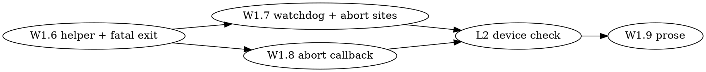
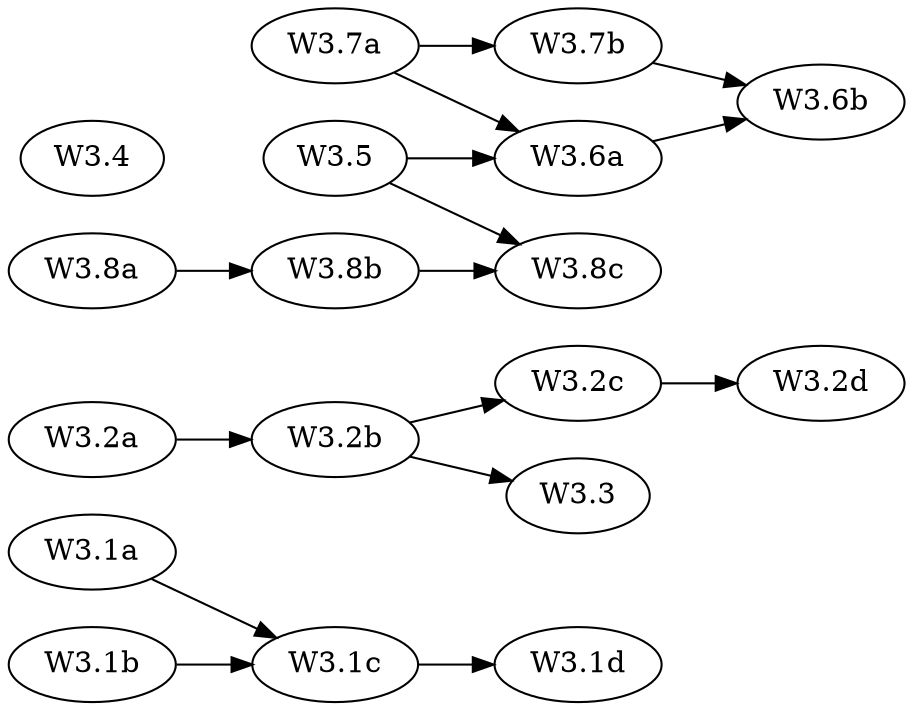

# MoE Prompt Micro-Batches Wider Than 512 Rows: Implementation Plan

> **Execution:** Use `team-driven-development` in Claude Code, `pi-team-driven-development` in pi.dev, or `codex-team-driven-development` in Codex.

**Goal:** A MoE model's prompt runs at micro-batches of 1024, 2048 and 4096 rows as safely and as cheaply in VRAM as
at 512, so that width can later become the automatic choice.

**Architecture:** Four stages, each merged and measured before the next. Stage 1 makes a device loss end the process
at once and leave evidence. Stage 2 lays the prompt executor's activation and output scratch out per GEMM group
instead of as one rectangle, and sizes the planned ring from the same rule. Stage 3 sizes every per-context MoE
structure from the context's own row count. Stage 4 lets the automatic picker climb past 512 rows for a MoE model.

**Tech Stack:** C++17, SYCL (icpx, oneAPI 2025.3), oneDNN, Level Zero on Intel Arc Pro B70 and B50, CMake and Ninja,
Python 3 source pins.

**Test Infrastructure:** ctest. Host-only C++ tests compile one backend source directly
(`ggml/src/ggml-sycl/CMakeLists.txt:7713-7728` is the pattern). Tests that need backend internals link
`ggml-sycl-private-fixtures` (`ggml/src/ggml-sycl/CMakeLists.txt:8106-8150`). Python source pins register through
`llama_test_pytest` (`tests/CMakeLists.txt:4663-4668`). Every device run, every model load and every binary that
links the whole backend is run by the lead, pinned, one at a time.

**Tracker:** epic llama.cpp-fmcp. This plan closes llama.cpp-ohkx and carries the hunt for llama.cpp-ve38. The design
and every owner ruling are on llama.cpp-ohkx (comments c-ikf2 to c-uitg).

**Base tree:** every line number in this plan is at `e2e/a10-combined` 5d3267494, tree
`abff080463434a50cfc038ff4911635738484f61`. The A10 merge into `integ/th32` produces that same tree. No task of this
plan starts before that merge. Task branches fork from `integ/th32` after it.

---

## What the owner approved (2026-11-15)

1. **Plan shape.** Width only. After it lands the lead re-profiles and writes the next two plans (grouped launches,
   then a fused quantized GEMM).
2. **Success bar.** Correct and monotone, with no fixed number:
   - every width from 512 to 4096 passes the real-text perplexity gate;
   - interleaved pairs show no wider rung slower than the one below it;
   - the 512-row baselines hold (GPT-OSS 20B and Mistral, both cards);
   - no routed expert leaves the device for scratch room at 2048 rows.
3. **Approach.** Pack per GEMM group, and MoE joins the dense ladder.
4. **Packing gate.** The freed scratch must show up as more routed experts on the device at 512 rows on Qwen.
5. **Picker rule.** Measured per model and card first. Stage 4's picker task is written after the lead's measurement
   and an owner gate.
6. **Fault gating.** Stage 1 lands the fast exit and the capture. The lead hunts the 1024-row fault while stages 2
   and 3 are implemented. Stage 4 stays blocked until the fault is explained and fixed, or shown to be the driver's
   with a measured rate the owner accepts.
7. **Width gate.** Each width (1024, 2048, 4096) runs the real-text perplexity 5 times with no fault. Every final
   figure is within 1% of the mean of 5 runs at 512 rows.

## Decisions the owner confirmed at the review gate (2026-11-15)

The owner approved this plan for execution after the A10 merge, and confirmed each decision below as written.

| # | Question | Confirmed | Task |
|---|---|---|---|
| D1 | A device loss can also surface at a queue wait (`SYCL_CHECK`, which aborts after forking gdb) or at the graph boundary (which returns `GGML_STATUS_FAILED`, after which the application exits normally into the Level Zero destructor that hung on 2026-11-15). Does stage 1 cover those paths? | Yes. A latch records the loss. `SYCL_CHECK` then leaves through the fast exit instead of gdb and `abort()`. The graph boundary still returns `FAILED`, and an exit handler registered at the loss ends the process through the fast exit when the application leaves. | W1.3 |
| D2 | Exit status of a process ended by a device loss. | 69, distinct from 1. A script can then tell a lost device from a failed test (llama.cpp-4lnb records that 1 is ambiguous today). Every other fatal op error keeps 1. | W1.1 |
| D3 | `ggml_sycl_set_device`'s catch segfaults on purpose (`crash()`, `common.hpp:1123`). | Replace it with the fast exit. A core dump on this path holds VRAM after the message. | W1.2 |
| D4 | The asynchronous handler in `dpct/helper.hpp:150-165` prints an asynchronous device loss and swallows it. | Leave it. That header is compiled into targets that do not link `common.cpp`. A lost device fails the next device call, which reaches a covered path. The gap is recorded as a ticket when stage 1 merges. | none |

---

## Team Topology

**Recommended implementers:** up to 3 concurrent, one per track (owner ruling 2026-11-14: implementers by track, at
most three at once, Opus for ownership and placement code).
**Reviewers:** spec, then quality, spawned fresh per review. Full reviews on Opus.

| Track | Tasks | Implementer | Description |
|-------|-------|-------------|-------------|
| A | W1.1, W1.2, W1.3, W1.4 | Opus, high | Stage 1: the fast exit, the injected device loss, the latch, the capture |
| B | W2.1, W2.2 | Opus, high | Stage 2: the packed layout function and the executor that uses it |
| C | W2.3, W2.4, W2.5 | Opus, xhigh | Stage 2: the packed bound, one sizing source, the planner switch |
| L (lead) | L1, G1, G2, W3.0, W4.0 | lead | The fault hunt, the stage gates, the stage 3 spike, the stage 4 measurement |

Stage 3's tasks are Amendment 3, written on 2026-11-16 after the W3.0 spike. Stage 4's tasks are not in this
document yet: they are written as an amendment after the W4.0 measurement. Since the owner's ruling of 2026-11-16
the lead decides each amendment's design and reports it; it no longer waits for a review before implementers start.

### Dependency Graph

```dot
digraph dependencies {
    rankdir=LR;
    P0   [label="P0: A10 merged into integ/th32"];
    W11  [label="W1.1 fast-exit helper"];
    W12  [label="W1.2 op failures use it"];
    W13  [label="W1.3 latch for waits and boundary"];
    W14  [label="W1.4 capture at the loss"];
    G1   [label="G1 stage 1 gate (lead)"];
    L1   [label="L1 fault hunt (lead)"];
    W21  [label="W2.1 packed layout function"];
    W22  [label="W2.2 executor packs per group"];
    W23  [label="W2.3 packed bound"];
    W24  [label="W2.4 one sizing source"];
    W25  [label="W2.5 planner sizes the packed ring"];
    G2   [label="G2 stage 2 gate (lead)"];
    W30  [label="W3.0 stage 3 spike, then amendment"];
    W40  [label="W4.0 picker measurement, owner gate"];
    P0 -> W11 -> W12 -> W13 -> W14 -> G1 -> L1;
    P0 -> W21 -> W22;
    P0 -> W23 -> W24 -> W25;
    W22 -> W25;
    G1 -> G2;
    W25 -> G2 -> W30 -> W40;
    L1 -> W40;
}
```



Merge order into `integ/th32`: W1.1 to W1.4 as each passes review, then G1. W2.1, W2.3 and W2.4 may merge as soon
as they pass review, because none changes behaviour. W2.2 merges after G1. W2.5 merges after W2.2. Then G2.

### File Ownership Map

| File/Directory | Tasks | Conflict Risk |
|----------------|-------|---------------|
| `ggml/src/ggml-sycl/common.hpp`, `common.cpp` | W1.1, W1.2, W1.3, W1.4 | Sequential (track A) |
| `ggml/src/ggml-sycl/tests/test-sycl-fatal-exit.cpp` | W1.1, W1.2, W1.3, W1.4 | Sequential (track A) |
| `tests/test-sycl-fatal-exit-source.py`, `tests/test-sycl-unified-private-seams.py` | W1.2, W1.3 | Sequential (track A) |
| `ggml/src/ggml-sycl/cpy.cpp`, `mmq.cpp` | W1.2 | None |
| `ggml/src/ggml-sycl/ggml-sycl.cpp`, catch sites and boundary (35564 to 127533, outside 92884 to 94444) | W1.2, W1.3 | Other regions than track B and C; merges are textual, checked with merge-tree every round |
| `ggml/src/ggml-sycl/ggml-sycl.cpp`, the executor lambda (92884 to 94444) | W2.2 | None |
| `ggml/src/ggml-sycl/ggml-sycl.cpp`, inventory publish and ring re-plan (17385 to 17665, 18024 to 18040, 20537 to 20800) | W2.4, W2.5 | Sequential (track C) |
| `ggml/src/ggml-sycl/moe-pp-pack.hpp`, `tests/test-moe-pp-pack.cpp` | W2.1 | None |
| `ggml/src/ggml-sycl/tests/test-moe-pp-batched-dequant.cpp` | W2.2, W2.5 | W2.5 runs after W2.2 |
| `ggml/src/ggml-sycl/moe-scratch-admission.hpp`, `.cpp`, `tests/test-moe-scratch-admission.cpp` | W2.3, W2.5 | Sequential (track C) |
| `ggml/src/ggml-sycl/unified-cache.cpp`, `unified-cache.hpp` | W2.4, W2.5 | Sequential (track C) |
| `src/llama-model.cpp`, `ggml/include/ggml-sycl.h` | W2.5 | None |
| `ggml/src/ggml-sycl/CMakeLists.txt` | W1.1, W1.2, W1.3, W2.1 | Separate blocks; W2.1 adds beside line 7728, track A beside line 6584 |
| `docs/backend/sycl-env-vars.md`, `docs/backend/sycl-memory-design.md` | W1.4, W2.5 | Separate sections |

### Rules every implementer prompt carries

- Work only in the task's worktree. It is not the codescout session root: pass `root="<worktree>"` on every codescout
  call, and check the echoed `root`. The codescout index is blind inside `ggml-sycl.cpp`: verify there with
  `cat ggml/src/ggml-sycl/ggml-sycl.cpp | grep -n '<pattern>'`.
- Never run a GPU binary, a device test, a model load or any test binary that links the backend. Never build without
  the lead's literal `GO` naming a commit. Report what needs running.
- Python source pins run as `python3 <file>`. Host-only tests that compile one source may be compiled and run with
  the lead's `GO`.
- Commits are path-scoped (`git commit -- <paths>`), never amended once reported, and end with exactly one trailer:
  `Co-Authored-By: Claude Opus 5.5 <noreply@anthropic.com>`.
- Never `clang-format-19 -i`. Check with `clang-format-19 --dry-run -Werror <file>` and leave drift you did not
  introduce.
- Comments state the reason for the code. They cite no ticket id, task number or review round.
- The task is not closed by the implementer.

---

## Stage 1: a device loss ends the process at once

**Why.** On 2026-11-15 an explicit `-ub 1024` run lost the device in MUL_MAT_ID. The catch called `std::exit(1)`.
The Level Zero library's destructor then spun under `_dl_fini`, and the process held 51 GB and `GPU.lock` until it
was killed by pid. `std::exit` runs static destructors; `std::_Exit` does not. The watchdog already leaves through
`std::_Exit` (`common.cpp:746-773`). Stage 1 gives every other fatal path the same exit, and saves the process's
memory map at the moment of the loss, because the fault's page (`0x0000782b60004000`) could not be attributed
afterwards.

### Task W1.1: one fast exit

**Track:** A
**Depends on:** P0
**File scope:**
- Modify: `ggml/src/ggml-sycl/common.hpp:829-831` (insert between the `#endif` at 829 and `#define CHECK_TRY_ERROR` at 831)
- Modify: `ggml/src/ggml-sycl/common.cpp:775` (insert after the closing brace of `watchdog_thread_fn`, before the comment `// Parse GGML_SYCL_OP_TIMEOUT_MS`)
- Create: `ggml/src/ggml-sycl/tests/test-sycl-fatal-exit.cpp`
- Modify: `ggml/src/ggml-sycl/CMakeLists.txt:6584` (insert a block after `endif() # static SYCL backend fixture`)

**Description:**

Adds `ggml_sycl_fatal_exit(code, message)`: print one line, flush, do what the watchdog does before it leaves, and
call `std::_Exit`. Adds the test that tells `_Exit` from `exit`: a child process plants an `atexit` handler and a
static destructor, and neither may run. No caller changes in this task.

**Acceptance Criteria:**

- [ ] `test-sycl-fatal-exit helper` passes: the child ends with status 69, prints the `[SYCL-FATAL]` line, and prints neither marker
- [ ] `test-sycl-fatal-exit control` passes: a child that calls `std::exit(69)` prints both markers (the markers can fire)
- [ ] `test-sycl-fatal-exit classify` passes: the real device-loss text is recognised, an error-39 text and a null are not
- [ ] `python3 tests/test-sycl-moe-cpu-job-device-signal-source.py`, `python3 tests/test-sycl-zone-reset-audit-source.py` and `python3 tests/test-sycl-watchdog-progress-tick-source.py` still pass
- [ ] `clang-format-19 --dry-run -Werror` is clean on the new test file

**Implementation Guide:**

1. **Test first.** Create `ggml/src/ggml-sycl/tests/test-sycl-fatal-exit.cpp`:

```cpp
// A process the backend ends after a fatal error must not run its exit handlers or static destructors: after a
// device loss the Level Zero library's own destructor does not return. Each mode runs this binary again as a child
// that plants an atexit handler and a static destructor, and checks from outside which of them ran.

#include "common.hpp"

#include <sys/wait.h>
#include <unistd.h>

#include <chrono>
#include <cstdio>
#include <cstdlib>
#include <cstring>
#include <string>

namespace {

constexpr const char * k_atexit_marker = "TEST-ATEXIT-RAN";
constexpr const char * k_dtor_marker   = "TEST-STATIC-DTOR-RAN";

void atexit_marker() {
    std::fprintf(stderr, "%s\n", k_atexit_marker);
    std::fflush(stderr);
}

struct dtor_marker {
    ~dtor_marker() {
        std::fprintf(stderr, "%s\n", k_dtor_marker);
        std::fflush(stderr);
    }
};

void plant_markers() {
    static dtor_marker marker;
    std::atexit(atexit_marker);
}

struct child_result {
    bool        exited  = false;
    int         status  = -1;
    int         signal  = 0;
    double      seconds = 0.0;
    std::string err;
};

child_result run_child(const char * self, const char * mode) {
    int fds[2];
    if (pipe(fds) != 0) {
        std::perror("pipe");
        std::exit(1);
    }
    const auto  t0  = std::chrono::steady_clock::now();
    const pid_t pid = fork();
    if (pid < 0) {
        std::perror("fork");
        std::exit(1);
    }
    if (pid == 0) {
        dup2(fds[1], STDERR_FILENO);
        close(fds[0]);
        close(fds[1]);
        execl(self, self, "--child", mode, static_cast<char *>(nullptr));
        _exit(127);
    }
    close(fds[1]);
    child_result r;
    char         buf[4096];
    ssize_t      n = 0;
    while ((n = read(fds[0], buf, sizeof(buf))) > 0) {
        r.err.append(buf, static_cast<size_t>(n));
    }
    close(fds[0]);
    int st = 0;
    waitpid(pid, &st, 0);
    r.seconds = std::chrono::duration<double>(std::chrono::steady_clock::now() - t0).count();
    r.exited  = WIFEXITED(st);
    r.status  = r.exited ? WEXITSTATUS(st) : -1;
    r.signal  = WIFSIGNALED(st) ? WTERMSIG(st) : 0;
    return r;
}

bool has(const child_result & r, const char * needle) {
    return r.err.find(needle) != std::string::npos;
}

int fail(const char * mode, const child_result & r, const char * why) {
    std::fprintf(stderr, "FAIL mode=%s: %s (exited=%d status=%d signal=%d seconds=%.1f)\n--- child stderr ---\n%s\n",
                 mode, why, r.exited ? 1 : 0, r.status, r.signal, r.seconds, r.err.c_str());
    return 1;
}

// The fast exit ran: the given status, its banner, and neither marker.
int check_fast_exit(const char * mode, const child_result & r, int want_status) {
    if (!r.exited || r.status != want_status) {
        return fail(mode, r, "wrong exit status");
    }
    if (!has(r, "[SYCL-FATAL]")) {
        return fail(mode, r, "no [SYCL-FATAL] line");
    }
    if (has(r, k_atexit_marker) || has(r, k_dtor_marker)) {
        return fail(mode, r, "an exit handler or a static destructor ran");
    }
    if (r.seconds > 30.0) {
        return fail(mode, r, "the child took over 30 s to end");
    }
    return 0;
}

int child_main(const char * mode) {
    if (std::strcmp(mode, "helper") == 0) {
        plant_markers();
        ggml_sycl_fatal_exit(GGML_SYCL_EXIT_DEVICE_LOST, "test: helper mode");
    }
    if (std::strcmp(mode, "control") == 0) {
        plant_markers();
        std::exit(GGML_SYCL_EXIT_DEVICE_LOST);
    }
    std::fprintf(stderr, "unknown child mode %s\n", mode);
    return 2;
}

int parent_main(const char * self, const char * mode) {
    if (std::strcmp(mode, "helper") == 0) {
        const child_result r = run_child(self, mode);
        if (!has(r, "[SYCL-FATAL] test: helper mode")) {
            return fail(mode, r, "the message is not on the [SYCL-FATAL] line");
        }
        return check_fast_exit(mode, r, GGML_SYCL_EXIT_DEVICE_LOST);
    }
    if (std::strcmp(mode, "control") == 0) {
        const child_result r = run_child(self, mode);
        if (!r.exited || r.status != GGML_SYCL_EXIT_DEVICE_LOST || !has(r, k_atexit_marker) ||
            !has(r, k_dtor_marker)) {
            return fail(mode, r, "std::exit did not run both markers, so their absence proves nothing");
        }
        return 0;
    }
    if (std::strcmp(mode, "classify") == 0) {
        const char * lost = "level_zero backend failed with error: 20 (UR_RESULT_ERROR_DEVICE_LOST)";
        const char * oom  = "level_zero backend failed with error: 39 (UR_RESULT_ERROR_OUT_OF_DEVICE_MEMORY)";
        const bool   ok   = ggml_sycl_what_is_device_lost(lost) && !ggml_sycl_what_is_device_lost(oom) &&
                            !ggml_sycl_what_is_device_lost(nullptr) &&
                            ggml_sycl_fatal_exit_code(lost) == GGML_SYCL_EXIT_DEVICE_LOST &&
                            ggml_sycl_fatal_exit_code(oom) == 1 && ggml_sycl_fatal_exit_code(nullptr) == 1;
        if (!ok) {
            std::fprintf(stderr, "FAIL mode=classify\n");
            return 1;
        }
        return 0;
    }
    std::fprintf(stderr, "usage: %s helper|control|classify\n", self);
    return 2;
}

}  // namespace

int main(int argc, char ** argv) {
    if (argc == 3 && std::strcmp(argv[1], "--child") == 0) {
        return child_main(argv[2]);
    }
    if (argc != 2) {
        std::fprintf(stderr, "usage: %s helper|control|classify\n", argv[0]);
        return 2;
    }
    const int rc = parent_main(argv[0], argv[1]);
    if (rc == 0) {
        std::fprintf(stderr, "PASS mode=%s\n", argv[1]);
    }
    return rc;
}
```

2. **Register it.** In `ggml/src/ggml-sycl/CMakeLists.txt`, directly after line 6584
   (`endif() # static SYCL backend fixture`, the end of the `test-sycl-orchestrator` block):

```cmake
# The backend's fatal exit: a child process must end without running an exit handler or a static destructor. The
# helper, control and classify modes touch no device.
if (NOT GGML_BACKEND_DL)
add_executable(test-sycl-fatal-exit
    ${CMAKE_CURRENT_SOURCE_DIR}/tests/test-sycl-fatal-exit.cpp
)
target_include_directories(test-sycl-fatal-exit PRIVATE
    ${CMAKE_CURRENT_SOURCE_DIR}
    ${CMAKE_CURRENT_SOURCE_DIR}/..
    ${CMAKE_CURRENT_SOURCE_DIR}/../../include
    ${SYCL_INCLUDE_DIR}
)
target_compile_options(test-sycl-fatal-exit PRIVATE "-fsycl" "-Wno-narrowing")
target_link_options(test-sycl-fatal-exit PRIVATE "-fsycl")
target_compile_definitions(test-sycl-fatal-exit PRIVATE
    GGML_SYCL_WARP_SIZE=32
    GGML_SYCL_DNNL=${GGML_SYCL_DNNL}
    GGML_SYCL_PRIVATE_TESTING=1
)
target_link_libraries(test-sycl-fatal-exit PRIVATE ggml-sycl-private-fixtures)
set_target_properties(test-sycl-fatal-exit PROPERTIES RUNTIME_OUTPUT_DIRECTORY ${CMAKE_BINARY_DIR}/bin)
foreach(_fatal_mode IN ITEMS helper control classify)
    add_test(NAME test-sycl-fatal-exit-${_fatal_mode} COMMAND test-sycl-fatal-exit ${_fatal_mode})
    set_tests_properties(test-sycl-fatal-exit-${_fatal_mode} PROPERTIES
        LABELS "sycl;fatal-exit"
        ENVIRONMENT "LD_LIBRARY_PATH=/opt/intel/oneapi/redist/lib:$ENV{LD_LIBRARY_PATH}"
        TIMEOUT 60
    )
endforeach()
endif() # static SYCL backend fixture
```

   RED: the build fails, because `ggml_sycl_fatal_exit`, `ggml_sycl_what_is_device_lost`,
   `ggml_sycl_fatal_exit_code` and `GGML_SYCL_EXIT_DEVICE_LOST` do not exist. Report the compiler's first error line.

3. **Declare.** In `ggml/src/ggml-sycl/common.hpp`, between line 829 (`#endif` of `GGML_SYCL_KTRACE`) and line 831
   (`#define CHECK_TRY_ERROR(expr)`):

```cpp
// The exit status of a process the backend ended because a device was lost. It differs from 1, which a failed test,
// the watchdog and every other fatal op error use, so a script can tell a lost device from a wrong result.
constexpr int GGML_SYCL_EXIT_DEVICE_LOST = 69;

// True when an exception's text names a lost device, as the Level Zero adapter prints it:
// "level_zero backend failed with error: 20 (UR_RESULT_ERROR_DEVICE_LOST)".
bool ggml_sycl_what_is_device_lost(const char * what) noexcept;

// GGML_SYCL_EXIT_DEVICE_LOST for a lost device's exception text, 1 for any other.
int ggml_sycl_fatal_exit_code(const char * what) noexcept;

// Ends the process at once after a failure it cannot recover from. Prints `message` on one [SYCL-FATAL] line,
// flushes stdout and stderr, does what the watchdog does before its exit, and leaves through std::_Exit: no exit
// handler and no static destructor runs. After a device loss the Level Zero library's destructor does not return,
// and std::exit would run it. The caller prints its own diagnostic first.
[[noreturn]] void ggml_sycl_fatal_exit(int code, const char * message) noexcept;
```

4. **Define.** In `ggml/src/ggml-sycl/common.cpp`, after the closing brace of `watchdog_thread_fn` (line 775):

```cpp
bool ggml_sycl_what_is_device_lost(const char * what) noexcept {
    return what != nullptr && std::strstr(what, "UR_RESULT_ERROR_DEVICE_LOST") != nullptr;
}

int ggml_sycl_fatal_exit_code(const char * what) noexcept {
    return ggml_sycl_what_is_device_lost(what) ? GGML_SYCL_EXIT_DEVICE_LOST : 1;
}

void ggml_sycl_fatal_exit(int code, const char * message) noexcept {
    std::fprintf(stderr, "[SYCL-FATAL] %s: ending the process with _Exit(%d), no teardown\n",
                 message ? message : "(no message)", code);
    std::fflush(stdout);
    std::fflush(stderr);
    // The watchdog's order: release every device command parked on a CPU expert job, then print the zone-reset
    // audit an exit handler would have printed (nothing unless GGML_SYCL_ZONE_RESET_AUDIT is set).
    ggml_sycl::cpu_job_signal_signal_all();
    ggml_sycl::zone_reset_audit_report("sycl-fatal-exit");
    std::_Exit(code);
}
```

5. **GREEN.** Report the commit. The lead builds `test-sycl-fatal-exit` and runs the three modes.

Lead run (after the build):

```bash
source /opt/intel/oneapi/setvars.sh --force >/dev/null
for m in helper control classify; do ./build/bin/test-sycl-fatal-exit $m; echo "rc=$?"; done
```

Expected: `PASS mode=helper`, `PASS mode=control`, `PASS mode=classify`, each `rc=0`.

**Commit:**

```bash
git add ggml/src/ggml-sycl/tests/test-sycl-fatal-exit.cpp
git commit -m "sycl: one fast exit for fatal backend errors, tested from a child process" -- \
    ggml/src/ggml-sycl/common.hpp ggml/src/ggml-sycl/common.cpp \
    ggml/src/ggml-sycl/tests/test-sycl-fatal-exit.cpp ggml/src/ggml-sycl/CMakeLists.txt
```

**Gotchas:**
- The definition must sit **after** `watchdog_thread_fn`, and must not call `ggml_sycl_cleanup_host_allocations()`.
  `tests/test-sycl-moe-cpu-job-device-signal-source.py:532-537` finds the first such call in `common.cpp` and expects
  the watchdog around it. `tests/test-sycl-zone-reset-audit-source.py:417-418` reads the watchdog's body. Leave the
  watchdog body and its banner untouched.
- Print with `fprintf(stderr)`, not `GGML_LOG_ERROR`. The log queue is not flushed by `_Exit`.
- `common.cpp` already includes `<cstring>`, `<cstdio>`, `<cstdlib>` and `unified-cache.hpp` (lines 18 to 25).
- The parent re-executes the binary (`execl`) rather than running the child after a bare `fork`, so the child's
  process image is fresh.
- `noexcept` holds: `cpu_job_signal_signal_all` is `noexcept` with a bounded lock. `zone_reset_audit_report` takes a
  plain mutex only when the audit variable is set.

---

### Task W1.2: an op failure leaves through the fast exit

**Track:** A
**Depends on:** W1.1
**File scope:**
- Modify: `ggml/src/ggml-sycl/common.hpp:317-323` (a second seam directly after the scratchpad hook block) and `:1121-1124`
- Modify: `ggml/src/ggml-sycl/common.cpp` (the seam's definition, after `ggml_sycl_fatal_exit`)
- Modify: `ggml/src/ggml-sycl/ggml-sycl.cpp` at the 33 `std::exit(1)` sites listed below, plus two injection lines
- Modify: `ggml/src/ggml-sycl/cpy.cpp:1532`, `ggml/src/ggml-sycl/mmq.cpp:7756`
- Modify: `ggml/src/ggml-sycl/tests/test-sycl-fatal-exit.cpp`, `ggml/src/ggml-sycl/CMakeLists.txt` (two registrations)
- Create: `tests/test-sycl-fatal-exit-source.py`; Modify: `tests/CMakeLists.txt:4668` (register it after the `test-sycl-auto-ubatch-source` block)
- Modify: `tests/test-sycl-unified-private-seams.py:11-37` and its `guarded`, `forbidden_symbols`, `forbidden_strings` lists

**Description:**

Every catch in the backend that ends the process calls `ggml_sycl_fatal_exit` in place of `std::exit(1)`. A
test-only switch throws the exception a lost device throws, at the top of MUL_MAT_ID or of any op, so the test of
W1.1 can show the catch's own exit no longer runs teardown. Two commits: RED (switch, test modes, source pin), then
GREEN (the sites).

**Acceptance Criteria:**

- [ ] RED commit, lead run: `test-sycl-fatal-exit mmid` and `op` FAIL with "wrong exit status" (status 1) and the child's stderr shows `TEST-ATEXIT-RAN`; `python3 tests/test-sycl-fatal-exit-source.py` fails naming `ggml-sycl.cpp`
- [ ] GREEN commit, lead run: both modes pass with status 69, `[MUL_MAT_ID-FAIL]` (mode `mmid`) or `Error OP` (mode `op`), `Exception caught at file:`, `UR_RESULT_ERROR_DEVICE_LOST`, `[SYCL-FATAL]`, and neither marker
- [ ] `python3 tests/test-sycl-fatal-exit-source.py` passes: no `std::exit(` in `ggml-sycl.cpp`, `cpy.cpp` or `mmq.cpp`; exactly one in `common.hpp`, inside `bad_arch`
- [ ] `python3 tests/test-sycl-unified-private-seams.py` passes (it needs the built ordinary library: lead run) and `python3 tests/test-sycl-lock-audit-source.py` passes
- [ ] Every diagnostic line a site printed before its exit is still printed, unchanged

**Implementation Guide:**

1. **The switch (RED commit).** In `common.hpp`, directly after the `#endif` that closes the scratchpad hook block
   (line 323):

```cpp
#if defined(GGML_SYCL_PRIVATE_TESTING)
// GGML_SYCL_TEST_INJECT_DEVICE_LOST=<site>:<n> throws, from the nth call at `site` onward, the exception a lost
// device throws. It keeps throwing because a lost device stays lost: graph recording rethrows the first one and
// runs the graph again directly.
void ggml_sycl_test_inject_device_lost(const char * site);
#else
inline void ggml_sycl_test_inject_device_lost(const char *) {
}
#endif
```

   In `common.cpp`, after `ggml_sycl_fatal_exit` (add `#include <string>` beside the other standard headers):

```cpp
#if defined(GGML_SYCL_PRIVATE_TESTING)
void ggml_sycl_test_inject_device_lost(const char * site) {
    struct request {
        std::string site;
        long long   n = 0;
    };
    static const request req = [] {
        request      r;
        const char * value = std::getenv("GGML_SYCL_TEST_INJECT_DEVICE_LOST");
        const char * colon = value != nullptr ? std::strchr(value, ':') : nullptr;
        if (colon != nullptr) {
            r.site.assign(value, colon);
            r.n = std::atoll(colon + 1);
        }
        return r;
    }();
    if (req.n <= 0 || site == nullptr || req.site != site) {
        return;
    }
    static std::atomic<long long> calls{ 0 };
    if (calls.fetch_add(1, std::memory_order_relaxed) + 1 >= req.n) {
        throw sycl::exception(sycl::make_error_code(sycl::errc::runtime),
                              "injected test fault: level_zero backend failed with error: 20 "
                              "(UR_RESULT_ERROR_DEVICE_LOST)");
    }
}
#endif
```

   Two call sites in `ggml-sycl.cpp`:
   - first statement of `ggml_sycl_mul_mat_id`, directly after line 85858
     (`static void ggml_sycl_mul_mat_id(ggml_backend_sycl_context & ctx, ggml_tensor * dst) try {`):
     `ggml_sycl_test_inject_device_lost("mmid");`
   - in `ggml_sycl_compute_forward_impl`, directly after the closing brace of `if (!g_sycl_loaded) { ... }`
     (line 98201): `ggml_sycl_test_inject_device_lost("op");`. The call must sit inside the `try` whose handlers are
     at 99062-99091. If the `g_sycl_loaded` check is above that `try`, make the call the first statement inside it.

2. **The private-seam audit (RED commit).** In `tests/test-sycl-unified-private-seams.py`:
   - add to the `guarded` tuple of `SYCL / "common.cpp"`: `"void ggml_sycl_test_inject_device_lost(const char * site) {"`;
   - add to the `guarded` tuple of `SYCL / "common.hpp"`: `"void ggml_sycl_test_inject_device_lost(const char * site);"`;
   - add `"ggml_sycl_test_inject_device_lost"` to `forbidden_symbols` and `"GGML_SYCL_TEST_INJECT_DEVICE_LOST"` to
     `forbidden_strings` (both lists are further down the same file; follow the form of the
     `GGML_SYCL_TEST_DMA_FAIL` entry).

3. **The test modes (RED commit).** In `test-sycl-fatal-exit.cpp`:
   - add the includes `ggml.h`, `ggml-backend.h`, `ggml-cpu.h`, `ggml-sycl.h`, `ggml-quants.h`, `<random>`, `<vector>`;
   - copy `alloc_tensor_buffer`, `fill_random`, `quantize_weights_mxfp4` and `run_mul_mat_id_backend` from
     `tests/test-moe-mul-mat-id.cpp:47-161` into the anonymous namespace, unchanged;
   - add the child and the parent checks:

```cpp
// One small MUL_MAT_ID graph on the SYCL backend. Returns false when the compute reported a failure.
bool run_one_mmid(ggml_backend_t backend) {
    const int          in_dim = 64, out_dim = 32, n_experts = 4, n_used = 2, n_tokens = 8;
    std::mt19937       rng(7);
    std::vector<float> weights(size_t(in_dim) * out_dim * n_experts);
    std::vector<float> input(size_t(in_dim) * n_tokens);
    fill_random(weights, 1.0f, rng);
    fill_random(input, 1.0f, rng);
    std::vector<uint8_t> packed;
    quantize_weights_mxfp4(weights, in_dim, out_dim, n_experts, packed);
    std::vector<int32_t> ids(size_t(n_used) * n_tokens);
    for (int t = 0; t < n_tokens; ++t) {
        for (int i = 0; i < n_used; ++i) {
            ids[size_t(t) * n_used + i] = (t + i) % n_experts;
        }
    }
    std::vector<float> out;
    return run_mul_mat_id_backend(backend, ggml_backend_sycl_host_buffer_type(), packed, input, ids, in_dim, out_dim,
                                  n_experts, n_used, n_tokens, out);
}

// The device modes: the injected loss is in the environment the registration sets.
int child_device(const char * mode) {
    plant_markers();
    ggml_backend_t backend = ggml_backend_sycl_init(0);
    if (backend == nullptr) {
        std::fprintf(stderr, "SKIP: no SYCL backend\n");
        return 77;
    }
    const bool computed = run_one_mmid(backend);
    std::fprintf(stderr, "TEST-CHILD-SURVIVED mode=%s computed=%d\n", mode, computed ? 1 : 0);
    return 3;
}
```

   Match the argument list of `run_one_mmid`'s call to `run_mul_mat_id_backend`'s real signature at
   `tests/test-moe-mul-mat-id.cpp:80-93` and to `quantize_weights_mxfp4`'s at `:66`; the call above shows the values
   to pass, not a verified order.

   In `child_main`, before the `unknown child mode` line:

```cpp
    if (std::strcmp(mode, "mmid") == 0 || std::strcmp(mode, "op") == 0) {
        return child_device(mode);
    }
```

   In `parent_main`, before the usage line:

```cpp
    if (std::strcmp(mode, "mmid") == 0 || std::strcmp(mode, "op") == 0) {
        const child_result r = run_child(self, mode);
        if (r.exited && r.status == 77) {
            std::fprintf(stderr, "%s", r.err.c_str());
            return 77;
        }
        if (has(r, "TEST-CHILD-SURVIVED")) {
            return fail(mode, r, "the injected loss was never thrown: the op did not reach the site");
        }
        const char * site_line = std::strcmp(mode, "mmid") == 0 ? "[MUL_MAT_ID-FAIL]" : "Error OP";
        if (!has(r, site_line) || !has(r, "Exception caught at file:") || !has(r, "UR_RESULT_ERROR_DEVICE_LOST")) {
            return fail(mode, r, "the catch's own diagnostic lines are missing");
        }
        return check_fast_exit(mode, r, GGML_SYCL_EXIT_DEVICE_LOST);
    }
```

   Extend both usage strings with `|mmid|op`. Register the two modes in `ggml/src/ggml-sycl/CMakeLists.txt`, inside
   the block W1.1 added, after its `endforeach()`:

```cmake
# The device modes: the registration injects the loss a lost device throws, once at MUL_MAT_ID and once at any op.
foreach(_fatal_site IN ITEMS mmid op)
    add_test(NAME test-sycl-fatal-exit-${_fatal_site} COMMAND test-sycl-fatal-exit ${_fatal_site})
    set_tests_properties(test-sycl-fatal-exit-${_fatal_site} PROPERTIES
        LABELS "sycl;fatal-exit;device;B50"
        SKIP_RETURN_CODE 77
        RUN_SERIAL TRUE
        ENVIRONMENT "GGML_SYCL_TEST_INJECT_DEVICE_LOST=${_fatal_site}:1;ONEAPI_DEVICE_SELECTOR=level_zero:1;LD_LIBRARY_PATH=/opt/intel/oneapi/redist/lib:$ENV{LD_LIBRARY_PATH}"
        TIMEOUT 120
    )
endforeach()
```

4. **The source pin (RED commit).** Create `tests/test-sycl-fatal-exit-source.py`:

```python
#!/usr/bin/env python3
"""No backend source ends the process with std::exit: a fatal path leaves through ggml_sycl_fatal_exit."""
from pathlib import Path
import re
import sys

ROOT = Path(__file__).resolve().parents[1]
SYCL = ROOT / "ggml/src/ggml-sycl"


def code_of(path: Path) -> str:
    text = path.read_text(encoding="utf-8")
    text = re.sub(r"/\*.*?\*/", lambda m: " " * len(m.group(0)), text, flags=re.S)
    return re.sub(r"//[^\n]*", "", text)


EXIT = re.compile(r"\b(?:std::)?exit\s*\(")
failures = []
for name in ("ggml-sycl.cpp", "cpy.cpp", "mmq.cpp"):
    hits = len(EXIT.findall(code_of(SYCL / name)))
    if hits != 0:
        failures.append(f"{name}: {hits} exit( call(s); a fatal path must call ggml_sycl_fatal_exit")

hpp = code_of(SYCL / "common.hpp")
hpp_hits = [m.start() for m in EXIT.finditer(hpp)]
bad_arch = hpp.find("static inline void bad_arch(")
if len(hpp_hits) != 1 or bad_arch < 0 or not (bad_arch < hpp_hits[0] < bad_arch + 400):
    failures.append(f"common.hpp: expected exactly one exit( call, inside bad_arch; found {len(hpp_hits)}")

cpp = code_of(SYCL / "common.cpp")
watchdog = cpp.find("static void watchdog_thread_fn(")
helper = cpp.find("void ggml_sycl_fatal_exit(int code, const char * message) noexcept {")
if watchdog < 0 or helper < 0 or helper < watchdog:
    failures.append("common.cpp: ggml_sycl_fatal_exit must be defined after watchdog_thread_fn")
body = cpp[helper:helper + 900] if helper >= 0 else ""
if "std::_Exit(code);" not in body or "ggml_sycl_cleanup_host_allocations" in body:
    failures.append("common.cpp: ggml_sycl_fatal_exit must end in std::_Exit(code) and not call the host cleanup")

if failures:
    print("\n".join(failures))
    sys.exit(1)
print("ok")
```

   Register it in `tests/CMakeLists.txt` directly after the `test-sycl-auto-ubatch-source` block (line 4668):

```cmake
if (Python3_Interpreter_FOUND)
    llama_test_pytest(${Python3_EXECUTABLE}
        NAME test-sycl-fatal-exit-source
        SCRIPT ${CMAKE_CURRENT_SOURCE_DIR}/test-sycl-fatal-exit-source.py
        LABEL "sycl;python;source-assert"
        TIMEOUT 120)
endif()
```

   Run: `python3 tests/test-sycl-fatal-exit-source.py`
   Expected (RED): three lines, `ggml-sycl.cpp: 33 exit( call(s)...`, `cpy.cpp: 1 ...`, `mmq.cpp: 1 ...`, and the
   `common.hpp` line (two calls today), exit status 1.

   Commit the RED state and report it. The lead builds and records the device RED.

5. **The sites (GREEN commit).** At each site replace the one statement `std::exit(1);` and keep every line above
   it. The replacement is

```cpp
ggml_sycl_fatal_exit(ggml_sycl_fatal_exit_code(<v>.what()), "<function>");
```

   where `<v>` is the caught variable and `<function>` is the enclosing function's name.

   | # | `ggml-sycl.cpp` line of `std::exit(1)` | enclosing function | caught variable |
   |---|---|---|---|
   | 1 | 35564 | `ggml_check_sycl` | `exc` |
   | 2 | 35598 | `ggml_backend_sycl_get_gpu_list` | `exc` |
   | 3 | 35948 | `ggml_backend_sycl_memcpy_d2h` | `exc` |
   | 4 | 35978 | `ggml_backend_sycl_buffer_free_buffer` | `exc` |
   | 5 | 36771 | `ggml_backend_sycl_buffer_init_tensor` | `exc` |
   | 6 | 47069 | `ggml_backend_sycl_buffer_set_tensor` | `exc` |
   | 7 | 47329 | `ggml_backend_sycl_buffer_get_tensor` | `exc` |
   | 8 | 47714 | `ggml_backend_sycl_buffer_clear` | `exc` |
   | 9 | 48741 | `ggml_backend_sycl_buffer_type_alloc_buffer` | `exc` |
   | 10 | 51220 | `~ggml_backend_sycl_split_buffer_context` | `exc` |
   | 11 | 51352 | `ggml_backend_sycl_split_buffer_init_tensor` | `exc` |
   | 12 | 51411 | `ggml_backend_sycl_split_buffer_set_tensor` | `exc` |
   | 13 | 51471 | `ggml_backend_sycl_split_buffer_get_tensor` | `exc` |
   | 14 | 55203 | `ggml_backend_sycl_host_compute_buffer_alloc` | `exc` |
   | 15 | 57769 | `ggml_sycl_cpy_tensor_2d` | `exc` |
   | 16 | 58712 | `ggml_sycl_op_mul_mat_sycl` | `exc` |
   | 17 | 59832 | `ggml_sycl_op_mul_mat` (first quantize try) | `exc` |
   | 18 | 59963 | `ggml_sycl_op_mul_mat` (second quantize try) | `exc` |
   | 19 | 60508 | `ggml_sycl_op_mul_mat` (outer catch, opened at 60414) | `exc` |
   | 20 | 63309 | `ggml_sycl_mul_mat_vec_p021` | `exc` |
   | 21 | 63352 | `ggml_sycl_mul_mat_vec_nc` | `exc` |
   | 22 | 76986 | `ggml_sycl_mul_mat_bf16_weight` | `exc` |
   | 23 | 95656 | `ggml_sycl_mul_mat_id` | `exc` |
   | 24 | 95733 | `ggml_sycl_set_main_device` | `exc` |
   | 25 | 99062 | `ggml_sycl_compute_forward_impl` (`dnnl::error`) | `e` |
   | 26 | 99083 | `ggml_sycl_compute_forward_impl` (`sycl::exception`) | `e` |
   | 27 | 99091 | `ggml_sycl_compute_forward_impl` (`std::exception`) | `e` |
   | 28 | 99101 | `ggml_backend_sycl_get_device_description` | `exc` |
   | 29 | 99149 | `ggml_backend_sycl_get_device_memory` | `exc` |
   | 30 | 99564 | `ggml_backend_sycl_set_tensor_async` | `exc` |
   | 31 | 99623 | `ggml_backend_sycl_get_tensor_async` | `exc` |
   | 32 | 99675 | `ggml_backend_sycl_cpy_tensor_async` | `exc` |
   | 33 | 127533 | `ggml_backend_sycl_device_event_free` | `exc` |

   Also `cpy.cpp:1532` (`ggml_sycl_cpy`, `exc`) and `mmq.cpp:7756` (`ggml_sycl_op_mul_mat_q`, `exc`). Read each
   catch's own variable name before editing; the table records what the excerpts showed.

   `common.hpp:1121-1124` (`ggml_sycl_set_device`, decision D3): replace the two statements `crash();` and
   `std::exit(1);` with `ggml_sycl_fatal_exit(ggml_sycl_fatal_exit_code(exc.what()), "ggml_sycl_set_device");`.
   `ggml_sycl_fatal_exit` is declared at line 831, above this function. Leave `bad_arch` (`common.hpp:1048-1054`)
   alone. If `crash()` (`common.hpp:897-900`) has no caller left, delete it; check with
   `git grep -n 'crash()' -- ggml/src/ggml-sycl`.

   Run: `python3 tests/test-sycl-fatal-exit-source.py`
   Expected (GREEN): `ok`.

**Commit:**

```bash
# RED
git add tests/test-sycl-fatal-exit-source.py
git commit -m "sycl: a test-only injected device loss, and the tests an op failure's exit must pass (RED)" -- \
    ggml/src/ggml-sycl/common.hpp ggml/src/ggml-sycl/common.cpp ggml/src/ggml-sycl/ggml-sycl.cpp \
    ggml/src/ggml-sycl/tests/test-sycl-fatal-exit.cpp ggml/src/ggml-sycl/CMakeLists.txt \
    tests/test-sycl-fatal-exit-source.py tests/CMakeLists.txt tests/test-sycl-unified-private-seams.py
# GREEN
git commit -m "sycl: every op failure that ends the process leaves through the fast exit" -- \
    ggml/src/ggml-sycl/ggml-sycl.cpp ggml/src/ggml-sycl/cpy.cpp ggml/src/ggml-sycl/mmq.cpp \
    ggml/src/ggml-sycl/common.hpp
```

**Gotchas:**
- The switch must keep throwing. A one-shot throw is consumed by graph recording: the op's catch rethrows through
  `ggml_sycl_try_dispatch_resource_exhaustion_fallback` (`ggml-sycl.cpp:56921-56926`), the recording handler
  disables graphs and runs the graph again directly (`:125080-125092`), and the second run would pass.
- The injected text must not match the resource-exhaustion predicate (`common.hpp:129-187`): it names error 20, not
  39 or 40, so the fallback returns false as it does for a real loss.
- Do not put a throw in `ggml_backend_sycl_graph_compute` in this task. Its catch returns `FAILED` and never exits;
  W1.3 owns that path.
- If the RED device run prints `TEST-CHILD-SURVIVED`, the small graph did not reach the site. Report it. Do not
  move the injection line.
- `ggml-sycl.cpp` is in the static-storage inventory (`docs/backend/sycl-static-storage-inventory.csv`). This task
  adds no static there. The switch's counter lives in `common.cpp`, which is not inventoried.
- The 31 `Exception caught at file:` prints, `[MUL_MAT_ID-FAIL]`, `Error OP` and the tensor dump stay exactly as
  they are; `scripts/parse-sycl-moe-profile.py:268` classifies logs by them.
- The sites are an upstream pattern (the dpct port). Each is a conflict candidate at the next upstream merge.

---

### Task W1.3: a loss seen at a wait or at the graph boundary ends the process too

**Track:** A
**Depends on:** W1.2
**File scope:**
- Modify: `ggml/src/ggml-sycl/common.hpp:831-841` (`CHECK_TRY_ERROR`), `:902-909` (`ggml_sycl_error`), and the declarations W1.1 added
- Modify: `ggml/src/ggml-sycl/common.cpp` (after `ggml_sycl_fatal_exit`)
- Modify: `ggml/src/ggml-sycl/ggml-sycl.cpp:99711-99712`, `:122895`, `:125171-125188`, `:125437-125441`, and the first statement of the outermost `try` of `ggml_backend_sycl_graph_compute` (function at 125472)
- Modify: `ggml/src/ggml-sycl/tests/test-sycl-fatal-exit.cpp`, `ggml/src/ggml-sycl/CMakeLists.txt`, `tests/test-sycl-fatal-exit-source.py`

**Description:**

A device loss caught by `CHECK_TRY_ERROR`, by the graph boundary or by a graph-exit wait sets a process-wide latch.
With the latch set, `SYCL_CHECK` leaves through the fast exit instead of forking gdb and aborting. The graph
boundary still returns `GGML_STATUS_FAILED`; the latch registers an exit handler, which runs before every handler
registered earlier (the Level Zero library's among them) and ends the process through the fast exit.

**Acceptance Criteria:**

- [ ] RED commit, lead run: `test-sycl-fatal-exit sync` fails (the child dies of SIGABRT) and `graph` fails (status 0, `TEST-ATEXIT-RAN` printed)
- [ ] GREEN commit, lead run: `sync` passes with status 69 and no markers; `graph` passes with `TEST-GRAPH-FAILED`, status 69 and no markers
- [ ] `python3 tests/test-sycl-lock-audit-source.py` still passes unchanged: the boundary returns `FAILED` and contains no `std::exit(1)`
- [ ] `python3 tests/test-sycl-fatal-exit-source.py` passes with the two new checks below
- [ ] A `SYCL_CHECK` failure with no device loss still aborts as before (covered by the `classify` mode's new in-process check that the latch starts clear)

**Implementation Guide:**

1. **Injection points (RED commit).** In `ggml-sycl.cpp`:
   - `ggml_backend_sycl_synchronize`, lines 99711-99712. Replace

```cpp
        auto err = use_deferred_decode_event ? CHECK_TRY_ERROR(sycl_ctx->last_graph_event->wait_and_throw()) :
                                               CHECK_TRY_ERROR(stream->wait_and_throw());
```

     with

```cpp
        auto err = CHECK_TRY_ERROR(ggml_sycl_test_inject_device_lost("sync"));
        if (err == 0) {
            err = use_deferred_decode_event ? CHECK_TRY_ERROR(sycl_ctx->last_graph_event->wait_and_throw()) :
                                              CHECK_TRY_ERROR(stream->wait_and_throw());
        }
```

   - `ggml_backend_sycl_graph_compute`: `ggml_sycl_test_inject_device_lost("graph");` as the first statement inside
     the outermost `try` whose handlers are the `catch (const std::exception & exc)` and `catch (...)` at lines
     125632-125640. Find the `try` with
     `sed -n '125472,125640p' ggml/src/ggml-sycl/ggml-sycl.cpp | grep -n 'try {'`.

2. **Test modes (RED commit).** In `test-sycl-fatal-exit.cpp`, change `child_device`:

```cpp
int child_device(const char * mode) {
    plant_markers();
    ggml_backend_t backend = ggml_backend_sycl_init(0);
    if (backend == nullptr) {
        std::fprintf(stderr, "SKIP: no SYCL backend\n");
        return 77;
    }
    const bool computed = run_one_mmid(backend);
    if (std::strcmp(mode, "graph") == 0 && !computed) {
        // The boundary reported the failure and returned. An application would now wind down and return from main.
        std::fprintf(stderr, "TEST-GRAPH-FAILED\n");
        return 0;
    }
    if (std::strcmp(mode, "sync") == 0) {
        ggml_backend_synchronize(backend);
    }
    std::fprintf(stderr, "TEST-CHILD-SURVIVED mode=%s computed=%d\n", mode, computed ? 1 : 0);
    return 3;
}
```

   Route `sync` and `graph` to `child_device` in `child_main`. In `parent_main`:

```cpp
    if (std::strcmp(mode, "sync") == 0 || std::strcmp(mode, "graph") == 0) {
        const child_result r = run_child(self, mode);
        if (r.exited && r.status == 77) {
            std::fprintf(stderr, "%s", r.err.c_str());
            return 77;
        }
        if (has(r, "TEST-CHILD-SURVIVED")) {
            return fail(mode, r, "the injected loss was never thrown");
        }
        if (std::strcmp(mode, "graph") == 0 && !has(r, "TEST-GRAPH-FAILED")) {
            return fail(mode, r, "the graph boundary did not return a failure to its caller");
        }
        if (!has(r, "UR_RESULT_ERROR_DEVICE_LOST")) {
            return fail(mode, r, "the loss was not reported");
        }
        return check_fast_exit(mode, r, GGML_SYCL_EXIT_DEVICE_LOST);
    }
```

   In the `classify` mode add `&& !ggml_sycl_device_lost_latched()` to `ok`. Register `sync` and `graph` by adding
   them to the `foreach(_fatal_site IN ITEMS mmid op)` list W1.2 wrote. Commit RED and report it.

3. **The latch (GREEN commit).** In `common.hpp`, with W1.1's declarations (above `CHECK_TRY_ERROR`):

```cpp
// Records a device loss when `what` names one. The first loss also registers an exit handler that ends the process
// through ggml_sycl_fatal_exit. Exit handlers run latest-registered first, so it runs before the Level Zero
// library's destructor, which does not return once a device is lost. A path that reports the failure to its caller
// instead of ending the process stays that way; the process still cannot hang when the caller exits.
void ggml_sycl_note_exception(const char * what) noexcept;

// True once any thread has recorded a device loss.
bool ggml_sycl_device_lost_latched() noexcept;
```

   In `common.cpp`, after `ggml_sycl_fatal_exit`:

```cpp
static std::atomic<bool> g_sycl_device_lost_latched{ false };

static void ggml_sycl_device_lost_at_exit() {
    ggml_sycl_fatal_exit(GGML_SYCL_EXIT_DEVICE_LOST, "process exit after a device loss");
}

void ggml_sycl_note_exception(const char * what) noexcept {
    if (!ggml_sycl_what_is_device_lost(what)) {
        return;
    }
    if (!g_sycl_device_lost_latched.exchange(true, std::memory_order_acq_rel)) {
        std::fprintf(stderr,
                     "[SYCL-FATAL] device lost: %s\n"
                     "[SYCL-FATAL] this process will leave through _Exit(%d) when it exits or at its next fatal check\n",
                     what, GGML_SYCL_EXIT_DEVICE_LOST);
        std::fflush(stderr);
        std::atexit(ggml_sycl_device_lost_at_exit);
    }
}

bool ggml_sycl_device_lost_latched() noexcept {
    return g_sycl_device_lost_latched.load(std::memory_order_acquire);
}
```

4. **The readers (GREEN commit).**
   - `CHECK_TRY_ERROR` (`common.hpp:836-840`): in the `catch`, add one line before `return dpct::default_error;`:
     `ggml_sycl_note_exception(e.what());` (keep the macro's `\` continuation column).
   - `ggml_sycl_error` (`common.hpp:902-909`): before `GGML_ABORT("SYCL error");` add

```cpp
    if (ggml_sycl_device_lost_latched()) {
        // A backtrace of a lost device says nothing the lines above do not, and gdb plus a core dump keep the
        // process, and its VRAM, alive for the time they take.
        ggml_sycl_fatal_exit(GGML_SYCL_EXIT_DEVICE_LOST, "SYCL_CHECK failed after a device loss");
    }
```

   - `ggml_backend_sycl_graph_boundary_exception_cleanup` (`ggml-sycl.cpp:125437`): first statement of the body,
     `ggml_sycl_note_exception(what);`.
   - The graph-exit catches, each as the first statement of the catch: `ggml-sycl.cpp:125171`
     (`exc`), `:125177` (`wait_exc`), `:125185` (`exc`), and `:122895` (`exc`):
     `ggml_sycl_note_exception(<v>.what());`.

5. **Source pin (GREEN commit).** Append to `tests/test-sycl-fatal-exit-source.py`, before the `if failures:` block:

```python
macro = hpp[hpp.find("#define CHECK_TRY_ERROR(expr)"):]
macro = macro[:macro.find("}()")]
if "ggml_sycl_note_exception(e.what());" not in macro:
    failures.append("common.hpp: CHECK_TRY_ERROR must record a device loss before it returns the error")
sycl_error = hpp[hpp.find("static void ggml_sycl_error("):]
sycl_error = sycl_error[:sycl_error.find("#define SYCL_CHECK(err)")]
if not re.search(r"ggml_sycl_device_lost_latched\(\).*ggml_sycl_fatal_exit\(.*GGML_ABORT", sycl_error, flags=re.S):
    failures.append("common.hpp: ggml_sycl_error must take the fast exit when a device loss is latched")
main = code_of(SYCL / "ggml-sycl.cpp")
cleanup = main[main.find("static void ggml_backend_sycl_graph_boundary_exception_cleanup("):]
cleanup = cleanup[:cleanup.find("static ggml_status ggml_backend_sycl_graph_compute(")]
if "ggml_sycl_note_exception(what);" not in cleanup:
    failures.append("ggml-sycl.cpp: the graph boundary's cleanup must record a device loss")
```

**Commit:**

```bash
# RED
git commit -m "sycl: injected device loss at the synchronize wait and at the graph boundary (RED)" -- \
    ggml/src/ggml-sycl/ggml-sycl.cpp ggml/src/ggml-sycl/tests/test-sycl-fatal-exit.cpp \
    ggml/src/ggml-sycl/CMakeLists.txt
# GREEN
git commit -m "sycl: a device loss seen at a wait or at the graph boundary ends the process through the fast exit" -- \
    ggml/src/ggml-sycl/common.hpp ggml/src/ggml-sycl/common.cpp ggml/src/ggml-sycl/ggml-sycl.cpp \
    tests/test-sycl-fatal-exit-source.py
```

**Gotchas:**
- `tests/test-sycl-lock-audit-source.py:34-39` pins that the graph boundary and `synchronize` return a failure and
  contain no `std::exit(1)`. This task keeps that: the boundary only records the loss.
- `ggml_sycl_error` is `static` in a header included by every backend source. The latch itself must therefore live
  in `common.cpp` behind the two functions, not in the header.
- The exit handler's order is what makes this work: handlers and static destructors run in reverse order of
  registration, and this one is registered at the loss, after every library is loaded. The test's own `atexit`
  marker is registered earlier, at the child's start, which is why it must not run.
- `dpct/helper.hpp:150-165` (the asynchronous handler) is deliberately not touched (decision D4).
- In an ordinary build `ggml_sycl_test_inject_device_lost` is an empty inline, so the added
  `CHECK_TRY_ERROR(ggml_sycl_test_inject_device_lost("sync"))` returns success and costs one empty call.

---

### Task W1.4: the loss leaves a memory map behind

**Track:** A
**Depends on:** W1.3
**File scope:**
- Modify: `ggml/src/ggml-sycl/common.cpp` (`ggml_sycl_fatal_exit`, `ggml_sycl_note_exception`, one new static function)
- Modify: `ggml/src/ggml-sycl/tests/test-sycl-fatal-exit.cpp`, `ggml/src/ggml-sycl/CMakeLists.txt`
- Modify: `docs/backend/sycl-env-vars.md` (one new row in the debugging table, and the sentence at 754-757)

**Description:**

When `GGML_SYCL_FATAL_CAPTURE_DIR` names a directory, the process copies `/proc/self/maps`, `/proc/self/smaps` and
`/proc/self/status` into it once: at the first recorded device loss, or at the fast exit if no loss was recorded.
The kernel's fault record names a faulted address; with the map taken at that moment the address can be assigned
to a mapping. The process is gone at once after stage 1, so nothing outside it can take the map.

**Acceptance Criteria:**

- [ ] `test-sycl-fatal-exit capture` passes: with the variable set the child leaves `sycl-fatal-<pid>.maps` containing a `[stack]` line, plus `.smaps` and `.status`, and prints `[SYCL-FATAL] capture:`; the files are written once
- [ ] `test-sycl-fatal-exit helper` still passes and its child prints no `capture:` line (variable unset)
- [ ] `docs/backend/sycl-env-vars.md` has a row for the variable in its debugging table, and its zone-audit sentence names the fatal exit

**Implementation Guide:**

1. **Test first.** In `test-sycl-fatal-exit.cpp` add a `capture` mode. Parent:

```cpp
    if (std::strcmp(mode, "capture") == 0) {
        char dir[] = "/tmp/sycl-fatal-capture-XXXXXX";
        if (mkdtemp(dir) == nullptr) {
            std::perror("mkdtemp");
            return 1;
        }
        setenv("GGML_SYCL_FATAL_CAPTURE_DIR", dir, 1);
        const child_result r = run_child(self, "helper");
        unsetenv("GGML_SYCL_FATAL_CAPTURE_DIR");
        if (check_fast_exit(mode, r, GGML_SYCL_EXIT_DEVICE_LOST) != 0) {
            return 1;
        }
        const size_t at = r.err.find("[SYCL-FATAL] capture: ");
        if (at == std::string::npos) {
            return fail(mode, r, "no capture line");
        }
        const size_t      begin = at + std::strlen("[SYCL-FATAL] capture: ");
        const std::string base  = r.err.substr(begin, r.err.find('\n', begin) - begin);
        if (base.compare(0, std::strlen(dir), dir) != 0) {
            return fail(mode, r, "the capture is not in the named directory");
        }
        for (const char * ext : { ".maps", ".smaps", ".status" }) {
            std::FILE * f = std::fopen((base + ext).c_str(), "r");
            if (f == nullptr) {
                return fail(mode, r, "a capture file is missing");
            }
            std::string text;
            char        buf[4096];
            size_t      n = 0;
            while ((n = std::fread(buf, 1, sizeof(buf), f)) > 0) {
                text.append(buf, n);
            }
            std::fclose(f);
            if (text.empty() || (std::strcmp(ext, ".maps") == 0 && text.find("[stack]") == std::string::npos)) {
                return fail(mode, r, "a capture file is empty or is not a memory map");
            }
            std::remove((base + ext).c_str());
        }
        rmdir(dir);
        return 0;
    }
```

   In the `helper` parent check add: `if (has(r, "[SYCL-FATAL] capture:")) return fail(...)`. Add `capture` to the
   host `foreach` list in CMake and to the usage strings. RED: the mode fails with "no capture line".

2. **Implement.** In `common.cpp`, above `ggml_sycl_fatal_exit` (add `#include <fcntl.h>` inside the existing
   non-Windows include block at line 33):

```cpp
// GGML_SYCL_FATAL_CAPTURE_DIR=<dir>: copy this process's memory map and status into <dir>, once. The kernel's GPU
// fault record names an address, and only a map taken while the process still exists can say which mapping held it.
static void ggml_sycl_fatal_capture() noexcept {
#if defined(__linux__)
    static std::atomic<bool> done{ false };
    const char *             dir = std::getenv("GGML_SYCL_FATAL_CAPTURE_DIR");
    if (dir == nullptr || dir[0] == '\0' || done.exchange(true, std::memory_order_acq_rel)) {
        return;
    }
    char base[1024];
    std::snprintf(base, sizeof(base), "%s/sycl-fatal-%ld", dir, static_cast<long>(getpid()));
    static const char * const names[] = { "maps", "smaps", "status" };
    for (const char * name : names) {
        char from[64];
        char to[1100];
        std::snprintf(from, sizeof(from), "/proc/self/%s", name);
        std::snprintf(to, sizeof(to), "%s.%s", base, name);
        const int in  = open(from, O_RDONLY | O_CLOEXEC);
        const int out = in >= 0 ? open(to, O_WRONLY | O_CREAT | O_EXCL | O_CLOEXEC, 0644) : -1;
        if (in >= 0 && out >= 0) {
            char    buf[65536];
            ssize_t n = 0;
            while ((n = read(in, buf, sizeof(buf))) > 0) {
                if (write(out, buf, static_cast<size_t>(n)) != n) {
                    break;
                }
            }
        }
        if (in >= 0) {
            close(in);
        }
        if (out >= 0) {
            close(out);
        }
    }
    std::fprintf(stderr, "[SYCL-FATAL] capture: %s\n", base);
    std::fflush(stderr);
#endif
}
```

   Call `ggml_sycl_fatal_capture();` in `ggml_sycl_note_exception` directly after the two-line `fprintf` (inside
   the `if (!...exchange(true...))` block), and in `ggml_sycl_fatal_exit` directly after its `fprintf`. Because
   `ggml_sycl_fatal_capture` is defined above `ggml_sycl_fatal_exit`, move nothing else.

3. **Docs.** `docs/backend/sycl-env-vars.md`: add a row to the debugging table,
   `GGML_SYCL_FATAL_CAPTURE_DIR` | unset | "A directory. At the first device loss, or at a fatal exit, the process
   copies `/proc/self/maps`, `smaps` and `status` to `<dir>/sycl-fatal-<pid>.*`. Linux only." At lines 754-757 add
   "from the fatal exit (`ggml_sycl_fatal_exit`)" to the list of places the zone audit inventory is re-emitted.

**Commit:**

```bash
git commit -m "sycl: a device loss saves the process's memory map when GGML_SYCL_FATAL_CAPTURE_DIR is set" -- \
    ggml/src/ggml-sycl/common.cpp ggml/src/ggml-sycl/tests/test-sycl-fatal-exit.cpp \
    ggml/src/ggml-sycl/CMakeLists.txt docs/backend/sycl-env-vars.md
```

**Gotchas:**
- The capture runs at the loss, not only at the exit. On the latch path the process may run on for a while, and a
  map taken later no longer shows what was mapped when the device faulted.
- `/proc/self/smaps` of a 50 GB process is a few megabytes and takes tens of milliseconds to read. That is why it is
  opt-in.
- `docs/backend/sycl-env-vars.md` is a curated catalog with no gate behind it. The row is the only record of the
  variable outside the source, so write what it does, when it fires and that it is Linux only.
- No gdb stack is taken. The catch's own `Exception caught at file:..., line:...` names the site.

---

### Lead task G1: stage 1 gate

Run after W1.4 merges into `integ/th32`. One device binary at a time, under `GPU.lock`, with the VRAM preflight and
the `Shmem` guard.

1. Build `integ/th32`: `llama-bench llama-cli llama-completion llama-perplexity test-sycl-fatal-exit`.
2. `test-sycl-fatal-exit` modes `helper control classify capture mmid op sync graph`, `level_zero:1` for the last
   four. All pass.
3. `ctest --test-dir build -R 'test-sycl-fatal-exit-source|sycl-unified-private-seams|test-sycl-lock-audit' --output-on-failure`.
4. The Mistral completion gate on the B50 (`1, 2, 3, 4, 5, 6, 7, 8, 9, 10`) and the GPT-OSS 20B chat gate on the B50
   (`grep -cx '1, 2, 3, 4, 5'` gives 1).
5. One interleaved ABBA pair, Mistral Q4_0 `-p 512 -n 128`, B50, stage 1 tree against the tree before W1.1. Stage 1
   touches only failure paths, so the pair must not differ beyond the B50's spread (cv 0.7%).
6. Kernel log: no `GT reset`, `guc_id` or `CAT error` line from these runs.
7. Record the results on llama.cpp-ohkx. File the ticket for decision D4's gap.

### Lead task L1: the 1024-row fault hunt (llama.cpp-ve38)

Runs from G1 until the fault is explained, in the gaps between other lead GPU work. It never has other GPU work
queued behind it.

- **Vehicle:** Qwen3.8 exps-IQ4_NL, B70 (`level_zero:0`), `llama-perplexity -c 2048 -b 2048 -ub N --chunks 2 --seed 42`
  on `fmcp/a10-4/corpus-build-md.txt`, mapped load, `GGML_SYCL_TUNING_CACHE=0`,
  `GGML_SYCL_FATAL_CAPTURE_DIR=<run dir>/cap`.
- **Schedule:** alternate N = 512 and N = 1024, one process each. Every third 1024 run adds
  `NEOReadDebugKeys=1 PrintBOBindingResult=1`.
- **At a fault:** the process ends by itself with status 69. Read the kernel's record first
  (`journalctl -k`, without `audit:` lines), take `Faulted Address`, and find it in `cap/sycl-fatal-<pid>.maps`.
  Save the vmstat delta of the run (`thp_*`, `compact_*`, `numa_pages_migrated`, `pgmigrate_success`).
- **The three candidates** (llama.cpp-ve38 c-uhr5, c-68no): a host page freed or unmapped while a queued command
  used it (the nine stand-alone host USM sites, or the runtime's own); a live userptr page the kernel moved; the
  oneDNN Graph completion marker. The map decides between "the address was mapped at the loss" (moved page) and
  "it was not" (freed).
- **A fault at 512 rows** means the fault is not about width. That is recorded and changes stage 4's gate, not
  stages 2 and 3.
- **Stop:** when one fault is classified. Then either a fix task is written (an amendment, with its own owner
  review), or the measured rate and the evidence that it is the driver's go to the owner.

---

## Stage 2: the scratch is packed per GEMM group

**Why.** The executor (`try_pp_onednn_f16_batched`, `ggml-sycl.cpp:92884-94441`) sorts the active experts by row
count and already issues one strided GEMM batch per group of similar counts. But it lays the activation and output
scratch out as one rectangle: every expert gets a slot padded to the busiest expert's rows. A strided batch needs
equal slots only inside its own group. The planner sizes the ring for the rectangle's worst case,
`n_ubatch * n_expert` rows (`src/llama-model.cpp:546-575`).

| Model | Rows of one micro-batch | Rectangle today | Packed bound | Bytes per ring slot, packed |
|---|---:|---:|---:|---:|
| Qwen3.8 (512 experts, 10 used, 15,360 B a row) | 512 | 262,144 rows, 4,027 MB | 42,496 rows | 653 MB |
| | 2048 | 1,048,576 rows | 73,216 rows | 1,125 MB |
| | 4096 | 2,097,152 rows | 114,176 rows | 1,754 MB |
| GPT-OSS 20B (32 experts, 4 used, 17,280 B a row) | 512 | 16,384 rows, 283 MB | 6,112 rows | 106 MB |

**The bound.** With `n` rows in the micro-batch, `E` experts and `k` used per row: `k' = min(k, E)`,
`A = min(E, n * k')` (experts that can hold a row), and

```
rows(n) = min(2 * n * k' + 63 * A,  align64(n) * A)
```

The first term holds because a group's members have at least half the head's rows, so padding to the head at most
doubles a member, and rounding to 64 adds at most 63 rows per expert. The second term is the rectangle. Both rise
with `n`, so the bound is monotone and can be searched. The lead compiled the function and the layout function
outside the build tree on 2026-11-15 and checked the table above, monotonicity for `n` up to 8192, and 3,000 random
routings (packed layout never above the bound).

### Task W2.1: the packed layout function

**Track:** B
**Depends on:** P0
**File scope:**
- Create: `ggml/src/ggml-sycl/moe-pp-pack.hpp`
- Create: `ggml/src/ggml-sycl/tests/test-moe-pp-pack.cpp`
- Modify: `ggml/src/ggml-sycl/CMakeLists.txt:7728` (a block after the `sycl-moe-scratch-admission` registration)

**Description:**

One header-only function that holds the grouping rule and gives every expert its base row. It has no SYCL or
backend dependency, so its test needs no device. Nothing calls it yet.

**Acceptance Criteria:**

- [ ] The test fails to compile before the header exists (RED), and prints `PASS: packed MoE prompt scratch layout` after (GREEN)
- [ ] The grouping rule is the executor's: a new group where the next expert has under half the head's rows; a group's slot is the head rounded up to 64
- [ ] `clang-format-19 --dry-run -Werror` is clean on both new files

**Implementation Guide:**

1. **Test first.** Create `ggml/src/ggml-sycl/tests/test-moe-pp-pack.cpp`:

```cpp
// The packed layout of the batched MoE prompt executor's scratch (moe-pp-pack.hpp). No device, no backend.

#include "moe-pp-pack.hpp"

#include <algorithm>
#include <cstdint>
#include <cstdio>
#include <functional>
#include <limits>
#include <random>
#include <type_traits>
#include <vector>

using ggml_sycl::moe_pp_gemm_group;
using ggml_sycl::moe_pp_pack_gemm_groups;
using ggml_sycl::moe_pp_packed_layout;

static int g_failures = 0;

static void check(bool ok, const char * what) {
    if (!ok) {
        std::fprintf(stderr, "FAIL: %s\n", what);
        ++g_failures;
    }
}

static size_t align_64(size_t rows) {
    return (rows + 63) & ~static_cast<size_t>(63);
}

// What every layout must satisfy, whatever the routing: the groups cover the experts in order, each expert's slot
// holds its rows, no two slots overlap, the strips are contiguous, and the total is the sum of the slots.
static bool well_formed(const std::vector<size_t> & rows, const moe_pp_packed_layout & layout) {
    if (layout.groups.empty() || layout.expert_base_row.size() != rows.size()) {
        return false;
    }
    size_t next_expert = 0;
    size_t next_row    = 0;
    for (const moe_pp_gemm_group & g : layout.groups) {
        if (g.begin != next_expert || g.end <= g.begin || g.base_row != next_row || g.n_rows % 64 != 0 ||
            g.n_rows != align_64(rows[g.begin])) {
            return false;
        }
        for (size_t i = g.begin; i < g.end; ++i) {
            if (layout.expert_base_row[i] != g.base_row + (i - g.begin) * g.n_rows || rows[i] > g.n_rows ||
                rows[i] * 2 < rows[g.begin]) {
                return false;
            }
        }
        next_expert = g.end;
        next_row    = g.base_row + (g.end - g.begin) * g.n_rows;
    }
    return next_expert == rows.size() && layout.packed_rows == next_row;
}

// 512 experts of 10 rows each: one group, 64 rows a slot. The rectangle is the same size here.
static void test_even_spread() {
    const std::vector<size_t> rows(512, 10);
    moe_pp_packed_layout      layout;
    check(moe_pp_pack_gemm_groups(rows, &layout), "an even spread packs");
    check(well_formed(rows, layout), "an even spread is well formed");
    check(layout.groups.size() == 1 && layout.groups[0].n_rows == 64, "an even spread is one group of 64-row slots");
    check(layout.packed_rows == 512 * 64, "an even spread needs 32768 rows");
    check(layout.expert_base_row[511] == 511 * 64, "the last expert's slot is the last 64 rows");
}

// One expert takes every token, the rest take a few: the rectangle pads all six to 1024 rows, the packed layout pads
// each group to its own head.
static void test_one_hot_expert() {
    const std::vector<size_t> rows = { 1024, 30, 30, 20, 4, 4 };
    moe_pp_packed_layout      layout;
    check(moe_pp_pack_gemm_groups(rows, &layout), "a hot expert packs");
    check(well_formed(rows, layout), "a hot expert is well formed");
    check(layout.groups.size() == 3, "a hot expert gives three groups");
    if (layout.groups.size() == 3) {
        const moe_pp_gemm_group & a = layout.groups[0];
        const moe_pp_gemm_group & b = layout.groups[1];
        const moe_pp_gemm_group & c = layout.groups[2];
        check(a.begin == 0 && a.end == 1 && a.n_rows == 1024 && a.base_row == 0, "group 1 is the hot expert alone");
        check(b.begin == 1 && b.end == 4 && b.n_rows == 64 && b.base_row == 1024, "group 2 is the three mid experts");
        check(c.begin == 4 && c.end == 6 && c.n_rows == 64 && c.base_row == 1216, "group 3 is the two small experts");
    }
    const std::vector<size_t> want_base = { 0, 1024, 1088, 1152, 1216, 1280 };
    check(layout.expert_base_row == want_base, "each expert's base row");
    check(layout.packed_rows == 1344, "a hot expert needs 1344 rows");
    check(layout.packed_rows < align_64(rows[0]) * rows.size(), "which is under the 6144-row rectangle");
}

// The split point: exactly half the head stays in the group, one row under half starts a new one.
static void test_split_boundary() {
    moe_pp_packed_layout layout;
    check(moe_pp_pack_gemm_groups({ 100, 50 }, &layout) && layout.groups.size() == 1, "half the head stays");
    check(moe_pp_pack_gemm_groups({ 100, 49 }, &layout) && layout.groups.size() == 2, "under half splits");
    check(moe_pp_pack_gemm_groups({ 7 }, &layout) && layout.groups.size() == 1 && layout.packed_rows == 64,
          "one expert is one 64-row slot");
}

// Random routings: the packed layout is never larger than the rectangle, and never larger than twice the routed rows
// plus 63 per expert, which is what the planner sizes the ring from.
static void test_random_routings() {
    std::mt19937 rng(20261115);
    for (int round = 0; round < 2000; ++round) {
        const size_t        count = 1 + rng() % 600;
        const size_t        cap   = 1 + rng() % 5000;
        std::vector<size_t> rows(count);
        size_t              sum = 0;
        for (size_t & r : rows) {
            // Mostly small counts with an occasional large one, like routed prompt rows.
            r = 1 + (rng() % 8 == 0 ? rng() % cap : rng() % 40);
            sum += r;
        }
        std::sort(rows.begin(), rows.end(), std::greater<size_t>());
        moe_pp_packed_layout layout;
        if (!moe_pp_pack_gemm_groups(rows, &layout) || !well_formed(rows, layout)) {
            check(false, "a random routing packs into a well-formed layout");
            return;
        }
        if (layout.packed_rows > align_64(rows[0]) * count || layout.packed_rows > 2 * sum + 63 * count) {
            check(false, "a random routing stays under the rectangle and under 2 * rows + 63 * experts");
            return;
        }
    }
}

// Offsets are size_t rows; a caller multiplies by the row width. 40 experts of 65536 rows of 2560 half floats put the
// last expert's byte offset past 4 GiB, which a 32-bit offset would wrap.
static void test_offsets_past_4gib() {
    static_assert(std::is_same<decltype(moe_pp_packed_layout::packed_rows), size_t>::value, "rows are size_t");
    const std::vector<size_t> rows(40, 65536);
    moe_pp_packed_layout      layout;
    check(moe_pp_pack_gemm_groups(rows, &layout), "40 full experts pack");
    const size_t row_bytes = 2560 * sizeof(uint16_t);
    check(layout.expert_base_row[39] == size_t(39) * 65536, "the last expert's base row");
    check(layout.expert_base_row[39] * row_bytes == 13086228480ull, "its byte offset is exact past 4 GiB");
    check(layout.packed_rows * row_bytes == 13421772800ull, "the strip's size is exact past 4 GiB");
}

static void test_rejections() {
    const size_t         max_size = std::numeric_limits<size_t>::max();
    moe_pp_packed_layout layout;
    layout.packed_rows = 7;
    check(!moe_pp_pack_gemm_groups({}, &layout), "no experts is refused");
    check(!moe_pp_pack_gemm_groups({ 4, 0 }, &layout), "an expert with no rows is refused");
    check(!moe_pp_pack_gemm_groups({ 4, 5 }, &layout), "an unsorted input is refused");
    check(!moe_pp_pack_gemm_groups({ max_size }, &layout), "a row count that cannot be rounded up is refused");
    check(!moe_pp_pack_gemm_groups({ max_size / 2, max_size / 2, max_size / 2 }, &layout),
          "a total that overflows is refused");
    check(!moe_pp_pack_gemm_groups({ 4 }, nullptr), "a null output is refused");
    check(layout.packed_rows == 7 && layout.groups.empty(), "a refusal leaves the output untouched");
}

int main() {
    test_even_spread();
    test_one_hot_expert();
    test_split_boundary();
    test_random_routings();
    test_offsets_past_4gib();
    test_rejections();
    if (g_failures != 0) {
        std::fprintf(stderr, "FAIL: %d check(s) failed\n", g_failures);
        return 1;
    }
    std::printf("PASS: packed MoE prompt scratch layout\n");
    return 0;
}
```

   This test needs no build tree. Run it from the worktree root (`build-host/` is ignored by git's `/build*` rule):

```bash
mkdir -p build-host
g++ -std=c++17 -Wall -Wextra -I ggml/src/ggml-sycl ggml/src/ggml-sycl/tests/test-moe-pp-pack.cpp \
    -o build-host/test-moe-pp-pack && ./build-host/test-moe-pp-pack; echo "rc=$?"
```

   Expected (RED): `fatal error: moe-pp-pack.hpp: No such file or directory`.

2. **Implement.** Create `ggml/src/ggml-sycl/moe-pp-pack.hpp`:

```cpp
//
// MIT license
// Copyright (C) 2024-2026 Intel Corporation
// SPDX-License-Identifier: MIT
//

// Where each active expert's rows sit in the batched MoE prompt executor's activation and output scratch.
//
// The executor sorts the active experts by row count, largest first, and issues one strided GEMM batch per group of
// experts with similar counts. Each group gets a strip of the scratch: one slot of `n_rows` rows per expert, the
// slots one after another, the strips one after another. A strided batch needs equal slots only inside its own
// group, so no group is padded to another group's row count.
//
// This header has no SYCL or backend dependency, so its test needs no device.

#pragma once

#include <cstddef>
#include <limits>
#include <utility>
#include <vector>

namespace ggml_sycl {

// Experts [begin, end) of the sorted order. Expert i of the group has rows [base_row + (i - begin) * n_rows, + n_rows).
struct moe_pp_gemm_group {
    size_t begin    = 0;
    size_t end      = 0;
    size_t n_rows   = 0;  // the group head's row count, rounded up to a multiple of 64
    size_t base_row = 0;
};

struct moe_pp_packed_layout {
    std::vector<moe_pp_gemm_group> groups;
    std::vector<size_t>            expert_base_row;  // per expert, in the sorted order
    size_t                         packed_rows = 0;  // rows the scratch must hold
};

// Groups `rows_desc` (each active expert's row count, largest first) and lays the groups out. A new group starts
// where the next expert has under half the rows of the current group's head, so padding to the head at most doubles
// an expert's rows; the head is rounded up to a multiple of 64 so GEMM shapes recur across layers and passes.
// Returns false, leaving *out untouched, when the input is empty, holds a zero, is not sorted largest first, or a
// row count overflows.
inline bool moe_pp_pack_gemm_groups(const std::vector<size_t> & rows_desc, moe_pp_packed_layout * out) {
    constexpr size_t k_max = std::numeric_limits<size_t>::max();
    if (out == nullptr || rows_desc.empty()) {
        return false;
    }
    for (size_t i = 0; i < rows_desc.size(); ++i) {
        if (rows_desc[i] == 0 || (i > 0 && rows_desc[i] > rows_desc[i - 1])) {
            return false;
        }
    }
    moe_pp_packed_layout layout;
    layout.expert_base_row.resize(rows_desc.size());
    size_t begin    = 0;
    size_t next_row = 0;
    for (size_t i = 1; i <= rows_desc.size(); ++i) {
        const size_t head = rows_desc[begin];
        // rows * 2 >= head, written so it cannot overflow (rows <= head): the expert stays in the head's group.
        if (i < rows_desc.size() && rows_desc[i] >= head - rows_desc[i]) {
            continue;
        }
        if (head > k_max - 63) {
            return false;
        }
        moe_pp_gemm_group group;
        group.begin        = begin;
        group.end          = i;
        group.n_rows       = (head + 63) & ~static_cast<size_t>(63);
        group.base_row     = next_row;
        const size_t count = i - begin;
        if (group.n_rows > (k_max - next_row) / count) {
            return false;
        }
        for (size_t j = begin; j < i; ++j) {
            layout.expert_base_row[j] = next_row + (j - begin) * group.n_rows;
        }
        next_row += count * group.n_rows;
        layout.groups.push_back(group);
        begin = i;
    }
    layout.packed_rows = next_row;
    *out               = std::move(layout);
    return true;
}

}  // namespace ggml_sycl
```

   Run the same command. Expected (GREEN): `PASS: packed MoE prompt scratch layout`, `rc=0`.

3. **Register.** In `ggml/src/ggml-sycl/CMakeLists.txt`, directly after the `set_tests_properties(sycl-moe-scratch-admission ...)`
   block that ends at line 7728:

```cmake
# The packed layout of the batched MoE prompt executor's scratch. moe-pp-pack.hpp is header-only and includes no SYCL
# header, so this target takes no -fsycl and links no backend library.
add_executable(test-moe-pp-pack
    tests/test-moe-pp-pack.cpp
)
target_include_directories(test-moe-pp-pack PRIVATE
    ${CMAKE_CURRENT_SOURCE_DIR}
)
set_target_properties(test-moe-pp-pack PROPERTIES
    RUNTIME_OUTPUT_DIRECTORY ${CMAKE_BINARY_DIR}/bin)
add_test(NAME sycl-moe-pp-pack COMMAND test-moe-pp-pack)
set_tests_properties(sycl-moe-pp-pack PROPERTIES
    LABELS "sycl;moe;host-only;tsan-capable"
    TIMEOUT 30
)
```

**Commit:**

```bash
git add ggml/src/ggml-sycl/moe-pp-pack.hpp ggml/src/ggml-sycl/tests/test-moe-pp-pack.cpp
git commit -m "sycl: the packed layout of the MoE prompt scratch, one strip per GEMM group" -- \
    ggml/src/ggml-sycl/moe-pp-pack.hpp ggml/src/ggml-sycl/tests/test-moe-pp-pack.cpp \
    ggml/src/ggml-sycl/CMakeLists.txt
```

**Gotchas:**
- Do not put this in `moe-mmvq-tables.hpp` beside `moe_pp_batched_f16_plan_groups` (`:416`). That function groups
  experts into weight-dequant phases; this one groups them into GEMM batches. They are different groupings of the
  same sorted list.
- The split test must stay `rows * 2 < head`. A different rule changes which GEMM shapes the executor issues, and
  with them the shapes oneDNN has already compiled.
- Check the CMake line number before inserting: `cat ggml/src/ggml-sycl/CMakeLists.txt | grep -n 'sycl-moe-scratch-admission'`.

---

### Task W2.2: the executor packs per group

**Track:** B
**Depends on:** W2.1 (merge after G1)
**File scope:**
- Modify: `ggml/src/ggml-sycl/ggml-sycl.cpp:93225-93265`, `:93351-93366`, `:93512-93515`, `:93697`, `:94043-94074`, `:94313`, and one `#include`
- Modify: `ggml/src/ggml-sycl/tests/test-moe-pp-batched-dequant.cpp`
- Create: `tests/test-sycl-moe-pp-pack-source.py`; Modify: `tests/CMakeLists.txt` (register it after the `test-sycl-auto-ubatch-source` block at 4663-4668)

**Description:**

The executor asks `moe_pp_pack_gemm_groups` for its groups and for each expert's base row, sizes the activation and
output scratch from `packed_rows`, and takes every offset into them from two helpers. The gather, both GEMM arms and
the scatter can then not disagree about where an expert's rows are. The planner still plans the rectangle after this
task, so every packed request fits the plan.

**Acceptance Criteria:**

- [ ] RED commit, lead run on the B50: `test-moe-pp-batched-dequant --skew 1024` and `--skew 2048` fail with ` act-not-packed` only (NMSE passes, the executor ran, no refusal)
- [ ] GREEN commit, lead run on the B50: both pass, with `act=19.0MB` at 1024 rows and `act=35.5MB` at 2048, and the whole `test-moe-pp-batched-dequant` passes (38 cases)
- [ ] `python3 tests/test-sycl-moe-pp-pack-source.py` fails before the executor change and passes after
- [ ] `python3 tests/test-sycl-pp-moe-scratch-admission-contract.py` still passes (the success line's format is unchanged)
- [ ] The names `max_rows_padded`, `act_slot_elems`, `out_slot_elems` and `pp_gemm_group` no longer appear in `ggml-sycl.cpp`

**Implementation Guide:**

1. **Source pin (RED commit).** Create `tests/test-sycl-moe-pp-pack-source.py`:

```python
#!/usr/bin/env python3
"""The batched MoE prompt executor takes every activation and output offset from one helper each."""
from pathlib import Path
import re
import sys

ROOT = Path(__file__).resolve().parents[1]
text = (ROOT / "ggml/src/ggml-sycl/ggml-sycl.cpp").read_text(encoding="utf-8")
text = re.sub(r"/\*.*?\*/", lambda m: " " * len(m.group(0)), text, flags=re.S)
text = re.sub(r"//[^\n]*", "", text)

begin = text.find("auto try_pp_onednn_f16_batched = [&]() -> bool {")
end = text.find("if (try_pp_onednn_f16_batched()) {")
failures = []
if begin < 0 or end < begin:
    failures.append("the executor lambda try_pp_onednn_f16_batched was not found")
body = text[begin:end] if not failures else ""

for name in ("max_rows_padded", "act_slot_elems", "out_slot_elems", "pp_gemm_group"):
    if name in body:
        failures.append(f"{name}: the rectangle's name is still in the executor")
if "moe_pp_pack_gemm_groups(" not in body:
    failures.append("the executor does not take its groups from moe_pp_pack_gemm_groups")
for pointer, helper, uses in (("batched_acts", "act_base", 3), ("batched_out", "out_base", 3)):
    offsets = len(re.findall(rf"\b{pointer}\s*\+", body))
    if offsets != 1:
        failures.append(f"{pointer}: {offsets} pointer offsets, want exactly one (inside {helper})")
    calls = len(re.findall(rf"\b{helper}\(", body))
    if calls < uses:
        failures.append(f"{helper}: {calls} calls, want at least {uses} (gather or scatter, and both GEMM arms)")

if failures:
    print("\n".join(failures))
    sys.exit(1)
print("ok")
```

   Register it in `tests/CMakeLists.txt` after the `test-sycl-auto-ubatch-source` block, in the same form
   (`NAME test-sycl-moe-pp-pack-source`, `LABEL "sycl;python;source-assert"`, `TIMEOUT 120`).

   Run: `python3 tests/test-sycl-moe-pp-pack-source.py`
   Expected (RED): the four name lines, the `moe_pp_pack_gemm_groups` line, and the offset and call lines; status 1.

2. **Device test (RED commit).** In `ggml/src/ggml-sycl/tests/test-moe-pp-batched-dequant.cpp`:

   a. The fixture takes the micro-batch. Change `expert_inventory` (lines 190-223):

```cpp
struct expert_inventory {
    ggml_sycl_tensor_info        tensors[3]{};
    ggml_sycl_tensor_inventory   inventory{};
    ggml_sycl_placement_envelope envelope{};

    explicit expert_inventory(ggml_type type, uint32_t n_ubatch = k_n_ubatch) {
        const uint32_t n_ctx = std::max(k_n_ctx, n_ubatch);
        envelope             = ggml_sycl_placement_envelope{ n_ctx, n_ubatch, 1, -1 };
```

   and in its body replace `inventory.n_ctx = k_n_ctx;` with `inventory.n_ctx = n_ctx;`,
   `inventory.n_ubatch = k_n_ubatch;` with `inventory.n_ubatch = n_ubatch;`, and both
   `align_256(size_t(k_n_ubatch) * ...)` with `align_256(size_t(n_ubatch) * ...)`.

   Change `lifecycle_fixture`'s constructor (line 240) to
   `lifecycle_fixture(ggml_type type, std::mt19937 & rng, uint32_t n_ubatch = k_n_ubatch) {`, construct
   `expert_inventory fixture(type, n_ubatch);`, and pass `std::max(k_n_ctx, n_ubatch), n_ubatch` in place of
   `k_n_ctx, k_n_ubatch` to `ggml_backend_sycl_set_runtime_context_for_model`.

   b. A float field parser on `log_capture`, after `min_field_since`:

```cpp
    // The largest value that follows `field` (such as "act=") in the chunks from `from` on that contain `needle`, or
    // a negative number when none of them carries the field.
    double max_double_field_since(size_t from, const char * needle, const char * field) {
        std::lock_guard<std::mutex> lock(mu);
        double                      most = -1.0;
        for (size_t i = from; i < chunks.size(); ++i) {
            const size_t at = chunks[i].find(needle) != std::string::npos ? chunks[i].find(field) : std::string::npos;
            if (at == std::string::npos) {
                continue;
            }
            const char * digits = chunks[i].c_str() + at + std::strlen(field);
            char *       end    = nullptr;
            const double value  = std::strtod(digits, &end);
            if (end != digits) {
                most = std::max(most, value);
            }
        }
        return most;
    }
```

   c. The skewed case, after `make_case`:

```cpp
// A skewed routing, as real prompts route: expert 0 takes every token, experts 1 to 3 a third each, experts 4 to 10 a
// seventh each, experts 11 to 31 a twenty-first each. Every expert is active and a token's four picks are distinct.
// The rectangle pads all 32 experts to the token count; the packed layout pads four groups to their own heads.
case_data make_skew_case(int n_tokens, std::mt19937 & rng) {
    case_data                             c{ GGML_TYPE_Q4_0, n_tokens, k_used, {}, {} };
    std::uniform_real_distribution<float> dist(-1.0f, 1.0f);
    c.input.resize(size_t(k_in) * k_used * n_tokens);
    for (float & v : c.input) {
        v = dist(rng);
    }
    c.ids.resize(size_t(k_used) * n_tokens);
    for (int t = 0; t < n_tokens; ++t) {
        c.ids[size_t(t) * k_used + 0] = 0;
        c.ids[size_t(t) * k_used + 1] = 1 + t % 3;
        c.ids[size_t(t) * k_used + 2] = 4 + t % 7;
        c.ids[size_t(t) * k_used + 3] = 11 + t % 21;
    }
    return c;
}
```

   d. The skew verdict, after `run_case`:

```cpp
// Runs the skewed case at `n_tokens` rows and checks, beyond what run_case checks, that the activation scratch the
// executor used is under half the rectangle's (the token count rounded up to 64, times every expert).
bool run_skew_case(lifecycle_fixture & life, ggml_backend_t cpu, int n_tokens, std::mt19937 & rng) {
    const size_t from   = g_log.mark();
    const bool   passed = run_case(life, cpu, make_skew_case(n_tokens, rng), true, 0);
    const double act_mb = g_log.max_double_field_since(from, "[MOE-PP-ONEDNN-F16-BATCHED] tensor=", " act=");
    const double rect_mb =
        double((size_t(n_tokens) + 63) / 64 * 64) * k_experts * k_in * sizeof(ggml_fp16_t) / (1024.0 * 1024.0);
    const bool packed = act_mb >= 0.0 && act_mb < rect_mb / 2.0;
    std::fprintf(stderr, "SKEW tokens=%d act=%.1fMB rectangle=%.1fMB -> %s\n", n_tokens, act_mb, rect_mb,
                 !passed ? "FAIL: case" : packed ? "PASS" : "FAIL: act-not-packed");
    return passed && packed;
}
```

   e. Generalize the child runner. Replace `run_capped_child` with a function that takes the flag, and keep the
   failure texts:

```cpp
// Runs one case in a child process: this binary again, as `<flag> <value>`, so a setting the backend reads once per
// process (the group cap) or a fixture of another micro-batch (the skewed cases) starts from a fresh backend. The
// child's CASE line shares this process's stderr; its exit status is the verdict.
bool run_child_case(const char * flag, int value) {
    const std::string arg = std::to_string(value);
    std::fflush(stdout);
    std::fflush(stderr);
    const pid_t pid = fork();
    if (pid == 0) {
        execl("/proc/self/exe", "test-moe-pp-batched-dequant", flag, arg.c_str(), static_cast<char *>(nullptr));
        _exit(127);
    }
    if (pid < 0) {
        std::fprintf(stderr, "FAIL: fork for the %s %d case failed\n", flag, value);
        return false;
    }
    int        status = 0;
    const bool waited = waitpid(pid, &status, 0) == pid;
    if (waited && WIFEXITED(status) && WEXITSTATUS(status) == 0) {
        return true;
    }
    if (!waited) {
        std::fprintf(stderr, "FAIL: waitpid for the %s %d case failed\n", flag, value);
    } else if (WIFEXITED(status)) {
        // 77 is a skip, which this process ruled out before it started the child; 127 is a failed exec.
        std::fprintf(stderr, "FAIL: the %s %d case exited %d\n", flag, value, WEXITSTATUS(status));
    } else {
        std::fprintf(stderr, "FAIL: the %s %d case died on signal %d\n", flag, value,
                     WIFSIGNALED(status) ? WTERMSIG(status) : 0);
    }
    return false;
}
```

   f. In `main`: add beside `k_group_caps` the constants
   `constexpr int k_skew_rows[] = { 1024, 2048 };` and
   `constexpr int k_skew_cases = int(sizeof(k_skew_rows) / sizeof(k_skew_rows[0]));`. Parse the flag:

```cpp
    int group_cap = 0;
    int skew_rows = 0;
    if (argc == 3 && std::strcmp(argv[1], "--group-cap") == 0) {
        group_cap = std::atoi(argv[2]);
        if (group_cap < 1) {
            std::fprintf(stderr, "FAIL: --group-cap takes a count of at least 1, not %s\n", argv[2]);
            return 1;
        }
        setenv("GGML_SYCL_MOE_PP_F16_GROUP_EXPERTS_MAX", argv[2], 1);
    } else if (argc == 3 && std::strcmp(argv[1], "--skew") == 0) {
        skew_rows = std::atoi(argv[2]);
        if (skew_rows < 64) {
            std::fprintf(stderr, "FAIL: --skew takes a row count of at least 64, not %s\n", argv[2]);
            return 1;
        }
    } else if (argc != 1) {
        std::fprintf(stderr, "usage: %s [--group-cap N | --skew ROWS]\n", argv[0]);
        return 1;
    }
```

   After the `if (group_cap > 0) { ... }` block:

```cpp
        if (skew_rows > 0) {
            lifecycle_fixture life(GGML_TYPE_Q4_0, rng, static_cast<uint32_t>(skew_rows));
            return run_skew_case(life, cpu.get(), skew_rows, rng) ? 0 : 1;
        }
```

   In the parent loop replace `run_capped_child(cap)` with `run_child_case("--group-cap", cap)`, add

```cpp
        for (int rows : k_skew_rows) {
            if (!run_child_case("--skew", rows)) {
                ++failed;
            }
        }
```

   after it, and make the totals `k_cases + k_capped_cases + k_skew_cases` with the PASS line reading
   `"%d cases (%d at the slot's own grouping, %d capped, %d skewed)"`. Update the file's header comment: one
   paragraph saying the skewed cases run at 1024 and 2048 rows in child processes and must use under half the
   rectangle's activation scratch.

   Commit the RED state and report it. The lead builds `test-moe-pp-batched-dequant` and runs the two skew modes.

3. **The executor (GREEN commit).** In `ggml/src/ggml-sycl/ggml-sycl.cpp`:

   a. Add `#include "moe-pp-pack.hpp"` beside the other `#include "moe-...hpp"` lines
   (`cat ggml/src/ggml-sycl/ggml-sycl.cpp | grep -n '#include "moe-'`), in alphabetical order.

   b. Lines 93225-93265. Keep the `std::sort` call. Replace the comment above it and everything from
   `const auto align_rows_64` (93238) through the closing brace of the grouping block (93265) with:

```cpp
            // One rectangular GEMM padded to the busiest expert wastes about 5x compute on GPT-OSS routing (one hot
            // expert takes nearly every token each layer while the rest average about 70). The experts are sorted by
            // row count and split into groups wherever the next expert has under half the group head's rows, and one
            // strided batch is issued per group, padded only to that group's head. The scratch is laid out the same
            // way: a strip per group, so a small group costs its own rows and not the busiest expert's.
```

   (that comment goes above the `std::sort`, replacing lines 93225-93233), and after the `std::sort` statement:

```cpp
            std::vector<size_t> rows_desc;
            rows_desc.reserve(active_experts.size());
            for (const pp_onednn_batched_expert & expert : active_experts) {
                rows_desc.push_back(expert.row_end - expert.row_begin);
            }
            ggml_sycl::moe_pp_packed_layout pack;
            if (!ggml_sycl::moe_pp_pack_gemm_groups(rows_desc, &pack)) {
                return reject_batched(moe_pp_batched_refusal::SCRATCH_SIZE, nullptr);
            }
            const std::vector<ggml_sycl::moe_pp_gemm_group> & gemm_groups = pack.groups;
```

   c. Lines 93351-93366. Delete the two declarations `size_t act_slot_elems = 0;` and `size_t out_slot_elems = 0;`.
   Replace the six-term condition with:

```cpp
            if (!checked_mul(pack.packed_rows, static_cast<size_t>(ne10), total_act_elems) ||
                !checked_mul(pack.packed_rows, static_cast<size_t>(ne0), total_out_elems) ||
                !checked_mul(total_act_elems, sizeof(sycl::half), act_bytes) ||
                !checked_mul(total_out_elems, sizeof(float), out_bytes)) {
                return reject_batched(moe_pp_batched_refusal::SCRATCH_SIZE, nullptr);
            }
```

   d. After `batched_out = static_cast<float *>(reserved.output);` (line 93514), before
   `batched_scratch_claim.mark_used();`:

```cpp
            // Where expert `slot` of the sorted order has its rows. The gather, both GEMM arms and the scatter all
            // ask here, so they cannot disagree about an expert's rows.
            const auto act_base = [&](size_t slot) -> sycl::half * {
                return batched_acts + pack.expert_base_row[slot] * static_cast<size_t>(ne10);
            };
            const auto out_base = [&](size_t slot) -> float * {
                return batched_out + pack.expert_base_row[slot] * static_cast<size_t>(ne0);
            };
```

   e. Line 93697 (gather): `reinterpret_cast<char *>(batched_acts + slot * act_slot_elems)` becomes
   `reinterpret_cast<char *>(act_base(slot))`.

   f. Line 94043: `for (const pp_gemm_group & group : gemm_groups) {` becomes
   `for (const ggml_sycl::moe_pp_gemm_group & group : gemm_groups) {`. Directly after the `if (lo >= hi) { continue; }`
   block add:

```cpp
                        // Slots are equal inside a group, so the batch's stride is the group's own slot.
                        const int64_t act_stride = static_cast<int64_t>(group.n_rows * static_cast<size_t>(ne10));
                        const int64_t out_stride = static_cast<int64_t>(group.n_rows * static_cast<size_t>(ne0));
```

   In the WOQ arm (94052-94062): `batched_acts + lo * act_slot_elems` becomes `act_base(lo)`,
   `static_cast<int64_t>(act_slot_elems)` becomes `act_stride`, `batched_out + lo * out_slot_elems` becomes
   `out_base(lo)`, `static_cast<int64_t>(out_slot_elems)` becomes `out_stride`. In the f16 arm (94064-94076) the
   same four replacements. The weight arguments (`batched_weight_bytes + lo * weight_slot_bytes`,
   `phase_weights + (lo - phase.begin) * weight_elems` and their strides) do not change.

   g. Line 94313 (scatter): `reinterpret_cast<const char *>(batched_out + slot * out_slot_elems)` becomes
   `reinterpret_cast<const char *>(out_base(slot))`.

   Run: `python3 tests/test-sycl-moe-pp-pack-source.py`; expected `ok`.
   Run: `cat ggml/src/ggml-sycl/ggml-sycl.cpp | grep -c 'max_rows_padded\|act_slot_elems\|out_slot_elems\|pp_gemm_group'`; expected `0`.

Lead run, RED then GREEN (B50, under `GPU.lock`, preflight, `Shmem` sampled before and 5 s after):

```bash
source /opt/intel/oneapi/setvars.sh --force >/dev/null
for r in 1024 2048; do
  ONEAPI_DEVICE_SELECTOR=level_zero:1 ./build/bin/test-moe-pp-batched-dequant --skew $r 2>&1 | grep -E '^(CASE|SKEW|FAIL|SKIP)'
  echo "rc=${PIPESTATUS[0]}"
done
```

Expected (RED): `SKEW tokens=1024 act=128.0MB rectangle=128.0MB -> FAIL: act-not-packed`, `rc=1`; the same at 2048
with `256.0MB`. Expected (GREEN): `act=19.0MB` and `act=35.5MB`, `-> PASS`, `rc=0`.

**Commit:**

```bash
# RED
git add tests/test-sycl-moe-pp-pack-source.py
git commit -m "sycl: tests that the MoE prompt executor packs its scratch per GEMM group (RED)" -- \
    ggml/src/ggml-sycl/tests/test-moe-pp-batched-dequant.cpp tests/test-sycl-moe-pp-pack-source.py tests/CMakeLists.txt
# GREEN
git commit -m "sycl: the MoE prompt executor lays its scratch out per GEMM group" -- ggml/src/ggml-sycl/ggml-sycl.cpp
```

**Gotchas:**
- If the RED run fails with anything other than ` act-not-packed` (a refusal, `executor-did-not-run`, an NMSE
  failure), stop and report. It would mean the fixture cannot run above 512 rows yet, which is a stage 3 finding and
  not something to work around here.
- The stride is the group's slot, not the scratch's. Passing one stride for all groups reads the wrong expert's rows
  and still produces finite numbers; only the comparison with the CPU reference catches it.
- The padded tail of a slot (rows past the expert's own count) holds stale values. The GEMM computes on them and the
  scatter never reads the result. That is unchanged from the rectangle.
- The expected sizes: at 1024 rows the groups are 1 expert of 1024 rows, 3 of 384, 7 of 192, 21 of 64, 4,864 rows in
  all; at 2048 rows 1 of 2048, 3 of 704, 7 of 320, 21 of 128, 9,088 rows. A row is 2048 half floats, 4,096 bytes.
- The success line's format (`ggml-sycl.cpp:94405`) is pinned by `tests/test-sycl-pp-moe-scratch-admission-contract.py`.
  Do not reword it; only the `act=` and `out=` values change.
- The executor's admission (`:93423`) compares the request with the planned slots. The plan is still the rectangle
  here, so the smaller request is admitted. Do not touch the admission.
- `ggml-sycl.cpp` has drift; check formatting of the touched lines only, with `git-clang-format-19 --diff` if alone
  in the worktree.

---

### Task W2.3: the packed row bound

**Track:** C
**Depends on:** P0
**File scope:**
- Modify: `ggml/src/ggml-sycl/moe-scratch-admission.hpp:78-90` (a declaration above `pp_moe_onednn_slots_at`)
- Modify: `ggml/src/ggml-sycl/moe-scratch-admission.cpp:29` (a definition above `pp_moe_onednn_slots_at`)
- Modify: `ggml/src/ggml-sycl/tests/test-moe-scratch-admission.cpp` (one new test function and its call)

**Description:**

The pure function that says how many scratch rows a micro-batch of `n` rows can need once the scratch is packed.
Nothing calls it yet.

**Acceptance Criteria:**

- [ ] The new test function fails to compile before the function exists and passes after
- [ ] The table holds: Qwen 42,496 / 52,736 / 73,216 / 114,176 rows at 512 / 1024 / 2048 / 4096; GPT-OSS 6,112 at 512
- [ ] The bound never falls as `n_ubatch` rises, for `n_ubatch` 0 to 8192 over the expert counts in the test
- [ ] The run ends `test-moe-scratch-admission: PASS (11 cases)`

**Implementation Guide:**

1. **Test first.** In `ggml/src/ggml-sycl/tests/test-moe-scratch-admission.cpp`, after `test_slots_at` (ends at
   line 110):

```cpp
// Rows the packed scratch can need at a micro-batch: min(2 * n * used + 63 * active, align64(n) * active).
static void test_packed_rows_at() {
    size_t rows = 7;
    check(pp_moe_onednn_packed_rows_at(0, 512, 10, &rows) && rows == 0, "0 rows need no scratch rows");
    rows = 7;
    check(!pp_moe_onednn_packed_rows_at(512, 0, 10, &rows), "no experts is refused");
    check(!pp_moe_onednn_packed_rows_at(512, 512, 0, &rows), "no experts used is refused");
    check(!pp_moe_onednn_packed_rows_at(512, 512, 10, nullptr), "a null output is refused");
    check(rows == 7, "a refusal leaves the rows untouched");

    struct table_row {
        uint32_t n_ubatch;
        uint32_t n_expert;
        uint32_t n_expert_used;
        size_t   want;
    };
    const table_row table[] = {
        { 512, 512, 10, 42496 },   // Qwen3.8: 2 * 5120 + 63 * 512
        { 1024, 512, 10, 52736 },
        { 2048, 512, 10, 73216 },
        { 4096, 512, 10, 114176 },
        { 32, 512, 10, 20480 },    // few rows: only 320 experts can be active, and the rectangle 64 * 320 is smaller
        { 512, 32, 4, 6112 },      // GPT-OSS 20B: 2 * 2048 + 63 * 32
        { 1, 32, 4, 256 },         // one row: four experts, one 64-row slot each
        { 512, 4, 8, 2048 },       // more used than experts: every expert takes every row, 512 * 4
    };
    for (const table_row & t : table) {
        size_t got = 0;
        check(pp_moe_onednn_packed_rows_at(t.n_ubatch, t.n_expert, t.n_expert_used, &got) && got == t.want,
              "the packed rows of a known shape");
    }

    for (uint32_t n_expert : { 4u, 32u, 128u, 512u }) {
        for (uint32_t n_used : { 1u, 4u, 10u, 600u }) {
            size_t prev = 0;
            for (uint32_t n = 1; n <= 8192; ++n) {
                size_t got = 0;
                if (!pp_moe_onednn_packed_rows_at(n, n_expert, n_used, &got) || got < prev) {
                    check(false, "the packed rows never fall as the micro-batch grows");
                    return;
                }
                prev = got;
            }
        }
    }

    size_t big = 0;
    check(pp_moe_onednn_packed_rows_at(0xFFFFFFFFu, 0xFFFFFFFFu, 0xFFFFFFFFu, &big) &&
              big == size_t(0x100000000ull) * size_t(0xFFFFFFFFull),
          "the largest counts do not wrap");
}
```

   Add `using ggml_sycl::pp_moe_onednn_packed_rows_at;` to the `using` list (lines 22-34, alphabetical), add
   `#include <cstdint>` beside the other standard headers, and add the row
   `{ "packed-rows-at", test_packed_rows_at },` to the `cases` array in `main`, directly after the `"slots-at"` row
   (align the columns as the array does). The PASS line counts the array, so it will read 11 cases. In this file
   `check` throws on a false condition, so the `return` after a `check(false, ...)` is never reached; it is there for
   the reader.

   Run from the worktree root:

```bash
mkdir -p build-host
g++ -std=c++17 -I ggml/src/ggml-sycl ggml/src/ggml-sycl/tests/test-moe-scratch-admission.cpp \
    ggml/src/ggml-sycl/moe-scratch-admission.cpp -o build-host/test-moe-scratch-admission \
    && ./build-host/test-moe-scratch-admission | tail -1; echo "rc=${PIPESTATUS[0]}"
```

   Expected (RED): `error: 'pp_moe_onednn_packed_rows_at' was not declared in this scope`.

2. **Declare.** In `moe-scratch-admission.hpp`, directly above the comment of `pp_moe_onednn_slots_at` (line 78):

```cpp
// Rows the batched prompt executor's activation or output scratch can need for a micro-batch of `n_ubatch` rows,
// once it is laid out per GEMM group (moe-pp-pack.hpp). With used = min(n_expert_used, n_expert) and
// active = min(n_expert, n_ubatch * used), the experts that can hold a row:
//
//     min(2 * n_ubatch * used + 63 * active,  align64(n_ubatch) * active)
//
// First term: a group's members have at least half its head's rows, so padding to the head at most doubles a member,
// and rounding a slot up to 64 rows adds at most 63 per expert. Second term: the rectangle, every active expert
// padded to the busiest one, which is smaller for very few rows. Both terms rise with n_ubatch, so the bound never
// falls as the micro-batch grows and a largest fitting micro-batch can be searched for. It assumes what MUL_MAT_ID
// routing gives: a row's picks are distinct experts. Returns false, leaving *rows untouched, for a null output or
// for a micro-batch with no experts or none used; n_ubatch 0 needs 0 rows.
bool pp_moe_onednn_packed_rows_at(uint32_t n_ubatch, uint32_t n_expert, uint32_t n_expert_used, size_t * rows);
```

3. **Define.** In `moe-scratch-admission.cpp`, directly above `pp_moe_onednn_slots_at` (line 30). Add
   `#include <algorithm>` beside `#include <limits>`:

```cpp
bool pp_moe_onednn_packed_rows_at(uint32_t n_ubatch, uint32_t n_expert, uint32_t n_expert_used, size_t * rows) {
    if (rows == nullptr) {
        return false;
    }
    if (n_ubatch == 0) {
        *rows = 0;
        return true;
    }
    if (n_expert == 0 || n_expert_used == 0) {
        return false;
    }
    static_assert(sizeof(size_t) >= 8, "the row bound multiplies two 32-bit counts");
    constexpr size_t kMax    = std::numeric_limits<size_t>::max();
    const size_t     n       = n_ubatch;
    const size_t     used    = std::min(n_expert_used, n_expert);
    const size_t     routed  = n * used;                            // rows the micro-batch routes in all
    const size_t     active  = std::min<size_t>(n_expert, routed);  // experts that can hold a row
    const size_t     slack   = 63 * active;
    const size_t     by_rows = routed > (kMax - slack) / 2 ? kMax : 2 * routed + slack;
    const size_t     by_rect = ((n + 63) & ~static_cast<size_t>(63)) * active;
    *rows                    = std::min(by_rows, by_rect);
    return true;
}
```

   Run the same command. Expected (GREEN): `test-moe-scratch-admission: PASS (11 cases)`, `rc=0`.

**Commit:**

```bash
git commit -m "sycl: the rows a packed MoE prompt scratch can need at a micro-batch" -- \
    ggml/src/ggml-sycl/moe-scratch-admission.hpp ggml/src/ggml-sycl/moe-scratch-admission.cpp \
    ggml/src/ggml-sycl/tests/test-moe-scratch-admission.cpp
```

**Gotchas:**
- `moe-scratch-admission.cpp` must stay free of SYCL and backend includes: the host-only target compiles it alone
  (`ggml/src/ggml-sycl/CMakeLists.txt:7713-7716`). Do not include `moe-pp-pack.hpp` here in this task.
- `by_rect` cannot overflow 64 bits (at most `2^32 * (2^32 - 1)`); `by_rows` can, and saturates.
- The file uses `kMax` for this constant (lines 35, 145). Keep that spelling in this file.

---

### Task W2.4: one function sizes the ring's slots

**Track:** C
**Depends on:** W2.3
**File scope:**
- Modify: `ggml/src/ggml-sycl/ggml-sycl.cpp:17394-17408` (`ggml_sycl_inventory_publish_planner_inputs`)
- Modify: `ggml/src/ggml-sycl/unified-cache.cpp:4442-4485` (`unified_cache_largest_fitting_n_ubatch_for_pp_moe_onednn`) and its comment at `unified-cache.hpp:3168-3181`
- Modify: `tests/test-sycl-ubatch-ring-plan.cpp:177-220` (only if an expectation moves; see step 3)

**Description:**

Two places size the ring's activation and output slots without `pp_moe_onednn_slots_at`: the load-time publish, which
copies slot sizes the loader computed, and the largest-fitting inverse, which divides by a per-row cost. Both go
through `pp_moe_onednn_slots_at`. The sizes do not change in this task, because `slots_at` still returns
`n_ubatch * per_row`. After it, changing `slots_at` changes every sizing site at once.

**Acceptance Criteria:**

- [ ] `ggml_sycl_inventory_publish_planner_inputs` no longer reads `inventory->pp_moe_onednn_activation_slot_bytes` or `inventory->pp_moe_onednn_output_slot_bytes`
- [ ] `unified_cache_largest_fitting_n_ubatch_for_pp_moe_onednn` contains no division by a per-row cost; it searches with `pp_moe_onednn_slots_at`
- [ ] `test-sycl-ubatch-ring-plan`, `test-pp-moe-ring-admission`, `test-sycl-layout-choice` and the three ring source pins pass (lead build and run; the pins are `python3 tests/test-sycl-ubatch-ring-replan-source.py`, `tests/test-sycl-explicit-ubatch-placement-source.py`, `tests/test-sycl-pp-moe-ring-kv-zone-source.py`)
- [ ] Lead run: the GPT-OSS 20B plan line on the B50 (`llama-bench -p 0 -n 4 -r 1 -v`, the `[SYCL-PLAN]` PP MoE ring line) shows the same activation and output slot sizes before and after

**Implementation Guide:**

1. **RED.** Add to `tests/test-sycl-ubatch-ring-replan-source.py`, after
   `test_populate_inventory_globals_wires_the_row_bytes` (line 1121 onward; put it after that function's end):

```python
def test_publish_sizes_the_slots_with_the_shared_function():
    """The load-time publish must size the row-scaled slots with pp_moe_onednn_slots_at, the function the ring's
    admission and re-plan use, and must not copy slot sizes the loader computed."""
    body = _bounded_body(
        GGML_SYCL_CPP_CODE,
        "static ggml_sycl_inventory_planner_inputs ggml_sycl_inventory_publish_planner_inputs(",
        "return in;",
    )
    body_norm = _normalize_ws(body)
    assert "ggml_sycl::pp_moe_onednn_slots_at(" in body_norm
    assert "inventory->pp_moe_onednn_activation_slot_bytes" not in body_norm
    assert "inventory->pp_moe_onednn_output_slot_bytes" not in body_norm


def test_largest_fitting_inverse_searches_with_the_shared_function():
    """The inverse must ask pp_moe_onednn_slots_at for each candidate, not divide by a per-row cost: a sizing rule
    that is not linear in the micro-batch has no per-row cost to divide by."""
    body = _bounded_body(
        CACHE_CPP_CODE,
        "uint32_t unified_cache_largest_fitting_n_ubatch_for_pp_moe_onednn(",
        "static std::atomic<uint64_t> g_offload_transfer_bytes_h2d_pp",
    )
    body_norm = _normalize_ws(body)
    assert "pp_moe_onednn_slots_at(" in body_norm
    assert "/ per_row_total" not in body_norm
```

   `GGML_SYCL_CPP_CODE` and `CACHE_CPP_CODE` are the file's own comment-stripped texts of `ggml-sycl.cpp` and
   `unified-cache.cpp` (lines 67-71).

   Run: `python3 -m pytest tests/test-sycl-ubatch-ring-replan-source.py -q -k 'shared_function'`
   Expected (RED): 2 failed.

2. **The publish.** Replace the body of `ggml_sycl_inventory_publish_planner_inputs` (`ggml-sycl.cpp:17397-17407`):

```cpp
    ggml_sycl_inventory_planner_inputs in;
    in.pp_pipeline_scratch_bytes       = pp_pipeline_env_enabled() ? inventory->pp_pipeline_scratch_bytes : 0;
    in.pp_moe_onednn_weight_slot_bytes = inventory->pp_moe_onednn_weight_slot_bytes;
    in.pp_moe_onednn_ring_depth        = inventory->pp_moe_onednn_ring_depth;
    // The two row-scaled slots are sized here, by the function the ring's admission and re-plan size them with, so
    // the ring planned at load and a ring re-planned for the same micro-batch are the same bytes.
    if (in.pp_moe_onednn_ring_depth != 0 &&
        !ggml_sycl::pp_moe_onednn_slots_at(inventory->n_ubatch, inventory->pp_moe_onednn_activation_bytes_per_row,
                                           inventory->pp_moe_onednn_output_bytes_per_row,
                                           &in.pp_moe_onednn_activation_slot_bytes,
                                           &in.pp_moe_onednn_output_slot_bytes)) {
        // A slot that overflows plans no ring. The executor's admission then refuses the batched path.
        in.pp_moe_onednn_weight_slot_bytes = 0;
        in.pp_moe_onednn_ring_depth        = 0;
    }
    ggml_sycl::unified_cache_set_planned_pp_pipeline_scratch_bytes(device, in.pp_pipeline_scratch_bytes);
    ggml_sycl::unified_cache_set_planned_pp_moe_onednn_scratch(
        device, in.pp_moe_onednn_weight_slot_bytes, in.pp_moe_onednn_activation_slot_bytes,
        in.pp_moe_onednn_output_slot_bytes, in.pp_moe_onednn_ring_depth);
    return in;
```

3. **The inverse.** Replace the body of `unified_cache_largest_fitting_n_ubatch_for_pp_moe_onednn`
   (`unified-cache.cpp:4447-4484`):

```cpp
    if (ring_depth == 0 || (activation_bytes_per_row == 0 && output_bytes_per_row == 0)) {
        return 0;
    }
    constexpr size_t kMax = std::numeric_limits<size_t>::max();
    // The whole ring at `n_ubatch` fits the capacity: ring_depth * (weight slot + activation slot + output slot),
    // the two row-scaled slots sized as the ring's admission sizes them. An overflow does not fit.
    const auto fits = [&](uint32_t n_ubatch) -> bool {
        size_t act = 0;
        size_t out = 0;
        if (!pp_moe_onednn_slots_at(n_ubatch, activation_bytes_per_row, output_bytes_per_row, &act, &out)) {
            return false;
        }
        if (weight_slot_bytes > kMax - act || weight_slot_bytes + act > kMax - out) {
            return false;
        }
        return weight_slot_bytes + act + out <= capacity_bytes / ring_depth;
    };
    // The slots never shrink as the micro-batch grows, so the largest fitting multiple of 32 (llama's BLAS minimum)
    // is found by bisection. 0 when not even 32 rows fit.
    uint32_t lo = 0;                                                 // lo * 32 fits, or lo is 0
    uint32_t hi = std::numeric_limits<uint32_t>::max() / 32;         // the largest multiple of 32 a uint32_t holds
    if (fits(hi * 32)) {
        return hi * 32;
    }
    while (hi - lo > 1) {
        const uint32_t mid = lo + (hi - lo) / 2;
        if (fits(mid * 32)) {
            lo = mid;
        } else {
            hi = mid;
        }
    }
    return lo * 32;
```

   Update the comment at `unified-cache.hpp:3168-3176` to: "Inverse of the sizing above: the largest n_ubatch, a
   multiple of 32 (llama's BLAS minimum), whose whole ring fits capacity_bytes: ring_depth times the weight slot plus
   the two slots `pp_moe_onednn_slots_at` gives for it. Found by bisection, which the slots' never shrinking with the
   micro-batch allows. Returns 0 when not even 32 rows fit, or the inputs are degenerate (ring_depth 0, or both
   per-row terms 0)."

   The old inverse ignored the slots' rounding up to 256 bytes, so at a capacity within 512 bytes of a boundary the
   new one can return 32 less. If an expectation in `tests/test-sycl-ubatch-ring-plan.cpp:177-220` moves, it must be
   for that reason: show the arithmetic in the report and change the expectation. Any other change is a defect.

   Run: `python3 -m pytest tests/test-sycl-ubatch-ring-replan-source.py -q`; expected: all pass.

**Commit:**

```bash
git commit -m "sycl: the load-time publish and the largest-fitting search size the MoE ring with one function" -- \
    ggml/src/ggml-sycl/ggml-sycl.cpp ggml/src/ggml-sycl/unified-cache.cpp ggml/src/ggml-sycl/unified-cache.hpp \
    tests/test-sycl-ubatch-ring-replan-source.py tests/test-sycl-ubatch-ring-plan.cpp
```

**Gotchas:**
- Some test fixtures may set an inventory's slot bytes and leave its per-row bytes 0. After this task such a fixture
  plans empty slots. List them first:
  `git grep -ln 'pp_moe_onednn_activation_slot_bytes' -- tests ggml/src/ggml-sycl/tests | cat` against
  `git grep -ln 'pp_moe_onednn_activation_bytes_per_row' -- tests ggml/src/ggml-sycl/tests | cat`. A file in the
  first list and not in the second needs the per-row fields set (slot bytes divided by its `n_ubatch`).
- The dry run's saved state (`ggml-sycl.cpp:18915-18937`) restores what this function publishes. It still publishes
  the same four values, so the saved state does not change.
- `capacity_bytes / ring_depth` rounds down, which is the exact test for `ring_depth * x <= capacity_bytes`.
- `fits(0)` is not asked: 0 rows always "fit" the search's lower end, and a capacity below the weight slots gives
  `lo * 32 == 0`, as before.

---

### Task W2.5: the planner sizes the packed ring

**Track:** C
**Depends on:** W2.2, W2.4
**File scope:**
- Modify: `ggml/src/ggml-sycl/moe-scratch-admission.hpp:78-90`, `:197-209`, `:215-216`, `:240-252`; `moe-scratch-admission.cpp:30-49`, `:151`, `:203`, `:239`, `:272`, `:330-331`
- Modify: `ggml/src/ggml-sycl/unified-cache.cpp:1078-1079`, `:3660-3661`, `:4380-4389`, `:4419-4440`, `:4442-4446`; `unified-cache.hpp:3136-3181`
- Modify: `ggml/src/ggml-sycl/ggml-sycl.cpp:17394-17408`, `:17660-17661`, `:20662-20675`
- Modify: `src/llama-model.cpp:546-588`; `ggml/include/ggml-sycl.h:336-347`
- Modify: `docs/backend/sycl-static-storage-inventory.csv` (two rows), `docs/backend/sycl-memory-design.md` (one paragraph)
- Modify tests: `ggml/src/ggml-sycl/tests/test-moe-scratch-admission.cpp`, `test-pp-moe-ring-admission.cpp`, `host-plan-shaped-inventory.hpp`, `test-moe-pp-batched-dequant.cpp`, `test-moe-decode-q8-0-soa.cpp`; `tests/test-sycl-ubatch-ring-plan.cpp`, `tests/test-sycl-layout-choice.cpp`, `tests/test-sycl-ubatch-ring-replan-source.py`, `tests/test-sycl-explicit-ubatch-placement-source.py`

**Description:**

`pp_moe_onednn_slots_at` takes the expert counts and sizes each slot as `packed rows * bytes of one scratch row`.
The loader stops multiplying by the expert count and stops sizing the slots. Every structure that carries the
per-row bytes carries the two counts beside them. This is one commit: the loader's meaning of "bytes per row" and
the backend's reading of it change together.

**Acceptance Criteria:**

- [ ] `test-moe-scratch-admission` passes with the new slot table (Qwen 512 rows: activation 217,579,520 B, output 435,159,040 B; GPT-OSS 512 rows: 35,205,120 B and 70,410,240 B)
- [ ] The cross-check passes: for 3,000 random routings with distinct picks, `moe_pp_pack_gemm_groups(...).packed_rows <= pp_moe_onednn_packed_rows_at(...)`
- [ ] `test-sycl-ubatch-ring-plan`, `test-pp-moe-ring-admission`, `test-sycl-layout-choice`, `sycl-moe-pp-pack` and all ring source pins pass (lead build and run)
- [ ] Lead run on the B50: `test-moe-pp-batched-dequant` passes, 38 cases, skewed ones included, with no "refusing unplanned PP MoE oneDNN batched scratch" line
- [ ] `python3 tests/test-sycl-static-storage-audit.py` passes
- [ ] The loader no longer mentions a rectangle, and contains no `GGML_ASSERT` on the ring's slot sizes

**Implementation Guide:**

1. **Tests first (the RED of this task is the host test).** In `test-moe-scratch-admission.cpp`:

   a. Add `#include "moe-pp-pack.hpp"`, `#include <algorithm>`, `#include <functional>`, `#include <random>` and
   `#include <vector>` where missing.

   b. Replace `test_slots_at` (lines 93-110) with:

```cpp
// The one slot sizer the ring's admission, the explicit micro-batch's room and the cache's re-plan share: packed
// rows times the bytes of one scratch row, rounded up to the slot alignment.
static void test_slots_at() {
    const size_t max_size = std::numeric_limits<size_t>::max();
    size_t       act      = 7;
    size_t       out      = 7;

    check(pp_moe_onednn_slots_at(0, 32, 4, 192, 96, &act, &out) && act == 0 && out == 0, "0 rows size two empty slots");
    // Qwen3.8: 42496 rows of 2560 half floats and of 2560 floats.
    check(pp_moe_onednn_slots_at(512, 512, 10, 5120, 10240, &act, &out) && act == 217579520u && out == 435159040u,
          "Qwen3.8 at 512 rows");
    check(pp_moe_onednn_slots_at(2048, 512, 10, 5120, 10240, &act, &out) && act + out == 1124597760u,
          "Qwen3.8 at 2048 rows");
    check(pp_moe_onednn_slots_at(4096, 512, 10, 5120, 10240, &act, &out) && act + out == 1753743360u,
          "Qwen3.8 at 4096 rows");
    // GPT-OSS 20B: 6112 rows of 2880 half floats and of 2880 floats.
    check(pp_moe_onednn_slots_at(512, 32, 4, 5760, 11520, &act, &out) && act == 35205120u && out == 70410240u,
          "GPT-OSS 20B at 512 rows");
    // One row, 4 used of 32: 256 rows. 100 and 1 bytes a row give 25600 and 256 bytes, both already aligned.
    check(pp_moe_onednn_slots_at(1, 32, 4, 100, 1, &act, &out) && act == 25600 && out == 256, "one row");
    // 1 expert, 1 used, 3 rows: 64 rows of 3 bytes round up from 192 to one 256-byte slot.
    check(pp_moe_onednn_slots_at(3, 1, 1, 3, 1, &act, &out) && act == PP_MOE_ONEDNN_SCRATCH_SLOT_ALIGNMENT &&
              out == PP_MOE_ONEDNN_SCRATCH_SLOT_ALIGNMENT,
          "192 and 64 bytes round up to whole slots");

    act = 7;
    out = 7;
    check(!pp_moe_onednn_slots_at(4, 32, 4, max_size / 2, 96, &act, &out), "an overflowing activation product fails");
    check(!pp_moe_onednn_slots_at(4, 32, 4, 192, max_size / 2, &act, &out), "an overflowing output product fails");
    check(!pp_moe_onednn_slots_at(4, 0, 4, 192, 96, &act, &out), "no experts fails");
    check(!pp_moe_onednn_slots_at(4, 32, 0, 192, 96, &act, &out), "no experts used fails");
    check(act == 7 && out == 7, "a failed sizing leaves both slots untouched");
}

// The bound the planner sizes the ring from is never below what the executor's layout asks for. Routings with
// distinct picks per row, in three shapes: uniform, one hot set, and picks from a hot eighth of the experts.
static void test_packed_bound_covers_the_layout() {
    std::mt19937 rng(11152026);
    for (int round = 0; round < 3000; ++round) {
        const uint32_t n_expert = 1 + rng() % 600;
        const uint32_t n_used   = 1 + rng() % std::min<uint32_t>(n_expert, 12);
        const uint32_t n_ubatch = 1 + rng() % 3000;
        const int      shape    = static_cast<int>(rng() % 3);
        std::vector<size_t>   rows_per(n_expert, 0);
        std::vector<uint32_t> pick(n_expert);
        for (uint32_t i = 0; i < n_expert; ++i) {
            pick[i] = i;
        }
        for (uint32_t t = 0; t < n_ubatch; ++t) {
            if (shape == 1) {
                for (uint32_t i = 0; i + 1 < n_used; ++i) {
                    rows_per[i]++;
                }
                rows_per[(n_used - 1) + rng() % (n_expert - (n_used - 1))]++;
                continue;
            }
            const uint32_t pool = shape == 0 ? n_expert : std::max(n_used, n_expert / 8);
            for (uint32_t i = 0; i < n_used; ++i) {
                std::swap(pick[i], pick[i + rng() % (pool - i)]);
                rows_per[pick[i]]++;
            }
        }
        std::vector<size_t> rows_desc;
        for (size_t r : rows_per) {
            if (r != 0) {
                rows_desc.push_back(r);
            }
        }
        std::sort(rows_desc.begin(), rows_desc.end(), std::greater<size_t>());
        moe_pp_packed_layout layout;
        size_t               bound = 0;
        if (!moe_pp_pack_gemm_groups(rows_desc, &layout) ||
            !pp_moe_onednn_packed_rows_at(n_ubatch, n_expert, n_used, &bound) || layout.packed_rows > bound) {
            check(false, "the executor's packed rows fit the planner's bound");
            return;
        }
    }
}
```

   Add `using ggml_sycl::moe_pp_pack_gemm_groups;` and `using ggml_sycl::moe_pp_packed_layout;` to the `using`
   list, and the row `{ "packed-bound-covers-the-layout", test_packed_bound_covers_the_layout },` to the `cases`
   array after the `"packed-rows-at"` row. The PASS line will read 12 cases.

   Run the W2.3 command. Expected (RED): `error: too many arguments to function 'bool ggml_sycl::pp_moe_onednn_slots_at(...)'`.

2. **The sizer.** `moe-scratch-admission.hpp:78-90` becomes:

```cpp
// The ring's activation and output slots at `n_ubatch` rows: the rows the packed scratch can need
// (pp_moe_onednn_packed_rows_at) times the bytes of one scratch row, rounded up to the slot alignment, every
// multiply and rounding checked. `activation_bytes_per_row` is one activation row of the widest expert (its input
// width in half floats); `output_bytes_per_row` one output row (its output width in floats). Returns false, leaving
// both outputs untouched, on overflow or when a non-empty micro-batch has no experts or none used. n_ubatch 0 sizes
// two empty slots. The ring's admission, the explicit micro-batch's room, the load-time publish and the cache's
// re-plan all size the slots here, so no two of them can size a slot differently.
bool pp_moe_onednn_slots_at(uint32_t n_ubatch,
                            uint32_t n_expert,
                            uint32_t n_expert_used,
                            size_t   activation_bytes_per_row,
                            size_t   output_bytes_per_row,
                            size_t * activation_slot_bytes,
                            size_t * output_slot_bytes);
```

   `moe-scratch-admission.cpp:30-49` becomes:

```cpp
bool pp_moe_onednn_slots_at(uint32_t n_ubatch,
                            uint32_t n_expert,
                            uint32_t n_expert_used,
                            size_t   activation_bytes_per_row,
                            size_t   output_bytes_per_row,
                            size_t * activation_slot_bytes,
                            size_t * output_slot_bytes) {
    constexpr size_t kMax = std::numeric_limits<size_t>::max();
    size_t           rows = 0;
    if (!pp_moe_onednn_packed_rows_at(n_ubatch, n_expert, n_expert_used, &rows)) {
        return false;
    }
    if (rows != 0 && (activation_bytes_per_row > kMax / rows || output_bytes_per_row > kMax / rows)) {
        return false;
    }
    size_t act_slot = 0;
    size_t out_slot = 0;
    if (!pp_moe_onednn_checked_align_slot_bytes(rows * activation_bytes_per_row, &act_slot) ||
        !pp_moe_onednn_checked_align_slot_bytes(rows * output_bytes_per_row, &out_slot)) {
        return false;
    }
    *activation_slot_bytes = act_slot;
    *output_slot_bytes     = out_slot;
    return true;
}
```

3. **The input structs.** In `pp_moe_onednn_ring_admission_inputs` (hpp:197-209) and
   `pp_moe_onednn_explicit_ubatch_inputs` (hpp:240-252), directly after `output_bytes_per_row`, add:

```cpp
    uint32_t n_expert                      = 0;  // experts per layer
    uint32_t n_expert_used                 = 0;  // experts a row routes to
```

   (aligned with each struct's own columns) and change the two per-row comments' meaning where the struct has them:
   "bytes of one activation scratch row" and "bytes of one output scratch row". In
   `pp_moe_onednn_ring_admission` (hpp:215-216) the two comments become
   `// pp_moe_onednn_slots_at(n_ubatch, ...)'s activation slot` and `... output slot`.

   In `moe-scratch-admission.cpp`:
   - line 151 and line 239: `pp_moe_onednn_slots_at(n_ubatch, in.n_expert, in.n_expert_used, in.activation_bytes_per_row, in.output_bytes_per_row, &act_slot, &out_slot)`;
   - line 203: add `|| in.n_expert == 0 || in.n_expert_used == 0` inside the degenerate-input condition;
   - line 272: the same two terms inside its condition;
   - after line 331 (`fit.output_bytes_per_row = in.output_bytes_per_row;`): `fit.n_expert = in.n_expert;` and
     `fit.n_expert_used = in.n_expert_used;`.

4. **The cache.** In `unified-cache.cpp`:
   - after line 1079 add

```cpp
// The expert counts the per-row bytes above are multiplied out with: the packed scratch's rows depend on them.
static std::atomic<uint32_t> g_planned_pp_moe_onednn_n_expert[GGML_SYCL_MAX_DEVICES]{};
static std::atomic<uint32_t> g_planned_pp_moe_onednn_n_expert_used[GGML_SYCL_MAX_DEVICES]{};
```

   - `unified_cache_set_planned_pp_moe_onednn_row_bytes` (4380-4389) gains `uint32_t n_expert, uint32_t n_expert_used`
     after `output_bytes_per_row` and stores them; add two getters in the form of the row-byte getters at 4391-4403:
     `uint32_t unified_cache_get_planned_pp_moe_onednn_n_expert(int device_id)` and
     `uint32_t unified_cache_get_planned_pp_moe_onednn_n_expert_used(int device_id)` (0 for an out-of-range device);
   - `unified_cache_pp_moe_onednn_slots_for_ubatch` (4430): pass the two getters' values after `n_ubatch`;
   - lines 3660-3661: after them add `in.n_expert = unified_cache_get_planned_pp_moe_onednn_n_expert(device_id);`
     and `in.n_expert_used = unified_cache_get_planned_pp_moe_onednn_n_expert_used(device_id);`;
   - `unified_cache_largest_fitting_n_ubatch_for_pp_moe_onednn` (4442-4446): add `uint32_t n_expert, uint32_t n_expert_used`
     after `output_bytes_per_row`; its `fits` passes them to `pp_moe_onednn_slots_at`; its degenerate check adds
     `|| n_expert == 0 || n_expert_used == 0`.
   - `unified-cache.hpp:3136-3181`: the three declarations follow, plus the two getters. The comment at 3136-3140
     becomes: "Bytes of one activation and one output scratch row, and the expert counts, carried from the loader so
     the runtime-context transaction can re-plan the ring for the context's own micro-batch. 0 = no MoE prompt ring
     planned (a dense model)." The comment at 3156-3162 drops "align256(n_ubatch * per_row)" for "the slots
     `pp_moe_onednn_slots_at()` gives".
   - add the two statics to `docs/backend/sycl-static-storage-inventory.csv` in the form of the rows for
     `g_planned_pp_moe_onednn_activation_bytes_per_row` (find them with
     `cat docs/backend/sycl-static-storage-inventory.csv | grep -n 'pp_moe_onednn_activation_bytes_per_row'`), then
     run `python3 tests/test-sycl-static-storage-audit.py`.

5. **The backend's callers.** In `ggml-sycl.cpp`:
   - `ggml_sycl_inventory_publish_planner_inputs` (W2.4's call): pass
     `static_cast<uint32_t>(std::max(0, inventory->n_expert))` and
     `static_cast<uint32_t>(std::max(0, inventory->n_expert_used))` after `inventory->n_ubatch`;
   - lines 17660-17661: the setter gains the same two values after the output per-row bytes;
   - lines 20662-20664: after them, `admit_in.n_expert = ggml_sycl::unified_cache_get_planned_pp_moe_onednn_n_expert(device);`
     and the `n_expert_used` line;
   - lines 20671-20675: the inverse's call gains the two getters' values after the output per-row bytes.

6. **The loader.** Replace `src/llama-model.cpp:546-588` (from the comment "Activation/output slots are allocated
   RECTANGULARLY" through the `pp_moe_onednn_scratch_bytes` assignment) with:

```cpp
            // One scratch row of the widest expert: its input width in half floats, its output width in floats. The
            // backend sizes the ring's activation and output slots from these and the expert counts, for the
            // micro-batch a context actually runs, so this loader sizes neither slot.
            inventory.pp_moe_onednn_activation_bytes_per_row = max_k * sizeof(ggml_fp16_t);
            inventory.pp_moe_onednn_output_bytes_per_row     = max_n * sizeof(float);
            inventory.pp_moe_onednn_activation_slot_bytes    = 0;
            inventory.pp_moe_onednn_output_slot_bytes        = 0;
            inventory.pp_moe_onednn_ring_depth               = pp_moe_onednn_ring_depth;
            // The weight slots only. The backend adds the two row-scaled slots when it plans the ring.
            inventory.pp_moe_onednn_scratch_bytes =
                static_cast<size_t>(pp_moe_onednn_ring_depth) * inventory.pp_moe_onednn_weight_slot_bytes;
```

   `ggml/include/ggml-sycl.h:336-347`: mark the two slot fields
   `// unused: the backend sizes this slot (pp_moe_onednn_slots_at)`, make the `pp_moe_onednn_scratch_bytes` comment
   "ring_depth * weight slot; the backend adds the row-scaled slots", and replace the comment at 340-345 with
   "Bytes of one activation scratch row (the widest expert's input width in half floats) and of one output scratch
   row (its output width in floats). The backend multiplies them by the rows the packed scratch can need at the
   context's micro-batch, which depend on n_expert and n_expert_used below." The struct's size and offsets do not
   change (the `static_assert`s at 487 and around it must still pass).

7. **The other fixtures and pins.** Each sets per-row bytes as `n_expert * width * sizeof(...)` today. In each, the
   per-row bytes become one row's (`width * sizeof(...)`), the two counts are set on every admission or
   explicit-micro-batch input the test builds, and every expected slot becomes
   `align256(packed_rows(n_ubatch, n_expert, n_expert_used) * per_row)`:

   | File | Lines today | What moves |
   |---|---|---|
   | `ggml/src/ggml-sycl/tests/test-pp-moe-ring-admission.cpp` | 52-58, 164-175, 303-336 | inputs gain the counts; expected slots and largest-fitting micro-batches recomputed |
   | `ggml/src/ggml-sycl/tests/host-plan-shaped-inventory.hpp` | 55-57, 150-163 | per-row bytes one row's; slot fields 0; `scratch_bytes` the weight slots |
   | `ggml/src/ggml-sycl/tests/test-moe-pp-batched-dequant.cpp` | 209-222 | `k_in * sizeof(ggml_fp16_t)`, `k_out * sizeof(float)`; slot fields 0; `scratch_bytes` the weight slot |
   | `ggml/src/ggml-sycl/tests/test-moe-decode-q8-0-soa.cpp` | 224-229 | the same three changes |
   | `tests/test-sycl-ubatch-ring-plan.cpp` | 177-220 | the inverse's new parameters; the round trip asserts `slots(largest) fits` and `slots(largest + 32) does not` |
   | `tests/test-sycl-layout-choice.cpp` | 655-676, 1101-1115, 3305-3335 | inventory fields as above; expected ring bytes recomputed |
   | `tests/test-sycl-ubatch-ring-replan-source.py` | 1087-1118, 1121-1168 | the loader pin: per-row fields still stored, no slot formula and no assert; the setter pin: five arguments |
   | `tests/test-sycl-explicit-ubatch-placement-source.py` | 138-146 | `FIT_INPUTS` gains `"fit.n_expert = in.n_expert;"` and `"fit.n_expert_used = in.n_expert_used;"` |

   Where a test needs a micro-batch's expected rows, compute them with `pp_moe_onednn_packed_rows_at` if the test
   links `moe-scratch-admission.cpp`, and from the W2.3 table otherwise. Never copy the formula into a test.

8. **Docs.** In `docs/backend/sycl-memory-design.md`, section "Path-scoped zone sizing", add a paragraph "The MoE
   prompt ring": the activation and output slots hold `pp_moe_onednn_packed_rows_at(n_ubatch, n_expert, n_expert_used)`
   rows of one scratch row each; the bound and why it holds (two sentences, as in the header comment); the executor
   lays the scratch out with `moe_pp_pack_gemm_groups`; the admission refuses a request above the plan, so a routing
   outside the bound's assumption takes the fallback path instead of overrunning.

**Commit:**

```bash
git commit -m "sycl: the MoE prompt ring is planned for the packed scratch, not for the rectangle" -- \
    ggml/src/ggml-sycl/moe-scratch-admission.hpp ggml/src/ggml-sycl/moe-scratch-admission.cpp \
    ggml/src/ggml-sycl/unified-cache.cpp ggml/src/ggml-sycl/unified-cache.hpp ggml/src/ggml-sycl/ggml-sycl.cpp \
    src/llama-model.cpp ggml/include/ggml-sycl.h docs/backend/sycl-static-storage-inventory.csv \
    docs/backend/sycl-memory-design.md ggml/src/ggml-sycl/tests tests/test-sycl-ubatch-ring-plan.cpp \
    tests/test-sycl-layout-choice.cpp tests/test-sycl-ubatch-ring-replan-source.py \
    tests/test-sycl-explicit-ubatch-placement-source.py
```

**Gotchas:**
- One commit. A loader that sends one row's bytes to a backend that multiplies by the micro-batch alone plans a ring
  512 times too small on Qwen; the reverse plans one 512 times too large. Both fail closed (the admission refuses,
  or the plan does not fit), but neither state may be committed.
- libllama and the backend are separate libraries. A stale one beside a fresh one gives exactly those two states.
  The lead builds both from one commit before any run; do not reason about results from a partial build.
- `inventory->n_expert` and `n_expert_used` are `int` (`ggml-sycl.h:349-350`), 0 for a dense model. A dense model
  has ring depth 0, so the sizer is not asked.
- The dry run's saved state (`ggml-sycl.cpp:18915-18937`) does not hold the per-row bytes, because the dry run does
  not call `populate_inventory_globals`. Confirm with
  `cat ggml/src/ggml-sycl/ggml-sycl.cpp | grep -n 'populate_inventory_globals('`. If a dry-run path does reach the
  setter, add the per-row bytes and the counts to the saved state in this task and say so in the report.
- The bound assumes a row's picks are distinct experts, as the rectangle's sizing did. A routing that breaks it asks
  for more than the plan and is refused by the executor's admission (`ggml-sycl.cpp:93423`), then takes the
  fallback. Do not loosen that admission.
- `tests/test-sycl-pp-moe-ring-kv-zone-source.py:219-248` pins the admission's inputs by regular expression. Adding
  two inputs does not break it; run it anyway.
- `git commit -- ggml/src/ggml-sycl/tests` takes every changed file under that directory. Check `git status --short`
  first so nothing unrelated rides along.

---

### Lead task G2: stage 2 gate

Run after W2.5 merges. One device binary at a time, under `GPU.lock`, preflight first, `GGML_SYCL_TUNING_CACHE=0`.
"Before" is `integ/th32` at G1; "after" is `integ/th32` with W2.1 to W2.5.

1. Build both libraries and `llama-bench llama-cli llama-completion llama-perplexity test-moe-pp-batched-dequant test-moe-scratch-admission test-moe-pp-pack test-pp-moe-ring-admission test-sycl-ubatch-ring-plan test-sycl-layout-choice`.
2. Host tests and pins: `ctest --test-dir build -R 'sycl-moe-pp-pack|sycl-moe-scratch-admission|pp-moe-ring-admission|ubatch-ring|layout-choice|static-storage|moe-pp-pack-source' --output-on-failure`.
3. Device unit test, B50: `test-moe-pp-batched-dequant` (38 cases).
4. Correctness gates: Mistral completion (B50), GPT-OSS 20B chat (B50, default context), GPT-OSS 20B chat (B70).
5. **The packing gate (owner ruling).** Qwen3.8 exps-IQ4_NL on the B70, `llama-bench -p 512 -n 0 -r 1 -v`, before and
   after: the `[SYCL-PLAN]` ring line and the count of routed experts placed on the device. After must be higher.
   Record both counts and the ring bytes (expected about 4,027 MB before and 653 MB after per ring slot).
6. **The 2048-row placement bar.** The same load with `-ub 2048` after stage 2: the device expert count must be at
   least the count at `-ub 512` before stage 2 (the ring at 2048 rows, 1,125 MB, is smaller than the rectangle at
   512). This is how success bar 4 is measured.
7. **The 512-row baselines.** Interleaved ABBA pairs, before against after, `-p 512 -n 128`: GPT-OSS 20B and Mistral
   Q4_0 on the B50 and on the B70. No pair may show after below before beyond the card's spread, and each must meet
   `docs/backend/sycl-perf-baselines.md`.
8. **Qwen prompt throughput.** Interleaved pairs before against after, `-p 2048 -n 0 -ub 512`, pinned load
   (`-lm none`): reported, expected to rise where experts moved back to the device.
9. GPT-OSS 120B perplexity on both cards (`level_zero:0,1`), 2 chunks, before and after: the tiled layer still
   agrees within 1%.
   **Changed on 2026-11-16 (owner ruling).** This step cannot run as written: both the before and the after tree
   refuse the second card's prompt path on purpose (`secondary-prompt-unvalidated`) and then abort
   (llama.cpp-dp4p). The owner accepted the same perplexity on single cards in its place, before against after:
   GPT-OSS 20B on the B50 5.7717 and 5.7717, GPT-OSS 20B on the B70 5.7714 and 5.7731, GPT-OSS 120B on the B70
   alone 4.8336 and 4.8324. The owner also ruled that llama.cpp-dp4p is fixed next, its task brought for review
   before anything is spawned. No gate of this plan names GPT-OSS 120B on two cards with a prompt batch until
   then.
10. Kernel log clean. Results on llama.cpp-ohkx.

---

## Stage 3: every per-context MoE structure is sized from the context

**Status: the tasks are written. They are "Amendment 3 (stage 3)" at the end of this document, written from the
W3.0 spike on 2026-11-16. The text below is the plan as it stood before the spike and is kept as the record of
what the spike had to answer.**

Stage 3's tasks are not written yet. Three facts found on 2026-11-15 block writing them to this plan's standard:

- Several structures are sized once, at load or at backend start, for 512 rows: the routing control layout
  (`unified-cache.cpp:35403-35408`), the CPU experts' workspace (`:35459-35465`), the phase-4 buffers
  (`moe_params.max_batch = 512`, `ggml-sycl.cpp:9605`) and the oneDNN Graph scratch shape (`src/llama-model.cpp:464-465`).
- The RUNTIME and ONEDNN zones cannot grow once weights are loaded (`unified-cache.cpp:7486-7535`, `:15801`), so
  "size it at context creation" needs room that was planned at load.
- Above 512 rows the backend today allocates outside the plan (`ggml-sycl.cpp:70564-70598`, `:73729-73766`,
  `mmvq.cpp:16948-16976`).

### Lead task W3.0: the stage 3 spike

Runs after G2. Read-only source work by one scout plus lead measurements. It answers:

1. For each structure above: can the context-creation transaction (`ggml-sycl.cpp:21063-22157`) re-size it inside
   zones planned at load, or must the load plan for the largest micro-batch a context may name
   (`n_ubatch_context`, `ggml-sycl.h:462-469`)?
2. What a second context with a larger `-ub` than the first needs, and whether it is refused cleanly today.
3. The CPU experts' workspace: is its unit a token or a routed slot (the scout could not settle it)?
4. Which unplanned allocations a 1024, 2048 and 4096 row prompt makes today, measured with the allocation log on
   GPT-OSS 20B (B50) and Qwen (B70).
5. `ggml_backend_sycl_moe_gpu_ubatch_max` (`ggml-sycl.h:984-991`): what it returns between stage 3 (constant gone)
   and stage 4 (picker changed), so the picker's behaviour does not change by accident in stage 3.
6. Probe mode skips step 9 of the transaction: which stage 3 sizing must also run there.

The spike's output is an amendment to this plan with stage 3's tasks, written to the same standard. The lead
decides it and reports it (owner ruling 2026-11-16; before that ruling it came to the owner for review before any
implementer started). The design it must realise is fixed (owner, section 5): the
context-creation re-plan sizes the routing ids and compaction table, the CPU experts' workspace and the attention
scratch from the context's row count and context size; `MOE_GPU_UBATCH_MAX` (`moe-control-plan.hpp:141-144`) is
deleted and its three users take the context's row count; `exceeds_gpu_ubatch` goes; the tuning cache's key gains
the row count; an explicit `-ub` is honoured by displacing experts and refused only when nothing fits, naming the
largest width that does.

## Stage 4: MoE joins the automatic ladder

Blocked on two things: the fault (L1) explained and fixed, or shown to be the driver's with a measured rate the
owner accepts; and the measurement below.

### Lead task W4.0: displaced-wide against undisplaced-narrow

After stage 3 merges. Interleaved pairs on GPT-OSS 20B (B50 and B70) and Qwen (B70): the widest rung that fits only
by displacing routed experts against the widest rung that fits without. The lead decides the rule from the numbers
and reports both (owner ruling 2026-11-16). The picker task is written after that measurement, as an amendment. Its
fixed parts (owner, section 3): the MoE ceiling leaves `llama_auto_ubatch_cap`'s inputs
(`src/llama-auto-ubatch.h:187-205`, `src/llama-context.cpp:2372-2406`); an explicit `-ub` is honoured if it fits and
refused with the largest width that fits; winners picked under the 512 cap are not reused. That last part no longer
needs a version change: the tuning cache's key records the row ceiling an entry was picked under (Amendment 3, task
W3.8), so stage 4 passes its own ceiling in that field and the version stays 6. No code may store 4294967295 there:
that value marks an entry written before the field existed.

---

## End-to-End Validation (on the user's machine): MANDATORY

> Run by the lead after each stage's tasks merge and before the stage is declared done. Every step is a command the
> lead runs itself. No step needs the owner.

**Environment:** this host. Arc Pro B70 (`ONEAPI_DEVICE_SELECTOR=level_zero:0`), Arc Pro B50 (`level_zero:1`), the
driver read live (`readlink /usr/lib/x86_64-linux-gnu/libze_intel_gpu.so.1`), ambient load as it is. One GPU process
at a time under `mkdir /Apps/llama.cpp/GPU.lock`, the VRAM tenant preflight before the first device binary, `Shmem`
sampled before and 5 s after each run, a run killed if `Shmem` passes 100 GB, `GGML_SYCL_TUNING_CACHE=0`, never a
build in a tree a run is using.

**Per stage:** G1 (stage 1) and G2 (stage 2) above are the stage gates. Stage 3 and stage 4 gates are written with
their amendments.

**The width gate** (run in full once stage 3 has merged; before that it is run at 512 and 1024 rows as part of L1):

```bash
Q=/models/Qwen3.8-Flash-Next-GGUF/exps-IQ4_NL/Qwen3.8-Flash-Next-exps-IQ4_NL-00001-of-00006.gguf
CORPUS=$RUN/corpus-build-md.txt   # the A10 gate's corpus, copied into the run directory (see below)
for ub in 512 1024 2048 4096; do            # 5 runs each, one process at a time
  GGML_SYCL_TUNING_CACHE=0 GGML_SYCL_FATAL_CAPTURE_DIR=$RUN/cap ONEAPI_DEVICE_SELECTOR=level_zero:0 \
    ./build/bin/llama-perplexity -m $Q -f $CORPUS -c 2048 -b 2048 -ub $ub --chunks 2 --seed 42 -lm none -v
done
```

The corpus is the one the A10 end-to-end used: the lead's
`/home/kainlan/.claude/tmp/claude-1000/-Apps-llama-cpp/d1d40610-bc78-403a-9635-1c9e14b13800/scratchpad/fmcp/a10-4/corpus-build-md.txt`,
sha256 `b405f2afa67b3d3659f9c3f0b340e4298a25bd9048a3a8a085ad7e0e20f24100`. Every run checks the copy's sha256 first, so the 512-row mean and the wide runs read the same
text.

Scored per run: exit status 0; the final estimate; the `[MOE-EXEC] summary` ring and cpu counts (so the path is
evidence); no `[SYCL-FATAL]` line; no `CAT error`, `GT reset` or `guc_id` line in `journalctl -k` for the run's
window. **Pass:** all 20 runs end with status 0 and no fault, and each of the 15 wide results is within 1% of the
mean of the five 512-row results. One mapped-load run per width (`-lm` left at its default) is recorded beside them.

**The monotone bar:** interleaved ABBA pairs of adjacent rungs (512 against 1024, 1024 against 2048, 2048 against
4096) with `llama-bench -p 4096 -n 0 -ub N -r 3 -lm none` on Qwen (B70) and `-p 2048` on GPT-OSS 20B (both cards).
**Pass:** no wider rung is slower than the one below it beyond the pair's own spread. Absolute numbers are reported,
with the load they were taken under; none becomes a baseline.

**The 512-row baselines:** GPT-OSS 20B and Mistral Q4_0, `-p 512 -n 128`, both cards, against
`docs/backend/sycl-perf-baselines.md` and in interleaved pairs against the tree before this plan.

**The placement bar:** G2 steps 5 and 6.

**Correctness gates on every stage:** the Mistral completion gate and the GPT-OSS chat gate exactly as `CLAUDE.md`
gives them, with `grep -cx '1, 2, 3, 4, 5'` equal to 1 for the chat gate.

**Observed success:** the lead records, on llama.cpp-ohkx, each command, its exit status, the figures above and the
kernel log check, per stage. A stage is done when its record is complete and every pass condition holds.

## Coverage of the approved design

| Design item | Owner |
|---|---|
| Stage 1: fast exit on every path reachable after a device loss | W1.1, W1.2, W1.3 |
| Stage 1: the capture | W1.4 |
| Stage 1: fast exit tested by an injected device loss, process ends within seconds, non-zero status | W1.1 to W1.3 tests |
| The fault hunt in parallel | L1 |
| Stage 2: one host-tested layout function, grouping rule and per-group base rows | W2.1 |
| Stage 2: gather, GEMM and scatter take their offset from one helper; source pin | W2.2 |
| Stage 2: device test on skewed routing at 1024 and 2048 rows against the CPU reference | W2.2 |
| Stage 2: one bound behind `pp_moe_onednn_slots_at`; fail-closed admission kept | W2.3, W2.4, W2.5 |
| Stage 2: table tests (Qwen 653 / 1,125 / 1,754 MB, one hot expert, even spread, never above the rectangle, offsets past 4 GiB) | W2.1, W2.3, W2.5 |
| Stage 2: freed scratch becomes more routed experts on the device at 512 rows | G2 step 5 |
| Stage 3: per-context sizing, constant deleted, explicit `-ub` honoured | W3.0, then an amendment |
| Stage 4: lead measurement, owner gate, picker, cache version | W4.0, then an amendment |
| Width gate, monotone bar, baselines, placement bar, GPT-OSS 120B, kernel log | End-to-End Validation, G1, G2 |
| Docs | W1.4, W2.5 |

---

## Amendment 1 (stage 1): the process waits for the driver's submission rings before it ends (llama.cpp-488x)

**Status:** written 2026-11-16 after the owner's ruling at gate G1 ("Investigate, then amend"). **Approved by the
owner on 2026-11-16, as written** ("Approve as written"), with one decision: L2's positive control is the 22
unsettled exits already measured that morning ("Reuse this morning's 22 exits"), so L2 runs no new unsettled exit.

**What was measured** (B50, driver 26.44, spike build db1b43cb3 on `spike/488x-exit-drain`, never merged; records on
llama.cpp-488x, comments c-kv48, c-9rr2, c-kuwt):

- A process that ends through `std::_Exit` on a healthy card usually leaves `Fault response: Unsuccessful -ENOENT`
  and `Engine reset: engine_class=bcs` in the kernel log: 16 of 22 exits.
- About 3 exits in 100 leave `Engine memory CAT error [18]: class=bcs` instead. In 2 of the 3 episodes seen, no bcs
  engine reset followed. The next process on the card then hung on its first copy (1 s later once, 42 s later once),
  and killing it reset the whole GT.
- At the exit every reachable backend queue was already empty (21 of 21 drains under 1 ms). A drain alone changed
  nothing (9 of 11 exits with lines).
- A 200 ms sleep before `_Exit` removed the lines: 0 of 20 exits.

**Cause, read from the compute-runtime 26.22 source** (`/Apps/compute-runtime-26.22-llama`; 26.44 is not tagged
upstream, so this is unconfirmed for the loaded driver): Level Zero keeps a direct-submission ring running on each
engine. The ring parks the engine on a semaphore inside the process's GPU memory. A driver thread stops an idle ring
after one to three timeouts of 5 ms. `_Exit` lands inside that window, the kernel closes the VM at once and ends the
exec queues later, and the parked engine faults. No Level Zero or SYCL call stops a ring without teardown, and
teardown is what the fast exit exists to skip.

**The fix.** Every exit the backend owns sleeps for a bounded time first, 200 ms by default, so the driver stops its
idle rings while the process still exists. It is a sleep and nothing else: it touches no queue and no device, so it
cannot hang on a lost card. `GGML_SYCL_FATAL_EXIT_SETTLE_MS` sets the time (0 disables, values above 5000 count as
5000).

**What it cannot cover.** A kill from outside (SIGKILL, the OOM killer, `timeout`, a ctest `TIMEOUT`) and a crash
signal run no code of ours. A ring that is still running work (a stuck kernel) is not idle and is not stopped. In
those cases the result is what it is today. The four device modes therefore stay out of the documented sweep
(decision at G1), and the lead's rule stays: after any kill on a card, read the kernel log before the next run.

**Not shipped:** the spike's drain, and a crash-signal handler (it would override the application's handlers, and
during a core dump the driver's thread cannot run anyway).

### Dependency graph and file ownership



One track (A), one implementer at a time: W1.6, W1.7 and W1.8 all edit `common.cpp`, the test binary and the source
pin. Base: `integ/th32` at the commit the lead names in the spawn prompt. The rules every implementer prompt carries
(above) apply unchanged.

| File | Tasks |
|---|---|
| `ggml/src/ggml-sycl/exit-settle.hpp` (new) | W1.6 |
| `ggml/src/ggml-sycl/common.cpp`, `common.hpp` | W1.6, W1.7, W1.8 |
| `ggml/src/ggml-sycl/tests/test-sycl-fatal-exit.cpp`, `ggml/src/ggml-sycl/CMakeLists.txt` | W1.6, W1.8, W1.9 |
| `tests/test-sycl-fatal-exit-source.py` | W1.6, W1.7, W1.8 |
| `ggml-sycl.cpp`, `pinned-pool.cpp`, `kv-region-registry.hpp`, `kv-runtime-demotion.hpp`, `pending-range.hpp`, `tlsf-allocator.hpp`, `witnessed-mutex.hpp` | W1.7 (W1.8 adds one call in `ggml-sycl.cpp`) |
| `docs/backend/sycl-env-vars.md` | W1.6 |

### Task W1.6: the settle, and the fatal exit takes it

**Track:** A
**Depends on:** None
**File scope:**
- Create: `ggml/src/ggml-sycl/exit-settle.hpp`
- Modify: `ggml/src/ggml-sycl/common.cpp` (`ggml_sycl_fatal_exit`, at `common.cpp:883-894`), `ggml/src/ggml-sycl/common.hpp:850-859` (the doc comment)
- Modify: `ggml/src/ggml-sycl/tests/test-sycl-fatal-exit.cpp`, `ggml/src/ggml-sycl/CMakeLists.txt:6607-6614`
- Modify: `tests/test-sycl-fatal-exit-source.py`, `docs/backend/sycl-env-vars.md` (one row after the `GGML_SYCL_FATAL_CAPTURE_DIR` row at line 435)

**Description:**

A header-only helper sleeps for the settle time and prints one line first. `ggml_sycl_fatal_exit` calls it as its
last step before `std::_Exit`. The latch's exit handler (`ggml_sycl_device_lost_at_exit`) already ends through
`ggml_sycl_fatal_exit`, so it is covered with no further code.

**Acceptance Criteria:**

- [ ] `test-sycl-fatal-exit settle` passes: with the variable at 150 the child takes at least 0.15 s and prints the settle line with `150 ms`
- [ ] `test-sycl-fatal-exit settle-off` passes: with the variable at 0 the child prints no settle line
- [ ] `test-sycl-fatal-exit settle-cap` passes: with the variable at 999999 the line says `5000 ms` (the child is not left to sleep: see step 1)
- [ ] `test-sycl-fatal-exit helper control classify capture` still pass
- [ ] `python3 tests/test-sycl-fatal-exit-source.py` passes with the two new checks, and each new check has a mutant test that it fails on

**Implementation Guide:**

1. **Test first.** In `test-sycl-fatal-exit.cpp` add three child modes to `child_main`, before the `mmid` branch:

```cpp
    if (std::strcmp(mode, "settle") == 0 || std::strcmp(mode, "settle-off") == 0) {
        plant_markers();
        ggml_sycl_fatal_exit(GGML_SYCL_EXIT_DEVICE_LOST, "test: settle mode");
    }
    if (std::strcmp(mode, "settle-cap") == 0) {
        // The cap is read back, not slept through: a child that slept for it would hold the test for five seconds.
        std::fprintf(stderr, "TEST-SETTLE-MS %ld\n", ggml_sycl::exit_settle_ms());
        return 0;
    }
```

   and three parent modes to `parent_main`, before the `mmid` branch. The line the helper prints is
   `[SYCL-FATAL] settle: waiting <n> ms before the process ends`:

```cpp
    if (std::strcmp(mode, "settle") == 0 || std::strcmp(mode, "settle-off") == 0) {
        const bool off = std::strcmp(mode, "settle-off") == 0;
        unsetenv(k_capture_env);
        setenv(k_settle_env, off ? "0" : "150", 1);
        const child_result r = run_child(self, mode);
        unsetenv(k_settle_env);
        if (const int rc = check_fast_exit(mode, r, GGML_SYCL_EXIT_DEVICE_LOST)) {
            return rc;
        }
        if (off) {
            return has(r, k_settle_line) ? fail(mode, r, "a settle line, although the settle is disabled") : 0;
        }
        if (!has(r, "[SYCL-FATAL] settle: waiting 150 ms")) {
            return fail(mode, r, "no settle line with the requested time");
        }
        if (r.seconds < 0.15) {
            return fail(mode, r, "the child ended sooner than the settle time");
        }
        return 0;
    }
    if (std::strcmp(mode, "settle-cap") == 0) {
        setenv(k_settle_env, "999999", 1);
        const child_result r = run_child(self, mode);
        unsetenv(k_settle_env);
        if (const int rc = check_ended(mode, r)) {
            return rc;
        }
        if (!r.exited || r.status != 0 || !has(r, "TEST-SETTLE-MS 5000\n")) {
            return fail(mode, r, "the cap is not 5000 ms");
        }
        return 0;
    }
```

   with, beside `k_capture_env`:

```cpp
constexpr const char * k_settle_env  = "GGML_SYCL_FATAL_EXIT_SETTLE_MS";
constexpr const char * k_settle_line = "[SYCL-FATAL] settle: ";
```

   Add `#include "exit-settle.hpp"` after `#include "common.hpp"`. Extend both usage strings with
   `settle|settle-off|settle-cap`. In `CMakeLists.txt:6607` extend the host list to
   `helper control classify capture settle settle-off settle-cap`.
   The existing `helper` parent must stay fast and must not depend on the caller's environment: add
   `setenv(k_settle_env, "0", 1);` next to its `unsetenv(k_capture_env);`, and the same line at the top of
   `run_capture_child`, `run_capture_child_missing_dir` and `run_capture_child_small_files`. The device modes are
   not changed here: their children keep the default settle.

2. **Source pin first.** In `tests/test-sycl-fatal-exit-source.py` add:

```python
SETTLE_CALL = "ggml_sycl::exit_settle();"


def fatal_exit_settle_problems(cpp: str) -> list:
    """Why ggml_sycl_fatal_exit does not settle as its last step before the exit."""
    at = cpp.find(FATAL_EXIT_DEF)
    if at < 0:
        return ["common.cpp: ggml_sycl_fatal_exit is missing"]
    body = braced_block(cpp, at)
    signal_at = body.find("ggml_sycl::cpu_job_signal_signal_all();")
    settle_at = body.find(SETTLE_CALL)
    exit_at = body.find("std::_Exit(code);")
    problems = []
    if body.count(SETTLE_CALL) != 1 or not 0 <= signal_at < settle_at < exit_at:
        problems.append("ggml_sycl_fatal_exit must call ggml_sycl::exit_settle() once, after it released the CPU "
                        "expert jobs and before std::_Exit(code): a ring parked on such a job is not idle")
    elif body[settle_at + len(SETTLE_CALL):exit_at].strip():
        problems.append("ggml_sycl_fatal_exit: nothing may stand between the settle and std::_Exit(code)")
    return problems


def test_the_fatal_exit_settles_last():
    problems = fatal_exit_settle_problems(code_of(SYCL / "common.cpp"))
    assert not problems, "\n".join(problems)


def test_the_settle_reader_refuses_a_settle_before_the_job_release():
    cpp = code_of(SYCL / "common.cpp")
    body = braced_block(cpp, cpp.find(FATAL_EXIT_DEF))
    moved = body.replace(SETTLE_CALL, "", 1).replace("ggml_sycl::cpu_job_signal_signal_all();",
                                                     SETTLE_CALL + "\n    ggml_sycl::cpu_job_signal_signal_all();", 1)
    assert fatal_exit_settle_problems(cpp.replace(body, moved, 1)), "the reader accepted a settle before the release"


SETTLE_FORBIDDEN = ("sycl::", "queue", "event", ".wait", "ext_oneapi", "unified_cache", "mem_handle", "dpct::")


def settle_header_problems(hpp: str) -> list:
    """Why exit-settle.hpp could touch a device: it must be a sleep and a print, usable after a device loss."""
    return [f"exit-settle.hpp: {word!r} must not appear: the settle may only sleep and print"
            for word in SETTLE_FORBIDDEN if word in hpp]


def test_the_settle_touches_no_device():
    problems = settle_header_problems(code_of(SYCL / "exit-settle.hpp"))
    assert not problems, "\n".join(problems)


def test_the_settle_header_reader_refuses_a_queue_wait():
    hpp = code_of(SYCL / "exit-settle.hpp")
    assert settle_header_problems(hpp + "\ninline void f(sycl::queue & q) { q.wait(); }\n")
```

   `FATAL_EXIT_DEF` and `braced_block` already exist in the file; place the new code after the capture checks.
   `test_fatal_exit_ends_in_exit_without_host_cleanup` reads only the first 900 characters of the function: change
   its slice to `braced_block(cpp, helper)` so the longer body is still read whole.
   Run: `python3 tests/test-sycl-fatal-exit-source.py`. Expected: the four new tests FAIL (no header, no call).

3. **Implement.** New file `ggml/src/ggml-sycl/exit-settle.hpp`:

```cpp
#pragma once

// The wait before the process ends on a path that runs no teardown (std::_Exit, abort).
//
// The GPU driver keeps a submission ring running on each engine and parks the engine on memory of this process. A
// driver thread stops an idle ring a few milliseconds after the last submission. A process that ends before that
// leaves the engine parked on memory the kernel has already released: the kernel log then shows a fault and an engine
// reset, and now and then a memory error after which the next process on the card hangs. Waiting here lets the
// driver stop its rings while the process still exists.
//
// It only sleeps and prints. It takes no lock and touches no queue, so it cannot hang after a device loss, and the
// headers that end the process on misuse can include it without the backend.

#include <cerrno>
#include <chrono>
#include <cstdio>
#include <cstdlib>
#include <thread>

namespace ggml_sycl {

// Measured: 200 ms left no kernel line in 20 exits, where 16 of 22 exits without a wait left some. The driver's own
// bound is a few 5 ms timeouts.
constexpr long k_exit_settle_default_ms = 200;
constexpr long k_exit_settle_max_ms     = 5000;

// GGML_SYCL_FATAL_EXIT_SETTLE_MS: the wait in milliseconds. 0 disables it, a value above the maximum counts as the
// maximum, and a value that is not a whole non-negative number counts as the default.
inline long exit_settle_ms() noexcept {
    const char * env = std::getenv("GGML_SYCL_FATAL_EXIT_SETTLE_MS");
    if (env == nullptr || env[0] == '\0') {
        return k_exit_settle_default_ms;
    }
    char * end = nullptr;
    errno      = 0;
    const long value = std::strtol(env, &end, 10);
    if (errno != 0 || end == env || *end != '\0' || value < 0) {
        return k_exit_settle_default_ms;
    }
    return value > k_exit_settle_max_ms ? k_exit_settle_max_ms : value;
}

inline void exit_settle() noexcept {
    const long ms = exit_settle_ms();
    if (ms <= 0) {
        return;
    }
    std::fprintf(stderr, "[SYCL-FATAL] settle: waiting %ld ms before the process ends, so the GPU driver can stop its "
                         "idle submission rings (GGML_SYCL_FATAL_EXIT_SETTLE_MS)\n",
                 ms);
    std::fflush(stderr);
    std::this_thread::sleep_for(std::chrono::milliseconds(ms));
}

}  // namespace ggml_sycl
```

   In `common.cpp` add `#include "exit-settle.hpp"` beside the file's other backend includes, and in
   `ggml_sycl_fatal_exit` insert one line, so the function ends:

```cpp
    ggml_sycl::cpu_job_signal_signal_all();
    ggml_sycl::zone_reset_audit_report("sycl-fatal-exit");
    ggml_sycl::exit_settle();
    std::_Exit(code);
```

   In `common.hpp:850-859` add to the doc comment of `ggml_sycl_fatal_exit`, after "prints the zone-reset audit
   when GGML_SYCL_ZONE_RESET_AUDIT is set.": "Then it waits GGML_SYCL_FATAL_EXIT_SETTLE_MS (200 ms by default, 0
   disables) so the GPU driver can stop its idle submission rings: a process that ends sooner can leave an engine
   parked on memory the kernel has released."

4. **Docs.** `docs/backend/sycl-env-vars.md`, a row after line 435:
   `GGML_SYCL_FATAL_EXIT_SETTLE_MS=<n>` | "Default 200. How long, in milliseconds, the backend waits before it ends
   the process on a path with no teardown (the fatal exit, the watchdog, an abort). The wait lets the GPU driver
   stop its idle submission rings; without it the kernel log usually shows a fault and a copy-engine reset after
   such an exit, and rarely the next process on the card hangs. 0 disables, values above 5000 count as 5000. It does
   not cover a kill from outside the process."

5. Report the build targets for the lead: `test-sycl-fatal-exit`. The lead builds and runs the host modes.

**Commit:**

```bash
git commit -m "sycl: the fatal exit waits for the driver's submission rings before it ends the process" -- \
    ggml/src/ggml-sycl/exit-settle.hpp ggml/src/ggml-sycl/common.cpp ggml/src/ggml-sycl/common.hpp \
    ggml/src/ggml-sycl/tests/test-sycl-fatal-exit.cpp ggml/src/ggml-sycl/CMakeLists.txt \
    tests/test-sycl-fatal-exit-source.py docs/backend/sycl-env-vars.md
```

**Gotchas:**
- The settle goes after `cpu_job_signal_signal_all()`. A device command parked on a CPU expert job keeps its ring
  busy, and the driver stops only idle rings.
- `std::this_thread::sleep_for` and not `nanosleep`: it is portable, and the library already resumes it after a
  signal.
- The header must stay free of backend includes. `kv-region-registry.hpp`, `pending-range.hpp`,
  `tlsf-allocator.hpp` and `witnessed-mutex.hpp` are compiled alone by host tests and will include it in W1.7.
- `code_of()` strips comments, so the pin never sees the header's prose. Write the forbidden-word check against
  code only, as given.
- The inventory gate may flag nothing here (the header has no static storage). Run
  `python3 scripts/audit-sycl-static-storage.py --check` anyway and report its result.
- Every existing mode that runs a child through the fast exit would now take 200 ms longer. That is harmless, but
  the capture and helper parents set the variable to 0 so they keep testing one thing.

---

### Task W1.7: the watchdog and the backend's own aborts take the settle

**Track:** A
**Depends on:** W1.6
**File scope:**
- Modify: `ggml/src/ggml-sycl/common.cpp:774` (the watchdog's `std::_Exit(1)`)
- Modify: `ggml/src/ggml-sycl/ggml-sycl.cpp:110326`, `:110337`; `pinned-pool.cpp:1308`; `kv-region-registry.hpp:84`; `kv-runtime-demotion.hpp:840`; `pending-range.hpp:110`, `:118`; `tlsf-allocator.hpp:36`; `witnessed-mutex.hpp:131`
- Modify: `tests/test-sycl-fatal-exit-source.py`

**Description:**

The watchdog ends the process through `std::_Exit(1)`, and nine places in the backend call `abort()` directly.
Both leave live rings exactly as the fatal exit did. Each now calls `ggml_sycl::exit_settle()` first. On the
watchdog's path the stuck ring is busy and is not stopped; the wait still lets the driver stop every idle ring, on
the other engine and on the other card.

**Acceptance Criteria:**

- [ ] `python3 tests/test-sycl-fatal-exit-source.py` passes, with a check that fails when any `abort()` or `_Exit(` in `ggml/src/ggml-sycl/*.cpp` and `*.hpp` is not directly preceded by the settle and is not on the allowlist
- [ ] The allowlist holds exactly: `common.cpp` `std::_Exit(code)` (preceded by the settle, checked in W1.6), and `a7l5w-probe.hpp` (2 sites, debug instrumentation that must stop at the failing site)
- [ ] Every host test that compiles one of the changed headers alone still builds (the lead builds them: see step 3)

**Implementation Guide:**

1. **Source pin first.** In `tests/test-sycl-fatal-exit-source.py` add:

```python
PROCESS_END = re.compile(r"\b(?:std::)?(?:abort|_Exit)\s*\(")
STRING = re.compile(r'"(?:[^"\\\n]|\\.)*"')
# Files whose process ends are deliberate as they are, with the reason.
UNSETTLED_ALLOWED = {
    "a7l5w-probe.hpp": "debug instrumentation: the core dump must show the failing site at once",
}


def code_only(path: Path) -> str:
    """The source with comments and string literals blanked, line for line, so a reported line is the file's line."""
    assert path.is_file(), f"{path.relative_to(ROOT)}: missing"

    def blank(m):
        return re.sub(r"[^\n]", " ", m.group(0))

    text = path.read_text(encoding="utf-8")
    text = re.sub(r"/\*.*?\*/", blank, text, flags=re.S)
    text = re.sub(r"//[^\n]*", blank, text)
    return STRING.sub(blank, text)


def unsettled_process_ends(name: str, code: str) -> list:
    """The abort() and _Exit( calls of one source that the settle does not directly precede.

    Directly means the settle is the statement before the call. Inside a multi-line macro the line continuation
    between the two does not count.
    """
    problems = []
    for m in PROCESS_END.finditer(code):
        before = re.sub(r"\\\s*$", "", code[:m.start()].rstrip()).rstrip()
        if not before.endswith(SETTLE_CALL):
            line = code.count("\n", 0, m.start()) + 1
            problems.append(f"{name}:{line}: {m.group(0)} is not directly preceded by {SETTLE_CALL}")
    return problems


def test_every_process_end_of_the_backend_settles_first():
    problems = []
    for path in sorted(list(SYCL.glob("*.cpp")) + list(SYCL.glob("*.hpp"))):
        if path.name in UNSETTLED_ALLOWED or path.name == "exit-settle.hpp":
            continue
        problems += unsettled_process_ends(path.name, code_only(path))
    assert not problems, "\n".join(problems)


def test_the_process_end_reader_refuses_a_bare_abort():
    assert unsettled_process_ends("x.cpp", "void f() {\n    std::fflush(stderr);\n    std::abort();\n}\n")
    assert not unsettled_process_ends("x.cpp", "void f() {\n    ggml_sycl::exit_settle();\n    std::abort();\n}\n")
    assert not unsettled_process_ends("x.hpp", "#define A do { \\\n    ggml_sycl::exit_settle(); \\\n    abort(); \\\n} while (0)\n")


def test_the_allowlist_names_only_files_that_still_end_the_process():
    for name in UNSETTLED_ALLOWED:
        assert PROCESS_END.search(code_only(SYCL / name)), f"{name}: no abort() or _Exit( left; drop it from the list"
```

   Run: `python3 tests/test-sycl-fatal-exit-source.py`. Expected: `test_every_process_end_of_the_backend_settles_first`
   FAILS and lists exactly ten sites: the watchdog's `std::_Exit(` at `common.cpp:774` and the nine `abort()` sites
   of the file scope. (The lead ran this reader on `c36d1fbab`: it lists those ten, and none after the edit.) If it
   lists any other site, stop and report it to the lead. `code_only` blanks string literals because three messages
   in `common.cpp` contain the text `_Exit(`, and the existing `code_of` keeps strings.

2. **Implement.** At each listed site insert `ggml_sycl::exit_settle();` as the statement directly before the
   `abort()` or `_Exit(1)`, after any `fflush`. Example, `common.cpp:773-774`:

```cpp
            // _Exit bypasses atexit/destructors which might deadlock on stuck threads
            ggml_sycl::exit_settle();
            std::_Exit(1);
```

   Move the existing comment above both lines, as shown. In each of the five headers and in `pinned-pool.cpp` add
   `#include "exit-settle.hpp"` with the file's other local includes. `ggml-sycl.cpp` includes `common.hpp`; add the
   include there too rather than rely on a transitive one. In `tlsf-allocator.hpp:36` and `pending-range.hpp:118`
   the `abort()` sits inside a multi-line macro: keep the trailing backslashes aligned and add the call on its own
   macro line.

3. Report for the lead: targets `ggml-sycl test-sycl-fatal-exit`, plus every test target that compiles one of the
   five headers. Find them with
   `cat ggml/src/ggml-sycl/CMakeLists.txt | grep -n -E 'kv-region-registry|kv-runtime-demotion|pending-range|tlsf|witnessed-mutex'`
   and by the tests' own `#include` lines under `ggml/src/ggml-sycl/tests/`, and list the targets in the report.

**Commit:**

```bash
git commit -m "sycl: the watchdog and the backend's aborts wait for the driver's rings before they end the process" -- \
    ggml/src/ggml-sycl/common.cpp ggml/src/ggml-sycl/ggml-sycl.cpp ggml/src/ggml-sycl/pinned-pool.cpp \
    ggml/src/ggml-sycl/kv-region-registry.hpp ggml/src/ggml-sycl/kv-runtime-demotion.hpp \
    ggml/src/ggml-sycl/pending-range.hpp ggml/src/ggml-sycl/tlsf-allocator.hpp \
    ggml/src/ggml-sycl/witnessed-mutex.hpp tests/test-sycl-fatal-exit-source.py
```

**Gotchas:**
- `ggml-sycl.cpp` is about 130,000 lines and the codescout index is blind inside it. Find the two sites with
  `cat ggml/src/ggml-sycl/ggml-sycl.cpp | grep -n 'std::abort()'`; the line numbers above move with every merge.
- `witnessed-mutex.hpp` may be included where `ggml_sycl` is not the enclosing namespace. Always write the call fully
  qualified, `ggml_sycl::exit_settle();`, never unqualified.
- The pin's "directly preceded" rule is strict on purpose: a settle three statements earlier can be skipped by a
  branch. If a site needs something between the two, report it instead of loosening the pin.
- A changed header moves line numbers that `scripts/audit-sycl-static-storage.py --check` compares byte for byte.
  Run it. If it reports the inventory stale, regenerate with `python3 scripts/audit-sycl-static-storage.py`, check
  that only line numbers changed (`git diff --stat` and a read of the diff), and add the inventory file to the
  commit.
- No new test binary and no device run: this task is proved by the pin and by the build.

---

### Task W1.8: a ggml abort settles too

**Track:** A
**Depends on:** W1.6 (and W1.7, same files)
**File scope:**
- Modify: `ggml/src/ggml-sycl/common.cpp`, `ggml/src/ggml-sycl/common.hpp` (one new function)
- Modify: `ggml/src/ggml-sycl/ggml-sycl.cpp` (`ggml_backend_sycl_reg`, one call)
- Modify: `ggml/src/ggml-sycl/tests/test-sycl-fatal-exit.cpp`, `ggml/src/ggml-sycl/CMakeLists.txt`, `tests/test-sycl-fatal-exit-source.py`

**Description:**

`GGML_ABORT` and `GGML_ASSERT` end in `abort()` inside `ggml_abort` (`ggml/src/ggml.c:253-273`), which the backend
cannot edit. `ggml_abort` calls the abort callback first, on the asserting thread. The backend installs a callback
when it registers: it does what the previous callback did (or prints the message and the backtrace), then settles.
The CPU expert job registry's own callback (`unified-cache.cpp:19037-19075`) is installed later and only while a
ring exists; it chains to whatever was installed before it, so it reaches this one.

**Acceptance Criteria:**

- [ ] `test-sycl-fatal-exit abort-settle` passes: the child ends by SIGABRT, prints its abort message, then the settle line, and takes at least 0.15 s with the variable at 150
- [ ] `python3 tests/test-sycl-fatal-exit-source.py` passes with a check that `ggml_backend_sycl_reg` installs the callback, and a mutant test for it
- [ ] `test-sycl-fatal-exit helper control classify capture settle settle-off settle-cap` still pass

**Implementation Guide:**

1. **Test first.** `test-sycl-fatal-exit.cpp`, child mode (before the `mmid` branch):

```cpp
    if (std::strcmp(mode, "abort-settle") == 0) {
        // No core file: the abort is the test's subject, and a dump of it is of no use to anyone.
        rlimit no_core{};
        if (setrlimit(RLIMIT_CORE, &no_core) != 0) {
            std::fprintf(stderr, "TEST-SETUP-FAILED setrlimit(RLIMIT_CORE): %s\n", std::strerror(errno));
            return 4;
        }
        ggml_sycl_abort_settle_install();
        GGML_ABORT("test: abort-settle mode");
    }
```

   parent mode:

```cpp
    if (std::strcmp(mode, "abort-settle") == 0) {
        // Without this the abort's backtrace starts a debugger that attaches to the child, and the debugger can
        // hold the child's output pipe past the child's end.
        setenv("GGML_NO_BACKTRACE", "1", 1);
        setenv(k_settle_env, "150", 1);
        const child_result r = run_child(self, mode);
        unsetenv(k_settle_env);
        unsetenv("GGML_NO_BACKTRACE");
        if (const int rc = check_ended(mode, r)) {
            return rc;
        }
        const size_t message_at = r.out.find("test: abort-settle mode");
        const size_t settle_at  = r.out.find("[SYCL-FATAL] settle: waiting 150 ms");
        if (r.signal != SIGABRT) {
            return fail(mode, r, "the child did not end by SIGABRT");
        }
        if (message_at == std::string::npos || settle_at == std::string::npos || settle_at < message_at) {
            return fail(mode, r, "the abort message must be printed, and the settle line after it");
        }
        return r.seconds < 0.15 ? fail(mode, r, "the child ended sooner than the settle time") : 0;
    }
```

   Add `abort-settle` to both usage strings and to the host list in `CMakeLists.txt`.

2. **Source pin first.**

```python
ABORT_INSTALL = "ggml_sycl_abort_settle_install();"


def abort_settle_problems(reg_cpp: str, common_cpp: str) -> list:
    """Why a GGML_ABORT in a process that uses the backend would not settle."""
    problems = []
    reg = reg_cpp.find("ggml_backend_reg_t ggml_backend_sycl_reg() {")
    if reg < 0 or ABORT_INSTALL not in braced_block(reg_cpp, reg):
        problems.append("ggml_backend_sycl_reg must call ggml_sycl_abort_settle_install()")
    cb = common_cpp.find("static void ggml_sycl_abort_settle_callback(const char * message) {")
    body = braced_block(common_cpp, cb) if cb >= 0 else ""
    if not body.rstrip("} \n").endswith(SETTLE_CALL):
        problems.append("ggml_sycl_abort_settle_callback must end with the settle, after the message is printed")
    return problems


def test_a_ggml_abort_settles():
    problems = abort_settle_problems(code_of(SYCL / "ggml-sycl.cpp"), code_of(SYCL / "common.cpp"))
    assert not problems, "\n".join(problems)


def test_the_abort_reader_refuses_a_registration_without_the_install():
    reg_cpp = code_of(SYCL / "ggml-sycl.cpp")
    assert abort_settle_problems(reg_cpp.replace(ABORT_INSTALL, "", 1), code_of(SYCL / "common.cpp"))
```

   Expected before step 3: `test_a_ggml_abort_settles` FAILS with both problems.

3. **Implement.** `common.hpp`, after the declaration of `ggml_sycl_fatal_exit`:

```cpp
// Makes GGML_ABORT and GGML_ASSERT wait like the fatal exit before abort() ends the process. Installs an abort
// callback once; it runs the callback that was installed before it, or prints the message and the backtrace when
// there was none, and then waits. Safe to call from every registration.
void ggml_sycl_abort_settle_install() noexcept;
```

   `common.cpp`, after `ggml_sycl_device_lost_latched()`:

```cpp
static std::atomic<ggml_abort_callback_t> g_sycl_abort_settle_previous{ nullptr };
static std::atomic<bool>                  g_sycl_abort_settle_installed{ false };

static void ggml_sycl_abort_settle_callback(const char * message) {
    const ggml_abort_callback_t previous = g_sycl_abort_settle_previous.load(std::memory_order_acquire);
    if (previous) {
        previous(message);
    } else {
        std::fprintf(stderr, "%s\n", message);
        ggml_print_backtrace();
    }
    std::fflush(stderr);
    ggml_sycl::exit_settle();
}

void ggml_sycl_abort_settle_install() noexcept {
    if (g_sycl_abort_settle_installed.exchange(true, std::memory_order_acq_rel)) {
        return;
    }
    g_sycl_abort_settle_previous.store(ggml_set_abort_callback(ggml_sycl_abort_settle_callback),
                                       std::memory_order_release);
}
```

   `ggml_print_backtrace` is declared in `ggml-impl.h`; include it in `common.cpp` if it is not already included.
   In `ggml-sycl.cpp`, `ggml_backend_sycl_reg()`, add the call as the first statement after
   `ggml_sycl::prepare_unified_cache_for_module_use();`:

```cpp
    ggml_sycl_abort_settle_install();
```

4. **Inventory.** The two new statics are process-lifetime state. Run
   `python3 scripts/audit-sycl-static-storage.py --check-classification` and `--check`; classify the two rows as the
   script's message directs (same class as `g_sycl_device_lost_latched`), regenerate, and commit the inventory.

**Commit:**

```bash
git commit -m "sycl: a ggml abort waits for the driver's submission rings before the process ends" -- \
    ggml/src/ggml-sycl/common.cpp ggml/src/ggml-sycl/common.hpp ggml/src/ggml-sycl/ggml-sycl.cpp \
    ggml/src/ggml-sycl/tests/test-sycl-fatal-exit.cpp ggml/src/ggml-sycl/CMakeLists.txt \
    tests/test-sycl-fatal-exit-source.py <the inventory file the audit names>
```

**Gotchas:**
- Order inside the callback: message and backtrace first, settle last. A reader of a crashed run must see the
  assert before a 200 ms pause, and the W1.7 pin does not cover this function (it ends in a return, not an abort).
- The CPU job registry restores "the previous callback" when its last ring goes
  (`cpu_job_signal_registry_prune`). Installed at registration, this callback is that previous one, so it survives.
  Do not touch `unified-cache.cpp`.
- An application that installs its own abort callback after the backend registered replaces this one. That is the
  application's choice; say so in the function's comment only if you can keep it to one clause.
- The `abort-settle` child must not initialise the backend: it calls the install function and aborts. A child that
  called `ggml_backend_sycl_reg()` would enumerate every GPU of the host from a host test.
- The W1.7 pin scans `common.cpp` for `abort(`: `ggml_abort_callback_t`, `ggml_set_abort_callback(` and
  `ggml_sycl_abort_settle_callback(` must not match it. The pattern's `\b(?:std::)?abort\s*\(` does not match a
  name that continues with `_`, but run the pin and read its output before you report.

---

### Lead task L2: the device check of the settle

Run after W1.8 merges into `integ/th32` and the tree is rebuilt. B50, `GPU.lock`, preflight, one process at a time,
12 s between processes, the kernel log read after every process, stop at the first `Schedule disable` or GT reset.

1. Host modes: `helper control classify capture settle settle-off settle-cap abort-settle` pass; the source pin and
   the registered Python gate set show no new failure against the base.
2. The device modes `mmid op sync graph`, each 5 times in rotated order, default settle: 20 exits. **Pass:** no exit
   leaves a `Fault response`, `Engine reset` or `CAT error` line.
3. The positive control (owner's decision, 2026-11-16): the 22 unsettled exits measured on 2026-11-16 on the same
   card, driver and modes, of which 16 left kernel lines. L2 runs no exit with the variable at 0: a fresh arm of ten
   would cost about one chance in six of a whole-GT reset on the B50. The record states the control's date, build
   (db1b43cb3) and driver beside the result, and that the driver was read again before step 2: if it has changed
   since the control was taken, the lead stops and asks the owner.
4. The Mistral completion gate and the GPT-OSS chat gate on the B50. One interleaved ABBA pair, Mistral Q4_0
   `-p 512 -n 128`, against the tree before W1.6: no difference beyond the B50's spread (the settle is on failure
   paths only).
5. Results on llama.cpp-488x. The lead's rule "no device modes in lead scripts" ends when this passes.

### Task W1.9: the comments say what the settle changed

**Track:** A
**Depends on:** L2
**File scope:**
- Modify: `ggml/src/ggml-sycl/CMakeLists.txt:6616-6631` (the comment above the device modes)
- Modify: `ggml/src/ggml-sycl/tests/test-sycl-fatal-exit.cpp:49-54` (the comment on `k_device_settle`)

**Description:** Both comments describe kernel lines as the normal result of a fast exit. After L2 they are wrong.
The lead gives the implementer L2's counts. The CMake comment keeps the history in two sentences (what an exit without
the wait leaves, and that four of them a second apart once reset the GT), says that the fatal exit now waits and
what L2 measured, and keeps the reason the label stays out of the sweep: a test the harness kills at its `TIMEOUT`
gets no wait. The 12 s spacing and `k_device_settle` stay, and the comment says why: the wait covers the exits the
backend owns, not a killed child.

**Acceptance Criteria:**

- [ ] Both comments state L2's measured counts and no longer present the kernel lines as expected
- [ ] `python3 tests/test-sycl-fatal-exit-source.py` and `bash scripts/check-ctest-safety-net.sh --self-test` still pass (the spacing pin and the label are unchanged)

**Commit:** `git commit -m "sycl: the fatal-exit test's comments describe the exit as it is now" -- ggml/src/ggml-sycl/CMakeLists.txt ggml/src/ggml-sycl/tests/test-sycl-fatal-exit.cpp`

**Gotchas:**
- Prose only. No code line, no label and no constant changes; the lead checks the diff by script.
- Comments cite the reason and the measurement, never a ticket id or a task number.

### End-to-end validation of the amendment

L2 is the validation: the finished binaries, on the B50, ending real processes through the fast exit, with the
kernel log as the observation. **Observed success:** 20 settled exits with no kernel GPU line, against the control the
owner chose (16 of 22 unsettled exits with lines, same day, card and driver), both correctness gates passing, and
the record on llama.cpp-488x.

### Amendment 1 as implemented and measured (2026-11-16)

All four tasks are merged into `integ/th32`: W1.6 as `9064de6dc`, W1.7 as `73024b399`, W1.8 as `8d113e02a` and W1.9
as `d0118bb6c`. L2 passed on `8d113e02a`.

**What differs from the tasks above.**

- W1.8 added a ninth host mode, `abort-settle-chain`. It proves that an abort callback installed before the
  backend's still runs, and that the wait happens once. L2 step 1 therefore ran nine host modes, not eight.
- The settle on a ggml abort depends on install order. The backend installs its callback once, at registration. An
  application that installs its own abort callback after that replaces it, and its aborts do not wait. The comment
  in `common.hpp` says so.
- W1.9's acceptance names `bash scripts/check-ctest-safety-net.sh --self-test`. That flag does not exist. The check
  that was run is `bash tests/merge-guards/test-ctest-safety-net.sh`, which passed.

**L2, integ `8d113e02a`, Arc Pro B50, driver 26.44 (`libze_intel_gpu.so.1.18.40734`):**

| check | without the wait (control, build `db1b43cb3`, same day) | with the wait |
|---|---|---|
| fast exits through the four device modes | 22 | 20 (five rounds, rotated order, 12 s apart) |
| exits that printed the settle line | not applicable | 20 |
| exit status | not recorded here | 69 on all 20 |
| exits that left a `Fault response`, `Engine reset` or `CAT error` line | 16 | 0 |
| exits that hung to the 60 s timeout | not recorded here | 0 |
| host modes through ctest | not run | 9 of 9 pass |
| source pin | not run | 41 cases pass |
| Mistral completion gate, GPT-OSS chat gate | not run | pass, pass (digit line count 1, scorer control 0) |
| Mistral Q4_0 `-p 512 -n 128`, order B A A B against the tree before the width plan (`5d3267494`) | pp512 1336.10, 1336.70; tg128 45.34, 45.34 | pp512 1337.15, 1334.08; tg128 45.43, 45.35 |

The kernel log shows no GPU line in either phase. Throughput is unchanged, as expected: the wait is on failure paths
only.

**What this does not show.** Twenty clean exits cannot rule out a rare hang. A process that ctest kills at its
`TIMEOUT` ends without the wait, and no run has checked what that leaves. So the `fatal-exit-device` label stays out
of the documented full sweep and each mode's parent still waits 12 s after its child. The lead's rule "no device
modes in lead scripts" ended with L2. The rule that stays: after any fast exit or kill on a card, read the kernel
log before starting the next process there.

---

## Amendment 2 (stage 2): the plan charges a device expert what staging allocates (llama.cpp-az3g)

**Status: approved by the owner on 2026-11-16, as written.** Decision D5 stands: charge what is staged and leave the
staging alone. Tracker: W2.6 is llama.cpp-mvp5, L3 is llama.cpp-31ac.

### What gate G2 found

After stage 2 the planner puts more routed experts on the B70 and holds room for the prompt ring in the WEIGHT zone
(136 slots, 119.5 MB at 512 rows). At 512 rows the ring then got only 133 of its 136 slots. The backend fell back to
the expert loan: the first prompt pass ran on the CPU and the unload took 7.4 minutes (the unload is
llama.cpp-ewu1). Throughput was unchanged, the wall time doubled.

The lead first blamed the indexer KV cache. That was wrong and is corrected on the tracker: the plan charges that
cache. The real cause, read from the source and closed against the zone census to the byte:

- Direct staging allocates an AOS quantized expert with a tail that completes its last row to 512 columns
  (`MATRIX_ROW_PADDING`): `ggml_sycl_get_padded_weight_bytes`, `ggml-sycl.cpp:43693-43704`, used at `:44502` and
  `:44568`.
- The plan charges the unpadded size: `entry.vram_charge_size = placement_vram_charge_bytes(entry.dst_size)`
  (`unified-cache.cpp:36774`, and `:38295` for several devices). `dst_size` is unpadded on purpose, because loans and
  refills size their copies from the cache entry (`unified-cache.cpp:32135-32141`). A comment already admits the gap:
  "direct staging pads an AOS quantized expert's tail to MATRIX_ROW_PADDING columns, and the plan does not count it"
  (`unified-cache.hpp:4356-4357`).
- Qwen3.8 exps-IQ4_NL: `ffn_down_exps` has 640 columns, so each expert gets 384 padded columns, 216 bytes. The request
  is 921,816 bytes and the zone's 256-byte grain makes it a 921,856-byte block. The plan charged 921,600. That is 256
  bytes per device down expert. Gate and up have 2,560 columns and no tail.
- At 512 rows after stage 2 the plan put 7,334 triplets on the device: 7,334 x 256 = 1,877,504 bytes. The plan had
  7,168 bytes left over. 1,877,504 - 7,168 = 1,870,336, the measured shortfall. Three ring slots did not fit.

| run (B70, Qwen, 512-row prompt) | device triplets | planned weights | staged weights | ring slots | loan |
|---|---:|---:|---:|---:|---|
| before stage 2 | 6,113 | 21,332.9 MB | 21,334.2 MB | 136 of 136 (1.9 MB spare) | no |
| after stage 2, `-ub 2048` | 7,144 | 24,051.4 MB | 24,052.8 MB | all (2.1 MB spare) | no |
| after stage 2, `-ub 512` | 7,334 | 24,552.4 MB | 24,553.9 MB | 133 of 136 | yes |
| spike (this fix), `-ub 512` | 7,333 | 24,551.5 MB | 24,551.2 MB | 136 of 136 | no |

The under-charge was always there. It only showed once stage 2 packed the zone to the last byte.

Dense weights are not part of it. S1-PRELOAD stages an AOS dense weight at its plain size (`ggml-sycl.cpp:45333`),
which is what the plan charges.

### The spike (lead, 2026-11-16)

Branch `spike/az3g-padded-expert-charge` (cfda22969), on `integ/th32` at c36d1fbab, in the scratchpad worktree `wt-a10g`. Not for
merging.

- Host test: the new case below fails without the fix (2 `FAIL` lines: the charge is 18,432 where 18,688 is wanted,
  and 38 triplets' staged blocks plus the ring exceed the budget) and passes with it. The other 53 cases of
  `test-sycl-layout-choice` pass both ways, because they read charges from the plan.
- Device, B70, driver 26.44, `llama-bench -m <Qwen exps-IQ4_NL> -p 512 -n 0 -r 1 -v`: 7,333 device triplets, no
  `[MOE-STREAM-RING] reserve: the WEIGHT zone cannot give` line, no `[MOE-EXEC] loan device` line, pp512 167.59 t/s
  (168.65 unfixed), wall time 306 s against 646 s, 0 kernel GPU lines. The unfixed run prints each of the two lines
  once, so the scorer has a positive control.
- `python3 scripts/audit-sycl-static-storage.py --check` fails on the spike: the edit moves line numbers in
  `ggml-sycl.cpp` and `unified-cache.cpp`, so the inventory must be regenerated in the task.

### Design

One fact, one source. The rule "what staging allocates for an AOS quantized weight" moves to one small header. The
stager's helper forwards to it. The planner charges a routed expert through it at every place that sets a device
charge from a layout that can be AOS. `dst_size` stays unpadded.

Not changed, each for a reason:

- The staging itself. Staging a padded tensor in bulk with one tail would also remove 7,168 small allocations, but it
  touches the entry sizes loans and refills read. It has its own ticket (llama.cpp-g7j0).
- Dense charges (`unified-cache.cpp:36795`, `:38316`): dense AOS staging is unpadded.
- The charges that set a layout which is never AOS: the SOA alternate (`:33118`) and the two MXFP4_I8 upgrades
  (`:33709`, `:33984`).
- The host-side line at `:33264` and the host-placed entries at `:37155`: they are not VRAM charges.
- The ring's slot size (921,600 bytes, the unpadded expert).

### Decision D5 (for the owner)

Charge what is staged, and leave the staging alone. The alternative, changing how padded tensors are staged, is
larger, riskier and not needed to close the gate.

### Task W2.6: a device AOS expert charges its staged block

**Track:** B (the planner). **Depends on:** none. **Implementer:** Opus (placement code). **Worktree:** the
scratchpad worktree `wt-a12-t4`, new branch `task/width-b-expert-charge` from `integ/th32` at spawn time.

**File scope:**
- Create: `ggml/src/ggml-sycl/weight-row-padding.hpp`
- Modify: `ggml/src/ggml-sycl/ggml-sycl.cpp:375` (include), `:43693-43704` (the helper forwards)
- Modify: `ggml/src/ggml-sycl/unified-cache.cpp:7` (include), `:32318` (new helper above it), `:33231`, `:33354`,
  `:36774`, `:38295` (the four charges)
- Modify: `ggml/src/ggml-sycl/unified-cache.hpp:4356-4357` (the comment that says the plan does not count the tail)
- Test: `tests/test-sycl-layout-choice.cpp` (one new case and its call)
- Regenerate: `docs/backend/sycl-static-storage-inventory.csv`

Line numbers are for c36d1fbab. Find each place by its text, not by its number.

**Description:** The plan under-charges every device AOS quantized expert whose column count is not a multiple of
512, by the row-padding tail that direct staging allocates. This task makes the planner charge the staged bytes,
from the same function the stager sizes with, so the room the plan holds for the prompt ring is really free.

**Acceptance criteria:**
- [ ] `test-sycl-layout-choice` prints `PASS: a device AOS expert charges the WEIGHT zone its staged block, so the ring's room is really there` and exits 0 with 54 `PASS` lines and no `FAIL` line (lead run).
- [ ] The new case fails on the base: the lead's spike recorded its two `FAIL` lines with this exact test text.
- [ ] `ggml_sycl_get_padded_weight_bytes` holds no arithmetic of its own; it returns `ggml_sycl::aos_staged_weight_bytes(...)`.
- [ ] `entry.dst_size` of an expert is unchanged (the test checks 18,432).
- [ ] `python3 scripts/audit-sycl-static-storage.py --check` exits 0 after the inventory is regenerated, and the regenerated file differs from the base only in line numbers.
- [ ] `clang-format-19 --dry-run -Werror ggml/src/ggml-sycl/weight-row-padding.hpp` is clean. No `-i` on any file.
- [ ] The whole registered Python gate set shows no new non-zero result against the base (lead run).

**Implementation guide:**

1. **Test (RED).** In `tests/test-sycl-layout-choice.cpp`, insert this function directly above the comment that begins
   `// A mapping load pins its routed host experts when the plan holds ring room`:

```cpp
// A routed expert on the device costs the WEIGHT zone what direct staging allocates for it. The case's Q4_0 experts
// have 256 columns, so staging completes each one's last row to 512 columns (MATRIX_ROW_PADDING): 256 more columns of
// Q4_0, 144 bytes, and the zone rounds the 18576-byte request to its 256-byte grain, 18688. The entry's dst_size stays
// the unpadded 18432 bytes, the size loans and refills read. With the ring's room held, the blocks staging allocates
// for the device experts and the ring's slots both fit what the budget leaves after the dense weights and their KV.
static bool run_expert_charge_is_staged_bytes_test() {
    using namespace ring_room_case;
    bool ok = true;
    ggml_sycl::unified_cache_set_planned_pp_moe_onednn_scratch(0, weight_slot, 0, 0, 1);

    // The stager's rule, written here and not read from the planner.
    const size_t tail   = ggml_row_size(GGML_TYPE_Q4_0, 512 - ncols % 512);
    const size_t staged = matrix_bytes + tail;
    const size_t block  = (staged + 255) / 256 * 256;
    if (tail != 144 || block != 18688) {
        printf("FAIL: the case's staged expert must be 18432 + 144 bytes in an 18688-byte block: tail %zu, block %zu\n",
               tail, block);
        ok = false;
    }

    const auto roomy   = plan_for(base + 2 * static_cast<size_t>(n_triplets) * ring_bytes, q4_0_bit);
    size_t     checked = 0;
    size_t     wrong   = 0;
    for (const auto & e : roomy.entries) {
        if (e.expert_id < 0 || !e.on_device) {
            continue;
        }
        checked++;
        if (e.layout == GGML_LAYOUT_AOS && e.dst_size == matrix_bytes && e.vram_charge_size == block) {
            continue;
        }
        if (wrong++ == 0) {
            printf(
                "FAIL: a device AOS expert must charge its staged block and keep its unpadded dst_size: %s expert %d "
                "layout %d dst_size %zu (want %zu) charge %zu (want %zu)\n",
                e.name.c_str(), e.expert_id, (int) e.layout, e.dst_size, matrix_bytes, e.vram_charge_size, block);
        }
        ok = false;
    }
    if (checked != 3 * static_cast<size_t>(n_triplets)) {
        printf("FAIL: a budget every expert fits puts all %d expert matrices on the device: %zu\n", 3 * n_triplets,
               checked);
        ok = false;
    }

    const size_t charge = triplet_charge(roomy);
    const size_t budget = base + 40 * charge;
    const auto   plan   = plan_for(budget, q4_0_bit);
    const size_t blocks = 3 * device_triplets(plan) * block;
    if (plan.moe_stream_ring_reserve_bytes != ring_bytes || device_triplets(plan) == 0 ||
        base + blocks + ring_bytes > budget) {
        printf(
            "FAIL: the staged experts and the ring's slots must fit the budget: %zu device triplets stage %zu bytes, "
            "the ring holds %zu (want %zu), dense and KV take %zu, the budget is %zu\n",
            device_triplets(plan), blocks, plan.moe_stream_ring_reserve_bytes, ring_bytes, base, budget);
        ok = false;
    }

    ggml_sycl::unified_cache_set_planned_pp_moe_onednn_scratch(0, 0, 0, 0, 0);
    if (ok) {
        printf("PASS: a device AOS expert charges the WEIGHT zone its staged block, so the ring's room is really there\n");
    }
    return ok;
}
```

   Call it in `main()`, on the line after
   `mock_ok = run_moe_stream_ring_room_before_experts_test() && mock_ok;`:

```cpp
        mock_ok = run_expert_charge_is_staged_bytes_test() && mock_ok;
```

   The implementer does not build or run it. Expected on the base (the lead's spike, same text):

```
FAIL: a device AOS expert must charge its staged block and keep its unpadded dst_size: blk.1.ffn_gate_exps.weight expert 0 layout 0 dst_size 18432 (want 18432) charge 18432 (want 18688)
FAIL: the staged experts and the ring's slots must fit the budget: 38 device triplets stage 2130432 bytes, the ring holds 110592 (want 110592), dense and KV take 655360, the budget is 2867200
```

2. **The shared rule (GREEN).** Create `ggml/src/ggml-sycl/weight-row-padding.hpp` with exactly:

```cpp
#pragma once

#include "ggml.h"
#include "presets.hpp"

#include <cstddef>
#include <cstdint>

namespace ggml_sycl {

// The bytes direct staging allocates for one AOS quantized weight of `ncols` columns whose rows take `base_size`
// bytes: the rows, plus a tail that completes the last row to a multiple of MATRIX_ROW_PADDING columns, which the
// quantized kernels may read. The stager sizes its allocation with this and the planner charges VRAM with it, so the
// plan and the zone cannot disagree about what one expert costs.
inline size_t aos_staged_weight_bytes(ggml_type type, int64_t ncols, size_t base_size) {
    if (!ggml_is_quantized(type)) {
        return base_size;
    }
    const int64_t rem = ncols % MATRIX_ROW_PADDING;
    if (rem == 0) {
        return base_size;
    }
    return base_size + ggml_row_size(type, MATRIX_ROW_PADDING - rem);
}

}  // namespace ggml_sycl
```

3. **The stager forwards.** In `ggml/src/ggml-sycl/ggml-sycl.cpp`, add `#include "ggml-sycl/weight-row-padding.hpp"`
   on the line after `#include "ggml-sycl/unified-cache.hpp"`. Replace the body of
   `ggml_sycl_get_padded_weight_bytes` (keep its comment, its name and its six callers) so the function reads:

```cpp
static size_t ggml_sycl_get_padded_weight_bytes(ggml_type type, int64_t ncols, size_t base_size) {
    return ggml_sycl::aos_staged_weight_bytes(type, ncols, base_size);
}
```

4. **The planner charges through it.** In `ggml/src/ggml-sycl/unified-cache.cpp`, add
   `#include "weight-row-padding.hpp"` on the line after `#include "unified-cache.hpp"`. Directly above
   `static size_t planner_layout_bytes_for_entry(`, add:

```cpp
// What a routed expert costs the WEIGHT zone on a device: its staged bytes, rounded as the zone rounds them. An AOS
// quantized expert is staged with its row-padding tail, which dst_size leaves out because loans and refills size their
// copies from the entry.
static size_t planner_expert_vram_charge_bytes(ggml_type type, int64_t ncols, ggml_layout_mode layout, size_t bytes) {
    return placement_vram_charge_bytes(layout == GGML_LAYOUT_AOS ? aos_staged_weight_bytes(type, ncols, bytes) : bytes);
}
```

   Then change four charges. Two are the routed-expert entry builders (in `compute_placement_plan` and in its
   several-device twin; both sit between `entry.layout = layout;` and `entry.kv_size = 0;`):

```cpp
                entry.vram_charge_size =
                    planner_expert_vram_charge_bytes(entry.type, entry.ne[0], entry.layout, entry.dst_size);
```

   Two are the layout changes of an expert already on a device, in `apply_multi_moe_per_target_layouts` and in
   `maybe_upgrade_multi_moe_primary_layouts`. In each, the line
   `const size_t new_charge = placement_vram_charge_bytes(new_size);` becomes:

```cpp
            const size_t new_charge =
                planner_expert_vram_charge_bytes(entry.type, entry.ne[0], target_layout, new_size);
```

   Leave every other `placement_vram_charge_bytes(` call as it is (see "Not changed" above).

5. **The comment.** In `ggml/src/ggml-sycl/unified-cache.hpp`, the sentence "Each can exceed the plan's dst_size:
   direct staging pads an AOS quantized expert's tail to MATRIX_ROW_PADDING columns, and the plan does not count it."
   becomes "Each can exceed the plan's dst_size: direct staging pads an AOS quantized expert's tail to
   MATRIX_ROW_PADDING columns, which dst_size leaves out and the plan's VRAM charge counts."

6. **The inventory.** Run `python3 scripts/audit-sycl-static-storage.py` (no flag) to regenerate
   `docs/backend/sycl-static-storage-inventory.csv`, then `--check` and `--check-classification`. Confirm with
   `git diff --stat` and a look at the diff that only line numbers changed. Report all three outputs.

**Commit:**

```bash
git add ggml/src/ggml-sycl/weight-row-padding.hpp
git commit -F <message file> -- ggml/src/ggml-sycl/weight-row-padding.hpp ggml/src/ggml-sycl/ggml-sycl.cpp \
    ggml/src/ggml-sycl/unified-cache.cpp ggml/src/ggml-sycl/unified-cache.hpp tests/test-sycl-layout-choice.cpp \
    docs/backend/sycl-static-storage-inventory.csv
```

Subject: `sycl: the plan charges a device AOS expert what direct staging allocates`. Trailer:
`Co-Authored-By: Claude Opus 5.5 <noreply@anthropic.com>`, nothing else.

**Gotchas:**
- The implementer builds nothing and runs no built binary. The lead builds `test-sycl-layout-choice` and runs it.
- codescout's index is blind inside `ggml-sycl.cpp`. Find text there with `cat <file> | grep -n '<pattern>'`.
- `entry.ne[0]` is the expert's column count (`copy_tensor_info_to_entry` copies the tensor's dimensions).
- Do not pad `dst_size` and do not touch `planner_layout_bytes_for_dims`: loans, refills and the bulk path's
  `bulk_expert_bytes != expert_size` test read it.
- `presets.hpp` includes `common.hpp`. Both `.cpp` files already include it, so the new header adds no dependency.
- If the W1.7 or W1.8 branch merges first, it also moves lines in `ggml-sycl.cpp` and regenerates the inventory.
  Merge `integ/th32` into the task branch, regenerate the inventory again, and report the merge commit.
- Comments state reasons. No ticket ids, task numbers or review rounds in code comments.
- Never `clang-format-19 -i`. Both `.cpp` files carry old drift; leave it.

### Lead task L3: the device check of W2.6

After W2.6 merges and `integ/th32` is rebuilt. Under `GPU.lock`, preflight first, `GGML_SYCL_TUNING_CACHE=0`, one
process at a time. Read the driver version first.

1. Host: `test-sycl-layout-choice`, 54 `PASS`, no `FAIL`.
2. Qwen exps-IQ4_NL on the B70, `llama-bench -p 512 -n 0 -r 1 -v`. Required: 0 lines
   `[MOE-STREAM-RING] reserve: the WEIGHT zone cannot give`, 0 lines `[MOE-EXEC] loan device`, the ring line shows
   136 slots, and the `[S1-PRELOAD] async bulk` megabytes are not above the device weights of `[PLACEMENT] Totals`.
   Positive control for the two counts: the unfixed run in the scratchpad (`fmcp/width/g2/pack/after-ub512`), 1 each.
   Record the device triplets, pp512 and the wall time (unfixed: 7,334, 168.65 t/s, 646 s).
3. The same with `-ub 2048`: the same two counts are 0.
4. A model the fix must not move: GPT-OSS 20B on the B50, `llama-bench -p 512 -n 0 -r 1 -v`, before (the G2 after
   tree's recorded log) and after: the `[PLACEMENT] Totals` line is identical. Its experts are not AOS.
5. Correctness: the Mistral completion gate (B50) and the GPT-OSS chat gate (B50).
6. Qwen prompt throughput, `-p 2048 -n 0 -ub 512 -lm none -r 5`, once: reported beside G2 step 8's after arms
   (162.29, 169.92, 138.85 t/s; wall 814 s). The wall time is expected to fall; no throughput figure is required.
7. Kernel log clean. Results on llama.cpp-az3g, which then closes.

### End-to-end validation of the amendment

L3 is the validation: the finished build loads the real model on the real card, the ring gets every slot the plan
held for it, and nothing is lent. All of it is run by the lead. No step needs the owner.

### Amendment 2 as implemented and measured (2026-11-16)

W2.6 is merged into `integ/th32` as `52a0efc56` (task commits `5b541ed26` and `74ee72f9d`). L3 passed on that tree.

**One ruling changed the design above.** The "Not changed" list leaves the host-side line of the per-target pass
and the host-placed entries of the single-device pack unpadded, because they are not VRAM charges. The quality
review found that a host-placed entry keeps its charge when it later moves to a device, so an unpadded host charge
would bring the defect back on that path. The lead ruled that the field means what the entry costs the WEIGHT zone
on a device in its current layout, for a host-placed entry too. Every writer of an expert's charge that can hold an
AOS layout now goes through the one helper: the single-device and multi-device entry builders, both arms of the
multi-device per-target pass, the host experts of the single-device pack, and the primary-layout upgrade (which has
no caller today). `dst_size` stays unpadded, and nothing charges the host budget from the field. The other entries
of the list stand.

**The test proves each site.** `test-sycl-layout-choice` runs 55 cases. With each charge site reverted alone in a
scratch tree, the case that covers it fails and every other case passes: the multi-device builder (12 of 12 experts
wrong), the per-target device arm (12 of 12), the per-target host arm (12 of 12), and the single-device host loop
(78 of 78, charge 18,432 against 18,688 wanted).

**L3, integ `52a0efc56`, driver 26.44:**

| check | unfixed (stage 2 gate) | fixed |
|---|---|---|
| `[MOE-STREAM-RING] reserve: the WEIGHT zone cannot give` lines, 512 rows | 1 | 0 |
| `[MOE-EXEC] loan device` lines, 512 rows | 1 | 0 |
| preload against the plan's device weights, 512 rows | 24,553.9 MB against 24,552.4 MB | 24,548.6 MB against 24,548.9 MB |
| device triplets, 512 rows | 7,334 | 7,332 |
| layer-ubatches on the ring / on the CPU, one 512-row prompt | 33 / 33 | 66 / 0 |
| wall time of the verbose 512-row run | 646 s | 308 s |
| the same two line counts planned for 2048 rows | not measured | 0 and 0 |
| GPT-OSS 20B on the B50, `[PLACEMENT] Totals` | 11,536.5 MB device | identical line |
| Qwen `-p 2048 -ub 512 -lm none -r 5` | 162.29, 169.92, 138.85 t/s, wall 814 s | 161.11 ± 3.23 t/s, wall 322 s |

Both correctness gates pass on the B50 and the kernel log shows no GPU line in any phase. Throughput is unchanged.
The run is about 490 s shorter because nothing is lent, so the slow unload after a loan (llama.cpp-ewu1) is not
entered. The single-run 512-row throughput figures (162.86 and 167.69 t/s) were taken while a Python gate sweep ran
on the host and are not a verdict.

**Left open, ticketed:** the plan can charge a layout the stager does not materialise under
`GGML_SYCL_DISABLE_REORDER=1` or in a build without the XMX MoE kernels (llama.cpp-kboh). Staging a padded tensor
in bulk stays llama.cpp-g7j0.

---

## Amendment 3 (stage 3): the tasks, written from the W3.0 spike (llama.cpp-5ova)

**Status: decided by the lead on 2026-11-16 and reported to the owner.** The owner ruled the same day that the lead
is the owner and long-term maintainer of this codebase and that its design is the lead's to decide. This amendment
therefore replaces two sentences written before that ruling: "It comes to the owner for review before any implementer
starts" (lead task W3.0) and, in stage 4, "the tuning cache's version rises from 6" (task W3.8 below adds a key field
and leaves the version alone). The design it realises is the one fixed in "Stage 3" above. The rule for every task
is the owner's: correct and monotone, no fixed number. A width either runs correctly or is refused cleanly with a
message that names a width that does run.

A second owner ruling of 2026-11-16 applies to every task here: an abort is a broken part, and a fit problem ends as
a placement or a clean refusal, never an abort and never a fallback outside the plan. Tasks W3.2d and W3.1b exist
because of it.

### What the spike measured

integ/th32 `d0118bb6c`, driver 26.44, `llama-bench -p N -n 0 -ub N -b N -r 1 -v`, one card, single runs, random
tokens. Throughput figures are orientation, not baselines.

| model, card | -ub 512 | -ub 1024 | -ub 2048 | -ub 4096 |
|---|---|---|---|---|
| Qwen 3.8 exps-IQ4_NL, B70 | 174.82 t/s | 267.87 t/s | 372.80 t/s, one direct oneDNN Graph scratch allocation outside the zone | refused at context creation: compute buffer 3880.0 MiB fits no tier |
| GPT-OSS 20B, B50 | 804.63 t/s | refused; the message names "about 256" although 512 runs | refused | refused |

Output at 2048 rows is checked: `llama-perplexity -c 2048 -b 2048 -ub 2048 --chunks 2` on Qwen gives
`Final estimate: PPL = 1.7997 +/- 0.07116`, inside the 1.788 to 1.804 band of the 512-row reference.

Every load printed `compute slot on device 0: probe bound ... measured at n_ctx 262144 ubatch 512, the caller's -c
and -ub are not transported`. That is the binding defect: the load measures its compute term at micro-batch 512 and
the model's training context whatever the caller asked. A full card then refuses every wider width, and a card with
slack holds 2 GiB for a context nobody requested.

### Scope the lead set

| id | what | why |
|---|---|---|
| W3.1a to W3.1d | the load measures its compute term at the caller's context and micro-batch | the binding defect |
| W3.2a to W3.2d | the oneDNN Graph scratch floor follows the context; a context the load did not plan for is refused by name | the direct fallback fires at 2048 rows, and its exhaustion is an abort today (llama.cpp-8aw1) |
| W3.3 | the routing-ids staging follows the context's micro-batch | sized from the planning context today |
| W3.4 | the refusal's "largest -ub that fits" never names a width below one that runs | "about 256" while 512 runs |
| W3.5 | the 512 ceiling moves into the picker; the backend stops exporting it | one owner for the number until stage 4 removes it |
| W3.6a, W3.6b | the control layout is sized from the context; `MOE_GPU_UBATCH_MAX` and `exceeds_gpu_ubatch` are deleted | a correctness item above 512 rows |
| W3.7a, W3.7b | the host recipe workspace is sized in tokens of the context's micro-batch | the constant's second user |
| W3.8a to W3.8c | the tuning-cache key records the row ceiling its entry was picked under | winners picked under 512 must not be reused |

Left out on purpose:
- The phase-4 buffers (`moe_preallocate_inference_buffers`) are outside the arena at every width, 512 included. They
  are not a width blocker. They become planned memory in their own later task.
- The transfer-rate probe was not refused in any run. Its task is dropped.

### Decisions on the drafters' open questions

1. W3.2a lands now. It does not wait for the replica rewrite of llama.cpp-23mk, because without it a Graph floor at a
   real context shape puts idle VRAM on models whose attention oneDNN refuses (GPT-OSS sinks).
2. No `flash_attn_hint` field is added to `llama_model_params`. A non-flash-attention context carries an idle Graph
   floor of at most 1 GiB. That cost is accepted until a run shows a context refused because of it; a public field is
   not added for a case nobody has met.
3. `llama-server` with several slots: the compute term measured at the whole `-c` with one sequence is taken as the
   bound. It is confirmed by one server run in the end-to-end validation below, not assumed.
4. Stage 4 does not raise the tuning cache's version. It passes its own ceiling value in the key W3.8 adds. No code
   may store 4294967295 as a ceiling: that value marks an entry written before the field existed.
5. Every model re-runs its micro-batch ladder once on the first start after W3.8a lands. Accepted.

### Team topology for stage 3

One fresh implementer per task, at most three at a time, each in its own worktree and branch from integ/th32.
Fresh spec reviewer, then fresh quality reviewer, each round. Opus for the tasks that touch placement, the load
measure, the transaction or zone sizing (tracks L, M, G, C). Sonnet may take track D. Every build waits for the
lead's GO for a named commit. Every device run and model load is the lead's. Crash fixes found by the no-crash
census (llama.cpp-eb3s) take implementer slots ahead of these tasks.

| track | tasks, in order | what it owns |
|---|---|---|
| L (load shape) | W3.1a and W3.1b, then W3.1c, then W3.1d | the load measure, the inventory tail, llama-bench's shared load |
| M (monotone refusal) | W3.4 | the hold-spill fit's credit |
| G (Graph scratch) | W3.2a, W3.2b, W3.2c, W3.2d; W3.3 after W3.2b | the oneDNN Graph floor, the plan's context shape, routing ids |
| C (control) | W3.5, W3.7a, W3.7b, W3.6a, W3.6b | the 512 constant, the control layout, the recipe workspace |
| D (tuning cache) | W3.8a, W3.8b, W3.8c (after W3.5) | the cache key |



Files that several tracks edit. Tasks in different tracks may run at the same time, but they merge one at a time,
and each task is checked with `git merge-tree` against integ/th32 before its last review round:

| file | tracks | note |
|---|---|---|
| `ggml/src/ggml-sycl/unified-cache.cpp`, function `populate_host_zone_sizing` | G (routing ids, Graph shape), C (control layout, recipe workspace) | separate hunks of one function |
| `ggml/src/ggml-sycl/ggml-sycl.cpp`, the runtime context transaction | G (W3.2b, W3.2d), C (W3.7b, W3.6b) | separate hunks of one function; W3.6b adds a pending term to the ring admission that W3.2d's check sits beside |
| `ggml/src/ggml-sycl/zone-sizing.hpp` and `.cpp` | L (W3.1b), M (W3.4), G (new functions appended) | appended functions conflict textually: merge G's tasks in order |
| `ggml/src/ggml-sycl/tests/test-zone-sizing.cpp` | L, M, G | new cases after Case 24c: the same |
| `src/llama-context.cpp` | L (the measure functions), C (W3.5, the picker's ceiling), D (W3.8b, W3.8c) | distant regions |
| `tests/test-sycl-auto-ubatch-source.py` | C (W3.5), D (W3.8b, W3.8c) | distant regions |
| `tests/test-sycl-explicit-ubatch-placement-source.py` | L, M | re-run after each merge |
| `docs/backend/sycl-env-vars.md` | C (one row), D (two rows) | adjacent rows |

First tasks to start, as slots allow: W3.8a (started 2026-11-16), W3.5, W3.4, W3.1a, W3.1b, W3.2a.

### How the lead runs the gates below

The drafted gate commands show the bare binary and `tee` into `/tmp`. The lead runs each through the run wrapper
(GPU.lock, the VRAM tenant check, the `Shmem` guard at 100 GB, the kernel log capture) with
`GGML_SYCL_TUNING_CACHE=0` unless the gate is about the cache, one run each, and keeps the logs in the durable
scratchpad and then in `docs/plans/data/`. A gate that names a log in `/tmp` means that run's captured log.

### End-to-end validation for stage 3 (lead, after the last task merges)

All on integ/th32 after a rebuild, one run each, pinned selectors, no `-ngl`, no shrunk context:

1. Qwen 3.8 on the B70 at `-ub 512`, 1024, 2048 and 4096 (`llama-bench -p N -n 0 -ub N -b N -r 1 -v`): each width
   prints its row, or is refused with a message that names a width, and that named width prints its row. No width
   that printed a row before stage 3 is refused after it. The load line names the caller's context and micro-batch.
   No `onednn_graph_scratch_direct` external allocation at any width that runs.
2. Qwen 3.8 perplexity at the widest width that runs (`-c N -b N -ub N --chunks 2`): `Final estimate` inside 1.788
   to 1.804.
3. GPT-OSS 20B on the B50 at `-ub 1024`: a row, or a refusal naming a width of at least 512.
4. GPT-OSS 20B on the B50, `llama-bench -p 512,2048 -n 0 -ub 512 -b 512`: one load, two rows.
5. One `llama-server` start on the B70 with Qwen, `-c 8192 -np 2`, and one completion request: the load line names
   context 8192, the request returns text, no refusal.
6. The Mistral completion gate and the GPT-OSS B50 chat gate from `CLAUDE.md`, verbatim.
7. Kernel log clean after every run.

Stage 3 is done when 1 to 7 pass and every source pin registered at the merge head passes.

The three parts below are the drafted tasks, each with its own open questions, lead gates and file ownership table.

---

### Part L, M and G: Stage 3, part "the load plan uses the shape the caller asked for" (W3.1 to W3.4)

These tasks make the load measure its compute term, size its oneDNN Graph scratch and its routing ids at the
context and micro-batch the caller named, and make a refusal name a width that runs. Tree: `integ/th32` at `d0118bb6c`.

Terms used below:
- **Compute term**: the bytes the load reserves in the RUNTIME zone for the scheduler's compute buffers. The load
  measures them by building a measure-only context (`llama_load_measure_run`) three times: probe, admitted, late.
- **Hint**: `llama_model_params::n_ctx_hint` and `n_ubatch_hint`, the context and micro-batch the caller is about to
  create. `common` and `llama-bench` already fill both. The SYCL inventory already carries them as
  `n_ctx_context` and `n_ubatch_context`.
- **Planning shape**: `inventory.n_ubatch = 512; inventory.n_ctx = inventory.n_ubatch;` at
  `src/llama-model.cpp:464-465`. It sizes KV planning and several zones. These tasks leave it alone (W3.5 to W3.7
  belong to another drafter).
- **Hold-spill fit**: the one function (`zone_hold_fit`, `ggml/src/ggml-sycl/zone-sizing.cpp:599-601`) that decides
  whether a micro-batch's compute buffers, kept out of the RUNTIME zone by the planned dense scratch, leave the card
  its 256 MB driver headroom. Its refusal names "the largest -ub that fits".

The fkpg constraints, checked against this tree:
- **c-z3qo** (do not fill the placement envelope's `n_ctx`): still holds. `llama_model_sycl_make_placement_envelope()`
  (`src/llama-model.cpp:271-278`) sets `n_ctx 0, n_ubatch 0`, and the planner reads `envelope->n_ubatch` at
  `unified-cache.cpp:36704` and `:38181`. These tasks never touch the envelope. The measures read the hint through
  one resolver (W3.1a) instead of the envelope, so `planner_n_ubatch` and the KV planning shape do not move.
- **c-sc3u** (a Graph floor at a real context shape puts idle VRAM on models whose attention oneDNN refuses): still
  holds. The oneDNN SDPA gate refuses sinks (`fattn-onednn.cpp:116-117`, `if (params.sinks)`), but the floor's head
  maxima (`src/llama-model.cpp:603-628`) count every head-dim-eligible layer, sinks or not. GPT-OSS has sinks on every
  layer, so a floor at `n_ctx 4096, ubatch 512` would hold about 805 MB it never uses. The replica rewrite that would
  fix this has not landed. W3.2a fixes the head maxima first; W3.2c raises the floor only after it.
- **c-4lx9** (the zone floor and the dispatcher's chunk budget must read one number): the dispatcher splits each
  execute to half the DIRECT cap (`fattn-onednn.cpp:1199`). W3.2c bounds the floor by that cap.

---

### Task W3.1a: one resolver names the shape the load measures at

**Track:** L
**Depends on:** none
**File scope:**
- Modify: `src/llama-load-measure.h:200-216` (after `llama_load_measure_n_ctx`, before `llama_load_measure_context_params`; find it by `inline uint32_t llama_load_measure_n_ctx(`)
- Modify: `tests/test-load-measure-guards.cpp:316-322` (`test_measure_n_ctx`) and its `main` call list

**Description:**

Today the load measures its compute term at `n_ctx_train` and micro-batch 512, whatever the caller asked. This task
adds the pure function that says which shape a load measures at, from the two hints. It changes no behavior: W3.1c
makes the measures use it. Rules:
- n_ctx: the caller's context, padded to 256 as `llama_context` pads it. `LLAMA_N_CTX_HINT_DEFAULT` (a caller that
  names no `-c`) and 0 (no hint at all, as in an API caller that never sets one) both give `n_ctx_train`, today's value.
- n_ubatch: the caller's micro-batch, or the auto ladder's bottom rung (`llama_auto_ubatch_ladder[0]`, 512) for 0.
  Clamped to n_ctx, because `llama_context` clamps a causal micro-batch to the context.

The resolver reuses `llama_n_ctx_hint_resolve` (`src/llama-n-ctx-hint.h`), the one place the hint is resolved, so the
KV room and the compute term read one context.

**Acceptance Criteria:**
- [ ] `llama_load_measure_shape_resolve(4096, 1024, 262144)` is `{4096, 1024}`.
- [ ] `(0, 0, 262144)` and `(LLAMA_N_CTX_HINT_DEFAULT, 0, 262144)` are `{262144, llama_auto_ubatch_ladder[0]}`.
- [ ] `(4000, 0, 262144)` gives n_ctx 4096 (padded as the KV room pads it).
- [ ] `(512, 2048, 262144)` gives n_ubatch 512 (clamped to the context).
- [ ] `test-load-measure-guards` passes (lead build and run).

**Implementation Guide:**

1. **RED.** In `tests/test-load-measure-guards.cpp`, add after `test_measure_n_ctx()` (ends at line 322):

```cpp
// The shape a load measures its compute term at: the caller's context and micro-batch, from the two hints, with the
// training context and the ladder's bottom rung where the caller names none. One resolver, so the KV room, the
// measure and the micro-batch the backend credits the term at read one shape.
static void test_measure_shape_resolve() {
    const llama_load_measure_shape named = llama_load_measure_shape_resolve(4096, 1024, 262144);
    CHECK(named.n_ctx == 4096 && named.n_ubatch == 1024, "the caller's shape was replaced: %u %u", named.n_ctx,
          named.n_ubatch);
    const llama_load_measure_shape none = llama_load_measure_shape_resolve(0, 0, 262144);
    CHECK(none.n_ctx == 262144 && none.n_ubatch == llama_auto_ubatch_ladder[0],
          "no hint must keep the training context and the ladder's bottom rung: %u %u", none.n_ctx, none.n_ubatch);
    const llama_load_measure_shape dflt = llama_load_measure_shape_resolve(LLAMA_N_CTX_HINT_DEFAULT, 0, 262144);
    CHECK(dflt.n_ctx == 262144 && dflt.n_ubatch == llama_auto_ubatch_ladder[0],
          "the default context is the training context: %u %u", dflt.n_ctx, dflt.n_ubatch);
    CHECK(llama_load_measure_shape_resolve(4000, 0, 262144).n_ctx == 4096,
          "the measure's context is padded as the context pads it");
    CHECK(llama_load_measure_shape_resolve(512, 2048, 262144).n_ubatch == 512,
          "a micro-batch above the context is clamped to it, as llama_context clamps it");
    CHECK(llama_load_measure_shape_resolve(0, 0, 0).n_ubatch == llama_auto_ubatch_ladder[0],
          "an unknown training context never clamps the micro-batch to 0");
}
```

   Add `test_measure_shape_resolve();` to `main` right after the `test_measure_n_ctx();` call
   (`cat tests/test-load-measure-guards.cpp | grep -n 'test_measure_n_ctx();'`).

   Build and run: `./scripts/sycl-build.sh test-load-measure-guards`, then
   `source /opt/intel/oneapi/setvars.sh --force && ./build/bin/test-load-measure-guards; echo rc=$?`.
   Expected before GREEN: the build fails with `'llama_load_measure_shape' was not declared` (or "use of undeclared
   identifier 'llama_load_measure_shape_resolve'").

2. **GREEN.** In `src/llama-load-measure.h`, add `#include "llama-n-ctx-hint.h"` beside the other includes at the
   top (check first: `cat src/llama-load-measure.h | grep -n '#include'`). Then insert right after the closing brace
   of `llama_load_measure_n_ctx` (line 204):

```cpp
// The shape a load-time measure runs at, from the hints the caller gave the load (llama_model_params::n_ctx_hint and
// n_ubatch_hint). n_ctx is the context the KV room is held for (llama_n_ctx_hint_resolve, padded as llama_context
// pads it), or the training context when the caller names none or gives no hint. n_ubatch is the caller's
// micro-batch, or the auto ladder's bottom rung for none, the rung a MoE model's auto pick stays at; it is clamped to
// n_ctx because llama_context clamps a causal micro-batch to its context. The measure's params, the reservation, the
// record and the micro-batch the backend credits the term at all read this one shape.
struct llama_load_measure_shape {
    uint32_t n_ctx    = 0;
    uint32_t n_ubatch = 0;
};

inline llama_load_measure_shape llama_load_measure_shape_resolve(uint32_t n_ctx_hint,
                                                                 uint32_t n_ubatch_hint,
                                                                 uint32_t n_ctx_train) {
    llama_load_measure_shape shape;
    shape.n_ctx             = llama_load_measure_n_ctx(llama_n_ctx_hint_resolve(n_ctx_hint, n_ctx_train).n_ctx_context,
                                                       n_ctx_train);
    const uint32_t n_ubatch = n_ubatch_hint != 0 ? n_ubatch_hint : llama_auto_ubatch_ladder[0];
    shape.n_ubatch          = shape.n_ctx != 0 ? std::min(n_ubatch, shape.n_ctx) : n_ubatch;
    return shape;
}
```

   Run the build and the binary again. Expected: `rc=0`. Then run the pins this header feeds, unchanged in this task:
   `python3 tests/test-sycl-load-measure-source.py` and `python3 tests/test-sycl-ctx-hint-default-source.py`.
   Expected: all pass. If `test-sycl-ctx-hint-default-source.py` counts readers of `LLAMA_N_CTX_HINT_DEFAULT`, the new
   code does not spell the sentinel, so its owner set is unchanged.

**Commit:**

```bash
git commit -m "llama: one resolver names the context and micro-batch a load measures its compute term at" -- \
    src/llama-load-measure.h tests/test-load-measure-guards.cpp
```

**Gotchas:**
- `llama_auto_ubatch_ladder` must be visible in `llama-load-measure.h`. It already is: `llama_load_measure_context_params`
  reads it. `std::min` needs `<algorithm>`, which the header already uses for `std::max`.
- Do not change `llama_load_measure_context_params` here. W3.1c changes its signature together with its callers;
  doing it here breaks the build of `llama-context.cpp`.
- A non-causal model (embeddings) does not clamp `n_batch` to `n_ctx`. The clamp then understates nothing that
  matters here: the measure context is causal by default (`llama_context_default_params`).

---

### Task W3.1b: the compute term's micro-batch record restarts when no load holds a term

**Track:** L
**Depends on:** none
**File scope:**
- Modify: `ggml/src/ggml-sycl/zone-sizing.hpp:676-705` (`k_zone_compute_term_n_ubatch_disagreed`, `zone_compute_term_n_ubatch_store`; find by `inline uint32_t zone_compute_term_n_ubatch_store(`)
- Modify: `ggml/src/ggml-sycl/unified-cache.cpp:2863-2882` (`unified_cache_set_planned_compute_term_n_ubatch`)
- Modify: `ggml/src/ggml-sycl/unified-cache.hpp:2717-2725` (the record's comment)
- Modify: `ggml/src/ggml-sycl/tests/test-zone-sizing.cpp:1804-1836` (the store-rule case)
- Modify: `tests/test-sycl-explicit-ubatch-placement-source.py:175-181` (`PLANNING_SETTER_RULE`, `PLANNING_CAS_LOOP`)

**Description:**

The backend credits the compute term only at the micro-batch it was measured at (`zone_hold_fit_rung_has_compute_room`).
It keeps that micro-batch in one record per device. Today every load measures at 512, so the record never changes.
After W3.1c a load measures at the caller's `-ub`. `llama-bench -ub 512,1024` loads the model twice, one after the
other. The store rule today turns the record off for the rest of the process when two loads disagree, so the second
load would lose its credit and the hold-spill fit would charge its compute buffers as spills.

The record is only wrong when two LIVE loads disagree. When no live load holds a compute term on the device (the
term merges to 0 bytes), the previous load is gone and the new load's value simply replaces the record. This task
adds that third input to the store rule.

**Acceptance Criteria:**
- [ ] `zone_compute_term_n_ubatch_store(512, 1024, false)` is 1024; `(512, 1024, true)` is the disagreement mark.
- [ ] A record already off restarts when no term is live: `store(mark, 1024, false)` is 1024.
- [ ] The existing cases keep their answers with `term_live = true`.
- [ ] `test-zone-sizing` passes (lead build and run); `python3 tests/test-sycl-explicit-ubatch-placement-source.py` passes.

**Implementation Guide:**

1. **RED.** In `ggml/src/ggml-sycl/tests/test-zone-sizing.cpp`, replace the store-rule block at lines 1806-1825
   (find by `using ggml_sycl::zone_compute_term_n_ubatch_store;`) with the same checks written with a third argument
   `true`, then add after them:

```cpp
        // Loads one after another (llama-bench -ub 512,1024): the first load's term is gone when the second load's
        // inventory is taken in, so its micro-batch replaces the record instead of turning it off.
        CHECK(zone_compute_term_n_ubatch_store(512, 1024, /*term_live=*/false) == 1024,
              "no live term: the new load's micro-batch replaces the record");
        CHECK(zone_compute_term_n_ubatch_store(512, 1024, /*term_live=*/true) == ggml_sycl::k_zone_compute_term_n_ubatch_disagreed,
              "two live loads that disagree still turn it off");
        CHECK(zone_compute_term_n_ubatch_store(ggml_sycl::k_zone_compute_term_n_ubatch_disagreed, 1024, false) == 1024,
              "a record turned off restarts once no load holds a term");
        CHECK(zone_compute_term_n_ubatch_store(ggml_sycl::k_zone_compute_term_n_ubatch_disagreed, 1024, true) ==
                  ggml_sycl::k_zone_compute_term_n_ubatch_disagreed,
              "but not while a load still holds one");
        CHECK(zone_compute_term_n_ubatch_store(512, 0, false) == 512, "a load naming no micro-batch changes nothing");
```

   Build and run: `./scripts/sycl-build.sh test-zone-sizing`, then
   `source /opt/intel/oneapi/setvars.sh --force && ./build/bin/test-zone-sizing; echo rc=$?`.
   Expected before GREEN: the build fails, "too many arguments to function 'zone_compute_term_n_ubatch_store'".

2. **GREEN.** In `zone-sizing.hpp`, replace `zone_compute_term_n_ubatch_store` and the last sentences of the comment
   above `k_zone_compute_term_n_ubatch_disagreed` ("The first load's value stands ... is harmless."):

```cpp
// ... The first load's value stands while later loads agree. A load that names a different one while another load
// still holds a compute term on the device turns the record off (k_zone_compute_term_n_ubatch_disagreed), because a
// credit at a shape the live term was not measured at is the defect the record prevents. When no load holds a term
// (`term_live` false: the merged term is 0 bytes), the earlier loads are gone and the new load's value replaces the
// record, even one turned off, so loads made one after another at different micro-batches each get their own credit.
// A load naming 0, or naming the mark itself, changes nothing.
inline uint32_t zone_compute_term_n_ubatch_store(uint32_t stored, uint32_t n_ubatch, bool term_live) {
    if (n_ubatch == 0 || n_ubatch == k_zone_compute_term_n_ubatch_disagreed) {
        return stored;
    }
    if (!term_live) {
        return n_ubatch;
    }
    if (stored == k_zone_compute_term_n_ubatch_disagreed) {
        return stored;
    }
    return stored == 0 || stored == n_ubatch ? n_ubatch : k_zone_compute_term_n_ubatch_disagreed;
}
```

   In `unified-cache.cpp`, in `unified_cache_set_planned_compute_term_n_ubatch`, read the merged term once before the
   loop and pass it to both store calls:

```cpp
    // The merged term of the loads live on the device; 0 when none holds one, so this load's value replaces the record.
    const bool term_live = g_planned_compute_term_bytes[device_id].load(std::memory_order_acquire) != 0;
    uint32_t   stored    = g_planned_compute_term_n_ubatch[device_id].load(std::memory_order_acquire);
    uint32_t   next      = zone_compute_term_n_ubatch_store(stored, n_ubatch, term_live);
    while (next != stored &&
           !g_planned_compute_term_n_ubatch[device_id].compare_exchange_weak(stored, next, std::memory_order_acq_rel)) {
        next = zone_compute_term_n_ubatch_store(stored, n_ubatch, term_live);
    }
```

   In `unified-cache.hpp:2718-2722`, replace "a load that disagrees with an earlier one turns the record off for the
   rest of the process" with "a load that disagrees with a load still holding a term turns the record off until no
   load holds one".

   In `tests/test-sycl-explicit-ubatch-placement-source.py`, change the two constants:

```python
PLANNING_SETTER_RULE = "uint32_t next = zone_compute_term_n_ubatch_store(stored, n_ubatch, term_live);"
PLANNING_CAS_LOOP = ("while (next != stored && !g_planned_compute_term_n_ubatch[device_id].compare_exchange_weak("
                     "stored, next, std::memory_order_acq_rel)) { next = zone_compute_term_n_ubatch_store(stored, "
                     "n_ubatch, term_live); }")
```

   The pin's `PLANNING_SETTER_RULE` match is whitespace-normalized; the aligned spelling above normalizes to it.
   Run `python3 tests/test-sycl-explicit-ubatch-placement-source.py`; expected all pass. Rebuild and run
   `test-zone-sizing`; expected `rc=0`.

**Commit:**

```bash
git commit -m "sycl: a load's compute-term micro-batch replaces the record once no earlier load holds a term" -- \
    ggml/src/ggml-sycl/zone-sizing.hpp ggml/src/ggml-sycl/unified-cache.cpp ggml/src/ggml-sycl/unified-cache.hpp \
    ggml/src/ggml-sycl/tests/test-zone-sizing.cpp tests/test-sycl-explicit-ubatch-placement-source.py
```

**Gotchas:**
- `claim_fit_reads_the_load_planning_micro_batch` counts `g_planned_compute_term_n_ubatch[device_id]` exactly 3
  times in `unified-cache.cpp`. The new line reads `g_planned_compute_term_bytes`, so the count stays 3. Do not add a
  fourth read of the n_ubatch slot.
- The previous model's term is dropped when its slot is released. If the quarantine reaper releases it late, the
  next load still sees a live term and the record turns off with the existing WARN: today's behavior, no worse.
- `zone_compute_term_n_ubatch_turns_off` is unchanged; it still WARNs once per transition to the mark.

---

### Task W3.1c: the load measures at the caller's shape, and the backend credits the term there

**Track:** L
**Depends on:** W3.1a, W3.1b
**File scope:**
- Modify: `src/llama-load-measure.h:206-216` (`llama_load_measure_context_params` and its comment, find by `inline llama_context_params llama_load_measure_context_params(`), and the declarations of `llama_load_measure`, `llama_load_probe_bound`, `llama_load_admitted_check`, `llama_load_late_check` (find each by name)
- Modify: `src/llama-context.cpp:4433-4700` (`llama_load_measure_run`, `llama_load_measure`, `llama_load_stage_measure`, `llama_load_probe_bound` at 4601, `llama_load_admitted_check` at 4636, `llama_load_late_check` at 4674)
- Modify: `src/llama-model.cpp:2921-2931` (probe call), `:2950-2953` (admitted call), `:2961-2970` (the `[LOAD-PLAN] compute slot` WARN), `:3144-3146` (late call), `:477-486` (populate_inventory's tail, find by `inventory.n_ubatch_context = n_ubatch_hint;`)
- Modify: `ggml/include/ggml-sycl.h:479-482` (append `n_ubatch_measure` after `lazy_table_count`) and the static_asserts at `:488-492`
- Modify: `ggml/src/ggml-sycl/ggml-sycl.cpp:17262-17273` (layout static_asserts), `:17682-17688` (the record, find by `unified_cache_set_planned_compute_term_n_ubatch(ctx->device, inventory->n_ubatch);`), `:48211-48214` (comment of `ggml_backend_sycl_load_reserve_compute_term`)
- Modify: `tests/test-sycl-load-measure-source.py:66-98, 114, 130, 175-177, 207, 236-244, 328-395, 408-413, 437`
- Modify: `tests/test-sycl-explicit-ubatch-placement-source.py:173, 190-191, 418-425` (`PLANNING_SET`, `MEASURE_SIG`, `MEASURE_N_UBATCH`, `claim_planning_micro_batch_is_the_measure_shape`)
- Modify: `tests/test-load-measure-guards.cpp:320, 856, 866, 887-892` (calls of `llama_load_measure_context_params`)

**Description:**

Three load-time measures build a measure-only context with `llama_load_measure_context_params(n_ctx, n_ctx_train)`,
which ignores the caller's `-ub` and receives `n_ctx = 0` from the envelope, so every model is measured at
`n_ctx_train` and 512. On Qwen 3.8 that is a 2057.7 MiB term measured at 262144 cells, whatever the context. This task:
- replaces the `uint32_t n_ctx` parameter of the six measure functions with `const llama_load_measure_shape & shape`;
- has the three call sites in `llama-model.cpp` pass the shape from W3.1a's resolver over the model's hints;
- prints the measured shape in the `[LOAD-PLAN] compute slot` WARN without the old "not transported" text;
- carries the measured micro-batch to the backend in a new inventory field, `n_ubatch_measure`, so the hold-spill
  fit credits the term at the micro-batch it was really measured at.

A hint of 0 (no `-ub`, or `-ub auto`) keeps today's 512, and no `-c` keeps today's training context.

**Design choice:** the inventory carries the measured micro-batch in a new field filled from the same resolver call
the measures use, and the backend reads it. Rejected: the backend recomputing it from `n_ubatch_context` and
`n_ctx_context` (two places spelling the clamp and the fallback, which can drift).

**Acceptance Criteria:**
- [ ] No caller of the six measure functions passes `llama_model_sycl_make_placement_envelope().n_ctx`; the three call sites pass one local `measure_shape` from `llama_model_load_measure_shape(*this)`.
- [ ] `llama_load_measure_context_params` takes the shape and sets `params.n_ctx = shape.n_ctx; params.n_ubatch = shape.n_ubatch;`.
- [ ] The WARN reads `measured at n_ctx %u ubatch %u, the context and micro-batch this load was told (the training context and ubatch %u where it was told none)` and no longer contains `not transported`.
- [ ] `inventory.n_ubatch_measure` is set in `llama_model_sycl_populate_inventory` from the same resolver, and `ggml-sycl.cpp` records `inventory->n_ubatch_measure` (falling back to `inventory->n_ubatch` for 0).
- [ ] The struct stays 208 bytes; `offsetof(ggml_sycl_tensor_inventory, n_ubatch_measure) == 204` is asserted in both `ggml-sycl.h` and `ggml-sycl.cpp`.
- [ ] `test-load-measure-guards` passes (lead build and run); the three pins pass.
- [ ] (lead) Gate G-W3.1 below.

**Implementation Guide:**

1. **RED.** Pins first. In `tests/test-sycl-load-measure-source.py` change these constants and strings (find each by
   its old text):

```python
_MEASURE = (
    "llama_load_measure_result llama_load_measure(const llama_model & model, const llama_load_measure_shape & shape, "
    "uint64_t load_txn, enum ggml_sycl_measure_stage stage)"
)
_RUN = (
    "llama_load_measure_result llama_load_measure_run(const llama_model & model, llama_measure_context_args & args, "
    "const llama_measure_override_procs & procs, const llama_load_measure_shape & shape, uint64_t load_txn, "
    "enum ggml_sycl_measure_stage stage, int first_device)"
)
_LATE = (
    "llama_late_check_result llama_load_late_check(const llama_model & model, const llama_load_measure_shape & shape, "
    "struct ggml_sycl_load_txn txn, const std::vector<llama_measure_dummy_entry> & weights)"
)
_STAGE_MEASURE = (
    "static llama_load_measure_result llama_load_stage_measure(const llama_model & model, "
    "const llama_load_measure_shape & shape, uint64_t load_txn, enum ggml_sycl_measure_stage stage, "
    "const std::vector<llama_measure_dummy_entry> & weights)"
)
_PARAMS = "inline llama_context_params llama_load_measure_context_params(const llama_load_measure_shape & shape)"
_PROBE = (
    "llama_load_probe_result llama_load_probe_bound(const llama_model & model, const llama_load_measure_shape & shape, "
    "struct ggml_sycl_load_txn txn, const std::vector<llama_measure_dummy_entry> & weights)"
)
_ADMIT = (
    "llama_admitted_check_result llama_load_admitted_check(const llama_model & model, "
    "const llama_load_measure_shape & shape, struct ggml_sycl_load_txn txn, "
    "const std::vector<llama_measure_dummy_entry> & weights, const llama_load_probe_result & probe)"
)
```

   And in the bodies' expected strings:
   - line 114: `"return llama_load_measure_run(model, args, llama_context_sycl_measure_override_procs(sycl_devs[0]), shape, "`
   - line 130: `"const llama_context_params params = llama_load_measure_context_params(shape);",`
   - lines 175-176: `z("params.n_ubatch = shape.n_ubatch;") in b` and `z("params.n_ctx = shape.n_ctx;") in b` (keep line 177's `n_batch` check).
   - line 207: `"llama_load_measure_result measured = llama_load_measure(model, shape, load_txn, stage);",`
   - line 236: `"llama_load_stage_measure(model, shape, txn.id, GGML_SYCL_MEASURE_STAGE_CANDIDATE_C, weights)",`
   - line 244: `and z("const uint32_t n_ubatch = shape.n_ubatch;")`
   - line 348 and 381: `shape` in place of `n_ctx` in the two `llama_load_stage_measure(model, n_ctx, ...` strings.
   - lines 350 and 383: `"const uint32_t measured_n_ctx = shape.n_ctx;",`
   - `n_ctx_ok` (408-413): replace with a check that `llama_load_measure_shape_resolve` contains
     `llama_load_measure_n_ctx(llama_n_ctx_hint_resolve(n_ctx_hint, n_ctx_train).n_ctx_context, n_ctx_train)` and
     `llama_load_measure_context_params` contains `params.n_ctx = shape.n_ctx;`. Docstring: "One n_ctx rule: the
     measure's params read the shape, and the shape reads the training-context fallback."
   - line 437: `args = z("measure_shape, sycl_model_loading_guard.txn,")`, and add to that function a check that
     `MODEL_CPP` holds exactly one `const llama_load_measure_shape measure_shape = llama_model_load_measure_shape(*this);`
     per measure scope (2 occurrences: the probe/admitted scope and the late scope) and no
     `llama_model_sycl_make_placement_envelope().n_ctx, sycl_model_loading_guard.txn`.

   Add one test function at the end of the file:

```python
def test_the_load_line_prints_the_measured_shape():
    """The compute-slot WARN prints the shape the admitted measure ran at and no longer says the caller's shape is
    not transported."""
    code = z(MODEL_CPP)
    assert z("measured at n_ctx %u ubatch %u, the context and micro-batch this load was told") in code
    assert "are not transported" not in MODEL_CPP
    assert "do not reach the load (fkpg)" not in MEASURE_H


def test_the_inventory_carries_the_measured_micro_batch():
    """The micro-batch the backend credits the term at comes from the resolver the measures use."""
    assert z("inventory.n_ubatch_measure = llama_load_measure_shape_resolve(n_ctx_hint, n_ubatch_hint, "
             "hparams.n_ctx_train).n_ubatch;") in z(MODEL_CPP)
    assert z("return llama_load_measure_shape_resolve(model.get_n_ctx_hint(), model.get_n_ubatch_hint(), "
             "model.hparams.n_ctx_train);") in z(MODEL_CPP)
```

   (`z` is the file's whitespace normalizer, already defined; check with `cat tests/test-sycl-load-measure-source.py | grep -n '^def z'`.)

   In `tests/test-sycl-explicit-ubatch-placement-source.py`:

```python
PLANNING_SET = ("ggml_sycl::unified_cache_set_planned_compute_term_n_ubatch(ctx->device, "
                "ggml_sycl_inventory_measure_n_ubatch(inventory));")
MEASURE_SIG = "inline llama_context_params llama_load_measure_context_params(const llama_load_measure_shape & shape)"
MEASURE_N_UBATCH = "params.n_ubatch = shape.n_ubatch;"
```

   and replace `claim_planning_micro_batch_is_the_measure_shape` (lines 418-425) with:

```python
SHAPE_SIG = "inline llama_load_measure_shape llama_load_measure_shape_resolve(uint32_t n_ctx_hint,"
SHAPE_FALLBACK = "const uint32_t n_ubatch = n_ubatch_hint != 0 ? n_ubatch_hint : llama_auto_ubatch_ladder[0];"
INVENTORY_MEASURE = ("inventory.n_ubatch_measure = llama_load_measure_shape_resolve(n_ctx_hint, n_ubatch_hint, "
                     "hparams.n_ctx_train).n_ubatch;")
MEASURE_READER = ("static uint32_t ggml_sycl_inventory_measure_n_ubatch(const ggml_sycl_tensor_inventory * inventory) "
                  "{ return inventory->n_ubatch_measure != 0 ? inventory->n_ubatch_measure : inventory->n_ubatch; }")


def claim_planning_micro_batch_is_the_measure_shape(model_cpp: str, ladder_h: str, measure_h: str,
                                                    sycl_cpp: str = "") -> bool:
    """The recorded micro-batch is the one the compute term was measured at: the measure's params read the shape,
    the shape falls back to the auto ladder's bottom rung, the inventory carries the same resolver's answer, and the
    backend records it (the planning micro-batch only for a libllama that sent none). The inventory's own planning
    micro-batch is still the ladder's bottom rung, the fallback both sides use."""
    inv = INVENTORY_N_UBATCH_RE.findall(model_cpp)
    ladder = LADDER_RE.findall(ladder_h)
    measure = body(norm(measure_h), MEASURE_SIG)
    shape = body(norm(measure_h), SHAPE_SIG)
    return (len(inv) == 1 and len(ladder) == 1 and inv[0] == ladder[0]
            and bool(measure) and MEASURE_N_UBATCH in measure
            and bool(shape) and norm(SHAPE_FALLBACK) in shape
            and norm(INVENTORY_MEASURE) in norm(model_cpp)
            and (not sycl_cpp or norm(MEASURE_READER) in norm(sycl_cpp)))
```

   Then find the test that calls the claim (`cat tests/test-sycl-explicit-ubatch-placement-source.py | grep -n
   'claim_planning_micro_batch_is_the_measure_shape('`) and pass `SYCL_CPP` (the file's name for the ggml-sycl.cpp
   text; check with `grep -n '^SYCL_CPP\|^sycl_cpp'`) as the fourth argument in the positive test. Leave the mutant
   tests on three arguments.

   In `tests/test-load-measure-guards.cpp`, change every `llama_load_measure_context_params(a, b)` to
   `llama_load_measure_context_params(llama_load_measure_shape_resolve(a, 0, b))` at lines 320, 856, 866, 887, 892.
   Line 892's `(1234, 4096)` then reads n_ctx 1280 (padded): change its expectation to
   `llama_load_measure_shape_resolve(1234, 0, 4096).n_ctx == 1280` with the message "the caller's n_ctx, padded as the
   context pads it". At line 320 compare with `llama_load_measure_shape_resolve(0, 0, 262144).n_ctx`. Add to
   `test_measure_params_tie_to_the_ladder` (after line 892):

```cpp
    const llama_context_params wide = llama_load_measure_context_params(llama_load_measure_shape_resolve(4096, 2048, 262144));
    CHECK(wide.n_ctx == 4096 && wide.n_ubatch == 2048 && wide.n_batch >= 2048,
          "the measure must run at the caller's shape: %u %u %u", wide.n_ctx, wide.n_ubatch, wide.n_batch);
```

   Run `python3 tests/test-sycl-load-measure-source.py` and `python3 tests/test-sycl-explicit-ubatch-placement-source.py`.
   Expected before GREEN: failures naming `_PARAMS`, `_RUN`, the shape claim and the two new tests. Build
   `test-load-measure-guards`: expected compile failure, "no matching function for call to
   'llama_load_measure_context_params'".

2. **GREEN.**

   a. `src/llama-load-measure.h`: replace `llama_load_measure_context_params` and its comment (206-216):

```cpp
// The params of a load-time measure: the shape resolved from the caller's hints (llama_load_measure_shape_resolve),
// every other parameter the default. n_batch is raised to n_ubatch, as a real context would need.
inline llama_context_params llama_load_measure_context_params(const llama_load_measure_shape & shape) {
    llama_context_params params = llama_context_default_params();
    params.n_ctx                = shape.n_ctx;
    params.n_ubatch             = shape.n_ubatch;
    params.n_batch              = std::max(params.n_batch, params.n_ubatch);
    return params;
}
```

   In the same header change the four
   declarations (`llama_load_measure`, `llama_load_probe_bound`, `llama_load_admitted_check`, `llama_load_late_check`;
   `cat src/llama-load-measure.h | grep -n 'uint32_t n_ctx,'` lists them) from `uint32_t n_ctx` to
   `const llama_load_measure_shape & shape`.

   b. `src/llama-context.cpp`: in each of the six definitions, rename the parameter the same way and:
   - `llama_load_measure_run`: `const llama_context_params params = llama_load_measure_context_params(shape);`
   - `llama_load_measure` and `llama_load_stage_measure`: pass `shape` where they passed `n_ctx`.
   - `llama_load_probe_bound` (4601): `const uint32_t measured_n_ctx = shape.n_ctx;` and delete `GGML_UNUSED(n_ctx);`
     in its `#else` arm, replacing it with `GGML_UNUSED(shape);`.
   - `llama_load_admitted_check` (4636): `const uint32_t measured_n_ctx = shape.n_ctx;` and
     `const uint32_t n_ubatch = shape.n_ubatch;`; `GGML_UNUSED(shape);` in the `#else` arm.
   - `llama_load_late_check` (4674): `const uint32_t n_ubatch = shape.n_ubatch;`; `GGML_UNUSED(shape);`.

   c. `src/llama-model.cpp`: add above `llama_model_sycl_make_placement_envelope` (line 271):

```cpp
// The shape every load-time measure of this model runs at: the context and micro-batch the caller told the load
// (llama_model_params::n_ctx_hint, n_ubatch_hint), resolved once.
static llama_load_measure_shape llama_model_load_measure_shape(const llama_model & model) {
    return llama_load_measure_shape_resolve(model.get_n_ctx_hint(), model.get_n_ubatch_hint(), model.hparams.n_ctx_train);
}
```

   At the probe (2921-2931) replace the comment's last three sentences with "It is measured at the context and
   micro-batch the caller told the load; a later context larger than that is refused at its creation." and the call:

```cpp
        const llama_load_measure_shape measure_shape = llama_model_load_measure_shape(*this);
        const std::vector<llama_measure_dummy_entry> probe_weights = llama_model_measure_weights(ml);

        const int64_t                 probe_t0 = ggml_time_us();
        const llama_load_probe_result probe    =
            llama_load_probe_bound(*this, measure_shape, sycl_model_loading_guard.txn, probe_weights);
```

   The admitted call (2950-2953) passes `measure_shape` in place of `llama_model_sycl_make_placement_envelope().n_ctx`.
   The WARN (2961-2970):

```cpp
                LLAMA_LOG_WARN(
                    "%s: [LOAD-PLAN] compute slot on device %d: probe bound %.1f MiB %s, admitted %.1f MiB (%zu of "
                    "%zu recorded); measured at n_ctx %u ubatch %u, the context and micro-batch this load was told "
                    "(the training context and ubatch %u where it was told none); measure %lld ms probe, %lld ms "
                    "admitted\n",
                    __func__, (int) t.device, t.probe_term / 1024.0 / 1024.0,
                    t.reserved ? "reserved in RUNTIME" : "NOT reserved (the backend said why), not compared",
                    t.admitted_term / 1024.0 / 1024.0, admitted.n_recorded, admitted.terms.size(), admitted.n_ctx,
                    admitted.n_ubatch, llama_auto_ubatch_ladder[0], (long long) probe_ms, (long long) admitted_ms);
```

   The late call (3144-3146) is in another scope: add
   `const llama_load_measure_shape measure_shape = llama_model_load_measure_shape(*this);` before it and pass
   `measure_shape`.

   In `llama_model_sycl_populate_inventory`, right after `inventory.n_ubatch_context = n_ubatch_hint;` (line 486):

```cpp
    // The micro-batch the load measures its compute term at, from the resolver the measures use, so the backend
    // credits the term at the rung it was measured at.
    inventory.n_ubatch_measure = llama_load_measure_shape_resolve(n_ctx_hint, n_ubatch_hint, hparams.n_ctx_train).n_ubatch;
```

   Also fix the comment at 477-479 that says the load measures keep their inputs: "Only the room reads the hint" becomes
   "The room and the load measures read the hint; the planning shape above keeps its inputs."

   d. `ggml/include/ggml-sycl.h`: after `uint32_t lazy_table_count;` (line 481):

```c
    // The micro-batch the load measured its compute term at (libllama's llama_load_measure_shape_resolve over the
    // caller's hints). The backend credits the term at this rung. 0 from a libllama that predates the field: the backend
    // then reads n_ubatch, the measure's old shape. It sits in the padding after lazy_table_count, so the struct stays
    // 208 bytes. libllama and libggml-sycl must be rebuilt together for the backend to see it.
    uint32_t                                 n_ubatch_measure;
```

   and beside the asserts at 488-492: `static_assert(offsetof(ggml_sycl_tensor_inventory, n_ubatch_measure) == 204, "n_ubatch_measure moved");`.
   Add the same assert after `ggml-sycl.cpp:17272`.

   e. `ggml/src/ggml-sycl/ggml-sycl.cpp`: above `populate_inventory_globals` (find by
   `static void populate_inventory_globals(`) add:

```cpp
// The micro-batch the load measured its compute term at; the planning micro-batch for a libllama that sent none.
static uint32_t ggml_sycl_inventory_measure_n_ubatch(const ggml_sycl_tensor_inventory * inventory) {
    return inventory->n_ubatch_measure != 0 ? inventory->n_ubatch_measure : inventory->n_ubatch;
}
```

   and at 17682-17688 replace the comment's last sentence ("It is the measure's shape only while ... a source pin
   holds.") with "It is the micro-batch the load measured the term at, which libllama sends with the inventory." and
   the call with `ggml_sycl::unified_cache_set_planned_compute_term_n_ubatch(ctx->device, ggml_sycl_inventory_measure_n_ubatch(inventory));`.
   At 48211-48214 replace "measured at the load's measure shape (n_ctx, ubatch 512), not the caller's -c and -ub,
   which fkpg (a) transports" with "measured at the context and micro-batch the caller told the load".
   Update `unified-cache.hpp:2718-2722` the same way: the record is "the micro-batch the load measured the term at
   (ggml_sycl_tensor_inventory::n_ubatch_measure)".

   f. Rebuild `test-load-measure-guards` and run it: `rc=0`. Run the three pins: all pass. Then
   `python3 tests/test-sycl-kv-before-experts-source.py` and `python3 tests/test-sycl-ctx-hint-default-source.py`:
   all pass (line 594 of the first is a mutant text, unaffected).

**Commit:**

```bash
git commit -m "llama: the load measures its compute term at the context and micro-batch the caller named" -- \
    src/llama-load-measure.h src/llama-context.cpp src/llama-model.cpp ggml/include/ggml-sycl.h \
    ggml/src/ggml-sycl/ggml-sycl.cpp ggml/src/ggml-sycl/unified-cache.hpp tests/test-sycl-load-measure-source.py \
    tests/test-sycl-explicit-ubatch-placement-source.py tests/test-load-measure-guards.cpp
```

**Gotchas:**
- Build the whole tree, not only the test target: the signature change reaches `llama-context.cpp` and `llama-model.cpp`,
  and `ggml-sycl.h` is compiled on both sides of the dlopen boundary. `./scripts/sycl-build.sh` (all targets).
- `get_n_ctx_hint()` returns the raw hint (`src/llama-model.h:821-825`). Do not resolve it twice: the resolver does.
- `llama-bench` reuses a model across contexts: until W3.1d, a later instance with a larger context than the first
  meets a smaller term and can be refused. W3.1d lands with or right after this task.
- The late check compares the late measure with the admitted record at the same shape. Both now read `measure_shape`,
  so they still agree.
- The `GGML_UNUSED(n_ctx)` lines live in the `#else` arm (no SYCL); `grep -n 'GGML_UNUSED(n_ctx)' src/llama-context.cpp`
  must print nothing after the edit, or a non-SYCL build fails.
- Comments must not mention ticket ids (the old text cites "fkpg"; the new text must not).

---

### Task W3.1d: llama-bench tells the load the largest context of the instances that share the model

**Track:** L
**Depends on:** W3.1c
**File scope:**
- Modify: `tools/llama-bench/llama-bench.cpp:1295-1302` (`equal_mparams` comment), `:2349-2356` (the loop that loads the model, find by `auto mparams = inst.to_llama_mparams();`)
- Modify: `tests/test-sycl-ctx-hint-default-source.py` (add one test function at the end)

**Description:**

`llama-bench` keeps a model loaded across consecutive instances whose model params are equal, and `equal_mparams`
leaves `n_ctx_hint` out on purpose, so `-p 512 -n 128` shares one load between pp512 (context 512) and tg128
(context 128). Before W3.1c the hint only sized the KV room, and a larger later context was re-placed. After W3.1c it
also sizes the compute term, and an instance whose context is larger than the one the load was told meets a term
measured at a smaller context. This task gives the load the largest context of the run of consecutive instances that
will share it, so no instance meets a term smaller than its own.

**Design choice:** the hint is the maximum over the instances that share the load. Rejected: comparing `n_ctx_hint`
in `equal_mparams` (a reload for every context of a sweep, minutes per load on the 119 GiB Qwen pack).

**Acceptance Criteria:**
- [ ] The loop sets `mparams.n_ctx_hint = bench_shared_load_n_ctx(params_instances, params_idx - 1);` right after `auto mparams = inst.to_llama_mparams();`.
- [ ] `bench_shared_load_n_ctx` returns the maximum `n_ctx()` over instance `i` and every following instance that `equal_mparams` instance `i`, stopping at the first that does not.
- [ ] The fit path still overrides the hint with `cparams.n_ctx` (unchanged, after the new line).
- [ ] `python3 tests/test-sycl-ctx-hint-default-source.py` passes.
- [ ] (lead) Gate G-W3.1 run 3 below.

**Implementation Guide:**

1. **RED.** Append to `tests/test-sycl-ctx-hint-default-source.py`:

```python
def test_bench_tells_the_load_the_largest_shared_context():
    """A reused model's compute term is measured at the context its load was told, so llama-bench tells it the
    largest context of the consecutive instances that share it."""
    bench = read(BENCH_REL)
    assert "static uint32_t bench_shared_load_n_ctx(const std::vector<cmd_params_instance> & instances, size_t i) {" in bench
    body = bench[bench.index("static uint32_t bench_shared_load_n_ctx("):]
    body = body[: body.index("\n}\n")]
    assert "instances[j].equal_mparams(instances[i])" in body
    assert "std::max(n_ctx, instances[j].n_ctx())" in body
    loop = bench[bench.index("auto mparams = inst.to_llama_mparams();"):]
    assert loop.index("mparams.n_ctx_hint = bench_shared_load_n_ctx(params_instances, params_idx - 1);") < loop.index(
        "if (do_fit) {")
```

   (`read` and `BENCH_REL` already exist in that file.) Run `python3 tests/test-sycl-ctx-hint-default-source.py`.
   Expected: the new test fails with `AssertionError` on the first `assert`.

2. **GREEN.** In `llama-bench.cpp`, after the `cmd_params_instance` struct ends (find the first top-level function
   after it, for example by `cat tools/llama-bench/llama-bench.cpp | grep -n '^static std::vector<cmd_params_instance> get_cmd_params_instances'`,
   and insert above that function):

```cpp
// The context a model load is told: the largest of the instances that will share it. llama-bench keeps a model for
// the consecutive instances whose model params are equal (equal_mparams leaves the context out), and the SYCL load
// measures its compute term at the context it is told, so a smaller first context would leave a later, larger one
// a term too small for it.
static uint32_t bench_shared_load_n_ctx(const std::vector<cmd_params_instance> & instances, size_t i) {
    uint32_t n_ctx = instances[i].n_ctx();
    for (size_t j = i + 1; j < instances.size() && instances[j].equal_mparams(instances[i]); ++j) {
        n_ctx = std::max(n_ctx, instances[j].n_ctx());
    }
    return n_ctx;
}
```

   In the loop, after `auto mparams = inst.to_llama_mparams();`:

```cpp
        // the load is told the largest context of the instances that share it (bench_shared_load_n_ctx)
        mparams.n_ctx_hint = bench_shared_load_n_ctx(params_instances, params_idx - 1);
```

   In the `equal_mparams` comment (1295-1302), replace "a reused model keeps the first instance's room, and a larger
   later context is re-placed at context creation" with "the load is told the largest context of the instances that
   share it (bench_shared_load_n_ctx), so a reused model's room and compute term cover each of them".

   Run the pin: all pass. Build `llama-bench` (`./scripts/sycl-build.sh llama-bench`): compiles.

**Commit:**

```bash
git commit -m "llama-bench: a shared model load is told the largest context of the instances that use it" -- \
    tools/llama-bench/llama-bench.cpp tests/test-sycl-ctx-hint-default-source.py
```

**Gotchas:**
- `params_idx` is incremented at the top of the loop, so the current index is `params_idx - 1`.
- `to_llama_mparams()` still sets `mparams.n_ctx_hint = n_ctx();`; the existing mutant test
  (`test_mutant_bench_asks_for_the_default_fails`) asserts that line exists. Keep it.
- `equal_mparams` must be callable on `const` instances (it is a `const` member).

---

### Task W3.4: the refusal's largest -ub never names a width below one the zone was planned to serve

**Track:** M
**Depends on:** none (it fixes today's tree and stays right after W3.1c)
**File scope:**
- Modify: `ggml/src/ggml-sycl/zone-sizing.hpp:571-585` (`zone_hold_fit_inputs`, `zone_hold_fit_rung_has_compute_room` and its comment)
- Modify: `ggml/src/ggml-sycl/zone-sizing.cpp:548-593` (`zone_hold_fit_request`, `zone_hold_fit_rung_has_compute_room`, `zone_hold_fit_terms_at`)
- Modify: `ggml/src/ggml-sycl/ggml-sycl.cpp:19823-19842` (the compute-room block of `ggml_sycl_hold_spill_fit`, find by `const auto room_plan     = ggml_sycl_global_plan_owner();`)
- Modify: `ggml/src/ggml-sycl/unified-cache.cpp:36388-36406` and `unified-cache.hpp:1038-1050` (`placement_plan_compute_room` loses its `held_out` parameter)
- Modify: `ggml/src/ggml-sycl/tests/test-zone-sizing.cpp` (new Case 24d after Case 24c, and lines 1752-1756)
- Modify: `tests/test-sycl-layout-choice.cpp:879-895`
- Modify: `tests/test-sycl-explicit-ubatch-placement-source.py:154-166, 200-206`
- Modify: `docs/backend/sycl-memory-design.md:2889-2898`

**Description:**

GPT-OSS 20B on the B50 at `-ub 1024` is refused with "the largest -ub that fits is about 256", but `-ub 512` runs.
The text comes from `src/llama-context.cpp:1981-1992`, which asks `ggml_backend_sycl_planned_hold_spill_fits`
(`ggml-sycl.cpp:19980`). That asks `ggml_sycl_hold_spill_fit` (`:19782-19858`), and the number is
`zone_hold_fit_largest_ub` (`zone-sizing.cpp:603-622`): the largest power of two at or below the asked micro-batch
that `zone_hold_fit` accepts over the same inputs.

Why it says 256, with the device numbers (B50 log in `w30-device-results.md`):
- The planned dense scratch is about 1108 MiB of f16 dequant weight plus 9 KiB per token: 1117.1 MiB at 1024,
  1112.6 MiB at 512, 1110.4 MiB at 256. Free before the rung: 1622.8 MiB. KV-zone room: 141.3 MiB. Headroom: 256 MiB.
- The 1024 rung's own compute buffer, 808.0 MiB, was held outside the arena. So `held_out` is true, and
  `placement_plan_compute_room` (`unified-cache.cpp:36389-36406`) returns no room for ANY rung (`compute_room=0.0 MB@0`
  in the log). The descent then asks 512 with no credit: 1112.6 + 404.0 (808.0 scaled to 512) - 141.3 = 1375.3 MiB,
  leaving 247.5 MiB, under 256. 256 leaves 451.7 MiB, so it names 256.
- When 512 runs on its own, the load's compute term (404.0 MiB, measured at 512) is credited at 512: demand 971.3 MiB,
  651.5 MiB left. So 512 fits.

Two defects:
1. `held_out` is a fact about the rung that ran (1024), but it switches off the room for every rung the descent asks.
2. Even with the room, a rung without its own record gets a request scaled from another rung, compared with the room
   whole or nothing. A 1024 buffer a few KiB over twice the 512 term (the log prints one decimal) scales above the
   room, and 512 is refused again. After W3.1c the room moves to the caller's micro-batch (1024 here), and 512, a
   rung below the room's rung, would never be credited at all.

The fix: the held-out flag names its rung (`held_out_n_ubatch`) and only that rung loses the credit. A rung at or
below the room's rung that has no record of its own is credited: its buffers are no larger than the ones the load
measured at the room's rung, because compute buffers grow with the micro-batch (the scaler already assumes it). A rung
with its own record is credited when the record fits the room, as today.

**Design choice:** credit every rung at or below the room's rung. Rejected: credit only the room's rung (today), which
makes the descent name a width below one that runs as soon as the room moves to the caller's micro-batch.

**Acceptance Criteria:**
- [ ] Case 24d (device numbers) names 512 for a refusal at 1024, and 256 when fed the inputs production fed it before (no room).
- [ ] The 1024 rung stays refused (its own buffer was held out).
- [ ] A rung above the room's rung is never credited.
- [ ] `placement_plan_compute_room` has no `held_out` parameter; `ggml_sycl_hold_spill_fit` sets `in.held_out_n_ubatch = held_out ? q.n_ubatch : 0;`.
- [ ] `test-zone-sizing` passes (lead build and run); `test-sycl-layout-choice` builds and passes (lead run, ctest `sycl-layout-choice`); the explicit-ubatch pin passes.
- [ ] (lead) Gate G-W3.4 below.

**Implementation Guide:**

1. **RED.** In `ggml/src/ggml-sycl/tests/test-zone-sizing.cpp`, insert after Case 24c's closing brace (the block
   that ends after `"an overflowing product");` at line 1767):

```cpp
    // ---- Case 24d: the -ub a hold-spill refusal names is never below a rung the zone was planned to serve. The B50 /
    // GPT-OSS 20B MXFP4 context at -ub 1024: a planned dense scratch of about 1108 MiB of f16 dequant weight plus
    // 9 KiB per token (1117.1 MiB at 1024, 1112.6 MiB at 512), one 808 MiB compute buffer at 1024 held outside the
    // arena, 141.3 MiB of KV-zone room, 1622.8 MiB free before the rung, and the 404.0 MiB compute term the load
    // measured at 512. 512 runs; the refusal at 1024 named 256. -----------------------------------------------------
    {
        const size_t KiB  = 1024;
        const size_t MiB  = 1024 * KiB;
        auto         plan = [](void *, uint32_t n_ubatch) -> size_t {
            return size_t(11081) * 1024 * 1024 / 10 + size_t(n_ubatch) * 9 * 1024;
        };
        // 808.04 MiB prints as 808.0: a buffer a little over twice the 512 term, as a real one can be
        ggml_sycl::zone_hold_rung_request rungs[] = {
            { 1024, 808 * MiB + 40 * KiB }
        };
        ggml_sycl::zone_hold_fit_inputs in = {};
        in.headroom_target                 = 256 * MiB;
        in.free_before                     = 1622 * MiB + 819 * KiB;
        in.kv_room                         = 141 * MiB + 307 * KiB;
        in.rungs                           = rungs;
        in.n_rungs                         = 1;
        in.plan_of                         = plan;

        // What production fed the fit at the refused rung: the held-out buffer had switched the room off for every
        // rung, so the descent charged 512 its scaled buffer and named 256.
        CHECK(!ggml_sycl::zone_hold_fit(in, 1024), "1024 does not fit: 1783.8 MiB of demand on 1622.8 MiB free");
        CHECK(ggml_sycl::zone_hold_fit_largest_ub(in, 1024) == 256, "with no room the descent names 256");

        // The room the load planned, at the rung it measured, and the rung whose buffer was held out.
        in.compute_room_n_ubatch = 512;
        in.compute_room_bytes    = 404 * MiB;
        in.held_out_n_ubatch     = 1024;
        CHECK(!ggml_sycl::zone_hold_fit(in, 1024), "1024 stays refused: its own buffer was held out");
        CHECK(!ggml_sycl::zone_hold_fit_terms_at(in, 1024).request_credited, "and gets no credit");
        CHECK(ggml_sycl::zone_hold_fit_terms_at(in, 512).request_credited,
              "512 has no record of its own and is at the room's rung: the zone holds its buffers");
        CHECK(ggml_sycl::zone_hold_fit(in, 512), "so 512 fits: 971.3 MiB of demand leaves 651.5 MiB");
        CHECK(ggml_sycl::zone_hold_fit_largest_ub(in, 1024) == 512, "and the refusal names 512, the width that runs");

        // The room moves to the caller's micro-batch once the load measures there: a rung below it is still credited.
        in.compute_room_n_ubatch = 1024;
        in.compute_room_bytes    = 808 * MiB;
        CHECK(ggml_sycl::zone_hold_fit_largest_ub(in, 1024) == 512, "a rung below the room's rung keeps the credit");

        // A rung's own record is compared with the room, whole or nothing, as before.
        ggml_sycl::zone_hold_rung_request own[] = {
            { 512, 405 * MiB }
        };
        in.rungs                 = own;
        in.compute_room_n_ubatch = 512;
        in.compute_room_bytes    = 404 * MiB;
        in.held_out_n_ubatch     = 0;
        CHECK(!ggml_sycl::zone_hold_fit_terms_at(in, 512).request_credited, "a record above the room is not credited");
        // A rung above the room's rung never borrows it.
        CHECK(!ggml_sycl::zone_hold_fit_rung_has_compute_room(in, 1024, 1, false), "above the room's rung: no credit");
        CHECK(!ggml_sycl::zone_hold_fit_rung_has_compute_room(in, 0, 0, false), "an unknown rung: no credit");
    }
```

   Build and run: `./scripts/sycl-build.sh test-zone-sizing`, then
   `source /opt/intel/oneapi/setvars.sh --force && ./build/bin/test-zone-sizing; echo rc=$?`.
   Expected before GREEN: build error "'struct ggml_sycl::zone_hold_fit_inputs' has no member named 'held_out_n_ubatch'"
   (and "too many arguments" for the 4-argument call). If you add only the field to see a runtime RED, the check
   "and the refusal names 512, the width that runs" fails: today's rule scales 808.04 MiB to 404.02 MiB, above the
   404.0 MiB room, and names 256.

2. **GREEN.**

   a. `zone-sizing.hpp`: in `zone_hold_fit_inputs`, after `compute_room_bytes`:

```cpp
    // The rung whose own compute buffer the hold kept outside the arena (the realized check's rung, when its record
    // shows such a spill), 0 for none. The zone did not serve that rung's buffer, so the room is not credited there.
    // Every other rung keeps the credit the plan gives it.
    uint32_t                       held_out_n_ubatch     = 0;
```

   Replace the declaration of `zone_hold_fit_rung_has_compute_room` and the first sentences of its comment (571-585):

```cpp
// Whether the RUNTIME zone was planned to serve the rung's compute buffers beside the hold. The zone holds the compute
// term the load measured at compute_room_n_ubatch, so a rung at or below that one is served: with its own measured
// request (`own_record`), when the request is no larger than the room (whole or nothing); without one, always,
// because compute buffers grow with the micro-batch and a smaller rung's are no larger than the measured ones. A
// request scaled from another rung is an estimate and does not refuse a rung the zone was planned for. Never the rung
// whose own buffer was held out, never a rung above the room's, never n_ubatch 0.
bool zone_hold_fit_rung_has_compute_room(const zone_hold_fit_inputs & in, uint32_t n_ubatch, size_t request, bool own_record);

// Whether the rung has a measured request of its own among the records.
bool zone_hold_fit_rung_has_record(const zone_hold_fit_inputs & in, uint32_t n_ubatch);
```

   Keep the comment's paragraph about multi-chunk over-credit.

   b. `zone-sizing.cpp`: replace `zone_hold_fit_rung_has_compute_room` (569-571) and add the record helper:

```cpp
bool zone_hold_fit_rung_has_record(const zone_hold_fit_inputs & in, uint32_t n_ubatch) {
    if (!in.rungs) {
        return false;
    }
    for (size_t i = 0; i < in.n_rungs; ++i) {
        if (in.rungs[i].n_ubatch == n_ubatch) {
            return true;
        }
    }
    return false;
}

bool zone_hold_fit_rung_has_compute_room(const zone_hold_fit_inputs & in,
                                         uint32_t                     n_ubatch,
                                         size_t                       request,
                                         bool                         own_record) {
    if (n_ubatch == 0 || in.compute_room_n_ubatch == 0 || n_ubatch > in.compute_room_n_ubatch ||
        n_ubatch == in.held_out_n_ubatch) {
        return false;
    }
    return !own_record || request <= in.compute_room_bytes;
}
```

   In `zone_hold_fit_terms_at` (583):

```cpp
    t.request_credited = zone_hold_fit_rung_has_compute_room(in, n_ubatch, t.request,
                                                             zone_hold_fit_rung_has_record(in, n_ubatch));
```

   c. `unified-cache.hpp:1038-1050` and `unified-cache.cpp:36389-36406`: delete the `bool held_out` parameter of
   `placement_plan_compute_room`, the `!held_out &&` in its gate, and the comment sentence about a held-out request
   (the fit now says which rung was held out). New gate: `if (!plan.multi_device && plan.device_id == device) {`.

   d. `ggml-sycl.cpp:19823-19842` becomes:

```cpp
    {
        const auto room_plan     = ggml_sycl_global_plan_owner();
        uint32_t   room_n_ubatch = 0;
        // The realized check has the rung's own record: a request the hold kept outside the arena means the zone did
        // not serve this rung, so the fit charges it here and nowhere else. The read copies the counters and resets
        // nothing, so the realized refusal still reports them.
        bool       held_out      = false;
        if (q.rung_live) {
            ggml_sycl::planned_hold_spill_totals totals;
            ggml_sycl::unified_cache_get_recent_planned_hold_spills(q.device, q.owner, &totals);
            held_out = totals.raw_count != 0;
        }
        const size_t room_bytes = ggml_sycl::placement_plan_compute_room(
            *room_plan, q.device, ggml_sycl::unified_cache_get_planned_compute_term_bytes(q.device),
            ggml_sycl::unified_cache_get_planned_compute_term_n_ubatch(q.device), &room_n_ubatch);
        in.compute_room_n_ubatch = room_n_ubatch;
        in.compute_room_bytes    = room_bytes;
        in.held_out_n_ubatch     = held_out ? q.n_ubatch : 0;
    }
```

   Keep the comment block above it (19818-19822) but change "credits a request of that rung no larger than the term"
   to "credits that rung and every rung below it".

   e. Tests that encode the old rule:
   - `test-zone-sizing.cpp:1720, 1732, 1744, 1754, 1759`: add the fourth argument. 1720, 1732 and 1744 pass `true`
     (their 2048 record is the rung's own). Replace 1752-1756 with:

```cpp
        // A rung below the room's rung with no record of its own is served by the room: 1024 here.
        in.compute_room_bytes = room;
        CHECK(ggml_sycl::zone_hold_fit_rung_has_compute_room(in, 1024, 980 * MiB, false), "a rung below the room");
        CHECK(ggml_sycl::zone_hold_fit_demand(in, 1024) == 98 * MiB - 64 * MiB,
              "1024's scaled buffer is credited: the plan alone");
        CHECK(!ggml_sycl::zone_hold_fit_rung_has_compute_room(in, 4096, 1, false), "a rung above the room is not");
```

     1759 becomes `(in, 0, 0, false)`.
   - `tests/test-sycl-layout-choice.cpp:885-887`: the 256 rung is now credited. Replace with
     `ggml_sycl::zone_hold_fit_rung_has_compute_room(fit, 512, compute_term, true) &&
      ggml_sycl::zone_hold_fit_rung_has_compute_room(fit, 256, compute_term / 2, false) &&
      !ggml_sycl::zone_hold_fit_rung_has_compute_room(fit, 1024, compute_term, false);`
     and its comment "only the planning rung is credited ... not 256, not 1024" to "the planning rung and the rungs
     below it are credited, never a rung above". Delete line 891 (the `held_out` call) and its comment line 890; the
     held-out case is now Case 24d. Drop the `false` argument from the other `placement_plan_compute_room` calls
     (879, 889, 893, 895, 902, 910). Update the FAIL text at the end of the block: "credited at that rung and below".
   - `tests/test-sycl-explicit-ubatch-placement-source.py`:

```python
FIT_HELD_OUT = ("bool held_out = false; if (q.rung_live) { ggml_sycl::planned_hold_spill_totals totals; "
                "ggml_sycl::unified_cache_get_recent_planned_hold_spills(q.device, q.owner, &totals); "
                "held_out = totals.raw_count != 0; }")
FIT_ROOM = ("const size_t room_bytes = ggml_sycl::placement_plan_compute_room(*room_plan, q.device, "
            "ggml_sycl::unified_cache_get_planned_compute_term_bytes(q.device), "
            "ggml_sycl::unified_cache_get_planned_compute_term_n_ubatch(q.device), &room_n_ubatch);")
PLAN_ROOM_GATE = "if (!plan.multi_device && plan.device_id == device) {"
FIT_FIELDS = ("in.compute_room_n_ubatch = room_n_ubatch; in.compute_room_bytes = room_bytes; "
              "in.held_out_n_ubatch = held_out ? q.n_ubatch : 0;")
CREDIT_SIG = ("bool zone_hold_fit_rung_has_compute_room(const zone_hold_fit_inputs & in, uint32_t n_ubatch, "
              "size_t request, bool own_record)")
CREDIT_RULE = ("if (n_ubatch == 0 || in.compute_room_n_ubatch == 0 || n_ubatch > in.compute_room_n_ubatch || "
               "n_ubatch == in.held_out_n_ubatch) { return false; } return !own_record || request <= in.compute_room_bytes;")
DEMAND_CREDIT = ("t.request = zone_hold_fit_request(in, n_ubatch); "
                 "t.request_credited = zone_hold_fit_rung_has_compute_room(in, n_ubatch, t.request, "
                 "zone_hold_fit_rung_has_record(in, n_ubatch));")
```

     The claim at 386 also counts `fit.count("in.compute_room_n_ubatch =") == 1`; add
     `and fit.count("in.held_out_n_ubatch =") == 1`.
   - `docs/backend/sycl-memory-design.md:2893-2898`: "the hold-spill fit credits a compute buffer of that rung no larger
     than the term, whole or nothing ... Every other rung, the auto trial's included, is judged as before." becomes
     "the hold-spill fit credits that rung and every rung below it: a rung's own measured buffer when it is no larger
     than the term, whole or nothing, and a rung without a record of its own always, since compute buffers grow with
     the micro-batch. The rung whose own buffer the hold kept outside the arena gets no credit; a rung above the
     room's rung gets none either."

   Rebuild and run `test-zone-sizing`: `rc=0`. Run `python3 tests/test-sycl-explicit-ubatch-placement-source.py`
   and `python3 tests/test-sycl-auto-ubatch-source.py`: all pass. The lead builds and runs
   `ctest --test-dir build -R '^sycl-layout-choice$' --output-on-failure` (it links the SYCL private fixtures; it
   touches no device, but it is a SYCL binary, so the lead runs it).

**Commit:**

```bash
git commit -m "sycl: the hold-spill fit credits the planned compute room below its rung and charges only the held-out rung" -- \
    ggml/src/ggml-sycl/zone-sizing.hpp ggml/src/ggml-sycl/zone-sizing.cpp ggml/src/ggml-sycl/ggml-sycl.cpp \
    ggml/src/ggml-sycl/unified-cache.hpp ggml/src/ggml-sycl/unified-cache.cpp \
    ggml/src/ggml-sycl/tests/test-zone-sizing.cpp tests/test-sycl-layout-choice.cpp \
    tests/test-sycl-explicit-ubatch-placement-source.py docs/backend/sycl-memory-design.md
```

**Gotchas:**
- The descent asks rungs below the refused one with the refused rung's inputs. That is right for every input but the
  held-out flag, which this task scopes. Do not add other per-rung state.
- More rungs are now credited, so the verdict at a pinned `-ub` below the load's planning micro-batch becomes more
  permissive. That is sound only because the zone was sized for the larger rung's buffers; do not extend the credit
  to rungs above `compute_room_n_ubatch`.
- `ggml-sycl.cpp` has two other "largest -ub that fits" texts (`:20736`, the ring refusal; `:21937`, the explicit
  micro-batch refusal) with their own estimators. They are not this defect and this task does not touch them. The
  lead's gate greps the hold-spill text only.
- The refusal still prints `compute_room=...@...`; it now shows the room at the held-out rung too, with
  `request_credited=0`. That is the truth; leave the format.

---

### Task W3.2a: the Graph floor leaves out layers whose attention oneDNN refuses (sinks)

**Track:** G
**Depends on:** none
**File scope:**
- Modify: `src/llama-model.cpp:422-436` (`llama_model_sycl_populate_inventory` signature), `:603-628` (the head maxima loop, find by `if (!llama_model_sycl_onednn_head_dim_eligible(`), `:796` and `:875` (its two callers), and a new helper above `llama_model_sycl_populate_inventory`
- Modify: `tests/test-sycl-onednn-graph-floor-eligibility-source.py` (one new test, and the `POPULATE_INVENTORY_BODY` anchor if the first line of the signature changes; it does not, see Gotchas)

**Description:**

The oneDNN Graph scratch floor reserves VRAM in the ONEDNN zone for the attention of every layer the oneDNN SDPA path
accepts. The inventory counts a layer as accepted when its head size and scale pass
`llama_model_sycl_onednn_head_dim_eligible`. The real gate (`ggml_sycl_flash_attn_ext_onednn_plan`,
`fattn-onednn.cpp`) also refuses any op with attention sinks (`if (params.sinks) return ...SINKS_UNSUPPORTED`). GPT-OSS
has sinks on every layer, so its floor counts 64 heads it never runs through oneDNN. At the planning shape (512 x 512)
the floor is the 64 MiB minimum, so nobody saw it. W3.2c sizes the floor at the caller's context, where GPT-OSS at
`-c 4096` would hold about 805 MB for nothing. This task makes the head maxima skip layers with sinks, before W3.2c.

**Acceptance Criteria:**
- [ ] A layer with an `attn_sinks` weight in the file is left out of `n_head_ctx_max` and `n_head_swa_max`, and still counts in `n_head_all_max`.
- [ ] Both inventory builders pass the same mask, built by one helper from `ml.weights_map`.
- [ ] The new source test passes; the existing eligibility tests pass.
- [ ] (lead) GPT-OSS 20B B50 log line `oneDNN Graph-scratch zone floor: 64.0 MB (n_head_ctx_max=0 n_head_swa_max=0` (needs `-v`; the line is INFO).

**Implementation Guide:**

1. **RED.** Append to `tests/test-sycl-onednn-graph-floor-eligibility-source.py`:

```python
def test_layers_with_sinks_do_not_count_toward_the_floor() -> None:
    # The real gate refuses an op with attention sinks before it looks at the head size, so a layer that carries
    # sinks never draws Graph scratch and must not raise the per-class head maxima the floor is sized from. The
    # all-layers maximum feeds the non-FA guard, which runs on every layer, so it still counts them.
    assert re.search(r"if\s*\(\s*params\.sinks\s*\)\s*\{\s*return\s+ggml_sycl_onednn_fa_reject\(",
                     FATTN_ONEDNN_PLAN_BODY), "the real gate no longer refuses sinks: revisit this test"
    code = strip_comments(POPULATE_INVENTORY_BODY)
    all_max = code.index("n_head_all_max = std::max(n_head_all_max, hparams.n_head(il));")
    skip = re.search(r"if\s*\(\s*sinks_layer_mask\s*&&\s*sinks_layer_mask\[il\]\s*\)\s*\{\s*continue;\s*\}", code)
    assert skip, "populate_inventory must skip layers with sinks before the per-class maxima"
    assert all_max < skip.start(), "the all-layers maximum must be taken before the sinks skip"
    assert skip.start() < code.index("n_head_ctx_max = std::max(n_head_ctx_max, hparams.n_head(il));")
    assert LLAMA_MODEL_CPP.count("llama_model_sycl_attn_sinks_layers(ml, ") == 2, "both inventory builders build the mask"
```

   Run `python3 tests/test-sycl-onednn-graph-floor-eligibility-source.py`. Expected: the new test fails on
   "populate_inventory must skip layers with sinks".

2. **GREEN.** In `src/llama-model.cpp`, above `llama_model_sycl_populate_inventory` (line 422):

```cpp
// Which layers carry attention sinks. The oneDNN SDPA path refuses an op with sinks, so those layers never draw
// oneDNN Graph scratch and the floor's head maxima leave them out. Read from the file's tensor list, the same source
// for the early and the late inventory.
static std::unique_ptr<bool[]> llama_model_sycl_attn_sinks_layers(const llama_model_loader & ml, uint32_t n_layer) {
    std::unique_ptr<bool[]> sinks(new bool[n_layer]());
    const LLM_TN            tn(ml.get_arch());
    for (uint32_t il = 0; il < n_layer; ++il) {
        sinks[il] = ml.weights_map.find(tn(LLM_TENSOR_ATTN_SINKS, "weight", il).str()) != ml.weights_map.end();
    }
    return sinks;
}
```

   Add a parameter `const bool * sinks_layer_mask,` to `llama_model_sycl_populate_inventory` right after
   `const bool * swa_layer_mask,` (line 424). In the loop, after `n_head_all_max = std::max(...)` and before the
   head-dim check:

```cpp
        // The oneDNN SDPA path refuses attention with sinks, whatever the head size.
        if (sinks_layer_mask && sinks_layer_mask[il]) {
            continue;
        }
```

   At both callers (796 and 875), build the mask next to `swa_layer_mask` and pass it:
   `const std::unique_ptr<bool[]> sinks_layer_mask = llama_model_sycl_attn_sinks_layers(ml, hparams.n_layer);` and
   `sinks_layer_mask.get()` as the new argument. (Check how each builder names `n_layer`; both read `hparams`.)

   Run the eligibility pin: all pass. Build `llama-completion` (`./scripts/sycl-build.sh llama-completion`) to compile
   `llama-model.cpp`.

**Commit:**

```bash
git commit -m "llama: the oneDNN Graph floor's head maxima leave out layers with attention sinks" -- \
    src/llama-model.cpp tests/test-sycl-onednn-graph-floor-eligibility-source.py
```

**Gotchas:**
- `POPULATE_INVENTORY_BODY` is anchored on the signature's first line (`static void llama_model_sycl_populate_inventory(ggml_sycl_tensor_inventory &         inventory,`).
  Add the parameter on a later line so the anchor still matches.
- The early inventory is built before the tensors exist, so do not read `model.layers[il].attn_sinks`; the file's
  tensor list is the one source both builders have.
- Confirm the tensor name GPT-OSS uses: `cat src/models/openai-moe.cpp | grep -n 'ATTN_SINKS'` (or the file that builds
  `LLM_ARCH_OPENAI_MOE`). It is `tn(LLM_TENSOR_ATTN_SINKS, "weight", i)` in the other architectures.
- An architecture without sinks gets an all-false mask: no change.

---

### Task W3.2b: the plan carries the context shape, and the Graph scratch shape reads it

**Track:** G
**Depends on:** W3.2a
**File scope:**
- Modify: `ggml/src/ggml-sycl/zone-sizing.hpp` / `zone-sizing.cpp` (a new pure function, placed after `zone_hold_free_before`)
- Modify: `ggml/src/ggml-sycl/unified-cache.hpp:1174-1176` (two new `placement_plan` fields after `planner_n_ubatch`)
- Modify: `ggml/src/ggml-sycl/unified-cache.cpp:36703-36704` and `:38180-38181` (set them where the plan's shape is set)
- Modify: `ggml/src/ggml-sycl/unified-cache.cpp:35696-35713` (inside `populate_host_zone_sizing`: the Graph shape setter and its INFO line)
- Modify: `ggml/src/ggml-sycl/tests/test-zone-sizing.cpp` (new case)

**Description:**

At load the plan's `planner_n_ctx` and `planner_n_ubatch` are the planning shape (512 and 512). They also size KV and
the MoE prompt path, so they stay. But the Graph scratch floor is sized from them too, so the ONEDNN zone is planned
for a 512-cell, 512-row attention whatever the caller asked, and the zone cannot grow once weights are live. On Qwen
at `-ub 2048` one Graph request missed the zone and went DIRECT, outside the plan.

The inventory already carries the context the caller named (`kv_info.n_ctx_context`) and its micro-batch
(`kv_info.n_ubatch_context`). This task adds the context shape to the plan, from one pure function:
- at load (`n_ctx_is_runtime` false): the caller's context and micro-batch when named, else the planning shape;
- at a runtime context transaction (`n_ctx_is_runtime` true): the plan's own shape, which is the context's.

The Graph scratch shape setter in `populate_host_zone_sizing` then reads the context shape. The non-FA scratch shape
(`:35732-35733`) keeps the planning shape: see the design choice.

**Design choice:** the non-FA attention scratch stays at the planning shape. The load cannot know whether the context
will run flash attention (the envelope's `flash_attn_type` is always AUTO), and the non-FA demand at the real shape
(`n_head * n_ubatch * n_ctx * 6` bytes) is several GB at `-c 32768`. Raising SCRATCH for it would displace experts on
every flash-attention context. The runtime check (`ggml_sycl_check_nonfa_attn_scratch`, `ggml-sycl.cpp:20079`) stays
the authority and refuses by name. Rejected: sizing it at the context shape.

**Acceptance Criteria:**
- [ ] `zone_plan_context_shape(false, 512, 4096, 512, 2048)` is `{4096, 2048}`; `(false, 512, 0, 512, 0)` is `{512, 512}`; `(true, 8192, 4096, 1024, 2048)` is `{8192, 1024}`.
- [ ] `placement_plan` has `context_n_ctx` and `context_n_ubatch`, set at both plan builders.
- [ ] The Graph shape setter and its INFO line read `plan.context_n_ubatch` and `plan.context_n_ctx`; the non-FA setter still reads `planner_n_ubatch`, `planner_n_ctx`.
- [ ] `test-zone-sizing` passes (lead build and run).
- [ ] (lead) Gate G-W3.2 below: the floor line prints the context shape.

**Implementation Guide:**

1. **RED.** Add to `test-zone-sizing.cpp` (a new case after Case 24d):

```cpp
    // ---- Case 24e: the context shape a plan sizes the per-context scratch for. At load it is the context and
    // micro-batch the caller named, else the load's planning shape; at a context transaction it is the context's own.
    {
        using ggml_sycl::zone_plan_context_shape;
        ggml_sycl::zone_context_shape s = zone_plan_context_shape(false, 512, 4096, 512, 2048);
        CHECK(s.n_ctx == 4096 && s.n_ubatch == 2048, "a load the caller named a shape for: that shape");
        s = zone_plan_context_shape(false, 512, 0, 512, 0);
        CHECK(s.n_ctx == 512 && s.n_ubatch == 512, "a load with no shape named: the planning shape");
        s = zone_plan_context_shape(false, 512, 4096, 512, 0);
        CHECK(s.n_ctx == 4096 && s.n_ubatch == 512, "a context with no micro-batch named: the planning micro-batch");
        s = zone_plan_context_shape(true, 8192, 4096, 1024, 2048);
        CHECK(s.n_ctx == 8192 && s.n_ubatch == 1024, "a context transaction: the context's own shape");
        s = zone_plan_context_shape(false, 512, 256, 512, 2048);
        CHECK(s.n_ubatch == 256, "a micro-batch is never above its context");
    }
```

   Build and run `test-zone-sizing`. Expected: compile error, "'zone_plan_context_shape' is not a member of 'ggml_sycl'".

2. **GREEN.**

   a. `zone-sizing.hpp`, after the `zone_hold_free_before` declaration:

```cpp
// The context shape a plan sizes its per-context scratch for (the oneDNN Graph attention floor, the MoE routing ids).
// At load (`n_ctx_is_runtime` false) the plan's own shape is the load's planning shape, so the shape is the context and
// micro-batch the caller named (`n_ctx_context`, `n_ubatch_context`), each falling back to the plan's own when 0. At a
// context transaction the plan's own shape is the context's. The micro-batch never exceeds the context.
struct zone_context_shape {
    uint32_t n_ctx    = 0;
    uint32_t n_ubatch = 0;
};

zone_context_shape zone_plan_context_shape(bool     n_ctx_is_runtime,
                                           uint32_t plan_n_ctx,
                                           uint32_t n_ctx_context,
                                           uint32_t plan_n_ubatch,
                                           uint32_t n_ubatch_context);
```

   `zone-sizing.cpp`:

```cpp
zone_context_shape zone_plan_context_shape(bool     n_ctx_is_runtime,
                                           uint32_t plan_n_ctx,
                                           uint32_t n_ctx_context,
                                           uint32_t plan_n_ubatch,
                                           uint32_t n_ubatch_context) {
    zone_context_shape s;
    s.n_ctx    = !n_ctx_is_runtime && n_ctx_context != 0 ? n_ctx_context : plan_n_ctx;
    s.n_ubatch = !n_ctx_is_runtime && n_ubatch_context != 0 ? n_ubatch_context : plan_n_ubatch;
    if (s.n_ctx != 0 && s.n_ubatch > s.n_ctx) {
        s.n_ubatch = s.n_ctx;
    }
    return s;
}
```

   b. `unified-cache.hpp`, after `uint32_t planner_n_ubatch = 0;` (line 1175):

```cpp
    // The context shape the per-context scratch is sized for (zone_plan_context_shape): at load the context and
    // micro-batch the caller named, else the planning shape above; at a context transaction the context's own.
    uint32_t                     context_n_ctx            = 0;
    uint32_t                     context_n_ubatch         = 0;
```

   c. `unified-cache.cpp`, after line 36704 and after line 38181 (both plan builders), the same three lines:

```cpp
    const zone_context_shape context_shape = zone_plan_context_shape(
        kv_info.n_ctx_is_runtime, plan.planner_n_ctx, kv_info.n_ctx_context, plan.planner_n_ubatch, kv_info.n_ubatch_context);
    plan.context_n_ctx    = context_shape.n_ctx;
    plan.context_n_ubatch = context_shape.n_ubatch;
```

   d. `unified-cache.cpp:35696-35713`: replace `plan.planner_n_ubatch, plan.planner_n_ctx` with
   `plan.context_n_ubatch, plan.context_n_ctx` in the setter call, the floor call and the INFO arguments. Add one
   comment line above the setter: "Sized for the context the caller named (plan.context_*), not the planning shape: the
   ONEDNN zone cannot grow once weights are live." Leave the non-FA setter (`:35732-35733`) as it is and add to its
   comment: "The planning shape on purpose: the load cannot know whether the context runs flash attention."

   e. Any code path that mutates a plan copy at a context transaction (`ggml_sycl_run_runtime_context_transaction`,
   which the comment at `unified-cache.cpp:36707-36711` mentions) and then reads the Graph shape must set
   `context_n_ctx`/`context_n_ubatch` too. Find them: `cat ggml/src/ggml-sycl/ggml-sycl.cpp | grep -n 'planner_n_ctx *=\|planner_n_ubatch *=\|update_runtime_kv_sizes('`.
   At each place that writes `planner_n_ubatch` or calls `update_runtime_kv_sizes`, set
   `next_plan.context_n_ctx = next_plan.planner_n_ctx; next_plan.context_n_ubatch = next_plan.planner_n_ubatch;`
   right after it, with the comment "A context transaction sizes for the context itself."

   Rebuild and run `test-zone-sizing`: `rc=0`. Run `python3 tests/test-sycl-onednn-graph-allocator-source.py` and
   `python3 tests/test-sycl-plan-dry-run-source.py`; if a pin asserts the setter's exact arguments, update its
   constant to the new spelling in this task.

**Commit:**

```bash
git commit -m "sycl: the plan carries the caller's context shape and the oneDNN Graph floor is sized for it" -- \
    ggml/src/ggml-sycl/zone-sizing.hpp ggml/src/ggml-sycl/zone-sizing.cpp ggml/src/ggml-sycl/unified-cache.hpp \
    ggml/src/ggml-sycl/unified-cache.cpp ggml/src/ggml-sycl/ggml-sycl.cpp ggml/src/ggml-sycl/tests/test-zone-sizing.cpp
```

(Add the pin files you had to update.)

**Gotchas:**
- Do not change `planner_n_ctx` or `planner_n_ubatch`: KV sizing, `planner_effective_ubatch_for_moe_pp`
  (`unified-cache.cpp:32442-32450`) and the ring read them.
- `populate_host_zone_sizing` is shared with another drafter (W3.5 to W3.7). Touch only `35696-35713` here. See File ownership.
- Without W3.2c a long context makes the floor large: at `-c 32768 -ub 2048` with 32 heads the formula is 24 GiB.
  The zone's 25% budget clamp (`ensure_planned_arena_zones`, `unified-cache.cpp:7412-7460`) bounds it, but W3.2c must
  land before the lead's gates. Merge W3.2b and W3.2c together.

---

### Task W3.2c: the Graph floor is bounded by the dispatcher's chunk budget

**Track:** G
**Depends on:** W3.2b
**File scope:**
- Modify: `ggml/src/ggml-sycl/zone-sizing.hpp` / `zone-sizing.cpp` (the floor formula moves here as a pure function)
- Modify: `ggml/src/ggml-sycl/unified-cache.cpp:4148-4225` (`onednn_graph_scratch_zone_floor_bytes_swa`), `:4271-4288` (`onednn_planned_pair_and_floor`)
- Modify: `ggml/src/ggml-sycl/tests/test-zone-sizing.cpp` (new case)

**Description:**

The dispatcher splits each oneDNN attention execute so it needs at most half the DIRECT cap of Graph scratch
(`fattn-onednn.cpp:1193-1201`, `chunk_budget = unified_cache_onednn_graph_scratch_direct_cap_bytes(...) / 2`); a full
chunk and the last chunk then fit under the cap together. So the most Graph scratch attention can hold at once is the
cap. A floor above the cap holds VRAM no execute uses. This task moves the formula into `zone-sizing.cpp` (pure,
host-tested) and bounds the floor by the cap, so the zone and the dispatcher read one number. The cap is
`min(1 GiB, a quarter of the budget available at plan time)` or `GGML_SYCL_ONEDNN_GRAPH_DIRECT_CAP_MB`.

**Acceptance Criteria:**
- [ ] `zone_onednn_graph_scratch_floor_bytes(n_head_ctx_max, n_head_swa_max, n_swa, n_ubatch, n_ctx, cap)` returns `max(64 MiB, min(formula, cap))`, and the formula for a cap of 0 (none known).
- [ ] `onednn_graph_scratch_zone_floor_bytes_swa` keeps the env override (`GGML_SYCL_ONEDNN_GRAPH_ZONE_MB`) and otherwise calls the pure function with the device's cap.
- [ ] `test-zone-sizing` passes (lead build and run). `test-sycl-onednn-graph-floor` passes (lead run: it links the SYCL backend).
- [ ] (lead) Gate G-W3.2 below.

**Implementation Guide:**

1. **RED.** Add to `test-zone-sizing.cpp`:

```cpp
    // ---- Case 24f: the oneDNN Graph floor, bounded by the dispatcher's chunk budget. Each execute is split to half
    // the DIRECT cap, so a full chunk and the last one fit under the cap together: the floor never holds more.
    {
        const size_t MiB = 1024 * 1024;
        using ggml_sycl::zone_onednn_graph_scratch_floor_bytes;
        // 512 x 512, 16 heads: 16 * 512 * 512 * 4 * 3 / 2 = 24 MiB, under the 64 MiB minimum
        CHECK(zone_onednn_graph_scratch_floor_bytes(16, 0, 0, 512, 512, 1024 * MiB) == 64 * MiB, "the minimum");
        // 2048 x 4096, 16 heads: 768 MiB, under a 1 GiB cap
        CHECK(zone_onednn_graph_scratch_floor_bytes(16, 0, 0, 2048, 4096, 1024 * MiB) == 768 * MiB, "the formula");
        // 2048 x 32768, 32 heads: 12 GiB, bounded by the cap
        CHECK(zone_onednn_graph_scratch_floor_bytes(32, 0, 0, 2048, 32768, 1024 * MiB) == 1024 * MiB, "the cap");
        CHECK(zone_onednn_graph_scratch_floor_bytes(32, 0, 0, 2048, 32768, 0) == size_t(12) * 1024 * MiB,
              "no cap known: the formula");
        // SWA window: min(n_ctx, n_swa + n_ubatch)
        CHECK(zone_onednn_graph_scratch_floor_bytes(0, 8, 512, 2048, 32768, 1024 * MiB) == 8 * 2560 * 2048 * 6,
              "the window, not the context, for SWA heads");
        CHECK(zone_onednn_graph_scratch_floor_bytes(0, 0, 0, 2048, 4096, 1024 * MiB) == 64 * MiB, "no eligible head");
    }
```

   (8 * 2560 * 2048 * 6 = 251,658,240 bytes = 240 MiB, above the minimum.) Build and run: expected compile error,
   "'zone_onednn_graph_scratch_floor_bytes' is not a member of 'ggml_sycl'".

2. **GREEN.**

   a. `zone-sizing.hpp`:

```cpp
// The oneDNN Graph attention scratch the ONEDNN zone holds: the modeled peak of one execute,
// max(n_head_ctx_max * n_ctx, n_head_swa_max * min(n_ctx, n_swa + n_ubatch)) * n_ubatch f32 elements, times 3/2,
// bounded by `direct_cap` (the dispatcher splits an execute to half the cap, so a full chunk and the last chunk fit
// under it together and no more is ever held), and at least 64 MiB. `direct_cap` 0 is no cap known: the formula.
size_t zone_onednn_graph_scratch_floor_bytes(uint32_t n_head_ctx_max,
                                             uint32_t n_head_swa_max,
                                             uint32_t n_swa,
                                             uint32_t n_ubatch,
                                             uint32_t n_ctx,
                                             size_t   direct_cap);
```

   `zone-sizing.cpp`:

```cpp
size_t zone_onednn_graph_scratch_floor_bytes(uint32_t n_head_ctx_max,
                                             uint32_t n_head_swa_max,
                                             uint32_t n_swa,
                                             uint32_t n_ubatch,
                                             uint32_t n_ctx,
                                             size_t   direct_cap) {
    constexpr uint64_t k_floor_min_bytes = 64ull * 1024ull * 1024ull;
    constexpr uint64_t k_sizeof_f32      = 4;
    const uint64_t     ctx_term          = uint64_t(n_head_ctx_max) * uint64_t(n_ctx);
    const uint64_t     swa_term = uint64_t(n_head_swa_max) * std::min<uint64_t>(n_ctx, uint64_t(n_swa) + n_ubatch);
    const uint64_t     elems    = std::max(ctx_term, swa_term) * uint64_t(n_ubatch);
    uint64_t           modeled  = (elems * k_sizeof_f32 * 3) / 2;
    if (direct_cap != 0) {
        modeled = std::min<uint64_t>(modeled, direct_cap);
    }
    return static_cast<size_t>(std::max<uint64_t>(k_floor_min_bytes, modeled));
}
```

   b. `unified-cache.cpp:4148-4225`: keep the env-override comment and code, replace the formula (from
   `static constexpr uint64_t kFloorMinBytes` to the `return`) with a call. The function needs the cap, so give it a
   `size_t direct_cap` parameter and pass it from both callers:

```cpp
    return zone_onednn_graph_scratch_floor_bytes(n_head_ctx_max, n_head_swa_max, n_swa, n_ubatch, n_ctx, direct_cap);
```

   In `onednn_planned_pair_and_floor` (4284-4285) pass `unified_cache_onednn_graph_scratch_direct_cap_bytes(device_id)`.
   In the DIRECT-failure log (`:15768-15775`, find by `floor %.1f MB at n_head_ctx_max=`) pass
   `onednn_graph_scratch_direct_cap()`, and in the INFO line of W3.2b (`:35704-35708`) pass
   `unified_cache_onednn_graph_scratch_direct_cap_bytes(plan.device_id)`. List every caller first:
   `cat ggml/src/ggml-sycl/unified-cache.cpp | grep -n 'onednn_graph_scratch_zone_floor_bytes_swa('`.
   Change the INFO line at `:35704` to WARN only if the lead asks; it stays INFO here (the gate passes `-v`).

   Rebuild and run `test-zone-sizing`: `rc=0`. The lead runs `ctest --test-dir build -R '^test-sycl-onednn-graph-floor$' --output-on-failure`
   (check the exact name with `ctest --test-dir build -N | grep -i graph-floor`); its expectations are at the
   planning shape (64 MiB minimum) and do not move unless one exceeds 1 GiB. If one does, it moves to the cap for this
   reason; change the expectation and say so in the report.

**Commit:**

```bash
git commit -m "sycl: the oneDNN Graph floor is a pure function bounded by the dispatcher's chunk budget" -- \
    ggml/src/ggml-sycl/zone-sizing.hpp ggml/src/ggml-sycl/zone-sizing.cpp ggml/src/ggml-sycl/unified-cache.cpp \
    ggml/src/ggml-sycl/tests/test-zone-sizing.cpp
```

**Gotchas:**
- Before the first `ensure_planned_arena_zones` the cap's plan-time snapshot is 0, and the cap is then 1 GiB
  (`onednn_graph_scratch_direct_cap_bytes(0)`). The floor is bounded by 1 GiB at that point, then by a quarter of the
  budget. Both are bounds the dispatcher also uses.
- `test-zone-sizing` links no ggml-base and stubs the log macro (`ZONE_SIZING_STANDALONE`). The new function logs
  nothing, so nothing changes there.
- `std::min<uint64_t>(n_ctx, uint64_t(n_swa) + n_ubatch)` widens before the add; keep it, `n_swa + n_ubatch` in 32 bits
  can wrap for a huge window.

---

### Task W3.2d: a context whose Graph scratch the load did not plan is refused by name, not by the DIRECT abort

**Track:** G
**Depends on:** W3.2c
**File scope:**
- Modify: `ggml/src/ggml-sycl/zone-sizing.hpp` / `zone-sizing.cpp` (two pure functions)
- Modify: `ggml/src/ggml-sycl/ggml-sycl.cpp` (a new check next to `ggml_sycl_check_nonfa_attn_scratch` at `:20079`, and its call in the context transaction after the non-FA check at `:21771-21775`, find by `return refuse("non-FA attention scratch exceeds the device's outside-arena headroom");`)
- Modify: `ggml/src/ggml-sycl/tests/test-zone-sizing.cpp` (new case)

**Description:**

After W3.2b the load plans the ONEDNN zone for the context the caller named. A later context can still ask for more:
a larger `-c` than the hint, or an API caller that gave no hint. Its Graph requests then go DIRECT, outside the arena,
and when the card has no room the allocator aborts the process (`unified-cache.cpp:15761-15796`,
"oneDNN Graph scratch DIRECT allocation exhausted"). This task checks it at the context transaction, where the shape is
known: the part of the context's Graph scratch the zone cannot hold must fit outside the arena above the driver
headroom, together with the hold's worst-case spill (the same headroom the non-FA check guards). Otherwise the
context is refused and the refusal names the largest power-of-two micro-batch whose Graph scratch fits.

**Design choice:** refuse only when the part above the zone does not fit outside the arena. Rejected: refusing every
context whose Graph scratch exceeds the zone, which would refuse Qwen at `-ub 2048` (one DIRECT request, ran
correctly in W3.0) whenever the hint was smaller.

**Acceptance Criteria:**
- [ ] `zone_onednn_graph_uncovered_bytes(demand, room)` is `demand - room` above the room, else 0.
- [ ] `zone_onednn_graph_fit_largest_ub(...)` returns the largest power of two (at least 32) not above the asked micro-batch whose uncovered part fits, 0 when none does.
- [ ] The transaction refuses with `[SYCL-PLAN] runtime context update rejected: the oneDNN Graph attention scratch ...` naming the largest -ub that fits, when flash attention is on and the Graph allocator is enabled.
- [ ] `test-zone-sizing` passes (lead build and run).
- [ ] (lead) Gate G-W3.2 run 3 below.

**Implementation Guide:**

1. **RED.** Add to `test-zone-sizing.cpp`:

```cpp
    // ---- Case 24g: a context's oneDNN Graph scratch above the zone the load planned. The part above the zone's
    // Graph room is served outside the arena and must leave the card its headroom; otherwise the refusal names the
    // largest power-of-two micro-batch whose part fits.
    {
        const size_t MiB = 1024 * 1024;
        using ggml_sycl::zone_onednn_graph_uncovered_bytes;
        using ggml_sycl::zone_onednn_graph_fit_largest_ub;
        CHECK(zone_onednn_graph_uncovered_bytes(768 * MiB, 1024 * MiB) == 0, "inside the zone: nothing uncovered");
        CHECK(zone_onednn_graph_uncovered_bytes(768 * MiB, 512 * MiB) == 256 * MiB, "the part above the room");
        // 16 heads, n_ctx 4096, a 1 GiB cap, 192 MiB of Graph room (planned at ubatch 512), 600 MiB free outside the
        // arena, 256 MiB headroom, no hold spill. 2048: 768 MiB, 576 uncovered, refused; 1024: 384 MiB, 192 uncovered,
        // 408 left: fits.
        CHECK(zone_onednn_graph_fit_largest_ub(16, 0, 0, 4096, 2048, 1024 * MiB, 192 * MiB, 600 * MiB, 256 * MiB, 0) ==
                  1024,
              "the refusal at 2048 names 1024");
        CHECK(zone_onednn_graph_fit_largest_ub(16, 0, 0, 4096, 1024, 1024 * MiB, 192 * MiB, 600 * MiB, 256 * MiB, 0) ==
                  1024,
              "a micro-batch that fits is returned unchanged");
        CHECK(zone_onednn_graph_fit_largest_ub(16, 0, 0, 4096, 2048, 1024 * MiB, 0, 200 * MiB, 256 * MiB, 0) == 0,
              "a card already under the headroom: nothing named");
        CHECK(zone_onednn_graph_fit_largest_ub(16, 0, 0, 4096, 2048, 1024 * MiB, 192 * MiB, 600 * MiB, 256 * MiB,
                                               200 * MiB) == 512,
              "the hold's spill is charged beside the uncovered part");
    }
```

   Check the arithmetic: at 1024, 16 * 4096 * 1024 * 6 = 384 MiB, 192 uncovered, 600 - 192 = 408 >= 256: fits. With a
   200 MiB hold spill: 1024 leaves 208, refused; 512 is 192 MiB, inside the room, leaves 400: fits.

   Build and run: expected compile error naming `zone_onednn_graph_uncovered_bytes`.

2. **GREEN.**

   a. `zone-sizing.hpp` and `.cpp`:

```cpp
// The part of a context's oneDNN Graph scratch the ONEDNN zone's Graph room cannot hold: served outside the arena.
size_t zone_onednn_graph_uncovered_bytes(size_t demand, size_t graph_room);

// The largest power of two (at least 32, not above n_ubatch) whose Graph scratch, less the zone's Graph room, plus
// the hold's worst-case spill, leaves `free_outside` at least `headroom`. n_ubatch itself when it fits; 0 when no
// rung does or the card is under the headroom without any of it.
uint32_t zone_onednn_graph_fit_largest_ub(uint32_t n_head_ctx_max,
                                          uint32_t n_head_swa_max,
                                          uint32_t n_swa,
                                          uint32_t n_ctx,
                                          uint32_t n_ubatch,
                                          size_t   direct_cap,
                                          size_t   graph_room,
                                          size_t   free_outside,
                                          size_t   headroom,
                                          size_t   hold_spill);
```

```cpp
size_t zone_onednn_graph_uncovered_bytes(size_t demand, size_t graph_room) {
    return demand > graph_room ? demand - graph_room : 0;
}

uint32_t zone_onednn_graph_fit_largest_ub(uint32_t n_head_ctx_max,
                                          uint32_t n_head_swa_max,
                                          uint32_t n_swa,
                                          uint32_t n_ctx,
                                          uint32_t n_ubatch,
                                          size_t   direct_cap,
                                          size_t   graph_room,
                                          size_t   free_outside,
                                          size_t   headroom,
                                          size_t   hold_spill) {
    auto fits = [&](uint32_t ub) {
        const size_t demand = zone_onednn_graph_scratch_floor_bytes(n_head_ctx_max, n_head_swa_max, n_swa, ub, n_ctx,
                                                                    direct_cap);
        const size_t outside = zone_hold_nonfa_demand(zone_onednn_graph_uncovered_bytes(demand, graph_room), hold_spill);
        return outside <= free_outside && free_outside - outside >= headroom;
    };
    if (n_ubatch == 0 || free_outside < headroom) {
        return 0;
    }
    if (fits(n_ubatch)) {
        return n_ubatch;
    }
    uint32_t rung = 32;
    while (rung <= n_ubatch / 2) {
        rung <<= 1;
    }
    for (; rung >= 32; rung >>= 1) {
        if (fits(rung)) {
            return rung;
        }
    }
    return 0;
}
```

   `zone_hold_nonfa_demand` is the saturating sum the non-FA check already uses (`zone-sizing.cpp`, find by
   `size_t zone_hold_nonfa_demand(`).

   b. `ggml-sycl.cpp`, right after `ggml_sycl_check_nonfa_attn_scratch` ends:

```cpp
// The context's oneDNN Graph attention scratch against what the load planned: the ONEDNN zone holds the Graph room the
// load sized for the context it was told; the part of this context's scratch above that room is served outside the
// arena (the DIRECT path), and it must leave the card its driver headroom beside the hold's worst-case spill. A context
// that would not is refused here, by name, instead of aborting at its first oversized attention.
static bool ggml_sycl_check_onednn_graph_scratch(int                              device,
                                                 const ggml_sycl::placement_plan & plan,
                                                 bool                             flash_attn_enabled,
                                                 bool                             probe_mode,
                                                 const ggml_sycl_hold_fit_query & hold_query) {
#if GGML_SYCL_DNNL
    if (!flash_attn_enabled || !ggml_sycl::onednn_graph_allocator_enabled()) {
        return true;
    }
    ggml_sycl::unified_cache * cache = ggml_sycl::get_unified_cache_for_device(device);
    if (!cache || !cache->arena_active()) {
        return true;
    }
    size_t free_mem = 0, total_mem = 0;
    ggml_backend_sycl_get_device_memory(device, &free_mem, &total_mem);
    if (total_mem == 0) {
        return true;
    }
    const size_t cap        = ggml_sycl::unified_cache_onednn_graph_scratch_direct_cap_bytes(device);
    const size_t pair       = ggml_sycl::unified_cache_get_planned_onednn_scratchpad_bytes_stored(device);
    const size_t zone       = cache->zone_capacity(ggml_sycl::vram_zone_id::ONEDNN);
    const size_t graph_room = zone > pair ? zone - pair : 0;
    const size_t hold_spill = ggml_sycl_planned_scratch_hold_spill_bound(hold_query);
    const uint32_t n_ubatch = plan.context_n_ubatch;
    const uint32_t n_ctx    = plan.context_n_ctx;
    const size_t   demand   = ggml_sycl::zone_onednn_graph_scratch_floor_bytes(
        plan.planner_n_head_ctx_max, plan.planner_n_head_swa_max, plan.planner_n_swa, n_ubatch, n_ctx, cap);
    const uint32_t largest = ggml_sycl::zone_onednn_graph_fit_largest_ub(
        plan.planner_n_head_ctx_max, plan.planner_n_head_swa_max, plan.planner_n_swa, n_ctx, n_ubatch, cap, graph_room,
        free_mem, kSyclArenaMinExternalHeadroomBytes, hold_spill);
    if (largest == n_ubatch) {
        return true;
    }
    const double mb = 1024.0 * 1024.0;
    GGML_SYCL_RUNTIME_TXN_REFUSAL(
        probe_mode,
        "[SYCL-PLAN] runtime context update rejected: the oneDNN Graph attention scratch at n_ubatch=%u n_ctx=%u "
        "(%.1f MB, bounded by the %.1f MB chunk cap) exceeds the %.1f MB the load planned in the ONEDNN zone, and the "
        "%.1f MB above it, with the hold's %.1f MB worst-case spill, would leave device %d under the %.1f MB driver "
        "headroom (%.1f MB free); %s; or tell the load this context (-c) so it plans the zone for it\n",
        n_ubatch, n_ctx, demand / mb, cap / mb, graph_room / mb,
        ggml_sycl::zone_onednn_graph_uncovered_bytes(demand, graph_room) / mb, hold_spill / mb, device, free_mem / mb,
        kSyclArenaMinExternalHeadroomBytes / mb, ggml_sycl_hold_fit_advice(largest).c_str());
    return false;
#else
    GGML_UNUSED(device);
    GGML_UNUSED(plan);
    GGML_UNUSED(flash_attn_enabled);
    GGML_UNUSED(probe_mode);
    GGML_UNUSED(hold_query);
    return true;
#endif
}
```

   In the transaction, right after the non-FA refusal (`return refuse("non-FA attention scratch exceeds the device's
   outside-arena headroom");` and its closing brace):

```cpp
    if (!ggml_sycl_check_onednn_graph_scratch(ctx->device, next_plan, flash_attn_enabled, probe_mode, hold_query)) {
        return refuse("oneDNN Graph attention scratch exceeds the ONEDNN zone and the device's outside-arena headroom");
    }
```

   `next_plan` must carry `context_n_ctx`/`context_n_ubatch` for this context (W3.2b step e). Confirm with a read of
   the lines above the call that `next_plan.planner_n_ubatch == next_kv_info.n_ubatch` at this point.

   Rebuild and run `test-zone-sizing`: `rc=0`. Build `llama-completion` (compiles `ggml-sycl.cpp`). Run
   `python3 tests/test-sycl-nonfa-attn-scratch-guard-source.py`: all pass (the non-FA check is untouched).

**Commit:**

```bash
git commit -m "sycl: a context whose oneDNN Graph scratch the load did not plan is refused by name" -- \
    ggml/src/ggml-sycl/zone-sizing.hpp ggml/src/ggml-sycl/zone-sizing.cpp ggml/src/ggml-sycl/ggml-sycl.cpp \
    ggml/src/ggml-sycl/tests/test-zone-sizing.cpp
```

**Gotchas:**
- Confirm where the DIRECT path draws before trusting "outside the arena": read `unified-cache.cpp` just above
  `:15730` (the `req` it builds for `unified_alloc`). If its request is a RUNTIME-zone request rather than raw device
  memory, the uncovered part competes with the RUNTIME zone's free bytes, not the card's free memory: then use
  `cache->zone_largest_free(vram_zone_id::RUNTIME)` as `free_outside` and a headroom of 0, and say so in the report.
- The hold's spill is the one `ggml_sycl_planned_scratch_hold_spill_bound` returns, the same one the non-FA check
  adds. Do not compute a second hold figure.
- `ggml_sycl_hold_fit_advice` prints "estimated by scaling", which is true here too (the formula is a model).
- The check runs in probe mode too (it has no side effect), so the auto ladder sees the same verdict.

---

### Task W3.3: the routing-ids host staging is sized for the context's micro-batch

**Track:** G
**Depends on:** W3.2b
**File scope:**
- Modify: `ggml/src/ggml-sycl/unified-cache.cpp:35402-35410` (inside `populate_host_zone_sizing`, find by `const size_t max_batch_tokens = static_cast<size_t>(std::max<uint32_t>(plan.planner_n_ctx, 1));`)
- Modify: `ggml/src/ggml-sycl/zone-sizing.hpp` / `zone-sizing.cpp` (one pure function)
- Modify: `ggml/src/ggml-sycl/tests/test-zone-sizing.cpp` (new case)

**Description:**

The routing ids are the host-pinned control buffer that tells each expert which tokens it serves. One micro-batch
writes them, so their size follows the micro-batch: at most every token of the micro-batch per expert. The code sizes
them by `plan.planner_n_ctx` ("the maximum context length = conservative max batch size"). At load that is the
planning shape (512), which is too small for a wider micro-batch; at a context transaction it is the context, which
is far too large (128 experts * 4 B * 262144 = 128 MiB of host-pinned memory for a micro-batch of 512). This task
sizes them by the plan's context micro-batch, `plan.context_n_ubatch` (W3.2b). The expert count stays `n_experts`:
the worst case is every token routed to one expert, for each expert.

**Acceptance Criteria:**
- [ ] `zone_moe_routing_ids_bytes(128, 2048)` is `128 * 4 * 2048`; `(128, 0)` is `128 * 4` (one token, as today's `max(.., 1)`).
- [ ] `max_batch_tokens` reads `plan.context_n_ubatch`; the INFO line at `:35508-35515` still prints it as `max_batch`.
- [ ] `test-zone-sizing` passes (lead build and run).
- [ ] (lead) Gate G-W3.3 below.

**Implementation Guide:**

1. **RED.** Add to `test-zone-sizing.cpp`:

```cpp
    // ---- Case 24h: the MoE routing ids follow the micro-batch that writes them, not the context.
    {
        using ggml_sycl::zone_moe_routing_ids_bytes;
        CHECK(zone_moe_routing_ids_bytes(128, 2048) == size_t(128) * 4 * 2048, "every token, for every expert");
        CHECK(zone_moe_routing_ids_bytes(128, 0) == size_t(128) * 4, "an unknown micro-batch is one token");
        CHECK(zone_moe_routing_ids_bytes(0, 2048) == 0, "no experts, no ids");
    }
```

   Build and run: expected compile error naming `zone_moe_routing_ids_bytes`.

2. **GREEN.** `zone-sizing.hpp`:

```cpp
// The host-pinned MoE routing ids one micro-batch writes: for each expert, the worst case of every token of the
// micro-batch routed to it, one int32 each. An unknown micro-batch (0) counts one token.
size_t zone_moe_routing_ids_bytes(int n_experts, uint32_t n_ubatch);
```

   `zone-sizing.cpp`:

```cpp
size_t zone_moe_routing_ids_bytes(int n_experts, uint32_t n_ubatch) {
    if (n_experts <= 0) {
        return 0;
    }
    return static_cast<size_t>(n_experts) * sizeof(int32_t) * static_cast<size_t>(std::max<uint32_t>(n_ubatch, 1));
}
```

   `unified-cache.cpp:35402-35410` becomes:

```cpp
        // 3b. MoE routing IDs: the per-micro-batch expert assignment control buffer, n_expert rows of int32 for the
        //     tokens of one micro-batch (zone_moe_routing_ids_bytes). Sized for the context's micro-batch
        //     (plan.context_n_ubatch): the micro-batch writes them, not the context. These are CPU-produced and read
        //     by any participating GPU, so they are planned as shared-context host-pinned CONTROL memory rather than
        //     VRAM runtime bytes.
        const size_t max_batch_tokens = static_cast<size_t>(std::max<uint32_t>(plan.context_n_ubatch, 1));
        plan.moe_routing_ids_bytes    = zone_moe_routing_ids_bytes(n_experts, plan.context_n_ubatch);
```

   Keep `max_batch_tokens`: the INFO line at `:35508-35515` prints it. Rebuild and run `test-zone-sizing`: `rc=0`.
   Run `python3 tests/test-sycl-plan-dry-run-source.py`: if a pin asserts the old `planner_n_ctx` line, change its
   constant to the new line in this task.

**Commit:**

```bash
git commit -m "sycl: the MoE routing ids are sized for the context's micro-batch, not its context" -- \
    ggml/src/ggml-sycl/zone-sizing.hpp ggml/src/ggml-sycl/zone-sizing.cpp ggml/src/ggml-sycl/unified-cache.cpp \
    ggml/src/ggml-sycl/tests/test-zone-sizing.cpp
```

**Gotchas:**
- The fold at `:35825` adds `plan.moe_routing_ids_bytes` into the host CONTROL total. It reads the field, so it needs
  no change; it is shared with the other drafter's tasks.
- Find the consumer that allocates the routing-ids buffer before you trust the "one micro-batch" bound:
  `cat ggml/src/ggml-sycl/*.cpp | grep -n 'moe_routing_ids\|routing_ids_bytes'`. If a consumer writes more than one
  micro-batch's ids into it (for example a pipeline holding two micro-batches in flight), multiply by that depth and
  say so in the report.
- At a context transaction `context_n_ubatch` is the context's own micro-batch (W3.2b), so the ids shrink from the
  context size to the micro-batch there. That frees host-pinned memory; nothing reads the old larger size.

---

### Open questions (part L, M and G)

1. W3.2a fixes the floor's head maxima for sinks in `llama-model.cpp`. The replica rewrite that deletes
   `llama_model_sycl_onednn_head_dim_eligible` and reads the backend's own predicate (ticket 23mk, first part) is
   still in progress and not in this tree. Does the lead want W3.2a now (my recommendation: c-sc3u blocks W3.2b
   otherwise), or to wait for 23mk and drop W3.2a?
2. Should the load be told whether the context will run flash attention (a `flash_attn_hint` beside the two hints)?
   With it, the ONEDNN zone could be skipped for a non-FA context and the non-FA SCRATCH raised instead. Without it
   (this plan), a non-FA context carries an idle Graph floor bounded by the 1 GiB cap. Owner input needed, since it
   adds a public `llama_model_params` field.
3. `llama-server` creates its context from `-c` and `-np`. `common_n_ctx_hint` passes the whole `-c`, and the
   measure runs with one sequence. A multi-slot non-unified context pads each slot (the resolver's comment says so).
   Is the compute term at the whole `-c` the right bound for the server? I believe yes (the KV room uses the same
   number), but no device run has shown it.

### Lead gates (part L, M and G)

All runs: take `GPU.lock`, wait for `Shmem < 30 GB`, sample `grep -E '^(MemAvailable|Shmem):' /proc/meminfo` before and
`sleep 5; grep -E '^(Shmem|MemAvailable):' /proc/meminfo` after; abort if `Shmem` passes ~100 GB. One run each, never
repeated. Source `/opt/intel/oneapi/setvars.sh --force` first and check `grep -E '^GGML_SYCL:' build/CMakeCache.txt`.
`<QWEN>` is the Qwen 3.8 exps-IQ4_NL pack the W3.0 runs used (path in `../exec2/runs/w30d-*/run.err`).

**G-W3.1** (after W3.1a to W3.1d; the compute term follows the caller's shape):
1. `ONEAPI_DEVICE_SELECTOR=level_zero:1 timeout 900 ./build/bin/llama-bench -m /models/gpt-oss-20b-mxfp4.gguf -p 4096 -n 0 -ub 512 -b 512 -r 1 -v 2>&1 | tee /tmp/gw31-1.log`
   Expect: `cat /tmp/gw31-1.log | grep -c 'measured at n_ctx 4096 ubatch 512, the context and micro-batch this load was told'` is 1 or more, and
   `cat /tmp/gw31-1.log | grep -c 'n_ctx 262144'` is 0 for the `[LOAD-PLAN] compute slot` lines
   (`cat /tmp/gw31-1.log | grep 'compute slot on device' | grep -c 262144` is 0). The load no longer reserves a
   compute term for a 262144-token context.
2. `ONEAPI_DEVICE_SELECTOR=level_zero:0 timeout 900 ./build/bin/llama-bench -m <QWEN> -p 2048 -n 0 -ub 2048 -b 2048 -r 1 -v 2>&1 | tee /tmp/gw31-2.log`
   Expect: `grep -c 'measured at n_ctx 2048 ubatch 2048'` is 1 or more; a pp2048 row; no
   `[LOAD-PLAN] device 0: this load plans its compute term at n_ubatch=` line (the record was not turned off).
3. `ONEAPI_DEVICE_SELECTOR=level_zero:1 timeout 900 ./build/bin/llama-bench -m /models/gpt-oss-20b-mxfp4.gguf -p 512,2048 -n 0 -ub 512 -b 512 -r 1 -v 2>&1 | tee /tmp/gw31-3.log`
   (one load shared by two contexts; W3.1d). Expect: one load line `measured at n_ctx 2048 ubatch 512`, and both
   pp512 and pp2048 rows.
4. Correctness, unchanged by these tasks but required before any commit to load planning: the Mistral completion gate
   and the GPT-OSS B50 chat gate in `CLAUDE.md`, verbatim (`grep -cx '1, 2, 3, 4, 5'` is 1).

**G-W3.4** (after W3.4 alone, and again after W3.1c; the largest fit names a width that runs):
- `ONEAPI_DEVICE_SELECTOR=level_zero:1 timeout 900 ./build/bin/llama-bench -m /models/gpt-oss-20b-mxfp4.gguf -p 1024 -n 0 -ub 1024 -b 1024 -r 1 -v 2>&1 | tee /tmp/gw34.log`
  Pass: either a pp1024 row (rc 0), or rc 1 with
  `cat /tmp/gw34.log | grep -o 'the largest -ub that fits is about [0-9]*'` printing a number of at least 512.
  Fail: `about 256` or lower. If refused, run the named width once
  (`... -p N -n 0 -ub N -b N ...`) and confirm a row.
- `ONEAPI_DEVICE_SELECTOR=level_zero:0 timeout 900 ./build/bin/llama-bench -m <QWEN> -p 4096 -n 0 -ub 4096 -b 4096 -r 1 -v 2>&1 | tee /tmp/gw34q.log`
  Pass: a pp4096 row, or a refusal whose named width runs (one run at that width). The W3.0 refusal was the
  compute-buffer refusal (`fits no tier of the card`), not the hold-spill one; after W3.1c the term is measured at
  4096, so a refusal now means VRAM, and its named width must run.

**G-W3.2** (after W3.2a to W3.2d; the Graph floor follows the context):
1. GPT-OSS sinks: the G-W3.1 run 1 log. Expect
   `cat /tmp/gw31-1.log | grep 'oneDNN Graph-scratch zone floor'` to show `n_head_ctx_max=0 n_head_swa_max=0` and
   `64.0 MB`.
2. Qwen at 2048: the G-W3.1 run 2 log, with `GGML_SYCL_EXT_ALLOC_TRACE=1` added to the command. Expect the floor line
   to print `n_ubatch=2048 n_ctx=2048`, and no `onednn_graph_scratch_direct` external allocation:
   `cat /tmp/gw31-2.log | grep -c 'onednn_graph_scratch_direct'` is 0 (W3.0 had 1).
3. A context larger than the load was told must be refused by name, never aborted. No tool in the tree creates a
   context larger than its own hint (`common` and `llama-bench` after W3.1d always tell the load the largest), so no
   device command can drive this path. The refusal is covered by the host test Case 24g. On the device the lead
   confirms only that no run of G-W3.1 and G-W3.4 aborted:
   `cat /tmp/gw3*.log | grep -c 'DIRECT allocation exhausted'` is 0.

**G-W3.3** (after W3.3): the G-W3.1 run 2 log, `-v`. Expect
`cat /tmp/gw31-2.log | grep 'MoE routing buffer sizing'` to show `max_batch=2048` at load (it showed 512 or the
context before).

### File ownership (part L, M and G)

| File | Region (tree d0118bb6c) | Tasks |
|------|--------------------------|-------|
| `src/llama-load-measure.h` | 200-216 (`llama_load_measure_n_ctx`, `llama_load_measure_context_params`), the four measure declarations | W3.1a, W3.1c |
| `src/llama-context.cpp` | 4433-4700 (the six measure functions) | W3.1c |
| `src/llama-context.cpp` | 554-582, 1975-1993 (hold-spill fit wrapper and its refusal) | read only; W3.4 changes the answer, not this code |
| `src/llama-model.cpp` | 271-278 (new helper above the envelope; the envelope itself unchanged) | W3.1c |
| `src/llama-model.cpp` | 422-436 (populate signature), 477-486 (tail: comment, `n_ubatch_measure`), 603-628 (head maxima loop), 796, 875 (callers) | W3.1c (477-486), W3.2a (422-436, 603-628, 796, 875) |
| `src/llama-model.cpp` | 2921-2970 (probe, admitted, WARN), 3144-3146 (late) | W3.1c |
| `ggml/include/ggml-sycl.h` | 479-492 (inventory tail and asserts) | W3.1c |
| `ggml/src/ggml-sycl/ggml-sycl.cpp` | 17262-17273 (layout asserts), 17682-17688 (record), 48211-48214 (comment) | W3.1c |
| `ggml/src/ggml-sycl/ggml-sycl.cpp` | 19818-19842 (compute-room block of `ggml_sycl_hold_spill_fit`) | W3.4 |
| `ggml/src/ggml-sycl/ggml-sycl.cpp` | after 20079's function (new check), 21771-21775 (its call in the transaction) | W3.2d |
| `ggml/src/ggml-sycl/ggml-sycl.cpp` | transaction lines that write `planner_n_ubatch` / call `update_runtime_kv_sizes` | W3.2b step e |
| `ggml/src/ggml-sycl/zone-sizing.hpp` / `.cpp` | 548-593 / 571-616 (hold-fit credit) | W3.4 |
| `ggml/src/ggml-sycl/zone-sizing.hpp` | 676-705 (compute-term micro-batch store rule) | W3.1b |
| `ggml/src/ggml-sycl/zone-sizing.hpp` / `.cpp` | new functions appended: `zone_plan_context_shape`, `zone_onednn_graph_scratch_floor_bytes`, `zone_onednn_graph_uncovered_bytes`, `zone_onednn_graph_fit_largest_ub`, `zone_moe_routing_ids_bytes` | W3.2b, W3.2c, W3.2d, W3.3 |
| `ggml/src/ggml-sycl/unified-cache.hpp` | 1038-1050 (`placement_plan_compute_room`), 1174-1176 (new plan fields), 2717-2725 (record comment) | W3.4, W3.2b, W3.1b and W3.1c |
| `ggml/src/ggml-sycl/unified-cache.cpp` | 2863-2882 (record setter) | W3.1b |
| `ggml/src/ggml-sycl/unified-cache.cpp` | 4148-4225, 4271-4288 (Graph floor), 15768-15775 (DIRECT-failure log argument) | W3.2c |
| `ggml/src/ggml-sycl/unified-cache.cpp` | 36388-36406 (`placement_plan_compute_room`) | W3.4 |
| `ggml/src/ggml-sycl/unified-cache.cpp` | 36703-36704, 38180-38181 (plan shape, new lines after them) | W3.2b |
| `ggml/src/ggml-sycl/unified-cache.cpp`, inside `populate_host_zone_sizing` (35173-35876) | 35402-35410 (routing ids) | W3.3 |
| same function | 35696-35713 (Graph shape setter and its INFO line) | W3.2b, W3.2c (INFO argument) |
| same function | 35732-35733 (non-FA shape setter): comment only | W3.2b |
| same function | 35441-35450 (control layout), 35487-35506 (host recipe workspace), 35849-35859 (fold detail) | not mine: W3.5 to W3.7 |
| same function | 35825 (the CONTROL fold that adds `moe_routing_ids_bytes`) | shared; I change no text on this line |
| same function | 35508-35515 (routing INFO line) | unchanged by me; it prints `max_batch_tokens`, which W3.3 recomputes |
| `tools/llama-bench/llama-bench.cpp` | 1295-1302 (comment), 2349-2356 (loop), new helper above `get_cmd_params_instances` | W3.1d |
| `ggml/src/ggml-sycl/tests/test-zone-sizing.cpp` | 1720-1767 (Case 24c edits), 1804-1836 (store rule), new Cases 24d to 24h after 24c | W3.4, W3.1b, W3.2b, W3.2c, W3.2d, W3.3 |
| `tests/test-load-measure-guards.cpp` | 316-322, 856, 866, 887-892, `main` | W3.1a, W3.1c |
| `tests/test-sycl-layout-choice.cpp` | 879-912 | W3.4 |
| `tests/test-sycl-load-measure-source.py` | 66-98, 114, 130, 175-177, 207, 236-244, 328-413, 437, new tests at end | W3.1c |
| `tests/test-sycl-explicit-ubatch-placement-source.py` | 154-166, 173-181, 190-206, 386, 418-425 | W3.4, W3.1b, W3.1c |
| `tests/test-sycl-onednn-graph-floor-eligibility-source.py` | new test at end | W3.2a |
| `tests/test-sycl-ctx-hint-default-source.py` | new test at end | W3.1d |
| `docs/backend/sycl-memory-design.md` | 2889-2898 | W3.4 |

Order across tasks: W3.1a, W3.1b and W3.4 are independent and can merge first. W3.1c needs W3.1a and W3.1b; W3.1d
needs W3.1c and should merge with it. W3.2a, then W3.2b with W3.2c together, then W3.2d. W3.3 needs W3.2b. Three tasks
touch `test-zone-sizing.cpp` in adjacent new cases and two touch `test-sycl-explicit-ubatch-placement-source.py`:
merge them one at a time and re-run both after each merge.

---

### Part C: Stage 3, part "the 512-row constant leaves the backend": tasks W3.5, W3.7a, W3.7b, W3.6a, W3.6b

This part deletes `MOE_GPU_UBATCH_MAX` and `exceeds_gpu_ubatch`, moves the picker's 512 into the picker, and sizes the MoE control layout and the CPU experts' recipe workspace from the context's micro-batch, at load and in the runtime context transaction.
All lines are read from `integ/th32` at `d0118bb6c` (worktree `.../scratchpad/wt-integ-th32`); each site is also named by its text, because lines drift.

Order: W3.5, then W3.7a, then W3.7b, then W3.6a, then W3.6b. W3.7 is ordered before W3.6, not folded into it.

**Design choice:** W3.7 is ordered before W3.6 and not folded in. The recipe loop is the constant's second user (`unified-cache.cpp:35498`), so W3.6a cannot delete the constant until that loop reads the context's micro-batch. Folding both would put two behaviours, two test files and the transaction in one task. Rejected: one combined task.

Terms used below:
- **micro-batch** (`n_ubatch`, `-ub`): the number of prompt rows one graph computes.
- **control layout** (`moe_context_control_layout`): the byte layout of the MoE CONTROL pool. It holds one expert-pointer table per expert tensor, the routing ids (`n_expert_used * n_ubatch` int32), the compaction table (`n_expert_used * n_ubatch` pointers) and a 4-byte missing flag. The tables do not depend on the micro-batch. The ids and compaction table do.
- **recipe workspace**: the host-pinned CPU scratch an immutable Q1_0 or NVFP4 host expert recipe uses (`plan_moe_host_workspace`, `moe-resolved-batch.hpp:122-165`). It holds f32 and Q8 activations, f32 outputs and descriptors for one micro-batch of tokens.
- **transaction**: `ggml_sycl_run_runtime_context_transaction` (`ggml-sycl.cpp:21087-22181`). It runs at context creation, once as a probe (`probe_mode`, publishes nothing) and once for real. Its steps are named S1 to S16 in the scout re-check.
- **pending terms**: `ggml_sycl_runtime_pending_terms` (`ggml-sycl.cpp:20410-20418`). These are RUNTIME-zone bytes that are planned but not yet allocated. The ring admission keeps room for them.

---

### Task W3.5: the picker owns its MoE ceiling

**Track:** S3-control
**Depends on:** none
**File scope:**
- Modify: `src/llama-auto-ubatch.h:58-60` (the ladder; add the ceiling below it) and `:187-192` (comment of `llama_auto_ubatch_cap`)
- Modify: `src/llama-context.cpp:423-431` (comment naming `moe_gpu_ubatch_max`), `:473-477` (`llama_context_sycl_moe_gpu_ubatch_max_proc`, delete), `:2372` (`auto moe_cap_fn = ...`, delete), `:2385-2396` (the `moe_cap` block), `:2433` (comment naming `moe_cap_fn`), `:2585-2590` (comment naming the accessor)
- Modify: `ggml/include/ggml-sycl.h:988-996` (the accessor's comment and declaration, delete)
- Modify: `ggml/src/ggml-sycl/ggml-sycl.cpp:26393-26398` (the accessor's definition, delete) and `:128912-128922` (its proc-address registration, delete; keep `auto_ubatch_enabled`'s)
- Modify: `src/llama-load-measure.h:209` (one phrase; shared with W3.1, see File ownership)
- Modify: `docs/backend/sycl-env-vars.md:63` (one parenthetical), `docs/backend/sycl-memory-design.md:3421` (one phrase)
- Test: `tests/test-sycl-auto-ubatch-source.py:15-20, 445-489, 524-557, 1795, 2583-2600`

**Description:**

The automatic micro-batch picker (the "trial" in `llama_context::sycl_select_auto_ubatch`) caps a MoE model at 512 rows. It reads the 512 from the backend through `ggml_backend_sycl_moe_gpu_ubatch_max()`, which returns `MOE_GPU_UBATCH_MAX`. W3.6 deletes that constant, because the backend no longer has a row limit for MoE routing once stage 3 is done. The picker still keeps MoE models at 512 until stage 4 measures wide widths (lead task W4.0). So the 512 moves to the picker, as `llama_auto_ubatch_moe_ceiling` in `src/llama-auto-ubatch.h`, and the backend accessor, its declaration, its proc-address registration and the context's DL lookup are deleted.

Nothing the picker does changes. `llama_auto_ubatch_cap` keeps its signature and the call site keeps its exact text, so `tests/test-sycl-planned-ladder-source.py` and the ladder unit test stay green. The stop reason `"MoE GPU routing ceiling"` keeps its text: it is the tuning cache's terminal reason and is pinned widely. Stage 4 removes the ceiling and these parameters.

**Design choice:** form B, the constant moves to the picker and the backend export is deleted. Rejected form A, keeping `ggml_backend_sycl_moe_gpu_ubatch_max()` returning a literal 512: the backend would then export a "routing ceiling" it no longer enforces, a second source for a fact whose only user is the picker.

**Acceptance Criteria:**

- [ ] `git grep -n 'moe_gpu_ubatch_max' -- ggml src tests docs/backend | cat` prints nothing
- [ ] `src/llama-auto-ubatch.h` declares `static const uint32_t llama_auto_ubatch_moe_ceiling = 512;`
- [ ] The trial has one `moe_cap` declaration for both builds: `model.hparams.n_expert > 0 ? llama_auto_ubatch_moe_ceiling : 0`, and `moe_cap_available = true`
- [ ] `python3 -m pytest tests/test-sycl-auto-ubatch-source.py -q` gives 233 passed
- [ ] `python3 -m pytest tests/test-sycl-planned-ladder-source.py -q` gives 12 passed, unchanged
- [ ] `./scripts/sycl-build.sh llama-cli llama-bench test-auto-ubatch-ladder` builds; `./build/bin/test-auto-ubatch-ladder` passes (after the lead's GO)
- [ ] (lead) Gate L-W3.5 below: GPT-OSS 20B on the B50 still picks 512 with the stop reason `MoE GPU routing ceiling`, and the count gate passes

**Implementation Guide:**

1. **RED.** In `tests/test-sycl-auto-ubatch-source.py`, replace the function
   `test_moe_model_cap_binds_whenever_moe_cap_does_not_exceed_the_batch_ctx_cap` (starts at line 445, ends before
   `def test_moe_model_cap_binds_at_equal_has_a_mutation_witness`) with:

```python
_MOE_CEILING_DECL = "static const uint32_t llama_auto_ubatch_moe_ceiling = 512;"


def test_moe_model_cap_binds_whenever_moe_cap_does_not_exceed_the_batch_ctx_cap():
    """For a MoE model (hparams.n_expert > 0), the cap is narrowed to the picker's own MoE ceiling,
    llama_auto_ubatch_moe_ceiling in src/llama-auto-ubatch.h, and the "MoE GPU routing ceiling" stop reason is
    reported whenever that ceiling BINDS (moe_cap <= cap), not only when it is strictly smaller. The backend no
    longer has a row limit for MoE routing, so the ceiling is the picker's policy until the wide-width measurement
    lifts it; it is read from nowhere else, and llama-context.cpp holds no bare 512 for it."""
    helper = _cap_helper_body()
    assert _MOE_NARROW in helper, (
        "llama_auto_ubatch_cap must narrow `cap` only when n_expert > 0 && moe_cap_available && "
        "moe_cap <= cap -- not on moe_cap <= cap alone"
    )
    assert "*moe_bound = true;" in helper and "*moe_bound = false;" in helper

    header_norm = _normalize_ws(strip_comments(LLAMA_AUTO_UBATCH_H))
    assert _MOE_CEILING_DECL in header_norm, (
        "src/llama-auto-ubatch.h must declare the picker's MoE ceiling: " + _MOE_CEILING_DECL
    )

    body_norm = _normalize_ws(_trial_body())
    assert "ggml_backend_sycl_moe_gpu_ubatch_max" not in body_norm, (
        "the trial must not read a MoE ceiling from the backend: the backend has none"
    )
    assert "moe_cap_fn" not in body_norm, "the DL lookup of the old backend accessor must be gone"
    assert re.search(
        r"const\s+uint32_t\s+moe_cap\s*=\s*model\.hparams\.n_expert\s*>\s*0\s*\?\s*llama_auto_ubatch_moe_ceiling"
        r"\s*:\s*0\s*;",
        body_norm,
    ), "the trial must take the picker's ceiling, and only for a MoE model"
    assert re.search(r"const\s+bool\s+moe_cap_available\s*=\s*true\s*;", body_norm), (
        "the ceiling is a constant of the picker, so it is always available"
    )
    assert re.search(r'stop\s*=\s*moe_bound\s*\?\s*"MoE GPU routing ceiling"\s*:\s*"ladder exhausted"\s*;', body_norm), (
        "the stop reason must be the MoE ceiling exactly when the helper reports it bound"
    )
    assert not re.search(r"\bcap\s*=\s*512\b", body_norm), (
        "the MoE ceiling must not be hardcoded as a bare 512 in llama-context.cpp"
    )
```

   Replace the two functions `test_header_declares_the_moe_gpu_ubatch_max_accessor` and
   `test_proc_address_registers_moe_gpu_ubatch_max_and_auto_ubatch_enabled` (lines 524-557) with:

```python
def _backend_moe_ceiling_violations(texts: dict) -> list:
    """Names every file that still exports, registers or looks up the deleted backend MoE ceiling."""
    return [name for name, code in texts.items() if "ggml_backend_sycl_moe_gpu_ubatch_max" in code]


def test_the_backend_exports_no_moe_routing_ceiling():
    """The backend has no micro-batch limit for MoE routing: the control layout and the CPU recipe workspace are
    sized from the context's micro-batch. So ggml-sycl.h declares no ceiling accessor, ggml-sycl.cpp defines and
    registers none, and llama-context.cpp looks none up."""
    texts = {
        "ggml/include/ggml-sycl.h": GGML_SYCL_H_CODE,
        "ggml/src/ggml-sycl/ggml-sycl.cpp": GGML_SYCL_CPP_CODE,
        "src/llama-context.cpp": LLAMA_CONTEXT_CPP_CODE,
    }
    assert _backend_moe_ceiling_violations(texts) == []


def test_the_backend_exports_no_moe_routing_ceiling_has_a_mutation_witness():
    """Proves the check above catches the accessor coming back in any one of the three files."""
    mutant = GGML_SYCL_H_CODE + "\nGGML_BACKEND_API uint32_t ggml_backend_sycl_moe_gpu_ubatch_max(void);\n"
    texts = {
        "ggml/include/ggml-sycl.h": mutant,
        "ggml/src/ggml-sycl/ggml-sycl.cpp": GGML_SYCL_CPP_CODE,
        "src/llama-context.cpp": LLAMA_CONTEXT_CPP_CODE,
    }
    assert _backend_moe_ceiling_violations(texts) == ["ggml/include/ggml-sycl.h"]


def test_proc_address_registers_auto_ubatch_enabled():
    """llama.cpp-1mwi: a GGML_BACKEND_DL build's llama-context lookup needs
    ggml_backend_sycl_auto_ubatch_enabled registered in the strcmp
    proc-address chain, or the lookup silently returns nullptr."""
    assert re.search(
        r'strcmp\(\s*name\s*,\s*"ggml_backend_sycl_auto_ubatch_enabled"\s*\)\s*==\s*0\s*\)\s*\{\s*'
        r"return\s*\(\s*void\s*\*\s*\)\s*ggml_backend_sycl_auto_ubatch_enabled\s*;",
        GGML_SYCL_CPP_CODE,
    ), "ggml_backend_sycl_auto_ubatch_enabled must be registered in the proc-address strcmp chain"
```

   In `test_env_vars_doc_explains_the_moe_512_pin` (starts at line 2583), add after the `"GPT-OSS" in row` assert:

```python
    assert "ggml_backend_sycl_moe_gpu_ubatch_max" not in row, (
        "the row must name the picker's ceiling, not the deleted backend accessor"
    )
    assert "llama_auto_ubatch_moe_ceiling" in row, "the row must name where the 512 lives now"
```

   Docstrings: in the module docstring (lines 17-19) replace
   `` by the GPU MoE routing ceiling\n  (`ggml_backend_sycl_moe_gpu_ubatch_max()`, comment c-s747 / llama.cpp-ohkx). ``
   with `` by the picker's MoE ceiling\n  (`llama_auto_ubatch_moe_ceiling`, comment c-s747 / llama.cpp-ohkx). ``
   In `test_proc_address_registers_the_four_ubatch_cache_accessors` (line 1795) replace
   `the auto_ubatch_enabled/moe_gpu_ubatch_max precedent just above` with `the auto_ubatch_enabled precedent just above`.

   Run: `python3 -m pytest tests/test-sycl-auto-ubatch-source.py -q`
   Expected (RED): 4 failed, 229 passed. The failures are `test_moe_model_cap_binds_whenever...` (no ceiling in the
   header), `test_the_backend_exports_no_moe_routing_ceiling` (all three files name the accessor),
   `test_the_backend_exports_no_moe_routing_ceiling_has_a_mutation_witness` (the unmutated files already name it, so
   the list has three entries, not one) and `test_env_vars_doc_explains_the_moe_512_pin`.

2. **The picker's constant.** In `src/llama-auto-ubatch.h`, after the ladder's size line
   (`sizeof(llama_auto_ubatch_ladder) / sizeof(llama_auto_ubatch_ladder[0]);`, line 60), add:

```cpp

// The largest micro-batch the trial tries for a MoE model. The backend sizes MoE routing from the context's own
// micro-batch, so this is the picker's policy, not a backend limit: it keeps MoE models at the width the tuning cache
// and the baselines were measured at until wider widths are measured against it.
static const uint32_t llama_auto_ubatch_moe_ceiling = 512;
```

   Replace the comment above `llama_auto_ubatch_cap` (lines 187-192, from `// The trial's cap: min(n_batch, n_ctx),`
   to `// happens. *moe_bound is set to whether the ceiling is the binding cap.`) with:

```cpp
// The trial's cap: min(n_batch, n_ctx), narrowed to the picker's MoE ceiling (llama_auto_ubatch_moe_ceiling) for a
// MoE model whenever that ceiling does not exceed it. A ceiling equal to the cap still binds, so the stop reason
// names the ceiling. `moe_cap_available` false means no narrowing happens, whatever moe_cap is.
// *moe_bound is set to whether the ceiling is the binding cap.
```

3. **The trial.** In `src/llama-context.cpp`:
   - Delete line 2372 (`    auto               moe_cap_fn  = llama_context_sycl_moe_gpu_ubatch_max_proc(first_dev);`).
   - Replace lines 2385-2396 (from `    // A direct GGML_USE_SYCL build's accessor is a real, always-defined` through the `#    endif` after
     `const bool     moe_cap_available = moe_cap_fn != nullptr;`) with:

```cpp
    // The MoE ceiling is the picker's own constant, the same in a direct and a DL build. A dense model never
    // consults it.
    const uint32_t moe_cap           = model.hparams.n_expert > 0 ? llama_auto_ubatch_moe_ceiling : 0;
    const bool     moe_cap_available = true;
```

   - Keep the following comment and the call `llama_auto_ubatch_cap(cparams.n_batch, cparams.n_ctx, model.hparams.n_expert, moe_cap, moe_cap_available, &moe_bound);` exactly as they are. In that comment delete the last two lines' clause `The helper gates on\n    // moe_cap_available so a DSO without the accessor never reports a ceiling\n    // that was never consulted.` and end the sentence after `misreport why the ladder stopped.`
   - Delete lines 473-477 (`static decltype(&ggml_backend_sycl_moe_gpu_ubatch_max) llama_context_sycl_moe_gpu_ubatch_max_proc(` through its closing `}`) and the blank line after it.
   - In the comment at lines 423-431, replace `(the probe\n// and fallback counter) or this task (auto_ubatch_enabled's registration,\n// moe_gpu_ubatch_max) exports none of these;` with `(the probe\n// and fallback counter) or this task (auto_ubatch_enabled's registration)\n// exports none of these;`.
   - At line 2433 replace `mirroring probe_fn/fallback_fn/moe_cap_fn's own` with `mirroring probe_fn/fallback_fn's own`.
   - At lines 2587-2590 replace `additionally by the GPU MoE routing ceiling\n// (ggml_backend_sycl_moe_gpu_ubatch_max(), llama.cpp-ohkx) until that\n// ceiling is lifted -- a candidate whose ring still fits but whose routing\n// silently falls off the GPU path is not a win.` with `additionally by the picker's MoE ceiling\n// (llama_auto_ubatch_moe_ceiling, src/llama-auto-ubatch.h) until wider MoE\n// widths are measured against it.` Re-wrap the comment's following line if it now reads oddly; change no code.

4. **The backend.** In `ggml/include/ggml-sycl.h` delete lines 988-996: the comment starting
   `// llama.cpp-xojq (nphx Task 4b): the GPU MoE routing ceiling` through
   `GGML_BACKEND_API uint32_t ggml_backend_sycl_moe_gpu_ubatch_max(void);` and the blank line after it.
   In `ggml/src/ggml-sycl/ggml-sycl.cpp` delete lines 26393-26398: the comment
   `// llama.cpp-xojq (nphx Task 4b): see the declaration in ggml-sycl.h. A thin` through the closing `}` of
   `ggml_backend_sycl_moe_gpu_ubatch_max()`, and the blank line after it.
   In the proc-address chain (find it with `cat ggml/src/ggml-sycl/ggml-sycl.cpp | grep -n '"ggml_backend_sycl_moe_gpu_ubatch_max"'`)
   delete the three lines `if (strcmp(name, "ggml_backend_sycl_moe_gpu_ubatch_max") == 0) {`, `return (void *) ggml_backend_sycl_moe_gpu_ubatch_max;`, `}`,
   and in the comment above `ggml_backend_sycl_auto_ubatch_enabled`'s registration replace
   `GGML_BACKEND_DL build's llama-context lookup returned nullptr) and\n    // registers this task's own new accessor alongside it.` with `GGML_BACKEND_DL build's llama-context lookup returned nullptr).`

5. **Comments and docs.**
   - `src/llama-load-measure.h:209`: replace `(its cap is MOE_GPU_UBATCH_MAX)` with `(its cap is llama_auto_ubatch_moe_ceiling)`.
   - `docs/backend/sycl-env-vars.md:63`: replace ``that ceiling (`ggml_backend_sycl_moe_gpu_ubatch_max()`, llama.cpp-ohkx) is the BINDING cap`` with ``that ceiling (`llama_auto_ubatch_moe_ceiling` in `src/llama-auto-ubatch.h`, the picker's own constant since the backend dropped its 512-row MoE routing limit; llama.cpp-ohkx) is the BINDING cap``. Leave the rest of the row, including `every MoE model is pinned at 512`, `GPT-OSS` and `Mistral`.
   - `docs/backend/sycl-memory-design.md:3421`: replace ``MoE models are capped at 512 (`MOE_GPU_UBATCH_MAX`), so their term is the`` with ``MoE models are capped at 512 by the picker (`llama_auto_ubatch_moe_ceiling`), so their term is the`` and re-wrap the paragraph's next line if needed.

   Run: `python3 -m pytest tests/test-sycl-auto-ubatch-source.py -q` (expect 233 passed) and
   `python3 -m pytest tests/test-sycl-planned-ladder-source.py -q` (expect 12 passed).
   After the lead's GO: `./scripts/sycl-build.sh llama-cli llama-bench test-auto-ubatch-ladder`, then
   `source /opt/intel/oneapi/setvars.sh --force; ./build/bin/test-auto-ubatch-ladder; echo rc=$?` (expect rc=0).

**Commit:**

```bash
git commit -m "llama: the auto micro-batch picker owns its MoE ceiling; the backend stops exporting one" -- \
    src/llama-auto-ubatch.h src/llama-context.cpp src/llama-load-measure.h ggml/include/ggml-sycl.h \
    ggml/src/ggml-sycl/ggml-sycl.cpp docs/backend/sycl-env-vars.md docs/backend/sycl-memory-design.md \
    tests/test-sycl-auto-ubatch-source.py
```

**Gotchas:**
- Do not touch `MOE_GPU_UBATCH_MAX` itself here. W3.6a deletes it after W3.7a removes its second user.
- The planned-ladder pin requires the cap call's text `moe_cap, moe_cap_available, &moe_bound` unchanged. Do not drop the `moe_cap_available` argument; stage 4 removes it.
- Deleting an exported symbol is an ABI change for a DL build. Only `llama-context.cpp` looked it up, and that lookup goes in the same commit. A stale SYCL DSO with a new libllama works; a new DSO with an old libllama returns null for the lookup, which the old code treated as "unavailable".
- `llama-load-measure.h:209` sits in the comment W3.1 rewrites. If W3.1 lands first and the phrase is gone, skip that edit and say so in the report.
- `git grep` on `docs/design/sycl-kv-region-segregation.md` still finds the old names. That file is history; leave it.

---

### Task W3.7a: the recipe workspace is sized in tokens of the planned micro-batch

**Track:** S3-control
**Depends on:** none (lands after W3.5 only to keep one order)
**File scope:**
- Modify: `ggml/src/ggml-sycl/unified-cache.hpp:1115` (new struct above `struct placement_plan {` at 1116), `:1319-1320` (new field after `base_context_control_layout`), and a declaration next to the struct
- Modify: `ggml/src/ggml-sycl/unified-cache.cpp:35172` (new function above `static void populate_host_zone_sizing(`), `:35483-35506` (the recipe loop), `:35517-35523` (the dense branch)
- Test: `tests/test-sycl-moe-resolved-batch.cpp:704` (new test function after `test_recipe_matrix_workspace_and_immutability`) and `:1012-1024` (`main`)

**Description:**

The immutable Q1_0 and NVFP4 host expert recipes run a micro-batch's tokens through one host-pinned workspace. The executor sizes its request with `rows = count / slots_per_token` (`ggml-sycl.cpp:38538`), which is the number of tokens, and refuses to run when that request exceeds the plan's `moe_host_recipe_workspace_bytes` (`ggml-sycl.cpp:90231-90243`, "MUL_MAT_ID Q1/NVFP4 planned workspace unavailable"). The planner sizes the workspace at `max(n_expert_used, 1) * 512` rows. That is k times too large at 512 tokens, and too small above `512 * k` tokens.

This task sizes it at the micro-batch the plan is built for, in tokens: `placement_load_n_ubatch(plan.planner_n_ubatch)`. It keeps each recipe shape (K, N, Q8 row bytes) on the plan, so the transaction (W3.7b) can re-size it for another context by the same rule. One function, `placement_moe_host_recipe_workspace_bytes_at`, holds the rule and calls `plan_moe_host_workspace`, the function the executor sizes its request with.

The workspace at `-ub 512` shrinks by the factor `n_expert_used` (8 on a top-8 model). That is host-pinned memory returned, not a new risk: the executor never asked for more than one micro-batch of tokens.

**Design choice:** the shapes live on the plan and one non-static function in `unified-cache.cpp` sizes them at any token count. Rejected: re-walking the tensor inventory in the transaction (a second walk with its own filters), and a closed-form "bytes per token" (the 256-byte alignment of each region makes it not linear).

**Acceptance Criteria:**

- [ ] `placement_moe_host_recipe_workspace_bytes_at` is declared in `unified-cache.hpp` and defined, not static, in `unified-cache.cpp`
- [ ] `populate_host_zone_sizing`'s recipe loop no longer names `MOE_GPU_UBATCH_MAX`
- [ ] `./build/bin/test-sycl-moe-resolved-batch` prints `PASS: retained MoE route-batch host contract` (after the lead's GO)
- [ ] `python3 tests/test-sycl-moe-resolved-batch-source.py` and `python3 -m pytest tests/test-sycl-host-role-routing-source.py -q` pass unchanged
- [ ] (lead) Gate L-W3.7 below

**Implementation Guide:**

1. **RED, behaviour.** In `tests/test-sycl-moe-resolved-batch.cpp`, add `#include "ggml-sycl/unified-cache.hpp"` after
   `#include "ggml-sycl/moe-resolved-batch.hpp"` (line 4). After the end of `test_recipe_matrix_workspace_and_immutability`
   (starts at line 704; put the new function after its closing `}`), add:

```cpp
static bool test_recipe_workspace_follows_the_planned_micro_batch() {
    using namespace ggml_sycl;
    const auto * traits = ggml_sycl_get_type_traits_cpu(GGML_TYPE_NVFP4);
    CHECK(traits && traits->vec_dot);
    const size_t q8_row_bytes = ggml_row_size(traits->vec_dot_type, 64);

    // The planner: one NVFP4 routed expert tensor. The workspace is one micro-batch of tokens, the micro-batch the
    // plan is built for, never top-k times a fixed 512.
    std::vector<placement_tensor_info> inventory;
    placement_tensor_info              item;
    item.name  = "blk.0.ffn_up_exps.weight";
    item.type  = GGML_TYPE_NVFP4;
    item.ne[0] = 64;
    item.ne[1] = 64;
    item.ne[2] = 1;
    item.ne[3] = 1;
    item.size  = ggml_row_size(GGML_TYPE_NVFP4, item.ne[0]) * static_cast<size_t>(item.ne[1]);
    inventory.push_back(item);
    const std::vector<device_budget> devices  = { { 0, 1, 1 } };
    size_t                           previous = 0;
    for (uint32_t n_ubatch : { 512u, 2048u }) {
        placement_kv_info kv{};
        kv.n_ctx         = 4096;
        kv.n_ubatch      = n_ubatch;
        kv.n_expert_used = 8;
        const placement_plan plan = compute_multi_device_plan(devices, inventory, 1, multi_gpu_mode::HYBRID, kv,
                                                              nullptr, 1, host_ledger_budget());
        moe_route_request    request{ moe_route_phase::PROMPT, 64, 64, n_ubatch, GGML_TYPE_NVFP4, 0 };
        moe_workspace_recipe expected;
        CHECK(plan_moe_host_workspace(request, q8_row_bytes, sizeof(size_t) * 4, &expected));
        CHECK(plan.moe_host_recipe_workspace_bytes == expected.total_bytes);
        CHECK(plan.moe_host_recipe_workspace_bytes > previous);
        previous = plan.moe_host_recipe_workspace_bytes;
    }
    return true;
}
```

   In `main` (line 1012), add `|| !test_recipe_workspace_follows_the_planned_micro_batch()` after
   `!test_recipe_matrix_workspace_and_immutability()` in the first `if`.

   Build and run (after the lead's GO):

```bash
./scripts/sycl-build.sh test-sycl-moe-resolved-batch
source /opt/intel/oneapi/setvars.sh --force
./build/bin/test-sycl-moe-resolved-batch; echo rc=$?
```

   Expected (RED): rc=1, and the `CHECK` failure line names
   `plan.moe_host_recipe_workspace_bytes == expected.total_bytes` (the tree sizes 8 x 512 = 4096 rows for both widths).

2. **RED, the rule.** Add to the same test function, before `return true;`:

```cpp
    // The rule: one row per token, the largest shape wins, nothing for no tokens or no shapes, and an overflow is
    // refused without writing the answer.
    const std::vector<moe_host_recipe_shape> shapes = { { 64, 64, q8_row_bytes }, { 64, 128, q8_row_bytes } };
    size_t                                   bytes  = 1;
    CHECK(placement_moe_host_recipe_workspace_bytes_at(shapes, 0, &bytes) && bytes == 0);
    bytes = 1;
    CHECK(placement_moe_host_recipe_workspace_bytes_at({}, 512, &bytes) && bytes == 0);
    for (uint32_t n_tokens : { 1u, 512u, 513u, 2048u, 4096u }) {
        moe_route_request    wide_request{ moe_route_phase::PROMPT, 64, 128, n_tokens, GGML_TYPE_NVFP4, 0 };
        moe_workspace_recipe wide;
        CHECK(plan_moe_host_workspace(wide_request, q8_row_bytes, sizeof(size_t) * 4, &wide));
        CHECK(placement_moe_host_recipe_workspace_bytes_at(shapes, n_tokens, &bytes));
        CHECK(bytes == wide.total_bytes);
    }
    const std::vector<moe_host_recipe_shape> huge = { { INT64_MAX / 2, 64, q8_row_bytes } };
    bytes = 7;
    CHECK(!placement_moe_host_recipe_workspace_bytes_at(huge, 4096, &bytes) && bytes == 7);
```

   Build as above. Expected (RED): a compile error, `'moe_host_recipe_shape' was not declared in this scope` (or
   "is not a member of ggml_sycl").

3. **GREEN, the header.** In `ggml/src/ggml-sycl/unified-cache.hpp`, directly above `struct placement_plan {` (line 1116), add:

```cpp
// One immutable Q1_0/NVFP4 host expert recipe's shape: what its CPU workspace scales with. K is the input width, N the
// output width, q8_row_bytes one activation row in the recipe's vec-dot type.
struct moe_host_recipe_shape {
    int64_t K            = 0;
    int64_t N            = 0;
    size_t  q8_row_bytes = 0;
};

// The CPU workspace the immutable Q1_0/NVFP4 host recipes need for a micro-batch of n_tokens: the largest
// plan_moe_host_workspace() total over `shapes`, one row per token, the request the executor sizes. 0 for no shapes or
// no tokens. Returns false on an overflow and leaves *out untouched.
bool placement_moe_host_recipe_workspace_bytes_at(const std::vector<moe_host_recipe_shape> & shapes,
                                                  uint32_t                                   n_tokens,
                                                  size_t *                                   out);
```

   After `moe_context_control_layout base_context_control_layout;` (line 1319), add:

```cpp
    // The immutable Q1_0/NVFP4 host recipes' distinct shapes, from the inventory. moe_host_recipe_workspace_bytes is
    // placement_moe_host_recipe_workspace_bytes_at() of these at the plan's micro-batch; a context with another
    // micro-batch re-sizes it from them.
    std::vector<moe_host_recipe_shape> moe_host_recipe_shapes;
```

4. **GREEN, the rule.** In `ggml/src/ggml-sycl/unified-cache.cpp`, directly above `static void populate_host_zone_sizing(` (line 35173), add:

```cpp
bool placement_moe_host_recipe_workspace_bytes_at(const std::vector<moe_host_recipe_shape> & shapes,
                                                  uint32_t                                   n_tokens,
                                                  size_t *                                   out) {
    if (!out) {
        return false;
    }
    size_t bytes = 0;
    if (n_tokens != 0) {
        for (const moe_host_recipe_shape & shape : shapes) {
            // The executor's request: the prompt phase, one row per token (ggml_sycl_build_moe_resolved_batch).
            const moe_route_request request{ moe_route_phase::PROMPT, shape.K, shape.N, n_tokens, GGML_TYPE_COUNT, 0 };
            moe_workspace_recipe    workspace;
            if (!plan_moe_host_workspace(request, shape.q8_row_bytes, sizeof(size_t) * 4, &workspace)) {
                return false;
            }
            bytes = std::max(bytes, workspace.total_bytes);
        }
    }
    *out = bytes;
    return true;
}
```

5. **GREEN, the planner.** Replace the recipe block in `populate_host_zone_sizing` (lines 35483-35506: from the comment
   `// Immutable Q1_0/NVFP4 host recipes reserve one occurrence workspace` through the closing `}` of the
   `for (const auto & item : tensor_inventory)` loop) with:

```cpp
        // Immutable Q1_0/NVFP4 host recipes run one micro-batch's tokens through one workspace, so it is sized in
        // tokens of the micro-batch this plan is built for. The shapes stay on the plan so a context with another
        // micro-batch re-sizes it by the same rule. K/N and the activation vec-dot row size come from the
        // inventory, never from a resolver-time request.
        plan.moe_host_recipe_shapes.clear();
        for (const auto & item : tensor_inventory) {
            if ((item.type != GGML_TYPE_Q1_0 && item.type != GGML_TYPE_NVFP4) || !item.has_shape() ||
                expert_tensor_role_from_tensor_name(item.name.c_str()) == expert_tensor_role::UNKNOWN) {
                continue;
            }
            const auto * traits = ggml_sycl_get_type_traits_cpu(item.type);
            if (!traits || !traits->vec_dot || item.ne[0] <= 0 || item.ne[1] <= 0) {
                continue;
            }
            const moe_host_recipe_shape shape{ item.ne[0], item.ne[1],
                                               ggml_row_size(traits->vec_dot_type, item.ne[0]) };
            bool known = false;
            for (const moe_host_recipe_shape & seen : plan.moe_host_recipe_shapes) {
                known = known || (seen.K == shape.K && seen.N == shape.N && seen.q8_row_bytes == shape.q8_row_bytes);
            }
            if (!known) {
                plan.moe_host_recipe_shapes.push_back(shape);
            }
        }
        const uint32_t recipe_n_ubatch = placement_load_n_ubatch(plan.planner_n_ubatch);
        if (!placement_moe_host_recipe_workspace_bytes_at(plan.moe_host_recipe_shapes, recipe_n_ubatch,
                                                          &plan.moe_host_recipe_workspace_bytes)) {
            // A workspace that overflows cannot be planned. SIZE_MAX makes the host SCRATCH fold refuse the plan's
            // MMID workspaces, and the executor's allocation fails by name, instead of a wrapped small reservation.
            plan.moe_host_recipe_workspace_bytes = SIZE_MAX;
        }
        if (!plan.moe_host_recipe_shapes.empty()) {
            GGML_LOG_WARN("[SYCL-PLAN] MoE host recipe workspace: %zu shape(s), %.2f MB of host SCRATCH at n_ubatch=%u\n",
                          plan.moe_host_recipe_shapes.size(),
                          plan.moe_host_recipe_workspace_bytes / (1024.0 * 1024.0), recipe_n_ubatch);
        }
```

   In the dense `else` branch (line 35522, after `plan.moe_host_recipe_workspace_bytes = 0;`), add
   `        plan.moe_host_recipe_shapes.clear();`.

   Build and run as in step 1. Expected (GREEN): `PASS: retained MoE route-batch host contract`, rc=0.
   Then: `python3 tests/test-sycl-moe-resolved-batch-source.py; echo rc=$?` (rc=0) and
   `python3 -m pytest tests/test-sycl-host-role-routing-source.py -q` (all pass).

**Commit:**

```bash
git commit -m "sycl: the MoE host recipe workspace is sized in tokens of the planned micro-batch" -- \
    ggml/src/ggml-sycl/unified-cache.hpp ggml/src/ggml-sycl/unified-cache.cpp tests/test-sycl-moe-resolved-batch.cpp
```

**Gotchas:**
- `placement_load_n_ubatch(0)` is 512. A fixture with no micro-batch (`kv.n_ubatch` left at its default) keeps a non-zero workspace, so `tests/test-sycl-moe-handle-resolution.cpp:504-506` (workspace > 0, host SCRATCH covers it) still holds. That is a device test; the lead runs it if asked.
- Both the executor (`ggml-sycl.cpp:38722`) and the new function spell the descriptor stride `sizeof(size_t) * 4`. They must stay equal. Do not change one.
- The plan is built more than once per load (the builders, the dry run). The new WARN can print a few times per load, and only for a model with Q1_0 or NVFP4 routed experts. That is intended: the lead gate reads it.
- `compute_multi_device_plan` is host arithmetic, but it writes the planner's published globals (`unified_cache_set_planned_*`). The test runs in its own process, so that is harmless there. If it touches a device in this binary (it should not), stop and report.
- The line `max_batch=%zu` in the INFO log below the loop is W3.3's (`max_batch_tokens`). Do not touch it.
- The loop's filters are unchanged; only the rows and the dedupe are new. Do not change which tensors count.

---

### Task W3.7b: the transaction re-sizes the recipe workspace at the context's micro-batch

**Track:** S3-control
**Depends on:** W3.7a
**File scope:**
- Modify: `ggml/src/ggml-sycl/ggml-sycl.cpp:21197-21199` (insert after `next_plan.update_runtime_kv_sizes(n_ctx, next_kv_info.kv_bytes_per_layer(), next_kv_info.kv_bytes_per_swa_layer());`, before the comment `// Filled when KV is re-placed to the host tier`)
- Create: `tests/test-sycl-moe-context-sizing-source.py`
- Modify: `tests/CMakeLists.txt:4668` (register the new pin after `test-sycl-auto-ubatch-source`'s block)

**Description:**

The load sizes the recipe workspace at its own micro-batch (W3.7a). A context may name another one: the auto picker's probes try several, and a server can create a second context. The transaction already copies the published plan into `next_plan` and sets `next_plan.planner_n_ubatch` to this context's micro-batch (S1). This task recomputes `next_plan.moe_host_recipe_workspace_bytes` there, from the shapes W3.7a stored, by the same function. The published plan is what the executor's check reads (`ggml_sycl_cache_plan_owner`, `ggml-sycl.cpp:90234-90236`), so after the publish the check compares against this context's size.

The block runs before the ring's pending terms (S8), which both the probe and the real call reach, so the probe answers for the same workspace the real call publishes. `next_plan` is a local copy, so a refusal leaves nothing to roll back.

**Design choice:** re-size in the transaction for every context, by the load's function. Rejected: sizing once at load for the largest micro-batch any context may name (it reserves host memory for widths nobody asked for, and no fixed largest width exists under the owner's rule).

**Acceptance Criteria:**

- [ ] `python3 -m pytest tests/test-sycl-moe-context-sizing-source.py -q` gives 2 passed
- [ ] `ctest --test-dir build -R '^test-sycl-moe-context-sizing-source$' --output-on-failure` passes after a reconfigure (pure Python, safe anywhere)
- [ ] `./scripts/sycl-build.sh llama-bench` builds (after the lead's GO)
- [ ] The existing transaction pins still pass: `python3 -m pytest tests/test-sycl-ubatch-ring-replan-source.py tests/test-sycl-compute-buffer-fallback-source.py tests/test-sycl-explicit-ubatch-placement-source.py tests/test-sycl-pp-moe-ring-kv-zone-source.py -q`
- [ ] (lead) Gate L-W3.7, second arm

**Implementation Guide:**

1. **RED.** Create `tests/test-sycl-moe-context-sizing-source.py`:

```python
#!/usr/bin/env python3
"""Source pins: the runtime context transaction sizes the per-context MoE structures from the context's micro-batch.

- The immutable Q1_0/NVFP4 host recipes' CPU workspace is re-sized at the context's micro-batch, in tokens, by the
  function the load sized it with. It sits after the transaction sets next_plan.planner_n_ubatch and before the ring's
  pending terms are built, so the probe and the real call both run it, and an overflow refuses the context.
"""

import re
from pathlib import Path

ROOT = Path(__file__).resolve().parents[1]
GGML_SYCL_CPP = (ROOT / "ggml/src/ggml-sycl/ggml-sycl.cpp").read_text()

# One left-to-right pass, so a `/*` inside a `//` comment cannot open a block comment.
_LEXEME_RE = re.compile(
    r'"(?:\\.|[^"\\\n])*"'  # string literal (kept)
    r"|'(?:\\.|[^'\\\n])*'"  # char literal (kept)
    r"|//[^\n]*"  # line comment (dropped)
    r"|/\*.*?\*/",  # block comment (dropped)
    flags=re.DOTALL,
)


def strip_comments(src: str) -> str:
    def repl(m: re.Match) -> str:
        tok = m.group(0)
        if tok[0] in "\"'":
            return tok
        return "\n" * tok.count("\n")

    return _LEXEME_RE.sub(repl, src)


def squash(text: str) -> str:
    """One space for every whitespace run, and none after `(` or before `)` and `,`, so a call clang-format wraps
    still matches its one-line spelling."""
    text = re.sub(r"\s+", " ", text)
    text = re.sub(r"\(\s+", "(", text)
    text = re.sub(r"\s+\)", ")", text)
    return re.sub(r"\s+,", ",", text)


GGML_SYCL_CPP_CODE = squash(strip_comments(GGML_SYCL_CPP))

_TXN_START = "static ggml_sycl_txn_result ggml_sycl_run_runtime_context_transaction("
_TXN_END = "#undef GGML_SYCL_RUNTIME_TXN_REFUSAL"
_S1_ANCHOR = "next_plan.planner_n_ubatch = next_kv_info.n_ubatch;"
_S8_ANCHOR = "ggml_sycl_ring_kv_zone_inputs ring_kv_zone;"

_RECIPE_RESIZE = (
    "ggml_sycl::placement_moe_host_recipe_workspace_bytes_at(next_plan.moe_host_recipe_shapes, "
    "ggml_sycl::placement_load_n_ubatch(next_plan.planner_n_ubatch), &next_plan.moe_host_recipe_workspace_bytes)"
)
_RECIPE_REFUSE = 'return refuse("MoE host recipe workspace overflows");'


def transaction(code: str) -> str:
    start = code.find(_TXN_START)
    assert start != -1, "the runtime context transaction is not found"
    end = code.find(_TXN_END, start)
    assert end != -1, "the transaction's end is not found"
    return code[start:end]


def between_s1_and_s8(txn: str, needle: str, what: str) -> list:
    s1 = txn.find(_S1_ANCHOR)
    s8 = txn.find(_S8_ANCHOR)
    at = txn.find(needle)
    if s1 == -1 or s8 == -1:
        return [f"{what}: an anchor is missing (S1 {s1}, S8 {s8})"]
    if at == -1:
        return [f"{what}: not found in the transaction"]
    if not s1 < at < s8:
        return [f"{what}: must sit after planner_n_ubatch is set and before the ring's pending terms"]
    return []


def recipe_resize_violations(code: str) -> list:
    txn = transaction(code)
    violations = between_s1_and_s8(txn, _RECIPE_RESIZE, "the host recipe workspace re-size")
    violations += between_s1_and_s8(txn, _RECIPE_REFUSE, "the host recipe workspace refusal")
    return violations


def test_transaction_resizes_the_host_recipe_workspace():
    assert recipe_resize_violations(GGML_SYCL_CPP_CODE) == []


def test_recipe_resize_check_has_a_mutation_witness():
    assert GGML_SYCL_CPP_CODE.count(_RECIPE_RESIZE) == 1, "the re-size must appear exactly once"
    mutated = GGML_SYCL_CPP_CODE.replace(_RECIPE_RESIZE, "true", 1)
    assert recipe_resize_violations(mutated) != [], "the check must catch the re-size being removed"


if __name__ == "__main__":
    import sys

    import pytest

    sys.exit(pytest.main([__file__, "-q"]))
```

   Register it in `tests/CMakeLists.txt` after the `test-sycl-auto-ubatch-source` block (ends at line 4668):

```cmake
if (Python3_Interpreter_FOUND)
    llama_test_pytest(${Python3_EXECUTABLE}
        NAME test-sycl-moe-context-sizing-source
        SCRIPT ${CMAKE_CURRENT_SOURCE_DIR}/test-sycl-moe-context-sizing-source.py
        LABEL "sycl;python;source-assert"
        TIMEOUT 120)
endif()
```

   Run: `python3 -m pytest tests/test-sycl-moe-context-sizing-source.py -q`
   Expected (RED): 2 failed (`not found in the transaction`, and the count assertion in the witness).

2. **GREEN.** In `ggml/src/ggml-sycl/ggml-sycl.cpp`, after the line
   `next_plan.update_runtime_kv_sizes(n_ctx, next_kv_info.kv_bytes_per_layer(), next_kv_info.kv_bytes_per_swa_layer());`
   (line 21197) and its blank line, before `// Filled when KV is re-placed to the host tier`, add:

```cpp
    // The immutable Q1_0/NVFP4 host recipes' CPU workspace is one micro-batch of tokens: this context's, by the rule the
    // load sized it with. The executor checks its request against the published plan's figure. next_plan is a local
    // copy, so a refusal leaves nothing to roll back, and the probe sizes the same workspace the real call publishes.
    if (!ggml_sycl::placement_moe_host_recipe_workspace_bytes_at(
            next_plan.moe_host_recipe_shapes, ggml_sycl::placement_load_n_ubatch(next_plan.planner_n_ubatch),
            &next_plan.moe_host_recipe_workspace_bytes)) {
        GGML_SYCL_RUNTIME_TXN_REFUSAL(probe_mode,
                                      "[SYCL-PLAN] runtime context update rejected: the MoE host recipe workspace for "
                                      "n_ubatch=%u overflows\n",
                                      next_kv_info.n_ubatch);
        return refuse("MoE host recipe workspace overflows");
    }
```

   Run the pin: 2 passed. Run the four existing transaction pins (Acceptance). After the lead's GO:
   `./scripts/sycl-build.sh llama-bench`.

**Commit:**

```bash
git commit -m "sycl: the runtime context transaction re-sizes the MoE host recipe workspace at its micro-batch" -- \
    ggml/src/ggml-sycl/ggml-sycl.cpp tests/test-sycl-moe-context-sizing-source.py tests/CMakeLists.txt
```

**Gotchas:**
- The host SCRATCH zone was sized at load from the load's workspace (`unified-cache.cpp:35856-35874`) and is not re-sized here. A context wider than the load needs the host SCRATCH ledger to cover the larger request when the executor allocates it. Whether `allocate_managed_host_pinned(..., EXPERT_STAGING, ...)` grows through the ledger is not settled (Open question 1). Do not change `next_plan.host_zone_scratch_bytes` in this task: it describes a zone that is already built.
- With W3.1 the load is planned at the caller's `-ub`, so the first context usually re-sizes to the same figure. The block matters for the picker's probes and for a second context.
- `GGML_SYCL_RUNTIME_TXN_REFUSAL` logs INFO in a probe and ERROR otherwise. Use it, not a bare log.
- The pin's anchors are the code's own text. If clang-format re-wraps `next_plan.planner_n_ubatch   = next_kv_info.n_ubatch;`, `squash` absorbs it; a rename does not, and is the point.
- The macro is `#undef`-ed right after the transaction; the pin uses that line as the function's end.

---

### Task W3.6a: the control layout is sized from the planned micro-batch, and the 512 constant goes

**Track:** S3-control
**Depends on:** W3.5, W3.7a
**File scope:**
- Modify: `ggml/src/ggml-sycl/moe-control-plan.hpp:140-144` (comment and `MOE_GPU_UBATCH_MAX`, delete), `:164` (`exceeds_gpu_ubatch`, delete), `:173-175` (add a declaration after `moe_build_context_control_layout`'s)
- Modify: `ggml/src/ggml-sycl/moe-control-plan.cpp:380-393` (the builder's head; delete the branch at 390-393) and `:476-503` (its tail, moved into a helper)
- Modify: `ggml/src/ggml-sycl/unified-cache.cpp:35440-35445` (the layout call and its comment)
- Test: `ggml/src/ggml-sycl/tests/test-moe-control-plan.cpp:41, 296-302, 305-310, 615-641`
- Test: `tests/test-sycl-moe-control-plan-contract.py:149-151`

**Description:**

The control layout's routing ids and compaction table are `n_expert_used * n_ubatch` entries. The planner builds the layout at `MOE_GPU_UBATCH_MAX` (512), and the builder refuses any micro-batch above 512 (`exceeds_gpu_ubatch`). Nothing reads that flag, and stage 2 made the prompt path correct above 512, so the refusal is a fixed number with no reason left behind it (owner rule: "Correct and monotone, no fixed number").

This task deletes the constant, the flag and the refusal. The planner builds the layout at the micro-batch the plan is built for, `placement_load_n_ubatch(plan.planner_n_ubatch)`. A new pure function, `moe_context_control_layout_at(base, n_ubatch)`, re-lays only the row-scaled regions of an audited layout at another micro-batch. It shares one helper with the builder, so the two cannot disagree. W3.6b uses it in the transaction.

**Design choice:** `moe_context_control_layout_at` re-lays a layout the builder already audited, instead of the transaction re-running the builder on the inventory. The audit (role masks, geometry, per-entry checks) does not depend on the micro-batch, and the transaction has no descriptor list. Rejected: storing the descriptor list on the plan to re-run the builder.

**Acceptance Criteria:**

- [ ] `git grep -n 'MOE_GPU_UBATCH_MAX\|exceeds_gpu_ubatch' -- ggml src tests | cat` prints nothing
- [ ] `./build/bin/test-moe-control-plan` prints `moe control plan: PASS (28 cases)` (after the lead's GO; or the g++ form below, which needs no GO)
- [ ] `python3 tests/test-sycl-moe-control-plan-contract.py` prints `PASS (20 checks)`; `--self-test` prints `PASS (5 mutants)`
- [ ] `python3 -m pytest tests/test-sycl-plan-dry-run-source.py -q` passes unchanged
- [ ] `./scripts/sycl-build.sh llama-bench test-sycl-moe-resolved-batch` builds (after the lead's GO)
- [ ] (lead) Gate L-W3.6 below

**Implementation Guide:**

1. **RED.** In `ggml/src/ggml-sycl/tests/test-moe-control-plan.cpp`:
   - Replace `using ggml_sycl::MOE_GPU_UBATCH_MAX;` (line 41) with `using ggml_sycl::moe_context_control_layout_at;`.
   - Replace `case_oversized_ubatch_is_not_gpu_eligible` (lines 296-302) with these four functions:

```cpp
static void case_wide_ubatch_is_a_valid_layout() {
    const auto plan = moe_build_ptr_table_plan(build_inventory(2, { "gate_exps", "up_exps", "down_exps" }), 32);
    for (uint32_t n_ubatch : { 513u, 1024u, 4096u }) {
        const auto layout = moe_build_context_control_layout(plan, 4, n_ubatch);
        check(layout.valid && layout.gpu_eligible, "a micro-batch above 512 rows has a routable layout");
        check(layout.ids_bytes == 4u * n_ubatch * sizeof(int32_t), "ids are n_expert_used x n_ubatch int32");
        check(layout.compact_bytes == 4u * n_ubatch * sizeof(void *), "compact is n_expert_used x n_ubatch pointers");
        check(!layout.arithmetic_overflow && !layout.metadata_mismatch, "and nothing is flagged");
    }
}

static void check_same_layout(const moe_context_control_layout & a,
                              const moe_context_control_layout & b,
                              const std::string &                what) {
    check(a.n_expert == b.n_expert && a.n_expert_used == b.n_expert_used && a.n_ubatch == b.n_ubatch, what + ": shape");
    check(a.table_count == b.table_count && a.table_bytes == b.table_bytes && a.table_stride == b.table_stride,
          what + ": tables");
    check(a.tables_offset == b.tables_offset && a.tables_bytes == b.tables_bytes, what + ": table region");
    check(a.ids_offset == b.ids_offset && a.ids_bytes == b.ids_bytes, what + ": ids region");
    check(a.compact_offset == b.compact_offset && a.compact_bytes == b.compact_bytes, what + ": compact region");
    check(a.missing_offset == b.missing_offset && a.missing_bytes == b.missing_bytes, what + ": missing flag");
    check(a.total_bytes == b.total_bytes, what + ": total");
    check(a.valid == b.valid && a.gpu_eligible == b.gpu_eligible, what + ": verdict");
    check(a.metadata_mismatch == b.metadata_mismatch && a.arithmetic_overflow == b.arithmetic_overflow,
          what + ": flags");
}

static void case_layout_at_matches_the_builder() {
    const auto plan = moe_build_ptr_table_plan(build_inventory(4, { "gate_exps", "up_exps", "down_exps" }), 32);
    const auto base = moe_build_context_control_layout(plan, 4, 512);
    check(base.valid && base.gpu_eligible, "the base layout must be routable");
    for (uint32_t n_ubatch : { 1u, 256u, 512u, 513u, 1024u, 2048u, 4096u, 65536u }) {
        check_same_layout(moe_context_control_layout_at(base, n_ubatch),
                          moe_build_context_control_layout(plan, 4, n_ubatch),
                          "n_ubatch=" + std::to_string(n_ubatch));
    }
}

static void case_layout_at_is_monotone() {
    const auto plan     = moe_build_ptr_table_plan(build_inventory(2, { "gate_exps", "up_exps", "down_exps" }), 32);
    const auto base     = moe_build_context_control_layout(plan, 4, 512);
    size_t     previous = 0;
    for (uint32_t n_ubatch = 1; n_ubatch <= 8192; ++n_ubatch) {
        const auto layout = moe_context_control_layout_at(base, n_ubatch);
        check(layout.valid && layout.total_bytes >= previous, "the pool never shrinks as the micro-batch grows");
        previous = layout.total_bytes;
    }
}

static void case_layout_at_keeps_what_it_cannot_resize() {
    const auto plan = moe_build_ptr_table_plan(build_inventory(2, { "gate_exps", "up_exps", "down_exps" }), 32);

    const auto refused = moe_build_context_control_layout(plan, 0, 512);
    check(!refused.valid && refused.metadata_mismatch, "fixture: n_expert_used 0 is refused");
    const auto still = moe_context_control_layout_at(refused, 2048);
    check(!still.valid && still.metadata_mismatch && still.n_ubatch == refused.n_ubatch,
          "a refused layout is returned unchanged");

    const auto dense = moe_build_context_control_layout(moe_build_ptr_table_plan({ desc("output.weight") }, 0), 0, 512);
    check(dense.valid && !dense.gpu_eligible && dense.total_bytes == 0, "fixture: a dense layout is valid and empty");
    const auto dense_at = moe_context_control_layout_at(dense, 4096);
    check(dense_at.valid && !dense_at.gpu_eligible && dense_at.total_bytes == 0,
          "a dense layout stays valid and empty at any micro-batch");

    const auto base = moe_build_context_control_layout(plan, 4, 512);
    const auto none = moe_context_control_layout_at(base, 0);
    check(!none.valid && none.metadata_mismatch, "no rows is refused, as the builder refuses it");
}
```

   - In `case_checked_pool_bytes_refuses_overflow` (line 305), replace the comment's
     `n_expert is an int and n_ubatch is capped at MOE_GPU_UBATCH_MAX, so every\n    // product stays well inside a 64-bit size_t.`
     with `n_expert is an int and n_ubatch a uint32_t, so every\n    // product stays well inside a 64-bit size_t.`
   - In `main`'s `cases` array replace `{ "oversized-ubatch-not-eligible",       case_oversized_ubatch_is_not_gpu_eligible            },` with:

```cpp
        { "wide-ubatch-is-valid",                case_wide_ubatch_is_a_valid_layout                   },
        { "layout-at-matches-the-builder",       case_layout_at_matches_the_builder                   },
        { "layout-at-is-monotone",               case_layout_at_is_monotone                           },
        { "layout-at-keeps-what-it-cannot",      case_layout_at_keeps_what_it_cannot_resize           },
```

   In `tests/test-sycl-moe-control-plan-contract.py` line 151, replace
   `"moe_build_context_control_layout(ptr_tables, n_expert_used, MOE_GPU_UBATCH_MAX)"` with
   `"moe_build_context_control_layout(ptr_tables, n_expert_used, placement_load_n_ubatch(plan.planner_n_ubatch))"`.

   Run from the worktree root (host-only, no GO needed):

```bash
mkdir -p build-host
g++ -std=c++17 -I ggml/src/ggml-sycl ggml/src/ggml-sycl/tests/test-moe-control-plan.cpp \
    ggml/src/ggml-sycl/moe-control-plan.cpp -pthread -o build-host/test-moe-control-plan \
    && ./build-host/test-moe-control-plan | tail -1; echo "rc=${PIPESTATUS[0]}"
python3 tests/test-sycl-moe-control-plan-contract.py; echo rc=$?
```

   Expected (RED): the compile fails with `'moe_context_control_layout_at' is not a member of 'ggml_sycl'`; the
   contract pin exits non-zero naming `the planner builds the exact descriptor plan and control layout`.

2. **GREEN, the header.** In `moe-control-plan.hpp` delete lines 140-144 (the comment
   `// Above this micro-batch the routing ids and compaction table stop being a` through
   `static constexpr uint32_t MOE_GPU_UBATCH_MAX = 512;`) and the blank line after them. Delete line 164
   (`    bool     exceeds_gpu_ubatch  = false;`). After the declaration of `moe_build_context_control_layout` (ends at line 175), add:

```cpp

// `base` re-laid at another micro-batch: the pointer tables stay, the routing ids and the compaction table become
// n_expert_used * n_ubatch entries, and every offset after the tables follows. `base` must come from
// moe_build_context_control_layout, which did the audit; that audit does not depend on the micro-batch. A layout that
// is not valid, or valid with nothing to route (a dense model), is returned unchanged. n_ubatch 0 is a metadata
// mismatch, as in the builder.
moe_context_control_layout moe_context_control_layout_at(const moe_context_control_layout & base, uint32_t n_ubatch);
```

3. **GREEN, the builder.** In `moe-control-plan.cpp`, directly above `moe_context_control_layout moe_build_context_control_layout(`
   (line 380), add:

```cpp
// Lays out the routing ids, the compaction table and the missing flag after the pointer tables, for
// layout.n_expert_used slots per token and layout.n_ubatch tokens. Sets valid and gpu_eligible on success, and
// arithmetic_overflow otherwise. The builder and moe_context_control_layout_at both end here, so they cannot disagree.
static moe_context_control_layout layout_routed_regions(moe_context_control_layout layout) {
    size_t routed_slots = 0;
    if (!moe_checked_pool_bytes(static_cast<size_t>(layout.n_expert_used), static_cast<size_t>(layout.n_ubatch),
                                &routed_slots) ||
        !moe_checked_pool_bytes(routed_slots, sizeof(int32_t), &layout.ids_bytes) ||
        !moe_checked_pool_bytes(routed_slots, sizeof(void *), &layout.compact_bytes)) {
        layout.arithmetic_overflow = true;
        return layout;
    }
    layout.missing_bytes = sizeof(uint32_t);

    size_t cursor = 0;
    if (!checked_add(layout.tables_offset, layout.tables_bytes, &cursor) ||
        !checked_align(cursor, &layout.ids_offset) || !checked_add(layout.ids_offset, layout.ids_bytes, &cursor) ||
        !checked_align(cursor, &layout.compact_offset) ||
        !checked_add(layout.compact_offset, layout.compact_bytes, &cursor) ||
        !checked_align(cursor, &layout.missing_offset) ||
        !checked_add(layout.missing_offset, layout.missing_bytes, &cursor) ||
        !checked_align(cursor, &layout.total_bytes)) {
        layout.arithmetic_overflow = true;
        return layout;
    }
    layout.valid        = true;
    layout.gpu_eligible = true;
    return layout;
}
```

   In `moe_build_context_control_layout`, delete the branch at lines 390-393:

```cpp
    if (n_ubatch > MOE_GPU_UBATCH_MAX) {
        layout.exceeds_gpu_ubatch = true;
        return layout;
    }
```

   and replace its tail, everything after the dense-model block
   (`if (plan.entries.empty()) {\n        layout.valid = true;\n        return layout;\n    }`) up to the function's closing `}`
   (from `size_t routed_slots = 0;` through `layout.gpu_eligible = true;\n    return layout;`), with:

```cpp
    return layout_routed_regions(layout);
```

   After the builder's closing `}`, add:

```cpp

moe_context_control_layout moe_context_control_layout_at(const moe_context_control_layout & base, uint32_t n_ubatch) {
    if (!base.valid || !base.gpu_eligible) {
        return base;
    }
    moe_context_control_layout layout = base;
    layout.n_ubatch                   = n_ubatch;
    layout.valid                      = false;
    layout.gpu_eligible               = false;
    if (n_ubatch == 0) {
        layout.metadata_mismatch = true;
        return layout;
    }
    return layout_routed_regions(layout);
}
```

   `checked_add` and `checked_align` are in the file's anonymous namespace above (lines 21-150), so the new static
   function sees them.

4. **GREEN, the planner.** In `unified-cache.cpp`, replace lines 35440-35445 (the comment
   `// n_ubatch is not known at plan time, so the layout is built at the` through
   `moe_build_context_control_layout(ptr_tables, n_expert_used, MOE_GPU_UBATCH_MAX);`) with:

```cpp
        // The layout is built at the micro-batch this plan is built for. A context with another micro-batch re-lays it
        // in its transaction (moe_context_control_layout_at); the pointer tables do not change with it.
        const moe_ptr_table_plan ptr_tables = moe_build_ptr_table_plan(moe_descs, n_experts);
        plan.base_context_control_layout =
            moe_build_context_control_layout(ptr_tables, n_expert_used, placement_load_n_ubatch(plan.planner_n_ubatch));
```

   Leave the publish block below (`// Publish the per-device CONTROL requirement`) exactly as it is: the contract pin
   checks its text, and `tests/test-sycl-plan-dry-run-source.py` needs `placement_plan_size_host_side` to reach the
   setter through static callees.

   Run the g++ form and the contract pin again. Expected (GREEN): `moe control plan: PASS (28 cases)`, rc=0;
   `PASS (20 checks)`; `python3 tests/test-sycl-moe-control-plan-contract.py --self-test` gives `PASS (5 mutants)`;
   `python3 -m pytest tests/test-sycl-plan-dry-run-source.py -q` passes. After the lead's GO:
   `./scripts/sycl-build.sh llama-bench test-moe-control-plan test-sycl-moe-resolved-batch`, then
   `./build/bin/test-moe-control-plan` and `source /opt/intel/oneapi/setvars.sh --force; ./build/bin/test-sycl-moe-resolved-batch`.

**Commit:**

```bash
git commit -m "sycl: the MoE control layout is sized from the planned micro-batch; the 512-row routing limit goes" -- \
    ggml/src/ggml-sycl/moe-control-plan.hpp ggml/src/ggml-sycl/moe-control-plan.cpp \
    ggml/src/ggml-sycl/unified-cache.cpp ggml/src/ggml-sycl/tests/test-moe-control-plan.cpp \
    tests/test-sycl-moe-control-plan-contract.py
```

**Gotchas:**
- `build-host/` is scratch. Do not commit it.
- `layout_routed_regions` takes the layout by value and returns it; the builder's `return layout_routed_regions(layout);` is the only change to its control flow. Do not move the audit.
- `case_layout_regions_are_aligned_and_disjoint` (line 183) still builds at 256 and still holds.
- After this task the load's control requirement grows with the load's micro-batch: `n_expert_used * n_ubatch * 12` bytes plus alignment (about 0.14 MB more at 2048 than at 512 for a top-8 model). It enters the RUNTIME requirement (`unified-cache.cpp:3612`) and `unified_cache_dense_scratch_runtime_fit` (`:3217`) through the published requirement, at load, before the zones are built. That is correct.
- `unified_cache_explicit_ubatch_room` (`unified-cache.cpp:3648-3700`) says the requirement less the ring and dense terms "is the same at any micro-batch". It is now off by the control delta, under 1 MB. Leave it; W3.6b's Gotchas say why.
- `plan.moe_control_pool_bytes` and `plan.moe_vram_runtime_bytes` (`unified-cache.cpp:35450, 35627`) follow the load's layout. They feed the load's VRAM estimate.

---

### Task W3.6b: the transaction lays the control pool out at the context's micro-batch and keeps room for it

**Track:** S3-control
**Depends on:** W3.6a, W3.7b
**File scope:**
- Modify: `ggml/src/ggml-sycl/ggml-sycl.cpp:20410-20418` (`ggml_sycl_runtime_pending_terms`), `:20537-20549` (the ring refusal's term WARN, `ggml_sycl_log_ring_refusal_runtime_terms`), the S1 insertion W3.7b made (after `next_plan.update_runtime_kv_sizes(...)`), `:21903-21904` (S8, after the state term)
- Modify: `tests/test-sycl-moe-context-sizing-source.py` (W3.7b's file)

**Description:**

After W3.6a the load lays the control pool out at its own micro-batch. A context with another micro-batch needs its own layout, and the ring admission must keep room for that pool in the RUNTIME zone. Today the admission keeps no room for it at all: the pool is in the zone's requirement but is never allocated, so the zone's free space includes it, and a ring could take it.

This task does two things in the transaction, in both the probe and the real call:
1. After S1, `next_plan.base_context_control_layout = moe_context_control_layout_at(next_plan.base_context_control_layout, placement_load_n_ubatch(next_plan.planner_n_ubatch))`. The plan is published at S16 with the context's layout. If a valid layout cannot be re-laid (an overflow), the context is refused.
2. In S8, a new pending term `control_bytes` holds the pool at this context's micro-batch, so the ring re-plan leaves it room. The ring refusal's term line prints it as `moe_control=`.

The transaction does not re-publish the control requirement global (`unified_cache_set_planned_moe_control_requirement`). That global sizes the RUNTIME zone, and the zone is built at load and cannot grow while allocations are live. A requirement raised after load can make a later `ensure_planned_arena_zones` refuse to rebuild and abort the load: W3.0 saw that abort (`need runtime=1750.2 MB` against `1750.1 MB`, bug `llama.cpp-pgay`) from a growth of a tenth of a MB. The context's pool is carried as a pending term instead, which competes for the fixed zone the way every other per-context term does.

**Design choice:** the context's control pool is a pending term in the ring admission, and the published requirement stays the load's. Rejected: re-publishing the requirement from the transaction (it can trip the no-rebuild check above, and the dry run's saved state would then have to model it).

**Acceptance Criteria:**

- [ ] `python3 -m pytest tests/test-sycl-moe-context-sizing-source.py -q` gives 4 passed
- [ ] The transaction does not call `unified_cache_set_planned_moe_control_requirement` (pinned)
- [ ] The four existing transaction pins of W3.7b's Acceptance still pass
- [ ] `./scripts/sycl-build.sh llama-bench` builds (after the lead's GO)
- [ ] (lead) Gate L-W3.6, second arm

**Implementation Guide:**

1. **RED.** Append to `tests/test-sycl-moe-context-sizing-source.py`, before the `if __name__ == "__main__":` block:

```python
_CONTROL_RESIZE = (
    "next_plan.base_context_control_layout = ggml_sycl::moe_context_control_layout_at("
    "next_plan.base_context_control_layout, ggml_sycl::placement_load_n_ubatch(next_plan.planner_n_ubatch));"
)
_CONTROL_REFUSE = 'return refuse("MoE control layout overflows");'
_CONTROL_PENDING = "ring_kv_zone.pending_terms.control_bytes ="
_PENDING_STRUCT = "struct ggml_sycl_runtime_pending_terms {"


def control_violations(code: str) -> list:
    txn = transaction(code)
    violations = between_s1_and_s8(txn, _CONTROL_RESIZE, "the control layout re-lay")
    violations += between_s1_and_s8(txn, _CONTROL_REFUSE, "the control layout refusal")
    s8 = txn.find(_S8_ANCHOR)
    pending = txn.find(_CONTROL_PENDING)
    if pending == -1 or pending < s8:
        violations.append("the control pool must be a pending term of the ring admission (S8)")
    if "unified_cache_set_planned_moe_control_requirement" in txn:
        violations.append("the transaction must not re-publish the control requirement: the zone is built at load")
    start = code.find(_PENDING_STRUCT)
    struct = code[start : code.find("};", start)] if start != -1 else ""
    if "size_t control_bytes = 0;" not in struct or "+ control_bytes" not in struct:
        violations.append("ggml_sycl_runtime_pending_terms must hold control_bytes and add it in sum()")
    return violations


def test_transaction_lays_out_the_control_pool_at_its_micro_batch():
    assert control_violations(GGML_SYCL_CPP_CODE) == []


def test_control_check_has_mutation_witnesses():
    assert GGML_SYCL_CPP_CODE.count(_CONTROL_RESIZE) == 1, "the re-lay must appear exactly once"
    dropped = GGML_SYCL_CPP_CODE.replace(_CONTROL_RESIZE, ";", 1)
    assert control_violations(dropped) != [], "the check must catch the re-lay being removed"
    republish = GGML_SYCL_CPP_CODE.replace(
        _CONTROL_PENDING, "ggml_sycl::unified_cache_set_planned_moe_control_requirement(0, {}); " + _CONTROL_PENDING, 1
    )
    assert control_violations(republish) != [], "the check must catch a re-publish inside the transaction"
```

   Run: `python3 -m pytest tests/test-sycl-moe-context-sizing-source.py -q`
   Expected (RED): 2 failed (the two new tests), 2 passed.

2. **GREEN, the pending term.** Replace the struct at `ggml-sycl.cpp:20410-20418` (find it by
   `struct ggml_sycl_runtime_pending_terms {`) with:

```cpp
struct ggml_sycl_runtime_pending_terms {
    size_t dense_scratch_bytes = 0;  // the dense scratch planned at the runtime n_ubatch
    size_t compute_term_bytes  = 0;  // the load's planned compute term
    size_t state_term_bytes    = 0;  // the load's planned state term
    size_t control_bytes       = 0;  // the MoE control pool laid out at the runtime n_ubatch
    size_t host_scatter_bytes  = 0;  // the planned host-expert scatter scratch this context does not hold yet
    size_t mmid_pools_bytes    = 0;  // the next plan's MMID workspace pools on the device

    size_t sum() const {
        return dense_scratch_bytes + compute_term_bytes + state_term_bytes + control_bytes + host_scatter_bytes +
               mmid_pools_bytes;
    }
};
```

3. **GREEN, the term line.** In `ggml_sycl_log_ring_refusal_runtime_terms` (find
   `"pending=%zu (dense_scratch=%zu compute=%zu state=%zu host_scatter_unheld=%zu mmid_pools=%zu "`), insert a new
   literal line directly after that one:

```cpp
        "moe_control=%zu "
```

   and in the argument list replace `pending.mmid_pools_bytes, unattributed,` with
   `pending.mmid_pools_bytes, pending.control_bytes, unattributed,`.

4. **GREEN, S1.** Directly after W3.7b's block (it ends `return refuse("MoE host recipe workspace overflows");\n    }`), add:

```cpp
    // The MoE control pool's routing ids and compaction table follow this context's micro-batch. The layout is re-laid
    // from the audited one the plan holds; the pointer tables do not change. It is published with the plan, and the
    // ring admission below keeps room for it. The requirement global stays the load's: the zone it sized is built.
    const bool control_was_valid          = next_plan.base_context_control_layout.valid;
    next_plan.base_context_control_layout = ggml_sycl::moe_context_control_layout_at(
        next_plan.base_context_control_layout, ggml_sycl::placement_load_n_ubatch(next_plan.planner_n_ubatch));
    if (control_was_valid && !next_plan.base_context_control_layout.valid) {
        GGML_SYCL_RUNTIME_TXN_REFUSAL(probe_mode,
                                      "[SYCL-PLAN] runtime context update rejected: the MoE control layout for "
                                      "n_ubatch=%u overflows\n",
                                      next_kv_info.n_ubatch);
        return refuse("MoE control layout overflows");
    }
```

5. **GREEN, S8.** After the state term (find
   `ring_kv_zone.pending_terms.state_term_bytes = ring_kv_zone.runtime_pending_bytes - ring_kv_zone.pending_terms.sum();`),
   add:

```cpp
    // The MoE control pool at this context's micro-batch. It is part of the RUNTIME requirement the zone was sized
    // from but is not allocated, so the zone's free space still holds it and the ring must leave it. A layout that
    // could not be computed adds nothing here: the load already published that requirement as invalid.
    {
        const ggml_sycl::moe_control_requirement control = ggml_sycl::moe_control_requirement_from_layout(
            next_plan.base_context_control_layout, next_plan.base_context_control_layout.table_count != 0);
        ring_kv_zone.runtime_pending_bytes += control.valid ? control.bytes : 0;
        ring_kv_zone.pending_terms.control_bytes =
            ring_kv_zone.runtime_pending_bytes - ring_kv_zone.pending_terms.sum();
    }
```

   Run the pin (4 passed) and the four transaction pins. After the lead's GO: `./scripts/sycl-build.sh llama-bench`.

**Commit:**

```bash
git commit -m "sycl: the runtime context transaction lays the MoE control pool out at its micro-batch and keeps room for it" -- \
    ggml/src/ggml-sycl/ggml-sycl.cpp tests/test-sycl-moe-context-sizing-source.py
```

**Gotchas:**
- `next_plan` is moved into the published snapshot after the CAS (`std::make_shared<const ggml_sycl::placement_plan>(std::move(next_plan))`). Every use in this task is before that.
- The S6 dense-scratch fit (`unified_cache_dense_scratch_runtime_fit`, `unified-cache.cpp:3217`) and `unified_cache_explicit_ubatch_room` (`:3683`) read the load's published control, not the context's. The difference is the control delta, under 1 MB, and the S8 term now covers the context's pool in the admission. Do not make them read the plan: that is a second source for the requirement.
- The pending term is conservative on a re-publish for the same micro-batch, like the dense scratch and the state term above it: the pool is not allocated, so it is never counted twice in fact.
- No source pin checks the term WARN's format. The lead greps it by `moe_control=`.
- The phase-4 part edits S8 too (its buffers become planned terms). Land this task first, or rebase the later one onto the new `control_bytes` summand.

---

### Open questions (part C)

1. **Host SCRATCH growth for a wider context.** W3.7b raises `moe_host_recipe_workspace_bytes` for a context wider than the load. The host SCRATCH zone was built from the load's figure. The code says a context's host demands go through the host SCRATCH ledger (`unified-cache.cpp:35852-35853`), but I could not confirm that an `EXPERT_STAGING` request from `allocate_managed_host_pinned` (`ggml-sycl.cpp:8040-8075`) is one of them. If it is not, a context wider than its load fails at the executor with "planned workspace unavailable". Gate L-W3.7's second arm answers it on the device. If it fails, the fix is a ledger notification in the transaction, which I would add to W3.7b.
2. **Does the NVFP4 vehicle have NVFP4 routed experts?** The only candidate is `/models/qwen36-35b-a3b-nvfp4/Qwen3.6-35B-A3B-NVFP4-MTP-TURBO.gguf`. A file name is not its quant type. If its routed experts are not Q1_0 or NVFP4, there is no device vehicle for W3.7 and only the host test covers it.
3. **Does the fallback error reach a log?** `ggml_sycl_fallback_error("MUL_MAT_ID Q1/NVFP4 planned workspace unavailable")` is caught in op dispatch. I did not trace whether its text is printed. Gate L-W3.7 greps for it and also requires rc 0, so a silent failure still fails the gate through rc or the throughput line.

### Lead gates (part C)

Every gate: one run per arm, pinned selector, under `timeout`, with Shmem sampled before and 5 s after. Take `GPU.lock` and wait for `Shmem < 30 GB` first. `RUN` is the lead's run directory for this stage. `GGML_SYCL_TUNING_CACHE=0` keeps the tuning cache from answering. Check the backend first: `grep -E '^GGML_SYCL:' build/CMakeCache.txt` shows `BOOL=ON`.

**L-W3.5 (after W3.5): the picker still keeps MoE at 512.**

```bash
source /opt/intel/oneapi/setvars.sh --force
grep -E '^(MemAvailable|Shmem):' /proc/meminfo
GGML_SYCL_TUNING_CACHE=0 ONEAPI_DEVICE_SELECTOR=level_zero:1 timeout 300 ./build/bin/llama-cli \
  -m /models/gpt-oss-20b-mxfp4.gguf \
  -st --simple-io --no-display-prompt \
  --chat-template-kwargs '{"reasoning_effort":"medium"}' \
  --reasoning-format none --reasoning-budget 0 \
  -p 'Count from 1 to 5. Answer with only: 1, 2, 3, 4, 5' \
  -n 48 --seed 42 --temp 0 > "$RUN/lw35-gptoss-b50.log" 2>&1; echo "rc=$?"
sleep 5; grep -E '^(Shmem|MemAvailable):' /proc/meminfo
cat "$RUN/lw35-gptoss-b50.log" | grep -cx '1, 2, 3, 4, 5'                                   # want 1
cat "$RUN/lw35-gptoss-b50.log" | grep -c 'auto n_ubatch=512 for .*; MoE GPU routing ceiling)' # want 1
```

**L-W3.7 (after W3.7b; arm 2 needs W3.1 merged): the recipe workspace follows the micro-batch.**
First, with no GPU: confirm the routed experts' type.

```bash
python3 gguf-py/gguf/scripts/gguf_dump.py /models/qwen36-35b-a3b-nvfp4/Qwen3.6-35B-A3B-NVFP4-MTP-TURBO.gguf \
  2>/dev/null | grep -m3 'ffn_.*_exps'      # the type column must read NVFP4 or Q1_0; otherwise stop (Open question 2)
```

Then two runs on the B50, which holds only part of the experts, so routed experts run on the host recipes:

```bash
for W in 512 2048; do
  grep -E '^(MemAvailable|Shmem):' /proc/meminfo
  GGML_SYCL_TUNING_CACHE=0 ONEAPI_DEVICE_SELECTOR=level_zero:1 timeout 900 ./build/bin/llama-bench \
    -m /models/qwen36-35b-a3b-nvfp4/Qwen3.6-35B-A3B-NVFP4-MTP-TURBO.gguf \
    -p $W -n 0 -ub $W -b $W -r 1 -v > "$RUN/lw37-nvfp4-b50-$W.log" 2>&1; echo "W=$W rc=$?"
  sleep 5; grep -E '^(Shmem|MemAvailable):' /proc/meminfo
done
cat "$RUN"/lw37-nvfp4-b50-*.log | grep -c 'planned workspace unavailable'          # want 0
cat "$RUN/lw37-nvfp4-b50-512.log"  | grep 'MoE host recipe workspace:'            # want: at n_ubatch=512
cat "$RUN/lw37-nvfp4-b50-2048.log" | grep 'MoE host recipe workspace:'            # want: at n_ubatch=2048 (needs W3.1)
```

Expected: rc=0 for both, a `pp512` and a `pp2048` row each, and the 2048 workspace about 4 times the 512 one. Without W3.1 both lines read `n_ubatch=512`; the 2048 run then exercises the transaction's re-size and Open question 1. The two widths are separate processes on purpose: `-ub 512,2048` in one process aborts on bug `llama.cpp-pgay`.

Executed 2026-11-19 at `eb016b2f4` (merged as `e375c95a2`), and not passed as written. The vehicle had never run on this fork. It did not load until `llama.cpp-zmcl` (the loader never counted the skipped MTP block's NVFP4 scale tensors). Once it loaded, both runs ended rc=1 with no `pp` row: the prompt warmup is refused at its first `MUL_MAT_ID`, because an NVFP4 expert that is resident on the card has no production executor (`llama.cpp-dwmr`). No host recipe was dispatched, so the zero count of `planned workspace unavailable` proves nothing. What the runs did show: the load line reads 6.08 MB at `n_ubatch=512` in both, the context at 2048 is accepted, and the transaction prints `runtime context update: MoE host recipe workspace bound 24.31 MB at n_ubatch=2048 (was 6.08 MB)`, four times the load's figure; at 512 it prints nothing. W3.7a and W3.7b merged on that, their reviews, the host test of the sizing rule and the source pin. The gate as written here is owed again under `llama.cpp-dwmr`.

**L-W3.6 (after W3.6b; arm 1 needs W3.1 merged): the control pool follows the micro-batch.**

```bash
Q=/models/Qwen3.8-Flash-Next-GGUF/exps-IQ4_NL/Qwen3.8-Flash-Next-exps-IQ4_NL-00001-of-00006.gguf
for W in 512 2048; do
  grep -E '^(MemAvailable|Shmem):' /proc/meminfo
  GGML_SYCL_TUNING_CACHE=0 ONEAPI_DEVICE_SELECTOR=level_zero:0 timeout 1800 ./build/bin/llama-bench \
    -m "$Q" -p $W -n 0 -ub $W -b $W -r 1 -v > "$RUN/lw36-qwen-b70-$W.log" 2>&1; echo "W=$W rc=$?"
  sleep 5; grep -E '^(Shmem|MemAvailable):' /proc/meminfo
done
cat "$RUN"/lw36-qwen-b70-*.log | grep -o 'moe_control=[0-9.]* MB'
```

Expected: rc=0 for both; prompt rate at 2048 not below the W3.0 figure (372.80 t/s, same card, same model; one run, under load, read with the ~10% B70 noise); `moe_control=` at 2048 larger than at 512 by `n_expert_used * 1536 * 12` bytes plus alignment (about 0.14 MB for a top-8 model; W3.0 read 0.6 MB with the 512 sizing). Without W3.1 both runs print the 512 figure, which proves only that the load is still planned at 512. Arm 2 is covered by these runs: no `runtime context update rejected: the MoE control layout` line in either log (`cat "$RUN"/lw36-qwen-b70-*.log | grep -c 'MoE control layout for'`, want 0).

### Every 512 these tasks leave behind (part C)

For the phase-4 part (not drafted here):
- `ggml-sycl.cpp:9603-9621`, `moe_params.max_batch = 512;` (line 9608), the phase-4 buffers' size.
- `unified-cache.hpp:9390`, `int max_batch = 512;`, the default of `moe_buffer_params`.
- `unified-cache.cpp:29146-29271`, `moe_preallocate_inference_buffers`: ids `k * max_batch * 4`, compact `k * max_batch * 8`.
- The raw fallbacks above the 512-row buffers: `ggml-sycl.cpp:70583-70613`, `ggml-sycl.cpp:73741-73775`, `mmvq.cpp:16923-17010`.
- `ggml-sycl.cpp:28002`, `total_batches = 4`.
- `unified-cache.cpp:29287` (expert pointer table) and `:29352` (the free function, no callers).
- `unified-cache.cpp:28523` and `:28572`, the MoE Q8_1 scratch.

Owned by others or kept on purpose:
- `src/llama-model.cpp:464-465`, the load measure shape (W3.1, W3.2).
- `unified-cache.cpp:35408-35410`, the routing ids term from `planner_n_ctx` (W3.3).
- `unified-cache.hpp:649`, `PLACEMENT_LOAD_N_UBATCH_DEFAULT = 512`: the load's micro-batch when none is named. It is a default, not a limit; W3.1 decides whether it stays.
- `src/llama-auto-ubatch.h`, `llama_auto_ubatch_moe_ceiling = 512` (new in W3.5): stage 4 removes it after W4.0.
- `src/llama-auto-ubatch.h:59`, the ladder's 512 rung: a candidate, not a limit.
- `ggml-sycl.cpp:20406`, `k_pp_moe_ring_compute_reserve_bytes_per_row`: a per-row reserve, not a row limit.

### File ownership (part C)

| file | region (lines at `d0118bb6c`) | task | shared with |
|------|-------------------------------|------|-------------|
| `src/llama-auto-ubatch.h` | 58-60 (after the ladder), 187-192 | W3.5 | stage 4 later |
| `src/llama-context.cpp` | 423-431, 473-477, 2372, 2385-2396, 2433, 2585-2590 | W3.5 | none in stage 3 |
| `src/llama-load-measure.h` | 209 (one phrase) | W3.5 | W3.1 rewrites the same comment (206-211): land W3.5's phrase in whichever lands second |
| `ggml/include/ggml-sycl.h` | 988-996 | W3.5 | the tuning-cache task edits 760-830 |
| `ggml/src/ggml-sycl/ggml-sycl.cpp` | 26393-26398, 128912-128922 | W3.5 | the tuning-cache task may edit 128934-128938 |
| `ggml/src/ggml-sycl/ggml-sycl.cpp` | 20410-20418 (pending terms struct), 20537-20549 (term WARN) | W3.6b | phase-4 part |
| `ggml/src/ggml-sycl/ggml-sycl.cpp` | S1 insertion after 21197 | W3.7b, then W3.6b below it | W3.2's fit check sits near S5 (21755-21779), not here |
| `ggml/src/ggml-sycl/ggml-sycl.cpp` | S8, insertion after 21903 | W3.6b | phase-4 part (21869-21925) |
| `ggml/src/ggml-sycl/unified-cache.hpp` | 1115 (new struct and declaration), 1319-1320 (new field) | W3.7a | none |
| `ggml/src/ggml-sycl/unified-cache.cpp` | 35172 (new function above `populate_host_zone_sizing`) | W3.7a | none |
| `ggml/src/ggml-sycl/unified-cache.cpp` | 35440-35445 (control layout call) | W3.6a | W3.3 edits 35402-35410 in the same function |
| `ggml/src/ggml-sycl/unified-cache.cpp` | 35483-35506 (recipe loop), 35522 (dense branch) | W3.7a | W3.3 owns the INFO log at 35508-35515 just below |
| `ggml/src/ggml-sycl/unified-cache.cpp` | 35696-35733 | not mine | W3.2 |
| `ggml/src/ggml-sycl/moe-control-plan.hpp` | 140-144, 164, 173-175 | W3.6a | none |
| `ggml/src/ggml-sycl/moe-control-plan.cpp` | 380-503 | W3.6a | none |
| `ggml/src/ggml-sycl/tests/test-moe-control-plan.cpp` | 41, 296-310, 615-641 | W3.6a | none |
| `tests/test-sycl-moe-resolved-batch.cpp` | 4, after 704, 1012-1024 | W3.7a | none |
| `tests/test-sycl-moe-context-sizing-source.py` | new file | W3.7b creates, W3.6b extends | none |
| `tests/CMakeLists.txt` | after 4668 | W3.7b | any task registering a pin nearby: append, do not reorder |
| `tests/test-sycl-auto-ubatch-source.py` | 15-20, 445-489, 524-557, 1795, 2583-2600 | W3.5 | the tuning-cache task edits near 1792 |
| `tests/test-sycl-moe-control-plan-contract.py` | 151 | W3.6a | none |
| `docs/backend/sycl-env-vars.md` | 63 (one parenthetical) | W3.5 | any doc task on the same row |
| `docs/backend/sycl-memory-design.md` | 3421 | W3.5 | none |

`populate_host_zone_sizing` (`unified-cache.cpp:35173-35876`) is one function edited by W3.6a, W3.7a, W3.2 and W3.3. The transaction (`ggml-sycl.cpp:21087-22181`) is one function edited by W3.7b, W3.6b, W3.2 and the phase-4 part. Serialize the tasks within each function; the hunks are apart, so the text merges should be clean.

---

### Part D: Stage 3 part: the micro-batch tuning cache knows the row ceiling its entry was picked under (W3.8)

The automatic micro-batch picker stores its winner in a per-device JSON cache. For a MoE model the stored entry is 512 with the stop reason "MoE GPU routing ceiling", and a hit on that reason skips the picker's ladder for good. These three tasks add the ceiling the picker used to the cache key, so an entry picked under one ceiling is never a hit under another.

Order: W3.8a (the key and its JSON, host test), then W3.8b (the ABI struct and the `_layout2` entry points), then W3.8c (the picker fills the field, docs). W3.8c also waits for W3.5, which owns the `moe_cap` lines it reads.

---

### Task W3.8a: the cache key holds the ceiling

**Track:** D (tuning cache)
**Depends on:** none
**File scope:**
- Modify: `ggml/src/ggml-sycl/tuning-cache-io.hpp` (version comment above `constexpr int CACHE_VERSION = 6;` at line 119; struct `UbatchCacheKey` at 693-745; `ubatch_key_to_json` at 811-829; `ubatch_key_from_json` at 831-847). Find each by its text.
- Modify: `tests/test-tuning-cache-io.cpp` (new tests after `ubatch_swa_full_json_roundtrip`, which ends near line 719; new `RUN_TEST` lines in `main`, after `RUN_TEST(ubatch_swa_full_json_roundtrip);` at line 1937)

**Description:**

`UbatchCacheKey` says which device set, model, context shape and KV types an entry was picked for. It does not say which routing ceiling the picker applied. For a MoE model the picker caps its ladder at the ceiling (512 today), and an entry that stopped at the ceiling is stored as terminal: a later hit trusts the value and skips the ladder. When stage 4 raises the ceiling, such an entry would pin 512 forever.

This task gives the key a field `moe_row_ceiling`: the ceiling the picker applied, 0 for a model with no experts. It joins `operator==`, so a lookup under one ceiling never matches an entry stored under another. It is written to the JSON as a number.

An entry that has no such field (a file written before this change) is read as `UBATCH_KEY_MOE_ROW_CEILING_UNRECORDED`, the largest 32-bit value. No picker stores that value, so the entry never equals the key a lookup builds. It misses, and the file is still read without error. The next store for that key appends a current entry beside it. The cache keeps the 64 newest entries per device, so the old one ages out.

Nothing sets the field from the picker yet (W3.8c), and the ABI struct does not carry it yet (W3.8b). After this task every lookup still builds a key with ceiling 0, so every entry in an existing file misses once and the ladder runs once per model.

**Design choice:** a new key field, not a `CACHE_VERSION` bump. The version is shared with the kernel tuning winners and the MoE executor's probed rates (`load_cache`, `load_ubatch_cache` and `load_moe_exec_rates` all check it). A bump discards all three kinds, and would do it again each time the ceiling moves. Neither the kernel winners nor the rates depend on the ceiling. The field also makes stage 4 need no bump. Rejected: a bump to 7 (the plan's stage 4 text proposes it), and reading an absent field as 0. The second would make every old entry of a dense model a hit, which is correct, but would also make an old MoE entry spell the same key as a stage 4 lookup that stores 0 for "no ceiling".

**Acceptance Criteria:**

- [ ] `CACHE_VERSION` is still 6 (the existing tests `cache_version_is_6` and `moe_exec_rates_kind_leaves_the_ubatch_file_loadable` assert it and must keep passing unchanged)
- [ ] `UbatchCacheKey::operator==` compares `moe_row_ceiling`
- [ ] A key serialised by `ubatch_key_to_json` carries `"moe_row_ceiling":<n>`, and `ubatch_key_from_json` returns the same value
- [ ] A key whose JSON has no `moe_row_ceiling` reads as `UBATCH_KEY_MOE_ROW_CEILING_UNRECORDED`, and so does a value above 32 bits
- [ ] A version 6 file written before the field loads without error, and none of its entries equals a key built with ceiling 0, 512 or 1024
- [ ] `test-tuning-cache-io` fails to compile before the change (RED) and passes after (GREEN)
- [ ] `clang-format-19 --dry-run -Werror` reports nothing new on the two files (drift you did not write stays)

**Implementation Guide:**

1. **RED.** In `tests/test-tuning-cache-io.cpp`, insert these tests directly before the comment line `// Test: ubatch_entry_to_json / ubatch_entry_from_json round-trip every`:

```cpp
// The routing ceiling the picker applied is part of the key: an entry picked under one ceiling is no answer under
// another, and a model with no experts (ceiling 0) is a third value.
TEST(ubatch_key_moe_row_ceiling_decides_equality) {
    UbatchCacheKey a;
    a.device_key      = "Arc_Pro_B70@1.3.12345";
    a.model_name      = "moe-model";
    a.model_size      = 4096;
    a.model_hash      = 17;
    a.n_ctx           = 4096;
    a.n_batch         = 2048;
    a.flash_attn      = true;
    a.n_seq_max       = 1;
    a.moe_row_ceiling = 512;

    UbatchCacheKey b = a;
    ASSERT(a == b);
    ASSERT(!(a != b));
    b.moe_row_ceiling = 1024;
    ASSERT(a != b);
    b.moe_row_ceiling = 0;
    ASSERT(a != b);

    // A key nobody filled in holds the no-experts value, so keys built by hand elsewhere in this file keep matching.
    const UbatchCacheKey fresh;
    ASSERT(fresh.moe_row_ceiling == 0);
    return true;
}

TEST(ubatch_key_moe_row_ceiling_json_roundtrip) {
    UbatchCacheKey k;
    k.device_key = "Dev@1.0";
    k.model_name = "moe-json";
    k.n_ctx      = 4096;
    k.n_batch    = 2048;

    const uint32_t ceilings[] = { 0, 512, 4096 };
    for (size_t i = 0; i < sizeof(ceilings) / sizeof(ceilings[0]); ++i) {
        k.moe_row_ceiling      = ceilings[i];
        const std::string json = "{" + ubatch_key_to_json(k) + "}";
        // The writer must name the field: a writer that dropped it would still round-trip through the default.
        ASSERT(json.find("\"moe_row_ceiling\":" + std::to_string(ceilings[i])) != std::string::npos);
        const UbatchCacheKey restored = ubatch_key_from_json(json);
        ASSERT(restored.moe_row_ceiling == ceilings[i]);
        ASSERT(restored == k);
    }
    return true;
}

// An entry written before the field existed has no key for it. It must not read as 0, the value a model with no
// experts stores: it reads as the one value no picker stores.
TEST(ubatch_key_without_moe_row_ceiling_reads_as_unrecorded) {
    const std::string before =
        "{\"device_key\":\"Dev@1.0\",\"model_name\":\"before\",\"model_size\":4096,\"model_hash\":17,"
        "\"n_ctx\":4096,\"n_batch\":2048,\"flash_attn\":true,\"n_seq_max\":1,\"type_k\":1,\"type_v\":1,"
        "\"kv_unified\":false,\"swa_full\":false}";
    const UbatchCacheKey k = ubatch_key_from_json(before);
    // Positive control: the other fields were read, so the key below is not just an empty parse.
    ASSERT(k.model_name == "before" && k.n_ctx == 4096 && k.n_batch == 2048 && k.flash_attn);
    ASSERT(k.moe_row_ceiling == UBATCH_KEY_MOE_ROW_CEILING_UNRECORDED);

    const uint32_t ceilings[] = { 0, 512, 1024 };
    for (size_t i = 0; i < sizeof(ceilings) / sizeof(ceilings[0]); ++i) {
        UbatchCacheKey lookup = k;
        lookup.moe_row_ceiling = ceilings[i];
        ASSERT(k != lookup);
    }

    // A value past 32 bits is a damaged file. It reads the same way and does not wrap into a real ceiling.
    const UbatchCacheKey huge = ubatch_key_from_json("{\"model_name\":\"huge\",\"moe_row_ceiling\":4294967808}");
    ASSERT(huge.model_name == "huge");
    ASSERT(huge.moe_row_ceiling == UBATCH_KEY_MOE_ROW_CEILING_UNRECORDED);
    return true;
}

// The file-level behaviour the entry points rely on: a version 6 file written before the field loads, none of its
// entries answers a lookup, and the entry a later store appends answers only a lookup under its own ceiling.
TEST(ubatch_cache_file_written_before_the_ceiling_loads_and_misses) {
    std::string cache_dir   = "/tmp/llama_test_ubatch_cache_ceiling_" + std::to_string(getpid());
    std::string device_name = "TestUbatchCeilingDevice_" + std::to_string(getpid());

    create_dir_recursive(cache_dir);
    const std::string path = get_ubatch_cache_file(cache_dir, device_name);
    {
        // What save_ubatch_cache wrote at version 6 before the field existed: one dense model's entry and one MoE
        // model's terminal entry.
        std::ofstream f(path);
        f << "{\n  \"version\": 6,\n  \"device\": \"" << device_name << "\",\n  \"entries\": [\n"
          << "    {\"device_key\":\"Dev@1.0\",\"model_name\":\"dense\",\"model_size\":4096,\"model_hash\":1,"
          << "\"n_ctx\":4096,\"n_batch\":2048,\"flash_attn\":true,\"n_seq_max\":1,\"type_k\":1,\"type_v\":1,"
          << "\"kv_unified\":false,\"swa_full\":false,\"n_ubatch\":2048,\"reason\":\"ladder exhausted\","
          << "\"created\":\"2026-11-01T00:00:00Z\"},\n"
          << "    {\"device_key\":\"Dev@1.0\",\"model_name\":\"moe\",\"model_size\":4096,\"model_hash\":2,"
          << "\"n_ctx\":4096,\"n_batch\":2048,\"flash_attn\":true,\"n_seq_max\":1,\"type_k\":1,\"type_v\":1,"
          << "\"kv_unified\":false,\"swa_full\":false,\"n_ubatch\":512,\"reason\":\"MoE GPU routing ceiling\","
          << "\"created\":\"2026-11-01T00:00:01Z\"}\n  ]\n}\n";
    }

    std::vector<UbatchCacheEntry> loaded;
    ASSERT(load_ubatch_cache(cache_dir, device_name, loaded));  // read without error
    ASSERT(loaded.size() == 2);
    ASSERT(loaded[0].n_ubatch == 2048 && loaded[1].n_ubatch == 512);  // positive control: the contents were read

    // The keys a lookup builds for the same two models: ceiling 0 for the dense one, 512 for the MoE one.
    UbatchCacheKey dense_key = loaded[0].key;
    dense_key.moe_row_ceiling = 0;
    UbatchCacheKey moe_key = loaded[1].key;
    moe_key.moe_row_ceiling = 512;
    for (size_t i = 0; i < loaded.size(); ++i) {
        ASSERT(loaded[i].key != dense_key);
        ASSERT(loaded[i].key != moe_key);
    }

    // A store finds no equal key, so it appends. The old entries stay, still unrecorded, and age out by `created`.
    UbatchCacheEntry current;
    current.key      = moe_key;
    current.n_ubatch = 512;
    current.reason   = "MoE GPU routing ceiling";
    current.created  = "2026-11-16T00:00:00Z";
    loaded.push_back(current);
    ASSERT(save_ubatch_cache(cache_dir, device_name, loaded));

    std::vector<UbatchCacheEntry> reloaded;
    ASSERT(load_ubatch_cache(cache_dir, device_name, reloaded));
    ASSERT(reloaded.size() == 3);
    ASSERT(reloaded[0].key.moe_row_ceiling == UBATCH_KEY_MOE_ROW_CEILING_UNRECORDED);
    ASSERT(reloaded[1].key.moe_row_ceiling == UBATCH_KEY_MOE_ROW_CEILING_UNRECORDED);

    // The entry picked under 512 answers a lookup under 512 and does not answer one under 1024.
    UbatchCacheKey wide_key = moe_key;
    wide_key.moe_row_ceiling = 1024;
    int hits_512  = 0;
    int hits_1024 = 0;
    for (size_t i = 0; i < reloaded.size(); ++i) {
        if (reloaded[i].key == moe_key) {
            ++hits_512;
        }
        if (reloaded[i].key == wide_key) {
            ++hits_1024;
        }
    }
    ASSERT(hits_512 == 1);
    ASSERT(hits_1024 == 0);

    std::remove(path.c_str());
    rmdir(cache_dir.c_str());
    return true;
}

```

   In `main`, after the line `    RUN_TEST(ubatch_swa_full_json_roundtrip);` add:

```cpp
    RUN_TEST(ubatch_key_moe_row_ceiling_decides_equality);
    RUN_TEST(ubatch_key_moe_row_ceiling_json_roundtrip);
    RUN_TEST(ubatch_key_without_moe_row_ceiling_reads_as_unrecorded);
    RUN_TEST(ubatch_cache_file_written_before_the_ceiling_loads_and_misses);
```

   Build and run (the lead's GO first; this target is host-only, a pure header and STL test):

```bash
source /opt/intel/oneapi/setvars.sh --force >/dev/null
./scripts/sycl-build.sh test-tuning-cache-io
ctest --test-dir build -R '^test-tuning-cache-io$' --output-on-failure
```

   Expected (RED): the build fails with `no member named 'moe_row_ceiling' in 'ggml_sycl_tuning::UbatchCacheKey'` and `use of undeclared identifier 'UBATCH_KEY_MOE_ROW_CEILING_UNRECORDED'`.

2. **GREEN, the version note.** In `tuning-cache-io.hpp`, replace

```cpp
// every v5 file is rejected.
constexpr int CACHE_VERSION = 6;
```

   with

```cpp
// every v5 file is rejected.
// UbatchCacheKey::moe_row_ceiling joined the key at version 6 without a bump. This version is shared with the kernel
// winners and the MoE executor's rates, which do not depend on the routing ceiling, and a bump would discard them
// each time the ceiling moves. An entry written before the field has no such key; it reads as
// UBATCH_KEY_MOE_ROW_CEILING_UNRECORDED and misses.
constexpr int CACHE_VERSION = 6;
```

3. **GREEN, the constant and the field.** Replace

```cpp
struct UbatchCacheKey {
    // ubatch_device_set_key() over every participating device, in order:
```

   with

```cpp
// The moe_row_ceiling of a key read from an entry that has no such field. No picker stores this value, so such an
// entry never equals the key a lookup builds: it misses, and the next store for that key appends a current entry.
constexpr uint32_t UBATCH_KEY_MOE_ROW_CEILING_UNRECORDED = UINT32_MAX;

struct UbatchCacheKey {
    // ubatch_device_set_key() over every participating device, in order:
```

   Replace

```cpp
    bool        swa_full        = false;

    bool operator==(const UbatchCacheKey & other) const {
        return device_key == other.device_key && model_name == other.model_name && model_size == other.model_size &&
               model_hash == other.model_hash && n_ctx == other.n_ctx && n_batch == other.n_batch &&
               flash_attn == other.flash_attn && n_seq_max == other.n_seq_max && type_k == other.type_k &&
               type_v == other.type_v && kv_unified == other.kv_unified && swa_full == other.swa_full;
    }
```

   with

```cpp
    bool        swa_full        = false;
    // The routing ceiling the picker applied when it chose the entry's n_ubatch: the most rows a MoE model's
    // micro-batch could have under it, and 0 for a model with no experts, which the ceiling never touches. The
    // ceiling bound the choice (the stop reason "MoE GPU routing ceiling" is terminal, so a hit skips the ladder),
    // which is why an entry picked under one ceiling must not answer a lookup made under another.
    uint32_t    moe_row_ceiling = 0;

    bool operator==(const UbatchCacheKey & other) const {
        return device_key == other.device_key && model_name == other.model_name && model_size == other.model_size &&
               model_hash == other.model_hash && n_ctx == other.n_ctx && n_batch == other.n_batch &&
               flash_attn == other.flash_attn && n_seq_max == other.n_seq_max && type_k == other.type_k &&
               type_v == other.type_v && kv_unified == other.kv_unified && swa_full == other.swa_full &&
               moe_row_ceiling == other.moe_row_ceiling;
    }
```

4. **GREEN, the JSON.** In `ubatch_key_to_json` replace

```cpp
       << "\"swa_full\":" << (k.swa_full ? "true" : "false");
    return ss.str();
```

   with

```cpp
       << "\"swa_full\":" << (k.swa_full ? "true" : "false") << ","
       << "\"moe_row_ceiling\":" << k.moe_row_ceiling;
    return ss.str();
```

   In `ubatch_key_from_json` replace

```cpp
    k.swa_full        = parse_bool(json, "swa_full");
    return k;
```

   with

```cpp
    k.swa_full        = parse_bool(json, "swa_full");

    // An entry written before the field existed has no key for it. Read it as the value no picker stores, so it
    // misses instead of passing for a model with no experts. A value past 32 bits is a damaged file, read the same.
    const bool     has_ceiling = json.find("\"moe_row_ceiling\":") != std::string::npos;
    const uint64_t ceiling     = parse_u64(json, "moe_row_ceiling");
    k.moe_row_ceiling          = (has_ceiling && ceiling <= UINT32_MAX) ? static_cast<uint32_t>(ceiling) :
                                                                          UBATCH_KEY_MOE_ROW_CEILING_UNRECORDED;
    return k;
```

   Run the build and ctest from step 1 again. Expected (GREEN): every test passes, including `cache_version_is_6` and the four new ones. The ctest line reads `100% tests passed`.

**Commit:**

```bash
git commit -m "sycl: the ubatch tuning cache key holds the routing ceiling the picker applied" -- \
    ggml/src/ggml-sycl/tuning-cache-io.hpp tests/test-tuning-cache-io.cpp
```

**Gotchas:**
- `test-tuning-cache-io` prints SKIP and exits 77 when `XDG_CACHE_HOME` is unset, and the registration sets it. Run it through ctest as above, not as `./build/bin/test-tuning-cache-io`.
- `parse_int` stops at `INT_MAX`; the field is read with `parse_u64` so the unrecorded value, 4294967295, round-trips (an old entry that is saved again is written with it).
- The old entries stay in the file until the 64-entry cap evicts them. That is intended. Do not add code that drops them at load: the lookup's miss is the whole behaviour.
- `UBATCH_KEY_MOE_ROW_CEILING_UNRECORDED` is a value no picker may store. Stage 4's picker may use any other value, including 0, for "no ceiling".
- The existing test `ubatch_kv_mode_json_roundtrip` builds key JSON by hand without the field. It still passes: both keys read as unrecorded and differ by `kv_unified`.

---

### Task W3.8b: the backend struct carries the ceiling, as layout 2

**Track:** D (tuning cache)
**Depends on:** W3.8a
**File scope:**
- Modify: `ggml/include/ggml-sycl.h` (comment and struct `ggml_sycl_ubatch_cache_key` at 725-780, the two `_layout1` declarations at 811 and 828)
- Modify: `ggml/src/ggml-sycl/ubatch-tuning-cache.cpp` (`to_internal_key` at 186-201; the layout comment and asserts at 232-259; the two entry points at 274 and 304)
- Modify: `ggml/src/ggml-sycl/ggml-sycl.cpp` (the two proc registrations at 128934-128938; find them with `cat ggml/src/ggml-sycl/ggml-sycl.cpp | grep -n 'ubatch_cache_lookup_layout1'`)
- Modify: `src/llama-context.cpp` (the two proc helpers at 497-508, inside `#if defined(GGML_BACKEND_DL) && !defined(GGML_USE_SYCL)`; the direct-build assignments at 2438-2439)
- Modify: `src/llama-context.h:568`
- Modify: `docs/backend/sycl-env-vars.md:64` (the two function names)
- Modify: `tests/test-sycl-auto-ubatch-source.py` (see the list of tests in step 1)

**Description:**

The key the caller hands to the backend crosses the backend's dlopen boundary as a plain C struct, `ggml_sycl_ubatch_cache_key`. It has no size or version field, so the two entry points that take it carry the layout in their names: `_layout1` today. The header's rule is that a layout change bumps the suffix, so a libllama and a backend built against different layouts fail to resolve the symbol and run the ladder instead of misreading the struct.

This task adds `uint32_t moe_row_ceiling` to the struct, copies it into the internal key, and renames the two entry points to `_layout2`. The new field sits in what was tail padding (offset 68; `swa_full` is at 65), so the struct is still 72 bytes. The size assert alone would not fire, which is why the offset of the new field is pinned too. Renaming is still required: an old libllama would pass a struct whose bytes 66 to 71 are padding of unknown value.

After this task the struct field is zero, because nothing fills it. `prep->cache_key` is declared `ggml_sycl_ubatch_cache_key cache_key{};` in `sycl_auto_ubatch_prep` (`src/llama-context.h`, find it by that text), so the field is 0 and not garbage. W3.8c fills it.

**Design choice:** bump the suffix to `_layout2` and keep no `_layout1` alias, as the header comment says to. Rejected: reusing the padding and keeping the name. It works only while both sides are built from one tree, and the suffix exists for the day they are not.

**Acceptance Criteria:**

- [ ] `ggml_sycl_ubatch_cache_key` declares `uint32_t moe_row_ceiling;` after `swa_full`, `sizeof` is still 72 and the offset of the new field is asserted as 68
- [ ] The entry points are `ggml_backend_sycl_ubatch_cache_lookup_layout2` and `ggml_backend_sycl_ubatch_cache_store_layout2` everywhere; no `_layout1` remains in code (comments may name it)
- [ ] `to_internal_key` copies `moe_row_ceiling`
- [ ] `python3 tests/test-sycl-auto-ubatch-source.py` passes (lead build and run is not needed for the pin)
- [ ] `./scripts/sycl-build.sh ggml-sycl llama` builds (lead: the `static_assert`s and the direct-build call sites compile only there)
- [ ] The DL-only proc helpers in `src/llama-context.cpp` are not compiled in a direct SYCL build. The new pin is the only check on them. Say so in the report.

**Implementation Guide:**

1. **RED: the pin first.** Make these edits in `tests/test-sycl-auto-ubatch-source.py`.

   a. After the line `GGML_SYCL_CPP_CODE = strip_comments(GGML_SYCL_CPP)` (near line 97) add:

```python
LLAMA_CONTEXT_H_CODE = strip_comments((ROOT / "src/llama-context.h").read_text())
```

   b. Rename every `ubatch_cache_lookup_layout1` and `ubatch_cache_store_layout1` to `_layout2` in this file. They are on the lines of the tests `test_header_declares_the_ubatch_cache_key_and_four_accessors` (about 1751, 1756, 1760, 1764), `test_proc_address_registers_the_four_ubatch_cache_accessors` (1799, 1800) and `test_ubatch_cache_disabled_by_env_var_zero` (1863 to 1869). One command does all of it:

```bash
sed -i 's/ubatch_cache_\(lookup\|store\)_layout1/ubatch_cache_\1_layout2/g' tests/test-sycl-auto-ubatch-source.py
```

   c. In `test_header_declares_the_ubatch_cache_key_and_four_accessors`, replace

```python
                   # llama.cpp-uajm: swa_full, same reason (SWA layers sized as FULL under it).
                   "bool\\s+swa_full\\s*;"):
```

   with

```python
                   # llama.cpp-uajm: swa_full, same reason (SWA layers sized as FULL under it).
                   "bool\\s+swa_full\\s*;",
                   # The routing ceiling the picker applied; the entry points are _layout2 because of it.
                   "uint32_t\\s+moe_row_ceiling\\s*;"):
```

   d. In `test_ubatch_cache_key_layout_is_pinned_next_to_the_accessors`, replace

```python
                  "flash_attn", "n_seq_max", "type_k", "type_v", "kv_unified", "swa_full"):
        assert re.search(rf"UBATCH_CACHE_KEY_FIELD_AT\s*\(\s*{field}\s*,\s*\d+\s*\)\s*;", code), (
            f"ubatch-tuning-cache.cpp must pin the offset of ggml_sycl_ubatch_cache_key::{field}"
        )
```

   with

```python
                  "flash_attn", "n_seq_max", "type_k", "type_v", "kv_unified", "swa_full", "moe_row_ceiling"):
        assert re.search(rf"UBATCH_CACHE_KEY_FIELD_AT\s*\(\s*{field}\s*,\s*\d+\s*\)\s*;", code), (
            f"ubatch-tuning-cache.cpp must pin the offset of ggml_sycl_ubatch_cache_key::{field}"
        )
    # The field sits in what was tail padding, so sizeof stays 72 and only its offset says the layout changed.
    assert re.search(r"UBATCH_CACHE_KEY_FIELD_AT\s*\(\s*moe_row_ceiling\s*,\s*68\s*\)\s*;", code), (
        "moe_row_ceiling must be pinned at offset 68, right after swa_full at 65 and its padding"
    )
```

   e. Add these two tests directly after `test_ubatch_cache_key_layout_is_pinned_next_to_the_accessors` (before `test_proc_address_registers_the_four_ubatch_cache_accessors`):

```python
def test_ubatch_cache_entry_points_carry_the_current_layout_suffix():
    """The key struct gained moe_row_ceiling, so the two entry points that take it are _layout2. Nothing may still
    name _layout1: a libllama and a backend that disagree on the layout must fail to resolve the symbol, which only
    holds if no caller kept the old name. libllama's proc helpers for the GGML_BACKEND_DL build without SYCL are not
    compiled in a direct SYCL build, so this text check is the only one that sees them."""
    for name, code in (
        ("ggml-sycl.h", GGML_SYCL_H_CODE),
        ("ggml-sycl.cpp", GGML_SYCL_CPP_CODE),
        ("ubatch-tuning-cache.cpp", UBATCH_TUNING_CACHE_CPP_CODE),
        ("llama-context.cpp", LLAMA_CONTEXT_CPP_CODE),
        ("llama-context.h", LLAMA_CONTEXT_H_CODE),
    ):
        for entry in ("lookup", "store"):
            assert f"ggml_backend_sycl_ubatch_cache_{entry}_layout1" not in code, (
                f"{name} still names ggml_backend_sycl_ubatch_cache_{entry}_layout1"
            )
    for entry in ("lookup", "store"):
        symbol = f"ggml_backend_sycl_ubatch_cache_{entry}_layout2"
        assert re.search(rf"decltype\(\s*&{symbol}\s*\)", LLAMA_CONTEXT_CPP_CODE), (
            f"llama-context.cpp's proc helper must take its type from {symbol}"
        )
        assert f'"{symbol}"' in LLAMA_CONTEXT_CPP_CODE, f"llama-context.cpp must look up the proc named {symbol}"


def test_the_backend_copies_moe_row_ceiling_into_the_internal_key():
    """The ceiling the caller passes is part of the entry's key: to_internal_key must copy it, or every entry would be
    filed and looked up under ceiling 0."""
    code = _normalize_ws(UBATCH_TUNING_CACHE_CPP_CODE)
    assert re.search(r"k\.moe_row_ceiling\s*=\s*c_key\.moe_row_ceiling\s*;", code), (
        "to_internal_key must assign k.moe_row_ceiling = c_key.moe_row_ceiling;"
    )
```

   Run: `python3 tests/test-sycl-auto-ubatch-source.py`.
   Expected (RED): exactly six tests fail, `test_header_declares_the_ubatch_cache_key_and_four_accessors`, `test_ubatch_cache_key_layout_is_pinned_next_to_the_accessors`, `test_proc_address_registers_the_four_ubatch_cache_accessors`, `test_ubatch_cache_disabled_by_env_var_zero`, `test_ubatch_cache_entry_points_carry_the_current_layout_suffix` and `test_the_backend_copies_moe_row_ceiling_into_the_internal_key`.

2. **GREEN, the header.** In `ggml/include/ggml-sycl.h` replace

```cpp
// have different KV demand. All pointer fields are borrowed: valid
// only for the duration of the call, never retained.
```

   with

```cpp
// have different KV demand. `moe_row_ceiling` is the routing ceiling the
// picker applied to a model with experts (the most rows a micro-batch could
// have under it) and 0 for a model with none: an entry that stopped at the
// ceiling is terminal, so one picked under a ceiling must never answer a
// lookup made under another. All pointer fields are borrowed: valid
// only for the duration of the call, never retained.
```

   Replace

```cpp
// take it carry its LAYOUT version as a suffix (_layout1; the unsuffixed
// names took the earlier single-device layout). A libllama and a
```

   with

```cpp
// take it carry its LAYOUT version as a suffix (_layout2; _layout1 lacked
// moe_row_ceiling, and the unsuffixed names took the earlier single-device
// layout). A libllama and a
```

   Replace

```cpp
    bool         kv_unified;
    bool         swa_full;
};
```

   with

```cpp
    bool         kv_unified;
    bool         swa_full;
    uint32_t     moe_row_ceiling;
};
```

   In the same file rename the two declarations: `ggml_backend_sycl_ubatch_cache_lookup_layout1(` to `ggml_backend_sycl_ubatch_cache_lookup_layout2(` and `ggml_backend_sycl_ubatch_cache_store_layout1(` to `ggml_backend_sycl_ubatch_cache_store_layout2(`. Their continuation lines are aligned to the opening parenthesis and the name length does not change, so nothing else moves.

3. **GREEN, the backend TU** (`ubatch-tuning-cache.cpp`).

   In `to_internal_key` replace

```cpp
    k.swa_full        = c_key.swa_full;
    return k;
```

   with

```cpp
    k.swa_full        = c_key.swa_full;
    k.moe_row_ceiling = c_key.moe_row_ceiling;
    return k;
```

   Replace the comment line `// The _layout1 suffix on the two entry points below names this exact layout` with `// The _layout2 suffix on the two entry points below names this exact layout`.

   After `UBATCH_CACHE_KEY_FIELD_AT(swa_full, 65);` add:

```cpp
UBATCH_CACHE_KEY_FIELD_AT(moe_row_ceiling, 68);
```

   Leave the `sizeof(ggml_sycl_ubatch_cache_key) == 72` assert as it is: the field fills the padding.

   Rename the two definitions: `bool ggml_backend_sycl_ubatch_cache_lookup_layout1(` and `bool ggml_backend_sycl_ubatch_cache_store_layout1(` become `_layout2`. Their parameter lines are aligned to the opening parenthesis, and the length does not change.

4. **GREEN, the registrations** (`ggml-sycl.cpp`). Replace

```cpp
    if (strcmp(name, "ggml_backend_sycl_ubatch_cache_lookup_layout1") == 0) {
        return (void *) ggml_backend_sycl_ubatch_cache_lookup_layout1;
    }
    if (strcmp(name, "ggml_backend_sycl_ubatch_cache_store_layout1") == 0) {
        return (void *) ggml_backend_sycl_ubatch_cache_store_layout1;
    }
```

   with

```cpp
    if (strcmp(name, "ggml_backend_sycl_ubatch_cache_lookup_layout2") == 0) {
        return (void *) ggml_backend_sycl_ubatch_cache_lookup_layout2;
    }
    if (strcmp(name, "ggml_backend_sycl_ubatch_cache_store_layout2") == 0) {
        return (void *) ggml_backend_sycl_ubatch_cache_store_layout2;
    }
```

5. **GREEN, libllama.** In `src/llama-context.cpp` the helpers at 497-508 become:

```cpp
static decltype(&ggml_backend_sycl_ubatch_cache_lookup_layout2) llama_context_sycl_ubatch_cache_lookup_proc(
    ggml_backend_dev_t dev) {
    return reinterpret_cast<decltype(&ggml_backend_sycl_ubatch_cache_lookup_layout2)>(
        llama_context_sycl_proc_addr(dev, "ggml_backend_sycl_ubatch_cache_lookup_layout2"));
}

static decltype(&ggml_backend_sycl_ubatch_cache_store_layout2) llama_context_sycl_ubatch_cache_store_proc(
    ggml_backend_dev_t dev) {
    return reinterpret_cast<decltype(&ggml_backend_sycl_ubatch_cache_store_layout2)>(
        llama_context_sycl_proc_addr(dev, "ggml_backend_sycl_ubatch_cache_store_layout2"));
}
```

   and the two direct-build assignments (inside `#    ifdef GGML_USE_SYCL`, near line 2438) become:

```cpp
    auto cache_lookup_fn  = &ggml_backend_sycl_ubatch_cache_lookup_layout2;
    auto cache_store_fn   = &ggml_backend_sycl_ubatch_cache_store_layout2;
```

   In `src/llama-context.h:568` the member type becomes `decltype(&ggml_backend_sycl_ubatch_cache_store_layout2)`.

6. **GREEN, the docs.** In `docs/backend/sycl-env-vars.md`, in the `GGML_SYCL_TUNING_CACHE=0` row (line 64) rename `ggml_backend_sycl_ubatch_cache_lookup_layout1()` to `ggml_backend_sycl_ubatch_cache_lookup_layout2()` and `ggml_backend_sycl_ubatch_cache_store_layout1()` to `ggml_backend_sycl_ubatch_cache_store_layout2()`. W3.8c edits the next row.

7. Run `python3 tests/test-sycl-auto-ubatch-source.py`. Expected (GREEN): `234 passed` (232 before, two new). Then the lead builds (the implementer asks for GO):

```bash
source /opt/intel/oneapi/setvars.sh --force >/dev/null
./scripts/sycl-build.sh ggml-sycl llama
```

   Expected: the build finishes with no error. A failed `static_assert` would name `ggml_sycl_ubatch_cache_key layout changed`.

**Commit:**

```bash
git commit -m "sycl: the ubatch cache key struct carries the routing ceiling, entry points are layout 2" -- \
    ggml/include/ggml-sycl.h ggml/src/ggml-sycl/ubatch-tuning-cache.cpp ggml/src/ggml-sycl/ggml-sycl.cpp \
    src/llama-context.cpp src/llama-context.h docs/backend/sycl-env-vars.md tests/test-sycl-auto-ubatch-source.py
```

**Gotchas:**
- The proc helpers at `src/llama-context.cpp:497-508` compile only when `GGML_BACKEND_DL` is on and `GGML_USE_SYCL` is off. The worktree build has `GGML_BACKEND_DL=OFF`, so a typo there compiles clean. The text pin is the check; read the two helpers once more by eye after the rename.
- `ggml-sycl.cpp` is about 129k lines and the codescout index is blind there. Use `cat ggml/src/ggml-sycl/ggml-sycl.cpp | grep -n 'ubatch_cache_'` to find the registrations, and check the grep shows only `_layout2` afterwards.
- This task edits `src/llama-context.cpp` in two small hunks. W3.5 edits the `moe_cap` lines about 40 lines above the second one. The hunks do not overlap, but merge with `git merge-tree` before the lead merges.
- The registered pin is `test-sycl-auto-ubatch-source`. The sed command in step 1b also touches the test's own failure messages, which is intended.
- Do not add a `_layout1` alias "for compatibility". The refusal to resolve is the compatibility.

---

### Task W3.8c: the picker files its entry under the ceiling it used

**Track:** D (tuning cache)
**Depends on:** W3.8b, W3.5 (W3.5 owns the `moe_cap` lines that this task reads; if it renamed the variable, read the value the picker passes to `llama_auto_ubatch_cap` as its `moe_cap` argument)
**File scope:**
- Modify: `src/llama-context.cpp` (one new statement in `llama_context::sycl_auto_ubatch_prepare`, after `cache_key.type_v = static_cast<int32_t>(type_v);`, near line 2478)
- Modify: `docs/backend/sycl-env-vars.md:65` (the key description of the `GGML_SYCL_TUNING_CACHE_DIR` row)
- Modify: `tests/test-sycl-auto-ubatch-source.py` (a new test and its mutation witness, after `test_cache_key_populates_swa_full`, near line 2064)

**Description:**

`sycl_auto_ubatch_prepare` computes `moe_cap` (0 for a dense model; for a MoE model the backend's routing ceiling, 512 in stage 3), passes it to `llama_auto_ubatch_cap`, and later builds the cache key. This task copies the same `moe_cap` into the key, so the entry is filed under the ceiling that bound the ladder. A lookup in the same context uses the same key, so a hit needs the same ceiling.

In stage 3 the value is 512 for every MoE model and 0 for every dense one, so a MoE entry stored by this build is found again by this build. When stage 4 changes the ceiling the picker applies, the key changes with it, and the stage 3 entries miss without any version bump.

The DL-without-SYCL branch reports `moe_cap` as 0 when the backend lacks the accessor, and `moe_cap_available` false. The key then holds 0 for a MoE model too. That is honest: no ceiling was consulted, and a backend without the accessor also lacks the `_layout2` cache entry points, so the cache is not used there at all.

**Acceptance Criteria:**

- [ ] `cache_key.moe_row_ceiling` is assigned from `moe_cap`, after `moe_cap` is defined and before the key is used
- [ ] The new pin fails before the edit and passes after, and its mutation witness (assigning a literal 512 instead) is rejected by the same check
- [ ] The `GGML_SYCL_TUNING_CACHE_DIR` row lists `moe_row_ceiling` in the key and says what an old file does
- [ ] `python3 tests/test-sycl-auto-ubatch-source.py` passes
- [ ] (lead) the three-step device check in "Lead gates" shows: miss on a file written before the change, miss then a stored `"moe_row_ceiling":512` entry, then a terminal hit

**Implementation Guide:**

1. **RED.** In `tests/test-sycl-auto-ubatch-source.py`, add after `test_cache_key_populates_swa_full` (it ends just before `test_cache_devices_list_every_sycl_backend_in_order`):

```python
_CACHE_KEY_CEILING_RE = r"cache_key\.moe_row_ceiling\s*=\s*moe_cap\s*;"


def test_cache_key_populates_moe_row_ceiling_from_the_pickers_ceiling():
    """cache_key.moe_row_ceiling must be the very value the cap helper was given as the MoE ceiling. A "MoE GPU
    routing ceiling" entry is terminal, so an entry filed under a ceiling other than the one that bound the ladder
    would pin a stale value once the ceiling moves. Declaring the field (checked elsewhere) is not enough if nothing
    fills it: it would stay 0 and every MoE model would file under the no-experts value."""
    body_norm = _normalize_ws(_trial_body())
    fill = re.search(_CACHE_KEY_CEILING_RE, body_norm)
    assert fill, "missing cache_key.moe_row_ceiling = moe_cap; assignment"
    # The value is the one the cap helper takes: the helper's call names moe_cap, and moe_cap is defined before
    # the key is built.
    assert re.search(r"llama_auto_ubatch_cap\s*\([^;]*\bmoe_cap\b", body_norm), (
        "the cap helper must be given moe_cap, the value the key records"
    )
    assert body_norm.find("moe_cap") < fill.start(), "moe_cap must be defined before the key records it"


def test_cache_key_moe_row_ceiling_has_a_mutation_witness():
    """Mutation witness: filing the entry under a literal instead of the picker's own ceiling must be rejected."""
    raw = LLAMA_CONTEXT_CPP
    line = "    cache_key.moe_row_ceiling = moe_cap;\n"
    assert raw.count(line) == 1, f"mutation target not unique -- found {raw.count(line)}"
    mutated_raw = raw.replace(line, "    cache_key.moe_row_ceiling = 512;\n", 1)
    mutated_body_norm = _body_of(mutated_raw, _TRIAL_START, _TRIAL_END)
    assert not re.search(_CACHE_KEY_CEILING_RE, mutated_body_norm), (
        "mutation witness is broken: a literal ceiling should make the key check fail"
    )
```

   Run: `python3 tests/test-sycl-auto-ubatch-source.py`.
   Expected (RED): `test_cache_key_populates_moe_row_ceiling_from_the_pickers_ceiling` fails with `missing cache_key.moe_row_ceiling = moe_cap; assignment`, and `test_cache_key_moe_row_ceiling_has_a_mutation_witness` fails with `mutation target not unique -- found 0`.

2. **GREEN, the fill.** In `src/llama-context.cpp`, in `llama_context::sycl_auto_ubatch_prepare`, replace

```cpp
    cache_key.type_k     = static_cast<int32_t>(type_k);
    cache_key.type_v     = static_cast<int32_t>(type_v);
```

   with

```cpp
    cache_key.type_k     = static_cast<int32_t>(type_k);
    cache_key.type_v     = static_cast<int32_t>(type_v);

    // The routing ceiling the cap above was bounded by: 0 for a model with no experts and for a backend that reports
    // none. An entry that stopped at the ceiling is terminal, so it must answer only a context picked under the same
    // ceiling.
    cache_key.moe_row_ceiling = moe_cap;
```

   The blank line keeps clang-format from realigning the assignments above it (the `.clang-format` aligns consecutive assignments across comments, not across empty lines).

3. **GREEN, the docs.** In `docs/backend/sycl-env-vars.md`, in the row that starts `| \`GGML_SYCL_TUNING_CACHE_DIR=<path>\``:

   Replace `type_k, type_v, kv_unified, swa_full), filed under the context's first SYCL device` with `type_k, type_v, kv_unified, swa_full, moe_row_ceiling), filed under the context's first SYCL device`.

   Replace `misses cleanly rather than applying a stale value. The file keeps at most the 64 newest entries per device (by \`created\`); older ones are evicted on the next store.` with

   `misses cleanly rather than applying a stale value. \`moe_row_ceiling\` is the routing ceiling the picker applied to a model with experts (512 while the picker keeps that ceiling) and 0 for a model with none. An entry that stopped at the ceiling is terminal, so one picked under one ceiling is never a hit under another, and moving the ceiling needs no \`CACHE_VERSION\` bump (a bump would also discard the kernel winners and the MoE rates, which do not depend on it). A file written before the field existed is read without error: its entries read as a value no picker stores and miss, the next store appends a current entry beside them, and the 64-entry cap evicts them. The file keeps at most the 64 newest entries per device (by \`created\`); older ones are evicted on the next store.`

   Check the row still renders as one table line (no newline inside).

4. Run `python3 tests/test-sycl-auto-ubatch-source.py`. Expected (GREEN): `236 passed`. Then, with the lead's GO, `./scripts/sycl-build.sh llama` to compile `llama-context.cpp`; it ends with no error.

**Commit:**

```bash
git commit -m "sycl: the auto ubatch picker files its cache entry under the routing ceiling it applied" -- \
    src/llama-context.cpp docs/backend/sycl-env-vars.md tests/test-sycl-auto-ubatch-source.py
```

**Gotchas:**
- W3.5 changes how `moe_cap` is computed (stage 3 keeps a ceiling of 512 through a shim). Do not change those lines here. If the variable was renamed or removed, stop and ask the lead: the key must record the number the cap helper was given, and a second, separately computed 512 would be two sources for one fact.
- The pin's order check uses the first occurrence of the text `moe_cap` in the body, which is its definition (both build branches define it before the key is built).
- The value is 0 for a MoE model when the DL backend lacks the accessor. Do not turn that into a special case.
- Stage 4's picker, when it drops the ceiling from `llama_auto_ubatch_cap`, must still pass its own value here. It may use any value except `UBATCH_KEY_MOE_ROW_CEILING_UNRECORDED` (4294967295). Its entries then differ from every stage 3 entry (512) without a version bump.
- The terminal-reason test in `sycl_select_auto_ubatch` (`std::strcmp(cached_reason_buf, "MoE GPU routing ceiling") == 0`, near line 3014) is unchanged. It is now correct because a terminal entry is only reachable under its own ceiling.

---

### Open questions (part D)

None that block these tasks. Two notes for the lead:

1. The plan's stage 4 section says "the tuning cache's version rises from 6 (`tuning-cache-io.hpp:119`)". With this part merged that sentence is wrong: stage 4 changes the value it passes as `moe_row_ceiling` and needs no bump. Amend the stage 4 text when the stage 3 amendment is written. The one rule for stage 4 is that it must not store 4294967295.
2. The first start after this change misses once per model and device, whatever the model, because every old entry reads as unrecorded. The cost is one run of the ladder (one to four reserves) and a rewritten file. Dense models pay it too. This was chosen over reading an old entry as ceiling 0 (see the design choice in W3.8a).

### Lead gates (part D)

**G3.8: the cache behaves across the change (lead; GPT-OSS 20B on the B50; one model load at a time, never overlapped).** It needs two builds: any build of `integ/th32` at `d0118bb6c` or earlier (call it `build-old`) and the build with W3.8a to W3.8c merged (`build`). Pin the selector, and sample `Shmem` before each run and about 5 seconds after.

```bash
source /opt/intel/oneapi/setvars.sh --force >/dev/null
D=$(mktemp -d)
run() { # $1 = build dir
  ONEAPI_DEVICE_SELECTOR=level_zero:1 GGML_SYCL_TUNING_CACHE_DIR=$D timeout 900 \
    $1/bin/llama-bench -m /models/gpt-oss-20b-mxfp4.gguf -p 512 -n 4 -r 1 -v 2>&1 \
    | grep -E 'SYCL-PLAN\] (tuning cache|auto n_ubatch=)'
}
# step 1: an entry as the old build writes it
run build-old;  grep -c moe_row_ceiling $D/*-ubatch.json
# step 2: the new build, same shape
run build;      grep -o '"moe_row_ceiling":[0-9]*' $D/*-ubatch.json
# step 3: the new build again
run build
```

If `auto n_ubatch=` does not appear because the context is below 512 rows, use `-p 512 -n 128` in all three steps.

Expected lines:
- Step 1: `tuning cache miss: n_ubatch=0`, then `auto n_ubatch=512 ... MoE GPU routing ceiling`. The `grep -c` prints `0`: the old file has no field.
- Step 2: `tuning cache miss: n_ubatch=0` (not `hit`: the old entry did not answer), then the same outcome line. The `grep -o` prints `"moe_row_ceiling":4294967295` for the old entry and `"moe_row_ceiling":512` for the new one.
- Step 3: `tuning cache hit: n_ubatch=512 (cached, terminal)`.

A `hit` in step 2 is a failure. Remove `$D` afterwards.

**G3.8b: the backend compiles with the new layout (lead).** `./scripts/sycl-build.sh ggml-sycl llama test-tuning-cache-io`, then `ctest --test-dir build -R '^test-tuning-cache-io$' --output-on-failure` (expect `100% tests passed`) and `python3 tests/test-sycl-auto-ubatch-source.py` (expect `236 passed`). The DL-without-SYCL build path (`src/llama-context.cpp:497-508`) is not built by any of these; only the pin reads it.

### File ownership (part D)

| File | Region (find by text) | Task |
|------|------------------------|------|
| `ggml/src/ggml-sycl/tuning-cache-io.hpp` | version comment above `constexpr int CACHE_VERSION = 6;` (about 118-119); `struct UbatchCacheKey` and `operator==` (about 693-745); `ubatch_key_to_json` and `ubatch_key_from_json` (about 811-847) | W3.8a |
| `tests/test-tuning-cache-io.cpp` | new tests after `ubatch_swa_full_json_roundtrip` (about line 719); four `RUN_TEST` lines after line 1937 | W3.8a |
| `ggml/include/ggml-sycl.h` | the comment and `struct ggml_sycl_ubatch_cache_key` (about 725-780); the two `_layout1` declarations (about 811, 828) | W3.8b |
| `ggml/src/ggml-sycl/ubatch-tuning-cache.cpp` | `to_internal_key` (about 186-201); layout comment and `UBATCH_CACHE_KEY_FIELD_AT` list (about 232-259); the two entry points (about 274, 304) | W3.8b |
| `ggml/src/ggml-sycl/ggml-sycl.cpp` | the two proc registrations (about 128934-128938) | W3.8b |
| `src/llama-context.cpp` | the two DL proc helpers (about 497-508); the direct-build assignments `cache_lookup_fn`, `cache_store_fn` (about 2438-2439) | W3.8b |
| `src/llama-context.cpp` | one statement after `cache_key.type_v = static_cast<int32_t>(type_v);` (about 2478), in `sycl_auto_ubatch_prepare` | W3.8c (reads `moe_cap`, defined by W3.5 at about 2391-2395; order W3.5 first) |
| `src/llama-context.h` | `cache_store_fn` member type (line 568) | W3.8b |
| `docs/backend/sycl-env-vars.md` | row 64, the two function names | W3.8b |
| `docs/backend/sycl-env-vars.md` | row 65, the key description and the old-file sentence | W3.8c |
| `tests/test-sycl-auto-ubatch-source.py` | `LLAMA_CONTEXT_H_CODE` constant (about line 97); header-member and layout-pin tests (about 1733-1780); two new tests after `test_ubatch_cache_key_layout_is_pinned_next_to_the_accessors`; registration test and env-var test (about 1795-1869) | W3.8b |
| `tests/test-sycl-auto-ubatch-source.py` | two new tests after `test_cache_key_populates_swa_full` (about 2064) | W3.8c |

Other stage 3 tasks that touch the same files, from the re-check: W3.5 and the accessor-shim task edit `src/llama-context.cpp` at 428, 473-477, 2372-2406 and 2588 (no overlap with the regions above), and the shim task edits `tests/test-sycl-auto-ubatch-source.py` at 445-557 (no overlap) and `docs/backend/sycl-env-vars.md:63` (a different row). Nothing else in stage 3 touches the tuning cache files. Merge order for the shared files: W3.5, then W3.8c; W3.8a and W3.8b are independent of every other stage 3 task.
