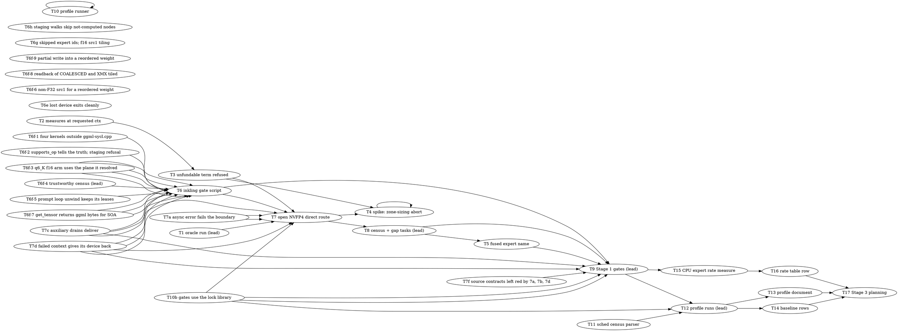

# Inkling-2-Mini on the SYCL Fork: Enable, Profile, Optimize — Implementation Plan

> **Execution:** Use `team-driven-development` in Claude Code, `pi-team-driven-development` in pi.dev, or `codex-team-driven-development` in Codex.

**Goal:** Make `Inkling-2-Mini-UD-Q8_K_XL.gguf` produce correct tokens on the Arc Pro B70 alone, the B50 alone and both
cards together, measure where its time goes in prompt processing and decode on each setup, and optimize the hotspots
the measurement names.

**Architecture:** Three stages. Stage 1 removes the two things that stop the model today (a load-time measure taken at
the 1,048,576-token training context, and a decode route for NVFP4 experts that is closed until it is validated) and
adds a token gate. Stage 2 profiles the working model and writes the result down. Stage 3 is a list of candidate
optimizations, each with a numeric threshold: a candidate is worked only if the Stage 2 profile meets its threshold,
and is closed with the measured number otherwise.

**Tech Stack:** C++17 (llama.cpp core in `src/`, SYCL backend in `ggml/src/ggml-sycl/`), Intel oneAPI DPC++ / Level
Zero, bash and Python 3 for gates and parsers, CTest.

**Test Infrastructure:** CTest. Host unit tests are C++ binaries with a local `CHECK` macro
(`tests/test-load-measure-guards.cpp`, `ggml/src/ggml-sycl/tests/test-kv-room-cost.cpp`). Source contracts are Python
scripts with `--self-test` semantics registered in `tests/CMakeLists.txt`. Gate scripts have stub-driven bash tests
(`tests/test-sycl-canonical-gates-script.sh`). GPU and model-loading runs are done by the lead only, one at a time,
under `GPU.lock` (CLAUDE.md, "Running Tests").

**Model facts (measured 2026-11-21, master `1dcdf49b1`, driver 26.44):** arch `inkling2_loop`; 24 layers, layers 6-17
run three times (48 layer applications); 128 experts, 8 used; expert weights are NVFP4 (`ffn_gate_up_exps`
`[2304,2304,128]` with an F32 `.scale`, `ffn_down_exps` `[1152,2304,128]`); dense weights BF16; trained context
1,048,576; sliding window 1024; a learned relative-position bias gathered as tokens x heads x n_kv F32.
CPU-only reference (`--device none`, 4 threads): correct tokens, decode 4.8-5.8 t/s, prompt 17.1 t/s on 1,208 tokens.

**What stops it today (evidence in the lead's scratch directory, to be copied by Task 1):**

1. Without `-c`, the load-time compute probe measures at n_ctx 1,048,576: 150,637.7 MiB on one device (three 48 GiB
   copies of the position-bias tensor). The load then aborts at `ggml/src/ggml-sycl/ggml-sycl.cpp:17627`
   (`[SYCL-PLAN] failed to size VRAM arena zones from tensor inventory`).
2. With the context forced to 8192, both cards load and the first decode graph is refused:
   `[MOE-DECODE-REFUSAL] tensor=blk.0.ffn_gate_up_exps.weight ... reason=capability_unsupported type=nvfp4 layout=aos`.
   This is not a missing kernel. The direct NVFP4 kernel exists (`moe_route_kernel::DEVICE_MMVQ_Q1_NVFP4_AOS`); its
   production route is closed on purpose by `k_moe_mmid_direct_route_validated = false`
   (`ggml/src/ggml-sycl/ggml-sycl.cpp:11934`, "fail-closed by owner ruling: this stays false until B70 validation opens
   it") and by the matching early return in `choose_moe_batch_executor`
   (`ggml/src/ggml-sycl/moe-resolved-batch.hpp:821-843`). The validation vehicle already exists:
   `sycl-q1-nvfp4-admitted-device` (`ggml/src/ggml-sycl/tests/test-q1-nvfp4-admitted-device.cpp`).

**Rules every task inherits (CLAUDE.md; read it before the first edit):**

- GPU and model-loading work is the lead's, one run at a time, selector pinned, under `GPU.lock`, `Shmem < 30 GB`
  before touching a card. No implementer or reviewer runs `llama-bench`, `llama-cli`, `llama-completion`,
  `test-backend-ops`, `test-llama-archs` or a model-loading ctest. Never repeat a run that loads a model onto a GPU.
- The unified cache is the only SYCL allocator. Placement decides the executor. The loaded layout is the answer: a
  missing kernel for a loaded layout is closed by writing the kernel, never by re-routing, converting or refusing.
- No gate or script passes `-ngl`. Device selection belongs to oneAPI: no code parses `ONEAPI_DEVICE_SELECTOR`.
- Never `clang-format-19 -i`. Check with `clang-format-19 --dry-run -Werror <file>` on lines you wrote.
- A command-position `grep`/`rg` on repo source is blocked by a hook. Use codescout `search_text`, or
  `cat FILE | grep -n PATTERN`. Inside `ggml/src/ggml-sycl/ggml-sycl.cpp` always verify with `cat ... | grep -n`.
- Commits: path-scoped (`git commit -- <paths>`), never amended, author `Cory`, message ends with
  `Co-Authored-By: Claude Fable 5.2 <noreply@anthropic.com>`. No push without the human's explicit yes.
- The main checkout has uncommitted wiki files that belong to other sessions. Never `git add -A` or `git add .`.

---

## Team Topology

**Recommended implementers:** 2 concurrent (three host-side tracks, but each implementer worktree needs a cold SYCL
build of ~25 minutes and three cold builds at once slow the whole host). Execution spawns one ephemeral implementer
per task.
**Reviewers:** spec + quality, spawned fresh per review. Every review also checks the memory and placement principles.
**Lead:** owns Track L (all GPU runs, the two spikes, plan amendments, merges into the integration branch).

**Integration branch:** `feat/inkling2`, cut from master `1dcdf49b1`. The lead's integration worktree is the existing
merge worktree `/home/kainlan/.claude/tmp/claude-1000/-Apps-llama-cpp/upstream-merge/wt` (it already holds a warm build
of `1dcdf49b1`): `git -C <wt> switch -c feat/inkling2 master`. Implementers work in their own worktrees cut from
`feat/inkling2`; a merge into it happens only in the lead's worktree.

### Parallel Tracks

| Track | Tasks | Description |
|-------|-------|-------------|
| L (lead, GPU-serial) | 1, 4, 7, 8, 9, 12, 14, 15, 17 | Oracle run, spikes, opening the route, census, gates, profile runs, planning |
| A (`src/` load path) | 2, 3, 5, 4b | Requested context reaches the measures; unfundable term refused; expert names; zone-sizing refusal |
| B (scripts) | 6, 6b, 10, 10b, 11 | `inkling` gate; GPT-OSS gate without `-ngl`; profile runner; atomic lock takers; scheduler-census parser |
| C (planner rate, docs) | 13, 16 | Profile document; measured CPU expert rate row |
| D (backend failure path) | 7a, 7d, 7b, 7c | Asynchronous SYCL errors fail the graph boundary instead of terminating (added 2026-11-21); a failed context gives its device back |
| E (inherited regression) | 6c, 6d, 6h | GPT-OSS 20B at the default context loses the B50: spike, then the COMPUTE-flag fix (found 2026-11-21). 6e, the exit path, is on Track D |
| F (`test-backend-ops`, inherited) | 6f-1, 6f-2, 6f-3, 6f-4, 6g | The suite aborts on the B50 and one case writes out of bounds (found 2026-11-22 by Task 6d's acceptance run). 6f-1 touches four kernel files only and runs beside Track D; 6f-2 and 6f-3 queue on `ggml-sycl.cpp` |

**Amended 2026-11-21, after Task 1 ran and the two spikes concluded.** Task 1 ended red at an old defect
(llama.cpp-kjoc), so Tasks 7a and 7b now precede the route's opening, and Task 7c follows 7b. Task 4's spike produced Task 4b. Task 6b was
found in review of Task 6. Their full specifications are separate files beside this plan:
`2026-11-21-inkling2-task-4b-zone-sizing-refusal.md` and `2026-11-21-inkling2-task-7a-7b-async-failure.md`.
Task 10b was found in review of Task 10: this host's `mkdir` is not atomic, so `GPU.lock` can be taken twice.
Task 7d was found by Task 7a's first oracle run, and Task 6c by the first real run of the GPT-OSS gate without `-c`.
Tasks 6f-1 to 6f-4 and 6g were found on 2026-11-22 by Task 6d's `test-backend-ops` acceptance run.

### Dependency Graph



### File Ownership Map

| File/Directory | Tasks | Conflict Risk |
|----------------|-------|---------------|
| `src/llama-load-measure.h` | 2, 3 | Sequential (Track A) |
| `src/llama-model.cpp` | 2, 3, 5, 4b | Sequential (Track A) |
| `src/llama-context.cpp` | 3 | None |
| `tests/test-load-measure-guards.cpp` | 2, 3, 5 | Sequential (Track A) |
| `tests/test-sycl-load-measure-source.py`, `tests/test-sycl-kv-before-experts-source.py` | 2 | None |
| `scripts/sycl-canonical-gates.sh`, `tests/test-sycl-canonical-gates-script.sh` | 6, 6b | Sequential (both merged) |
| `docs/backend/gpt-oss-testing.md` | 6b | None |
| `ggml/src/ggml-sycl/ggml-sycl.cpp` | 6d (one predicate near `:99182`, disjoint from Track D's regions; merged by the lead between Track D merges), 7a, then 7d, then 7 and 7b, then 7c, then 4b, then gap tasks from 8 | Lead orders the merges; 7 and 7b touch disjoint regions and may overlap in time, each merge is followed by a build |
| `ggml/src/ggml-sycl/unified-cache.cpp` | 7a, 7b, 7c, 4b | Sequential (lead orders them) |
| `ggml/src/ggml-sycl/common.cpp`, `common.hpp`, `async-failure.hpp` | 7a, 7b, 7c (`common.cpp` only) | Sequential (Track D) |
| `ggml/src/ggml-sycl/device-pool.hpp`, `layer-streaming.cpp`, `l2-prefetch.hpp`, `dense-scheduler.cpp`, `tests/test-sycl-async-drain-source.py` | 7c | None |
| `ggml/src/ggml-sycl/tests/test-q1-nvfp4-admitted-device.cpp` | 7a, then 7d | Sequential (Track D) |
| `ggml/src/ggml-sycl/zone-sizing.{hpp,cpp}`, `tests/test-zone-sizing.cpp` | 4b | None |
| `ggml/src/ggml-sycl/tsembd.cpp`, `pad_reflect_1d.cpp`, `gated_delta_net.cpp`, `fattn.cpp` | 6f-1 | None (no other task of this plan touches them) |
| `ggml/src/ggml-sycl/binbcast.cpp`, `binbcast.hpp`, `tests/test-sycl-op-support-predicates.py` | 6f-2 | None |
| `ggml/src/ggml-sycl/ggml-sycl.cpp`, the `supports_op` switch, the MoE prompt staging aborts and the f16 dequant arm | 6f-2, then 6f-3 | Disjoint from Track D's regions; the lead orders the merges and builds after each |
| `ggml/src/ggml-sycl/moe-resolved-batch.hpp` | gap tasks from 8 | Sequential |
| `scripts/sycl-inkling-profile.sh`, `tests/test-sycl-inkling-profile-script.sh` | 10 | None |
| `scripts/sycl-lock.sh`, `tests/test-sycl-lock.sh` | 10 (creates), 10b (reads) | Sequential (Track B) |
| `scripts/sycl-moe-exec-gate.sh`, `scripts/sycl-qwen35-ppl-gate.sh`, their stub tests, `docs/backend/sycl-host-safety.md`, `CLAUDE.md` | 10b | None |
| `scripts/sycl-sched-census.py` | 11 | None |
| `ggml/src/ggml-sycl/kv-room-cost.hpp`, `ggml/src/ggml-sycl/tests/test-kv-room-cost.cpp` | 16 | None |
| `docs/backend/inkling2-profile.md`, `docs/backend/data/inkling2/` | 1, 8, 12, 13 | Lead writes data, T13 writes prose |
| `docs/backend/sycl-perf-baselines.md` | 14 | None |
| this plan and the two specification files beside it | 4, 8, 17 | Lead only |

---

# Stage 1 — Enable

### Task 1: Run the existing NVFP4 route oracle on the B70 and the B50

**Track:** L (lead; GPU)
**Depends on:** None
**File scope:**
- Create: `docs/backend/data/inkling2/t1-oracle-b70.txt`, `docs/backend/data/inkling2/t1-oracle-b50.txt`
- Create: `docs/backend/data/inkling2/blockers-2026-11-21/` (copies of the scratch evidence)

**Description:** The owner ruling on the NVFP4 direct route says it opens when B70 validation passes. The validation
binary exists and has never been recorded as passing on this driver. Run it once per card and commit the output, so
Task 7 opens the route on evidence. Also move the blocker evidence out of scratch, which does not survive cleanup.

**Acceptance Criteria:**
- [ ] `t1-oracle-b70.txt` ends with `Q1/NVFP4 scoped production-route lifecycle: PASS` and contains no `SKIP[`.
- [ ] `t1-oracle-b50.txt` holds the B50 run's full output and its exit code on the last line.
- [ ] `journalctl -k --since "30 min ago" --no-pager | grep -ciE 'GT reset|guc_id|GPU hang|CAT error'` prints `0`.
- [ ] The blocker logs (`b70-load.err`, `b70-c8k.err`, `b50-c8k.err`, `b70-census2.err`, `cpu-ref.out`, `cpu.txt`,
      `census2.txt`, the `.done` files) are committed under `docs/backend/data/inkling2/blockers-2026-11-21/`, copied
      from `/home/kainlan/.claude/tmp/claude-1000/-Apps-llama-cpp/inkling/`.
- [ ] That directory's `prompt400.txt` (1,208 tokens) is committed as `docs/backend/data/inkling2/prompt-1208.txt`.

**Implementation Guide:**

```bash
cd <integration worktree> && source /opt/intel/oneapi/setvars.sh --force
./scripts/sycl-build.sh test-sycl-q1-nvfp4-admitted-device        # own worktree: no BUILD.lock
mkdir /Apps/llama.cpp/GPU.lock && echo "inkling T1 pid=$$" > /Apps/llama.cpp/GPU.lock/holder
grep -E '^(MemAvailable|Shmem):' /proc/meminfo                     # wait for Shmem < 30 GB
# B70: the registration pins level_zero:0 and sets the op timeout
ctest --test-dir build -R '^sycl-q1-nvfp4-admitted-device$' -V > docs/backend/data/inkling2/t1-oracle-b70.txt 2>&1
sleep 12; grep -E '^(MemAvailable|Shmem):' /proc/meminfo
# B50: the binary, once, selector pinned by hand
ONEAPI_DEVICE_SELECTOR=level_zero:1 GGML_SYCL_OP_TIMEOUT_MS=110000 timeout 120 \
  ./build/bin/test-sycl-q1-nvfp4-admitted-device > docs/backend/data/inkling2/t1-oracle-b50.txt 2>&1; \
  echo "rc=$?" >> docs/backend/data/inkling2/t1-oracle-b50.txt
sleep 12; rm -f /Apps/llama.cpp/GPU.lock/holder; rmdir /Apps/llama.cpp/GPU.lock
```

Expected: B70 `1/1 Test #N: sycl-q1-nvfp4-admitted-device ... Passed`; B50 `rc=0`.

**If the B70 run fails or skips:** stop. The failure text names the case and the stage (`candidate`, `admit`,
`submit`, `executed`). That failure is the first Stage 1 defect: the lead writes it up as Task 7a to the Task Detail
Standard and the route stays closed until it passes. Do not open the route on a failing oracle.

**Commit:** `git add docs/backend/data/inkling2 && git commit -m "docs: Inkling-2-Mini blocker evidence and the NVFP4 route oracle runs" -- docs/backend/data/inkling2`

**Gotchas:**
- The target only exists with `BUILD_TESTING=ON` and `GGML_BACKEND_DL=OFF` (both true in the integration build).
- The oracle's seventh case injects an asynchronous failure. It must end like the other six, with the process alive.
  A `terminate called` in the log is the defect the result below records, not part of the test's design.
- 77 is a skip, not a pass. `SKIP[off-primary]` on a pinned card is a regression to read (llama.cpp-n8da).

**Result (2026-11-21, driver 26.44, integration build of `0118d99df`): RED, at an old defect, not at the kernels.**
- B70 (ctest, rc 8) and B50 (binary, rc 134), one run each: the four graph-churn oracle comparisons (Q1_0, NVFP4 at 1
  and 3 rows) and the two injected synchronous failures complete. The seventh case,
  `injected_async_terminal_failure_case`, ends the process: `Default async_handler caught exceptions: injected
  Q1/NVFP4 asynchronous terminal failure`, then `std::terminate`.
- Cause: no queue the backend builds carries an `async_handler` (llama.cpp-kjoc, open since 2026-10-10). The SYCL
  runtime's default handler terminates. This is not specific to NVFP4: any asynchronous error on any model ends the
  process the same way.
- Consequence: the route stays closed (`k_moe_mmid_direct_route_validated = false`) until the oracle passes. Tasks 7a
  and 7b fix the defect; Task 7 opens the route on the oracle run that Task 7a records.
- Kernel log clean after both runs, Shmem about 7 GB, no VRAM tenant left.
- Evidence: `docs/backend/data/inkling2/t1-oracle-b70.txt`, `t1-oracle-b50.txt`, `blockers-2026-11-21/` (commit
  `fa0785d1d`).

---

### Task 2: The load's three measures run at the context the caller requested

**Track:** A
**Depends on:** None
**File scope:**
- Modify: `src/llama-load-measure.h:200-218` (new helper beside `llama_load_measure_n_ctx`)
- Modify: `src/llama-model.cpp:2945-2954`, `:2975`, `:2986-2993`, `:3168-3169`
- Modify: `tests/test-load-measure-guards.cpp:316-322` and `main()` at `:1064`
- Modify: `tests/test-sycl-load-measure-source.py` (the pinned call arguments, about line 436)
- Modify: `tests/test-sycl-kv-before-experts-source.py:327-331` (docstring of `claim_envelope_keeps_no_context`)

**Description:** `llama_model_params::n_ctx_hint` already carries the caller's `-c` into the load and is used for the
KV room. The probe, admitted and late measures ignore it and measure at `n_ctx_train` (the gap named fkpg (a)). For a
model trained at 1,048,576 tokens that measure is 150 GiB. This task feeds the same resolved hint to the three
measures. The placement envelope is not touched: the planning shape keeps its own values.

**Behaviour, exactly:** the measures run at `llama_n_ctx_hint_resolve(hint, n_ctx_train).n_ctx_context`. A named
`-c 8192` measures at 8192. `-c 8000` measures at 8192 (padded like the real context). No `-c`
(`LLAMA_N_CTX_HINT_DEFAULT`) measures at the padded training context, as today. Hint 0 (a caller that asked for no
room) yields 0, which `llama_load_measure_n_ctx` turns into the training context, as today.

**Acceptance Criteria:**
- [ ] `llama_load_measure_request_n_ctx` exists and the five checks below pass.
- [ ] All three call sites in `src/llama-model.cpp` pass the same local `load_measure_n_ctx`.
- [ ] `test-sycl-load-measure-source` and `test-sycl-kv-before-experts-source` pass, and the first has a mutant that
      fails when a call site goes back to the envelope's `n_ctx`.
- [ ] No text in `src/` or `docs/` still says the caller's `-c` does not reach the load-time measures.

**Implementation Guide:**

1. **Test (RED)** — in `tests/test-load-measure-guards.cpp`, after `test_measure_n_ctx()`:

```cpp
static void test_measure_request_n_ctx() {
    CHECK(llama_load_measure_request_n_ctx(8192, 1048576) == 8192, "a named context was not kept");
    CHECK(llama_load_measure_request_n_ctx(8000, 1048576) == 8192, "the request is not padded like the context");
    CHECK(llama_load_measure_request_n_ctx(LLAMA_N_CTX_HINT_DEFAULT, 1048576) == 1048576,
          "no -c did not resolve to the training context");
    CHECK(llama_load_measure_request_n_ctx(0, 1048576) == 0, "hint 0 (no request) did not stay 0");
    CHECK(llama_load_measure_n_ctx(llama_load_measure_request_n_ctx(0, 262144), 262144) == 262144,
          "hint 0 does not measure at the training context");
}
```

Add `test_measure_request_n_ctx();` after `test_measure_n_ctx();` in `main()`.
Run: `./scripts/sycl-build.sh test-load-measure-guards` — Expected: compile error, `llama_load_measure_request_n_ctx`
was not declared.

2. **Implement (GREEN)** — in `src/llama-load-measure.h`, add `#include "llama-n-ctx-hint.h"` with the other project
includes and, directly after `llama_load_measure_n_ctx`:

```cpp
// The n_ctx the load's three measures are asked for: the context the caller requested from the load (the hint,
// resolved and padded once by llama_n_ctx_hint_resolve, so the measure and the KV room read one value), or 0 when the
// caller requested none, which llama_load_measure_n_ctx turns into the training context.
inline uint32_t llama_load_measure_request_n_ctx(uint32_t n_ctx_hint, uint32_t n_ctx_train) {
    return llama_n_ctx_hint_resolve(n_ctx_hint, n_ctx_train).n_ctx_context;
}
```

In `src/llama-model.cpp`, inside `if (sycl_model_backend) {` at `:2944`, before `probe_weights`:

```cpp
        const uint32_t load_measure_n_ctx = llama_load_measure_request_n_ctx(get_n_ctx_hint(), hparams.n_ctx_train);
```

Replace `llama_model_sycl_make_placement_envelope().n_ctx` with `load_measure_n_ctx` in the
`llama_load_probe_bound(` call (`:2953`) and the `llama_load_admitted_check(` call (`:2975`). At the late check
(`:3168`, a second `if (sycl_model_backend) {` block in the same function) declare the same `const uint32_t
load_measure_n_ctx = ...` line again at the top of that block and pass it to `llama_load_late_check(`.

Rewrite the comment at `:2945-2949` so its third sentence reads: "It is measured at the context the caller requested
from the load (the n_ctx hint; the training context when none was named, padded to 256 under the default hint) and
ubatch 512: the caller's -ub does not reach the measures (fkpg (a))." In the WARN at `:2988` replace `the caller's -c and -ub are not transported (fkpg)`
with `n_ctx is the load's requested context, the caller's -ub is not transported to the measure (fkpg)`. In
`src/llama-load-measure.h:212` replace the last sentence of the comment with "The caller's -ub does not reach the
measures (fkpg); its -c does, as the hint."

**Corrected 2026-11-21 (review of this task).** The first version of this paragraph said the caller's `-ub` "does not
reach the load". That is false: `common/common.cpp:1759-1764` sets `mparams.n_ubatch_hint` from `-ub`, and the load
uses it to place the prompt-processing MoE ring. Only the three measures ignore `-ub` and run at ubatch 512. Every
comment and document the task touches says so.

**Consequence found in review, checked in Task 9.** `llama-bench` passes `n_ctx_hint = n_prompt + n_gen + n_depth`
(`tools/llama-bench/llama-bench.cpp:1224`, `:1242`). With this task the measures follow that hint, so every bench's
load changes for every model: the measured compute term drops from the training context to the bench's own (640 for
`-p 512 -n 128`). The token gates pass no `-c` and do not exercise the change. `equal_mparams` does not compare the
hint, so a model reused for a later, larger bench instance keeps the smaller measure; the excess takes the KV zone,
then raw device memory outside the arena (open finding llama.cpp-nkr8).

Run: `./scripts/sycl-build.sh test-load-measure-guards && ctest --test-dir build -R '^test-load-measure-guards$' --output-on-failure`
Expected: `100% tests passed`.

3. **Source contracts** — in `tests/test-sycl-load-measure-source.py` change the pinned argument text (about line 436)

```python
    args = z("llama_model_sycl_make_placement_envelope().n_ctx, sycl_model_loading_guard.txn,")
```

to

```python
    args = z("load_measure_n_ctx, sycl_model_loading_guard.txn,")
```

List every other pin of the old text and update each the same way:
`cat tests/test-sycl-load-measure-source.py | grep -n 'make_placement_envelope().n_ctx\|not transported'`.
Add beside the existing mutant tests:

```python
def test_mutant_measure_rides_the_envelope_again_fails():
    """A measure fed the envelope's n_ctx (0, the training context) instead of the load's requested context."""
    assert not wiring_ok(MODEL.replace(z("load_measure_n_ctx, sycl_model_loading_guard.txn,"),
                                       z("llama_model_sycl_make_placement_envelope().n_ctx, "
                                         "sycl_model_loading_guard.txn,"), 1))
```

Use the name of the claim function that contains the `args =` line in place of `wiring_ok`, and the module's own
constant for the `llama-model.cpp` text in place of `MODEL` (both are visible in the lines around 420-440).
In `tests/test-sycl-kv-before-experts-source.py:328-329` change the docstring to: "The envelope still carries n_ctx
0, so the planning shape keeps n_ctx_train and 512; the probe, admitted and late measures read the resolved hint
(llama_load_measure_request_n_ctx)." The claim's code does not change.

Run: `ctest --test-dir build -R '^test-sycl-(load-measure|kv-before-experts)-source$' --output-on-failure`
Expected: both pass.

4. **Prose** — find every remaining statement: run this from the repo root and fix each hit that claims `-c` does not
reach the measures (leave statements about `-ub`):

```bash
python3 - <<'EOF'
import os, re
for root in ("docs", "src", ".claude/rules", "CLAUDE.md", "AGENTS.md"):
    paths = [root] if os.path.isfile(root) else [os.path.join(d, f) for d, _, fs in os.walk(root) for f in fs]
    for p in sorted(paths):
        for i, line in enumerate(open(p, errors="replace"), 1):
            if re.search(r"fkpg|n_ctx_train and (ubatch )?512|not transported", line):
                print(f"{p}:{i}:{line.rstrip()[:160]}")
EOF
```

**Commit:**

```bash
git commit -m "llama: the load-time measures run at the context the caller requested (fkpg (a), n_ctx half)" -- \
  src/llama-load-measure.h src/llama-model.cpp tests/test-load-measure-guards.cpp \
  tests/test-sycl-load-measure-source.py tests/test-sycl-kv-before-experts-source.py docs
```

**Gotchas:**
- Do not edit `llama_model_sycl_make_placement_envelope()`: `claim_envelope_keeps_no_context` pins `envelope.n_ctx = 0`
  and the plan builders at `src/llama-model.cpp:741` and `:797` read it for the planning shape.
- `test-sycl-load-measure-source` normalises whitespace (`z(...)`); keep the argument on the call exactly
  `load_measure_n_ctx, sycl_model_loading_guard.txn,`.
- A context later created larger than the hint is not this task: the late check and the runtime transaction already
  own that case. Do not add a clamp.
- This changes the probe term of every model loaded with `-c`. The lead compares the `[LOAD-PLAN] compute slot` line
  of the GPT-OSS B50 gate before and after in Task 9 (the gate passes no `-c`, so its line must be unchanged).

---

### Task 3: A compute term larger than its device is refused by name, before anything is reserved

**Track:** A
**Depends on:** Task 2 (same files)
**File scope:**
- Modify: `src/llama-load-measure.h` (after `struct llama_load_probe_reservations`, about `:441`)
- Modify: `src/llama-context.cpp:4335-4360` (`llama_load_probe_bound`)
- Modify: `tests/test-load-measure-guards.cpp`

**Description:** With no `-c`, Inkling's measured compute term is 150 GiB on a 32 GiB card. Today the backend accepts
the reservation and aborts later while sizing zones. `llama_load_probe_bound` already has a refusal path
(`out.refusal`, thrown as `std::runtime_error` at `src/llama-model.cpp:2961`). This task uses it: a term larger than
the device's total memory can never be funded, so the load is refused with the numbers and the remedy. Nothing is
shrunk and no fallback context is chosen.

**Acceptance Criteria:**
- [ ] A measured device whose `total` exceeds that device's total memory yields a non-empty refusal that contains
      `load refused`, the n_ctx, the device index, the term in MiB and the device total in MiB.
- [ ] A term that fits, a host-tier entry, and a device with unknown capacity (not listed, or total 0) yield no refusal.
- [ ] `llama_load_probe_bound`'s signature is unchanged (it is pinned by `test-sycl-load-measure-source`).
- [ ] No reservation proc is called for a refused load.

**Implementation Guide:**

1. **Test (RED)** — `tests/test-load-measure-guards.cpp`:

```cpp
static void test_probe_unfundable_text() {
    const size_t mib = 1024 * 1024;
    llama_load_measure_device big;
    big.device      = 0;
    big.chunk_bytes = { 1024 * mib, 2048 * mib, 49152 * mib, 49152 * mib, 49152 * mib };
    big.total       = 150528 * mib;
    llama_load_measure_device host;
    host.host  = true;
    host.total = 900000 * mib;
    const std::vector<llama_load_device_capacity> caps = { { 0, 32656ull * mib }, { 1, 16304ull * mib } };

    const std::string refused = llama_load_probe_unfundable_text({ host, big }, caps, 1048576);
    CHECK(refused.find("load refused") != std::string::npos, "no refusal for a 150 GiB term on a 32 GiB device");
    CHECK(refused.find("n_ctx 1048576") != std::string::npos, "the refusal does not name the context");
    CHECK(refused.find("device 0") != std::string::npos, "the refusal does not name the device");
    CHECK(refused.find("150528.0 MiB") != std::string::npos, "the refusal does not name the term");
    CHECK(refused.find("32656.0 MiB") != std::string::npos, "the refusal does not name the device total");
    CHECK(refused.find("-c") != std::string::npos, "the refusal does not name the remedy");

    llama_load_measure_device fits = big;
    fits.total = 1052 * mib;
    CHECK(llama_load_probe_unfundable_text({ fits }, caps, 8192).empty(), "a term that fits was refused");
    CHECK(llama_load_probe_unfundable_text({ host }, caps, 1048576).empty(), "the host tier was judged");
    llama_load_measure_device unknown = big;
    unknown.device = 7;
    CHECK(llama_load_probe_unfundable_text({ unknown }, caps, 1048576).empty(), "an unknown device was refused");
    CHECK(llama_load_probe_unfundable_text({ big }, { { 0, 0 } }, 1048576).empty(), "a zero capacity was trusted");
}
```

Add the call in `main()`. Run the build: Expected compile error (`llama_load_device_capacity` not declared).

2. **Implement (GREEN)** — `src/llama-load-measure.h`, after `llama_load_probe_reserve`:

```cpp
// One SYCL device's total memory, by the post-selector device index the measure reports.
struct llama_load_device_capacity {
    int32_t  device;
    uint64_t total_bytes;  // 0 = unknown: the device is not judged
};

// A measured compute term larger than its device's total memory can never be reserved, whatever the placement: the
// load is refused by this text before any reservation. Empty when every device can hold its term or cannot be judged.
// A term below the total can still be more than the zones can give; the backend's zone sizing answers that.
inline std::string llama_load_probe_unfundable_text(const std::vector<llama_load_measure_device> &  devices,
                                                    const std::vector<llama_load_device_capacity> & capacities,
                                                    uint32_t                                        n_ctx) {
    const double mib = 1024.0 * 1024.0;
    for (const llama_load_measure_device & d : devices) {
        if (d.host) {
            continue;
        }
        for (const llama_load_device_capacity & c : capacities) {
            if (c.device != d.device || c.total_bytes == 0 || d.total <= c.total_bytes) {
                continue;
            }
            char text[512];
            snprintf(text, sizeof(text),
                     "load refused: the compute buffer measured at n_ctx %u needs %.1f MiB on SYCL device %d, and "
                     "that device has %.1f MiB in total; request a context that fits with -c (with no -c the context "
                     "is the model's training context)",
                     n_ctx, d.total / mib, (int) d.device, c.total_bytes / mib);
            return text;
        }
    }
    return {};
}
```

(`<cstdio>` and `<string>` are already included by this header; add them if the compiler says otherwise.)

`src/llama-context.cpp`, in `llama_load_probe_bound`, replace the block from `out.devices  = measured.devices;` to the
`llama_load_probe_reserve` call with:

```cpp
    const uint32_t measured_n_ctx = llama_load_measure_n_ctx(n_ctx, model.hparams.n_ctx_train);
    // a term no placement can fund is the load's refusal, by name, before anything is reserved
    std::vector<llama_load_device_capacity> capacities;
    int                                     sycl_ordinal = 0;
    for (const auto & d : model.devices) {
        if (!llama_context_dev_is_sycl(d.dev)) {
            continue;
        }
        size_t free_bytes  = 0;
        size_t total_bytes = 0;
        ggml_backend_dev_memory(d.dev, &free_bytes, &total_bytes);
        capacities.push_back(
            { (int32_t) llama_context_sycl_device_index(d.dev, sycl_ordinal++), (uint64_t) total_bytes });
    }
    out.refusal = llama_load_probe_unfundable_text(measured.devices, capacities, measured_n_ctx);
    if (!out.refusal.empty()) {
        return out;
    }
    out.devices  = measured.devices;
    out.kv       = measured.kv;
    out.measured = true;

    // each SYCL device's state term, then its compute term; a declined device's compute buffer stays unplanned
    llama_load_probe_reservations reserved = llama_load_probe_reserve(procs, txn, measured.devices, measured_n_ctx);
```

Run: `./scripts/sycl-build.sh test-load-measure-guards && ctest --test-dir build -R '^test-load-measure-guards$' --output-on-failure`
then `ctest --test-dir build -R '^test-sycl-load-measure-source$' --output-on-failure`. Expected: both pass. If the
source contract pins the order `out.devices ... measured_n_ctx`, update its pinned text to the new order and say so in
the commit message.

**Commit:** `git commit -m "llama: refuse a load whose compute term exceeds its device, by name (Inkling at the 1M default context)" -- src/llama-load-measure.h src/llama-context.cpp tests/test-load-measure-guards.cpp tests/test-sycl-load-measure-source.py`

**Gotchas:**
- `llama_context_sycl_device_index` is `static` in `src/llama-context.cpp:186`; `llama_load_probe_bound` is in the same
  file, below it. Do not move either.
- The comparison is against the device's total, not its free memory: free memory is stale-low after a destroy
  (memory: driver-free-memory-is-stale-low-after-a-destroy) and would refuse valid loads.
- The lead verifies the real message in Task 9; do not run the model.

---

### Task 4: Spike — can the zone-sizing abort become a refusal? (llama.cpp-ouur, Inkling's middle case)

**Track:** L (lead; read-only, no GPU)
**Depends on:** None
**File scope:** this plan (append Task 4b)

**Description:** Task 3 covers a term larger than the whole card. A term that is smaller than the card but larger than
what is left beside the weights (for Inkling on the B70, roughly `-c 131072`: 18 GiB of position bias beside 22.8 GB
of weights) still reaches `GGML_ABORT("[SYCL-PLAN] failed to size VRAM arena zones from tensor inventory")` at
`ggml/src/ggml-sycl/ggml-sycl.cpp:17627`. The comment there names the fix as llama.cpp-ouur. The lead reads the call
chain from `llama_model_sycl_set_late_inventory` (`src/llama-model.cpp:2965`) to
`compute_and_store_plan_for_inventory` and `unified_cache_ensure_planned_arena_zones`, and decides how a failed sizing
travels back to `load_tensors` as a refusal.

**Acceptance Criteria:**
- [ ] The plan gains Task 4b, written to the Task Detail Standard (RED test, GREEN code, files, commit), or a recorded
      decision that the abort stays, with the reason and the llama.cpp-ouur ticket updated.
- [ ] The decision states which existing status channel carries the refusal (no new global, no new abort).

**Gotchas:**
- Experts are evicted to the host to make room; the question is what is left when only the weights that must be on the
  device remain. Read how the planner answers that before writing a bound of your own: one fact, one source.
- Another live model's allocations also make sizing fail (the case the comment describes). The refusal text must tell
  the two causes apart.

**Result (2026-11-21): the abort becomes a refusal, through a channel that already exists.** The decision record and
Task 4b are in `docs/plans/2026-11-21-inkling2-task-4b-zone-sizing-refusal.md`. In short:
- The loader already calls `ggml_backend_sycl_stage_inventory_plan`, which already returns a lifecycle result with a
  `GGML_SYCL_LIFECYCLE_PLAN_REJECTED` value. Both abort sites throw a typed exception with the cause's text; the stage
  entry prints it on its `[SYCL-PLAN]` ERROR line and answers `PLAN_REJECTED`; the loader names the rejection.
- Lead ruling: no new entry across the backend's dlopen boundary and no thread-local carries the text to the loader.
  The backend's ERROR line is where the cause is stated.
- **This task's premise was wrong.** Inkling at `-c 131072` on the B70 does not reach the abort: zone sizing never
  looks at weights, and an 18.5 GiB RUNTIME zone fits under the B70's 29,472 MiB per-allocation cap. The abort is
  reachable when a RUNTIME zone exceeds the cap or the arena budget (for Inkling on the B70, above roughly 205k tokens:
  a linear estimate, not measured), or when live allocations block a rebuild (llama.cpp-ouur, llama.cpp-pgay). Task 9
  runs `-c 131072` once to see what the planner does with it.

---

### Task 4b: A load whose arena zones cannot be sized is refused by name, not aborted (llama.cpp-ouur)

**Track:** A
**Depends on:** Task 4 (the decision); Tasks 2 and 3 (same `src/llama-model.cpp`); Task 7 (same `ggml-sycl.cpp`)
**Full specification:** `docs/plans/2026-11-21-inkling2-task-4b-zone-sizing-refusal.md` (files, RED, GREEN, commands,
commit, gotchas). Its line numbers are at master `1dcdf49b1`; find each site by its text.

**Done when:** `ggml-sycl.cpp` holds no `GGML_ABORT("[SYCL-PLAN] failed to size VRAM arena zones`; the new source
contract and `test-zone-sizing` Case 34 pass; and the lead's one B50 run
(`GGML_SYCL_RUNTIME_ARENA_MB=40000 ONEAPI_DEVICE_SELECTOR=level_zero:1 timeout 120 ./build/bin/llama-completion -m
/models/mistral-7b-v0.1.Q4_0.gguf -p '1, 2, 3, 4, 5,' -n 15 --seed 42 --temp 0`) exits non-zero with `load refused:
SYCL device 0 cannot size its arena zones`, names the device's capacity as the cause, and prints no abort line.

---

### Task 5: The loader's expert-name check knows the fused gate+up tensor

**Track:** A
**Depends on:** Task 3 (same test file); Task 8 (HELD until the census, see below)
**File scope:**
- Create: `src/llama-sycl-expert-names.h`
- Modify: `src/llama-model.cpp:248-254` and its include list
- Modify: `tests/test-load-measure-guards.cpp`

**Description:** `llama_model_sycl_is_moe_expert_weight` (`src/llama-model.cpp:248`) matches `ffn_gate_exps`,
`ffn_up_exps` and `ffn_down_exps`. Inkling's fused tensor is named `ffn_gate_up_exps`, which contains none of those
substrings, so the prompt-scratch sizing loop at `:476-485` never sees its dimensions (K 2304, N 2304) and sizes from
`ffn_down_exps` alone (N 1152). The backend's own classifiers already know the fused name
(`ggml/src/ggml-sycl/ggml-sycl.cpp:7131`). This task makes the loader agree and puts the name test where a unit test
can reach it.

**HELD 2026-11-21 (lead ruling after quality review). Implemented on `task/inkling2-t5` (`98c3d4bc2`), reviewed, NOT
merged.** The code does what this task says. The task's premise is not established, and two statements in it are
wrong:
- **What the loop sizes.** The maxima feed the prompt-processing MoE oneDNN scratch ring in the RUNTIME zone
  (`src/llama-model.cpp:473-550`, published at `ggml-sycl.cpp:17291-17342`). For Inkling the ring is already planned
  from `ffn_down_exps` alone: 892.1 MB (weight slot 172.1, activation 144.0, output 576.0;
  `blockers-2026-11-21/b70-load.err`). `ffn_down_exps` is `{n_ff_exp, n_embd}`, so it gave K 1152 and N 2304, not
  "N 1152" as the description says. With the fused tensor seen, K becomes 2304 and the weight slot doubles: the
  activation slot and the weight slot each double, about +316 MB per card.
- **Who consumes it.** The ring's executor (`try_pp_onednn_f16_batched`, `ggml-sycl.cpp:90653`) sizes from the tensor
  it is dispatched, so the larger plan is exactly right IF that executor runs on a fused tensor. Whether it does is
  not settled by the code: its claim predicate accepts only the gate, up and down roles (`moe_classify_tensor`
  returns UNKNOWN for the fused name), and the one log line we have for Inkling's prompt path says
  `[MOE-PROMPT-CANONICAL] tensor=blk.0.ffn_gate_up_exps.weight published=0 kind=-1`. If no executor consumes the ring
  for a fused NVFP4 tensor, the growth reserves VRAM that nothing uses, on a card (the B50) where every MB displaces
  an expert. The same question applies to the 892 MB planned today.
- **"No other model's sizing changes" is false.** `create_tensor_gate_up_exps` (`src/llama-model.cpp:5236-5250`) tries
  the fused tensor first for about fourteen architectures (gemma4, qwen3next, qwen35moe, deepseek2 and others). Any
  GGUF that stores its experts fused gets the larger plan. Files with separate gate and up tensors are unchanged.

**Decision rule, applied when Task 8's census exists:** the plan for the ring follows what its executor serves. If
the census shows the executor meeting fused tensors (a `refusing unplanned PP MoE oneDNN batched scratch` WARN with
`required=` above `planned_cap=`, or an executor line naming `ffn_gate_up_exps`), this branch is merged with a
reason-comment at the sizing loop and a corrected commit message. If a gap task gives fused NVFP4 prompt rows an
executor that uses the ring, this change lands with that task. If nothing uses the ring for Inkling, this branch is
not merged, and the gap task is the opposite one: stop planning a ring that no executor of the loaded layout can use.
The four Minor review findings (the header comment's claim about `.bias` dimensions, calling the helper directly
instead of through a `static` wrapper, a negative test for `ffn_norm_exps`, and the grovemoe `*_chexps` names the
backend's classifiers know and the loader does not) are fixed in whichever commit lands.

**Acceptance Criteria:**
- [ ] `blk.3.ffn_gate_up_exps.weight` is an expert weight; `blk.3.ffn_gate_inp.weight` is not; the three existing
      names still are; `nullptr` is not.
- [ ] Every name the old function matched still matches (no suffix rule is added), so no other model's sizing changes.
- [ ] `src/llama-model.cpp` has no second copy of the name list.

**Implementation Guide:**

1. **Test (RED)** — `tests/test-load-measure-guards.cpp`, add `#include "../src/llama-sycl-expert-names.h"` and:

```cpp
static void test_sycl_expert_weight_names() {
    CHECK(llama_sycl_is_moe_expert_weight_name("blk.3.ffn_gate_up_exps.weight"), "the fused gate+up tensor is missed");
    CHECK(llama_sycl_is_moe_expert_weight_name("blk.3.ffn_gate_exps.weight"), "ffn_gate_exps is missed");
    CHECK(llama_sycl_is_moe_expert_weight_name("blk.3.ffn_up_exps.weight"), "ffn_up_exps is missed");
    CHECK(llama_sycl_is_moe_expert_weight_name("blk.3.ffn_down_exps.weight"), "ffn_down_exps is missed");
    CHECK(llama_sycl_is_moe_expert_weight_name("blk.3.ffn_gate_exps.bias"), "a name the old check matched is lost");
    CHECK(!llama_sycl_is_moe_expert_weight_name("blk.3.ffn_gate_inp.weight"), "the router is not an expert weight");
    CHECK(!llama_sycl_is_moe_expert_weight_name(nullptr), "a null name matched");
}
```

Run the build. Expected: `llama-sycl-expert-names.h: No such file or directory`.

2. **Implement (GREEN)** — `src/llama-sycl-expert-names.h`:

```cpp
#pragma once

#include <cstring>

// Whether a tensor belongs to a routed-expert family, by the names the model loaders create: the separate gate, up
// and down tensors and the fused gate+up tensor. It matches by substring, as the check it replaces did, so a
// family's ".bias" and ".scale" match too; their dimensions never exceed the weight's, which is all the caller reads.
static inline bool llama_sycl_is_moe_expert_weight_name(const char * name) {
    if (name == nullptr) {
        return false;
    }
    static const char * kinds[] = { "ffn_gate_exps", "ffn_up_exps", "ffn_down_exps", "ffn_gate_up_exps" };
    for (const char * kind : kinds) {
        if (std::strstr(name, kind) != nullptr) {
            return true;
        }
    }
    return false;
}
```

In `src/llama-model.cpp` include the header and replace the body of `llama_model_sycl_is_moe_expert_weight` with
`return llama_sycl_is_moe_expert_weight_name(tensor.name);`.

Run: `./scripts/sycl-build.sh test-load-measure-guards llama && ctest --test-dir build -R '^test-load-measure-guards$' --output-on-failure`
Expected: pass.

**Commit:** `git commit -m "llama: the SYCL loader's expert-name check knows ffn_gate_up_exps" -- src/llama-sycl-expert-names.h src/llama-model.cpp tests/test-load-measure-guards.cpp`

**Gotchas:**
- Do not add a `.weight` suffix rule or a `.scale` exclusion: the old check matched a family's `.bias` tensors (GPT-OSS
  has them) and this task must not change what any existing model's sizing loop sees.
- The scratch sizing that grows is planned VRAM for Inkling only. The lead reads Inkling's `[LOAD-PLAN]` lines before
  and after, and confirms the GPT-OSS B50 gate's `[LOAD-PLAN]` line is unchanged (Task 9).

---

### Task 6: An `inkling` gate in `scripts/sycl-canonical-gates.sh`

**Track:** B
**Depends on:** None
**File scope:**
- Modify: `scripts/sycl-canonical-gates.sh` (`:11`, `:65-80`, `:107-112`, `:203-205`, `:243-246`, after `:400`, `:402-406`)
- Modify: `tests/test-sycl-canonical-gates-script.sh`

**Description:** A token gate for Inkling, scored like the Mistral gate against the CPU reference (`--device none`
printed `1, 2, 3, 4, 5, 6, 7, 8, 9, 10, 11, 12, 13,`). It names `-c 8192` because the model's default context is its
1,048,576-token training context, which no card here can hold; that is a requested context, not a context shrunk to
fit (the GPT-OSS gate keeps carrying no `-c`). It is not part of `--gate all`: a 22.9 GB model must not ride along
with every pre-commit gate run.

**Acceptance Criteria:**
- [ ] `--gate inkling` runs one `llama-completion` with `-c 8192 -p '1, 2, 3, 4, 5,' -n 15 --seed 42 --temp 0`, under
      `timeout 900`, with `GGML_SYCL_MOE_MULTI_GPU=0` in its environment, and no `-ngl`.
- [ ] PASS needs rc 0, a stdout line matching `^ ?1, 2, 3, 4, 5, 6, 7, 8, 9, 10`, and no abort line on stderr.
- [ ] A missing model is `GATE inkling SKIP rc=77`.
- [ ] `--gate all` still runs only mistral and gptoss.
- [ ] The stub test has a PASS, a FAIL (wrong tokens) and a SKIP (no model) case for the new gate, and passes.

**Implementation Guide:**

1. **Test (RED)** — in `tests/test-sycl-canonical-gates-script.sh`, find the Mistral PASS, FAIL and missing-model
cases (`cat tests/test-sycl-canonical-gates-script.sh | grep -n mistral`) and add the same three for Inkling. In
`run_gates`, `run_gates_real_oneapi` and `run_gates_fake_setvars` add `SYCL_GATES_INKLING_MODEL="$dir/fake-inkling.gguf" \`
beside the Mistral line, and make `touch_fake_models` create `fake-inkling.gguf`. The three assertions:

```bash
expect_gate "inkling pass"  0  "$out" "$rc" '^GATE inkling PASS rc=0 '
expect_gate "inkling wrong tokens" 1 "$out" "$rc" '^GATE inkling FAIL rc=0 '
expect_gate "inkling no model" 77 "$out" "$rc" '^GATE inkling SKIP rc=77 '
```

Each case builds its fake `llama-completion` with the file's own `write_exec` helper exactly as the Mistral case of
the same kind does, and calls the script with `--gate inkling`. Also assert that the fake binary received
`-c 8192` and never `-ngl` (have the fake write `"$@"` to `$dir/argv` and `grep -q -- '-c 8192' "$dir/argv"`).
Run: `bash tests/test-sycl-canonical-gates-script.sh` — Expected: FAIL, `--gate must be mistral, gptoss, or all`.

2. **Implement (GREEN)** — `scripts/sycl-canonical-gates.sh`:
- Usage lines (`:11`, `:67`, `:77`): `--gate mistral|gptoss|inkling|all`, and one sentence: "inkling is opt-in and is
  not part of all".
- Validation (`:107-112`): accept `inkling`.
- Paths (`:205`): `INKLING_MODEL="${SYCL_GATES_INKLING_MODEL:-/models/Inkling-2-Mini-UD-Q8_K_XL.gguf}"`.
- Binary check (`:243-246`): `inkling) ;;` (it needs `llama-completion`, which every gate already requires).
- After `run_gptoss`:

```bash
# Inkling-2-Mini (inkling2_loop, NVFP4 experts, BF16 dense). Scored against the CPU reference of 2026-11-21
# (--device none printed "1, 2, 3, ... 13,"). The gate names -c 8192: the model's default context is its
# 1,048,576-token training context, which the load refuses by name on these cards. GGML_SYCL_MOE_MULTI_GPU=0 is set
# for every selector, so a two-card run takes the scheduler split and the script never reads the selector.
run_inkling() {
    if [ -n "$NO_DEVICE_REASON" ]; then
        gate_skip inkling "$NO_DEVICE_REASON"
        return
    fi
    if [ ! -f "$INKLING_MODEL" ]; then
        gate_skip inkling "model not found at $INKLING_MODEL"
        return
    fi

    local out="$GATES_OUT_DIR/inkling.out" err="$GATES_OUT_DIR/inkling.err"
    sample_mem "inkling pre"
    local rc=0
    GGML_SYCL_MOE_MULTI_GPU=0 timeout 900 "$BIN_DIR/llama-completion" \
        -m "$INKLING_MODEL" -c 8192 -p '1, 2, 3, 4, 5,' -n 15 --seed 42 --temp 0 \
        >"$out" 2>"$err" || rc=$?
    sleep "$SETTLE_SECONDS"
    sample_mem "inkling post"
    gate_verdict inkling "$out" "$err" "$rc" '^ ?1, 2, 3, 4, 5, 6, 7, 8, 9, 10'
}
```

- Dispatch (`:402-406`): add `inkling) run_inkling ;;` and leave `all)` unchanged.

Run: `bash tests/test-sycl-canonical-gates-script.sh` — Expected: every line `PASS:`, exit 0. Then
`ctest --test-dir build -R '^sycl-canonical-gates-script$' --output-on-failure`.

**Commit:** `git commit -m "scripts: an opt-in inkling gate, scored against the CPU reference" -- scripts/sycl-canonical-gates.sh tests/test-sycl-canonical-gates-script.sh`

**Gotchas:**
- `gate_verdict` reads stdout only; the echoed prompt is on stdout too, which is why the regex needs `6, 7, 8, 9, 10`.
- The stub test must never start a real binary: keep `SYCL_GATES_BIN_DIR` pointed at the case directory.
- Do not add the gate to the opt-in ctest `sycl-canonical-gates` (`tests/CMakeLists.txt:1800`): it would load a
  22.9 GB model from a ctest sweep.

---

### Task 6b: The GPT-OSS gate is the documented command (no `-ngl`, no `-c`) — DONE

**Track:** B
**Depends on:** Task 6 (same two files)
**Status:** merged into `feat/inkling2` as `7809ffac8` on 2026-11-21, after spec and quality review.

**Why it exists:** review of Task 6 found that the script's GPT-OSS gate still passed `-ngl 99 -c 4096`. The script
predates the ruling of 2026-10-17 (no gate passes `-ngl`: the unified cache places every weight, and a layer-count
flag is a second source for that fact) and the rule that a gate never shrinks the context. The gate is now exactly
the command in `CLAUDE.md`; a stub case pins its argv; `docs/backend/gpt-oss-testing.md` agrees (`-c 4096` only as the
all-VRAM control arm of an A/B).

**First real runs, 2026-11-21: the gate is red on the B50.** The documented command loses the device in its first
decode. The fault is not from this task or any other task of this plan: Task 6c has the evidence and owns it. This
task only removed the `-c 4096` pin that had kept the fault out of sight.
**Left out on purpose:** the other fork scripts and documents that still mention `-ngl`, and the loader knob itself,
belong to llama.cpp-guwc.

---

### Task 6c: Spike — GPT-OSS 20B at the default context loses the B50 (found 2026-11-21)

**Track:** E (read-only investigation, then the lead's GPU runs). **Depends on:** nothing. **Blocks:** Task 9.
**File scope:** none until the cause is known. The fix tasks are written from this spike's result, to the Task
Detail Standard, before anyone starts them.

**What was seen.** The gate command from `CLAUDE.md` (no `-c`, no `-ngl`, `ONEAPI_DEVICE_SELECTOR=level_zero:1`),
each run on a card that had just passed the Mistral gate with zero kernel fault lines:

| run | tree | flags | result |
|---|---|---|---|
| 22:43 | `00487e5bb` (Task 7a build) | gate | device lost, rc 139 |
| C1 | `00487e5bb` (Task 7a build) | gate + `-c 4096` | **pass**, answer line 1, 0 kernel lines |
| C2 | `1ce4cd442` (no Task 7a) | gate | device lost, rc 139, 6 CAT errors |
| M | `7809ffac8` (product code = master `1dcdf49b1`) | gate + `-lv 4` | device lost, rc 139, 4 CAT errors |

- stderr: `[MEM-HANDLE] event-bound lease wait failed (... UR_RESULT_ERROR_DEVICE_LOST)`, then `[MUL_MAT_ID-FAIL]
  op=MUL_MAT_ID dst=ffn_moe_gate-0 src0=blk.0.ffn_gate_exps.weight ... src1_ne=[2880,1,2,1]` (the 2-token warmup
  batch), then `Exception caught at ... ggml-sycl.cpp, line:93362`, then SIGSEGV with a core.
- kernel: `xe ... Engine memory CAT error [18]: class=ccs ... guc_id=2`, `Timedout job ... in llama-cli`, engine
  resets. A CAT error is a GPU page fault: a kernel touched an address with no mapping.
- The Mistral gate on the same card passes right after each fault, with zero kernel lines.
- Evidence: `inkling/t7a-run1/`, `inkling/t7a-control/`, `inkling/b50-noc/` under
  `/home/kainlan/.claude/tmp/claude-1000/-Apps-llama-cpp/`. The verbose log of run M is committed with the fix.

**What is established.**
- It is inherited from `master`. Run M is master's product code. `master` never ran this shape: its canonical gate
  passed `-c 4096` until Task 6b.
- It is a regression. On 2026-10-18, `master` `8b5946b53`, the same shape decoded at 23.5 t/s
  (`docs/backend/sycl-perf-baselines.md` history; all experts on device, 12 layers' KV on the host tier).
- It is not Task 7a, Task 2 or Task 3.
- The shape at the fault (run M, `-lv 4`): weights 11536.5 MiB all on device; the 12 full-context layers' KV on the
  host KV tier and the 12 sliding-window layers' KV on device; 49 scheduler splits; a 148.0 MiB
  `SYCL_CpuActivation` compute buffer. At `-c 4096` all KV is on device.
- The device is lost before layer 0's MoE gate, and the error is reported at the first wait. The faulting kernel
  is something submitted before that wait, not necessarily `MUL_MAT_ID`.

**Cause (found 2026-11-21 by the read-only investigation, checked by the lead in the code).** The SYCL backend
executes graph nodes that do not carry `GGML_TENSOR_FLAG_COMPUTE`.
- Upstream's input embedding is now a 3-way `ggml_build_forward_select` (`src/llama-graph.cpp:2751-2867`, from
  `0bb496dbd`). For a token batch the mixed branch, `GET_ROWS(tok_embd, inp_mixed_tokens)` and a `SET_ROWS`, is
  built and not selected; its inputs are never written (`src/llama-graph.cpp:159`).
- The scheduler keeps the split-input copy of such an input and does not upload it (`ggml-backend.cpp:2536-2539`,
  from `806b3c2be`).
- Every other backend, and upstream's SYCL backend at four sites, skips a node without the flag. The fork's node
  loop came through the merge without that check: `ggml_sycl_is_noop` (`ggml-sycl.cpp:99182`) tests the op only,
  and no line under `ggml/src/ggml-sycl/` reads the flag.
- So the fork gathers token-embedding rows by whatever the copy's memory holds. In the first graph that is fresh
  memory. In the second it is f32 activations read as int32 row ids, about 3 TB out of bounds.
- The kernel's page-fault addresses confirm it: 31 read faults on 6 pages that solve exactly as two rows of the
  Q8_0 token embedding at arena offset 0, with ids 0xC384B8DF and 0x428FD3C1 (f32 -265.44 and 71.91).
- `-c 4096` passes by luck. With no CPU work in the plan the CPU buffer type is `SYCL_Host`, which the device
  accepts, so there is no copy and the kernel reads the zeroed host input in place: row 0.
- The same defect costs every decode of every model three wasted ops, and the unselected `SET_ROWS` is an
  out-of-bounds write when its stale ids are large.
- Ruled out by the addresses: the KV clear, a host-tier KV pointer, a stale replay pointer, the expert table.

**The SIGSEGV.** The catch in `ggml_sycl_mul_mat_id` calls `std::exit(1)` on the compute thread
(`ggml-sycl.cpp:93333-93363`; 31 of the file's 37 `std::exit(1)` calls sit at "Exception caught" sites). Static
destruction then runs while the detached retained-handle drain worker (`mem-handle.cpp:257-365`) still waits on
SYCL events, and the kernel log shows a segfault in `libsycl.so` on another thread. Task 6e.

**Result:** Task 6d fixes the device loss. Task 6e fixes the exit. No further diagnostic GPU run is needed.

**Two defects, not one.** The device loss is the first. The second is the SIGSEGV after the device-lost exception
is caught at `ggml-sycl.cpp:93362`: a lost device must end in an error return or a clean exit, not a core.

**Steps (1 is done; 2 was not needed; 3 is Tasks 6d and 6e below).**
1. Read-only investigation: rank the candidate kernels on the path before layer
   0's MoE gate from the code and the verbose log; read the regression range; find why the catch at `:93362`
   ends in a segfault; name at most one diagnostic GPU run.
2. Lead: that one run, with a Mistral health arm before and after, under `GPU.lock`. A run that passes when the
   hypothesis is right (a disable switch) is preferred over one that prints more and faults.
3. Lead: write the fix tasks here.

**Rules that bound the fix:** the context is not shrunk and the gate keeps no `-c` (rulings 2026-08-31 and
2026-09-27); no GPU kernel reads host memory; an op runs where its data is; a missing kernel for a layout is
written, not routed around.

**Fixed on this branch by Task 6d (merged 2026-11-22 as `8157bf677`):** the gate without `-c` passes on the
B50 with zero kernel fault lines. From that merge on, Tasks 7d, 7b and 7c are accepted on the documented command.
`master` (`313fa14e4`) still has the defect: there the command still faults the card.

---

### Task 6d: The SYCL backend does not execute a node the graph did not ask for

**Track:** E. **Depends on:** Task 6c (done). **Blocks:** Task 9.
**File scope:**
- Modify: `ggml/src/ggml-sycl/ggml-sycl.cpp`: `ggml_sycl_is_noop` (`:99182-99185` at `b429f23e4`), and any node
  walker the audit below finds that dispatches a node without going through it.
- Create: `ggml/src/ggml-sycl/tests/test-select-unselected-branch.cpp`; Modify: `ggml/src/ggml-sycl/CMakeLists.txt`.
- Create: `tests/test-sycl-compute-flag-source.py`; Modify: `tests/CMakeLists.txt`.
- Modify: `docs/backend/sycl-verification-traps.md` (one paragraph: a `-c` pin hid this for a whole sync).

**Description:** one predicate decides what the backend does not run. It gains the flag test, so the main node
loop, prefix detection, suffix dispatch, the recorder's `is_noop` field and `moe_graph_dispatch_direct_node` all
skip a not-computed node. The graph signature already mixes `node->flags` (`:113580`), so a recorded graph is
not replayed for a different selection.

**GREEN (the predicate):**
```cpp
// True for a node that generates no work in this backend. A node without GGML_TENSOR_FLAG_COMPUTE is one the graph
// did not ask for (an unselected branch of ggml_build_forward_select). The scheduler does not upload such a node's
// inputs (ggml-backend.cpp, hv_tensor_requires_copy), so running it reads memory that nobody wrote.
// Used by graph_compute_impl, prefix detection, and suffix dispatch.
static inline bool ggml_sycl_is_noop(const ggml_tensor * node) {
    return (node->flags & GGML_TENSOR_FLAG_COMPUTE) == 0 || ggml_is_empty(node) || node->op == GGML_OP_RESHAPE ||
           node->op == GGML_OP_TRANSPOSE || node->op == GGML_OP_VIEW || node->op == GGML_OP_PERMUTE ||
           node->op == GGML_OP_NONE;
}
```

**Audit (part of the task, reported in the commit message):**
- List every place that submits a kernel, or hands a node to the CPU path, for a node of the caller's graph.
  For each, name the `ggml_sycl_is_noop` call (or flag test) that guards it. A site with none gets the test.
- List every pattern detector that pairs or fuses nodes (fusions, MoE descriptors, look-ahead for `CPY`, runs of
  norms). A detector must not pair a computed node with a not-computed one. Upstream guards its two
  (`19bc41dbb:ggml/src/ggml-sycl/ggml-sycl.cpp:5507` and `:6663`); find the fork's equivalents.
- List every fork-internal graph or synthetic node that reaches the predicate without having gone through
  `ggml_build_forward_expand` (which sets the flag, `ggml.c:7303`). Such a node would now be skipped silently.
  `tests/test-attn-host-flash-attn-identity.cpp:45-85` describes one fixture that had to set the flag by hand.
  Each one found either sets the flag or is reported to the lead.

**RED 1, host-only source contract** (`tests/test-sycl-compute-flag-source.py`, label `source-contract`, with
`--self-test`): the body of `ggml_sycl_is_noop` tests `GGML_TENSOR_FLAG_COMPUTE`; `ggml_sycl_graph_signature`
mixes `node->flags`. Mutants: the flag test removed from the predicate; `mix(...node->flags)` removed from the
signature. Fails before the change on the first claim.

**RED 2, device test** (`test-sycl-select-unselected-branch`, built by the implementer, run by the lead once per
card). It must show execution without faulting the card, so it uses no out-of-range id:
- SYCL backend only, no scheduler, F32 tensors, no model. Exit 77 when no device is found.
- Graph: `a = ggml_scale(x, 2)`, `b = ggml_scale(x, 3)`, `out = ggml_build_forward_select(gf, {a, b}, 2, 0)`.
- After allocation and before the compute, write a sentinel into `b`'s buffer with `ggml_backend_tensor_set`.
- After `ggml_backend_graph_compute` and a synchronize: `a` equals `2 * x` (the positive control: the selected
  branch ran) and `b` still holds the sentinel. If `b` equals `3 * x`, print
  `FAIL: the unselected branch was executed` and exit 1.
- A second graph with index 1 swaps the roles, so a backend that runs nothing cannot pass.
- If the allocator gives `a` and `b` the same memory (the dead-end early free of `1dcdf49b1`), the test says so
  and exits 1 instead of passing: the sentinel check needs distinct memory. Read `tests/test-alloc.cpp:473-490`
  for how that free behaves, and keep both branches alive (for example by making each an output) if needed.
- Registration: it loads no model. Follow `.claude/rules/ctest-registration.md`.

**Acceptance:**
- [ ] The source contract passes with `--self-test`; both mutants are caught.
- [ ] `./scripts/sycl-build.sh` builds `llama-cli`, `llama-completion`, `llama-bench`, `test-backend-ops` and
      the new test (`TMPDIR` on the root disk).
- [ ] Lead, once per card: the device test prints PASS; on the tree before the change it prints the FAIL line
      (run once, B50, as the RED).
- [ ] Lead, once: the GPT-OSS B50 gate without `-c` passes (`grep -cx '1, 2, 3, 4, 5'` is 1) with zero kernel
      fault lines, between two Mistral B50 health arms.
- [ ] Lead, once each: Mistral gates on both cards, the GPT-OSS B70 gate, the GPT-OSS B50 `-c 4096` arm.
- [ ] Lead, by hand: `test-backend-ops` on the B50.
- [ ] Lead: an interleaved ABBA `llama-bench -p 512 -n 128` on B50 Mistral against the parent commit, to record
      what the three skipped ops were costing. A gain is expected; a loss is a finding.

**Gotchas:**
- The predicate is called from about 25 sites. Read each before you change the predicate: two of them test
  `!ggml_sycl_is_noop(next)` to look ahead, where "not computed" must also mean "not there".
- Do not add a bounds check to `k_get_rows_reorder` in this task. An id out of range is a caller defect, and a
  check in the kernel would hide the next one.
- Do not make the device accept or refuse a buffer type here. That the no-CPU-work shape reads a `SYCL_Host`
  input in place is a separate question (Task 6c, cause, sixth bullet).

**Commit:** `sycl: a node without the COMPUTE flag is not executed (unselected select branches)`, paths: the
five files above.

**DONE 2026-11-22, merged as `8157bf677`** (task commits `083d09c1a` tests, `9013f01c2` fix, `3f1cb2f45` and
`0838e9736` review rounds, `1f068bbc4` test registration). Spec review PASS; quality review PASS with findings;
two fix rounds, each re-reviewed.

*What the task became.* The predicate alone was not enough:
- One helper, `ggml_sycl_node_is_computed(node)`, states the rule. The predicate calls it, and so do five walkers
  that must keep views and therefore cannot call the predicate (the block-exec alias walk and publish, and the
  persistent plan's recipe replay, fast path and full build).
- The persistent token-generation plan (opt-in, `GGML_SYCL_PERSISTENT_TG`) is keyed to the graph's selection: a
  hash over the node count and one computed bit per node, stored beside the plan and compared before any cached
  path. A different selection rebuilds.
- The persistent split plan (opt-in twice, `GGML_SYCL_PERSISTENT_SPLIT`) lists weights of computed MUL_MAT nodes
  only, and rebuilds its secondary ops when the primary plan was rebuilt instead of updated.
- The source contract (`tests/test-sycl-compute-flag-source.py`) counts every function that calls
  `ggml_sycl_compute_forward(`: 9 functions, 7 guarded, 2 allowlisted with reasons. It fails closed on a
  dispatch call outside a parsed function and on a census below its floor. 18 mutants and one control that
  must still pass.
- Accepted limits of that contract (it parses text, not C++): a string literal containing `//` or `/*` would
  be read as a comment, and a block comment holding `//` before its `*/` would lose its end. The file has
  neither; both would show as a failed claim or a census below the floor, not as a false pass. A guard that
  sits in a function but off its dispatch path satisfies the census: the granularity is one function.
- The rule is one sentence in `.claude/rules/sycl-backend.md`.

*GPU, one run per arm at `1f068bbc4`:* the device test passes on the B50 and the B70 (it printed
`FAIL: the unselected branch was executed` for both cases on the tree before the change); Mistral gates on both
cards; **the GPT-OSS B50 gate without `-c`: rc 0, answer line 1, no device loss, zero kernel fault lines**, with a
Mistral B50 health arm before and after it; the `-c 4096` control; the GPT-OSS B70 gate. Logs:
`docs/backend/data/inkling2/t6d-*`.
- The first run of these checks (at `9013f01c2`) lacked the Mistral health arm after the default-context gate,
  which this task's acceptance asks for. It was added from the second run on.

*Bench, B50 Mistral `-p 512 -n 128`, interleaved A B B A, parent against `9013f01c2`:* parent 1337.0 / 46.10 and
1334.9 / 46.00; fix 1344.0 / 46.05 and 1342.4 / 45.99 (PP512 / TG128, t/s). Prompt processing is about 0.5%
faster, token generation is unchanged. The host load was about 5 during the runs, far below its usual level:
these are a paired comparison, not baselines.

*`test-backend-ops` on the B50:* aborts, identically on the fix build and on its parent (per-op census of 130
ops, same return code and counts for every op). Nothing in it comes from this task. It is Task 6f.

*Not exercised by any vehicle:* the two persistent-plan changes. A Mistral B50 arm with
`GGML_SYCL_PERSISTENT_TG=1` passed on both builds, but its policy line reads `eligible=0`: the persistent plan
never engaged, so the arm says nothing about the selection key. The source contract is the only gate for it.

*Left open, recorded as Task 6h below:* walks that stage or count the sources of a not-computed node, and two
neighbours of the defect that this task was told not to touch.

*The merged tree, built and run once per arm at `dffdfbedb` (2026-11-22):* the device test on both cards, the
Mistral gate on both cards, the GPT-OSS B50 gate without `-c` (rc 0, answer line 1, no device loss) with a
Mistral health arm after it, the `-c 4096` control and the GPT-OSS B70 gate all pass, with zero kernel fault
lines. The first attempt lost the `GPU.lock` race to another session and ran nothing; this is the retry.

---

### Task 6e: A lost device ends the process without running static destructors under live workers

**Track:** D, after Task 7c (same file, same failure path). **Depends on:** Task 7c.
**Status:** recorded 2026-11-21 from Task 6c's finding; written out to the Task Detail Standard before it starts.
**What is known:** `ggml-sycl.cpp` has 31 "Exception caught" sites that call `std::exit(1)` on the compute
thread. `std::exit` runs static destructors and `atexit` handlers while the detached drain worker and the CPU
expert pool keep calling SYCL; the watchdog is even restarted after its shutdown guard ran
(`mem-handle.cpp:280-283`, `common.cpp:712-716`). The watchdog's own fatal path (`common.cpp:768-781`) already
does the right thing: signal CPU jobs, flush, `std::_Exit(1)`.
**Direction (lead ruling):** one fatal helper that the 31 sites call, doing what the watchdog path does, with the
200 ms settle before `_Exit` (llama.cpp-488x). Returning `GGML_STATUS_FAILED` from a kernel catch is the better
end state and belongs with the async-failure latch of Tasks 7a to 7c: a synchronous `sycl::exception` records
into the same latch and the boundary reports it. Which of the two this task does is decided when it is written.
**Also in scope:** detached workers stop calling SYCL once shutdown begins; `watchdog_start` refuses after its
guard has run. A normal exit has the same race.

---

### Task 6f: `test-backend-ops` on the B50 neither aborts nor writes out of bounds (found 2026-11-22)

**Track:** F. **Depends on:** Task 6d (merged; its census is the RED). **Blocks:** nothing in Stage 1. Task 9 records
its state.

**Why it is in this plan.** Task 6d's acceptance asked for `test-backend-ops` on the B50. The suite aborted, on the
fix build and identically on the parent build, so none of it comes from Task 6d and none of it is about Inkling. It
is here because of the standing rule (owner, 2026-11-16): an abort is a broken part, and an abort we meet is fixed,
not only filed. The out-of-bounds device write (F3) is fixed for the same reason. The two cheap wrong-result
kernels (F4, F5) are fixed because each is a few lines in a file that Task 6f-1 opens anyway. The two larger gaps
(F1, F2) are Task 6g.

**What was measured.** B50 (`ONEAPI_DEVICE_SELECTOR=level_zero:1`), one process per op name, the 130 names of
`--list-ops`, once on the fix build (`9013f01c2`) and once on the parent build (`1ce4cd442`). The two runs agree on
return code, OK count, FAIL count and unsupported count for all 130 ops. 101 ops end rc 0; 22 end rc 1, 19 of them
because no test case has that op name; 7 abort. The full-suite run aborts on an eighth case (A4) that the per-op
census cannot reach. Summary: `docs/backend/data/inkling2/bops-census-b50.tsv` (committed with Task 6d).

| item | first case that shows it | what happens | cause | fixed by |
|---|---|---|---|---|
| A1 | `ADD(type=bf16,ne=[1,1,8,1],nr=[1,1,1,1],nf=1,perm1=0,src_overlap=0)`, same for SUB, MUL, DIV | abort, `binbcast.cpp:989` | `supports_op` checks layout only; the kernel's type chain has no bf16 arm. The upstream sync dropped upstream's two bf16 arms | 6f-2 |
| A2 | `GATED_DELTA_NET(...,padded_q=1,permuted_k=0)` | abort, `gated_delta_net.cpp:335` | the kernel addresses k with q's strides and asserts they are equal | 6f-1 |
| A3 | `MUL_MAT(type_a=q6_K,type_b=f32,m=1000,n=21,k=4608,...,weights=1)` | abort through `SYCL_CHECK` at `ggml-sycl.cpp:58188` | the f16 dequant arm resolves the SoA plane, then asks for it a second time through a stricter lookup that refuses it | 6f-3 |
| A4 | `CONV_1D_DW(ne_input=[64,16,1,1],ne_kernel=[3,1,16,1],type_kernel=bf16,stride=1,padding=0,dilation=1)` | abort, `ggml-sycl.cpp:57051` | `supports_op` never checks the type of MUL_MAT's src1; no route reads a bf16 src1 | 6f-2 |
| A5 | `MUL_MAT_ID(type_a=q8_0,type_b=f32,n_mats=16,n_used=16,b=0,m=32,n=65536,k=256,m_v=0,ids_offset=0,skip=0)` | abort, `ggml-sycl.cpp:92331` | a 1 GiB activation staging allocation fails and the caller aborts instead of refusing | 6f-2 |
| F1 | `MUL_MAT_ID(...,skip=1)`, 15 cases before the op aborted at A5 (185 exist, the backend admits 111), and one q4_K case with `m_v=80` | FAIL (graph compute returns FAILED) | an expert id of -1 means "skip this slot, zero the row" upstream; the fork's resolver throws on it. The `m_v` case is an expert table inside a strided view | 6g; the `m_v` decline is in 6f-2 |
| F2 | `MUL_MAT(type_a=f16,type_b=f32,m=16,n=2105344,k=32,...)` | FAIL (graph refused before submission) | the f16 arm sizes one f16 copy of the whole src1; without a model plan the runtime zone cannot hold 128.5 MB | 6g |
| F3 | `FLASH_ATTN_EXT` with `hsk=64,hsv=72` and with `hsk=128,hsv=96` | FAIL; the second case **writes past dst** (sentinel mismatch) | the support predicate checks only the key head size; the kernels index V with it | 6f-1 |
| F4 | `PAD_REFLECT_1D(type=f32,ne_a=[2,16777217,1,1],pad_0=1,pad_1=1,view=0)` | FAIL, one row written | `dpct::dim3` multiplies in `unsigned`: 16777217 x 256 wraps to 256 work-items | 6f-1 |
| F5 | `TIMESTEP_EMBEDDING(type=f32,ne_a=[65,1,1,1],dim=1,max_period=10000)` | FAIL, dst never written | the launcher computes `dim / 2` blocks; for `dim=1` that is zero | 6f-1 |

Upstream `19bc41dbb` has A2, F4 and F5 as well (same code), and admits A4. The others are the fork's.

**How to read a `test-backend-ops` log** (this cost one wrong attribution on 2026-11-22):
- The console printer flushes stdout after every result line, and `ggml_abort` flushes stdout before it prints. So
  in an abort log the aborting case is the next case in list order after the last printed result line, and a stderr
  line belongs to the case whose result line comes after it.
- `-o` takes comma-separated entries. An entry with a `(` is compared exactly with the full case string. An entry
  matching `[A-Z0-9_]+` is an exact op-name compare. Anything else is a regex over the op name only.
- About 40 composite tests override the printed name (`CONV_1D_DW`, `LLAMA`, `TOPK_MOE`, `MUL_MAT_ID_FUSION`,
  ...). None of those names is in `--list-ops`, so a census driven from that list never runs them.
- `-p` is an ECMAScript regex over the parameter string, applied to every op. A negative lookahead steps past a
  known abort: `-o MUL_MAT_ID -p '^(?!.*,n=65536,)'`.
- `test-backend-ops support -b SYCL0` lists every case string without computing anything. It omits the whole-graph
  (fusion) cases.

**Every run of the binary is a GPU run:** the lead runs them, one at a time, pinned, under `GPU.lock`. An
implementer builds and runs host tests only.

---

### Task 6f-1: Four kernels outside `ggml-sycl.cpp` (A2, F3, F4, F5)

**Track:** F. **Depends on:** Task 6d merged. **Parallel with:** Track D (no shared file).
**Workspace:** its own worktree and branch `task/inkling2-t6f1`, cut from `feat/inkling2`.
**File scope (four commits, one per file):**
- Modify: `ggml/src/ggml-sycl/tsembd.cpp:45-46`
- Modify: `ggml/src/ggml-sycl/fattn.cpp`, `ggml_sycl_flash_attn_ext_supported`, after the head-dimension check
  (`:2752-2756`)
- Modify: `ggml/src/ggml-sycl/gated_delta_net.cpp:26-28, 81-82, 110-111, 242-244, 270, 335, 342-344, 362-378`
- Modify: `ggml/src/ggml-sycl/pad_reflect_1d.cpp:3-20, 68-98`

**RED (exists; the lead ran it 2026-11-22):** the four case strings in the table above fail or abort on
`9013f01c2` and on `1ce4cd442`. No new test file: `test-backend-ops` is the test.

**GREEN 1, `tsembd.cpp` (F5).** Replace lines 45-46:
```cpp
    // One work-item per frequency, plus the item at j == dim / 2 that zeroes the last element of an odd dim.
    int half_ceil = (dim + 1) / 2;
```
The kernel already handles `j == half` for an odd `dim` (`:26-28`); the launcher never launched that item when
`dim / 2` was a multiple of the block size (0 for `dim=1`, 256 for `dim=513`).
Commit: `sycl: timestep embedding launches the work-item that zeroes an odd dim's last element`.

**GREEN 2, `fattn.cpp` (F3).** Directly after the `if (!fattn_vec_supports_head_dim(D) && ...) { return false; }`
block:
```cpp
    // The vec and tile kernels are templated on one head size and index V with it. A value head size that differs
    // from the key head size leaves part of each dst row unwritten (DV > D) or writes past dst (DV < D). The D=512
    // routes pin DV in their own admissibility functions.
    if (D != 512 && V->ne[0] != D) {
        return false;
    }
```
Before you commit, read the two D=512 admissibility functions and confirm each rejects `V->ne[0] != 512` (the
checks were at `:2446` and `:2569`). If one does not, report it to the lead and do not widen this task.
This is a decline, and upstream declines the same shapes (`19bc41dbb:ggml/src/ggml-sycl/fattn.cpp:195-212`). No
model this fork runs has a value head size different from its key head size; a kernel for that shape is a gap to
write when one appears.
Commit: `sycl: flash attention declines a value head size its kernels do not index`.

**GREEN 3, `gated_delta_net.cpp` (A2).** k gets its own strides, as the CPU reference has
(`ggml/src/ggml-cpu/ops.cpp:11355`):
- Kernel parameters (`:26-28`): after `int64_t sq3,` add `int64_t sk1, int64_t sk2, int64_t sk3,`.
- `:82`: `const float * kp = k + iq3 * sk3 + iq1 * sk1 + lane;`
- `:111`: `kp += sk2;`
- `launch_gated_delta_net` (`:242-244` and the kernel call at `:270`): the same three parameters, passed through.
- `ggml_sycl_op_gated_delta_net`: delete `GGML_ASSERT(ggml_are_same_stride(src_q, src_k));` (`:335`); after
  `sq3` add
  ```cpp
      const int64_t sk1 = nbk1 / sizeof(float);
      const int64_t sk2 = nbk2 / sizeof(float);
      const int64_t sk3 = nbk3 / sizeof(float);
  ```
  and pass `sk1, sk2, sk3` after `sq3` in the four `launch_gated_delta_net` calls (`:362-378`).
- Then search the file for every other read of `k` (`cat ggml/src/ggml-sycl/gated_delta_net.cpp | grep -n 'kp\|k_d\|k +'`).
  Each must use the k strides. The chunked path (`n_seq_tokens=65`) hits the same assert today.
Commit: `sycl: gated delta net addresses k with k's own strides`.

**GREEN 4, `pad_reflect_1d.cpp` (F4).** The launch is capped so the global range fits in an `int`, and each
work-group strides over the row tiles the cap left out.
- Kernel: add a parameter `const int64_t n_groups0` before `item_ct1`. Replace the head (`:11-20`) and the early
  return with a loop; `return` inside the old body becomes `continue`:
  ```cpp
      const int64_t i3 = item_ct1.get_group(0);
      const int64_t i2 = item_ct1.get_group(1);
      if (i2 >= ne02 || i3 >= ne03) {
          return;
      }
      // The launcher caps dimension 2. A work-group serves every row tile congruent to its own index.
      for (int64_t g = item_ct1.get_group(2); g < n_groups0; g += (int64_t) item_ct1.get_group_range(2)) {
          const sycl::uint2 div_mod_packed = fast_div_modulo((uint32_t) g, ne01);
          const int64_t     i1             = div_mod_packed.y();
          const int64_t     i0 = item_ct1.get_local_id(2) + div_mod_packed.x() * item_ct1.get_local_range(2);
          if (i0 >= ne0 || i1 >= ne01.z()) {
              continue;
          }
          // ... the existing body, unchanged, from `const char *src0_ptr` to the store into dst ...
      }
  ```
- Launcher: replace `grid_dims`, `block_dims` and the `nd_range` built from their product:
  ```cpp
      const int64_t n_groups0 = ne01 * tiles0;
      // A global range must fit in an int (the DPC++ default), and dpct::dim3 multiplies in unsigned: 16777217 rows
      // times 256 wrapped to 256 work-items and one row was written. Launch at most max_groups0 groups along
      // dimension 2; the kernel strides over the rest.
      const int64_t        max_groups0 = std::max<int64_t>(1, (int64_t) INT_MAX / (bx * ne02 * ne03));
      const int64_t        launched0   = std::min(n_groups0, max_groups0);
      const sycl::range<3> local_range(1, 1, (size_t) bx);
      const sycl::range<3> global_range((size_t) ne03, (size_t) ne02, (size_t) (launched0 * bx));
  ```
  and `cgh.parallel_for(sycl::nd_range<3>(global_range, local_range), ...)` with `n_groups0` passed to the kernel.
- For every shape that fitted before, `launched0 == n_groups0` and the loop runs once: no extra work.
Commit: `sycl: pad_reflect_1d launches a range that fits in an int and strides over the rest`.

**Acceptance:**
- [ ] `./scripts/sycl-build.sh test-backend-ops` is rc 0 (`TMPDIR` on the root disk).
- [ ] `clang-format-19 --dry-run -Werror` reports nothing new on the lines you changed (compare with the same
      command on the parent commit; never `clang-format-19 -i`).
- [ ] Lead, one run per case string, B50: the four RED cases print OK (F4, F5, A2) or `not supported` (the two F3
      cases); plus `-o GATED_DELTA_NET`, `-o FLASH_ATTN_EXT`, `-o PAD_REFLECT_1D`, `-o TIMESTEP_EMBEDDING` once
      each: rc 0, and no OK count lower than in `bops-census-b50.tsv`.
- [ ] Lead, once each: Mistral B70 gate (flash attention is on its path) and the Qwen 3.5 gate if a gated-delta-net
      model is staged in `/models/`; otherwise say that no model exercised GREEN 3.

**Gotchas:**
- `fast_div_modulo` takes a `uint32_t` (`common.hpp:8527`). A tile count above 2^32 was already truncated by the
  old `(unsigned)` cast and needs a tensor larger than either card; say so in the comment, add no assert.
- Confirm the "fits in an int" rule against the DPC++ source you build with before relying on it: the check is
  `checkValueRange` in `sycl/handler.hpp`, and it covers the product of the dimensions, not each one alone.
- `gated_delta_net.cpp` reads `src->data` directly. Do not change how it resolves pointers in this task.
- Four commits, each path-scoped (`git commit -F msgfile -- <one file>`), never amended.

**Rulings after this text was written (lead, 2026-11-22). They supersede the GREEN blocks above.**
1. *Flash attention declines `V->ne[0] != D` for every D.* The D=512 exception in GREEN 2 was wrong:
   `ggml_sycl_fattn_d512_onednn_admissible` does not check the value head size; only the tile route does.
   Nothing that runs today is dropped: both Gemma 4 files in `/models/` have key and value lengths 512/512,
   and 256/256 for the sliding-window layers.
2. *Gated delta net indexes k's sequence with k's own repeat ratio,* `rk3 = nev3 / nek3`, as the CPU reference
   does (`ops.cpp`, gated delta net). `ggml_gated_delta_net` has no assert that ties `k->ne[3]` to `q->ne[3]`.
3. *The launch-range rule, measured on DPC++ 2026.2:* there is no `checkValueRange` in the headers. The check is
   inlined in `libsycl.so.9` (`enqueueImpKernel`). In the default `-fsycl-id-queries-range=int` mode it refuses
   a global range in which any dimension, or the running product of the dimensions, exceeds `INT_MAX`.
4. *`PAD_REFLECT_1D` caps all three launch dimensions* (fix round, from the spec review). Capping only the
   row dimension left a tensor with more than 8,388,607 planes (`ne02 * ne03`, times the block size 256)
   unable to launch, as it was before this task. The launch takes at most `INT_MAX / 256` work-groups in
   total and the kernel strides over the rest in each dimension. Above `INT_MAX` row tiles the kernel splits
   the tile index with 64-bit division, because `fastdiv` adds in `uint32_t` and overflows from 2^31: a row
   of one float with no padding reaches that at 16 GiB of src plus dst, which the B70 holds. A new
   `test-backend-ops` case, `ne_a=[2,1,8388608,1]`, is the RED.

**Device results so far (B50, one run per arm; not yet merged, quality review open):**
- At `9d6b9a4d9`: `-o TIMESTEP_EMBEDDING`, `-o PAD_REFLECT_1D`, `-o GATED_DELTA_NET` and `-o FLASH_ATTN_EXT`
  all end rc 0 with no FAIL line (the census had rc 1, 1, 134 and 1). The `dim=1` and 16,777,217-row cases
  print OK, both gated-delta-net `padded_q=1,permuted_k=0` cases print OK, the two mismatched head-size
  flash-attention cases print `not supported`, and no case with `hsk != hsv` runs. Mistral B70 gate passes.
  No gated-delta-net model is staged, so no model exercised that kernel.
- Fix round: on the binary built at the tests-only commit `14ae8586a` the many-plane case ends rc 1 with
  `Error OP PAD_REFLECT_1D` and no result line (the runtime's range exception; the 16,777,217-row case on
  the same binary prints OK, as the positive control). At `5d5bbe417` `-o PAD_REFLECT_1D` ends rc 0 and all
  eight cases print OK. Zero kernel fault lines throughout.
- Found in passing: an exception thrown by a kernel launch that is not a resource-exhaustion error ends the
  process with `std::exit(1)` from the dispatch catch (`Error OP ...`). That is not an abort, but it is the
  same class of ending as Task 6f-2's staging aborts; it is noted there for Task 6f-4's census.

**DONE 2026-11-22, merged as `48632a819`** (task commits `619915c6e` .. `1be861bc0`, logs `c930d7762`). Spec review
PASS; quality review PASS with five findings; two fix rounds, each re-reviewed (the last by a fresh reviewer: PASS).

*Fix round 2, from the quality review:*
- Two `test-backend-ops` cases for gated delta net with k broadcast over sequences (`k_seq_bcast=1`, one with a
  scalar gate, one KDA), and `GGML_ASSERT(neq3 > 0 && nek3 > 0 && nev3 % neq3 == 0 && nev3 % nek3 == 0)` beside the
  ratios. CUDA asserts `nek3 == neq3` (`gated_delta_net.cu:308`), so a CUDA run aborts on the two cases unless its
  `supports_op` declines them. CUDA is not built in this fork; this is a known consequence for upstream CI.
- A flash-attention case with head sizes 512/256 (F16 K and V), which the D=512 exception would admit.
- Both many-plane `PAD_REFLECT_1D` cases have 2^24 planes, `[2,1,16777216,1]` and `[2,1,1,16777216]` (ruling 4
  above names the first as `8388608`; it was enlarged). The smallest count above the launch bound leaves one plane
  to the stride loop, and dropping that loop then moves the error to 1.2e-7 against a threshold of 1e-7. At 2^24
  half the planes depend on the loop.
- The two dead `std::max` clamps in the launch arithmetic are gone, and the kernel's comments describe the code.

*Mutation run, B50, once per arm* (the build at `1be861bc0` with three deliberate mutations: k's divisor built from
q's ratio, the D=512 exception restored, the last-axis stride loop removed): both `k_seq_bcast` cases FAIL (error
0.99 and 1.05); `[2,1,1,16777216]` FAILs (error 1.00) while `[2,1,16777216,1]` prints OK as the positive control;
the 512/256 flash-attention case reads SUPPORTED. That last arm ran in `support` mode, which calls `supports_op` on
an unallocated graph and runs no kernel: executing the mutant would write about 128 KiB past the end of dst on a
shared card, and the lead does not run that.

*GREEN, B50, once per arm at `1be861bc0`:* `-o GATED_DELTA_NET` rc 0 (74 OK), `-o FLASH_ATTN_EXT` rc 0 (1352 OK
lines, the 512/256 case `not supported`, no case with `hsk != hsv` ran), `-o PAD_REFLECT_1D` rc 0 (11 OK). Mistral
B70 gate passes. Zero kernel fault lines. `-o TIMESTEP_EMBEDDING` passed at `9d6b9a4d9` and its kernel has not
changed since. Logs: `docs/backend/data/inkling2/t6f1-*`.

*Not exercised by any model:* no gated-delta-net model is staged, and no staged model has differing key and value
head sizes. The four kernels are covered by `test-backend-ops` only.

---

### Task 6f-2: `supports_op` says what the kernels can do, and a staging failure is a refusal (A1, A4, A5, F1's view case)

**Track:** F, on the `ggml-sycl.cpp` queue (the lead orders the merge). **Depends on:** Task 6d merged.
**Workspace:** its own worktree and branch `task/inkling2-t6f2`, cut from `feat/inkling2`.
**File scope:**
- Modify: `ggml/src/ggml-sycl/binbcast.cpp` (the type chain near `:961-989`), `binbcast.hpp`
- Modify: `ggml/src/ggml-sycl/ggml-sycl.cpp`: `ggml_backend_sycl_device_supports_op`, the cases `REPEAT`,
  `ADD/SUB/MUL/DIV` (near `:123867-123892` at `3f1cb2f45`), `MUL_MAT` (near `:123622`), `MUL_MAT_ID`; and the
  three `GGML_ABORT("[MoE] Failed to allocate PP F32 activation staging ...")` sites (near `:92331`, `:93026`,
  `:93038`)
- Modify: `tests/test-sycl-op-support-predicates.py`

**Rule this task enforces:** `supports_op` returning true is a promise that a kernel exists. An op it admits must
not reach a `GGML_ABORT`. Where the kernel is missing and cheap to restore, restore it; otherwise decline.

**Step 1, A1: one predicate beside the type chain.** In `binbcast.cpp`, next to `ggml_sycl_op_bin_bcast`, and
declared in `binbcast.hpp`:
```cpp
// The (src0, src1, dst) type triples ggml_sycl_op_bin_bcast has a kernel for. It lists exactly the arms of that
// function's type chain: supports_op asks it, so an op it admits cannot reach the chain's abort.
bool ggml_sycl_bin_bcast_types_supported(ggml_type src0, ggml_type src1, ggml_type dst) {
    if (src0 == src1 && src1 == dst) {
        return dst == GGML_TYPE_F32 || dst == GGML_TYPE_F16 || dst == GGML_TYPE_I32 || dst == GGML_TYPE_I16;
    }
    return src0 == GGML_TYPE_F16 && src1 == GGML_TYPE_F32 && dst == GGML_TYPE_F16;
}
```
In `supports_op`: `ADD/SUB/MUL/DIV` return
`ggml_sycl_bin_bcast_types_supported(op->src[0]->type, op->src[1]->type, op->type) && ggml_sycl_binbcast_layout_supported(op->src[0], op->src[1], op)`;
`REPEAT` replaces its hand-written type list with
`ggml_sycl_bin_bcast_types_supported(op->type, op->src[0]->type, op->type)` (REPEAT hands `(dst, src, dst)` to the
kernel) and keeps its layout call. Update REPEAT's comment: the list now lives in `binbcast.cpp`.

**Step 2, A1: restore upstream's two bf16 arms.** `git show 19bc41dbb:ggml/src/ggml-sycl/binbcast.cpp` lines
294-305 has `(bf16, bf16, bf16)` and `(bf16, f32, bf16)` under `#ifdef GGML_SYCL_HAS_BF16`, and
`git show 19bc41dbb:ggml/src/ggml-sycl/common.hpp` lines 36-41 defines that macro. The fork has the macro only in
`convert.cpp:18-23`. Add the two arms to the fork's chain in the fork's calling convention (the fork's `op()`
returns an event and takes resolved pointers; copy the shape of the F16 arms), define the macro where both files
see it, and extend the predicate with the two triples under the same `#ifdef`. If the fork's `op()` template
cannot take `sycl::ext::oneapi::bfloat16` without changes outside `binbcast.cpp`, stop: land step 1 alone and
report what blocked the port.

**Step 3, A4: MUL_MAT's src1 type.** Read first, change second:
- `ggml_sycl_op_mul_mat` asserts `src1` is F32 or 2-D (`:57051`) and then reads it as `float *` except in the one
  arm that special-cases F16 (`:57836`). So a bf16 src1 has no reader.
- The three `CONV_1D_DW` cases with `type_kernel=f16` pass today: there both operands are F16 and the op takes
  another route. Find that route (follow `GGML_OP_MUL_MAT` in `ggml_sycl_compute_forward_impl`) and write down,
  in the commit message, which `(src0 type, src1 type, src1 rank)` combinations each route reads.
- In the `MUL_MAT` case of `supports_op`, after the `ne[3]` check, decline every src1 type that no route reads.
  Starting point, to be corrected by what you found:
  ```cpp
                  // src1 is read as float by every route except the F16 x F16 one; nothing reads a BF16 src1.
                  if (b->type != GGML_TYPE_F32 &&
                      (b->type != GGML_TYPE_F16 || ((b->ne[2] != 1 || b->ne[3] != 1) && a->type != GGML_TYPE_F16))) {
                      return false;
                  }
  ```
- Ruling (lead, 2026-11-22): this is a decline, not a kernel, because the fork has no bf16-src1 reader of any
  kind and neither model that could produce one (`src/models/wavtokenizer-dec.cpp:223`,
  `tools/mtmd/models/chatterbox-gen.cpp:234`, both only with a BF16 depthwise-conv weight) is in this plan. It is
  recorded under Known limits as a kernel to write.

**Step 4, F1's view case: MUL_MAT_ID over a strided expert table.** In the `MUL_MAT_ID` case of `supports_op`
add `if (!ggml_is_contiguous(op->src[0])) { return false; }` with the comment
`// Expert routes are resolved per contiguous expert table; a strided view of one has no route.` Real expert
weights are contiguous; the case is `m_v=80` in the test.

**Step 5, A5: the staging failure is a refusal.** The first site (near `:92331`) runs before any per-expert
kernel is submitted. Replace its `GGML_ABORT` with
```cpp
            GGML_LOG_ERROR("[MoE] prompt F32 activation staging refused for %s rows=%zu row_bytes=%zu\n",
                           src0->name ? src0->name : "?", src1_contiguous_rows, src1_contiguous_f32_row_bytes);
            throw ggml_sycl_fallback_error("MUL_MAT_ID prompt activation staging does not fit");
```
(`ggml_sycl_fallback_error` keeps the pointer, so the reason must be a string literal.) The resolver's throw at
the batch build already travels this way and ends in `GGML_STATUS_FAILED`.
The two sites inside the per-expert loop (near `:93026` and `:93038`) can fire after earlier experts' kernels were
submitted. Before you change them, name the owner that keeps each staged buffer alive until those kernels finish
when the scope unwinds (the scoped temporaries' destructors and what they chain on). If every buffer is held by a
handle that outlives its events, make the same replacement. If not, leave those two sites, and report exactly
which buffer would be released early: that is a lifetime defect for the lead to rule on, not something to
improvise.

**RED, host-only (`tests/test-sycl-op-support-predicates.py`, with its self-test).** Read the file first and add
claims in its style:
- the `ADD/SUB/MUL/DIV` case and the `REPEAT` case of `supports_op` each call
  `ggml_sycl_bin_bcast_types_supported`;
- every `src0->type == ... && src1->type == ... && dst->type == ...` arm of the chain in `binbcast.cpp` has its
  triple in the predicate, and the predicate has no triple without an arm (parse both, compare the sets);
- the `MUL_MAT` case tests `b->type`; the `MUL_MAT_ID` case tests `ggml_is_contiguous(op->src[0])`;
- no `GGML_ABORT` carries the text `Failed to allocate PP F32 activation staging` at the first site.
Mutants: the predicate call removed from `ADD`; a chain arm added without a predicate triple; the `b->type` test
removed; the first abort restored. The claims fail before the change.

**Acceptance:**
- [ ] The contract passes plain and with its self-test; `./scripts/sycl-build.sh` builds `test-backend-ops`,
      `llama-cli`, `llama-completion` and `llama-bench`, rc 0.
- [ ] Lead, one run per case, B50: the A1 case prints OK (or `not supported` if step 2 was blocked); the A4 case
      prints `not supported`; the A5 case prints FAIL without an abort and the process exits; the `m_v=80` case
      prints `not supported`.
- [ ] Lead, once each: `-o ADD`, `-o SUB`, `-o MUL`, `-o DIV`, `-o REPEAT`, `-o MUL_MAT`
      (`-p '^(?!.*weights=1$)'` until Task 6f-3 lands), `-o CONV_1D_DW`: no abort, and no OK count lower than in
      `bops-census-b50.tsv`.
- [ ] Lead, once each: Mistral gates on both cards, the GPT-OSS B50 gate (it runs `MUL_MAT_ID` prompt staging).

**Gotchas:**
- A decline in `supports_op` sends the node to the CPU backend. That is correct only for a shape no kernel reads.
  Do not decline a shape that passes today: the census OK counts are the guard.
- The A5 case stages about 1.2 GiB of host and device memory. It is run once, with a `Shmem` reading before and
  after.
- `supports_op` cannot see expert id values. Negative ids are Task 6g, not this task.

**Commit:** two commits. `sycl: binary broadcast admits exactly the type triples it has kernels for (bf16 restored)`
(`binbcast.cpp`, `binbcast.hpp`, `ggml-sycl.cpp`, the contract) and
`sycl: MUL_MAT and MUL_MAT_ID decline what no route reads; prompt staging refuses instead of aborting`
(`ggml-sycl.cpp`, the contract).

**DONE 2026-11-22, merged as `0c698019b`** (task commits `dffdfbedb..4cb961040`, logs `90c3643dd`). Spec review
PASS with one should-fix; quality review PASS with five findings; two fix rounds, the last re-reviewed by a
fresh reviewer. The spec review ruled the implementer's seven deviations from the GREEN text within the task's
intent.

*What landed, beyond the text above:*
- `supports_op` asks the dispatch's own answers instead of restating them:
  `ggml_sycl_bin_bcast_types_supported` for the seven type triples the kernel chain has, and
  `ggml_sycl_mul_mat_src1_has_reader`, which asks the route classifier with the dispatch's environment.
- *Fix round 1, from the spec review:* the orchestrator's unified-kernel arm (on by default for Q4_0 and MXFP4)
  reads src1 as float with no type check, so a one-plane F16 or BF16 src1 was admitted and read as float. The
  CPU backend declines the same shape, so `test-backend-ops` compared nothing. The arm's condition is now
  `ggml_sycl_mul_mat_takes_unified_arm`, called by `UnifiedMatmulOrchestrator::select` and by `supports_op`.
  The batched f16 routes admit a src1 type only if the strided converter has it (F32 and BF16; a quantized
  or integer src1 reached `GGML_ASSERT(to_fp16_nc_sycl != nullptr)`).
- *Fix round 2, from the quality review:* the contract requires the two per-expert staging sites to be
  `GGML_ABORT` calls, not only to carry the message (Task 6f-5 turns them into refusals once an unwind keeps
  its leases); the predicate asks the weight type before the uncached device query; the reader's comment says
  what each arm reads.

*How regressions were looked for.* The census could not show them: on the parent the ops aborted part-way, so
its OK counts are lower bounds. `test-backend-ops support -b SYCL0` calls only `supports_op` on unallocated
graphs, so it lists a verdict for all 24,649 cases on any build without running a kernel. Parent against
task, same case list:

| newly declined | cases | on the parent build |
|---|---|---|
| `ADD`, `f8_e4m3` with an F32 src1 | 6 lines, 3 distinct | aborts, `binbcast.cpp:989` (run once) |
| `MUL_MAT`, F16 src1 with several planes | 116 | aborts at the F32-or-one-plane assert (first case run once) |
| `MUL_MAT`, Q4_0 or MXFP4 with a one-plane F16 src1 | 4 | read as float; the CPU declines them too |
| `MUL_MAT_HADAMARD` | 1 | aborts at the same assert (run once) |
| `MUL_MAT_ID`, `m_v=80` (expert table in a strided view) | 1 | FAIL |

Two `REPEAT` cases are newly admitted and pass. Three one-plane F16 `MUL_MAT` cases that pass on the parent
are still admitted. Nothing that passed is declined.

*Device results, B50 unless said, one run per arm per build, zero kernel fault lines, `Shmem` 9 GB:*
- At `232ebf50d`: `-o ADD`, `SUB`, `MUL`, `DIV` rc 0 with 129, 106, 107 and 106 OK (the census aborted at 78,
  68, 68, 68); the BF16 `[1,1,8,1]` case prints OK in all four. `-o REPEAT` rc 0, 18 OK. `CONV_1D_DW` rc 0:
  F32 and F16 kernels OK, BF16 `not supported`. A5 prints FAIL, rc 1, with `[MoE] prompt F32 activation
  staging refused` and no abort, `Shmem` 9 GB before and after. `m_v=80` prints `not supported`. Mistral gates
  pass on both cards; the GPT-OSS B50 gate without `-c` rc 0, one answer line, no device loss.
- At `804055691` and again at `4cb961040`: the `support` list (above; identical on the two builds), `-o MUL_MAT -p
  '^(?!.*weights=1$)'` with 1,993 OK and one FAIL, the F2 case of Task 6g, no abort; the Mistral gate passes.

*Left open, each recorded as its own task:* the two staging sites inside the per-expert loop and the existing
throw beside them (Task 6f-5); a one-plane non-F32 src1 for a reordered weight (Task 6f-6). *Accepted:* three
commits of this task left a source contract red until a later commit of the same task; a contract update
belongs in the commit that breaks it.

---

### Task 6f-3: The f16 dequant arm takes an SOA plane from the owner the resolver names (A3)

**Track:** F, after Task 6f-2 (same file). **Depends on:** Task 6f-2.
**Status:** written out 2026-11-22 after the diagnostic run. Find each function by name: Task 6f-2 moves the lines.

**The diagnostic run (lead, B50, once, integration build at `dffdfbedb`; Mistral health arm before it passes):**
`GGML_SYCL_HANDLE_TRACE=1 test-backend-ops -o MUL_MAT -p 'type_a=q6_K,type_b=f32,m=1000,n=21,k=4608.*weights=1$'`
ends rc 134. What the trace shows:
- The weight `a` is not a model weight. No model is loaded: the tensor sits in a plain backend buffer
  (`tensor usage UNKNOWN: name=a type=q6_K`, `buffer-scoped provenance`), and `set_tensor` laid it out as SOA there.
- Every resolve of it reads `handle_valid=1 handle_kind=5 handle_device=0`. Kind 5 is `CHUNK_LEASE`
  (`mem-handle.hpp:162`): a raw pointer plus a lease on its arena chunk. Kind 0, `WEIGHT`, is the cache-managed kind.
- Then `f16 dequant arm refused a (q6_K, loaded soa): the SOA plane is not staged on this device`, and the abort.
- No trace line names the check inside `unified_cache::acquire_layout_handle` that refused. It no longer matters:
  the arm asked the wrong authority.

**Cause:** `ggml_sycl_dequant_f16_from_loaded_layout` resolves the weight, learns it is loaded as SOA, and then asks
the unified cache for a leased SOA handle under the weight's cache key (`ggml_sycl_acquire_weight_layout`). The cache
leases only planes it placed. A plane that lives in the tensor's own buffer has an owner too, the tensor's handle
on that device, and the arm never asks it.

**Ruling (lead, 2026-11-22; it replaces the direction recorded before the run):** the owner of the plane is whoever
the resolver's handle says it is.
- Handle kind `WEIGHT`: the cache lease, exactly as today. A miss there is still refused by name. Nothing changes
  for a model weight, so no Q4_K_M path moves.
- Handle kind `CHUNK_LEASE` on this device, resolving to SOA: the owner is a copy of that handle, and the plane is
  the pointer the resolver returned. Corrected 2026-11-22 (quality review): the copy does not share the lease, it
  takes its own lease on the same chunk (`bump_chunk_lease_for_copy` in `mem-handle.cpp`). That keeps the arena
  chunk alive; it does not stop the tensor's own sub-allocation from being freed and dealt again, which is the
  same strength as the tensor's own handle (ggml synchronizes before it frees a buffer). Since fix round 2 the arm
  also checks that the copied handle resolves to the pointer it reads, and refuses by name when it does not. The conversion is chained on the resolution's ready event with
  `ggml_sycl_chain_ready_event_if_needed` (`common.hpp`), and the copy is retained until the read's event, as the
  cache lease is today. No host wait.
- Any other kind: refused by name, `f16 dequant arm: the SOA plane has no owner the arm can hold`. Corrected
  2026-11-22 (quality review): this line said `DIRECT` and the arena kinds carry no lifetime a reader can hold.
  That is false for an owning `DIRECT` handle (`from_owned_alloc`) and for an arena handle with an authority; a
  copy of either holds the allocation. They are refused because nothing installs an SOA plane in one today, not
  because they could not be held. The first path that does install one gets its own arm here.
- The earlier direction said the arm should never call `ggml_sycl_acquire_weight_layout`. Withdrawn: for a
  cache-managed weight the lease is what stops an eviction under the read, and a plain copy of a `WEIGHT` handle is
  not known to do that.

**Second change, same task: a refusal fails the graph instead of aborting the process.** The two call sites of
`op(...)` in `ggml_sycl_op_mul_mat` wrap it in `SYCL_CHECK(CHECK_TRY_ERROR(...))`. `CHECK_TRY_ERROR`
(`common.hpp:900`) catches every `std::exception`, and `SYCL_CHECK` then calls `GGML_ABORT`. A
`ggml_sycl_fallback_error` must leave those two sites unchanged, so that it reaches the catch in
`ggml_backend_sycl_graph_compute` (the `catch (const ggml_sycl_fallback_error & error)` near the end of the
function), which quarantines the graph and returns a failed status. Use the rethrow-first form the file already
documents (`catch (const ggml_sycl_fallback_error &) { throw; }` ahead of the general catch, see the comment near
`ggml_sycl_fallback_error`'s other catch sites); do not change `CHECK_TRY_ERROR` itself, which other files use.

**File scope:**
- Modify: `ggml/src/ggml-sycl/ggml-sycl.cpp`: `ggml_sycl_dequant_f16_from_loaded_layout` (the SOA branch only) and
  the two `op(...)` call sites in `ggml_sycl_op_mul_mat`.
- Create: `tests/test-sycl-f16-arm-owner-source.py`, registered beside the other source contracts in
  `tests/CMakeLists.txt` (pure Python, no GPU, label as its neighbours are).
- No header changes. `gated_delta_net.cpp`, `binbcast.*` and the unified cache are out of scope.

**RED (already measured, do not rerun):** the diagnostic run above, rc 134. The source contract is the
implementer's own RED: write it first, run it, and it must fail on the tree before the change.

**Source contract, claims (each with one mutant that must make it fail):**
1. In `ggml_sycl_dequant_f16_from_loaded_layout`, the call to `ggml_sycl_acquire_weight_layout` sits inside a branch
   on the handle kind `WEIGHT`.
2. The `CHUNK_LEASE` branch compares the handle's device with `ctx.device` and the resolved layout with
   `GGML_LAYOUT_SOA` before it uses the pointer.
3. The function calls `ggml_sycl_chain_ready_event_if_needed` before the converter on the `CHUNK_LEASE` branch.
4. Every branch that reaches the converter passes its owner to `retain_handles_until_event`.
5. The function body contains no `.wait(` and no `wait_and_throw(`.
6. Both `op(` call sites in `ggml_sycl_op_mul_mat` rethrow `ggml_sycl_fallback_error` before the general catch.

**GREEN, the SOA branch (replace from the `owner` declaration to the alloc-type check; keep everything after it):**
```cpp
    // The plane's owner is whoever the resolver's handle says it is. A weight the cache placed (WEIGHT) is read
    // through a cache lease, which is what stops an eviction under the read. A weight in a plain backend buffer
    // (CHUNK_LEASE: test-backend-ops, or any graph whose weights were never registered with the cache) is owned by
    // the tensor's own handle, and a copy of it shares the chunk lease. No other kind carries a lifetime a reader
    // that outlives this call can hold.
    const auto * extra = static_cast<const ggml_tensor_extra_gpu *>(src0->extra);
    const ggml_sycl::mem_handle * own =
        (extra != nullptr && ggml_sycl_valid_device_index(ctx.device)) ? &extra->data_handle[ctx.device] : nullptr;
    ggml_sycl::mem_handle owner;
    void *                plane = nullptr;
    if (own == nullptr || !own->valid() || own->kind() == ggml_sycl::mem_handle_kind::WEIGHT) {
        owner = ggml_sycl_acquire_weight_layout(src0, ctx.device, GGML_LAYOUT_SOA);
        plane = owner.resolve(ctx.device).ptr;
        if (plane == nullptr) {
            refuse("f16 dequant arm: the SOA plane is not staged on this device");
        }
    } else if (own->kind() == ggml_sycl::mem_handle_kind::CHUNK_LEASE && own->device() == ctx.device &&
               loaded.layout == GGML_LAYOUT_SOA) {
        owner = *own;
        plane = loaded.ptr;
        ggml_sycl_chain_ready_event_if_needed(*stream, loaded);
    } else {
        refuse("f16 dequant arm: the SOA plane has no owner the arm can hold");
    }
```
The implementer verifies each name against the tree (`data_handle`, `kind()`, `device()`, `valid()`,
`ggml_sycl_valid_device_index`) and reports any that differs instead of guessing.

**Gotchas:**
- `loaded` is the `resolved_ptr` the function already has. Do not resolve a second time.
- `refuse` throws: code after it does not run, and `plane` is non-null afterwards.
- An empty handle on a cache-placed weight is the existing miss path (the first branch), not a new case.
- With change two in place a refusal no longer aborts, so a wrong branch shows as a `FAIL` line, not rc 134.
- Never `clang-format-19 -i`; check with `clang-format-19 --dry-run -Werror` and fix by hand only your own lines.
- Build only when fewer than three `ninja` run; never edit or commit during a build.

**Acceptance (lead runs the GPU arms, once each, B50):**
- [ ] The source contract passes, and each of its six mutants fails it.
- [ ] The A3 case prints OK. **Moved to Task 6f-7 (2026-11-22):** with this task the case runs to its comparison
      with no abort and no refusal, and then fails on `CPU=-nan`: the CPU reference is built from `get_tensor`,
      which returns plane-ordered bytes for a reordered weight. This task's criterion is "no abort, no refusal".
- [ ] `test-backend-ops -o MUL_MAT` runs to the end with no `-p` filter and no abort.
- [ ] Mistral gates on both cards and the GPT-OSS B50 gate pass (a q6_K model weight still takes the cache lease:
      `GGML_SYCL_ONEDNN_PP_TRACE=1` on a Q4_K_M file would witness it, and none is required here because the
      `WEIGHT` branch is unchanged code).
- [ ] No wait is added.

**Commits:** `tests: the f16 dequant arm's owner contract (RED)`, then
`sycl: the f16 dequant arm takes an SOA plane from the owner the resolver names`, then
`sycl: a refusal inside MUL_MAT's op call fails the graph instead of aborting`. Path-scoped, never amended.

**DONE 2026-11-22, merged as `b2250b420`** (task commits `a691e98f2..f5b729bdf`, logs `5e4b2ccc0`). Three fix
rounds. Spec review PASS after round 1; quality review FAIL on the contract (the C++ was correct), re-review PASS
WITH FINDINGS on the contract again. A narrow re-review of round 3 PASSED: it applied the six edits itself and each fails the contract. It found one more limit, accepted: a char literal holding a double quote, followed by a string on the same line, hides the code between them from the token count; the function has neither.

*What landed:*
- The SOA branch of `ggml_sycl_dequant_f16_from_loaded_layout` holds an owner on every path: the cache lease for
  a `WEIGHT` (unchanged), a copy of the tensor's own handle for a `CHUNK_LEASE` on this device. Anything else is
  the named refusal. The owner goes to `retain_handles_until_event` with the read's event, as before.
- *Round 1 (spec review):* the handle-copy branch refuses a resolution that carries its own retention.
- *Round 2 (quality review):* after the copy the arm checks that the copy resolves to the pointer it reads and
  refuses when it does not. The proxy (`loaded.retention == nullptr`) stays. The ready-event chain call passes
  the same-queue identity and the site `GGML_SYCL_READY_QUERY_SITE_MUL_MAT_WEIGHT`, like its peer in
  `ggml_sycl_op_mul_mat`; the hostpath trace therefore counts the arm's queries with the split mul_mat weight
  check. The two guarded `op(...)` calls go through one helper, `ggml_sycl_op_mul_mat_call` (its error text now
  names the helper, not the call site). The false comment about other handle kinds is corrected, as is the
  ruling above.
- *The contract, three rounds.* `tests/test-sycl-f16-arm-owner-source.py` ends with 19 claims and 32 mutants,
  each mutant required to fail its own claim. The first version (14 claims) passed on seven edits that read the
  plane unowned, the literal pre-task line among them; the second passed when the owner was moved or swapped out
  instead of assigned, and when the `WEIGHT` branch read the resolver's pointer. It now allowlists every
  occurrence of the token `owner` (six forms, each once, counted with comments and string literals blanked),
  pins where each branch's plane comes from, and compares the handle-copy condition with one exact string.
  Accepted as limits of a text contract: `#if 0` around the copy, `if (false)` before the identity check.
- `tests/test-sycl-chain-same-queue-source.py` (pin E, the census of chain calls) gained the arm's call. The arm
  had failed that gate since its first code commit; nobody had run it (see Task 7f, the sweep).
- `tests/test-sycl-dequant-f16-aos-plan-source.py` rejects the pre-task declaration line.
- The `loaded.layout == GGML_LAYOUT_SOA` conjunct is redundant (the function refuses any other layout before the
  branches). Kept as a pinned restatement (lead).

*Device results, one run per arm, B50 unless said, zero kernel fault lines, `Shmem` 8 GB.* At `659b71ba0` and
again at `15b61e99a` (the build with the identity check; round 3 changes one Python file):
- A3 alone: rc 1, 0 abort lines, 0 refusals, `NaN ... CPU=-nan` (Task 6f-7). The identity check does not refuse
  the case, so the copied handle does resolve to the pointer the kernel reads.
- `test-backend-ops -o MUL_MAT`, every case: 1994 of 1996, 0 abort lines, 0 refusals. The second failure is the
  large f16 case (`n=2105344`, status -2), the same as before this task.
- Mistral gate on both cards: pass. GPT-OSS gate, no `-c`: rc 0, one answer line, no device loss.

*State a refusal leaves behind (quality review, traced from the code):* nothing new. The two known items are
recorded under Task 6f-5 below.

*Not taken:* a new query-site enum member for the arm; the call site's line in the helper's error text.

*Merged-tree gate at `5c6f9d379` (2026-11-22, full rebuild rc 0, one run per arm, zero kernel fault lines, `Shmem`
8 GB after each model run):* `test-sycl-select-unselected-branch` PASS on both cards; the Q1/NVFP4 lifecycle oracle
PASS on both cards; the Mistral gate passes on both cards; the GPT-OSS gate rc 0 with one answer line and no device
loss on the B50 without `-c` and on the B70. The source-contract sweep of the merged tree waits for Task 7f's
interpreter fix (see there: under the old interpreter 128 of its tests report Skipped).

---

### Task 6f-5: An unwind out of the per-expert prompt loop keeps its leases until the submitted kernels finish (recorded 2026-11-22)

**Track:** F, after Task 6f-3 (same file). **Depends on:** Tasks 6f-2, 6f-3. **Not a Stage 1 exit gate.**
**Status:** recorded from Task 6f-2's step 5 and its spec review; written out to the Task Detail Standard before it
starts.
**Also in scope (recorded 2026-11-22 from Task 6f-3's quality review, traced from the code, not run):**
- A refusal that unwinds out of MUL_MAT's op call leaves the weight entry's per-op pin flag set
  (`entry.pinned = true` in `unified-cache.cpp`) until the next successful unpin of that entry.
  `weight_entry_reclaimable` does not read the flag, so teardown still reclaims the entry; what is lost is the
  entry's evictability in between. Nothing is corrupted.
- `g_mul_mat_exc_ctx.active` stays set after such an unwind. It is thread-local, every entry of
  `ggml_sycl_op_mul_mat` resets it and only that function's own `sycl::exception` handler reads it, so nothing
  carries into the next graph. A scope guard would make both exact.
- `mem_handle`'s copy of a non-owning `DIRECT` handle is a silent non-owning copy: the type gives a caller no
  way to ask "does this copy hold the bytes" short of knowing the kind. Task 6f-3's arm refuses the kind by
  name; a query on the handle (`owns_allocation()` exists for `DIRECT`) would let callers ask.
**What is known (at `8a1de2f51`, Task 6f-2's branch):**
- Task 6f-2 turned the first prompt-staging failure in `ggml_sycl_mul_mat_id` into a refusal. That site runs
  before any expert kernel is submitted.
- Two more staging-failure sites sit inside the per-expert loop and still call `GGML_ABORT`. The spec review
  placed them: they allocate only when the first site was skipped (the MXFP4 SOA f16 arm in a oneDNN build), and
  no `test-backend-ops` case reaches them.
- They cannot simply throw. Kernels for earlier experts are already in flight, and an unwind would destroy
  `pp_gpu_leases` (a plain vector of `mem_handle`, retained on the normal path only at the end) and the oneDNN
  scratch claim's weight, activation and output owners while those kernels still read them.
- An existing throw in the same loop, `retained prompt secondary executor refused exact handle`, already has that
  exposure today. That is a use-after-release, not an abort, and it is the reason this is a task and not a note.
**Direction (lead):** every exit from the loop by exception hands the leases and the scratch owners to
`retain_handles_until_event` on a barrier of the stream before it leaves; no host wait. With that in place the two
abort sites become refusals, as the first one is.
**Done when:** a source contract pins that no throw between the loop's first submission and its normal retention
leaves the function without retaining; the two sites throw `ggml_sycl_fallback_error`; the GPT-OSS B50 gate and
both Mistral gates pass.

---

### Task 6f-6: `MUL_MAT` admits a one-plane non-F32 src1 for a reordered weight (recorded 2026-11-22)

**Track:** F, after Task 6f-3 (same file). **Not a Stage 1 exit gate.** No `test-backend-ops` case and no llama
graph reaches it: the `weights=1` cases all have an F32 src1, and no model feeds a non-F32 activation to a
weight matmul.
**Status:** recorded from Task 6f-2's quality review (traced from the code, not run); written out to the Task
Detail Standard before it starts.
**What is known (at Task 6f-2's branch):**
- Outside the f16 attention chain and the unified-kernel arm, `ggml_sycl_mul_mat_src1_has_reader` admits a
  non-F32 src1 with one plane. Only the arm that lands on the oneDNN AOS path
  (`ggml_sycl_op_mul_mat_sycl`) converts such a src1 by its type.
- DMMV, MMVQ and MMQ require an F32 src1 in their own eligibility checks, and the generic BLAS fallback does
  too. For a weight in COALESCED or SOA layout the orchestrator prefers the oneDNN AOS arm, sees the layout
  mismatch, picks a DMMV or MMVQ kernel, and that pick is rejected for the src1 type. The decision comes back
  invalid and the dispatch ends in `GGML_ABORT("MUL_MAT dispatch failed")`.
- The XMX GEMM arm (`use_xmx`, opt-in) has no src1 type check: a quantized weight with an F16 src1 could be
  read as float there. Whether the default build compiles that arm in was not checked.
- Also from the review, older than Task 6f-2: `is_unified_kernel_enabled_for_device` queries the device on
  every call, and its one-time log is guarded by a plain `static bool` that scheduler threads can now reach
  through `supports_op`.
**Direction (lead):** the layout ruling decides it. A reordered weight is the loaded layout, so the answer is not
to convert the weight for the oneDNN arm and not to widen what DMMV reads; `supports_op` declines the src1 type
that no kernel for that layout reads, by asking the orchestrator's own decision for the node (as Task 6f-2 does
for BF16: an activation type no kernel reads runs elsewhere, and the kernel is written when a model needs it).
The XMX arm gets the same src1 check as the unified arm. The device query is cached per device at backend init.
**Done when:** a source contract pins that every arm reachable from the default route either converts src1 by
type or is declined for a non-F32 src1; the Mistral and GPT-OSS gates pass.

---

### Task 6f-7: `get_tensor` returns ggml's bytes for a weight stored as SOA (written 2026-11-22)

**Track:** F, after Task 6f-3 (same file). **Depends on:** Task 6f-3 merged. **Blocks:** Task 6f-4.
**Found by:** Task 6f-3's device run. The A3 case no longer aborts; it prints FAIL with
`NaN at index 3 (SYCL0=-31.095451 CPU=nan)`. The SYCL value is finite and the CPU reference is NaN.

**Description:** `ggml_backend_sycl_buffer_set_tensor` may reorder a whole quantized weight on the CPU before the
upload: SOA (one plane per block field) for Q4_0, Q6_K, Q8_0 and MXFP4 where the layout policy says so, and it
records that in `extra->optimized_feature` (`mark_soa_pretransformed`) and `extra->layout`. The lazy in-place
reorder `reorder_tensor_to_soa` sets the same record. `ggml_backend_sycl_buffer_get_tensor` copies the stored
bytes with no layout handling on any path, so a reader gets plane bytes where ggml's block bytes are expected. No
inverse exists anywhere in the backend. Readers of weight bytes: `ggml_backend_graph_copy` (the CPU reference of
`test-backend-ops`, which is why A3's reference is NaN), `llama_tensor_rows_to_f32` (`src/llama-model.cpp:5333`,
token-embedding rows, used by the mtmd helpers), `gguf_write_to_file`, the scheduler's input copies and
`common/debug.cpp:207`. The stored layout is the backend's own business; the buffer interface speaks ggml's
layout. This task makes the read return it. The stored weight is not converted, moved or re-routed.

**File scope:**
- Create: `ggml/src/ggml-sycl/soa-readback.hpp` (pure C++ over `ggml.h`)
- Create: `tests/test-sycl-soa-readback.cpp`; Modify: `tests/CMakeLists.txt` (register it after the
  `test-sycl-ubatch-ring-plan` block, which ends near `:4425`)
- Modify: `ggml/src/ggml-sycl/ggml-sycl.cpp`: `ggml_backend_sycl_buffer_get_tensor` (`:45879` on Task 6f-3's
  branch; find it by name) and its forward declarations, if any
- Create: `ggml/src/ggml-sycl/tests/test-weight-readback-layout.cpp`; Modify:
  `ggml/src/ggml-sycl/CMakeLists.txt` (register it after `sycl-select-unselected-branch`, `:6969-6985`)

**Acceptance criteria:**
- [ ] `test-sycl-soa-readback` (host-only) passes: for the five types of `soa-reorder-types.hpp` the inverse
      rebuilds every tested window of the AOS image from an SOA image the test built from the block structs.
- [ ] The plane table and `ggml_sycl_soa_reorder_supported_type` name the same types (the same test, over the
      whole `ggml_type` enum).
- [ ] `sycl-weight-readback-layout` (device, run by the lead, once per card): all cases pass. On the tree
      before the `get_tensor` edit the same binary fails for at least `q6_K` (the lead's RED run; it is the proof
      that the cases exercise a reordered weight on this build).
- [ ] Lead: the A3 case prints OK; `-o MUL_MAT` has one failing case, F2; the Mistral gates and the GPT-OSS B50
      gate pass.
- [ ] No wait is added to a path that had none; no allocation outside the unified cache apart from one
      function-local `std::vector` (host scratch, see Gotchas); `scripts/check-sycl-alloc-zone-contract.py`
      passes.

**Implementation guide:**

*Cycle 1: the plane table and its inverse (host only).*

1. **Test.** Create `tests/test-sycl-soa-readback.cpp`:

```cpp
//
// Host-only gate for the inverse of the AOS->SOA weight reorder (ggml/src/ggml-sycl/soa-readback.hpp).
//
// The SYCL backend may store a quantized weight as SOA: one plane per block field, each plane holding that field
// of every block in block order. A reader of the tensor must get ggml's block bytes back, so get_tensor rebuilds
// them with ggml_sycl_soa_to_aos_window. This test builds the SOA image from the block structs of ggml-common.h
// (field by field, never from the header's numbers), asks the inverse for windows of the AOS image, and compares.
// It also holds the header's plane table to the one list of SOA types (soa-reorder-types.hpp).
//
// No SYCL device, queue or backend library is touched.
//

#include "ggml-sycl/soa-readback.hpp"
#include "ggml-sycl/soa-reorder-types.hpp"
#include "ggml.h"

#define GGML_COMMON_DECL_CPP
#include "ggml-common.h"

#include <cstdint>
#include <cstdio>
#include <cstring>
#include <vector>

namespace {

int g_failures = 0;

void check(bool ok, const char * type_name, const char * what) {
    if (!ok) {
        std::fprintf(stderr, "FAIL: %s: %s\n", type_name, what);
        ++g_failures;
    }
}

void append(std::vector<uint8_t> & out, const void * src, size_t n) {
    const uint8_t * p = static_cast<const uint8_t *>(src);
    out.insert(out.end(), p, p + n);
}

template <typename block_t> block_t block_at(const std::vector<uint8_t> & aos, size_t i) {
    block_t blk;
    std::memcpy(&blk, aos.data() + i * sizeof(block_t), sizeof(block_t));
    return blk;
}

// The SOA images, stated from the structs. Plane order as the fills in ggml-sycl.cpp document it:
// Q4_0 and Q8_0 [qs][d], Q4_K [qs][scales][dm], Q6_K [ql][qh][scales][d], MXFP4 [qs][e].
std::vector<uint8_t> soa_q4_0(const std::vector<uint8_t> & aos) {
    const size_t         n = aos.size() / sizeof(block_q4_0);
    std::vector<uint8_t> out;
    for (size_t i = 0; i < n; ++i) {
        const block_q4_0 b = block_at<block_q4_0>(aos, i);
        append(out, b.qs, sizeof(b.qs));
    }
    for (size_t i = 0; i < n; ++i) {
        const block_q4_0 b = block_at<block_q4_0>(aos, i);
        append(out, &b.d, sizeof(b.d));
    }
    return out;
}

std::vector<uint8_t> soa_q8_0(const std::vector<uint8_t> & aos) {
    const size_t         n = aos.size() / sizeof(block_q8_0);
    std::vector<uint8_t> out;
    for (size_t i = 0; i < n; ++i) {
        const block_q8_0 b = block_at<block_q8_0>(aos, i);
        append(out, b.qs, sizeof(b.qs));
    }
    for (size_t i = 0; i < n; ++i) {
        const block_q8_0 b = block_at<block_q8_0>(aos, i);
        append(out, &b.d, sizeof(b.d));
    }
    return out;
}

std::vector<uint8_t> soa_q4_k(const std::vector<uint8_t> & aos) {
    const size_t         n = aos.size() / sizeof(block_q4_K);
    std::vector<uint8_t> out;
    for (size_t i = 0; i < n; ++i) {
        const block_q4_K b = block_at<block_q4_K>(aos, i);
        append(out, b.qs, sizeof(b.qs));
    }
    for (size_t i = 0; i < n; ++i) {
        const block_q4_K b = block_at<block_q4_K>(aos, i);
        append(out, b.scales, sizeof(b.scales));
    }
    for (size_t i = 0; i < n; ++i) {
        const block_q4_K b = block_at<block_q4_K>(aos, i);
        append(out, &b.data.dm, sizeof(b.data.dm));
    }
    return out;
}

std::vector<uint8_t> soa_q6_k(const std::vector<uint8_t> & aos) {
    const size_t         n = aos.size() / sizeof(block_q6_K);
    std::vector<uint8_t> out;
    for (size_t i = 0; i < n; ++i) {
        const block_q6_K b = block_at<block_q6_K>(aos, i);
        append(out, b.ql, sizeof(b.ql));
    }
    for (size_t i = 0; i < n; ++i) {
        const block_q6_K b = block_at<block_q6_K>(aos, i);
        append(out, b.qh, sizeof(b.qh));
    }
    for (size_t i = 0; i < n; ++i) {
        const block_q6_K b = block_at<block_q6_K>(aos, i);
        append(out, b.scales, sizeof(b.scales));
    }
    for (size_t i = 0; i < n; ++i) {
        const block_q6_K b = block_at<block_q6_K>(aos, i);
        append(out, &b.d, sizeof(b.d));
    }
    return out;
}

std::vector<uint8_t> soa_mxfp4(const std::vector<uint8_t> & aos) {
    const size_t         n = aos.size() / sizeof(block_mxfp4);
    std::vector<uint8_t> out;
    for (size_t i = 0; i < n; ++i) {
        const block_mxfp4 b = block_at<block_mxfp4>(aos, i);
        append(out, b.qs, sizeof(b.qs));
    }
    for (size_t i = 0; i < n; ++i) {
        const block_mxfp4 b = block_at<block_mxfp4>(aos, i);
        append(out, &b.e, sizeof(b.e));
    }
    return out;
}

struct type_case {
    ggml_type    type;
    const char * name;
    std::vector<uint8_t> (*to_soa)(const std::vector<uint8_t> &);
};

const type_case CASES[] = {
    { GGML_TYPE_Q4_0,  "q4_0",  soa_q4_0  },
    { GGML_TYPE_Q8_0,  "q8_0",  soa_q8_0  },
    { GGML_TYPE_Q4_K,  "q4_K",  soa_q4_k  },
    { GGML_TYPE_Q6_K,  "q6_K",  soa_q6_k  },
    { GGML_TYPE_MXFP4, "mxfp4", soa_mxfp4 },
};

constexpr size_t  N_BLOCKS   = 7;
constexpr size_t  GUARD      = 16;
constexpr uint8_t GUARD_BYTE = 0xA5;

void run_type(const type_case & tc) {
    const size_t block_bytes = ggml_type_size(tc.type);

    ggml_sycl_soa_plane_table table{};
    check(ggml_sycl_soa_plane_table_for_type(tc.type, &table), tc.name, "the type has no plane table");
    check(table.block_bytes == block_bytes, tc.name, "block_bytes is not ggml_type_size");
    // The planes are a partition of the block: every byte of the block belongs to exactly one plane.
    std::vector<int> owners(block_bytes, 0);
    for (size_t p = 0; p < table.n_planes; ++p) {
        for (size_t i = 0; i < table.planes[p].width; ++i) {
            const size_t at = table.planes[p].aos_offset + i;
            if (at < block_bytes) {
                ++owners[at];
            } else {
                check(false, tc.name, "a plane leaves the block");
            }
        }
    }
    for (size_t i = 0; i < block_bytes; ++i) {
        check(owners[i] == 1, tc.name, "the planes do not partition the block");
    }

    std::vector<uint8_t> aos(N_BLOCKS * block_bytes);
    uint32_t             s = 0x9E3779B9u + (uint32_t) tc.type;
    for (auto & b : aos) {
        s = s * 1664525u + 1013904223u;
        b = (uint8_t) (s >> 24);
    }
    const std::vector<uint8_t> soa = tc.to_soa(aos);
    check(soa.size() == aos.size(), tc.name, "the SOA image is not as large as the AOS image");
    if (soa.size() != aos.size()) {
        return;
    }

    const size_t offsets[] = { 0, 1, block_bytes - 1, block_bytes, block_bytes + 5, 3 * block_bytes, aos.size() };
    const size_t sizes[]   = { 0, 1, block_bytes - 1, block_bytes, block_bytes + 1, 2 * block_bytes + 3, aos.size() };
    for (size_t offset : offsets) {
        for (size_t size : sizes) {
            if (offset + size > aos.size()) {
                continue;
            }
            std::vector<uint8_t> got(size + 2 * GUARD, GUARD_BYTE);
            uint8_t *            dst = got.data() + GUARD;
            check(ggml_sycl_soa_to_aos_window(tc.type, soa.data(), N_BLOCKS, offset, size, dst), tc.name,
                  "a window inside the image was refused");
            check(std::memcmp(got.data() + GUARD, aos.data() + offset, size) == 0, tc.name,
                  "the window does not hold the AOS bytes");
            for (size_t i = 0; i < GUARD; ++i) {
                check(got[i] == GUARD_BYTE && got[GUARD + size + i] == GUARD_BYTE, tc.name,
                      "the inverse wrote outside the window");
            }
        }
    }

    uint8_t untouched = GUARD_BYTE;
    check(!ggml_sycl_soa_to_aos_window(tc.type, soa.data(), N_BLOCKS, aos.size(), 1, &untouched), tc.name,
          "a window past the image was accepted");
    check(untouched == GUARD_BYTE, tc.name, "a refused window wrote to dst");
}

}  // namespace

int main() {
    for (const type_case & tc : CASES) {
        run_type(tc);
    }
    // One list of SOA types: the plane table has exactly the types the reorder table has.
    for (int t = 0; t < (int) GGML_TYPE_COUNT; ++t) {
        ggml_sycl_soa_plane_table table{};
        const bool                has_planes = ggml_sycl_soa_plane_table_for_type((ggml_type) t, &table);
        if (has_planes != ggml_sycl_soa_reorder_supported_type((ggml_type) t)) {
            std::fprintf(stderr, "FAIL: ggml_type %d: plane table %d, reorder table %d\n", t, (int) has_planes,
                         (int) ggml_sycl_soa_reorder_supported_type((ggml_type) t));
            ++g_failures;
        }
    }
    uint8_t byte = 0;
    if (ggml_sycl_soa_to_aos_window(GGML_TYPE_F32, &byte, 1, 0, 1, &byte)) {
        std::fprintf(stderr, "FAIL: f32 has no SOA layout and was accepted\n");
        ++g_failures;
    }
    if (g_failures > 0) {
        std::fprintf(stderr, "test-sycl-soa-readback: %d checks failed\n", g_failures);
        return 1;
    }
    std::fprintf(stderr, "test-sycl-soa-readback: PASS\n");
    return 0;
}
```

   Register it in `tests/CMakeLists.txt`, directly after the `test-sycl-ubatch-ring-plan` block and inside the
   same kind of guard:

```cmake
# Inkling plan, Task 6f-7: host-only gate for the inverse of the AOS->SOA weight reorder
# (ggml/src/ggml-sycl/soa-readback.hpp), which ggml_backend_sycl_buffer_get_tensor uses to return ggml's block
# bytes for a weight stored as SOA. Pure C++ over ggml.h and the block structs: no device, no backend library.
if (GGML_SYCL)
    llama_build(test-sycl-soa-readback.cpp)
    target_include_directories(test-sycl-soa-readback PRIVATE ${CMAKE_SOURCE_DIR}/ggml/src)
    llama_test(test-sycl-soa-readback)
    set_tests_properties(test-sycl-soa-readback PROPERTIES
        LABELS "sycl;host"
        TIMEOUT 60)
endif()
```

   RED: create `ggml/src/ggml-sycl/soa-readback.hpp` with the two structs and both functions declared as below
   but with bodies `return false;`. Build only this target and run it:
   `./scripts/sycl-build.sh test-sycl-soa-readback && ./build/bin/test-sycl-soa-readback; echo rc=$?`.
   Expected: `rc=1`, with `FAIL: q4_0: the type has no plane table` among the lines. Keep the output for the
   report. Do not commit the stub.

2. **Implement.** `ggml/src/ggml-sycl/soa-readback.hpp`, complete:

```cpp
//
// The inverse of the AOS->SOA weight reorder, for reading a weight back.
//
// set_tensor may store a quantized weight as SOA: every field of the block becomes one plane, and a plane holds
// that field of all blocks in block order. The planes follow each other without padding, so the SOA image of n
// blocks is exactly as large as their AOS image. ggml_backend_tensor_get returns ggml's block bytes, so a read
// of an SOA weight rebuilds them from the planes.
//
// ggml_sycl_soa_plane_table_for_type lists, for each type of soa-reorder-types.hpp, the planes in SOA order with
// the field's offset inside the AOS block. The fills in ggml-sycl.cpp (reorder_q4_0_cpu, reorder_q8_0_cpu,
// reorder_q4_k_cpu, reorder_q6_k_cpu, reorder_mxfp4_cpu and their device forms) write this layout.
// tests/test-sycl-soa-readback.cpp holds the numbers to the block structs and this table to that type list.
//
// Pure C++ over the ggml_type enum: usable from a host-only test.
//
#pragma once

#include "ggml.h"

#include <cstddef>
#include <cstdint>
#include <cstring>

struct ggml_sycl_soa_plane {
    size_t aos_offset;  // offset of the field inside one AOS block
    size_t width;       // bytes of the field per block
};

struct ggml_sycl_soa_plane_table {
    const ggml_sycl_soa_plane * planes;       // in SOA order
    size_t                      n_planes;
    size_t                      block_bytes;  // size of one AOS block = sum of the widths
};

inline bool ggml_sycl_soa_plane_table_for_type(ggml_type type, ggml_sycl_soa_plane_table * table) {
    // Each entry is { offset in the AOS block, width }. Plane order: Q4_0 and Q8_0 qs, d; Q4_K qs, scales, dm;
    // Q6_K ql, qh, scales, d; MXFP4 qs, e.
    static constexpr ggml_sycl_soa_plane q4_0[] = {
        { 2, 16 },
        { 0, 2  }
    };
    static constexpr ggml_sycl_soa_plane q8_0[] = {
        { 2, 32 },
        { 0, 2  }
    };
    static constexpr ggml_sycl_soa_plane q4_k[] = {
        { 16, 128 },
        { 4,  12  },
        { 0,  4   }
    };
    static constexpr ggml_sycl_soa_plane q6_k[] = {
        { 0,   128 },
        { 128, 64  },
        { 192, 16  },
        { 208, 2   }
    };
    static constexpr ggml_sycl_soa_plane mxfp4[] = {
        { 1, 16 },
        { 0, 1  }
    };
    switch (type) {
        case GGML_TYPE_Q4_0:
            *table = { q4_0, 2, 18 };
            return true;
        case GGML_TYPE_Q8_0:
            *table = { q8_0, 2, 34 };
            return true;
        case GGML_TYPE_Q4_K:
            *table = { q4_k, 3, 144 };
            return true;
        case GGML_TYPE_Q6_K:
            *table = { q6_k, 4, 210 };
            return true;
        case GGML_TYPE_MXFP4:
            *table = { mxfp4, 2, 17 };
            return true;
        default:
            return false;
    }
}

// Writes bytes [window_offset, window_offset + window_size) of the AOS image of n_blocks blocks to dst, reading
// the SOA image of the same n_blocks blocks at soa. Returns false, and writes nothing, for a type without a
// plane table or a window that leaves the image.
inline bool ggml_sycl_soa_to_aos_window(ggml_type    type,
                                        const void * soa,
                                        size_t       n_blocks,
                                        size_t       window_offset,
                                        size_t       window_size,
                                        void *       dst) {
    ggml_sycl_soa_plane_table table{};
    if (!ggml_sycl_soa_plane_table_for_type(type, &table)) {
        return false;
    }
    const size_t image_bytes = n_blocks * table.block_bytes;
    if (window_offset > image_bytes || window_size > image_bytes - window_offset) {
        return false;
    }
    if (window_size == 0) {
        return true;
    }
    const uint8_t * src         = static_cast<const uint8_t *>(soa);
    uint8_t *       out         = static_cast<uint8_t *>(dst);
    const size_t    window_end  = window_offset + window_size;
    const size_t    block_first = window_offset / table.block_bytes;
    const size_t    block_last  = (window_end - 1) / table.block_bytes;  // inclusive
    size_t          plane_base  = 0;
    for (size_t p = 0; p < table.n_planes; ++p) {
        const ggml_sycl_soa_plane & plane = table.planes[p];
        for (size_t b = block_first; b <= block_last; ++b) {
            // The field of block b is AOS bytes [field_begin, field_end); copy its part inside the window.
            const size_t field_begin = b * table.block_bytes + plane.aos_offset;
            const size_t field_end   = field_begin + plane.width;
            const size_t lo          = field_begin > window_offset ? field_begin : window_offset;
            const size_t hi          = field_end < window_end ? field_end : window_end;
            if (lo < hi) {
                std::memcpy(out + (lo - window_offset), src + plane_base + b * plane.width + (lo - field_begin),
                            hi - lo);
            }
        }
        plane_base += n_blocks * plane.width;
    }
    return true;
}
```

   Run: `./scripts/sycl-build.sh test-sycl-soa-readback && ./build/bin/test-sycl-soa-readback; echo rc=$?`.
   Expected: `test-sycl-soa-readback: PASS`, `rc=0`.

   **Commit 1:**
   `sycl: the SOA plane table and its inverse, with a host test`, paths
   `ggml/src/ggml-sycl/soa-readback.hpp tests/test-sycl-soa-readback.cpp tests/CMakeLists.txt`.

*Cycle 2: `get_tensor` uses it.*

3. **Test.** Create `ggml/src/ggml-sycl/tests/test-weight-readback-layout.cpp`:

```cpp
//
// ggml_backend_tensor_get returns the bytes ggml_backend_tensor_set was given.
//
// The SYCL backend may store a quantized weight in another order than ggml's block layout (SOA: one plane per
// block field). That is the backend's own business: a reader of the tensor gets ggml's bytes. test-backend-ops
// builds its CPU reference from such a read (ggml_backend_graph_copy), and llama reads token-embedding rows the
// same way.
//
// Per case: a [N_COLS, n_rows] weight in a buffer marked GGML_BACKEND_BUFFER_USAGE_WEIGHTS, written whole, then
// read back whole, as one row, as a window that starts and ends inside blocks, as its last three bytes, and
// through a view of three rows. F32 has one layout, so its case is the positive control of the harness: it
// passes on any build. Whether a quantized type is stored reordered is the backend's decision per device and
// the test does not ask; on a build where set_tensor reorders and get_tensor does not invert, those cases fail.
// The last case is larger than one readback chunk (32 MiB), so the chunk walk is covered.
//
// SYCL backend only, no scheduler, no model, no compute. Exit 77 when no SYCL device is visible.
//

#include "../../../../tests/test-skip.h"  // LLAMA_TEST_EXIT_SKIP: the one definition of "77 means skip"
#include "ggml-alloc.h"
#include "ggml-backend.h"
#include "ggml-sycl.h"
#include "ggml.h"

#include <cstdint>
#include <cstdio>
#include <string>
#include <vector>

namespace {

constexpr int64_t N_COLS     = 4608;  // the weight shape of the test-backend-ops case that showed the defect
constexpr size_t  GUARD      = 64;
constexpr uint8_t GUARD_BYTE = 0xA5;

struct type_case {
    ggml_type    type;
    const char * name;
    int64_t      n_rows;
};

const type_case CASES[] = {
    { GGML_TYPE_F32,   "f32",             1000 },
    { GGML_TYPE_Q4_0,  "q4_0",            1000 },
    { GGML_TYPE_Q8_0,  "q8_0",            1000 },
    { GGML_TYPE_Q4_K,  "q4_K",            1000 },
    { GGML_TYPE_Q6_K,  "q6_K",            1000 },
    { GGML_TYPE_MXFP4, "mxfp4",           1000 },
    { GGML_TYPE_Q6_K,  "q6_K-two-chunks", 9000 }, // 34.0 MB: more than one 32 MiB readback chunk
};

// Reads [offset, offset + size) of t and compares it with want. Returns true on a match.
bool read_matches(const ggml_tensor * t,
                  size_t              offset,
                  size_t              size,
                  const uint8_t *     want,
                  const char *        case_name,
                  const char *        what) {
    std::vector<uint8_t> got(size + 2 * GUARD, GUARD_BYTE);
    ggml_backend_tensor_get(t, got.data() + GUARD, offset, size);
    for (size_t i = 0; i < GUARD; ++i) {
        if (got[i] != GUARD_BYTE || got[GUARD + size + i] != GUARD_BYTE) {
            std::fprintf(stderr, "FAIL: %s, %s: the read wrote outside its destination\n", case_name, what);
            return false;
        }
    }
    for (size_t i = 0; i < size; ++i) {
        if (got[GUARD + i] != want[i]) {
            std::fprintf(stderr, "FAIL: %s, %s: byte %zu of %zu is 0x%02x, want 0x%02x\n", case_name, what, i, size,
                         (unsigned) got[GUARD + i], (unsigned) want[i]);
            return false;
        }
    }
    return true;
}

// Returns 0 on pass, 1 on failure.
int run_case(ggml_backend_t backend, const type_case & tc) {
    ggml_init_params params = {
        /*.mem_size   =*/ggml_tensor_overhead() * 4,
        /*.mem_buffer =*/nullptr,
        /*.no_alloc   =*/true,
    };
    ggml_context * ctx = ggml_init(params);
    if (!ctx) {
        std::fprintf(stderr, "FAIL: %s: ggml_init failed\n", tc.name);
        return 1;
    }
    ggml_tensor * w = ggml_new_tensor_2d(ctx, tc.type, N_COLS, tc.n_rows);
    ggml_set_name(w, (std::string("w_") + tc.name).c_str());
    const size_t  row_bytes = w->nb[1];
    ggml_tensor * rows      = ggml_view_2d(ctx, w, N_COLS, 3, row_bytes, 2 * row_bytes);
    ggml_set_name(rows, "rows_2_to_4");

    ggml_backend_buffer_t buf = ggml_backend_alloc_ctx_tensors(ctx, backend);
    if (!buf) {
        std::fprintf(stderr, "FAIL: %s: ggml_backend_alloc_ctx_tensors failed\n", tc.name);
        ggml_free(ctx);
        return 1;
    }
    ggml_backend_buffer_set_usage(buf, GGML_BACKEND_BUFFER_USAGE_WEIGHTS);

    // Deterministic bytes. The round trip is about bytes, so the blocks need not decode to sane values.
    std::vector<uint8_t> want(ggml_nbytes(w));
    uint32_t             s = 0x9E3779B9u + (uint32_t) tc.type;
    for (auto & b : want) {
        s = s * 1664525u + 1013904223u;
        b = (uint8_t) (s >> 24);
    }
    ggml_backend_tensor_set(w, want.data(), 0, want.size());
    ggml_backend_synchronize(backend);

    const size_t block_bytes = ggml_type_size(tc.type);
    const size_t win_offset  = row_bytes + 5;
    const size_t win_size    = 3 * block_bytes + 7;
    bool         ok          = true;
    ok                       = read_matches(w, 0, want.size(), want.data(), tc.name, "whole tensor") && ok;
    ok = read_matches(w, 3 * row_bytes, row_bytes, want.data() + 3 * row_bytes, tc.name, "row 3") && ok;
    ok = read_matches(w, win_offset, win_size, want.data() + win_offset, tc.name, "window inside blocks") && ok;
    ok = read_matches(w, want.size() - 3, 3, want.data() + want.size() - 3, tc.name, "last three bytes") && ok;
    ok = read_matches(rows, 0, ggml_nbytes(rows), want.data() + 2 * row_bytes, tc.name, "view of rows 2 to 4") && ok;

    ggml_backend_buffer_free(buf);
    ggml_free(ctx);
    if (ok) {
        std::fprintf(stderr, "  ok: %s (%zu bytes)\n", tc.name, want.size());
    }
    return ok ? 0 : 1;
}

}  // namespace

int main() {
    if (ggml_backend_sycl_get_device_count() <= 0) {
        std::fprintf(stderr,
                     "SKIP: no SYCL device available -- NO DEVICE WORK WAS PERFORMED.\n"
                     "      source /opt/intel/oneapi/setvars.sh --force and re-run.\n");
        return LLAMA_TEST_EXIT_SKIP;
    }
    ggml_backend_t backend = ggml_backend_sycl_init(0);
    if (!backend) {
        // A device was counted, so a failed init is a broken backend, not a missing device.
        std::fprintf(stderr, "FAIL: a SYCL device was counted but ggml_backend_sycl_init(0) failed\n");
        return 1;
    }

    const int n_cases  = (int) (sizeof(CASES) / sizeof(CASES[0]));
    int       failures = 0;
    for (const type_case & tc : CASES) {
        failures += run_case(backend, tc);
    }
    ggml_backend_free(backend);

    if (failures > 0) {
        std::fprintf(stderr, "test-sycl-weight-readback-layout: %d of %d cases failed\n", failures, n_cases);
        return 1;
    }
    std::fprintf(stderr, "test-sycl-weight-readback-layout: PASS\n");
    return 0;
}
```

   Register it in `ggml/src/ggml-sycl/CMakeLists.txt` directly after the `sycl-select-unselected-branch`
   registration (before the comment `# Persistent-worker graph-boundary reset proof.`):

```cmake
# test-sycl-weight-readback-layout: ggml_backend_tensor_get returns the bytes ggml_backend_tensor_set was given,
# also for a weight the backend stores reordered (SOA). Set and get only: no graph, no model, at most 34 MB of
# device memory per case, so it carries no model/cache/mem-handle label and the sweep runs it. It submits device
# copies, so the registration pins the validation card (level_zero:1); run the binary under level_zero:0 for the
# B70. Exits 77 when no device is visible.
add_executable(test-sycl-weight-readback-layout
    tests/test-weight-readback-layout.cpp
)
target_include_directories(test-sycl-weight-readback-layout PRIVATE
    ${CMAKE_CURRENT_SOURCE_DIR} ${CMAKE_CURRENT_SOURCE_DIR}/..
    ${CMAKE_CURRENT_SOURCE_DIR}/../../include)
target_link_libraries(test-sycl-weight-readback-layout PRIVATE ggml-base ggml ggml-sycl)
set_target_properties(test-sycl-weight-readback-layout PROPERTIES
    RUNTIME_OUTPUT_DIRECTORY ${CMAKE_BINARY_DIR}/bin)
add_test(NAME sycl-weight-readback-layout COMMAND test-sycl-weight-readback-layout)
set_tests_properties(sycl-weight-readback-layout PROPERTIES
    LABELS "sycl;graph;device"
    ENVIRONMENT "ONEAPI_DEVICE_SELECTOR=level_zero:1;LD_LIBRARY_PATH=/opt/intel/oneapi/redist/lib:$ENV{LD_LIBRARY_PATH}"
    SKIP_RETURN_CODE 77
    RUN_SERIAL TRUE
    TIMEOUT 300)
```

   RED is a device run, so the lead makes it. Build the whole tree with the test and the registration in place
   and `get_tensor` untouched (`./scripts/sycl-build.sh`; `BUILD_RC=0`), do not commit, and message the lead
   `RED build ready` with the build log path. Edit nothing until the lead answers. The lead runs
   `ONEAPI_DEVICE_SELECTOR=level_zero:1 ./build/bin/test-sycl-weight-readback-layout` once.
   Expected: `ok: f32`, a `FAIL:` line for `q6_K` at least, exit 1. The lead sends back the list of failing
   cases; it goes into the commit message.

4. **Implement.** In `ggml/src/ggml-sycl/ggml-sycl.cpp`:

   a. Add `#include "soa-readback.hpp"` with the other local includes (alphabetical position, after
      `"soa-reorder-types.hpp"` if that one is included there; otherwise next to the `common.hpp` include).

   b. Rename the existing function. Its body stays byte for byte; only the name and the comment change:

```cpp
// Copies bytes [offset, offset + size) of the tensor's range in its buffer to host memory, as they are stored.
// For a weight the backend stores reordered these are not ggml's block bytes: ggml_backend_sycl_buffer_get_tensor
// is the reader that returns those.
static void ggml_sycl_buffer_read_stored_bytes(ggml_backend_buffer_t buffer,
                                               const ggml_tensor *   tensor,
                                               void *                data,
                                               size_t                offset,
                                               size_t                size) try {
    // ... the body of today's ggml_backend_sycl_buffer_get_tensor, unchanged, including its closing
    //     `} catch (const sycl::exception & exc) { ... std::exit(1); }`
```

      The log strings inside keep saying `buffer_get_tensor`: they name the operation the user asked for.

   c. Directly after it, the new reader:

```cpp
// The record of what the bytes at root->data hold. set_tensor (a CPU reorder before the upload) and
// reorder_tensor_to_soa (in place, on first use) both set it. It is read from the root tensor: a view shares its
// root's bytes, and the root's own record needs no owner lookup.
static reorder_mode ggml_sycl_stored_reorder_mode(const ggml_tensor * root) {
    const ggml_tensor_extra_gpu * extra = static_cast<const ggml_tensor_extra_gpu *>(root->extra);
    return extra ? extra->optimized_feature.get_reorder() : reorder_mode::NONE;
}

// One read of an SOA weight stages at most this much on the host before it is rebuilt into the caller's memory.
constexpr size_t k_soa_readback_chunk_bytes = 32ull * 1024 * 1024;

// The buffer interface speaks ggml's layout: a read returns the tensor's block bytes whatever order the backend
// stores them in. For an SOA weight the block range that covers the request is read plane by plane and rebuilt
// (soa-readback.hpp). Every other tensor is read as stored.
static void ggml_backend_sycl_buffer_get_tensor(ggml_backend_buffer_t buffer,
                                                const ggml_tensor *   tensor,
                                                void *                data,
                                                size_t                offset,
                                                size_t                size) {
    const ggml_tensor * root   = tensor->view_src ? tensor->view_src : tensor;
    const reorder_mode  stored = ggml_sycl_stored_reorder_mode(root);
    if (size == 0 || stored != reorder_mode::SOA) {
        if (stored != reorder_mode::NONE && stored != reorder_mode::SOA) {
            static std::atomic<bool> warned{ false };
            if (!warned.exchange(true)) {
                GGML_LOG_WARN("[SYCL] get_tensor: '%s' is stored in reorder mode %d, which has no inverse; the bytes "
                              "returned are the stored bytes, not ggml's block layout (reported once)\n",
                              root->name, (int) stored);
            }
        }
        ggml_sycl_buffer_read_stored_bytes(buffer, tensor, data, offset, size);
        return;
    }

    ggml_sycl_soa_plane_table table{};
    const bool                has_table = ggml_sycl_soa_plane_table_for_type(root->type, &table);
    GGML_ASSERT(has_table && "a tensor recorded as SOA has a plane table (soa-reorder-types.hpp)");
    const size_t root_bytes = ggml_nbytes(root);
    GGML_ASSERT(root_bytes % table.block_bytes == 0);
    const size_t n_total   = root_bytes / table.block_bytes;
    const size_t aos_begin = (tensor->view_src ? tensor->view_offs : 0) + offset;
    GGML_ASSERT(aos_begin <= root_bytes && size <= root_bytes - aos_begin);
    const size_t aos_end      = aos_begin + size;
    const size_t block_first  = aos_begin / table.block_bytes;
    const size_t block_end    = (aos_end - 1) / table.block_bytes + 1;
    const size_t chunk_blocks = std::max<size_t>(1, k_soa_readback_chunk_bytes / table.block_bytes);

    // Host scratch for the SOA image of one chunk of blocks. It is filled and consumed inside this call.
    std::vector<uint8_t> image;
    for (size_t c0 = block_first; c0 < block_end; c0 += chunk_blocks) {
        const size_t n = std::min(chunk_blocks, block_end - c0);
        image.resize(n * table.block_bytes);
        size_t plane_base = 0;  // of the plane inside the stored tensor
        size_t image_pos  = 0;  // of the plane inside the chunk's image
        for (size_t p = 0; p < table.n_planes; ++p) {
            const size_t width = table.planes[p].width;
            ggml_sycl_buffer_read_stored_bytes(buffer, root, image.data() + image_pos, plane_base + c0 * width,
                                               n * width);
            plane_base += n_total * width;
            image_pos  += n * width;
        }
        const size_t chunk_begin = c0 * table.block_bytes;
        const size_t lo          = std::max(aos_begin, chunk_begin);
        const size_t hi          = std::min(aos_end, chunk_begin + n * table.block_bytes);
        const bool   rebuilt     = ggml_sycl_soa_to_aos_window(root->type, image.data(), n, lo - chunk_begin, hi - lo,
                                                               static_cast<uint8_t *>(data) + (lo - aos_begin));
        GGML_ASSERT(rebuilt && "the window lies inside the chunk it was cut from");
    }
}
```

   d. If a forward declaration of `ggml_backend_sycl_buffer_get_tensor` exists, it still fits (same signature).
      The interface table (`.get_tensor = ggml_backend_sycl_buffer_get_tensor`, near `:46703`) is unchanged.

   Build: `./scripts/sycl-build.sh`, `BUILD_RC=0`. Run the host gates:
   `./build/bin/test-sycl-soa-readback`, `python3 scripts/check-sycl-alloc-zone-contract.py`, and
   `ctest --test-dir build -R 'test-sycl-.*-source' --output-on-failure` (source contracts; no device).
   Report the head sha and the build log; the lead runs the device arms.

   **Commit 2:**
   `sycl: get_tensor returns ggml's bytes for a weight stored as SOA`, paths
   `ggml/src/ggml-sycl/ggml-sycl.cpp ggml/src/ggml-sycl/tests/test-weight-readback-layout.cpp
   ggml/src/ggml-sycl/CMakeLists.txt`. The message names the cases the lead's RED run saw fail.

**Lead arms (once each, under `GPU.lock`, selector pinned):** the device test on the B50 and on the B70; the A3
case alone; the whole `-o MUL_MAT` sweep; the Mistral gate on both cards; the GPT-OSS B50 gate without `-c`.

**Gotchas:**
- The three rules of the memory design that this edit touches: the stored weight keeps its layout (nothing is
  converted back on the device, nothing is re-uploaded); no allocation is taken from the device or from USM (the
  `std::vector` is plain host scratch, like the caller's own destination, which the existing path already reads
  into directly); no handle outlives the call. Do not add a cache of rebuilt bytes.
- The renamed function waits on the stream before each copy (`stream.wait_and_throw()`), as it did. The new
  reader calls it once per plane per chunk, so a read of an SOA weight repeats that wait on a queue that is
  already drained. That is not a new wait on a path that had none. Do not add any other wait.
- `get_tensor` runs for every logits read. The new prelude for a tensor that is not SOA is two loads and a
  compare; keep it that way. Do not call `get_effective_layout_mode` there: it answers for cache layouts whose
  `layout.data_ptr` is not `tensor->data` (XMX tiled), which is a different question.
- `ggml_nbytes` of a quantized tensor counts all blocks of all matrices, and `set_tensor` reorders the whole
  tensor as one image (`nrows = ggml_nrows(tensor)`), so one plane table walk covers a 3D expert tensor.
- COALESCED and the XMX tiled forms have no inverse here. The reader keeps today's behaviour for them and says
  so once at WARN (`GGML_LOG_INFO` is dropped at default verbosity). Task 6f-8 owns them.
- `ggml-common.h` needs `GGML_COMMON_DECL_CPP` defined before the include to declare the block structs
  (`tests/test-onednn-woq.cpp:13` does the same). In that mode the unions of the K blocks are named `data`, so
  the Q4_K scale pair is `b.data.dm`, not `b.dm`.
- The lead compiled the host test against the header above with `g++ -std=c++17 -Wall -Wextra` on 2026-11-22: it
  passes, and it fails for each of six mutants of the header (two planes swapped, a wrong field offset, a type
  list that differs from `soa-reorder-types.hpp`, a plane base that does not advance, a lost window clamp, a
  lost refusal). Both files are `clang-format-19` clean as written here.
- Never `clang-format-19 -i`; check with `clang-format-19 --dry-run -Werror` on the three new files only.
  `ggml-sycl.cpp` carries drift: format your own hunk by hand.
- Build with `TMPDIR` on the root disk and only when fewer than three `ninja` processes run. Scratch copies of
  the tree go under the task's temp folder and are deleted before the report.
- Line numbers above are from Task 6f-3's branch and move with its merge: find every site by name.

**DONE 2026-11-22, merged as `d558d0a14`** (task commits `9363848c1..651dd0844`, fourteen commits and one
merge of Task 7f). Spec review, then three quality reviews with a fix round after each; the last is PASS WITH
FINDINGS, all minor.

*The design changed during the task (lead ruling 2026-11-22).* The guide above decides the read from the
reorder record (`extra->optimized_feature`). That record answers another question: which layout a kernel last
resolved for the weight, and for a cache layout the bytes it describes are not in the tensor's own range at
all. A read needs to know the order of the bytes in the tensor's own range and nothing else. So:
- `ggml_tensor_extra_gpu::own_data_layout` (`common.hpp`) records the order of the bytes in the tensor's own
  range. Every path that writes that range sets it; the field's comment names every writer and the writers it
  does not cover (see Task 6f-9).
- `ggml_backend_sycl_buffer_get_tensor` decides from the ROOT extra's `own_data_layout` alone. It does not read
  the reorder record. A view reads through its root.
- `set_tensor_async` records ggml order only when it wrote the tensor's own range (`dst_is_own_range`: the
  storage-handle branch, or `dst_ptr == tensor->data`). A write that landed elsewhere leaves the record alone.
- A stored order with no inverse (COALESCED) is read as stored and reported once per tensor at WARN. The helper
  decides under its mutex and logs after releasing it, names the layout, and keys an unnamed tensor by type
  and size.
- `tests/test-sycl-own-data-layout-source.py` pins the reader's source of truth, counts every write of the
  field and pins where the async own-range flag is set, with a mutation self-test. Accepted as a limit of a
  text contract: an assignment wrapped in `if (true) { ... }` passes.
- A read-only test seam, `ggml_sycl::test_get_tensor_layout_records` (`ggml-sycl-test.hpp`), lets the device
  test print both records. Accepted: it reads two fields and changes nothing.

*Device results, one run per arm, zero kernel fault lines, `Shmem` 8 to 9 GB.*
- RED, B50, the tree before the `get_tensor` edit: `f32` and `q4_K` pass; `q4_0`, `q8_0`, `q6_K`, `mxfp4` and
  `q6_K` in two chunks fail every read (whole tensor, one row, a window inside blocks, the last three bytes, a
  view).
- At `d379ed84d`, B50 and B70: `PASS (9 cases, 9 reads after MUL_MAT)`. The five reordered cases print
  `record=soa own=soa`; `f32`, `q4_K` and the two `set_tensor_async` cases print `record=none own=aos`.
- Lead arms from the task build (the code before the review rounds, `9d7f6da30`), B50 unless said: the A3 case
  prints OK (this closes the criterion moved here from Task 6f-3); `-o MUL_MAT` 1995 of 1996, the one failure
  the large f16 case (`n=2105344`, Task 6g-2); Mistral gate on both cards and the GPT-OSS gate without `-c`
  pass.
*Merged tree at `d558d0a14`, one run per arm, zero kernel fault lines, `Shmem` 9 GB:* the readback test passes on both
cards with the same nine lines; the A3 case prints OK; the unselected-branch device test, the route oracle on both
cards, the Mistral gate on both cards and the GPT-OSS gate on both cards (B50 without `-c`) pass. Sweep: first
selection 200 of 208, the failed set exactly the eight of the baseline; second selection 22 of 22; none skipped.

*What the device test does not reach:* a tensor whose reorder record says SOA while its own range holds ggml
order. The cache-side record (`ggml_sycl_update_layout_from_cache`, `mark_soa_pretransformed`) is written only
when the unified cache materializes a weight it has registered, and a test tensor is not one. Two cases
written for it failed by design (`reorder record is none, want soa`) and were restated to what the async path
reaches: own range is ggml order before and after the MUL_MAT, and the read is byte-equal to the upload. The
reader's independence from the reorder record is held by the source contract only. A device vehicle needs a
test control that can set the record; Task 6f-9 owns it.

*Declined (lead):* a `Claude-Session:` trailer (not a convention here); a stricter default than ggml order for
a tensor no writer has recorded (every writer records, and the contract counts them).

---

### Task 6f-8: Readback of a weight stored COALESCED or XMX tiled (recorded 2026-11-22)

**Track:** F, after Task 6f-7 (same function). **Not a Stage 1 exit gate** unless the census of Task 6f-4 shows a
case that reaches it.
**Status:** recorded from the lead's reading of `set_tensor` for Task 6f-7; not run. Written out to the Task
Detail Standard before it starts.
**What is known (at Task 6f-3's branch):**
- When the layout policy answers COALESCED, `set_tensor` reorders Q4_0, Q8_0, Q6_K and MXFP4 on the CPU into
  word-major tiles (`reorder_*_coalesced_cpu`) and records `reorder_mode::COALESCED`. The Q8_0 form can be larger
  than the AOS bytes (`ggml_sycl_layout_bytes_for_tensor`), and the Q6_K form uses power-of-two tiles of at most
  32 blocks. `get_tensor` returns those bytes as they are. No inverse exists
  (`moe_loan_soa_inverse_exists` answers false).
- When a pre-converted XMX tiled layout exists for an MXFP4 tensor (`extra->xmx_tiled_ptr(device)`), `set_tensor`
  skips the upload into the tensor's own range (`Skipping SoA upload ... using pre-converted tiled layout`). A
  read of that tensor returns whatever the range held.
- After Task 6f-7 the reader warns once at WARN for a stored mode other than NONE and SOA. The XMX tiled skip
  leaves the mode at NONE, so it does not warn.
**Open, to settle first:** which default policies answer COALESCED for a weight buffer on the two cards, and
whether any reader in the plan's models reaches such a tensor (the token embedding, a `gguf` write, a
`test-backend-ops` case).
**Direction (lead):** the same shape as Task 6f-7: the read returns ggml's bytes and the stored layout stays. For
COALESCED that is an inverse per type, stated from the tile geometry and host-tested against the forward fill.
For the XMX tiled skip, either the tensor's own range is written as well (the layout ruling allows one layout
per weight, so this needs a decision) or the read is served from the tiled form by an inverse.
**Done when:** the device round-trip test of Task 6f-7 has a case per stored form and passes on both cards.

---

### Task 6f-9: A partial write into a reordered weight, and copies between SYCL buffers (recorded 2026-11-22)

**Track:** F, after Task 6f-7. **Not a Stage 1 exit gate.**
**Status:** recorded from the lead's reading of `set_tensor`; not run.
**What is known:**
- `set_tensor` reorders only a whole-tensor write (`offset == 0 && size == ggml_nbytes(tensor)`). Every write
  first resets the layout record to AOS (`reset_reorder`, `ggml_sycl_init_layout_info`). A partial write into a
  tensor stored as SOA therefore copies AOS bytes into plane positions and marks the whole tensor AOS: the
  untouched part is still SOA and is now read as AOS.
- `ggml_backend_sycl_buffer_cpy_tensor` and `ggml_backend_sycl_cpy_tensor_async` copy bytes between SYCL buffers.
  Whether they carry the source's layout record to the destination was not checked.
**Also in scope (recorded 2026-11-22 from Task 6f-7's reviews; traced from the code, not run; verify each
before writing the task out):**
- Writers of a tensor's own range that `own_data_layout` does not follow: the destination of
  `ggml_backend_sycl_buffer_cpy_tensor`; a partial `memset_tensor`; a partial `set_tensor` or
  `set_tensor_async`, which records ggml order for the whole range after writing part of it.
- `get_tensor_async` returns the stored bytes with no layout handling.
- Tied aliases share one extra, and a write through a view records on the view's extra while the reader asks
  the root's.
- `set_tensor_async` skips what `set_tensor` does before a write: `reset_reorder`,
  `ggml_sycl_init_layout_info`, the `layout_dirty` mark and the weight-mutation invalidation. Its catch block
  calls `std::exit(1)`.
- `ggml_backend_sycl_cpy_tensor_async` is not wired into the backend interface. `reorder_tensor_to_soa` and
  `convert_tensor_layout` look dead; if `reorder_tensor_to_soa` is live, its ordering against asynchronous
  memory operations on the same range is open.
- The `has_preconverted_tiled` branch of `set_tensor` skips the upload into the own range (Task 6f-8 has the
  read side).
- A mutable test control that sets the reorder record apart from the own range, so the device test can reach
  `record=soa own=aos` (Task 6f-7 could not).
**Direction (lead):** a partial write into a reordered tensor writes each block field into its plane (the forward
of Task 6f-7's table, by block range) and leaves the record alone; a copy between buffers carries the record with
the bytes.
**Done when:** the device round-trip test has a partial-write case, a buffer-copy case and a case whose
reorder record disagrees with its own range, and all pass.

---

### Task 6f-4: A census that reaches every case (lead)

**Track:** F (lead, GPU). **Depends on:** Tasks 6f-1, 6f-2, 6f-3, 6f-7 merged. Task 6f-5 is not required: no case
reaches its two sites. Task 6f-7 is required: until a weight read returns ggml's bytes, the CPU reference of a
`weights=1` case with a reordered weight is built from plane bytes and the case fails whatever the kernel does.
**Steps:**
1. `ONEAPI_DEVICE_SELECTOR=level_zero:1 ./build/bin/test-backend-ops support -b SYCL0 > cases.txt`, then the
   printed names: `sed -E 's/^  ([A-Z0-9_]+)\(.*/\1/' cases.txt | sort -u`. Drive the per-op loop from that list,
   not from `--list-ops`, so the composite tests run.
2. One process per name, `timeout 600`, a 15 s settle and a `Shmem` reading between processes, `ulimit -c 0`,
   kernel fault lines counted per op. Whole-graph cases, which `support` omits, run once more in test mode.
3. An op that still aborts is re-run with `-p` stepping past the abort, so the rest of its cases are measured.
4. The same on the B70 (`level_zero:0`), once. `CLAUDE.md` asks for more than one backend on a ggml change.
5. Commit both summaries to `docs/backend/data/inkling2/` and replace this task's text with the result: remaining
   aborts (must be zero), remaining FAIL cases with their Task 6g item, and the unsupported counts.
**Done when:** zero aborts on both cards, the only failing cases are F1 and F2, and the summary is committed.

---

### Task 6g: Skipped expert ids and a src1 larger than the f16 buffer (F1, F2)

**Track:** F. **Depends on:** Task 6f-4 (and Task 6f-5 for 6g-3). **Not a Stage 1 exit gate.**
**Status:** groundwork done 2026-11-22 (read-only, at `146cfcfcc`; line numbers below are that tree's and move with
Tasks 6f-2, 6f-3 and 6f-5, which edit the same file). It is three tasks. Each is written out to the Task Detail
Standard, against the tree it will start from, before it starts.

**Step 1, answered: no real model on this backend builds a negative expert id.**
- The only producer is `cpu_ids` in upstream's MoE cache (`src/llama-moe-cache.cpp:942`, filled from a `cpu_map`
  of -1). The cache is off unless `--moe-cache-mib` is passed, and `cpu_ids` also needs `--moe-cache-cpu-share`.
- `llama_moe_cache::get_cpu_map` (`src/llama-moe-cache.cpp:707-724`) returns `nullptr` when any device answers
  `ggml_backend_offload_op` for a `MUL_MAT_ID` probe, and the SYCL backend answers yes for every `MUL_MAT_ID`
  (`ggml-sycl.cpp:124746`). So with this backend `cpu_ids` is never built, and `--moe-cache-cpu-share` does
  nothing. That agrees with the placement ruling: the unified cache places the experts, not a second cache.
- So F1 is a `test-backend-ops` failure only, and Task 6g stays behind Task 9.
- Checked and never negative: the cache's `slots` (empty value is `n_slots`), granite-switch (clamps at 0), the
  mtmd MoE ids (`ggml_top_k`), and the `ggml_add_id` calls (`selected_experts`).

**How many cases.** `support -b SYCL0` on Task 6f-2's build lists 185 `MUL_MAT_ID` cases with `skip=1`; the
backend admits 111 of them. The census saw 15 fail because the op aborted at A5 first. With Task 6f-2 merged, all
111 run and fail; Task 6f-4 counts them as F1. The 36 `ADD_ID` cases with `skip=1` are admitted and pass
(`add-id.cpp` skips an id outside `[0, ne11)`).

#### Task 6g-1: `MUL_MAT_ID` skips a slot whose id is -1 and zeroes its row (F1)

**The contract** (`ggml/include/ggml.h:1385`, upstream `701fd25b3`): an id of -1 skips the slot and zeroes the
matching row of the result. Upstream's SYCL backend does it with a `k_zero_dst_rows` kernel over the skipped rows
and a `stream->memset` in its single-expert loop.
**What the fork does today (all from the code):**
- `build_moe_resolved_batch` (`moe-resolved-batch.hpp:1062`, `:1090`) hands every id to the resolver, -1
  included. The resolver finds no entry and the callers throw `ggml_sycl_fallback_error` (`ggml-sycl.cpp:85237`,
  `:85242`, `:87061`); graph compute returns FAILED. That throw is the only thing that keeps a -1 out of the
  kernels below.
- No SYCL route zeroes the row of a skipped slot.
- Kernels in `mmvq.cpp` that index `expert_ptrs[expert_id]` with no check: `:6218` (MXFP4), `:9661`, `:10062`,
  `:11212` (gate/up), and `:9273` (bias at `expert_id * gate_bias_nb1`). Two weighted-down kernels (`:7963`,
  `:9056`) already skip a negative id, which is right for them because they accumulate a sum.
- The per-expert fallback asserts `i02 >= 0 && i02 < n_as` (`ggml-sycl.cpp:89957`): an abort if a -1 gets there.
- With no plan and `allow_materialize`, the route resolver computes `src0->data + (size_t) expert_id *
  expert_size` (`:6992`): out of bounds for -1.
**Rulings (lead):**
1. The host batch builder is where a -1 is recognised. It puts the (token, slot) pair on a skip list and asks
   neither the resolver nor the memo about it. Any other id outside `[0, n_as)` stays the refusal it is today.
2. The executor zeroes the skipped destination rows with one kernel on the stream, chained on the events of the
   node. No host wait and no host write into a device buffer.
3. A device kernel that reads ids itself cannot refuse, so it treats any negative id as "skip" and never indexes
   with it. Every unchecked site above gets the check in this task.
4. Order of commits: the kernel checks and the per-expert assert's replacement land **before** the builder stops
   throwing. Otherwise one commit of the series lets a -1 reach an unchecked index.
**Done when:** the 111 admitted `skip=1` cases print OK on the B50 and none prints FAIL on the B70; a source
contract lists every `expert_ptrs[...]` index in `mmvq.cpp` and requires a guard above each; the GPT-OSS B50 gate
and both Mistral gates pass.

#### Task 6g-2: The f16 dequant arm tiles a src1 that does not fit its buffer (F2)

**What the fork does today:**
- The graph-entry walk `ggml_sycl_dequant_f16_ensure_for_graph` (`ggml-sycl.cpp:112626`) skips a node whose src1
  has one row, asks the router, and takes `ggml_nrows(src1) * src1->ne[0]` as the demand (`:112687`), the whole
  src1 across all batches. It keeps the largest per device and ensures `max(planned, demand)` (`:112729`). When
  the RUNTIME zone cannot hold it the graph is refused before submission (`:112738`) and graph compute returns
  `GGML_STATUS_ALLOC_FAILED`.
- The legacy arm `ggml_sycl_op_mul_mat_sycl` takes `src1_ncols * ne10` halves (`:56013-56018`), converts with
  `to_fp16_sycl` and calls `DnnlGemmWrapper::row_gemm`. Its caller already loops over src1 columns
  (`ggml_sycl_op_mul_mat`, `:57746-57749`) with src1 and dst offset per step, but the stride is the whole `ne11`
  unless the op is split over devices.
- The unified route inside `ggml_sycl_mul_mat` sizes `M * K` for the whole src1 (`:76496`, `:76541`) and has no
  column loop.
- There is one f16 src1 buffer per context per device. A failed acquire during execution is
  `ggml_sycl_dequant_f16_plan_breach`, which aborts; the walk exists so that this cannot happen.
- oneDNN: `row_gemm` keys its primitive on `n` among others (`gemm.hpp:356-385`). A tile width is one more cached
  primitive, at most two per shape (full tile and remainder).
**Who can reach it.** A decode cannot: `n_ubatch` bounds src1 and the plan covers it. `test-backend-ops` has no
plan, so the target is the raw demand (the F2 case needs 128.5 MB). The multimodal projector runs its graphs
through the scheduler on this backend (`tools/mtmd/mtmd-subcontext.cpp`), and its src1 columns are patches, not
`n_ubatch`; whether any projector graph exceeds the zone is **not verified**. If a Stage 1 Inkling run prints
`[DEQUANT-F16] graph refused before submission`, this task moves ahead of Task 9.
**Rulings (lead):**
1. The walk decides a tile width per device and the consumers obey it. The width is the whole src1 whenever the
   zone grants that buffer, so nothing that runs today changes shape or speed. Otherwise it is the largest column
   count whose f16 copy the zone grants; the graph is refused only when one column does not fit.
2. The demand is per (i03, i02) plane, which is what the consumer converts at a time, not the whole tensor.
3. Tiles reuse the one buffer. The stream is in order, so tile i's GEMM runs before tile i+1's conversion
   overwrites the buffer; no wait is added.
4. The unified route gets the same column loop. Sending a tiled node to the legacy arm instead would be a
   re-route for a layout the route already reads, which the layout ruling forbids.
**To settle when it is written out:** how the walk learns the largest buffer the zone will grant without probing
with failed allocations (the unified cache tracks `largest_free_block` for its residency plan; whether the
RUNTIME zone exposes it is not checked).
**Done when:** the F2 case prints OK on the B50; a decode graph's tile width is the whole src1 (asserted by a host
test on the walk's arithmetic); the GPT-OSS B50 gate and both Mistral gates pass, with PP512 and TG128 on the B50
inside the baseline's noise.

#### Task 6g-3: `MUL_MAT_ID` prompt staging tiles over tokens (A5's proper fix)

**Depends on:** Task 6f-5 (the same loop, and its retention of leases on an unwind).
**What is known:** the staging buffer is `ids->ne[1] * n_ids` rows of `nb11` bytes (`ggml-sycl.cpp:90703-90704`),
and the destination staging is the whole dst in float (`:92381`). Task 6f-2 turns the failed allocation into a
refusal; the graph still does not run.
**Direction:** tile over tokens (`ids->ne[1]`), `n_tok * n_ids` rows per tile, by the same rule as Task 6g-2.
**Done when:** the A5 case prints OK on the B50, and the gates of Task 6g-2 pass.

---

### Task 6h: Walks that stage or count a not-computed node's sources (recorded 2026-11-22)

**Track:** E. **Depends on:** Task 6d. **Not a Stage 1 exit gate.**
**Status:** recorded from Task 6d's audit and reviews; written out to the Task Detail Standard before it starts.
**What is known:** Task 6d stops the backend from executing a node the graph did not select. Some walks still
look at such a node's sources before execution: `graph_prestage_leaf_tensors`,
`ggml_sycl_graph_stage_source_count`, the block-exec preblock staging, `missing_leaves` and
`graph_prestage_or_decline`. They can stage, count or decline on behalf of work that will not run. The cost is
wasted staging or a wrong decline, not a wrong result: nothing they stage is read by a skipped node.
**Two neighbours, to be ruled on when this task is written:**
- The MoE segment cache (near `ggml-sycl.cpp:121876`) is not keyed to the selection the way the persistent plan
  now is. Its record and replay loops are protected by the guard in `moe_graph_dispatch_direct_node`; whether a
  cached segment can describe another selection has not been checked.
- `ggml_backend_sycl_device_supports_buft` accepts a `SYCL_Host` buffer, so in a graph with no CPU work the device
  reads a host input in place (Task 6c, cause, sixth bullet). That is against "no GPU reads of host memory".
**Done when:** each walk applies `ggml_sycl_node_is_computed`, the source contract's census covers them, and the
two neighbours each have a ruling with its evidence.

---

### Task 7a: An asynchronous error on the execution queue fails the next graph boundary instead of terminating

**Track:** D (an implementer makes the host-side edits and host tests; the lead runs the GPU checks)
**Depends on:** Task 1 (its logs are the RED evidence). Blocks Task 7.
**Full specification:** `docs/plans/2026-11-21-inkling2-task-7a-7b-async-failure.md` (decision record, measured
runtime facts, files, RED, GREEN, commands, commit, gotchas).

**What it does:** a recording `async_handler` on the execution queue and its context; a per-device latch; a backend
context that saw a failure is failed for life. `ggml_backend_sycl_synchronize` logs once and cleans up (it no longer
aborts on a throwing drain either), every later `graph_compute` of that context returns `GGML_STATUS_FAILED`, and the
route's terminal never reports success after a failure. The success path gains no wait and no submission.

**Done when:** the host tests and the source contract pass; and the lead's runs, once each, show the oracle ending
`Q1/NVFP4 scoped production-route lifecycle: PASS` on the B70 and `rc=0` on the B50 with no `Default async_handler`
and no `terminate called`, the delivery probe passing with `--gpu` on the B50, and the Mistral B70 gate and the
GPT-OSS B50 gate with `-c 4096` passing (Task 6c explains the `-c 4096`). The oracle logs are committed as
`docs/backend/data/inkling2/t7a-oracle-b70.txt` and `t7a-oracle-b50.txt`.

**Two more commits than planned (2026-11-21, both in the specification):** commit 3 makes synchronize clean up
when the first failed boundary was a refused `graph_compute` (`async_failure_cleaned`; oracle case 8). Commit 4
fixes what case 8's first GPU run found: a failed terminal never reported `ready()`, its workspace slot kept the
invocation's pin, and the dead context kept owning the device, so every later context on the card got
`DEVICE_BUSY`. `ready()` now means finished; `observe_success()` means finished and succeeded.

**A fifth commit (2026-11-22, `095adc712`):** the admitted bundle holds a second reference to the invocation's
pin, and after a failure only the completion host task's functor kept the bundle alive. Whether the cleanup's
release succeeded then depended on when the SYCL runtime destroyed that functor. The task now assigns an empty
bundle as its last statement. Verified at `095adc712`, once per arm: oracle on both cards, Mistral B70 gate,
GPT-OSS B50 gate with `-c 4096`, zero kernel fault lines. Logs: `docs/backend/data/inkling2/t7a-oracle-b70.txt`
and `t7a-oracle-b50.txt`.

**DONE 2026-11-22, merged as `8cc311820`.** Spec review PASS; quality review PASS with findings, closed in
`5f8e80779`; re-review PASS. What the fix round changed:
- The terminal's `succeeded_` member is gone: `ready()` is "finished" and reads no latch and waits for nothing
  (the contract now forbids any `wait...(` call in it), `observe_success()` is "finished and succeeded".
- A throw out of the terminal's own `wait_and_throw` bypasses the queue's handler, so the latch had not moved.
  The catch now records into the device latch before it marks the terminal failed (contract claim T).
- Verified at `5f8e80779`, once per arm: oracle on both cards (PASS, rc 0), Mistral B70 gate, GPT-OSS B50 gate
  with `-c 4096`, zero kernel fault lines. The committed oracle logs are from this commit.

**Correction to commit `c255ac107`'s message:** the second `[SYCL-ASYNC-FAILURE]` line in the oracle logs is
case 8's refused `graph_compute`, not a second line from case 7. The commit is not amended; this is the record.

**No device test separates commit 5 from commit 4.** The difference is when the SYCL runtime destroys a
host-task functor, which the oracle cannot force. Task 7d adds the deterministic test (its step 0 below).

**Runtime facts this design rests on (measured 2026-11-21, B50, `docs/backend/data/inkling2/t7a-runtime-probe-b50.txt`):**
`queue::wait_and_throw` and `event::wait_and_throw` both deliver to the queue's handler and return; the same holds for
a queue on the platform default context; a queue without a handler falls back to its context's; a host task that
depends on a failed event still runs and sees the failure in the latch; a plain `wait()` neither throws nor delivers;
a handled queue destroyed with an undelivered error drops it silently.

**Accepted limits (lead ruling 2026-11-21, each a follow-up outside this plan):**
- One token can be sampled from the failed graph: the failure is seen in a `void` synchronize, so
  `llama_get_logits_ith` returns that graph's logits before the next decode returns an error. Today the process
  terminates instead. Closing the window needs a status out of the synchronize or poisoned readbacks.
- Withdrawn 2026-11-21: "a bundle whose terminal failed stays quarantined until the process exits". That limit
  left the device owned by the failed context. Commit 4 releases it at the failed synchronize; Task 7d covers a
  context torn down without one.

---

### Task 7d: A failed context that is torn down without a synchronize gives its device back

**Track:** D, after Task 7a and before Task 7b (same file). **Depends on:** Task 7a merged.
**Written out:** 2026-11-22, against `095adc712`. Line numbers below are from that commit and move by a few lines
after the Task 6d merge: find each function by name.

**Step 0, added 2026-11-22 (Task 7a's commit 5 has no device test yet):** behind
`GGML_SYCL_Q1_NVFP4_ROUTE_TESTING`, a test seam that keeps a second `shared_ptr` to the route's `completion`
object alive past the host task (what a copied functor would do). The oracle runs case 7 once more with the seam
armed and asserts the same end state: `invocation_id == 0 && busy_device_count == 0` after the failed
synchronize. With commit 5 reverted in a scratch build the armed case must fail; the implementer shows that with
the source-contract mutant, the lead with one B50 run of the scratch binary only if the implementer's build of
it is at hand. The seam compiles out of a production build.

**Fix round 1 (2026-11-22): the oracle failed on the B70, and the completion task stops deciding success.**
- *What ran, once per arm, at `ff51e943c`:* oracle on the B50 PASS; Mistral B70 gate and GPT-OSS B50 gate
  (`-c 4096`, the branch predates the Task 6d merge) pass; zero kernel fault lines. **Oracle on the B70: FAIL**
  in case 9, `failed asynchronous terminal recycled its workspace` (`recycled=+1 quarantined=+1`). The drain
  assertions before it passed. Spec review of the same commit: PASS.
- *Cause, from the code; the probe that pins it is commit 1 of this round:* the completion host task called
  `terminal->observe_success()`, which does `event->wait_and_throw()` and then reads the latch. The runtime's
  `throw_asynchronous` takes the pending exception list under its mutex and calls the handler after
  unlocking. When another thread (here the drain on the main thread) has taken the list and not yet run the
  handler, the completion task's wait delivers nothing and the latch has not moved: a failed terminal reads
  as a success. Runtime fact (d) was measured with one thread.
- *What it costs in the product:* nothing unsafe. `terminal_release()` itself requires `terminal->ready()`, so a
  slot is released only when its work is finished, and the boundary reads the latch after its own drain.
  But the terminal claimed to know something it cannot know, and the oracle asserted on it.
- *Ruling (decision 12 in the async-failure spec):* a terminal says when its work is **finished**; the latch
  says whether it **succeeded**, and only a boundary that has drained on its own thread reads that. The
  completion host task releases a finished bundle whether or not it succeeded. `observe_success()`, the
  terminal's `failed_` flag and its cursor go.
- *Tests:* cases 7 and 9 expect the release (`recycle == before + 1`); case 9 also asserts, after its fixture
  is destroyed, that the device's failure count moved by exactly one. A new failpoint,
  `GGML_SYCL_Q1_NVFP4_TEST_FAILURE_COMPLETION_NO_RELEASE`, makes the completion task skip its release once:
  it stands for a completion task that has not released when the context is drained, which the
  deferred-decode wait allows. `unreleased_graph_then_drain_case` uses it, without and with the second
  holder of Step 0. That case is now the device vehicle for this task's drain retry and for Task 7a's
  commit 5; the held run of case 7 is dropped, because with the release unconditional it shows nothing.
- *RED, run once on the B50 from the binary built at `df7da66df`:* rc 1, case 7 fails with its own message,
  `the completion task did not release the finished bundle of a failed terminal` (`recycled=+0
  quarantined=+1`). The delivery probe with `--gpu` on the B50 prints PASS, as it does on the OpenCL CPU device:
  fact (i) holds on both. Zero kernel fault lines.
- *Which wait raced in case 9 is not determined (corrected 2026-11-22).* This bullet first named the
  deferred-decode branch's `last_graph_event->wait_and_throw()`. The quality review showed that cannot be:
  that event is a barrier submitted on the same in-order stream after the completion task
  (`can_defer_exit_wait` requires an in-order queue), so its wait cannot return before the task has run.
  The code does not show which other wait on that queue was delivering. Fact (i) is measured by the probe
  and decision 12 rests on it, not on the identity of the racer.
- *From the spec review, in the same round:* a drain wait that throws synchronously (a lost device) is recorded
  in the device latch in the helper and in both twins' first wait; the context twin gets the begin-path
  twin's `waited` flag, so a wait that threw is not followed by a second wait on the same queue; contract
  claim K checks where the seam call sits, not only that it exists.

**File scope:**
- Modify: `ggml/src/ggml-sycl/ggml-sycl.cpp`: one forward declaration, one new helper, and the three release paths
  named below. Nothing else in the file.
- Modify: `ggml/src/ggml-sycl/tests/test-q1-nvfp4-admitted-device.cpp`: oracle case 9.
- Modify: `tests/test-sycl-async-failure-source.py`: claim D and three mutants.

**Description.** After Task 7a a failed context releases its device when the failure is reported at a synchronize.
A caller that stops at the first error never synchronizes again: it tears the context down. Three paths wait and
then release the invocation, and none of them recovers the quarantined workspace slot first. The slot keeps the
invocation's pin, `release_invocation` returns BUSY (`execution-lifecycle.cpp:1365-1367`), and the device stays
owned by a context that no longer exists. Every later context on that card gets `DEVICE_BUSY`. This task makes
the three paths recover the slot and release.

**What the code does now.**
- `ggml_sycl_execution_drain_own_terminal` (`ggml-sycl.cpp:16844`): wait, clear the event fields, then
  `if (!waited || !ggml_sycl_execution_release_graph(ctx)) ggml_sycl_execution_abort_and_release_graph(ctx);`,
  then retire. Called from the begin path.
- `ggml_sycl_execution_drain_context_terminal_events` (`:16910`): the same sequence in a lambda, once per backend
  bound to the context. Called by the public `ggml_backend_sycl_execution_context_drain_terminal_events`
  (`:16095`, which `llama_context` teardown calls before `begin_drain`, `src/llama-context.cpp:275` and `:295`)
  and by the `DEVICE_BUSY` retry in graph_compute (`:105428`).
- Those two are a documented twin (the comment block "DUPLICATED SEQUENCE -- KEEP BOTH IN STEP" above each). A
  change to one is made to the other in the same commit.
- `ggml_backend_sycl_context::~ggml_backend_sycl_context` (`:54189`): waits every queue, then calls
  `ggml_sycl_execution_abort_and_release_graph(this)`.
- `ggml_sycl_recover_exact_mmid_after_drain` (`:97139`) is the recovery. It is `static` and defined after all three
  paths. `ggml_backend_sycl_graph_boundary_exception_cleanup` (`:122645`) is the model to follow: waits, then the
  recovery, then the release.
- The recovery is safe to call at any time: `recover_quarantined` (`moe-mmid-workspace.cpp:1576`) frees a slot only
  when its terminal reports `ready()`, which since Task 7a means "the event completed". It takes the workspace
  registry mutex and the pool mutexes, so it is not called on a path that runs per token.
- The direct route submits on `ctx.stream()` (`:87122`), the queue the three paths wait on. One exception: when
  `last_graph_event_deferred_decode` is set, the twins wait only on `last_graph_event`, which need not cover the
  route's completion task.

**Acceptance criteria:**
- [ ] `python3 tests/test-sycl-async-failure-source.py --self-test` prints PASS with claim D and its three mutants.
- [ ] Oracle case 9 fails before the change with its own message (the lead runs it once on the B50) and passes
      after it on both cards; the oracle ends with `Q1/NVFP4 scoped production-route lifecycle: PASS`.
- [ ] No case's teardown reports a drain refusal; zero kernel fault lines.
- [ ] Lead, once each: Mistral B70 completion gate, GPT-OSS B50 chat gate (the documented command; `-c 4096` only if
      Task 6d has not merged yet).
- [ ] No wait is added to a path that succeeds: in the two drain twins the new wait and the registry walk run
      only after a refused release. The destructor runs the registry walk on every teardown (once per backend
      context, after its queues are drained; corrected 2026-11-22, the code block always said so).

**Implementation guide.**

1. **RED 1, source contract.** In `tests/test-sycl-async-failure-source.py` add to the docstring, after entry B:

```
  D. (ggml-sycl.cpp) a release refused during a drain is retried after the workspace recovery:
     ggml_sycl_execution_recover_and_release_graph waits the stream, then calls
     ggml_sycl_recover_exact_mmid_after_drain(ctx), then ggml_sycl_execution_release_graph(ctx); both drain twins
     call it before ggml_sycl_execution_abort_and_release_graph; the backend destructor calls the recovery before
     its abort-and-release.
```

   In `claims()` add these locals after `b = ...`:

```python
    d = body(sycl, "static bool ggml_sycl_execution_recover_and_release_graph(ggml_backend_sycl_context * ctx) noexcept")
    d_own = body(sycl, "static void ggml_sycl_execution_drain_own_terminal(ggml_backend_sycl_context * ctx) noexcept {")
    d_ctx = body(sycl, "static void ggml_sycl_execution_drain_context_terminal_events(uint64_t context_id) {")
    d_dtor = body(sycl, "ggml_backend_sycl_context::~ggml_backend_sycl_context() {")
    d_wait = d.find("stream->wait_and_throw();")
    d_recover = d.find("ggml_sycl_recover_exact_mmid_after_drain(ctx);")
    d_release = d.find("return ggml_sycl_execution_release_graph(ctx);")
```

   and these entries to the returned dict:

```python
        "D the helper waits, recovers, then releases": 0 <= d_wait < d_recover < d_release,
        "D the begin-path twin retries before it aborts": 0 <= d_own.find(
            "ggml_sycl_execution_recover_and_release_graph(ctx)") < d_own.find(
            "ggml_sycl_execution_abort_and_release_graph(ctx);"),
        "D the context twin retries before it aborts": 0 <= d_ctx.find(
            "ggml_sycl_execution_recover_and_release_graph(backend_ctx)") < d_ctx.find(
            "ggml_sycl_execution_abort_and_release_graph(backend_ctx);"),
        "D the destructor recovers before it releases": 0 <= d_dtor.find(
            "ggml_sycl_recover_exact_mmid_after_drain(this);") < d_dtor.find(
            "ggml_sycl_execution_abort_and_release_graph(this);"),
```

   The signature strings for `d_own` and `d_ctx` end in ` {` on purpose: without it `body()` would find the forward
   declaration first (`:12280`, `:16598`) and return the body of whatever function follows it.

   Mutants, in the `mutants` dict:

```python
            "helper releases without recovering": (cache, sycl.replace(
                "ggml_sycl_recover_exact_mmid_after_drain(ctx);\n    return ggml_sycl_execution_release_graph(ctx);",
                "return ggml_sycl_execution_release_graph(ctx);", 1), common),
            "context twin aborts without the retry": (cache, sycl.replace(
                " && !ggml_sycl_execution_recover_and_release_graph(backend_ctx)", "", 1), common),
            "destructor releases without recovering": (cache, sycl.replace(
                "ggml_sycl_recover_exact_mmid_after_drain(this);", "", 1), common),
```

   Run: `python3 tests/test-sycl-async-failure-source.py`
   Expected before the C++ change: rc 1, `async failure source contract failed:` followed by the four D claims.

2. **RED 2, oracle case 9.** In `test-q1-nvfp4-admitted-device.cpp`, after `refused_graph_then_synchronize_case`:

```cpp
// A caller that stops at the first error tears its context down without another synchronize. llama_context's
// teardown drains the terminal events first, and that drain must release a graph whose terminal failed: a slot left
// quarantined keeps the invocation pinned and the device owned by a context nothing computes on.
void failed_graph_then_drain_case() {
    lifecycle_fixture                life;
    std::vector<float>               oracle;
    size_t                           count = 0;
    auto                             c     = make_graph(life.backend, GGML_TYPE_Q1_0, 1, oracle, count);
    ggml_sycl_q1_nvfp4_test_counters before{};
    ggml_sycl_q1_nvfp4_test_counters_read(&before);
    const case_scope scope("failed_graph_then_drain_case", before);

    const auto observed = [](const ggml_sycl_execution_snapshot & state) {
        return " (invocation=" + std::to_string(state.invocation_id.value) +
               " graph_state=" + std::to_string(static_cast<int>(state.graph_state)) +
               " busy_devices=" + std::to_string(state.busy_device_count) + ")";
    };
    ggml_sycl_q1_nvfp4_test_failure_once(GGML_SYCL_Q1_NVFP4_TEST_FAILURE_ASYNC_TERMINAL);
    // The asynchronous form: ggml_backend_graph_compute would synchronize, and the synchronize would clean up.
    require_stages(ggml_backend_graph_compute_async(life.backend, c.graph) == GGML_STATUS_SUCCESS,
                   "async terminal fixture failed before submission", before);
    ggml_sycl_execution_snapshot submitted{};
    require_stages(ggml_backend_sycl_execution_context_extract(life.context, &submitted) == GGML_SYCL_EXECUTION_OK,
                   "context snapshot unavailable after the failed graph", before);
    require_stages(submitted.invocation_id.value != 0 && submitted.busy_device_count != 0,
                   "graph_compute released its own graph, so this case cannot observe the drain" + observed(submitted),
                   before);
    require_stages(ggml_backend_sycl_execution_context_drain_terminal_events(life.context) == GGML_SYCL_EXECUTION_OK,
                   "the terminal drain was refused", before);
    ggml_sycl_execution_snapshot drained{};
    require_stages(ggml_backend_sycl_execution_context_extract(life.context, &drained) == GGML_SYCL_EXECUTION_OK,
                   "context snapshot unavailable after the drain", before);
    require_stages(drained.invocation_id.value == 0 && drained.busy_device_count == 0,
                   "the terminal drain did not release the failed graph" + observed(drained), before);
    ggml_sycl_q1_nvfp4_test_counters after{};
    ggml_sycl_q1_nvfp4_test_counters_read(&after);
    require_stages(after.failure_consumed == before.failure_consumed + 1 && after.submit == before.submit + 1,
                   "async failpoint did not reach exactly one submitted terminal", before);
    require_stages(after.quarantine == before.quarantine + 1 && after.recycle == before.recycle,
                   "failed asynchronous terminal recycled its workspace", before);
}
```

   In `main()`, after the `refused_graph_then_synchronize_case(); require_clean_teardown();` pair:

```cpp
        failed_graph_then_drain_case();
        require_clean_teardown();
        // The card must be usable by a new context after a context that failed and was only drained.
        { lifecycle_fixture life; successful_reuse_case(life, GGML_TYPE_Q1_0, 1, "after-failed-drain"); }
        require_clean_teardown();
```

   `successful_reuse_case`'s last parameter (`:484`) is only a label for its failure messages.

   Build: `TMPDIR=<a directory on the root disk> ./scripts/sycl-build.sh test-sycl-q1-nvfp4-admitted-device`
   (start unless `pgrep -c -x ninja` is 2 or more). Do not run the binary: the lead runs it once on the B50.
   Expected RED on the GPU: `FAIL: ... the terminal drain did not release the failed graph (invocation=N ...)`
   with N not zero. If the lead's run fails at a different line, stop and report: the case does not show the defect.

3. **GREEN.** In `ggml-sycl.cpp`:
   - Next to the forward declarations at `:12280` add
     `static void ggml_sycl_recover_exact_mmid_after_drain(ggml_backend_sycl_context * ctx) noexcept;`
   - Directly above the comment block of `ggml_sycl_execution_drain_own_terminal` add:

```cpp
// The second attempt of a drain whose release was refused. A refusal with the invocation still live usually means a
// quarantined MoE workspace slot pins it: the slot's terminal finished without success, so nothing recycled the slot.
// The recovery frees a slot only once its terminal's event is complete, and the caller's wait may have covered only
// the deferred decode event, so the stream is drained first. Only a refused release pays for this wait and for the
// registry walk; a drain that releases at once does neither. Returns true when the graph was released.
static bool ggml_sycl_execution_recover_and_release_graph(ggml_backend_sycl_context * ctx) noexcept {
    if (!ctx || ggml_sycl_take_execution_state_snapshot(ctx).invocation_id == 0) {
        return false;
    }
    try {
        if (const queue_ptr stream = ctx->stream(ctx->device, 0)) {
            stream->wait_and_throw();
        }
    } catch (...) {
        // Enqueue status is unproven: the slot stays quarantined and the caller takes the abort path.
        return false;
    }
    ggml_sycl_recover_exact_mmid_after_drain(ctx);
    return ggml_sycl_execution_release_graph(ctx);
}
```

   - In `ggml_sycl_execution_drain_own_terminal` replace the condition
     `if (!waited || !ggml_sycl_execution_release_graph(ctx)) {` with

```cpp
    if (!waited ||
        (!ggml_sycl_execution_release_graph(ctx) && !ggml_sycl_execution_recover_and_release_graph(ctx))) {
```

   - In the lambda of `ggml_sycl_execution_drain_context_terminal_events` replace
     `if (!ggml_sycl_execution_release_graph(backend_ctx)) {` with

```cpp
            if (!ggml_sycl_execution_release_graph(backend_ctx) &&
                !ggml_sycl_execution_recover_and_release_graph(backend_ctx)) {
```

   - In both "DUPLICATED SEQUENCE" comment blocks change the sequence they name from "wait -> clear the event
     fields -> release-or-abort -> retire" to "wait -> clear the event fields -> release, else recover and release,
     else abort -> retire".
   - In `~ggml_backend_sycl_context`, on the line before `ggml_sycl_execution_abort_and_release_graph(this);` add:

```cpp
    // Every queue is drained, so a workspace slot whose terminal failed is finished and can be recovered. Without
    // this its pin outlives the context and the device stays owned.
    ggml_sycl_recover_exact_mmid_after_drain(this);
```
   (As merged the comment says more exactly: the queues were waited on and a wait that threw was swallowed;
   the recovery frees only the slots whose terminal reports `ready()`; a slot still in flight stays
   quarantined.)

   Run: `python3 tests/test-sycl-async-failure-source.py --self-test` — expected `async failure source contract:
   PASS`. Then build `llama-cli llama-completion test-sycl-q1-nvfp4-admitted-device` and report; the lead runs the
   oracle once per card and the gates.

**Commit:** two commits, each path-scoped with `git commit -F <msgfile> -- <paths>`.
1. `tests: a failed graph that is only drained must give its device back (oracle case 9, source contract, RED)`
   paths: the two test files.
2. `sycl: a drain whose release is refused recovers the workspace slot and releases again (kjoc)`
   path: `ggml/src/ggml-sycl/ggml-sycl.cpp`.

**Gotchas:**
- Do not call the recovery before the first release in the twins. `drain_own_terminal` runs on the begin path; a
  registry mutex and a plan snapshot there on every successful drain is a cost this task must not add.
- Do not release, reset or free a quarantined slot by any other route. If the retry still fails, the abort path
  stays as it is: an unproven terminal keeps its leases.
- `ggml_sycl_execution_release_graph` returns false when there is nothing to release (`invocation_id == 0`). The
  context twin calls it for every bound backend, so the helper's first line must keep the early return; without
  it every idle backend would wait and walk the registry at teardown.
- The async handler from Task 7a is installed on the stream, so `wait_and_throw()` latches an asynchronous error and
  returns. It throws only for a synchronous failure such as a lost device, and then the slot must stay quarantined.
- The begin-path twin cannot be reached by a context with a latched failure: graph_compute refuses first. Its edit is
  covered by the source contract only, and is made because the twin rule requires it.
- The destructor path has no oracle case: the fixture always drains its context before it frees a backend. The
  source contract covers it. Say so in the commit message.
- `/tmp` is a small quota-limited tmpfs: build with `TMPDIR` on the root disk.
- Never `clang-format-19 -i` on `ggml-sycl.cpp`; check your lines with `clang-format-19 --dry-run --lines=A:B`.

**DONE 2026-11-22, merged as `2c472b280`** (task commits `4e055f90c..afac98001`, logs `572064142`). Spec
review PASS at `ff51e943c`, spec re-review PASS after fix round 1; quality review PASS with twelve findings,
none blocking; quality re-review by a fresh reviewer PASS with four nits; all closed in fix rounds 2 and 3.

*Fix rounds 2 and 3, from the quality reviews:*
- A drain wait that throws records `<stage>: <what>`, formatted into a stack buffer by
  `ggml_sycl_async_failure_record_stage` (the record copies the text and neither allocates nor locks). Each
  of the three sites catches `const std::exception &` and then `catch (...)`; the contract checks both
  catches at each site, and that both catches of the retry helper return before the recovery.
- Comments that said a completion task can still be pending after the deferred-decode wait now say that is
  unmeasured. The failpoint stands for a completion task that did not release.
- The oracle checks each reuse fixture's teardown inside its loop (the single check after the loop never
  saw the first iteration's). The delivery probe prints `handler_calls` on its blocked path.
- *Not changed, by ruling:* the begin-path drain runs inside `graph_compute_impl`, after graph_compute's
  entry check of the latch. A failure it records or delivers does not fail the graph that is beginning; it
  is reported at the context's next boundary, like every asynchronous failure. Failing that graph would
  mean hoisting the drain above the entry check, which changes Task 7a's boundary model; it is listed in
  the spec's known limits beside the one-token window.

*Device results, one run per arm, zero kernel fault lines, `Shmem` 9 GB:*
- RED at `df7da66df` (B50): rc 1, `the completion task did not release the finished bundle of a failed
  terminal`. Delivery probe `--gpu` on the B50: PASS.
- At `b6acf0455`: oracle on the B70 (ctest) and on the B50 PASS; Mistral B70 gate passes; GPT-OSS B50 gate
  with `-c 4096` rc 0, one answer line.
- At `060c5a330` (an include, a comment, a renamed lambda and the contract since `b6acf0455`): oracle on the
  B70 and on the B50 PASS. The two model gates were not repeated. `afac98001` reflows one comment and was
  not built on the task branch; the post-merge build covers it.

*Recorded, not fixed here (older code, not live today; tracker items once the tracker is back):*
- `recover_quarantined` copies a vector inside a `noexcept` function: an allocation failure there terminates.
- `wait_and_confirm()` with `wait=true` would run `terminal->wait()`, which is `event->wait_and_throw()`,
  under the workspace registry and pool mutexes. No caller passes `wait=true` today.

*The merged tree (Tasks 6d, 6f-1, 7a and 7d), built with all targets and run once per arm at `4f8981184`
(2026-11-22):* the unselected-branch device test and the lifecycle oracle on both cards, the Mistral gate on both
cards, the GPT-OSS B50 gate without `-c` (rc 0, one answer line, no device loss) and the GPT-OSS B70 gate all
pass, with zero kernel fault lines and `Shmem` at 9 GB.

*The merged tree with Task 6f-2 added, built with all targets and run once per arm at `64a6a1f7e`
(2026-11-22):* the same eight arms all pass (device test and lifecycle oracle on both cards, the Mistral gate
on both cards, the GPT-OSS B50 gate without `-c` with rc 0, one answer line and no device loss, the GPT-OSS B70
gate), with zero kernel fault lines and `Shmem` at 8 GB.

*The merged tree with Task 7b added, built with all targets and run once per arm at `822f181f3`
(2026-11-22):* the same eight arms all pass (device test and lifecycle oracle on both cards, the Mistral gate
on both cards, the GPT-OSS B50 gate without `-c` with rc 0, one answer line and no device loss, the GPT-OSS B70
gate with rc 0 and one answer line), with zero kernel fault lines and `Shmem` at 8 GB.

---

### Task 7b: Every backend queue and context carries the async-failure handler

**Track:** D
**Depends on:** Task 7a merged. May overlap Task 7 in time (disjoint regions of `ggml-sycl.cpp`).
**Full specification:** `docs/plans/2026-11-21-inkling2-task-7a-7b-async-failure.md`.

**What it does:** every other queue and context the backend builds goes through the same two constructors; dpct's
print-and-drop handler is removed; the second terminal class (`moe_sycl_event_terminal`) is left as it is and the
contract pins that it reports only "finished" (amended 2026-11-22: decision 12 withdrew the edit that made it
deny success); a source contract with a mutant fails on any new queue built without the handler;
the llama.cpp-kjoc row of the no-crash census is updated.

**Done when:** the source contract and its mutants pass, the full build succeeds, and the lead's Mistral B70 and
GPT-OSS B50 gates pass once each.

**Not in 7b (lead ruling 2026-11-21):** the spike that wrote Task 7c found two queue constructions that 7b's scanner
does not see, because they are member initializers (`dense-scheduler.cpp:48`, `l2-prefetch.hpp:155`), and one more
destruction drain (`ggml_backend_sycl_shutdown`, `ggml-sycl.cpp:125031`). They are in Task 7c, whose contract was
validated with them (its claim M pins both constructions). "Every queue has the handler" is therefore true after 7c,
not after 7b. Both merge before Task 9.

**DONE 2026-11-22, merged as `ee6017e88`** (task commits `4f8981184..5592ae7a6`, logs `0a48fb5d5`). Spec review
PASS with four nits; quality review PASS with one should-fix and four nits; two fix rounds. A fresh reviewer
re-reviewed fix round 2 and ran 24 reverts of its own against the four drain claims: PASS, with three nits about
older scanner behaviour that fails closed, not changed.

*What landed:*
- The 22 constructions of the spec's table carry the recording handler with the slot the table names. Every
  queue kept its properties and its context: a queue built from a device alone still lands on the platform
  default context. `dpct/helper.hpp` installs the shared-slot handler on every dpct queue and context, and its
  printing handler is gone. Four existing drains became `wait_and_throw`; no wait was added (509 wait calls in
  `ggml-sycl.cpp` before and after). `moe_sycl_event_terminal` is untouched.
- *Outside the spec's file scope:* `test-esimd-dpas-gate` compiles against `gpu-arch.cpp` without linking the
  backend library, so the header's new reference failed its link. The test defines the handler factory itself,
  as it already does for the two symbols the gate needs, and that definition aborts if it is ever reached. The
  reviewers checked that no other target needs one.
- *Fix round 1, from the spec review:* the census row says `partly fixed` and names the two queues that still
  have no handler (member initializers; Task 7c converts them and restores the full statement). The spec's
  drain table said the split merge events are on the split merge queue; they are on the context's execution
  queue, and `g_split_merge_queue` receives no submission. The spec is corrected; the code was right.
- *Fix round 2, from the quality review:* three of the four drain claims of the new contract passed on a
  broken tree (a reverted readback drain with one statement inserted before the copy) and had no mutant. Each
  claim is now scoped to the body of its function, requires the `wait_and_throw` there and rejects a plain wait
  on the same receiver; the self-test runs 14 mutants. The scanner also reports `make_optional`,
  `allocate_shared` and copy-list constructions. The merged script is therefore stronger than the block in the
  spec, which is kept as the RED text.

*Device results, one run per arm at `34620abe7`, zero kernel fault lines, `Shmem` 11 GB:* Mistral B70 gate
passes; GPT-OSS B50 gate without `-c` rc 0, one answer line, no device loss. `244ece1b5` and `5592ae7a6` change
the contract script and rewrap one comment (verified by diff, words equal) and were not built on the task
branch; the post-merge build covers them.

*Not taken, recorded as Task 7e:* the duplicate device lookups at two converted sites.

---

### Task 7e: The device-id lookups cannot say "unmapped" (recorded 2026-11-22)

**Track:** D, after Task 7c (same files). **Not a Stage 1 exit gate.**
**Status:** recorded from Task 7b's quality review and confirmed in the code by the lead; written out to the Task
Detail Standard before it starts.
**What is known (at Task 7b's branch):**
- `ggml_sycl_get_device_id_from_device` and `ggml_sycl_get_device_id_from_queue` (`common.cpp`) never return a
  negative value. For a device the backend does not map, and on any exception, they return
  `dpct::dev_mgr::instance().current_device_id()`: the calling thread's current dpct device, which is another
  device's id and not necessarily a backend index at all.
- So a queue built on an unmapped device takes another device's async-failure slot instead of the shared slot,
  and an error on it fails the wrong device's contexts.
- `split_config_init` checks `secondary_device < 0` after the lookup and logs `secondary GPU queue did not map to
  a ggml SYCL device id`. The check is dead: a GPU outside the backend's device list would be adopted as the
  split secondary under the current device's id.
- Two converted sites look the same device up twice (`split_config_init`: from the device, then from the queue
  built on it; the readback: `q`, then `exec_q`).
**Direction (lead):** one lookup that can answer "unmapped" (a negative value, no fallback to the current device),
used by the callers that choose a slot or adopt a device; an unmapped answer takes the shared slot for a handler
and refuses the adoption. Callers that rely on the fallback today are found and decided one by one before the
fallback is removed. The duplicate lookups go in the same edit.
**Done when:** a host-only test shows the lookup's answer for an unmapped device; a source contract pins that no
handler slot comes from a lookup that falls back to the current device; the Mistral and GPT-OSS gates pass.

---

### Task 7c: A drain of a handled queue delivers its asynchronous errors

**Track:** D
**Depends on:** Task 7b merged. Blocks Task 9.
**Full specification:** `docs/plans/2026-11-21-inkling2-task-7a-7b-async-failure.md` (the section after Task 7b).

**Why:** a plain `wait()` neither throws nor calls the queue's handler (measured fact g), and a handled queue
destroyed with an undelivered error drops it silently (fact f). After 7b every queue has the recording handler, but an
error on a queue whose drains are all plain reaches the latch late or never.

**What it does:** changes 50 existing drains of non-execution queues from `wait()` to `wait_and_throw()` (the cache's
DMA and BCS queues, the prompt pipeline's DMA queue, the tensor-parallel worker queue, the pipeline copy queues, the
replan's drains, the dpct default queues, L2 prefetch, the dense scheduler). It adds no wait and removes none. With
the handler installed `wait_and_throw()` does not throw for an asynchronous error, so every `catch` block sees what it
sees today. Of 384 SYCL waits in the backend, the other 334 stay plain under four stated rules: a context's own
execution queue (synchronize already delivers it every graph), another device's execution queue (rule X, a known
limit, below), generic helpers that wait on a queue their caller passes (not traced caller by caller), and
`GGML_SYCL_PRIVATE_TESTING` fixtures.

**Per-token cost:** on the default decode path only the two graph-entry drains change (`ggml-sycl.cpp:105217` and
`:105233`). Task 9's interleaved A/B is where that is measured.

**Done when:** `test-sycl-async-drain-source --self-test` passes and each of its eight mutants fails, the two earlier
contracts still pass, the full build succeeds, and the lead's Mistral B70 and GPT-OSS B50 gates pass once each.

**DONE 2026-11-22, merged as `49f22d624`** (task commits `822f181f3..58fc74833`, logs `d201bd8aa`). Spec review
PASS with no finding against the code and three against the spec's text; quality review PASS with one should-fix
and four nits on the contract script and one gap in the spec's known limits; one fix round. The fix round was re-reviewed by a fresh reviewer: PASS, no findings.

*What landed:*
- 50 waits changed from `wait()` to `wait_and_throw()`, each in the function the spec's table names, and nothing
  else: 34 in `ggml-sycl.cpp`, 5 each in `dense-scheduler.cpp` and `layer-streaming.cpp`, 2 each in
  `unified-cache.cpp` and `device-pool.hpp`, 1 each in `common.cpp` and `l2-prefetch.hpp`. Both reviewers measured
  the same number of wait calls per file before and after (411, 24, 4, 1, 5, 1, 5). The execution-queue waits
  beside the converted ones stay plain. No `catch` block changed.
- The dense scheduler's copy queue and the L2 prefetch queue are built through `ggml_sycl_make_queue` with the
  same device, the same explicit context and an empty property list. With that the `kjoc` census row says `fixed:
  every backend queue and context has the recording handler` again.
- The spec reviewer reverted each of the 52 edits alone; the contract failed on every one. The quality reviewer
  traced, per group of sites, which thread now runs the handler: the handler takes no backend lock and never
  rethrows, so no site can deadlock on a mutex it holds and nothing new escapes a destructor.
- *Fix round 1, from the quality review (contract script only, no source edit, no rebuild):* the script took a
  function's body from the first textual match of its signature, which for the TP worker is a forward
  declaration; a braced declaration inserted before the definition made a reverted TP wait pass. It now finds the
  definition. Claim A matched the whole receiver, so `(*stream).wait()` escaped; it now matches the alias at the
  end of the receiver. The self-test gained mutants for both, for claim M's L2 half and for the file-wide aliases.
  The merged script is therefore stronger than the block in the spec, which is kept as the RED text.

*Device results, one run per arm at `fa6dc37a7`, zero kernel fault lines, `Shmem` 8 GB:* the Mistral B70 gate
passes; the GPT-OSS B50 gate without `-c` rc 0, one answer line, no device loss, no async-failure line. The fix
round changes one Python script, so the build stands.

*Not taken:* a list of drains that must be present (the script checks that no plain wait remains at a pinned
site, not that the drain still exists; the wait counts were measured in review instead), and the scope of claim
R's `q =` exemption.

*Recorded from the quality review, older than this task:*
- The graph-entry drains of the cache's BCS and DMA queues now deliver, but they sit behind the entry check: see
  the spec's known limit "The begin-path drain is behind the entry check", which now names them.
- The pipeline copy queue for device D latches slot D, although its copy lands on the primary device. A failed
  scatter fails device D's contexts, not the primary context whose output it corrupted (a Task 7b slot choice).
  Task 7e decides slots; this goes with it.
- The L2 prefetch queue (opt-in `GGML_SYCL_L2_PREFETCH`) is drained only in its destructor, so its errors reach the
  latch when the owning context is destroyed and then fail the other contexts on that device.
- `prefetch_next_layer` (layer streaming, opt-in) sets `prefetch_pending_` even when no weight has a host pointer,
  so the later wait can be on a default-constructed event. The open DPC++ source makes `wait_and_throw()` on such
  an event a no-op; the shipped 2026.2 runtime is a binary and was not checked.
- `dense_layer_scheduler` is constructed by no product code, and `tests/test-dense-scheduler.cpp` is built by no
  target. The class is dead in the product.
- The handler's `std::rethrow_exception` can allocate when an error is delivered; decision 1's "never allocates"
  is true of the latch's `record` only.

---

### Task 7f: The source contracts Tasks 7a, 7b and 7d left red (written 2026-11-22)

**Track:** D (worktree `inkling/wt-t7a`, branch `task/inkling2-t7f`). **Depends on:** Task 7c merged. **Blocks:** Task 9.
**No C++ changes and no build:** contract data, two test scripts and one README.

**Why this task exists.** On 2026-11-22 the lead ran, for the first time on this branch, the host-only source-contract
sweep on the merged tree at `9ea787a34`:

```bash
source /opt/intel/oneapi/setvars.sh --force
ONEAPI_DEVICE_SELECTOR=level_zero:0,1 ctest --test-dir build -L 'source' -LE 'model|cache|mem-handle|device|residency' -j 4 --timeout 300
```

Eight of 205 tests failed, and `scripts/check-sycl-alloc-zone-contract.py` (ctest `test-sycl-alloc-zone-contract`)
failed too. Each script was then run on `master` (`313fa14e4`) and the outputs compared:

| contract | master | branch | cause |
|---|---|---|---|
| `scripts/check-sycl-counter-dump.py` | red | red, same output | not this branch |
| `scripts/check-sycl-dnnl-decline-consumers.py` | red | red, same output | not this branch |
| `tests/test-sycl-mmq-src1-plan-source.py` | red | red, same output | not this branch |
| `tests/test-sycl-concat-no-host-wait-source.py` | red | red, same output | not this branch |
| `tests/test-sycl-moe-cpu-activation-row-source.py` | red | red, same output | not this branch |
| `tests/test-sycl-moe-join-queue-source.py` | green | red | Task 7b: the join queue is built through `ggml_sycl_make_queue`; pin O still spells the direct construction |
| `tests/test-sycl-gate-registration-audit.py` (`--self-test` and `--census`) | green | red | Task 7a: `tests/test-sycl-async-failure-source.py` has a helper named `test_seam_guarded`, so the audit reads the file as pytest-style (rules R2, R3) |
| `scripts/check-sycl-alloc-zone-contract.py` | green | red, 8 new `G-CATCH` | Tasks 7a and 7d: new `catch` handlers around drains |

The five that are red on `master` are outside this plan. Until `master` fixes them they are the **known-red baseline**
of the sweep: a sweep passes when its failed set is exactly those five, or a subset.
**Corrected 2026-11-22: the baseline is eight.** With Part 5's interpreter the pytest-based contracts execute, and
three more fail on `master` at `313fa14e4` with the same failures as here (line numbers aside):
`test-llama-model-lazy-auto-source` (4 failed: the lazy AUTO resolution block is missing from `load_tensors`),
`test-sycl-runtime-registry-index-source` (5 failed: three unlisted whole-row writes, the first in
`remap_or_extract_id_mapping_locked`), `test-llama-context-cpu-only-compile` (1 failed: a CPU-only syntax check of
`src/llama-context.cpp` stops at `llama_context_sycl_device_index` not declared). The last one says a CPU-only
build of `master` does not compile; it is `master`'s to fix.
The census also printed `R7 test-sycl-async-drain-source.py is registered ... but is not in the configured build`:
the merged tree's `build/` was configured before Task 7c merged. That line goes away with the next reconfigure and is
not part of this task.

**The process gap, closed from this task on.** No task review and no merged-tree gate ran the sweep. From now on:
every implementer brief for a task that touches `ggml/src/ggml-sycl/` or a contract script says to run the sweep
before reporting; every merged-tree gate of the lead runs it once and records the failed set.

**File scope:**
- Modify: `scripts/sycl-alloc-zone-contract/allowlist.json`, `scripts/sycl-alloc-zone-contract/debt.json`,
  `scripts/sycl-alloc-zone-contract/README.md`
- Modify: `tests/test-sycl-moe-join-queue-source.py`, `tests/test-sycl-async-failure-source.py`

#### Part 1: the eight `G-CATCH` findings

Clause (g) wants every `catch (...)` and `catch (const std::exception &)` preceded in its try by
`catch (const ggml_sycl_fallback_error &) { throw; }`, so a planned refusal is never swallowed. An exemption is an
allowlist entry with a reason (see `scripts/sycl-alloc-zone-contract/README.md`, clause (g), and the existing
`G-CATCH` entries such as `E-SYNC-FOR-REPLAN`). All eight findings are handlers on a try whose body is a single SYCL
wait, or the async handler's `std::rethrow_exception`. None of those bodies can raise a planned refusal, every handler
records the error in the failure latch (which fails the next graph boundary, the opposite of swallowing), and a
rethrow would be wrong: `std::terminate` through a `noexcept` boundary in three of the five functions, and in
`ggml_backend_sycl_synchronize` it would skip the `ggml_sycl_cpu_job_gates_clear` that follows the try. So the
handlers are exempted, not guarded. **Before writing each entry, read the function and confirm every clause of its
reason against the code. If a clause is false, do not write the entry: stop and report to the lead.**

Add these six entries at the end of `entries` in `allowlist.json`:

1. `"id": "E-KJOC-ASYNC-HANDLER"`, `"code": "G-CATCH"`, `"file": "common.cpp"`,
   `"function": "lambda in ggml_sycl_async_handler"`, `"count": 2`. Reason: *The lambda ggml_sycl_async_handler
   returns is the SYCL asynchronous-error handler of every backend queue and context, and it is noexcept: the runtime
   calls it from whichever wait_and_throw delivers, including ones in noexcept code, so a rethrow of any type would
   std::terminate. Its try body is one std::rethrow_exception of an error the runtime delivered, and both handlers
   record it in the per-device failure latch, which the graph boundaries read and turn into a failed graph. Nothing is
   swallowed: an error of any type, a planned refusal thrown inside a host task included, fails the next boundary.
   Permanent; llama.cpp-kjoc.*
2. `"id": "E-KJOC-DRAIN-RETRY-WAIT"`, `"code": "G-CATCH"`, `"file": "ggml-sycl.cpp"`,
   `"function": "ggml_sycl_execution_recover_and_release_graph"`, `"count": 2`. Reason: *ggml_sycl_execution_
   recover_and_release_graph is noexcept and its try body is one wait_and_throw on the context's stream, which raises
   no planned refusal: an asynchronous error goes to the queue's recording handler, and what the wait itself throws is
   a SYCL runtime error. Both handlers record the failed wait in the failure latch and return false, which sends the
   caller to its abort path with the workspace slot still quarantined; a rethrow would std::terminate through the
   noexcept boundary. Permanent; llama.cpp-kjoc.*
3. `"id": "E-KJOC-BEGIN-DRAIN-WAIT"`, `"code": "G-CATCH"`, `"file": "ggml-sycl.cpp"`,
   `"function": "ggml_sycl_execution_drain_own_terminal"`, `"count": 2`. Reason: *ggml_sycl_execution_drain_own_
   terminal is noexcept and its one try wraps the wait on the deferred decode event or the context's stream, which
   raises no planned refusal. Both handlers record the failed wait in the failure latch and fall through to the
   quarantine path, which retains every root and backing lease instead of releasing on an unproven terminal; a rethrow
   would std::terminate through the noexcept boundary. The catch-all was shrink-only debt until the std::exception
   handler joined it; the pair is exempt together because both sit on the same try. Permanent; llama.cpp-kjoc.*
4. `"id": "E-KJOC-CONTEXT-DRAIN-WAIT"`, `"code": "G-CATCH"`, `"file": "ggml-sycl.cpp"`,
   `"function": "lambda in ggml_sycl_execution_drain_context_terminal_events"`, `"count": 2`. Reason: *The lambda
   runs once for each backend bound to an ending execution context. Its one try wraps the wait on the deferred decode
   event or the backend's stream, which raises no planned refusal. Both handlers record the failed wait in the failure
   latch and fall through to the quarantine path, which retains every root and backing lease instead of releasing on
   an unproven terminal; a rethrow would leave the remaining bound backends undrained. The catch-all was shrink-only
   debt until the std::exception handler joined it; the pair is exempt together because both sit on the same try.
   Permanent; llama.cpp-kjoc.*
5. `"id": "E-KJOC-SYNC-DRAIN-WAIT-EXC"`, `"code": "G-CATCH"`,
   `"key": "ggml-sycl.cpp::ggml_backend_sycl_synchronize::catch_clause:exception#0"`, `"count": 1`. Reason: *The
   first unguarded std::exception handler of ggml_backend_sycl_synchronize, which by source order is the one on the
   drain's try. That try's body is one wait_and_throw on the deferred decode event or on stream 0, which raises no
   planned refusal. The handler keeps the wait's error in drain_error, and the code after the try records it in the
   failure latch, so the boundary reports a failed graph and cleans up. A rethrow would skip the CPU-job gate clear
   that follows the try. Keyed to the handler and not to the function, because the function's other three unguarded
   handlers (the diagnostic memory read and the outer boundary pair) stay shrink-only debt. Permanent;
   llama.cpp-kjoc.*
6. `"id": "E-KJOC-SYNC-DRAIN-WAIT-ALL"`, same as 5 with key
   `"ggml-sycl.cpp::ggml_backend_sycl_synchronize::catch_clause:all#0"` and "catch-all" for "std::exception" in the
   first sentence.

Copy the field order and JSON style of the neighbouring entries. A reason must not name a source line (`file:NNN`)
or a ledger id; the script rejects both.

`debt.json`, by hand (never `--write-debt`):
- Delete `ggml-sycl.cpp::ggml_sycl_execution_drain_own_terminal::catch_clause:all#0`.
- Delete `ggml-sycl.cpp::lambda in ggml_sycl_execution_drain_context_terminal_events::catch_clause:all#0`.
- `ggml_backend_sycl_synchronize`: the ordinal counts unguarded handlers per kind in source order, and the drain's two
  handlers now come first. The three debt handlers are the same three as before under new ordinals. Replace the keys
  `...::catch_clause:all#0`, `...::catch_clause:all#1`, `...::catch_clause:exception#0` with
  `...::catch_clause:all#1`, `...::catch_clause:all#2`, `...::catch_clause:exception#1`. Keep the file's sort order.
- Result: debt has two entries fewer than before and no new handler in it. Show this with
  `git diff --stat` and a count of `"code": "G-CATCH"` lines before and after.

`README.md`, clause (g) paragraph: add that a `G-CATCH` exemption may be keyed to one handler with `key` (the debt
key spelling) when the function's other unguarded handlers stay debt, that such an entry pins `count: 1`, and that an
unguarded handler added before it in the same function shifts the ordinals and fails the gate as a new finding. Add
one sentence listing the six `E-KJOC-*` entries and what they have in common (a try whose body is one SYCL wait or the
async handler's rethrow; the handler records in the failure latch).

Run and expect:
```bash
python3 scripts/check-sycl-alloc-zone-contract.py --root . ; echo "rc=$?"      # rc=0, no line starting FAIL
ctest --test-dir build -R 'alloc-zone' -j 4 --timeout 600                       # every alloc-zone test passes
```
Then prove the keyed entries fail closed, on a scratch copy (see Gotchas), and report the two outputs: (a) insert
`try { (void) 0; } catch (...) { }` as the first statement inside `ggml_backend_sycl_synchronize`'s outer try and
run the script against the copy: it must print a `FAIL new G-CATCH` line; (b) delete the `catch (...)` block of the
drain's try in the copy: it must print a `FAIL` (a stale debt entry or a new finding).

#### Part 2: `tests/test-sycl-moe-join-queue-source.py`, pin O

The construction in `unified_cache::get_moe_join_queue` (`ggml/src/ggml-sycl/unified-cache.cpp`) is now:
```cpp
moe_join_queue_ = std::make_unique<sycl::queue>(ggml_sycl_make_queue(
    queue_.get_context(), queue_.get_device(), ggml_sycl_get_device_id_from_queue(queue_),
    sycl::property_list{ sycl::property::queue::in_order{} }));
```
RED first: `python3 tests/test-sycl-moe-join-queue-source.py --self-test` prints `unmodified tree FAILS: FAIL [pin O]`.
Replace the `make = re.search(...)` of pin O with:
```python
    make = re.search(r"moe_join_queue_\s*=\s*std::make_unique\s*<\s*sycl::queue\s*>\s*\(\s*ggml_sycl_make_queue\s*\(\s*"
                     r"queue_\.get_context\s*\(\s*\)\s*,\s*queue_\.get_device\s*\(\s*\)\s*,\s*"
                     r"ggml_sycl_get_device_id_from_queue\s*\(\s*queue_\s*\)\s*,\s*"
                     r"sycl::property_list\s*\{\s*sycl::property::queue::in_order\s*\{\s*\}\s*\}\s*\)\s*\)\s*;", body)
```
and its message with `"get_moe_join_queue does not make one in-order queue, with the recording handler, on queue_'s
context and device under call_once"`. Rewrite the two mutants that no longer apply so each edits the new text:
- `join queue profiling-enabled`: turn `sycl::property_list{ sycl::property::queue::in_order{} }` in that statement
  into `sycl::property_list{ sycl::property::queue::in_order{}, sycl::property::queue::enable_profiling{} }`.
- `join queue out of order`: turn it into `sycl::property_list{}`.
Add one mutant, pin O, `join queue without the recording handler`: the statement becomes the direct construction
`moe_join_queue_ = std::make_unique<sycl::queue>(queue_.get_context(), queue_.get_device(),
sycl::property::queue::in_order{});`. Update the docstring line that describes pin O if it spells the construction.
GREEN: `python3 tests/test-sycl-moe-join-queue-source.py --self-test ; echo rc=$?` prints every mutant `caught` on
its own pin and `rc=0`; without `--self-test` it also exits 0.

#### Part 3: `tests/test-sycl-async-failure-source.py`

Rename the helper `test_seam_guarded` to `seam_guarded` (the definition and its one call). It is a predicate the
script calls, not a test; the name made the registration audit treat the file as pytest-style.
```bash
python3 tests/test-sycl-async-failure-source.py --self-test ; echo "rc=$?"       # PASS, rc=0
python3 tests/test-sycl-gate-registration-audit.py --self-test ; echo "rc=$?"    # rc=0
python3 tests/test-sycl-gate-registration-audit.py --census build ; echo "rc=$?" # rc=0 in this worktree
```

#### Part 4: three more contracts, found by the second selection (added 2026-11-22)

The first sweep selected by the label `source`. Twenty-two Python contracts carry no such label (the ten
`alloc-zone` tests among them), so the sweep is now two selections (see "The sweep" below). The second one showed
three more contracts that are green on `master` and red on the branch:

1. `tests/test-sycl-replan-census-source.py`, mutant `g30b` ("a censused queue no longer waited"): its anchor is
   `g_tp_device1_worker_queue->wait();`. Task 7c made that drain `wait_and_throw()`. Change the anchor text to the
   current statement. Then read the claim the mutant is meant to trip ("does not wait g_tp_device1_worker_queue")
   and confirm it accepts `wait_and_throw` because it requires a wait, not because it stopped looking.
2. `tests/test-sycl-execution-abort-source.py`, pin "own-terminal drain quarantines on an unproven wait": it spells
   `if (!waited || !ggml_sycl_execution_release_graph(ctx)) {`. Task 7d put a recovery between the refused release
   and the abort; the statement in `ggml_sycl_execution_drain_own_terminal` is now
   `if (!waited || (!ggml_sycl_execution_release_graph(ctx) && !ggml_sycl_execution_recover_and_release_graph(ctx))) {`.
   Pin the new statement whole (an unproven wait still goes straight to the abort: `!waited ||` comes first, so
   neither release nor recovery runs on it; say that in the comment above the pin). If the script pins the twin
   statement in `ggml_sycl_execution_drain_context_terminal_events`, check it the same way. If the script has no
   mutation self-test for this pin, do not add a framework; report it.
3. `tests/test-sycl-holder-census-source.py`, gate (H) "every return path of graph_compute runs the exit hooks":
   it flags the entry refusal Task 7a added at the top of `ggml_backend_sycl_graph_compute`:
   ```cpp
   if (auto * failed_ctx = ...; failed_ctx && ggml_sycl_async_failure_since(failed_ctx->async_failure_cursor)) {
       ggml_sycl_async_failure_report(failed_ctx, "graph_compute");
       return GGML_STATUS_FAILED;
   }
   ```
   **Ruling (lead):** the code is right and the gate learns the exception. The refusal returns before the graph
   begins anything: before the dispatch-owner scope, before any recording, staging or submission. The exit hooks
   close what a graph opened (they flush pending scatter state with a wait, advance the per-graph caches, publish
   staged owners, release tenant staging); here nothing was opened, and a flush would wait on a queue whose device
   has failed. What the failed context submitted earlier is cleaned by the first failed `synchronize`
   (`ggml_backend_sycl_graph_boundary_exception_cleanup`, which runs the exceptional exit).
   Change gate (H) so that a `return GGML_STATUS_FAILED;` is admitted when, and only when, all three hold: it lies
   before the first occurrence of `ggml_sycl_dispatch_owner_scope dispatch_owner(` in the function body; the text
   between the function's start and the return contains `ggml_sycl_async_failure_since(`; and the statement just
   before it is the `ggml_sycl_async_failure_report(` call. Exactly one return may use the exception (a second
   one fails). Add two mutants: (i) the same three-line refusal block moved to just after the dispatch-owner
   scope's construction is reported as skipping the exit hooks; (ii) a second bare `return GGML_STATUS_FAILED;`
   inserted before the refusal block is reported. Keep mutant `k18`.

Run each script as its ctest does (find the arguments with
`ctest --test-dir build -N -V -R '^<test name>$' | cat | grep -a 'Test command'`) and with plain `python3`; all
three exit 0, and the holder-census and replan-census self-tests report every mutant caught.

#### Part 5: `ctest` runs the contracts with the interpreter the shell uses

`find_package(Python3)` picks `/home/kainlan/.local/bin/python3.13` on this host, an interpreter without
`tree_sitter_language_pack`; the shell's `python3` (miniconda) has it. So every `alloc-zone` test, and the other
`ast` contracts, fail under `ctest` in every build directory with `tree_sitter_language_pack with the C++ grammar
is required`, while the same command passes by hand. That is how the allocation-zone contract stayed out of every
gate.
- Modify `scripts/sycl-build.sh`: add `"-DPython3_EXECUTABLE=$(command -v python3)"` to `configure_args`, next to
  the compiler lines, with a two-line comment giving the reason (ctest must run the Python contracts with the
  interpreter the developer's shell runs them with; CMake's own search prefers a versioned name that can be a
  different installation). If `command -v python3` is empty the script must stop with a clear error before
  configuring.
- An existing build directory keeps its cached interpreter until the script configures again: run
  `export TMPDIR=<dir under inkling/>; ./scripts/sycl-build.sh -r` once in `inkling/wt-t7a` (only while
  `pgrep -c -x ninja` prints less than 3; nothing in C++ changed, so it should compile little), then
  `cat build/CMakeCache.txt | grep -a Python3_EXECUTABLE` and `ctest --test-dir build -R 'alloc-zone' -j 4
  --timeout 600` must pass all ten.
- Add one line to `docs/development/sycl-fork-guide.md`, in the build section: after pulling this change, run the
  build script with `-r` once per build directory.

#### The sweep (two selections; both in every implementer brief and every merged-tree gate)

```bash
source /opt/intel/oneapi/setvars.sh --force
ONEAPI_DEVICE_SELECTOR=level_zero:0,1 ctest --test-dir build -L 'source' -LE 'model|cache|mem-handle|device|residency' -j 4 --timeout 300
ONEAPI_DEVICE_SELECTOR=level_zero:0,1 ctest --test-dir build -R 'alloc-zone|-source$|source-contract$|-audit$' -LE 'source|model|cache|mem-handle|device|residency' -j 4 --timeout 600
```
The second selects 22 tests, all Python (checked against `ctest --show-only=json-v1` on 2026-11-22). **Never widen
either selection by label.** On 2026-11-22 the lead tried `-L '^ast$|audit|policy|tdd'`: `tdd` and `policy` also
label compiled device tests, 163 tests ran four at a time on both cards without `GPU.lock`, and
`test-moe-mul-mat-id` timed out on the B50 with a GT reset (`06:01:05`, `xe 0000:09:00.0 ... reset done`). No
process or VRAM was left behind and `Shmem` stayed at 9 GB. Before a selection is changed, list it with
`--show-only=json-v1` and confirm every command is the Python interpreter.
**Read the Skipped count of a sweep, not only its failed list** (added 2026-11-22): a contract whose wrapper
exits 77 is not a pass. A sweep is valid when nothing in it reports Skipped.

#### Acceptance
- [ ] The three command groups above give the stated results, and Parts 4 and 5 theirs.
- [ ] The sweep (both selections, run in `inkling/wt-t7a` after Part 5's reconfigure) fails exactly the five
      known-red tests in the first selection and nothing in the second. Paste both `tests passed` lines and
      any `The following tests FAILED` block in the report.
- [ ] `git diff --stat` touches only the files of the file scope (Parts 4 and 5 add
      `tests/test-sycl-replan-census-source.py`, `tests/test-sycl-execution-abort-source.py`,
      `tests/test-sycl-holder-census-source.py`, `scripts/sycl-build.sh`,
      `docs/development/sycl-fork-guide.md`).
- [ ] Debt count for `G-CATCH` is two lower; no `--write-debt` was used.

**Commits (two, path-scoped, never amended):**
1. `scripts: exempt the async-failure drains' handlers from the catch clause, with reasons (kjoc)` — the three
   files under `scripts/sycl-alloc-zone-contract/`.
2. `tests: the join-queue pin and the async-failure contract follow Tasks 7a and 7b` — the two files under `tests/`.
3. `tests: three contracts follow the async-failure drains and the entry refusal (kjoc)` — Part 4's three files.
4. `scripts: ctest runs the Python contracts with the shell's interpreter` — Part 5's two files.

**Gotchas:**
- A hook blocks `grep`/`rg` as the first word of a command on repo files: use `cat FILE | grep -n` or `git grep -n`.
- codescout's index misses matches inside `ggml/src/ggml-sycl/ggml-sycl.cpp`; search it with `cat ... | grep -n`.
- Scratch copies go under `inkling/t7f-tmp/` (next to the worktree, on the root disk), never under `/tmp`, and are
  deleted before the report. For the fail-closed proof copy only what the script reads; if it needs the whole
  `ggml/src/ggml-sycl/` and `scripts/` trees, copy those two directories and nothing else.
- Do not build. `build/` in this worktree is from Task 7c and is only used by `ctest` to find the Python tests.
- Do not run any test that loads a model or touches a GPU; the sweep's `-LE` list excludes them. Keep `-j 4`.
- `debt.json` is shrink-only by rule. The synchronize re-key is a migration of the same three handlers; say so in the
  commit message so the next reader does not take it for growth.
- No C++ file changes. If you conclude one is needed, stop and report.

#### Parts 6 and 7 (added 2026-11-22, during the task)
Part 5 changed what the sweep runs. The interpreter CMake had picked has no `pytest`, so the wrapper of every
pytest-based contract exited 77 and ctest reported it Skipped: 128 of the first selection's tests had never run in
any build directory, and `test-sycl-static-storage-audit` in the second skipped for a missing module. With the
shell's interpreter they execute. Six of the first selection then failed (three on `master` too, see the baseline
above) and one of the second.
- **Part 6, three pytest contracts broken by this branch.** `tests/test-sycl-timeline-wait-graph-source.py` (the
  BCS and DMA drains in the compute-impl guard are `wait_and_throw()` since Task 7c),
  `tests/test-sycl-h2d-probe-source.py` (the probe's one wait per iteration, the same change) and
  `tests/test-sycl-moe-exec-window-timing-source.py` (the BCS queue and the timing queue are built through
  `ggml_sycl_make_queue` since Task 7a/7b; `ggml_backend_sycl_synchronize` tests the failure latch where it tested
  `err == 0`, Task 7d). Rule given to the implementer: a pin follows moved text only when the property the claim
  protects still holds; a property that no longer holds is a C++ defect and is reported, not re-pinned. Every
  property held. The flush claim is stricter than on `master`: the window-timing flush is skipped on any latched
  failure, not only when the wait's own error is set.
- **Part 7, the static-storage inventory.** `ff51e943c` (this branch) added three statics for the direct route's
  test hold (`g_q1_nvfp4_test_hold_mutex`, `g_q1_nvfp4_test_hold_armed`, `g_q1_nvfp4_test_held_completion`)
  without regenerating `docs/backend/sycl-static-storage-inventory.csv`. The classification columns of that file
  are generated from name, type and scope and cannot be written by hand; the rows are committed as generated and
  what the code says is in the commit message: all three and every use sit under
  `#ifdef GGML_SYCL_Q1_NVFP4_ROUTE_TESTING`, which only `ggml-sycl-q1-route-test-objects` and the
  `ggml-sycl-private-fixtures` interface define, so the product library never compiles them; every access is under
  the mutex. *Test-only residue:* a test that armed the hold and never released it would keep the completion's
  workspace leases until static destruction of the test binary, after backend teardown. The one user releases
  through an RAII guard.

**DONE 2026-11-22, merged as `7f8b118e6`** (task commits `ddd34ce30..9586bef9c`, eight commits, no C/C++ file).
One combined review, PASS WITH FINDINGS, nothing must-fix, no contract weakened, no C++ defect; one fix round.
A fresh re-review of the fix round closed all four findings (its sed check, hostile edits against gate (H) and a read of FindPython in CMake 4.1.2 included).

*What landed, beyond the parts above:*
- Six allowlist entries (`E-KJOC-*`) for the drains' handlers, each reason checked against its handler in review;
  `G-CATCH` debt 619 to 617 (two entries retired, synchronize's three re-keyed by ordinal).
- Holder-census gate (H) admits exactly one `return GGML_STATUS_FAILED;` that skips the exit hooks: before the
  dispatch-owner scope, after the failure test, in a block that is the report and the return alone. The review ran
  eleven hostile edits; the one it missed (a wait ahead of the report) is closed by the fix round and has a mutant.
- Replan census: four queue needles now require a wait, not a mention (`g_tp_device1_worker_queue` and the three
  split owners), with mutants. `g_block_exec_copy_queues` and `g_pipeline_copy_queue` are still matched by name:
  they are waited through a loop variable and an index.
- `test-sycl-h2d-probe-source.py` had a claim that was false on the real source but sat behind an earlier failing
  assert, so its per-chunk mutant passed vacuously; both now fail for the stated reason.
- The window-timing flush claim also pins that the drain's error is recorded in the latch before the failure test.
- `scripts/sycl-build.sh` passes `-DPython3_EXECUTABLE=$(command -v python3)` and, since the fix round, forces a
  configure when a build directory's cache holds another interpreter or none, so no build directory keeps
  skipping silently. FindPython takes an absolute hint over its cached `_Python3_EXECUTABLE` (read in the CMake
  4.1.2 module, and seen in `wt-t7a`'s cache).

*Sweep at the last commit, in `inkling/wt-t7a`:* first selection 198 of 206, the failed set exactly the eight of
the baseline; second selection 22 of 22, the ten alloc-zone tests among them.
*Merged tree at `7f8b118e6`:* `./scripts/sycl-build.sh` with no flag printed `refreshing cached Python3_EXECUTABLE: <unset> -> .../miniconda3/bin/python3`, reconfigured, and built with rc 0; the cache then held that interpreter in both entries. First selection 199 of 207, the failed set exactly the eight of the baseline; second selection 22 of 22; no test Skipped in either (before the fix: 128 and 4).

*Not taken:* a mutation self-test for `test-sycl-execution-abort-source.py` (it has none; its twin statement in
`ggml_sycl_execution_drain_context_terminal_events` is not pinned either); needles for the two queues waited
through a loop variable or an index.

---

### Task 7: Open the NVFP4/Q1_0 direct decode route

**Track:** L (lead orders it; an implementer makes the host-side edits, the lead builds and runs)
**Depends on:** Task 7a (the oracle passes on both cards); Tasks 2, 3 and 6 merged (the RED run needs the gate and a loadable model)
**File scope:**
- Modify: `ggml/src/ggml-sycl/ggml-sycl.cpp:11928-11934` (the constant and its comment), `:36536-36541` (comment)
- Modify: `ggml/src/ggml-sycl/moe-resolved-batch.hpp:249-253`, `:829-843` (comments only; the early return stays)
- Modify: every source contract that pins `k_moe_mmid_direct_route_validated = false`
- Modify: `docs/backend/sycl-static-storage-inventory.csv` (regenerate; the row at line 234 changes)

**Description:** The route's own ruling names its opening condition: B70 validation. Task 1's run ended red at
llama.cpp-kjoc; the passing runs are the ones Task 7a records. Flip
`k_moe_mmid_direct_route_validated` to `true`. One constant feeds the admission gate, the materialization gate and
the planner's reachability answer, so the workspace pool is planned, charged and materialized together. The early
return in `choose_moe_batch_executor` is not removed here: it now refuses only operands that fell through the direct
block (host-resident experts, a secondary card, prompt rows). Task 8 counts those.

**Acceptance Criteria:**
- [ ] `constexpr bool k_moe_mmid_direct_route_validated = true;` with a comment that cites the passing oracle logs
      (`t7a-oracle-b70.txt`, `t7a-oracle-b50.txt`) and the date, and states what the route covers (decode rows,
      primary residency, AoS).
- [ ] The comments in `moe-resolved-batch.hpp` and at `ggml-sycl.cpp:36536` no longer say NVFP4 never executes.
- [ ] `ctest --test-dir build -L source-contract -j 4 --output-on-failure` passes (these are pure Python).
- [ ] The static-storage audit pair passes after the CSV is regenerated.
- [ ] Lead: `sycl-q1-nvfp4-admitted-device` still passes on the B70 with the route open (one run).

**Implementation Guide:**

1. **RED** — the lead runs, before the edit, in the integration worktree:
`cat build/gates/inkling.err | grep -c 'MOE-DECODE-REFUSAL'` after one `bash scripts/sycl-canonical-gates.sh --gate inkling --selector level_zero:0`
(needs Tasks 2, 3 and 6 merged). Expected: `GATE inkling FAIL`, refusal count >= 1. This is the failing test.

2. **GREEN** — `ggml/src/ggml-sycl/ggml-sycl.cpp:11928-11934`:

```cpp
// The MoE MMID direct route (Q1_0/NVFP4 decode rows on the primary card, AoS) was fail-closed by owner ruling until
// B70 validation. Opened 2026-11-<day>: sycl-q1-nvfp4-admitted-device passed on the B70 and the B50 on driver 26.44
// (docs/backend/data/inkling2/t7a-oracle-b70.txt, t7a-oracle-b50.txt). Hoisted to file scope so the admission gate
// (ggml_sycl_mul_mat_id) and the materialization gate (load_end / context bind) read ONE constant and cannot drift
// apart -- materializing a pool for a route that cannot execute reserves VRAM nothing will ever consume, and refusing
// to materialize one the route CAN execute is a silent performance cliff.
constexpr bool k_moe_mmid_direct_route_validated = true;
```

Find the pins: `python3 - <<'EOF'` loop over `tests/*.py` and `ggml/src/ggml-sycl/tests/*` printing every line that
contains `k_moe_mmid_direct_route_validated` or `k_moe_mmid_route_reachable_compiled`; update each pinned literal
from `false` to `true` and each docstring that says the route is closed in an ordinary build. A test that asserts
"no pool is planned in an ordinary build" changes meaning: it must now assert that a pool is planned only for a model
with Q1_0 or NVFP4 experts. If such a test cannot be restated without reading planner code you have not been given,
stop and report to the lead; do not delete the test.

3. **Verify (lead)** — build, then one oracle run on the B70 (Task 1's ctest command), then the comparison in the
Gotchas below.

**Commit:** `git commit -m "sycl: open the Q1_0/NVFP4 direct decode route (B70 and B50 oracle passed, driver 26.44)" -- ggml/src/ggml-sycl/ggml-sycl.cpp ggml/src/ggml-sycl/moe-resolved-batch.hpp tests docs/backend/sycl-static-storage-inventory.csv`

**Gotchas:**
- With the constant `true`, `ggml_sycl_moe_mmid_route_reachable_in_build()` is true for every model. Before this
  commit is merged the lead must show that Mistral and GPT-OSS plans are unchanged: the `[LOAD-PLAN] compute slot` and
  `[PLACEMENT]` lines of one Mistral B70 gate run and one GPT-OSS B50 gate run, before and after, differ in nothing
  but timestamps. If a workspace pool is charged for a model without Q1_0/NVFP4 experts, that is a defect in the
  planner's condition, fixed in this task (charge only when the inventory holds such an expert), not accepted.
- `GGML_SYCL_Q1_NVFP4_ROUTE_TESTING` builds keep working: `q1_nvfp4_private_test_authorized` is an `||` operand.
- Edit `ggml-sycl.cpp` by exact-string replacement; it is 97k lines and other sessions' branches touch it.

**DONE 2026-11-22, merged as `ce8a3f27f`** (code freeze `0cbe9b572`; the section 12.5 completion `d72c0bf97`
merged as `d2ac34ce1`). The task grew from one constant to twenty-six commits, because opening the route
showed four defects the closed route had hidden. Reviews: spec, spec re-review, a whole-range quality review,
and a fresh re-review of both fix rounds; the last is PASS WITH FINDINGS, nothing must-fix.

*What landed, in order:*
- `5b51abc41` the planner charges an MMID pool only for a model that holds Q1_0 or NVFP4 experts;
  `3f2548276` the join-queue host task; `79d54a811` the fixture; `fe7e2ee5c` the flip;
  `cfab28c94` named refusals; `c67c34928` comments; `47bf6b5cf` tests for the deferred bind order.
- **The context bind** (`c1628c576`, hardened in `7ce1b01b7`, `b794ea4df`, `35e0fd7cc`). At `fe7e2ee5c` a real
  load printed eleven false context-bind WARN lines and no pool existed when decode asked for one: the load
  defers materialization to the bind, and the bind published against a plan snapshot that a later swap had
  replaced. `ggml_sycl_bind_materialize_live_mmid_workspaces` now publishes for the live snapshot and
  reconciles (`CURRENT`, `FOLLOWS_LIVE`, `REBOUND`, `REBIND_NOT_FOLLOWED`, `GEOMETRY_UNSTABLE`,
  `REBIND_REFUSED`, `EXCEPTION`); a refused in-place rebind retires the context under the identity the
  registry holds; a `SAME_IDENTITY_OTHER_PLAN` answer is reported only when the context does not follow the
  live snapshot. The bar for a device run is 0 context-bind lines, not a passing oracle: a passing oracle hid
  the eleven.
  `cfefd737e` and `dbf37608e` are the deferral contract: every report site named and controlled alone.
- **The host pool** (`defec841d`, `72889ec99`, `d09fe07a8`). `unified_alloc`'s no-growth pre-check
  compared `used + size` with the zone's reservation (about 64 MiB for Inkling) although llama's host compute
  buffers had grown the WEIGHT zone to 24 GB, so the 192-byte MMID host pool was refused.
  `host_zone_no_growth_bound(zone, reserved, capacity)` is `max(reserved, capacity)` for WEIGHT and the
  reservation for STAGING, SCRATCH and KV; the refusal names which of three causes applied.
- **Lock ranks** (`3802933d4`, `5e97a3f5c`, `786057358`, `7a00eb08a`, `d72c0bf97`). Section 12.5 of
  `docs/design/sycl-canonical-memory-architecture.md` ranks `g_lifecycle_plan_mutex` L3, the MMID registry
  mutex L4 and the pool mutexes L5, and lists what does not conform. Lead ruling 2026-11-22: graph compute
  takes the tensor-inventory lock (L1) under the graph-compute locks (L2, L3) at the into-empty republication
  and at four other sites; no rank removes that, so the ranks stand for every other path and the inversion is
  a recorded non-conformance. Two independent searches (implementer, reviewer) found no holder of L1 that takes
  L2 or L3, so it cannot close a cycle today. Both searches are by name, not a proof.
- **Release after the lock** (`7cd8aeaf4`). `retire`, `recover_quarantined` and `replace_plan` decide under the
  registry mutex and drop the erased contexts, and so the last pool owners, after it; `replace_plan` hands the
  displaced context out so it dies after the plan mutex too.
- **One predicate** (`f0976d787`): `ggml_sycl::moe_mmid_same_workspace_plan` answers "same MMID workspace plan"
  for the bind, the loan assert and the plan CAS. `30a653c94`: the follows question asks the device-global
  execution queue and reads no backend context. `0cbe9b572`: reconcile refusals print `reconcile-refused`, the
  bind's catch-all `bind-exception`.

*Device results at `0cbe9b572`, one run per arm, zero kernel fault lines, `Shmem` 10 to 11 GB:* route oracle
B70 and B50 pass, adapter test B70 passes, 0 context-bind lines; Mistral B70 gate prints `1, 2, ... 10`;
GPT-OSS B50 gate one answer line, no device loss; the `[LOAD-PLAN]` and `[PLACEMENT]` lines of both differ
from the run before the task only in a 2 MB free-VRAM reading; Inkling loads on the B70, the B50 and both
cards with 0 context-bind lines and 0 host-pool refusals. The Inkling token gate fails at this commit on the
down projection (Task 8a) and the prompt (Task 8b).
*Merged tree, `d2ac34ce1` (Task 7, Task 8a and the 12.5 completion), one build (`[713/713]`), one run per arm:* route oracle B70 and B50 pass (28 `PASS:` lines each, 0 context-bind lines), adapter test B70 passes, Mistral B70 gate passes, GPT-OSS B50 gate one answer line and no device loss, zero kernel fault lines. Sweep: first selection fails exactly the eight of the known-red baseline, second selection passes entirely, none skipped.

*Not taken (lead):* `unified_cache_note_host_task` is not `noexcept` inside the direct block's try; the bind's
catch-all retires conservatively; several intermediate commits fail the allocation-zone contract that the tip
passes (a bisect across this range must skip them); 136-column lines left by `8f1cabe52`.

---

### Task 8: Census — what still refuses with the route open, and the gap tasks

**Track:** L (lead; GPU, then plan amendment)
**Depends on:** Task 7 (which carries Tasks 1, 2, 3 and 6)
**File scope:**
- Create: `docs/backend/data/inkling2/t8-census-{b70,b50,both}.txt`
- Modify: this plan (append Tasks 8a, 8b, ... to the Task Detail Standard)

**Description:** One gate run per setup with the route open. Each either passes or names its next refusal. Three gaps
are expected from the route's own conditions (`ggml-sycl.cpp:87033-87052`): experts the B50 plan left on the host
(`HOST_CPU` recipe for an NVFP4 operand), prompt rows (`ne12 > 1`, outside the direct block), and whatever the
two-card scheduler split does with a secondary backend. None of these is confirmed. The census confirms or removes
each, and the lead writes one task per confirmed gap.

**Acceptance Criteria:**
- [ ] Three census files, each with the gate line, the count of `MOE-DECODE-REFUSAL` lines by `reason=`, `owner=` and
      `kernel=`, the `MOE-PROMPT-CANONICAL` / `MOE-EXEC` lines, and the first `E ` line of the run.
- [ ] Each census file also answers Task 5's question: the `[SYCL-PLAN] PP MoE oneDNN scratch ring` line, the count
      of `refusing unplanned PP MoE oneDNN batched scratch` lines with their `required=` and `planned_cap=` values,
      and whether any executor line names `ffn_gate_up_exps`. The lead then applies Task 5's decision rule and
      records the outcome in Task 5's section.
- [ ] For every refusal class: a new task in this plan with files, RED, GREEN, commands and commit; or a sentence
      stating the class did not occur.
- [ ] Each gap task closes the gap with a kernel or an executor for the loaded layout where the operand lives. None
      re-routes, converts, streams or refuses (CLAUDE.md, "SYCL Memory Ownership").

**Implementation Guide:**

```bash
for S in level_zero:0 level_zero:1 level_zero:0,1; do
  # one run per selector, GPU.lock held, Shmem < 30 GB first, 12 s settle after (see Task 1)
  bash scripts/sycl-canonical-gates.sh --gate inkling --selector "$S" | tee -a /tmp/x
  T=$(echo "$S" | tr -d ':,' ); { cat build/gates/inkling.out; \
    cat build/gates/inkling.err | grep -a -o 'reason=[a-z_]* \|owner=-\?[0-9]* \|kernel=[a-z0-9-]*' | sort | uniq -c; \
    cat build/gates/inkling.err | grep -a 'MOE-PROMPT-CANONICAL\|MOE-EXEC\|MOE-DECODE-CANONICAL' | head -5; \
    cat build/gates/inkling.err | grep -a -m1 ' E '; } > docs/backend/data/inkling2/t8-census-$T.txt
done
```

**Gotchas:**
- A refusal throws `ggml_sycl_fallback_error`; the run then prints `failed to eval` and exits 1. That is the expected
  shape of a gap, not a crash. A `GT reset` in the kernel log is a crash: stop, and no number from that card counts
  until the log is clean.
- A failure right after a crash on the same card is not a reproduction. One run per selector; do not rerun to "see if
  it sticks".
- The B50 holds 16 GB and the model is 22.9 GB: host-resident experts there are placement working as designed. The
  gap, if any, is the CPU executor for NVFP4, not the placement.

---

### Task 8a: The direct route admits one input row per selected expert (found 2026-11-22)

**Track:** L. **Depends on:** Task 7's bind fix (`c1628c576`); branch `task/inkling2-t8a` is cut from it and
merges after Task 7. **Found by:** the lead's Inkling gate on the B70 at `c1628c576`, the first run in which
the workspace is bound. `blk.0.ffn_gate_up_exps` is admitted (`[MOE-DIRECT-AUTHORITY-CANDIDATE]`); the next
node is refused and the graph fails:
`[MOE-DECODE-REFUSAL] tensor=blk.0.ffn_down_exps.weight ... reason=capability_unsupported type=nvfp4 layout=aos
kernel=device-mmvq-q1-nvfp4-aos capability=direct-recipe-candidate`.

**Description:** `build_moe_ffn` (`src/llama-graph.cpp`) gives the fused gate+up `MUL_MAT_ID` a src1 of
`[n_embd, 1, n_tokens]` and the down `MUL_MAT_ID` a src1 of `[n_ff, n_expert_used, n_tokens]`. The direct
block in `ggml_sycl_mul_mat_id` admits `ne11 == 1` in a production build and `ne11 == ids->ne[0]` only under
the private test authorization. Traced from the code (2026-11-22): the workspace planner already sizes for
`ne11 == top_k` (`plan_moe_mmid_workspaces`, `moe_mmid_plan_workspace`), the adapter
`mmvq_submit_q1_nvfp4_aos_id_admitted` accepts both shapes, the kernel indexes `id % ne11`, and no commit
message or document gives a reason for the restriction (it predates `06daafe61`, which added only the
test-only arm). The route oracle runs `ne11 = 1` and `ne11 = 3` for both types and passes on both cards.

**Ruling (lead, 2026-11-22):** production admits both shapes. This opens the kernel that exists for the
operand where it lives; nothing is re-routed or converted. The activation copy in the block is one flat copy of
`ne00 * ne11` floats with no contiguity check, which cannot go wrong for one row and can for several: a src1
whose rows are strided is copied row by row on the exact queue, every copy a dependency of the kernel, no host
wait added; a src1 whose elements are not contiguous inside a row is not admitted.

**File scope:** `ggml/src/ggml-sycl/ggml-sycl.cpp` (the direct block's admission and its activation copy, the
two comments that state what the route covers); `tests/test-sycl-moe-resolved-batch-source.py` and any other
contract that pins the block; `ggml/src/ggml-sycl/tests/test-q1-nvfp4-admitted-device.cpp`.

**Acceptance criteria:**
- [ ] RED commit first: the source contract fails on the current admission line; the device test has a
      strided-input case for `ne11 = 3` (Q1_0 and NVFP4) that the lead sees fail before the fix.
- [ ] The string `q1_nvfp4_private_test_authorized && ne11 == ids->ne[0]` is gone; the outer condition is
      unchanged.
- [ ] Lead, one run each: the oracle on both cards passes with 0 context-bind WARN lines; the Inkling gate on
      the B70 admits `ffn_down_exps` (an `AUTHORITY-CANDIDATE` line for it) and either passes or names its next
      refusal; the Mistral and GPT-OSS gates pass.
- [ ] Both sweeps: the failed set is the known-red eight, none skipped.

**Not in this task:** `choose_moe_batch_executor`'s early return, prompt rows (`ne12 > 1`), host-resident
experts, a secondary card.

**DONE 2026-11-22, merged as `bbdb6e4bc`** (reviewed at `6cf95a1a8`). Task commits on `c1628c576`:
`2b2acecf0` (RED tests), `7038e6119` (the admission, the row-by-row copy, the regenerated inventory),
`6cf95a1a8` (each passing device case prints its line). Spec review PASS WITH FINDINGS, quality review PASS WITH
FINDINGS, no defect in the production code, no fix round: every finding taken sits on lines Task 8b rewrites and
moved there.

*Device results, one run each, zero kernel fault lines, `Shmem` 9 GB:*
- RED, B70, `2b2acecf0`, predicted by the implementer to the index before the run:
  `FAIL: CPU oracle mismatch (type=q1_0 ne11=3 graph=strided pass=0) at 96: got 33989.679688, expected
  33.277046`. The old single block copy reads the 1000.0 filler between strided rows into row 1.
- `6cf95a1a8`, B70 and B50: the route oracle passes with 28 `PASS:` lines per card (6 through the production
  fixture, 4 strided), 0 context-bind WARN lines; the adapter device test passes on the B70.
- Inkling gate, B70, `7038e6119`: both MoE matrices take the direct route through `blk.19` in the warm-up
  decode, 0 refusals. The gate still fails, on the prompt (Task 8b). *Corrected 2026-11-22:* the warm-up is
  the only decode that run reached; the first decode after a prompt is refused (Task 8b).
- The gate command itself was wrong and had never run to its verdict: `llama-completion` enters conversation
  mode for a file with a chat template and throws on this one. Fixed on `feat/inkling2` (`66a4f0bd4`,
  `-no-cnv`, pinned in the stub test).

*Moved to Task 8b:* a strided test view that starts at a non-zero offset (a root-based copy would pass today);
one spelling for `ne00`/`ne10` in the block; an explicit `src1->type == GGML_TYPE_F32` conjunct; activation data
that differs per case, row and token (the workspace slot is reused, so a piece the copy loop skips still holds
the previous case's identical bytes and the oracle passes); a contract tokenizer that keeps numeric literals
(`for (int64_t row = 2;` is not caught today).
*Not taken:* an older contract test accepts the dependency-vector spelling anywhere after the mark (the new test
pins the loop); a `PASS:` line is printed before the fixture's teardown check.
*For the profile stage:* a strided src1 costs one copy submit and one `std::vector<sycl::event>` per row. The
usual graph gives a dense src1, which stays one copy.
*Merged tree:* see Task 7's block; one build and one gate run cover both merges.

**Also seen in the same run, recorded for the census (not fatal):** once per graph,
`[UNIFIED-CACHE] planned-mode runtime materialization rejected op=direct_stage_weight ... model=0 type=0
ne=[1,128,1,1]`. Traced: `stage_raw_host_source` in `binbcast.cpp` stages a small host-resident F32 weight that
the load never preloaded; the cache refuses it in planned mode and the op then copies it into a STAGING buffer
with a synchronous wait. The tensor is not identified yet (a weight with `model_id` 0 and 128 elements; the
candidates are the attention clip or relative-bias tensors). It costs a host wait per op and is a placement gap
(a weight the plan does not know); Task 8's census names the tensor and writes its task.

---

### Task 8b: The direct route takes prompt rows (`ne12 > 1`) (found 2026-11-22)

**Track:** L. **Depends on:** Task 8a; branch `task/inkling2-t8b` is cut from Task 8a's tip and merges after it.
**Found by:** the lead's Inkling gate on the B70 from Task 8a's build (`7038e6119`), with the gate command fixed
(`66a4f0bd4`, `-no-cnv`). The warm-up decode (one token) takes the direct route through `blk.19` with no
refusal. The 11-token prompt is refused at the first MoE node and the graph fails:
`[MOE-PROMPT-CANONICAL] tensor=blk.0.ffn_gate_up_exps.weight published=0 kind=-1 stable=0`, then
`[MOE-DECODE-REFUSAL] tensor=blk.0.ffn_gate_up_exps.weight occurrence=0 expert=84 owner=0
reason=capability_unsupported type=nvfp4 layout=aos kernel=mmvq-compat capability=local-mmvq queue_ready=1`.

**Description (traced by an explorer on `feat/inkling2`; the lines marked *checked* were re-read by the lead in
Task 8a's tree):**
- The direct block in `ggml_sycl_mul_mat_id` admits `ne12 == 1` and `ids->ne[1] == 1` only, and reads its
  operand from `retained_decode_batch_result`, which is built only when `ne12 == 1` and is the only build that
  passes a queue capability. The capability function offers the direct recipe for
  `phase == moe_route_phase::DECODE && rows == 1` only (*checked*).
- A prompt batch therefore falls through to the retained hybrid route. Its capability answer is `MMVQ_COMPAT`
  (`local-mmvq`), and `choose_moe_batch_executor` (`moe-resolved-batch.hpp`) refuses every Q1_0/NVFP4 device
  recipe by design. The refusal is printed by a lambda shared by decode and prompt whose label is a fixed
  string, which is why a prompt batch prints `MOE-DECODE-REFUSAL`.
- The adapter `mmvq_submit_q1_nvfp4_aos_id_admitted` already takes `n_tokens` (*checked*): it sizes
  `occurrences = top_k * n_tokens` and `activation_rows = ne11 * n_tokens`, uploads `occurrences` ids, and the
  kernel reads expert `ids[token][slot]`, activation row `[slot % ne11][token]` and writes `[token][slot]`.
  The direct block passes `n_tokens = 1`.
- The MMID workspace is planned at load for `c = min(n_ctx, n_ubatch)` tokens (`moe_mmid_capacity`, *checked*)
  with `ne11 = top_k = n_expert_used`, and admission derives the token count from the authority's bindings
  (`bindings->size() / top_k`). So the pools already hold a whole ubatch.
- The recipe's own workspace plan (`plan_moe_q1_nvfp4_device_workspace`) is given `max_prompt_chunk_rows = 32`
  (*checked*). Whether `validate_moe_execution_recipe` would reject a direct-recipe prompt above 32 rows is
  not traced.
- No other prompt executor takes these types: the batched oneDNN table leaves them out because of the same
  gate, the MXFP4 paths are type-gated, the prompt ring refuses them.

**Ruling (lead, 2026-11-22):** the direct block admits a prompt batch and submits it once, through the same
adapter, with `n_tokens = ne12`. This opens the kernel that exists for the operand where it lives; nothing is
converted, re-routed or sent to the CPU, and `choose_moe_batch_executor` stays as it is.
- One submission per `MUL_MAT_ID` node, one terminal event, every copy a dependency of the kernel on the exact
  queue, no host wait added.
- The ids are the immutable prompt snapshot, all `top_k * ne12` of them. A kernel that used token 0's ids for
  every token must fail the device test.
- The activation copy and the output copy cover `ne12` tokens. A src1 whose rows or tokens are strided is
  copied piecewise on the exact queue, as Task 8a does for rows; a src1 whose elements are not contiguous
  inside a row is not admitted.
- One source for the size: the MMID workspace plan. If the recipe's 32-row chunk plan binds on this path, make
  the recipe's plan agree with the workspace plan for the direct recipe; do not chunk the submission to 32.
- `ne12` above the admitted capacity cannot come from a ubatch (`ne12 <= n_ubatch`). If it is seen, the block
  refuses it with a reason that names the capacity; it is not chunked and not truncated.
- The shared refusal line names the phase it refused (`MOE-PROMPT-REFUSAL` on a prompt batch). Every contract
  and script that searches for the old string on a prompt batch moves with it.
- Speed is not this task. The kernel is a row kernel; what it costs on 512 tokens is Stage 2's measurement.

**Added at the checkpoint (2026-11-22), a defect the implementer found and its ruling:** the block passes the
ids tensor's own storage as the adapter's upload target, and the adapter writes the packed `[token][top_k]`
snapshot there. In a model, ids is the `ggml_argsort_top_k` view with `nb1 = n_expert * 4`. For one token the
write puts the same values in the same places. For a prompt, token `t` lands at `t * top_k` instead of
`t * n_expert`, and from `top_k * ne12 > n_expert` on (Inkling: 17 tokens) it overwrites later tokens' ids,
which the down `MUL_MAT_ID` and the routing-weight `get_rows` read afterwards. The test fixture builds ids
contiguous, so no fixture run could show it.
- *Ruling:* an op does not write its input. The kernel reads the ids tensor in place with its own strides, as
  every other device MoE path here does (`ggml_sycl_get_moe_ids_device_ptr_exact`), and the upload is removed.
  The host snapshot stays the authority for which experts are resolved and leased; the adapter keeps its range
  check over it. What replaces "the kernel reads the snapshot": the snapshot was read from that storage, its
  producer has completed, and nothing writes it before the kernel.
- *Not taken:* a planned ids pool in the MMID workspace (a second copy of bytes already on the device, in a
  geometry Task 7 is editing); admitting only contiguous ids (refuses the real model).
- File scope gains `ggml/src/ggml-sycl/mmvq.cpp`, `mmvq.hpp` and
  `ggml/src/ggml-sycl/tests/test-q1-nvfp4-adapter-device.cpp`. Both device tests get a strided-ids case that
  asserts the ids bytes are unchanged after the compute.
- Expected side effect, not measured: one host-to-device copy less per `MUL_MAT_ID` in decode.
- Also ruled: the capability arm's widening must not steer a prompt operand with a host-resident or
  secondary-card expert into an abort; both end in a named refusal. Recorded as debt, not fixed here: for a
  direct recipe `recipe.workspace` (the 32-row chunk plan) is a size nothing allocates, a second figure for one
  thing.

**Checkpoint before any GREEN code (report to the lead, then wait):**
1. Where the prompt operand for the direct block comes from: pass the queue capability to the prompt build, or
   build the block's operand the same way for every `ne12`. Say which and why.
2. Whether the pointer table the block uses (`ggml_sycl_upload_moe_retained_ptr_table_from_batch` or its
   peer) is indexed by expert id for a multi-token batch.
3. Whether `validate_moe_execution_recipe` or any other check binds the 32-row chunk on this path.
4. What `[MOE-PROMPT-CANONICAL] published=0 kind=-1 stable=0` means for an AOS NVFP4 operand and whether the
   direct block needs the publication.
5. Every consumer after admission that assumes one token (byte counts, the output shape, counters, the
   completion, the join queue).

**File scope:** `ggml/src/ggml-sycl/ggml-sycl.cpp` (the direct block, the capability function's direct-recipe
arm, the shared refusal label, the comments that state what the route covers);
`ggml/src/ggml-sycl/moe-resolved-batch.hpp` only if checkpoint item 3 requires it;
`tests/test-sycl-moe-resolved-batch-source.py` and any other contract that pins the block or the label;
`ggml/src/ggml-sycl/tests/test-q1-nvfp4-admitted-device.cpp`.

**Acceptance criteria:**
- [ ] RED commit first: the source contract fails on the `ne12 == 1` admission and on the decode-only
      capability arm; the device test has prompt cases the lead sees fail before the fix.
- [ ] Device test cases, Q1_0 and NVFP4, `ne11 = 1` and `ne11 = top_k`, through the production fixture (no
      private authorization): 2 tokens, 33 tokens (past the recipe's 32), the fixture's full capacity, and one
      case with src1 strided across tokens. Every token selects different experts. The oracle has a token
      axis. Each passing case prints its line.
- [ ] One case above the capacity is refused by name and the graph fails cleanly (no abort).
- [ ] Lead, one run each: the oracle on both cards passes with 0 context-bind WARN lines; the Inkling gate on
      the B70 passes or names its next refusal; the Mistral and GPT-OSS gates pass.
- [ ] Both sweeps: the failed set is the known-red eight, none skipped.

**Not in this task:** the speed of prompt rows, `choose_moe_batch_executor`'s early return, hybrid layers (host
experts, the B50), a secondary card, the small F32 weights staged at run time.


**DONE 2026-11-22, merged as `e995206d3`** (re-reviewed at `5df0ba93c`, device runs at `0f4060d0f`; the merge's
tree is the tested tree, `7387999a8`). Task commits on Task 8a's tip: `2354c44f3`, `9b6689aa3` (RED),
`8ed0c3204` (prompt rows, ids read in place), `356d745c6`, `e9452b615` (every decline names its step, in the
file's execution error names), `7e907eccd` (every node dispatch holds the tracked graph open), `ce63eb0fd`
(merge of Task 7), `6ee2a4058`. Fix rounds: `3f2927684` (only the outermost dispatch scope seals or quarantines
the tracked graph) and `05f37d519..5df0ba93c` (twelve commits, findings F1 to F9). `b607a4315` merges
`d5c82cdff` (Tasks 8h and 8f) into the branch; `2c2f9ced5`, `e1aa9e902`, `bf91248f3`, `0f4060d0f` are
wording and contract follow-ons the lead read. Reviews: spec PASS WITH FINDINGS, quality PASS WITH FINDINGS,
re-review of the F round PASS WITH FINDINGS with F1 to F9 all fixed.

*What the F round changed:* `graph_compute_unchecked` drains the terminal this backend left submitted before it
takes L2 and L3 (a moved wait, not a new one: `synchronize` runs the same wait); the direct route's precondition
is 16 named `const bool`s used by the `if` and by the decline list; the execution tripwire decides under
`execution_state_mutex` and logs after it is released; the dispatch census requires a scope at top brace depth
before every node and lists what it exempts; the adapter refusal logs `route=direct step=adapter` before it
throws; the legacy MMID admission asks `moe_mmid_workspace_geometry_holds`.
*Wording corrected against the ruling above:* decline lines print at ERROR, not WARN. From this task on a
refusal count means both labels, `MOE-DECODE-REFUSAL` and `MOE-PROMPT-REFUSAL`; the criteria of Tasks 7 and 8
that name only the first predate the second.

*Device results at `0f4060d0f`, one run each, zero kernel fault lines, `Shmem` 11 GB
(`docs/backend/data/inkling2/t8b-lead-runs-0f4060d0f.txt`; the runs at `6ee2a4058` are in
`t8b-lead-runs-6ee2a4058.txt`):*
- Inkling gate, B70: PASS, `1, 2, ... 10`, 0 refusals. The first Inkling token gate that has passed.
- Inkling gate, both cards (`level_zero:0,1`): PASS, same output, 0 refusals. The placement is the B70's; the
  B50 holds nothing (Task 8d).
- Inkling on the B50 alone: not run at this commit. At `6ee2a4058` it is refused by name (Task 8c).
- NVFP4/Q1_0 admitted-device test: passes on the B70 and the B50, 56 `PASS:` lines each, 0 context-bind lines.
  Adapter device test: passes on the B70.
- Mistral gate, B70: `1 .. 10`. GPT-OSS gate, B50, no `-c`: one answer line, no device loss.
- In every log: 0 `EXECUTION-TRIPWIRE`, 0 `route=direct` declines, 0 `failed to begin tracked execution graph`,
  0 `begin-path drain wait threw`.
- Scheduler print, B70: one decoded token is 105 splits, 52 of them on the CPU (it was 282 and 141). What is
  left: 24 `FLASH_ATTN` and 48 `SET_ROWS` on the 24 host KV slots (Task 8e) and the 4 BF16 expert layers
  (Task 8g). `docs/backend/data/inkling2/t8-split-census-2026-11-22.txt`.
- `llama-bench -p 512 -n 128`, B70, one sample, host load 11.5: **pp 41.71 t/s, tg 4.49 t/s**
  (`t8b-bench-inkling-b70-0f4060d0f.jsonl`). At `6ee2a4058`, before Tasks 8h and 8f: 39.47 and 4.36. Removing
  89 CPU splits per token moved decode by 3 %, which is inside single-run noise on this card. The one-`SCALE`
  splits and the `GET_ROWS` split were not where the time goes; what is, the profile in Stage 2 has to say.

*Found by these runs, not caused by this task:* the first GPT-OSS B50 run reserved its arena as two chunks.
`[VRAM-ARENA] Rebuilding unused early arena` destroys the 14292 MB chunk and allocates one of the same size
with different zone sizes; the third such allocation of the load returned null without throwing, nothing logged
it, and the N-chunk fallback carved a separate 128 MB KV zone out of the weight zone. The plan then put 8 expert
triplets (100.9 MB) on the host. The gate still passed. A second run from the same build reserved one chunk and
its plan lines equal the baseline. It is the first two-chunk reservation in 155 run logs of this branch. Two
tasks owed (below): say so when the single allocation returns null, and re-carve the zones in the chunk the
arena already holds instead of freeing and allocating the same size.

*Asked for by the re-reviewer, not run:* `test-llama-archs` (back-to-back computes reach the entry drain; it
goes with the merged-tree gates after Task 8e), a two-context run on one device, a decode A/B against
`3f2927684`. The A/B at `6ee2a4058` against the integration tip showed no cost on GPT-OSS B50
(`t8b-ab-gptoss-b50-e8b13c2b5-vs-6ee2a4058.txt`).
*Sweeps at `0f4060d0f` (implementer, `TMPDIR` inside `build/`):* sweep 1 fails the known-red eight only of 208,
sweep 2 passes 22 of 22, none skipped.

---

### Task 8c: A `MUL_MAT_ID` node that selects card experts and host experts runs both (found 2026-11-22)

**Track:** L. **Depends on:** Task 8b (merged).
**Found by:** the lead's Inkling gate on the B50 from Task 8b's build (`6ee2a4058`). The load places 21.3 GiB
on a 16 GB card by pinning about 10 GB of experts in host memory. The warm-up decode is refused at the first
node that selects one of them, and the graph fails:
`[MOE-DECODE-REFUSAL] tensor=blk.15.ffn_gate_up_exps.weight route=direct step=precondition failed=all_primary
occurrence=0 expert=23 residency=host owner=-1 layout=aos operands=8`, then the retained route's
`reason=capability_unsupported ... kernel=device-mmvq-q1-nvfp4-aos capability=direct-recipe-candidate`, then
`[SYCL] recoverable runtime fallback failed: MUL_MAT_ID retained hybrid executor refused route`. The prompt
prints the same pair with `MOE-PROMPT-REFUSAL` and `operands=112`. The B70 holds every expert and passes.

**Description (traced by an explorer in Task 8b's tree at `6ee2a4058`, read not run; line numbers are that
tree's and move with every merge, so find each site by name):**
- The host half exists. ggml-cpu has `ggml_vec_dot_nvfp4_q8_0` and `ggml_vec_dot_q1_0_q8_0`. The backend's
  executor for a host-resident Q1_0/NVFP4 expert is `ggml_sycl_cpu_moe_host_aos_execute` (`cpu-dispatch.cpp`):
  one task at a time, single-threaded, staged through a host-pinned `moe_q1_nvfp4_recipe_workspace` that the
  plan reserves (`moe_host_recipe_workspace_bytes`, `unified-cache.cpp`), run from a `std::async` thread in the
  retained core, its rows written into `dst` by the same pending scatter MXFP4 uses.
- A batch whose selected experts are ALL host-resident already runs: `ggml_sycl_moe_direct_batch_all_host`
  lets the direct block pass it on silently and the retained core runs the HOST_CPU recipes.
- A tensor with NO expert on a card already runs: `supports_op` declines it and the CPU backend takes the node
  (`ggml_sycl_moe_tensor_all_experts_on_host`).
- The mix does not run. `choose_moe_batch_executor` (`moe-resolved-batch.hpp`) returns
  `CAPABILITY_UNSUPPORTED` for every Q1_0/NVFP4 recipe that is not HOST_CPU, by design: its comment says these
  types run only through the direct block. The direct block requires every operand PRIMARY on the context's
  device. So in a mixed batch the host operands pass, the card operands are refused, and
  `append_retained_operand` throws. The hybrid decode record build (`ggml_sycl_moe_hybrid_decode_record_build`)
  asks the same chooser per expert and declines for the same reason.
- `mmvq_submit_q1_nvfp4_aos_id_admitted` computes all `top_k * n_tokens` occurrences from the ids tensor on
  the device; the host ids are only range-checked. It cannot take a subset.
- How MXFP4 does the mix (`ggml_sycl_moe_hybrid_decode_event_chained`): the pointer table is indexed by
  expert id, a host expert's slot names a card expert as a stand-in, the device kernel computes every slot,
  and the CPU job's rows replace the host slots through a flagged scatter chained on the in-order queue.
- The CPU expert pool (`ggml_sycl_cpu_expert_mul_mat`, `cpu_expert_mul_mat_batched_run`) asserts these types
  out ("must use its admitted host recipe").
- The CPU expert rate table (`placement_cpu_expert_rate_measured`, `kv-room-cost.hpp`) has no Q1_0 or NVFP4
  row; both read the 40 GB/s default, flagged unmeasured. Tasks 15 and 16 own the row.

**Ruling (lead, 2026-11-22):** placement decides the executor, per occurrence. A card-resident expert runs in
the admitted device kernel, a host-pinned expert runs on the CPU through the host recipe that already exists,
and one node may do both. Nothing is converted, staged to the card for the purpose, or read from host memory
by a GPU kernel.
- The direct block is the one place a Q1_0/NVFP4 node is executed. It admits a batch whose operands are each
  PRIMARY on its device or HOST; `choose_moe_batch_executor`'s refusal stays, because no generic executor
  runs these types.
- The device kernel must not compute a host occurrence from a stand-in expert and must not read a host
  pointer. It skips an occurrence whose expert is not on the card (the table slot says so) and leaves that
  output row alone. This differs from the MXFP4 stand-in on purpose: on the B50 about half the experts are
  host-pinned, so a stand-in would spend about half the device kernel on rows that are thrown away. If the
  checkpoint shows a skip cannot be had without a second kernel image, say so before writing one.
- The host rows are computed by `ggml_sycl_cpu_moe_host_aos_execute` and reach `dst` through the existing
  scatter, ordered after the device kernel's output copy on the in-order queue. One terminal event per node
  that covers both legs; the bundle's leases are released by it, not before the host leg is done.
- No host wait on the submitting thread. The host leg waits for its activation and ids on its worker, as the
  MXFP4 job prologue does.
- A secondary-card operand (`residency=secondary`) is still refused by name. It is Task 8d's.
- *Added 2026-11-22 from Task 8b's spec review:* since Task 8b the kernel reads the ids on the device and
  indexes a pointer table built from the host snapshot. The two agree by the per-layer cache invariant; if
  they did not, the kernel would read a slot nobody leased, or a null one, and the direct block's `catch`
  would not see it. This task's skip of a slot that is not on the card closes the null case. Add a
  device-side range check of the id against the table size as well.
- Speed is not this task. One task at a time on one thread is what exists; its cost is Stage 2's measurement,
  and the pool or a threaded recipe is a Stage 3 candidate.

**Checkpoint before any GREEN code (report to the lead, then wait):**
1. How the pointer table the direct block uploads represents a host expert today (null, absent, or a
   stand-in), and what the kernel needs to skip one without a second image.
2. Where the host leg gets its activation rows and its ids for the direct block, which stages neither to the
   host today, and what that costs per node (one D2H of `ne11 * ne12` rows at most).
3. How the host rows' scatter and the block's terminal event combine into one terminal, given that the pending
   scatter is flushed at the first consumer and not at a terminal.
4. Whether the host recipe workspace the plan reserves covers a prompt batch (`n_expert_used * ubatch` rows)
   when only some occurrences are host occurrences, and what refuses if it does not.
5. Whether the hybrid decode record build must change too, or is not reached once the direct block takes the
   mix.

**File scope:** `ggml/src/ggml-sycl/ggml-sycl.cpp` (the direct block, its precondition and decline lines),
`ggml/src/ggml-sycl/mmvq.cpp` and `mmvq.hpp` (the admitted adapter and its kernel),
`ggml/src/ggml-sycl/cpu-dispatch.cpp` only if checkpoint item 2 requires it,
`ggml/src/ggml-sycl/tests/test-q1-nvfp4-admitted-device.cpp`, `tests/test-sycl-moe-resolved-batch-source.py`,
`tests/test-sycl-moe-refusal-reason-source.py`.

**Acceptance criteria:**
- [ ] RED commit first: the source contract fails on the all-PRIMARY precondition; the device test has mixed
      cases the lead sees fail before the fix.
- [ ] Device test cases through the production fixture, Q1_0 and NVFP4, decode and a prompt batch: one host
      occurrence among card occurrences, all but one host, and a prompt in which different tokens mix
      differently. The oracle is the CPU result for every row. A kernel that computed a host row from another
      expert must fail; so must one that left a card row unwritten.
- [ ] A secondary-card operand is refused by name and the graph fails cleanly.
- [ ] Lead, one run each: the oracle on both cards with 0 context-bind lines; the Inkling gate on the B50
      passes or names its next refusal; the Inkling gate on the B70, the Mistral gate and the GPT-OSS gate on
      the B50 pass.
- [ ] Both sweeps: the failed set is the known-red eight, none skipped.

**Not in this task:** a secondary card (Task 8d), the CPU expert pool for these types, the rate-table row, the
speed of the host leg.

**Checkpoint result (implementer, read-only, 2026-11-22) and what it corrects above:**
- A host expert never reaches the pointer table today: `make_moe_batch_local_view` refuses any operand that is
  not PRIMARY, so the block declines at `step=retained_table`. The upload needs `on_device`. A slot that was
  written once and whose handle was dropped later can still hold the old pointer. The kernel
  (`mul_mat_vec_q_id`) reads `expert_ptrs[expert_id]` with no null check and no range check.
- The ids are already on the host on both paths (decode: `ggml_sycl_copy_ids_to_host`, an existing wait;
  prompt: `prompt_ids_snapshot`). The activation rows are not: the host leg needs one D2H copy of the unique
  token rows of `activation_f32`. `ggml_sycl_cpu_moe_host_aos_execute` needs no change.
- The plan's host recipe workspace (`moe_host_recipe_workspace_bytes`, `max(n_expert_used, 1) * 512` rows)
  covers a prompt micro-batch.
- The sentence above about the hybrid decode record build is wrong: that build is not reached for Q1_0 or
  NVFP4 at all (`moe_decode_direct_request_admissible` rejects the dedicated-route types first). It does not
  change in this task.
- Four gaps outside the first file scope: the workspace registry's `admit` demands a device binding for every
  occurrence and derives the token count from the binding count (G1); the local view refuses a HOST operand
  (G2); the bind loop and the queue-capability loop walk every operand (G3); the direct block has no flush of
  another node's pending host scatter before it reads `src1` (G4).

**Rulings (lead, 2026-11-22):**
- *Table invariant.* A slot of the expert pointer table is null or a pointer its owner holds a lease for.
  The device table is zeroed when it is created, every site that drops a slot's handle nulls the slot, and a
  HOST operand's slot is null with no handle. The retained table is not re-uploaded per token.
- *An occurrence the device kernel does not compute is written as a quiet NaN.* This covers a null slot and
  an out-of-range id, and it amends "leaves that output row alone" above: the host leg's scatter is ordered
  after the output copy and overwrites the host rows, and a row nobody writes is seen. The two things the
  first ruling forbids still hold: no host row computed from another expert, no read through a host pointer.
  The checks are a compile-time property of the Q1_0/NVFP4 instantiation; the kernel images of the other
  callers of `mul_mat_vec_q_id` do not change.
- *No inherited wait.* If the input marker is not in play, a batch with a host operand declines before
  admission with `step=host_input_marker` and names the knob.
- *No abort.* Every host task is validated on the submitting thread first (a refusal is a named decline). A
  failure inside the worker fails the graph at its boundary through the path Task 7a built; if that path
  cannot carry it, the worker writes NaN and prints one ERROR line.
- *Scatter.* The block joins its own job and submits the H2D of the host rows inside its own `try`, with the
  terminal on the last of them and the leases released in the terminal's host task. The block flushes a
  pending host scatter before its activation copy, where the other routes do. The flush's
  `GGML_ABORT("Deferred scatter failed")` is replaced by a failed graph if every caller can propagate one.
- *Scope expanded* to `ggml/src/ggml-sycl/moe-mmid-workspace.{hpp,cpp}` and
  `ggml/src/ggml-sycl/moe-resolved-batch.hpp`: `workspace_admission_shape` carries the token count, the
  bindings are the card occurrences with their batch occurrence index (strictly increasing, below
  `tokens * top_k`), the view skips HOST operands, and a host operand never enters the table owner's retain.
- *All-host batches* stay on the retained core.
- *Test seam.* The mixed fixture gets its host experts from the placement planner under a forced budget, and
  fails (not skips) when the planner gives none or all. A test-only hook only if the planner cannot give a
  deterministic split, with the reason. Adapter-device cases call the adapter directly: card rows equal the
  CPU oracle, a null slot's row and an out-of-range id's row are NaN, a never-written slot is null.
- *Reported, not fixed here:* the number of per-node host workspaces that can be live at once in one decoded
  token on the B50.

---

### Task 8d: Experts on the second card (recorded 2026-11-22)

**Found by:** the lead's Inkling gate on `level_zero:0,1` from Task 8b's build. With
`GGML_SYCL_MOE_MULTI_GPU=0`, which every gate sets, the load puts all 21.3 GiB on the B70 and the B50 holds
nothing: the run prints `1, 2, ... 10` with 0 refusals and is the B70 setup with an idle second card. No
secondary cache arena is registered when the variable is 0, so overflow would go to host, not to the B50
(read, not run). With the variable on, an NVFP4 expert owned by device 1 resolves as SECONDARY, MXFP4's
secondary executor is SOA-only, and the direct block would print `failed=all_primary ... residency=secondary
owner=1`. The variable defaults ON when unset (`ggml_sycl_moe_multi_gpu_requested`), which CLAUDE.md states as
opt-in.
**Direction (lead):** a secondary-owned expert runs on the card that holds it, through the same admitted
kernel on that card's queue, with its activation and result crossing by host bounce (there is no peer-to-peer
path). Not written out: it depends on Task 8c's per-occurrence split and on what Stage 2 says a second card is
worth for a model the B70 holds whole.
**Done when:** written to the Task Detail Standard after Task 8c merges, or dropped by the profile with the
reason recorded.

---

### The CPU splits of an all-on-card decode (census, 2026-11-22)

With every weight on the B70, one decode token's graph is 282 scheduler splits, 141 of them on the CPU; each
CPU split forces a re-entry split on the card. An explorer parsed all 282 splits of the scheduler print
(`GGML_SCHED_DEBUG=2 -v`, Task 8b's tree) and read the declining clause for each class. The table is in
`docs/backend/data/inkling2/t8-census-b70.txt`. Four causes, one task each:

| CPU splits | Nodes | Cause | Task |
|---|---|---|---|
| 88 | 88 SCALE | `SCALE` declines a strided source | 8f |
| 24 + 24 | 48 SET_ROWS, 24 FLASH_ATTN_EXT | KV of cache slots 24..47 is planned on the host | 8e |
| 4 | 8 MUL_MAT_ID, 16 SCALE, 8 TANH, 8 MUL, 4 SIGMOID | BF16 experts have no device kernel | 8g |
| 1 | 1 GET_ROWS | BF16 is missing from the GET_ROWS type list | 8h |

The first decode figure (B70, one sample, 4 threads, `docs/backend/data/inkling2/t8b-bench-inkling-b70-6ee2a4058.jsonl`)
is pp512 39.5 t/s and tg128 4.36 t/s, below the CPU reference's decode. Tasks 8e, 8f and 8h leave 4 CPU splits.

---

### Task 8e: A KV cache slot lives where the layer that executes it lives (found 2026-11-22)

**Track:** K (planner). **Depends on:** none; branch from `feat/inkling2`.
**Found by:** the scheduler print. `cache_k_l0..23` are on SYCL0, `cache_k_l24..47` in `SYCL_KV_Host`, and the 24
FLASH_ATTN_EXT and 48 SET_ROWS nodes that touch slots 24..47 run on the CPU (48 CPU splits per token).

**Description (read by the lead and an explorer in Task 8b's tree; line numbers move, find each site by name):**
- `inkling2_loop` has 24 physical layers and 48 KV slots: layers 6..17 run three passes, and
  `layer_phys(il)` maps a slot to the layer that executes it (`src/models/inkling2-loop.cpp`).
- `src/llama-kv-cache.cpp` asks `hooks.kv_layer_on_device(dev, il)` with the slot index.
  `ggml_backend_sycl_kv_layer_on_device_from_dev` returns `plan->get_kv_device(il) >= 0`.
- `plan.kv_device` is filled per layer id that has weights, and ids come from tensor names (`blk.N`), so 0..23.
  The fallback loop in `compute_multi_device_plan` sets every missing id below `n_layers` to -1: slots 24..47
  are host by default, on a card with room.
- The planner is told the slot count and nothing else: `inventory.n_layer = hparams.n_layer()` is 48, and
  `llama_model_sycl_build_kv_layer_arrays` (`src/llama-model.cpp`) builds `kind`, `k_width`, `v_width`,
  `idx_k_width` and `swa_layer_mask` for 48 slots. The slot-to-layer map is not transported.
- KV is charged per weight layer id, 24 times: the charge loop iterates `dense_layer_indices`, the KV phase
  and the `[PLACEMENT] layer N` lines stop at 23, and `kv_context_room` held "4 full-attention + 20 SWA"
  layers. The host zone is sized over all 48 slots. So making 48 slots resident without charging them would
  under-plan the device KV room by half.
- `model.dev_layer(il)` is SYCL0 for every slot (`pimpl->dev_layer` is sized to `n_layer_all`); the host
  decision comes from the plan alone.
- `supports_op` declines SET_ROWS and FLASH_ATTN_EXT whose KV tensor is in the host KV buffer type
  (`ggml_sycl_tensor_is_in_kv_host_buft`), which is the rule working as written.

**Ruling (lead, 2026-11-22):** placement decides the executor, per slot. A slot's attention runs in the layer
that executes it, so the slot's KV lives where that layer's weights live, and the layer pays for every slot it
executes.
- The model transports the map: one physical layer id per slot, beside the per-slot arrays it already builds.
  The map is the identity for every architecture whose slots are its layers; nanbeige, metis16 and hrm_text
  also loop (their maps are written from their graph builders and have not been run on a model).
- The planner keys KV by slot: `kv_device` has an entry for every slot, the charge for a layer is the sum of
  `kv_bytes_for_layer(slot)` over its slots, and the KV phase, the context room, the block KV owner and the
  log lines iterate slots. A layer whose slots do not all fit keeps the ones that do only if the existing
  per-layer rule already allows a split; otherwise the layer's slots move together. Say which the code does.
- The hook answers by slot from the plan. It does not compute the map itself and llama does not pass a
  physical id in place of a slot.
- The struct that carries the map crosses the dlopen boundary and is allocated by libllama and indexed by
  libggml-sycl. Do not change an array stride: add the map as a new pointer-plus-count pair where the per-slot
  arrays already travel, or in existing padding; print `sizeof` and `offsetof` before and after from a
  standalone compile, and say in the commit message that both libraries rebuild together.
- No behaviour change for a model whose slots are its layers: the `[LOAD-PLAN]`, `[PLACEMENT]` and
  `[SYCL-PLAN]` lines of the Mistral B70 and GPT-OSS B50 gates are byte-equal before and after (timestamps
  and the free-VRAM reading aside). The lead runs that comparison.

**Checkpoint before any GREEN code (report to the lead, then wait):**
1. Every reader of `kv_device`, `get_kv_device`, `layer_range_kv_device`, `kv_bytes_for_layer` and the per-layer
   KV charge, with what each assumes about "layer id" (a table).
2. Where the map travels (the struct, its producer, its consumers) and the measured `sizeof`/`offsetof`.
3. Which existing host-only planner test can hold a 48-slot, 24-layer inventory, or what the smallest new one
   is.
4. What `GGML_SYCL_ATTN_HOST_DISPATCH` does and whether it is on by default; it must not become the fix.

**File scope:** `ggml/src/ggml-sycl/unified-cache.cpp`, `unified-cache.hpp`, `ggml/include/ggml-sycl.h` (the
transported struct), `ggml/src/ggml-sycl/ggml-sycl.cpp` (the inventory intake, the hook),
`src/llama-model.cpp` (`llama_model_sycl_build_kv_layer_arrays` and its caller), the planner's host-only test,
one source contract.

**Acceptance criteria:**
- [ ] RED first: a host-only planner test with 24 weight layers and 48 slots (layers 6..17 three times) on a
      device with room fails because slots 24..47 are host; it also has a device too small for all 48, where
      the plan must charge 48 slots and not 24.
- [ ] An identity-map case proves the plan is unchanged for a model whose slots are its layers.
- [ ] Lead, one run each: Inkling gate on the B70 passes; the scheduler print shows `cache_k_l24..47` on
      SYCL0, no FLASH_ATTN_EXT and no SET_ROWS on the CPU; Mistral B70 and GPT-OSS B50 gates pass with
      byte-equal plan lines; one `llama-bench -p 512 -n 128` on the B70 for the before/after figure.
- [ ] Both sweeps: the failed set is the known-red eight, none skipped.

**Not in this task:** the speed of attention on the card, a card too small for the model (the B50's hybrid
layers), the BF16 experts.

**DONE 2026-11-22, merged as `70292d66e`.** Task commits: `b4c687446`..`d6822101d` (first round), `131f17266`,
`10a0db1ee` (RED), `8050f81b3`, `60adba46f`, `b04a25680`, `ada7ce225` (RED), `4ddfb9137` (hrm_text),
`6b73fda3c` (docs), `d96e480cb` (the unowned-alias mutant, a docstring, the scan's limits). Review PASS WITH
FINDINGS, one fix round, re-review PASS WITH FINDINGS with all nine items fixed.

*What was built:* `ggml_sycl_tensor_inventory` carries `kv_layer_phys` and its count; `llama_model` has
`virtual int layer_phys(int il) const` with overrides in inkling2_loop, nanbeige, metis16 and hrm_text (the
last three written from their graph builders, not run on a model). The intake copies the map (empty means
identity; a null map with a count, a count mismatch or an out-of-range entry gives one WARN and identity).
The planner places KV per cache slot on the device of the layer that executes it. The contract is
`tests/test-sycl-kv-slot-layer-source.py` (37 tests).

*Device results on the merged tree (`baf7cf05a`, the docs commit on `70292d66e`), each run once, zero kernel
fault lines* (`docs/backend/data/inkling2/t8e-merged-chain-baf7cf05a.txt`):
- `sycl-q1-nvfp4-admitted-device` on the B70 and on the B50: pass, 56 PASS lines each, 0 context-bind lines.
  `sycl-q1-nvfp4-adapter-device` on the B70: pass.
- Inkling gate, B70: `1, 2, ... 10`, 0 refusals. Inkling gate, both cards: the same.
- Mistral B70 and GPT-OSS B50 gates pass; their plan lines differ from `integ-plan-d2ac34ce1` only in
  measured milliseconds and one RSS figure.
- The Inkling plan prints `kv_layers device=48 host=0`.
- Split census, B70: 9 splits per token, 4 on the CPU, and the 4 are the BF16 expert nodes (Task 8g). The
  tree before this task had 105 and 52.
- Both sweeps: sweep 1 fails the known-red eight of 209, sweep 2 passes 22 of 22, none skipped.
- Not run: `test-llama-archs`; Inkling on the B50 alone (Task 8c); nanbeige, metis16 and hrm_text on a model.

*Speed: no change.* Interleaved ABBA on the B70, one load per arm, previous tree (`0f4060d0f`) against the
merged tree (`docs/backend/data/inkling2/t8e-ab-b70-baf7cf05a.txt`): merged pp512 43.17 and 42.98, tg128 4.33
and 4.27 t/s; previous pp512 41.12, tg128 4.54 t/s in its clean arm (its other arm, 34.18 and 4.27, overlapped
the lead's contract sweep and is not used). The differences are inside the B70's run-to-run noise. A first
single sample of the merged tree, 38.15 and 3.91, was taken beside the same sweep and is not a result.

*Why decode did not move (profile and trace, one run each, B70):*
- The run is 163802 SYCL dispatches over 24 graph passes (the prompt and 23 decoded tokens), about 6800 per
  pass, and their host time is 5929 ms of about 6940 ms of prompt and decode wall time
  (`docs/backend/data/inkling2/t8-profile-stage-totals-2026-11-22.txt`). Decode is host dispatch.
- The "replay futility" refusal is gone: segmented recording now runs. 88 segments then fail at a
  `REPEAT` node with `bin-broadcast raw host staging is not graph-recordable` (no other failure is
  printed), each split's key is marked failed, and no segment replays for the rest of the context.
- The `REPEAT` sources that stage are the per-expert `.scale` tensors of the NVFP4 layers
  (`blk.N.ffn_gate_up_exps.scale`, `blk.N.ffn_down_exps.scale`, 512 bytes): 88 per decoded token. Each one
  is a plain host pointer, the cache's direct stage declines it (`ok=0`, `model=0`), and the op then makes a
  blocking host-to-device copy and waits on the whole queue
  (`docs/backend/data/inkling2/t8i-binbcast-stage-census-baf7cf05a.txt`). This is Task 8i.
- The outputs of the 4 BF16 CPU splits (`ffn_moe_weighted-2X`, `ffn_moe_down-2X`) stage the same way; they
  go away with Task 8g.

---

### Task 8f: `SCALE` reads a strided source (found 2026-11-22)

**Track:** M (kernels). **Depends on:** none; branch from `feat/inkling2`.
**Found by:** the scheduler print: 88 CPU splits per token hold one SCALE each (and 16 more SCALE nodes sit in
the BF16 layers' splits). Each costs a 67K copy to the CPU and a 36K copy back.

**Description (read by an explorer in Task 8b's tree):**
- `build_moe_ffn` (`src/llama-graph.cpp`) splits the fused `ffn_moe_gate_up` output into two `ggml_view_3d`
  halves, `ffn_moe_gate-N` and `ffn_moe_up-N`, with `nb1 = 2 * n_ff * 4`: each half is not contiguous. The
  SiTU activation starts with `ggml_scale(cur, 1 / beta)` and `ggml_scale(up, 1 / lb)` on those views.
- The `GGML_OP_SCALE` case of the SYCL `supports_op` admits `type F32 && src0 F32 && ggml_is_contiguous(src0)`;
  its comment says `scale_f32` (called from `ggml_sycl_op_scale`) reads src0 flat over `ggml_nelements`.
- In the same graph SIGMOID and MUL read the same strided views on SYCL0, and 525 SCALE nodes with contiguous
  sources run on SYCL0.

**Ruling (lead, 2026-11-22):** the layout the operand is in is the answer; the kernel reads it. `scale_f32`
walks src0 with the tensor's own strides and writes dst with dst's own strides, and `supports_op` admits what
the kernel can read. No contiguous copy is made first, and the graph builder is not changed to avoid the view.
- The contiguous case keeps its flat loop (same kernel image or a second arm; say which, and why, from what
  the other strided element-wise kernels in this backend do).
- The in-place case (`ggml_scale_inplace` on a view: dst is a view of src with the same strides) must be
  right or be declined by name in `supports_op`; it must not be admitted untested.
- F16 and BF16 SCALE keep whatever they do today.
- The view's storage is read through its root with its offset, as the other device kernels here read a view;
  a raw pointer is a transient view of the operand and is not stored.

**File scope:** `ggml/src/ggml-sycl/ggml-sycl.cpp` (`scale_f32`, `ggml_sycl_op_scale`, the `GGML_OP_SCALE` case
of `supports_op`), `tests/test-backend-ops.cpp` (`test_scale`), one source contract if a pin of the SCALE case
exists.

**Acceptance criteria:**
- [ ] RED first: `test_scale` gains strided-source cases (a `ggml_view_3d` half of a wider tensor with
      `nb1` twice the row size, the upper half so the offset is not zero; one with a bias; one in place).
      Before the fix the SYCL backend reports them not supported.
- [ ] Lead, by hand, one run per card: `ONEAPI_DEVICE_SELECTOR=level_zero:N ./build/bin/test-backend-ops -o SCALE`
      prints every F32 SCALE case OK; the seven F16 and BF16 cases stay "not supported", as today.
- [ ] Lead, one run each: Inkling gate on the B70 passes and the scheduler print has no SCALE-only CPU split;
      Mistral B70 and GPT-OSS B50 gates pass.
- [ ] Both sweeps: the failed set is the known-red eight, none skipped.

**Not in this task:** fusing the SiTU chain into one kernel (a Stage 3 candidate), other ops that decline a
strided source.


**DONE 2026-11-22, merged as `d5c82cdff`.** Task commits: `83f72932b` (RED), `32f64c9e6` (the strided arm),
`e07b5338d` (merge of Task 8h), `0398aaa18` (lower-half and permuted-source cases), `7b67fb60a` (comment). Spec
review PASS WITH FINDINGS, quality review PASS WITH FINDINGS, re-review PASS.

*What was built:* `ggml_sycl_op_scale` has two arms. A contiguous source and destination keep the flat
`scale_f32`. Any other layout takes `scale_f32_strided`, which decomposes the element index into `i0..i3` and
reads and writes each tensor with its own byte strides. `supports_op` admits F32 `SCALE` in any layout. F16 and
BF16 `SCALE` stay declined, as the ruling says.

*Device results, one run per card, zero kernel fault lines:*
- `test-backend-ops -o SCALE` at `7b67fb60a`: 15 of 15 F32 cases OK on the B70 and on the B50 (upper half x4,
  lower half x3, permuted source x1, the contiguous cases). The 7 F16 and BF16 cases print "not supported"
  (`docs/backend/data/inkling2/t8f-tbo-7b67fb60a-b70.txt`, `-b50.txt`).
- Scheduler print, B70, at `32f64c9e6`: no CPU split holds one `SCALE`; 16 `SCALE` nodes remain in the four
  BF16 expert splits (Task 8g). 106 splits per token where the base has 282.
- The Inkling token gate cannot run on this task's tree (it has no Task 8b); it passes on the merged tree, see
  Task 8b's block. Mistral B70 and GPT-OSS B50 pass there too.

*Recorded as owed (older than this task, found by the spec review):* `cpu_scale` in `cpu-dispatch.cpp` drops
the `SCALE` bias (`op_params[1]`), reachable for a contiguous `SCALE` with `GGML_SYCL_HYBRID_DISPATCH=0`; the
flat `scale_f32` counts elements in an `int`.

---

### Task 8g: BF16 experts have a device kernel (written 2026-11-22)

**Track:** M (kernels). **Depends on:** Tasks 8b and 8e (merged); branch from `feat/inkling2` at `70292d66e`.
Runs beside Task 8c, which edits the same direct block: see Gotchas.

**Found by:** the scheduler print. The 8 `MUL_MAT_ID` nodes of `blk.20..23` (`ffn_gate_up_exps` 1296 MB,
`ffn_down_exps` 648 MB, BF16, AOS, on the card) run on the CPU, and their SiTU chain (16 SCALE, 8 TANH, 8 MUL,
4 SIGMOID) is dragged there with them: 4 CPU splits per token. With Task 8e merged they are expected to be the
only CPU splits left.

**Why now, and not after the profile as first recorded.** The first profile (one run, B70, 24 tokens,
`GGML_SYCL_E2E_TG_PROFILE=1`, tree `0f4060d0f`) says one decoded token is 8076 graph nodes and about 5424 SYCL
dispatches at about 25 us of host time each, 172 ms of a 245 ms token. The log says
`replay futility: fragmented-split detected on device 0 ... disabling command-graph record/replay for this
context`. So the cost is the per-op dispatch, and what removes it is replay, which a fragmented token graph
turns off. Hypothesis, read and not measured: the decode gain is a step at zero CPU splits. Task 8e removes 48
of the 52 and this task removes the last 4. Caveat already read: every decode `MUL_MAT_ID` throws under graph
recording ("MoE host routing incompatible with graph recording"), so the MoE ops stay direct boundaries and
only the segments between them replay.

**Description (read by an explorer in the integ tree; names, not line numbers, because Task 8e moved them):**
- The MoE block of `supports_op` for `GGML_OP_MUL_MAT_ID` declines unless
  `moe_mmvq_admission_supports_type(type)` or `ggml_sycl_moe_pp_batched_admits_op(op, device)`.
  `moe_mmvq_admission_supports_type` (`moe-mmvq-tables.hpp`) admits 20 quantized types; F32, F16 and BF16 are
  not in it, and MMVQ cannot take them because it quantizes the activation to Q8_1. Residency plays no part in
  that gate.
- No expert-selected float kernel exists on the device. A dense BF16 `MUL_MAT` weight does run on the card:
  `ggml_sycl_mul_mat_bf16_weight` -> `ggml_sycl_bf16::mul_mat_bf16_f32` (`mul-mat-bf16.hpp`), with
  `launch_skinny<N>` for up to 8 columns and `launch_tiled` otherwise, converting with
  `ggml_sycl_bf16::bf16_to_f32(uint16_t bits)` (`sycl::bit_cast<float>(uint32_t(bits) << 16)`). BF16 to F16 is
  not exact.
- Route order inside `ggml_sycl_mul_mat_id`: scheduler stub; the decode direct MMVQ dispatch; prompt paths; the
  graph-recording throw; MXFP4 pair-GLU; the retained decode admission (`ggml_sycl_build_moe_resolved_batch`,
  which throws "MUL_MAT_ID retained decode admission failed" when `ggml_sycl_moe_query_route_capability`
  answers `local-layout-unsupported`, which is what BF16 gets); the Q1_0/NVFP4 direct route
  (`mmvq_submit_q1_nvfp4_aos_id_admitted`); hybrid GPU+CPU; the standard route.
- The direct route's machinery is mostly type-agnostic: the pointer table is one `void *` per expert, and an
  AOS expert's address is `tensor_offset + expert * tensor->nb[2]`
  (`ggml_sycl_publish_backend_aos_expert_handles`, gated by `moe_aos_expert_publication_wanted`). What names
  the two types: `moe_type_needs_direct_kernel` (`moe-resolved-batch.hpp`), `plan_moe_q1_nvfp4_device_workspace`,
  the planner's pool scoping in `plan_moe_mmid_workspaces`, and `moe_mmid_plan_workspace`, which is shape-only
  but demands `ne10 % 32 == 0 && ne01 % 32 == 0`.
- The graph: the gate_up `MUL_MAT_ID` reads `src1 = [n_embd, 1, n_tokens]`; two strided views of its output go
  through SiTU; the down `MUL_MAT_ID` reads `src1 = [n_ff, n_expert_used, n_tokens]`. With both `MUL_MAT_ID`
  nodes on the card, the SCALE, TANH, SIGMOID and MUL nodes between them return to the card by themselves.
- `tests/test-backend-ops.cpp` already has BF16 `MUL_MAT_ID` cases, some with a dimension that is not a
  multiple of 32.
- Contracts that pin the admitted type set or the direct route's two types and so move with this task:
  `tests/test-sycl-moe-mmvq-tables.cpp` (the 20-type list, BF16 pinned out),
  `tests/test-sycl-mmid-admission-source.py`, `tests/test-sycl-supports-op-indexed-moe-source.py` (the exact
  gate line), `tests/test-sycl-moe-pp-batched-types-source.py`, `tests/test-sycl-moe-stream-enqueue-source.py`
  and `tests/test-sycl-staged-ring-route-source.py` (`moe_type_needs_direct_kernel`),
  `tests/test-sycl-canonical-aos-expert-handles-source.py`, `tests/test-sycl-moe-resolved-batch-source.py`,
  `ggml/src/ggml-sycl/tests/test-q1-nvfp4-direct-mmvq.cpp`.

**Ruling (lead, 2026-11-22, amended the same day after the checkpoint): a BF16 route of its own, ahead of the
admission.** The weight is loaded BF16, AOS, on the card; the kernel reads it there.
- *What changed and why.* The first ruling put the BF16 arm inside the admitted direct block. The checkpoint
  showed that block cannot meet the ruling's own constraints: it runs only after an admission that copies the
  ids to the host and waits for them (`ggml_sycl_copy_ids_to_host` under `MOE_WAIT_B1` for decode,
  `ggml_sycl_refresh_moe_ids_cache` for a prompt), and its workspace admission demands the Q8_1 slices, the
  32-multiple geometry and a planner pool that a float kernel does not use. The constraints were the point;
  the location was the means. The location moves.
- A new submitter in `ggml/src/ggml-sycl/moe-bf16-direct.{hpp,cpp}` and one route block in
  `ggml_sycl_mul_mat_id`, ahead of the MMID_SCHED check and the decode direct MMVQ block. The pointer table is
  the tensor's full-coverage table (`moe_fusion_ensure_full_local_ptr_table`, AOS). The ids are read where
  they are (`ggml_sycl_moe_ids_device_resident_ptr`). `src1` is read in place with its own strides and `dst`
  is written in place. Decode (`ne12 == 1`) and a prompt batch are one kernel: one sub-group of 16 lanes per
  output row of one occurrence, F32 accumulation, `bf16_to_f32` per weight.
- No admission, no MMID workspace, no Q8_1 activation, no dequantized or F16 copy of the weights, no staging
  copy, no host read of the ids, no host wait. The kernel's event keeps the table's leases
  (`ggml_sycl_retain_moe_ptr_table_leases_until_event`).
- One predicate, `ggml_sycl_moe_bf16_direct_route_available(op, device)`, asked by `supports_op` and by the
  route, so the two cannot drift. It has no 32-multiple rule. With a placement plan known, the plan answers:
  every expert of the tensor on this device, AOS (`ggml_sycl_moe_tensor_plan_primary_layout`). With no plan
  known (test-backend-ops), a weight in this device's SYCL device buffer counts, on the condition that the
  lead's `test-backend-ops -o MUL_MAT_ID` run shows no FAIL and no abort for BF16; otherwise it is plan-only.
- The MMVQ tables do not change: a float type is not an MMVQ type. The direct block, `moe-resolved-batch.hpp`,
  `unified-cache.cpp`, `mmvq.cpp` and `moe-mmid-workspace.*` do not change, so there is no overlap with
  Task 8c.
- A BF16 expert tensor with any expert on the host or on the other card stays where it runs today (the CPU).
  That mix is owed after Task 8c; it is recorded, not done here.
- An id of -1 gives a zero row (ggml's skip contract, which the CPU follows). Any other out-of-range id and a
  null slot give a quiet NaN row. Nothing reads through a slot it has not checked.
- If the plan says the experts are on this device and the table cannot be built at run time, the route uses
  the cache's existing materialization call if there is one, and otherwise prints one named WARN line and
  throws `ggml_sycl_fallback_error` so the graph fails at its boundary. No abort, no re-route inside the op.
- Under command-graph recording a BF16 node does what the NVFP4 nodes of the same model do and disables
  nothing more than they do.
- Read before GREEN, not inferred: the preload materializes the BF16 experts at AOS on the card; the AOS
  expert address rule holds for BF16; nothing at graph level claims the node first; the reason for the decode
  direct block's single-device restriction; the route sits after the op-entry flush of a pending host scatter.
- Rejected: the admitted direct block (above); an arm in `mmvq_moe_batched_dispatch` (it contradicts the
  tables' invariant); one dense BF16 launch per (token, slot) through `src0_row` (host ids, a wait, one launch
  per occurrence).

**Checkpoint before any code (report to the lead, then wait):**
1. How the CPU backend reads these experts today, given that the scheduler print shows them as `[SYCL0]` with
   no copy in the split's inputs: is there a host mirror, and does it stay allocated once the node runs on the
   card?
2. Whether `supports_op` can read the placement of a tensor's experts (the plan exists by the time the
   scheduler splits the graph), and which existing query it should use.
3. What the BF16 `MUL_MAT_ID` cases of `test-backend-ops` do with no placement plan: can the route run them,
   and if not, what they print.
4. Which parts of the direct block the BF16 arm shares with the Q1_0/NVFP4 arm as they are, which need a type
   parameter, and whether any MMID workspace is needed at all.
5. The kernel shape you propose (work-group per output row or per tile, the reduce, the range), from what
   `mul_mat_bf16_f32` and `mul_mat_vec_q_id` do, and its cost for the two Inkling shapes.
6. Every contract that must change, with the claim each one keeps.

**File scope:** `ggml/src/ggml-sycl/ggml-sycl.cpp` (`supports_op` MoE block, the predicate, the one route
block), a new `ggml/src/ggml-sycl/moe-bf16-direct.{hpp,cpp}`, a new device test
`ggml/src/ggml-sycl/tests/test-moe-bf16-direct-device.cpp` with its CMake registration and `device` label,
a new contract `tests/test-sycl-moe-bf16-direct-source.py`, and the two contracts that pin the gate line
(`tests/test-sycl-supports-op-indexed-moe-source.py`, `tests/test-sycl-moe-pp-batched-types-source.py`).
The other contracts in the list above do not move under the amended ruling, and
`tests/test-sycl-moe-mmvq-tables.cpp` never did.

**Acceptance criteria:**
- [ ] RED commit first: the contracts fail on the admitted set, and the device test has BF16 cases the lead
      sees fail before the fix.
- [ ] Device test through the production fixture, both Inkling shapes (one input row, and one input row per
      selected expert) with 8 experts, and one shape whose dimensions are not multiples of 32, each for
      decode and a prompt batch. The oracle is the CPU result for every row. A tensor the plan does not
      contain and a strided expert view are declined by `supports_op`. At the submitter level: a null
      slot's row and an out-of-range id's row are NaN, and an id of -1 gives a zero row.
- [ ] Lead, by hand, one run per card: in `test-backend-ops -o MUL_MAT_ID` every BF16 case is OK or
      "not supported", and no other case changes against the integ tree's run of the same command
      (`integ-tbo-mmid-baf7cf05a`).
- [ ] Lead, one run each: the Inkling gate on the B70 passes; the scheduler print has no CPU split that holds
      a `MUL_MAT_ID`, and the split census is recorded; the Inkling gate on both cards passes; the Mistral
      gate on the B70 and the GPT-OSS gate on the B50 pass with unchanged plan lines.
- [ ] One Inkling bench load on the B70 is recorded beside the merged-tree figure. It is a record, not a
      criterion.
- [ ] Both sweeps: the failed set is the known-red eight, none skipped.

**Not in this task:** a BF16 expert tensor with experts on the host or on the second card (after Task 8c and
Task 8d), F16 and F32 experts, a rate-table row for BF16 CPU experts, recording `MUL_MAT_ID` in the command
graph, fusing the SiTU chain, the speed of the prompt batch beyond being correct.

**Gotchas:**
- Task 8c is editing the direct block, `mmvq.cpp`, `moe-resolved-batch.hpp` and `moe-mmid-workspace.*` at the
  same time. Under the amended ruling this task edits none of them. Whichever task merges second merges
  `feat/inkling2` first.
- The baseline `test-backend-ops -o MUL_MAT_ID` run on the merged tree is not clean: 150 FAIL on the B70 and
  151 on the B50 before this task (111 are the `skip=1` cases of every admitted type, 37 are the MXFP4,
  NVFP4 and Q1_0 cases whose routes need a placement plan). The criterion is "no BF16 FAIL and no other
  case changes", not a clean run. The baseline failures are recorded as owed.
- `GGML_ABORT` is not an error path. A refusal is a named decline or a thrown error that fails the graph.
- A raw expert pointer is a transient view. The table owner's lease is what keeps the weight alive until the
  kernel's event is done.
- The split census is read from `GGML_SCHED_DEBUG=2`, not from the gate passing: the gate passes with the
  node on the CPU too.

---

### Task 8h: `GET_ROWS` admits the BF16 arm its kernel has (found 2026-11-22)

**Track:** M (kernels), after Task 8f on the same branch line or in its own worktree (the two edits are in
different cases of `supports_op`). **Depends on:** none.
**Found by:** the scheduler print: split #0 of every token is a CPU `GET_ROWS` of `token_embd.weight` (BF16,
2304 x 201024, 883 MB, resident on SYCL0), so the first thing every token does is leave the card.
**Read (explorer):** `ggml_sycl_get_rows_type_supported` (`ggml/src/ggml-sycl/get-rows-support.hpp`) admits F16,
F32, Q4_0, Q4_1, Q5_0, Q5_1, Q8_0, Q4_K and Q6_K. The kernel has a BF16 arm (`getrows.cpp`,
`get_rows_sycl_float` with `bfloat16`). `tests/test-sycl-get-rows-q4-k-source.py` checks that every admitted type
has an arm. The ids being a CPU tensor is not the cause: 233 other GET_ROWS nodes run on SYCL0 from copied ids.
Whether the BF16 arm has ever run is not known.

**Ruling (lead, 2026-11-22):** the predicate says what the kernel can do. BF16 joins the list if and only if
the arm is right, and the device test decides that.

**File scope:** `ggml/src/ggml-sycl/get-rows-support.hpp`, `ggml/src/ggml-sycl/getrows.cpp` only if the arm is
wrong, `tests/test-backend-ops.cpp` (`test_get_rows` cases), `tests/test-sycl-get-rows-q4-k-source.py`.

**Acceptance criteria:**
- [ ] RED first: `test_get_rows` BF16 cases (the small shape, a view case, and one with more rows than a
      16-bit index holds, as the existing wide cases do for other types). Before the fix the SYCL backend
      reports them not supported. The source contract lists BF16.
- [ ] Lead, by hand, one run per card: `./build/bin/test-backend-ops -o GET_ROWS` prints every case OK.
- [ ] Lead: the Inkling scheduler print has no CPU GET_ROWS; the Inkling B70, Mistral B70 and GPT-OSS B50 gates
      pass.
- [ ] Both sweeps: the failed set is the known-red eight, none skipped.


**DONE 2026-11-22, merged as `0cc41d758`.** Task commits: `c1509154e` (RED), `009bd79d1` (the predicate),
`f949d54c1` (RED for the review finding), `b53147184` (the streamed-slice arm). First review PASS WITH FINDINGS,
re-review PASS.

*The review finding, fixed:* admitting BF16 in the predicate also admitted it to the streamed-slice dispatcher
(`ggml_sycl_get_rows_dispatch_slice`), which had no BF16 arm and aborts in its default. The arm was added and
the source contract now requires, for every admitted type, a slice arm or an early refusal before the stream
path. The slice arm ships read, not run: no fixture drives `get_rows_stream_slice` for any type.

*Device results, one run per card, zero kernel fault lines:*
- `test-backend-ops -o GET_ROWS` at `b53147184`: 93 of 93 supported cases OK on the B70 and on the B50, all 13
  BF16 cases among them (`n = 1`, a view, a column offset, the wide table)
  (`docs/backend/data/inkling2/t8h-tbo-b53147184-b70.txt`, `-b50.txt`).
- Scheduler print, B70, at `009bd79d1`: no `GET_ROWS` on the CPU; split #0 of a token is a SYCL0 split.
- Token gates: on the merged tree, see Task 8b's block.

*Recorded as owed:* `supports_op`'s `GET_ROWS` arm checks type and planned layout, not placement. A table the
plan tiered to the host reaches the stream slice, which copies a host weight to the card per call. That is
weight streaming, which the placement ruling of 2026-08-16 forbids outside the prompt staging exception.

---

### Task 8i: A device layer's per-expert `.scale` tensors are on the card (found 2026-11-22)

**Track:** P (placement). **Depends on:** none; branch from `feat/inkling2`. Runs beside Tasks 8c and 8g.

**Found by:** the merged-tree profile and one `GGML_SYCL_BINBCAST_TRACE=1` run (B70, 4 tokens, `baf7cf05a`).

**Description (trace and an explorer's read; the cause is not read yet, see the checkpoint):**
- The model loads optional per-expert scale tensors beside the expert weights (`src/llama-model.cpp`, the
  "generic pass" that creates `tn(LLM_TENSOR_FFN_*_EXPS, "scale", i)` with `{n_expert}` elements). Inkling's
  NVFP4 layers have two each: `blk.N.ffn_gate_up_exps.scale` and `blk.N.ffn_down_exps.scale`, 512 bytes.
- Each `MUL_MAT_ID` of those layers is followed by a `REPEAT` whose source is that tensor. In the trace the
  source pointer is a plain host address while every other operand is a device address:
  `cache-stage-try ... key_valid=1 model=0`, then `cache-stage-result ... ok=0 ptr=(nil)`, then `stage` and
  `stage-copied` to one STAGING address. 88 times per decoded token (16 from the layers that run once, 72
  from `blk.6..17`, which run three times).
- That path is `stage_raw_host_source` in `ggml_sycl_op_bin_bcast` (`binbcast.cpp`): the predicate is
  `ggml_sycl_binbcast_needs_raw_host_staging`; the copy is a synchronous
  `ggml_sycl_graph_safe_memcpy(...).wait()`; after the kernel the op calls `main_stream->wait_and_throw()`
  because `staged_raw_host` is set. Under graph recording it throws
  "bin-broadcast raw host staging is not graph-recordable", which is the first failure of every decode
  segment.
- `moe-control-plan.cpp` lists the `.scale` names of expert tensors as `moe_expert_candidate::IGNORED`.
- A comparable small weight, `blk.N.attn_q_clip.weight`, resolves to a device pointer with no staging.

**Ruling (lead, 2026-11-22):** the tensor lives where its consumer runs. A `.scale` tensor of a layer that
executes on a card is device-resident on that card through the unified cache, as the layer's other small
weights are, and the op reads it there.
- Not by teaching `REPEAT` to record a host staging, not by a per-token copy that is merely cheaper, and not
  by changing the model's graph builder.
- A layer that executes on the host keeps its `.scale` on the host.
- The raw-host staging path of the bin-broadcast op is not removed in this task. Its blocking copy and its
  queue-wide wait are a host wait on a hot path and are recorded as owed, with the census of who still
  reaches it after this task and Task 8g.

**Checkpoint before any code (report to the lead, then wait):**
1. Where a `.scale` tensor's storage lives today (which buffer type, who allocates it) and why the cache
   does not materialize it on the card: the intake's classification, `ggml_sycl_tensor_is_weight`, the
   weight plan, the `IGNORED` candidate class.
2. Why `unified_cache_direct_stage_weight` declines it (`ok=0`, `model=0`).
3. How `blk.N.attn_q_clip.weight` becomes device-resident: the path a `.scale` tensor should take.
4. Every tensor of this model in the same class (loaded, consumed by a device op, not planned on the card):
   read the loader and the plan, do not load the model. Say whether GPT-OSS or Mistral has any.
5. The consumers of `.scale` in the graph (`build_moe_ffn`), for decode and for a prompt batch.
6. The change you propose, its RED test, and what the lead's trace run will print after it.

**File scope:** set after the checkpoint. Expected: the intake and the weight plan in
`ggml/src/ggml-sycl/unified-cache.cpp` and `ggml/src/ggml-sycl/ggml-sycl.cpp`, possibly
`ggml/src/ggml-sycl/moe-control-plan.cpp`, and their contracts.

**Acceptance criteria:**
- [ ] RED commit first.
- [ ] Lead, one run, B70, `GGML_SYCL_BINBCAST_TRACE=1`, 4 tokens: no `[BINBCAST] stage` line names a `.scale`
      tensor. The `[SYCL-SEG-SLOT]` lines no longer name these `REPEAT` nodes; what they name next, or that
      they are gone, is recorded.
- [ ] Lead, one run each: the Inkling gate on the B70 and on both cards passes; the Mistral gate on the B70
      and the GPT-OSS gate on the B50 pass, and every changed plan line is explained.
- [ ] One Inkling bench load on the B70 is recorded; an interleaved A/B against the merged tree follows if
      the sample differs by more than the B70's noise.
- [ ] Both sweeps: the failed set is the known-red eight, none skipped.

**Not in this task:** removing the raw-host staging path, the bin-broadcast event mode
(`GGML_SYCL_BINBCAST_EVENT_MODE`), removing the identity `REPEAT` of the residual query weights in the graph
builder, the recording failures that appear after this one.

---

### Task 9: Stage 1 exit gates

**Track:** L (lead; GPU)
**Depends on:** Tasks 4b, 5, 6, 6b, 7b, 7c, 8 and every gap task Task 8 wrote
**File scope:**
- Create: `docs/backend/data/inkling2/t9-gates.txt`, `docs/backend/data/inkling2/t9-bench-ab.txt`

**Description:** The Stage 1 done-condition, run once each, in this order, under `GPU.lock`.

**Acceptance Criteria (each line is one run; the output lines are appended to `t9-gates.txt`):**
- [ ] Backend check: `grep -E '^GGML_SYCL:' build/CMakeCache.txt` prints `BOOL=ON`; `ldd build/bin/llama-completion | grep -cE 'libggml-sycl|libsycl'` prints >= 2.
- [ ] `--gate inkling --selector level_zero:0` → `GATE inkling PASS`.
- [ ] `--gate inkling --selector level_zero:1` → `GATE inkling PASS`.
- [ ] `--gate inkling --selector level_zero:0,1` → `GATE inkling PASS`.
- [ ] `--gate all --selector level_zero:1` and `--gate all --selector level_zero:0` → `GATE mistral PASS`, `GATE gptoss PASS` on both.
- [ ] No-`-c` refusal, B70: `ONEAPI_DEVICE_SELECTOR=level_zero:0 timeout 300 ./build/bin/llama-completion -m /models/Inkling-2-Mini-UD-Q8_K_XL.gguf -p 'x' -n 1` exits non-zero, stderr has `load refused: the compute buffer measured at n_ctx 1048576`, and has no `GGML_ABORT`, no `ggml-sycl.cpp:[0-9]+:` line and no core.
- [ ] `journalctl -k --since "2 hours ago" --no-pager | grep -ciE 'GT reset|guc_id|GPU hang|CAT error'` prints `0`.
- [ ] `grep -cE 'MOE-(DECODE|PROMPT)-REFUSAL' build/gates/inkling.err` is `0` for each Inkling run (both
      labels: a prompt batch prints the second since Task 8b).

**Added 2026-11-21 (each line is still one run; none is repeated):**
- [ ] The `--gate all` run on the B50 above runs the GPT-OSS gate without `-c` and without `-ngl` (Task 6b). It was
      first run on 2026-11-21, ahead of this task, and faulted the card (Task 6c). Task 6d fixed that and merged on
      2026-11-22. Record its `[LOAD-PLAN]` n_ctx line and its `[LOAD-PLAN] compute slot` line beside the verdict.
- [ ] Control arms, B50: the GPT-OSS gate command with `-c 4096` added, and the Mistral gate command with `-c 4096`
      added. Each must pass and print `[LOAD-PLAN]` with `n_ctx 4096` (Task 2: the measure follows the request).
- [ ] Throughput A/B for the whole stage (Task 2 changes every bench's load; Task 7a changes how the execution queue
      is built). Two builds: the commit just before Task 2 (`0118d99df`) and the stage tip, each in its own tree,
      built the same way. `llama-bench -p 512 -n 128 -v` in ABBA order, one model load per arm run, on B50 GPT-OSS
      and on B70 Mistral. Record per run the `[LOAD-PLAN]` n_ctx and probe-bound MiB and the PP/TG pair in
      `t9-bench-ab.txt`. The verdict is the paired difference; neither arm's absolute number becomes a baseline.
      A drop on the B50 of more than a few percent, or on the B70 of more than ~10%, is a regression to explain
      before Stage 2, against `docs/backend/sycl-perf-baselines.md`.
- [ ] Mixed-context bench, B50 GPT-OSS, stage tip only: `llama-bench -p 512 -n 128 -d 0,8192 -v`. Read the later
      instance's compute-buffer `zone=` line. If it is not RUNTIME, the reused model was under-reserved
      (llama.cpp-nkr8): record it and write the follow-up (the hint as the maximum over the instances that share a
      model, or `equal_mparams` comparing the hint). It does not block Stage 2.
- [ ] Inkling at `-c 131072`, B70, once: `--gate inkling` with the context overridden. Record whether it loads, what
      the `[LOAD-PLAN]` and `[PLACEMENT]` lines say, and the verdict. Task 4's corrected premise predicts a load with
      most experts tiered to the host, not an abort and not a refusal.
- [ ] Task 4b's capacity vehicle on the B50 (the command in Task 4b's section) ends in the named refusal.

**Gotchas:**
- A pass on one card covers that card's placement class only (memory: a-token-gate-covers-placement-classes-not-cards).
  The B50 run is the only one with host-resident experts; the two-card run is the only one with a scheduler split.
- Run the build that carries every Stage 1 commit. Check `git -C <wt> log --oneline -1` against the binary's build
  stamp before the first run.

---

# Stage 2 — Profile

### Task 10: A profile runner, `scripts/sycl-inkling-profile.sh`

**Track:** B
**Depends on:** None
**File scope:**
- Create: `scripts/sycl-inkling-profile.sh`
- Create: `tests/test-sycl-inkling-profile-script.sh`
- Modify: `tests/CMakeLists.txt` (register the stub test beside `sycl-canonical-gates-script`, `:1818-1835`)

**Description:** One invocation is one GPU run: it takes `GPU.lock`, waits for `Shmem < 30 GB`, sets the selector and
the instrument for the phase, runs under `timeout`, settles, and writes a `.done` line. The lead calls it once per
cell of the Task 12 matrix. `--dry-run` prints the command and environment and touches nothing, which is what the
stub test checks.

**Phases:** `bench` (unprofiled `llama-bench -p 512 -n 128 -r 3`), `kprof-prompt` and `kprof-decode`
(`GGML_SYCL_KERNEL_PROFILE=1`), `e2e-decode` (`GGML_SYCL_E2E_TG_PROFILE=1`), `census` (`GGML_SCHED_DEBUG=2`,
`GGML_SYCL_MUL_MAT_ROUTE_TRACE=1`, `-v`, 2 tokens). One instrument per run: an instrument's cost must not land in
another instrument's numbers.

**Acceptance Criteria:**
- [ ] `--dry-run` prints one `RUN` line with `tag=`, `selector=`, `timeout=`, `env=` and `cmd=` and exits 0 without
      creating `GPU.lock` or the output directory.
- [ ] Setups map to selectors `b70 → level_zero:0`, `b50 → level_zero:1`, `both → level_zero:0,1`.
- [ ] Every run's environment has `GGML_SYCL_MOE_MULTI_GPU=0` and a per-tag `GGML_SYCL_TUNING_CACHE_DIR`.
- [ ] No command contains `-ngl`. Completion phases carry `-c <ctx>`; `bench` carries none (llama-bench has no
      `--override-kv` and its own n_ctx hint is prompt + generation).
- [ ] An unknown setup or phase exits 1 with a usage message. A lock not acquired within 40 minutes exits 3 without
      running. `Shmem` not below 30 GB within 10 minutes releases the lock and exits 3.

**Implementation Guide:**

1. **Test (RED)** — `tests/test-sycl-inkling-profile-script.sh`:

```bash
#!/usr/bin/env bash
# Stub test of scripts/sycl-inkling-profile.sh: --dry-run only, so nothing is locked, loaded or run.
set -u
ROOT="$(cd "$(dirname "$0")/.." && pwd)"
S="$ROOT/scripts/sycl-inkling-profile.sh"
T="$(mktemp -d)"; trap 'rm -rf "$T"' EXIT
n_fail=0
check() { # LABEL EXPECTED_RC REGEX ARGS...
    local label="$1" want="$2" re="$3"; shift 3
    local out rc=0
    out="$(bash "$S" "$@" 2>&1)" || rc=$?
    if [ "$rc" -ne "$want" ] || ! printf '%s\n' "$out" | grep -qE -- "$re"; then
        echo "FAIL: ($label) rc=$rc want=$want re=/$re/ out: $out"; n_fail=$((n_fail + 1))
    else
        echo "PASS: ($label)"
    fi
}
D=(--dry-run --out "$T/o")
check "b70 selector"   0 'selector=level_zero:0 '            --setup b70  --phase bench "${D[@]}"
check "b50 selector"   0 'selector=level_zero:1 '            --setup b50  --phase bench "${D[@]}"
check "both selector"  0 'selector=level_zero:0,1 '          --setup both --phase bench "${D[@]}"
check "multi gpu off"  0 'GGML_SYCL_MOE_MULTI_GPU=0'         --setup both --phase kprof-decode "${D[@]}"
check "tuning dir"     0 'GGML_SYCL_TUNING_CACHE_DIR=.*/tuning-b70-kprof-decode-c8192' --setup b70 --phase kprof-decode "${D[@]}"
check "kprof env"      0 'GGML_SYCL_KERNEL_PROFILE=1 '       --setup b70  --phase kprof-prompt "${D[@]}"
check "e2e env"        0 'GGML_SYCL_E2E_TG_PROFILE=1 '       --setup b70  --phase e2e-decode "${D[@]}"
check "census env"     0 'GGML_SCHED_DEBUG=2 .* -v'          --setup b70  --phase census "${D[@]}"
check "ctx flag"       0 'llama-completion .* -c 32768 '     --setup b70  --phase kprof-prompt --ctx 32768 "${D[@]}"
check "bench no ctx"   0 'llama-bench -m [^ ]+ -p 512 -n 128 -r 3$' --setup b70 --phase bench "${D[@]}"
check "bad setup"      1 'unknown setup'                     --setup b580 --phase bench "${D[@]}"
check "bad phase"      1 'unknown phase'                     --setup b70  --phase warp "${D[@]}"
out="$(bash "$S" --setup b70 --phase bench "${D[@]}" 2>&1)"
case "$out" in *-ngl*) echo "FAIL: (no ngl) $out"; n_fail=$((n_fail + 1));; *) echo "PASS: (no ngl)";; esac
out="$(bash "$S" --setup b70 --phase kprof-prompt "${D[@]}" 2>&1)"
case "$out" in *E2E_TG_PROFILE*|*GGML_SCHED_DEBUG*) echo "FAIL: (one instrument) $out"; n_fail=$((n_fail + 1));;
               *) echo "PASS: (one instrument)";; esac
[ ! -e "$T/o" ] && echo "PASS: (dry run creates nothing)" || { echo "FAIL: (dry run created $T/o)"; n_fail=$((n_fail + 1)); }
[ "$n_fail" -eq 0 ] || exit 1
```

Run: `bash tests/test-sycl-inkling-profile-script.sh` — Expected: FAIL (the script does not exist).

2. **Implement (GREEN)** — `scripts/sycl-inkling-profile.sh`:

```bash
#!/usr/bin/env bash
# sycl-inkling-profile.sh -- ONE profiled or benchmark run of Inkling-2-Mini on one setup. Lead-only: it loads a
# 22.9 GB model onto a GPU. It holds GPU.lock for the run, waits for Shmem < 30 GB first, and never repeats a run.
#
#   sycl-inkling-profile.sh --setup b70|b50|both --phase bench|kprof-prompt|kprof-decode|e2e-decode|census
#                           --out DIR [--ctx N] [--build-dir DIR] [--dry-run]
set -u

usage() {
    sed -n '2,6p' "$0" | sed 's/^# \{0,1\}//'
}

SETUP="" PHASE="" CTX=8192 OUT="" BUILD_DIR="build" DRY=0
MODEL="${INKLING_MODEL:-/models/Inkling-2-Mini-UD-Q8_K_XL.gguf}"
PROMPT_FILE="${INKLING_PROMPT_FILE:-docs/backend/data/inkling2/prompt-1208.txt}"
LOCK="${INKLING_GPU_LOCK:-/Apps/llama.cpp/GPU.lock}"
while [ $# -gt 0 ]; do
    case "$1" in
        --setup) SETUP="$2"; shift 2 ;;
        --phase) PHASE="$2"; shift 2 ;;
        --ctx) CTX="$2"; shift 2 ;;
        --out) OUT="$2"; shift 2 ;;
        --build-dir) BUILD_DIR="$2"; shift 2 ;;
        --dry-run) DRY=1; shift ;;
        -h|--help) usage; exit 0 ;;
        *) echo "sycl-inkling-profile: unknown argument: $1" >&2; usage >&2; exit 1 ;;
    esac
done

case "$SETUP" in
    b70) SELECTOR="level_zero:0" ;;
    b50) SELECTOR="level_zero:1" ;;
    both) SELECTOR="level_zero:0,1" ;;
    *) echo "sycl-inkling-profile: unknown setup: '$SETUP'" >&2; usage >&2; exit 1 ;;
esac
[ -n "$OUT" ] || { echo "sycl-inkling-profile: --out DIR is required" >&2; exit 1; }

TAG="$SETUP-$PHASE-c$CTX"
ENVV=("ONEAPI_DEVICE_SELECTOR=$SELECTOR" "GGML_SYCL_MOE_MULTI_GPU=0" "GGML_SYCL_TUNING_CACHE_DIR=$OUT/tuning-$TAG")
COMPLETION=(llama-completion -m "$MODEL" -c "$CTX" --seed 42 --temp 0)
TIMEOUT=900
case "$PHASE" in
    bench)
        TAG="$SETUP-bench"
        ENVV[2]="GGML_SYCL_TUNING_CACHE_DIR=$OUT/tuning-$TAG"
        CMD=(llama-bench -m "$MODEL" -p 512 -n 128 -r 3) ;;
    kprof-prompt)
        ENVV+=("GGML_SYCL_KERNEL_PROFILE=1" "GGML_SYCL_KERNEL_PROFILE_OUTPUT=$OUT/$TAG.kprof")
        CMD=("${COMPLETION[@]}" -f "$PROMPT_FILE" -n 1) ;;
    kprof-decode)
        ENVV+=("GGML_SYCL_KERNEL_PROFILE=1" "GGML_SYCL_KERNEL_PROFILE_OUTPUT=$OUT/$TAG.kprof")
        CMD=("${COMPLETION[@]}" -p '1, 2, 3, 4, 5,' -n 128 --ignore-eos) ;;
    e2e-decode)
        ENVV+=("GGML_SYCL_E2E_TG_PROFILE=1")
        CMD=("${COMPLETION[@]}" -p '1, 2, 3, 4, 5,' -n 128 --ignore-eos) ;;
    census)
        ENVV+=("GGML_SCHED_DEBUG=2" "GGML_SYCL_MUL_MAT_ROUTE_TRACE=1" "GGML_SYCL_MUL_MAT_ROUTE_TRACE_LIMIT=600")
        CMD=("${COMPLETION[@]}" -p '1, 2, 3, 4, 5,' -n 2 -v) ;;
    *) echo "sycl-inkling-profile: unknown phase: '$PHASE'" >&2; usage >&2; exit 1 ;;
esac

if [ "$DRY" -eq 1 ]; then
    echo "RUN tag=$TAG selector=$SELECTOR timeout=$TIMEOUT env=${ENVV[*]} cmd=${CMD[*]}"
    exit 0
fi

shmem_gb() { awk '/^Shmem:/ { printf "%d", $2 / 1048576 }' /proc/meminfo; }

waited=0
until mkdir "$LOCK" 2>/dev/null; do
    sleep 10; waited=$((waited + 10))
    [ "$waited" -lt 2400 ] || { echo "sycl-inkling-profile: GPU.lock not acquired in 40 min" >&2; exit 3; }
done
echo "sycl-inkling-profile $TAG pid=$$" > "$LOCK/holder"
trap 'rm -f "$LOCK/holder"; rmdir "$LOCK" 2>/dev/null' EXIT

waited=0
until [ "$(shmem_gb)" -lt 30 ]; do
    sleep 10; waited=$((waited + 10))
    [ "$waited" -lt 600 ] || { echo "sycl-inkling-profile: Shmem stayed >= 30 GB for 10 min" >&2; exit 3; }
done

mkdir -p "$OUT"
# shellcheck disable=SC1091
source /opt/intel/oneapi/setvars.sh --force >/dev/null 2>&1
SHMEM_BEFORE="$(shmem_gb)"; T0="$(date +%s)"
LOAD="$(cut -d' ' -f1 /proc/loadavg)"; BUILDERS="$(pgrep -c -f 'ninja|icpx' || true)"
rc=0
BIN="${CMD[0]}"
timeout "$TIMEOUT" env "${ENVV[@]}" "$BUILD_DIR/bin/$BIN" "${CMD[@]:1}" >"$OUT/$TAG.out" 2>"$OUT/$TAG.err" || rc=$?
sleep 12
KLOG="$(journalctl -k --since "@$T0" --no-pager 2>/dev/null | grep -ciE 'GT reset|guc_id|GPU hang|CAT error' || true)"
echo "tag=$TAG rc=$rc secs=$(( $(date +%s) - T0 - 12 )) shmem_before=${SHMEM_BEFORE}G shmem_after=$(shmem_gb)G" \
     "kernel_lines=$KLOG load=$LOAD builders=$BUILDERS sha=$(git rev-parse --short HEAD 2>/dev/null)" \
     | tee "$OUT/$TAG.done"
exit "$rc"
```

In the stub test the `bench` regex expects the command to end the line; the `RUN` line above ends with `cmd=...`, so
it does. Register the stub test in `tests/CMakeLists.txt` by copying the `sycl-canonical-gates-script` block
(`:1818-1835`) with the name `sycl-inkling-profile-script`, the new script path, and the same labels.

Run: `bash tests/test-sycl-inkling-profile-script.sh` — Expected: all `PASS:`, exit 0.

**Commit:** `git commit -m "scripts: a one-run profile runner for Inkling-2-Mini, with a dry-run stub test" -- scripts/sycl-inkling-profile.sh tests/test-sycl-inkling-profile-script.sh tests/CMakeLists.txt`

**Gotchas:**
- The implementer runs `--dry-run` only. A real invocation loads the model.
- `rmdir` cannot release a lock that still holds `holder`: remove the file first, as the trap does.
- `GGML_SYCL_KERNEL_PROFILE_OUTPUT` is a path prefix, not a directory (`docs/backend/sycl-env-vars.md:431`).
- `llama-bench` discards log lines without `-v`; the bench phase is for the table row only.
- A foreground run longer than 10 minutes is killed by the harness: the lead starts each run in the background and
  waits for its `.done` file.

---

### Task 10b: The two older gate scripts take `GPU.lock` through the lock library (found 2026-11-21)

**Track:** B
**Depends on:** Task 10 (merged as `e1ddfccb3`; it created `scripts/sycl-lock.sh`). Blocks Task 12: sixteen profile
runs share `GPU.lock` with every other session that runs these gates.
**File scope:**
- Read, not modified: `scripts/sycl-lock.sh` (the interface is its header, lines 1-26), `tests/test-sycl-lock.sh`
  (the `mkdir` shim at :15-21), `scripts/sycl-inkling-profile.sh` (:151-214, a reviewed user of the library)
- Modify: `scripts/sycl-moe-exec-gate.sh`: header :116, :128 and the snapshot form :140-146; defaults :195;
  `lock_take` and `lock_release` :1237-1249; `--lock-selftest` :1422-1430; `LOCK_HELD=0` at :1481; the take at
  :1575; the arm loop :1642-1647
- Modify: `scripts/sycl-qwen35-ppl-gate.sh`: header, usage :65-78, option loop :92-114, the lock block :270-278
- Modify: `tests/test-sycl-moe-exec-gate-script.sh`, `tests/test-sycl-qwen35-ppl-gate.sh`
- Modify: `docs/backend/sycl-host-safety.md` (one paragraph after the 2026-11-16 correction that ends at :294),
  `CLAUDE.md` (one bullet after the `GPU.lock` bullet at :51-53)
- No CMake change: both stub tests are registered (`tests/CMakeLists.txt:1372`, `:1464`)

**Why:** `/usr/bin/mkdir` on this host is uutils coreutils 0.10.0. It runs `statx(L)`, then `mkdir(L)`, and exits 0
when that `mkdir` fails with EEXIST on a directory. Two takers that both pass the `statx` both hold the lock.
Measured: 400 paired races on one path, both succeeded in 173; with GNU `mkdir` (`/usr/bin/gnumkdir`) in 0. Two
holders of `GPU.lock` are two model loads on one card. `scripts/sycl-moe-exec-gate.sh` takes the lock with
`mkdir "$LOCK_DIR"` (:1238) and releases with `rm -f holder; rmdir` whatever the holder says (:1246-1247).
`scripts/sycl-qwen35-ppl-gate.sh` polls `until mkdir "$LOCK_DIR"` (:272), writes no holder, and releases with a
bare `rmdir` (:277). A census of tracked scripts, tests and documents on `e1ddfccb3` finds no third taker.

**The library, as merged** (read its header before writing anything):
`sycl_lock_take DIR TEXT VERIFY_SECONDS` returns 0 held and verified; 1 busy (the directory exists); 2 a co-taker's
holder is there or replaced ours inside the verify window (nothing removed); 3 the directory was created but the
holder could not be written (remove by hand); 4 the directory could not be created (waiting will not clear it); 5 the
helper could not start or failed unexpectedly. `sycl_lock_holder_is DIR TEXT` returns 0 when the first line of
`DIR/holder` equals TEXT. `sycl_lock_release DIR TEXT` removes the holder and the directory only when the holder is
still TEXT (0), else prints one stderr line and returns 1 (or 5 when the helper could not start).

**Rulings for this task** (the implementer makes none of these decisions again):

1. **Source at the top, fail closed.** In the MoE gate, directly after `ROOT_DIR=` (:191):
   `source "$SCRIPT_DIR/sycl-lock.sh" || { echo "sycl-moe-exec-gate: cannot load $SCRIPT_DIR/sycl-lock.sh" >&2; exit 2; }`.
   In the Qwen gate, directly after `ROOT_DIR=` (:39), the same with `$ROOT_DIR/scripts/sycl-lock.sh`, the name
   `sycl-qwen35-ppl-gate` and `exit 1`. A copy of a gate without the library next to it stops there. The MoE test
   copies the gate alone in two places (`mutate_control` at :154-161 writes `$WORK/mut/scripts/gate.sh`; the
   snapshot at :1154-1156): both must copy `sycl-lock.sh` next to it. The header's snapshot form (:140-146) must
   name the library among the files to copy.
2. **The holder line is unique per taker.** MoE gate:
   `sycl-moe-exec-gate pid=$$ sha=${EXPECT_SHA:-none} start=$(date +%FT%T)` (today's text, unchanged). Qwen gate:
   `sycl-qwen35-ppl-gate pid=$$ device=level_zero:$DEVICE start=$(date +%FT%T)`.
3. **The held flag is set before the take, not after it.** `sycl_lock_take` blocks for the verify window (1 s by
   default) in a child that ignores TERM, INT and HUP. Bash runs a trap for a signal that arrived during a
   foreground child only after that child returns, and before the next command. If `LOCK_HELD=1` came after the
   take, a TERM during that second would run the handler with `LOCK_HELD=0`, exit, and leave a lock whose holder
   names a dead pid. So, in both scripts:
   ```bash
   lock_take() { # 0 held | the sycl_lock_take status; LOCK_RC keeps it for the refusal text
       [ "$LOCK_HELD" = 0 ] || return 5 # never take twice: the second text would replace the first
       LOCK_TEXT="<the holder line of ruling 2>"
       LOCK_HELD=1 # before the take: a signal during it is handled right after it returns, and must release
       sycl_lock_take "$LOCK_DIR" "$LOCK_TEXT" "$LOCK_VERIFY"
       LOCK_RC=$?
       [ "$LOCK_RC" = 0 ] || LOCK_HELD=0
       return "$LOCK_RC"
   }
   ```
   A release that runs after a failed take is harmless: `sycl_lock_release` removes only a holder that is ours.
   In the MoE gate `LOCK_HELD=0`, `LOCK_TEXT=""`, `LOCK_RC=0` move to the defaults block (:195) and the assignment at
   :1481 goes, because `--lock-selftest` (:1422) runs before :1481. The Qwen gate runs under `set -euo pipefail`:
   write `LOCK_RC=0; sycl_lock_take ... || LOCK_RC=$?` there, and call `sycl_lock_holder_is` only inside `if` or
   before `||` (a bare failing call would end the script).
4. **Only the main shell releases, and only its own holder.**
   ```bash
   lock_release() {
       [ "$LOCK_HELD" = 1 ] || return 0
       [ "$BASHPID" = "$$" ] || return 0 # a subshell inherits LOCK_HELD and must never release the lock
       LOCK_HELD=0
       sycl_lock_release "$LOCK_DIR" "$LOCK_TEXT" || true # a foreign or missing holder: its stderr line, nothing removed
   }
   ```
5. **One environment variable for the verify window:** `LLAMA_GPU_LOCK_VERIFY_SECONDS` (default 1) in both scripts,
   next to `LLAMA_GPU_LOCK`. The Qwen gate adds `LLAMA_GPU_LOCK_POLL_SECONDS` (default 15, at least 1) and
   `LLAMA_GPU_LOCK_WAIT_SECONDS` (default 1800, 0 allowed): its wait loop has fixed literals today and a test cannot
   wait 30 minutes. Each value must match `^(0|[1-9][0-9]*)$` (a leading zero is an octal error in bash
   arithmetic); a bad value stops the script right after option parsing, through `die_usage` in the MoE gate
   (`REFUSED: usage: ...`, rc 2) and `die` in the Qwen gate (rc 1), naming the variable. Both headers list them.
6. **MoE gate: a failed take is a refusal with its reason, as today.** The gate does not wait for the lock. At
   :1575 and in the two selftests (:1492, :1498) the refusal text comes from a helper:
   ```bash
   lock_why() { # the reason for the last failed take
       case "$LOCK_RC" in
           1) echo "held: $(head -n 1 "$LOCK_DIR/holder" 2>/dev/null || echo "no holder file")" ;;
           2) echo "another taker's holder is there: $(head -n 1 "$LOCK_DIR/holder" 2>/dev/null || echo none)" ;;
           3) echo "the directory was created without a holder: remove it by hand" ;;
           4) echo "the directory cannot be created" ;;
           *) echo "the lock helper could not run (python3 missing?)" ;;
       esac
   }
   ```
   used as `lock_take || refuse "could not take $LOCK_DIR ($(lock_why))"`. Do not add `python3` to
   `require_tools` (:431-432): scoring modes need no lock, and a missing `python3` is status 5 above.
7. **MoE gate: a lost lock stops the run.** A co-taker that still uses the non-atomic `mkdir` and writes its holder
   after the verify window is visible only as a holder that is no longer ours.
   ```bash
   lock_check() { # refuse when the holder is no longer ours; a run without the lock has nothing to check
       [ "$LOCK_HELD" = 1 ] || return 0
       sycl_lock_holder_is "$LOCK_DIR" "$LOCK_TEXT" && return 0
       refuse "GPU.lock holder is no longer ours (now: $(head -n 1 "$LOCK_DIR/holder" 2>/dev/null || echo none)):" \
           "another taker may be on the card"
   }
   ```
   Call it first in the arm loop body (:1642, before `run_arm`) and once after the loop, before `lock_release`
   (:1647). `refuse` prints `STOPPED:`, the summary over the arms scored so far and exits 2; its `lock_release`
   removes nothing, because the holder is foreign. The Qwen gate gets no such check in this task: its run path
   cannot be exercised by a stub test on this host (its settle waits for `MemAvailable > 150 GB`, which this host
   never reaches; see "Not in this task"). Say so in the Qwen header.
8. **Qwen gate: the wait loop waits only for what waiting can clear, and a signal during it cannot strand the
   lock.** The gate has no signal handler, so a TERM would end bash at once while the take's child (which ignores
   the signal) goes on to create the directory. For the span of the take, signals are only recorded:
   ```bash
   LOCK_SIGNALLED=0
   lock_wait_take() {
       local waited=0 rc
       trap 'LOCK_SIGNALLED=1' TERM INT HUP # deferred until the take's child returns; restored below
       while :; do
           rc=0
           lock_take || rc=$?
           [ "$LOCK_SIGNALLED" = 0 ] || exit 143 # the EXIT trap releases a lock this take won
           case "$rc" in
               0) break ;;
               1 | 2) ;; # busy, or a co-taker won: wait
               *) die "could not take $LOCK_DIR ($(lock_why)): waiting will not clear it" ;;
           esac
           [ "$waited" -lt "$LOCK_WAIT" ] || die "could not take $LOCK_DIR in ${LOCK_WAIT}s ($(lock_why))"
           sleep "$LOCK_POLL"
           waited=$((waited + LOCK_POLL))
       done
       trap - TERM INT HUP
   }
   ```
   `trap lock_release EXIT` is installed before `lock_wait_take` is called (today it is installed after the take).
   The Qwen gate defines the same `lock_why` as ruling 6.
9. **Selftests carry the properties a stub test cannot reach from outside.** MoE gate `--lock-selftest` (:1422),
   in this order, each failure printing `lock-selftest: <what>` and exiting 1: `lock_take` succeeds;
   `sycl_lock_holder_is "$LOCK_DIR" "$LOCK_TEXT"` holds; `sycl_lock_take "$LOCK_DIR" "lock-selftest second taker" 0`
   returns exactly 1; after `( lock_release )` in a subshell the holder is still ours; `lock_release`; the directory
   is gone; `lock-selftest: ok`. The Qwen gate gets the same mode as a new option `--lock-selftest`, handled right
   after the environment values are validated and before the oracle default (:116), taking through
   `lock_wait_take`; failures go through `die`. Add it to the usage text.

**Acceptance Criteria:**

- [ ] `cat scripts/sycl-moe-exec-gate.sh scripts/sycl-qwen35-ppl-gate.sh | grep -cE '(^|[^_a-z])(mkdir|rmdir) +"\$LOCK_DIR"'`
      prints 0
- [ ] Both gates take, check and release only through `sycl_lock_take`, `sycl_lock_holder_is`, `sycl_lock_release`
- [ ] Every new test case below fails before its change (RED shown in the report with the failing line) and passes
      after it
- [ ] Each mutant in the list below makes the named case fail; the report shows each failing line; the tree is
      restored after each (`git diff --stat` empty against the commit)
- [ ] `bash tests/test-sycl-moe-exec-gate-script.sh` ends `cases=N fails=0` with N at least 461 plus the new
      cases; `bash tests/test-sycl-qwen35-ppl-gate.sh` ends `test-sycl-qwen35-ppl-gate: PASS`;
      `bash tests/test-sycl-lock.sh` still passes (the library is not modified)
- [ ] `shellcheck scripts/sycl-moe-exec-gate.sh scripts/sycl-qwen35-ppl-gate.sh` reports nothing new compared with
      `e1ddfccb3` (run it on both commits and diff the output)
- [ ] No test case touches `/Apps/llama.cpp/GPU.lock`: every MoE case passes `--lock-dir` under `$WORK`, every Qwen
      case sets `LLAMA_GPU_LOCK` under `$work`
- [ ] The document and `CLAUDE.md` say how a lock is taken and what a taker cannot detect

**Implementation Guide:**

Work in three commits. Run no GPU binary; this task needs none.

1. **RED, MoE gate.** In `tests/test-sycl-moe-exec-gate-script.sh`, export `LLAMA_GPU_LOCK_VERIFY_SECONDS=0` near
   the top (after :76), so the existing lock cases do not each wait a second. Add, after the snapshot cases
   (:1160, where `$WORK/stubbin`, `mkstub`, `$WORK/srcrepo/build` and `$SRC_SHA` exist):

   ```bash
   # ---- GPU.lock through scripts/sycl-lock.sh
   # lk <lock dir> <out dir>: a real run of the journal arm that takes the lock (no device, no model)
   lk() { PATH="${LK_PATH:-$WORK/stubbin}:$PATH" bash "$GATE" --lock-dir "$1" --arm resets \
       --build-dir "$WORK/srcrepo/build" --out-dir "$2" "$SRC_SHA" 2>&1; }
   # a mkdir shim that exits 0 for an existing directory, which models the losing side of the system mkdir's check-then-create race
   mkdir -p "$WORK/shim"
   printf '#!/usr/bin/env bash\nfor a in "$@"; do [ -d "$a" ] && exit 0; done\nexec /usr/bin/mkdir "$@"\n' \
       > "$WORK/shim/mkdir"
   chmod +x "$WORK/shim/mkdir"
   mkstub 'exit 0'
   /usr/bin/mkdir "$WORK/pre.lock"
   out="$(LK_PATH="$WORK/shim:$WORK/stubbin" lk "$WORK/pre.lock" "$WORK/lk-pre")"; rc=$?
   expect_rc "a lock directory that exists refuses the run, whatever the mkdir command reports" "$rc" 2
   expect "the refusal names the lock" "$out" "REFUSED: could not take $WORK/pre.lock"
   expect_not "no arm ran without the lock" "$out" "resets="
   if [ -d "$WORK/pre.lock" ]; then pass "a refused take removes nothing"; else fail "a refused take removed the lock"; fi
   echo "someone else" > "$WORK/pre.lock/holder"
   out="$(lk "$WORK/pre.lock" "$WORK/lk-held")"; rc=$?
   expect_rc "a held lock refuses" "$rc" 2
   expect "the refusal quotes the holder" "$out" "held: someone else"
   if [ "$(cat "$WORK/pre.lock/holder")" = "someone else" ]; then
       pass "a refusal leaves a foreign holder alone"
   else
       fail "a refusal changed a foreign holder"
   fi
   # a co-taker that replaces the holder during the run: the journal stub plays it
   # (it writes only once the gate has created the lock, in case the gate reads the journal before the take)
   mkstub "[ -d \"$WORK/lost.lock\" ] && echo intruder > \"$WORK/lost.lock/holder\"; exit 0"
   out="$(lk "$WORK/lost.lock" "$WORK/lk-lost")"; rc=$?
   mkstub 'exit 0'
   expect_rc "a lock lost during the run stops the gate" "$rc" 2
   expect "the stop says the holder changed" "$out" "STOPPED: GPU.lock holder is no longer ours (now: intruder)"
   if [ "$(cat "$WORK/lost.lock/holder" 2>/dev/null)" = intruder ]; then
       pass "a lost lock is left to its new holder"
   else
       fail "the gate removed a lock it no longer held"
   fi
   # a TERM while the take is still verifying must release the lock the take wins
   LLAMA_GPU_LOCK_VERIFY_SECONDS=3 bash "$GATE" --signal-selftest --lock-dir "$WORK/tk.lock" > "$WORK/tk.out" 2>&1 &
   tpid=$!
   for _ in $(seq 50); do [ -f "$WORK/tk.lock/holder" ] && break; sleep 0.1; done
   kill -TERM "$tpid" 2>/dev/null
   wait "$tpid"; rc=$?
   out="$(cat "$WORK/tk.out")"
   expect_rc "a TERM during the take ends the gate with rc 143" "$rc" 143
   expect_not "the TERM landed before the selftest child started" "$out" "signal-selftest: child="
   if [ -e "$WORK/tk.lock" ]; then fail "a TERM during the take left GPU.lock behind"; else pass "a TERM during the take releases GPU.lock"; fi
   for bad in 08 x -1; do
       out="$(LLAMA_GPU_LOCK_VERIFY_SECONDS="$bad" bash "$GATE" --lock-dir "$WORK/bad.lock" --lock-selftest 2>&1)"; rc=$?
       expect_rc "LLAMA_GPU_LOCK_VERIFY_SECONDS=$bad is a usage refusal" "$rc" 2
       expect "the refusal names the variable ($bad)" "$out" "LLAMA_GPU_LOCK_VERIFY_SECONDS"
   done
   if [ -e "$WORK/bad.lock" ]; then fail "a usage refusal created the lock"; else pass "a usage refusal never creates the lock"; fi
   mkdir -p "$WORK/nolib/scripts"
   cp -a "$GATE" "$WORK/nolib/scripts/"
   out="$(bash "$WORK/nolib/scripts/sycl-moe-exec-gate.sh" --check-controls 2>&1)"; rc=$?
   expect_rc "a copy of the gate without the lock library stops" "$rc" 2
   expect "and says what it could not load" "$out" "cannot load"
   ```

   Run: `bash tests/test-sycl-moe-exec-gate-script.sh 2>&1 | grep -E '^FAIL|^cases='`
   Expected before the change: `FAIL` lines for the shim case (the arm runs, `resets=PASS`, rc 0, the directory is
   removed), the lost-lock case (rc 0 and the intruder's holder removed), the TERM case (`child=` is printed
   because there is no verify window), the three bad-value cases (rc 0) and the no-library case (rc 0).
   The existing `--lock-selftest` case (:873-875) stays as it is.

2. **GREEN, MoE gate.** Apply rulings 1 to 7 and 9 to `scripts/sycl-moe-exec-gate.sh`; update `mutate_control` and
   the snapshot `cp` in the test (ruling 1); rewrite the header line :128 as "GPU.lock is taken, checked and
   released through scripts/sycl-lock.sh (mkdir(2) through python3, a `holder` line unique to this run): the
   system mkdir command reports success on an existing directory. A holder that is no longer ours stops the run
   before each arm and after the last." and add `LLAMA_GPU_LOCK_VERIFY_SECONDS` where the header lists the
   environment. Leave the `MemAvailable` wording and `host_settled` (:1266-1271) alone.
   Run the test again. Expected: `cases=N fails=0`. The test took 2 min 8 s on `e1ddfccb3`; run it in the
   background and wait for it if your shell limit is shorter.
   Commit 1 paths: `scripts/sycl-moe-exec-gate.sh`, `tests/test-sycl-moe-exec-gate-script.sh`.

3. **RED, Qwen gate.** Append to `tests/test-sycl-qwen35-ppl-gate.sh`, before the final `echo` (:115). This test
   runs under `set -euo pipefail` and its `fail` exits, so capture every status with `|| rc=$?`:

   ```bash
   # GPU.lock through scripts/sycl-lock.sh. --lock-selftest takes, checks and releases a lock under $work.
   export LLAMA_GPU_LOCK_VERIFY_SECONDS=0
   real_py="$(command -v python3)" || fail "python3 is needed for the lock cases"
   out="$(LLAMA_GPU_LOCK="$work/q.lock" "$GATE" --lock-selftest 2>&1)" || fail "--lock-selftest must pass: $out"
   grep -q 'lock-selftest: ok' <<<"$out" || fail "--lock-selftest must print ok: $out"
   [ ! -e "$work/q.lock" ] || fail "--lock-selftest left its lock behind"
   # a mkdir shim that exits 0 for an existing directory, which models the losing side of the system mkdir's check-then-create race
   mkdir -p "$work/shim"
   printf '#!/usr/bin/env bash\nfor a in "$@"; do [ -d "$a" ] && exit 0; done\nexec /usr/bin/mkdir "$@"\n' \
       >"$work/shim/mkdir"
   chmod +x "$work/shim/mkdir"
   /usr/bin/mkdir "$work/pre.lock"
   rc=0
   out="$(PATH="$work/shim:$PATH" LLAMA_GPU_LOCK="$work/pre.lock" LLAMA_GPU_LOCK_WAIT_SECONDS=2 \
       LLAMA_GPU_LOCK_POLL_SECONDS=1 "$GATE" --lock-selftest 2>&1)" || rc=$?
   [ "$rc" -eq 1 ] || fail "a lock directory that exists must not be taken (rc $rc): $out"
   grep -q "could not take $work/pre.lock in 2s" <<<"$out" || fail "the wait bound must be named: $out"
   [ -d "$work/pre.lock" ] || fail "a failed take removed the lock directory"
   # a busy lock is waited for
   echo "someone else" >"$work/pre.lock/holder"
   (sleep 1.5; rm -f "$work/pre.lock/holder"; rmdir "$work/pre.lock") &
   out="$(LLAMA_GPU_LOCK="$work/pre.lock" LLAMA_GPU_LOCK_WAIT_SECONDS=20 LLAMA_GPU_LOCK_POLL_SECONDS=1 \
       "$GATE" --lock-selftest 2>&1)" || fail "a lock released by its holder must be taken: $out"
   wait
   # a lock that cannot be created is not waited for
   rc=0
   out="$(LLAMA_GPU_LOCK="$work/no-such-parent/q.lock" LLAMA_GPU_LOCK_WAIT_SECONDS=600 \
       timeout 20 "$GATE" --lock-selftest 2>&1)" || rc=$?
   [ "$rc" -eq 1 ] || fail "an uncreatable lock must stop at once (rc $rc; 124 means it waited): $out"
   grep -q 'waiting will not clear it' <<<"$out" || fail "the stop must say waiting does not help: $out"
   # a TERM before the take's mkdir: the python3 shim delays the take (the program that calls os.mkdir) by 2 s and
   # leaves the release at full speed, so a gate that dies at once releases nothing and the take then strands the lock
   mkdir -p "$work/slowpy"
   printf '#!/bin/sh\ncase "$2" in *os.mkdir*) : > "%s"; sleep 2 ;; esac\nexec "%s" "$@"\n' \
       "$work/slowpy.started" "$real_py" >"$work/slowpy/python3"
   chmod +x "$work/slowpy/python3"
   PATH="$work/slowpy:$PATH" LLAMA_GPU_LOCK="$work/sig.lock" "$GATE" --lock-selftest >"$work/sig.out" 2>&1 &
   gpid=$!
   for _ in $(seq 50); do [ -e "$work/slowpy.started" ] && break; sleep 0.1; done
   [ -e "$work/slowpy.started" ] || fail "the take never started"
   kill -TERM "$gpid"
   rc=0
   wait "$gpid" || rc=$?
   [ "$rc" -eq 143 ] || fail "a TERM during the take must end the gate with 143 (rc $rc): $(cat "$work/sig.out")"
   sleep 4 # longer than the shim's delay: a take that outlived the gate would have created the lock by now
   [ ! -e "$work/sig.lock" ] || fail "a TERM during the take stranded the lock: $(cat "$work/sig.lock/holder" 2>&1)"
   for bad in LLAMA_GPU_LOCK_VERIFY_SECONDS=08 LLAMA_GPU_LOCK_WAIT_SECONDS=x LLAMA_GPU_LOCK_POLL_SECONDS=0; do
       rc=0
       out="$(env "$bad" LLAMA_GPU_LOCK="$work/bad.lock" "$GATE" --lock-selftest 2>&1)" || rc=$?
       [ "$rc" -eq 1 ] || fail "$bad must be refused (rc $rc)"
       grep -q "${bad%%=*}" <<<"$out" || fail "the refusal must name ${bad%%=*}: $out"
   done
   [ ! -e "$work/bad.lock" ] || fail "a refused value created the lock"
   ```

   Run: `bash tests/test-sycl-qwen35-ppl-gate.sh; echo "rc=$?"`
   Expected before the change: `FAIL: --lock-selftest must pass: sycl-qwen35-ppl-gate: unknown option: --lock-selftest`.

4. **GREEN, Qwen gate.** Apply rulings 1 to 5, 8 and 9. The lock block at :270-278 becomes:

   ```bash
   if [ "$TAKE_LOCK" = 1 ]; then
       trap lock_release EXIT
       lock_wait_take
   fi
   ```

   with `lock_take`, `lock_release`, `lock_why`, `lock_wait_take` defined once, after `skip()` (:90), so that
   `--lock-selftest` and the real run share them. Leave `settle()` (:257-268) and `COMMON` (:227) alone.
   To see each later case fail in turn while the selftest does not exist yet, write the selftest first.
   Commit 2 paths: `scripts/sycl-qwen35-ppl-gate.sh`, `tests/test-sycl-qwen35-ppl-gate.sh`.

5. **Mutants.** Apply each to the committed file, run the named test, copy the failing line into the report,
   restore with `git checkout HEAD -- <file>` (your own commit; this restores a mutant, it undoes no progress):
   - MoE: `lock_take` uses `mkdir "$LOCK_DIR" 2>/dev/null` in place of `sycl_lock_take` and writes the holder
     itself: the shim case fails.
   - MoE: `LOCK_HELD=1` moved after the take: "a TERM during the take releases GPU.lock" fails.
   - MoE: the `$BASHPID` line removed from `lock_release`: the `--lock-selftest` case fails.
   - MoE: the `lock_check` after the loop removed: "a lock lost during the run stops the gate" fails.
   - MoE: `lock_release` uses `rm -f "$LOCK_DIR/holder"; rmdir "$LOCK_DIR"`: "a lost lock is left to its new
     holder" fails.
   - Qwen: `lock_take` uses plain `mkdir`: the pre-created-directory case fails.
   - Qwen: the `trap 'LOCK_SIGNALLED=1' TERM INT HUP` line removed: "a TERM during the take stranded the lock".
   - Qwen: `1 | 2) ;;` widened to `*) ;;`: the uncreatable-lock case fails with rc 124.
   - Qwen: the `$BASHPID` line removed: `--lock-selftest must pass` fails.
   A mutant that does not fail its case is a finding: report it, do not weaken the list.

6. **Documents.** In `docs/backend/sycl-host-safety.md`, after the paragraph that ends at :294, add at the same
   indentation:

   ```markdown
     Correction, 2026-11-21: `mkdir GPU.lock` is not an exclusive take on this host. `/usr/bin/mkdir` is uutils
     coreutils 0.10.0: it checks with `statx`, then calls `mkdir(2)`, and exits 0 when that call fails with EEXIST
     on a directory. Two takers that arrive together both "win" (measured: 173 of 400 paired races; GNU `mkdir`,
     `/usr/bin/gnumkdir`, 0 of 400). Take every lock through `scripts/sycl-lock.sh`:
     `source scripts/sycl-lock.sh; sycl_lock_take /Apps/llama.cpp/GPU.lock "<who> pid=$$ start=$(date +%FT%T)" 1`
     (0 means held and verified), and release with `sycl_lock_release` and the same text. It creates the directory
     with `mkdir(2)`, writes a `holder` line exclusively, waits, and reads the holder back. For a one-off by hand,
     `/usr/bin/gnumkdir` plus a `holder` written with `set -C` is the equivalent. What no taker can detect: a
     co-taker that still uses plain `mkdir` and writes its holder after the verify window is seen only when the
     holder is read again (the gates read it before each arm and at the end), and one that writes no holder is
     never seen. A directory left by a killed taker is removed by hand once its holder's pid is confirmed dead.
   ```

   In `CLAUDE.md`, after the bullet that ends at :53, add:

   ```markdown
   - Take `GPU.lock` and `BUILD.lock` with `sycl_lock_take` from `scripts/sycl-lock.sh`, never with plain `mkdir`:
     the system `mkdir` here exits 0 on an existing directory, so two takers can both win (measured 2026-11-21).
   ```

   Commit 3 paths: `docs/backend/sycl-host-safety.md`, `CLAUDE.md`.

**Commit:**

```bash
git commit -F <msgfile> -- scripts/sycl-moe-exec-gate.sh tests/test-sycl-moe-exec-gate-script.sh
git commit -F <msgfile> -- scripts/sycl-qwen35-ppl-gate.sh tests/test-sycl-qwen35-ppl-gate.sh
git commit -F <msgfile> -- docs/backend/sycl-host-safety.md CLAUDE.md
```

Subjects: `scripts: the MoE exec gate takes GPU.lock through the lock library`,
`scripts: the Qwen perplexity gate takes GPU.lock through the lock library`,
`docs: a lock is taken with sycl_lock_take, not with mkdir`. Write each message to a file (a `-m` string loses
backticks and `${...}` to the shell). Never amend a reported commit.

**Gotchas:**
- The MoE gate has no `set -e` and no `set -u`; the Qwen gate has `set -euo pipefail`. The same helper text behaves
  differently in the two: see ruling 3.
- `lock_take` must not be called twice by the selftest for its "second take" check: it would overwrite `LOCK_TEXT`,
  and when the clock second differs the release would then refuse its own holder. Call `sycl_lock_take` directly
  with another text (ruling 9).
- The MoE test's `nocmp` case (:1400-1407) builds a `PATH` without `python3`. It runs `--score-arm`, which takes no
  lock; it must still pass unchanged. If it fails, the gate is running the lock helper in a mode that needs none.
- Tests call `/usr/bin/mkdir` or `mkdir -p` for their own directories. Where a case puts the shim first on `PATH`,
  only the gate under test sees it.
- A hook in this session blocks `grep` and `rg` as the first word of a command on repository files: use
  `cat FILE | grep -n ...`.
- `clang-format` does not apply to shell. Do not reformat lines you did not change; both scripts carry long lines
  on purpose.
- Other sessions take the real `/Apps/llama.cpp/GPU.lock`. Never name it in a test, and never run either gate
  without `--lock-dir`, `LLAMA_GPU_LOCK` or a selftest mode while developing.

**Not in this task, recorded here:** both gates still wait for `MemAvailable > 150 GB` before a run
(`scripts/sycl-moe-exec-gate.sh:1266-1271` and :1309, header :116-119; `scripts/sycl-qwen35-ppl-gate.sh:257-268`).
That half of the settle rule was retired by the ruling of 2026-11-12, and this host never reaches it, so neither
gate can start a device arm today. `scripts/sycl-qwen35-ppl-gate.sh:227` also passes `-ngl 99`, against the ruling
of 2026-10-17. Removing either changes what the gates run and needs a GPU check of its own; each gets a tracker
task. Until then the Qwen gate's run path has no stub test and no lost-lock check (ruling 7).

---

### Task 11: A scheduler-census parser, `scripts/sycl-sched-census.py`

**Track:** B
**Depends on:** None
**File scope:**
- Create: `scripts/sycl-sched-census.py`

**Description:** Turns a `GGML_SCHED_DEBUG=2` log into counts: per graph, how many splits each backend got and how
many nodes of each op ran on each backend. The Stage 3 thresholds for op-count overhead and CPU/GPU handoffs read
these numbers. Log lines from several threads interleave inside one physical line, so the parser scans the whole text
with `finditer`, never line by line.

**Acceptance Criteria:**
- [ ] `python3 scripts/sycl-sched-census.py --self-test` prints `self-test: PASS` and exits 0.
- [ ] `python3 scripts/sycl-sched-census.py LOG` prints, for the graph with the most nodes and for the last graph:
      node count, split count per backend, and a table of op x backend counts sorted by count.
- [ ] `--json` prints the same data as one JSON object.
- [ ] A log with no split lines exits 2 with `no scheduler splits found (was GGML_SCHED_DEBUG=2 set and -v passed?)`.

**Implementation Guide:**

1. **Test (RED)** — the self-test is in the script; write it first and run `python3 scripts/sycl-sched-census.py --self-test`
against a stub `parse()` that returns `[]`. Expected: `AssertionError`.

2. **Implement (GREEN):**

```python
#!/usr/bin/env python3
"""Count scheduler splits and ops per backend in a GGML_SCHED_DEBUG=2 log (llama-completion needs -v to print it)."""
import argparse
import collections
import json
import re
import sys

# ggml-backend.cpp prints "## SPLIT #<i>: <backend> # <n> inputs" and "node #<i> (<OP>): ...". Threads interleave
# inside one physical line, so match over the whole text in position order, never per line.
TOKEN_RE = re.compile(r"## SPLIT #(?P<split>\d+): (?P<backend>\S+) # \d+ inputs|node #\s*\d+ \(\s*(?P<op>[A-Z0-9_]+)\)")


def parse(text):
    """A list of graphs; each is {"splits": [backend, ...], "ops": Counter((backend, op))}."""
    graphs = []
    backend = None
    for m in TOKEN_RE.finditer(text):
        if m.group("split") is not None:
            if int(m.group("split")) == 0 or not graphs:
                graphs.append({"splits": [], "ops": collections.Counter()})
            backend = m.group("backend")
            graphs[-1]["splits"].append(backend)
        elif graphs and backend is not None:
            graphs[-1]["ops"][(backend, m.group("op"))] += 1
    return graphs


def summarize(graph):
    per_backend = collections.Counter(graph["splits"])
    return {
        "nodes": sum(graph["ops"].values()),
        "splits": len(graph["splits"]),
        "splits_by_backend": dict(per_backend),
        "ops": [{"backend": b, "op": op, "count": n}
                for (b, op), n in sorted(graph["ops"].items(), key=lambda kv: (-kv[1], kv[0]))],
    }


def render(title, s):
    lines = [f"{title}: {s['nodes']} nodes, {s['splits']} splits "
             f"({', '.join(f'{b} {n}' for b, n in sorted(s['splits_by_backend'].items()))})"]
    lines += [f"  {o['count']:6d}  {o['backend']:<8} {o['op']}" for o in s["ops"]]
    return "\n".join(lines)


def self_test():
    text = ("## SPLIT #0: SYCL0 # 1 inputs\nnode #  0 (   MUL_MAT): a\nno## SPLIT #1: CPU # 2 inputsde #  1 (     SCALE): b\n"
            "node #  2 (FLASH_ATTN_EXT): c\n## SPLIT #2: SYCL0 # 1 inputs\nnode #  3 (       ADD): d\n"
            "## SPLIT #0: CPU # 0 inputs\nnode #  0 (  GET_ROWS): e\n")
    graphs = parse(text)
    assert len(graphs) == 2, graphs
    first = summarize(graphs[0])
    assert first["nodes"] == 3 and first["splits"] == 3, first
    assert first["splits_by_backend"] == {"SYCL0": 2, "CPU": 1}, first
    assert {"backend": "CPU", "op": "FLASH_ATTN_EXT", "count": 1} in first["ops"], first
    assert summarize(graphs[1])["splits_by_backend"] == {"CPU": 1}
    assert parse("nothing here") == []
    print("self-test: PASS")


def main():
    ap = argparse.ArgumentParser(description=__doc__)
    ap.add_argument("log", nargs="?")
    ap.add_argument("--json", action="store_true")
    ap.add_argument("--self-test", action="store_true")
    args = ap.parse_args()
    if args.self_test:
        self_test()
        return 0
    if not args.log:
        ap.error("a log file is required")
    with open(args.log, errors="replace") as fh:
        graphs = parse(fh.read())
    if not graphs:
        print("no scheduler splits found (was GGML_SCHED_DEBUG=2 set and -v passed?)", file=sys.stderr)
        return 2
    largest = summarize(max(graphs, key=lambda g: sum(g["ops"].values())))
    last = summarize(graphs[-1])
    if args.json:
        print(json.dumps({"graphs": len(graphs), "largest": largest, "last": last}, indent=1))
    else:
        print(f"{len(graphs)} graphs")
        print(render("largest graph", largest))
        print(render("last graph", last))
    return 0


if __name__ == "__main__":
    sys.exit(main())
```

In the self-test text the second node line is deliberately torn (`no## SPLIT #1 ... de #  1 (SCALE)`): the torn node
is lost, which is why the first graph has 3 nodes, not 4. Keep that case; it pins that a tear loses one node and does
not corrupt the split count.

Run: `python3 scripts/sycl-sched-census.py --self-test` — Expected: `self-test: PASS`.
Then, against real evidence (no GPU): `python3 scripts/sycl-sched-census.py docs/backend/data/inkling2/blockers-2026-11-21/b70-census2.err`
— Expected: a largest graph near 8,076 nodes and 282 splits (141 CPU, 141 SYCL), the lead's hand count of 2026-11-21.
A difference of more than 1 % means the regex is wrong, not the hand count: report it.

**Commit:** `git commit -m "scripts: a scheduler-census parser for GGML_SCHED_DEBUG=2 logs" -- scripts/sycl-sched-census.py`

**Gotchas:**
- Python file names use underscores in this repo, but the existing parsers in `scripts/` use dashes
  (`parse-sycl-kernel-profile.py`); follow the directory.
- The 2026-11-21 census came from measure graphs at load, not a decode graph. Task 12 produces the decode census.

---

### Task 12: Profile runs

**Track:** L (lead; GPU)
**Depends on:** Tasks 9, 10, 11
**File scope:**
- Create: `docs/backend/data/inkling2/profile-<sha>/` (every `.out`, `.err`, `.done`, `.kprof.json`, `.kprof.csv`)

**Description:** Sixteen runs, each a different configuration, each once: for each of `b70`, `b50`, `both` the phases
`bench`, `kprof-prompt`, `kprof-decode`, `e2e-decode`, `census` at `--ctx 8192`; plus `b70 kprof-prompt --ctx 32768`.
Before the first: `uptime`, `pgrep -af 'codescout|ninja|icpx|ffmpeg'`, the driver version
(`readlink /usr/lib/x86_64-linux-gnu/libze_intel_gpu.so.1`), and the free-VRAM line of the B70 startup log
(~32.6 GB when free). All four go into `docs/backend/data/inkling2/profile-<sha>/host.txt`.

**Acceptance Criteria:**
- [ ] Sixteen `.done` files with `rc=0` and `kernel_lines=0`; none with `shmem_after` above 100 G.
- [ ] Every `kprof-*` run has a non-empty `.kprof.json`. Every `census` run parses with Task 11's script.
- [ ] `host.txt` records load, builders, driver and free VRAM. A run with `builders` above 0 is marked invalid for
      throughput in `host.txt` and is not rerun (its profile shares are still usable).
- [ ] The directory is committed.

**Gotchas:**
- Run each in the background and wait for its `.done` file; never chain two with `&&` in one foreground command.
- A run that crashes invalidates later numbers on that card until the kernel log is clean. Stop the matrix; do not
  "finish the row".
- The load (~60) is permanent. These are absolute numbers taken under load: they describe shares and orientation, and
  must not be read as baselines for a later A/B (CLAUDE.md, "Hard-Won Rules").

**Commit:** `git add docs/backend/data/inkling2/profile-* && git commit -m "docs: Inkling-2-Mini profile runs on B70, B50 and both cards" -- docs/backend/data/inkling2`

---

### Task 13: The profile document, `docs/backend/inkling2-profile.md`

**Track:** C (implementer; no GPU, reads Task 12's files)
**Depends on:** Task 12
**File scope:**
- Create: `docs/backend/inkling2-profile.md`
- Modify: `CLAUDE.md` "Documentation" list (one line), `docs/backend/sycl-env-vars.md` only if a variable's documented
  behaviour was found wrong

**Description:** The measured answer to "where does the time go". One section per setup, each with: throughput (prompt
and decode t/s from `bench`), the top 15 kernels by device time for prompt and for decode
(`python3 scripts/parse-sycl-kernel-profile.py --top-kernels 15 <file>.kprof.json`), the host-time stage table from
the `[SYCL-E2E-TG-STAGE]` rows, and the scheduler census (`scripts/sycl-sched-census.py`). Then one cross-setup table
that evaluates every Stage 3 threshold with its number and the file it came from.

**Acceptance Criteria:**
- [ ] Every number in the document names the file under `docs/backend/data/inkling2/profile-<sha>/` it was read from.
- [ ] The threshold table has one row per Stage 3 candidate with: measured value, threshold, met or not met.
- [ ] The document states the tree sha, driver version, host load and that all figures were taken under load.
- [ ] Shares in each table sum to 100 % with an explicit "other" row; a table that double-counts is rejected in review.
- [ ] The CPU reference perf shares of 2026-11-21 are included as a separate, labelled table (32.3 % NVFP4 dot,
      ~29 % BF16 dense, ~10 % thread wait, ~10 % page cache), not merged with GPU shares.

**Gotchas:**
- Kernel-profile time is device time; the e2e profile is host time. Never add the two.
- `kprof-decode` covers 128 tokens plus a short prompt; subtract nothing and say so.
- Report throughput as prompt/decode tokens per second, the form `sycl-perf-baselines.md` uses.

**Commit:** `git commit -m "docs: Inkling-2-Mini profile on B70, B50 and both cards" -- docs/backend/inkling2-profile.md CLAUDE.md`

---

### Task 14: First Inkling rows in `docs/backend/sycl-perf-baselines.md`

**Track:** L (lead)
**Depends on:** Task 12
**File scope:**
- Modify: `docs/backend/sycl-perf-baselines.md` (a new dated section at the end)

**Acceptance Criteria:**
- [ ] One row per setup: PP512 / TG128 from the `bench` runs, tree sha, driver, load, builders.
- [ ] The section says in its first sentence that these are single runs under load and are orientation figures, not
      regression gates, until a paired A/B on a clean boot replaces them.

**Commit:** `git commit -m "docs: first Inkling-2-Mini orientation figures (single runs under load)" -- docs/backend/sycl-perf-baselines.md`

---

### Task 15: Measure the CPU expert rate for NVFP4

**Track:** L (lead; GPU)
**Depends on:** Task 9
**File scope:**
- Create: `docs/backend/data/inkling2/t15-cpu-expert-rate.txt`

**Description:** The planner refuses KV context room "without weighing" for a default context when a routed expert
type has no measured CPU rate, and prices it at a 40 GB/s fallback for a named context
(`ggml/src/ggml-sycl/kv-room-cost.hpp:128-145`). NVFP4 has no entry in `placement_cpu_expert_rate_measured`. The
catalog row of `GGML_SYCL_PLAN_CPU_EXPERT_GBPS` in `docs/backend/sycl-env-vars.md` records the method used for MXFP4
(ticket comment c-ncj4): decode ms per token with the room held, minus a control with the same experts on the device,
over the displaced bytes times the hit probability. Follow that method on the B70 with Inkling, one run per arm.

**Acceptance Criteria:**
- [ ] The file holds both arms' commands, their ms per token, the displaced bytes, `p_hit = 8 / 128`, and the rate in
      GB/s with the arithmetic shown.
- [ ] If the two arms differ by less than the B70's ~10 % single-run noise, the file says "not measurable this way"
      and Task 16 is closed without a table change.

**Gotchas:**
- This is an end-to-end rate, not the CPU kernel's throughput; do not substitute a `perf` figure.
- The unmeasured-type mask also names f32 and bf16. Find which tensors those are in the `[PLACEMENT]` debug lines
  before assuming they are experts (the F32 `.scale` tensors are 512 bytes each).

---

### Task 16: The NVFP4 row in the CPU expert rate table

**Track:** C
**Depends on:** Task 15 (and only if it produced a rate)
**File scope:**
- Modify: `ggml/src/ggml-sycl/kv-room-cost.hpp:39-55`
- Modify: `ggml/src/ggml-sycl/tests/test-kv-room-cost.cpp`
- Modify: `docs/backend/sycl-env-vars.md` (the `GGML_SYCL_PLAN_CPU_EXPERT_GBPS` row: host, driver, date, load, threads)

**Implementation Guide:**

1. **Test (RED)** — in `ggml/src/ggml-sycl/tests/test-kv-room-cost.cpp`, beside the existing rate checks (use the
file's own check macro):

```cpp
    {
        const placement_cpu_expert_rate r = placement_cpu_expert_rate_measured(GGML_TYPE_NVFP4);
        CHECK(r.gbps > 0.0 && r.source != nullptr && r.source[0] != '\0', "NVFP4 has no measured CPU expert rate");
        kv_room_expert_types types;
        types.add(GGML_TYPE_NVFP4, 1u << 30);
        CHECK(types.unmeasured_mask == 0, "NVFP4 still counts as unmeasured");
        CHECK(kv_room_expert_rate_for(types, 40.0, false, true).priced, "a default context is still not weighed");
    }
```

Run: `./scripts/sycl-build.sh test-kv-room-cost && ctest --test-dir build -R '^sycl-kv-room-cost$' --output-on-failure`
Expected: FAIL, `NVFP4 has no measured CPU expert rate`.

2. **Implement (GREEN)** — in `placement_cpu_expert_rate_measured`, before `default:`, with the rate and date taken
from `docs/backend/data/inkling2/t15-cpu-expert-rate.txt` (the two values in angle brackets are that file's result,
copied exactly):

```cpp
        case GGML_TYPE_NVFP4:
            return { <rate from t15, GB/s>, "inkling-2-mini <date from t15> (docs/backend/data/inkling2/t15-cpu-expert-rate.txt)" };
```

Run the same command. Expected: pass. Then `ctest --test-dir build -R '^test-sycl-kv-room-cost-source$' --output-on-failure`
and update its pinned table text if it lists the cases.

**Commit:** `git commit -m "sycl: a measured CPU expert rate for NVFP4 (Inkling-2-Mini on the B70)" -- ggml/src/ggml-sycl/kv-room-cost.hpp ggml/src/ggml-sycl/tests/test-kv-room-cost.cpp docs/backend/sycl-env-vars.md tests/test-sycl-kv-room-cost-source.py`

**Gotchas:**
- `placement_cpu_expert_rates_valid()` is a `static_assert`: an empty source string fails the build.
- This changes placement for every NVFP4 MoE model loaded without `-c`. The lead reruns the three Inkling gates once.

---

# Stage 3 — Optimize what the profile names

### Task 17: Write the Stage 3 tasks from the measured profile

**Track:** L (lead; no GPU)
**Depends on:** Tasks 13, 14, 16
**File scope:** this plan (replace the candidate table below with tasks); the tracker

**Description:** Stage 3 cannot be written to the Task Detail Standard today: the model does not run on a GPU yet, so
no hotspot is measured. The table below is the approved starting list with its thresholds. After Task 13 the lead
evaluates each row against the profile document, closes the rows whose threshold is not met (recording the number in
the row), and writes each remaining row as tasks with files, RED, GREEN, commands and an interleaved paired A/B as the
acceptance measurement. Hotspots the table did not predict are added in order of measured share. The user reviews the
rewritten Stage 3 before any of it starts.

| # | Candidate | Start only if the profile shows | Why it is on the list (2026-11-21 evidence) | First file to read |
|---|-----------|--------------------------------|---------------------------------------------|--------------------|
| S1 | Per-op dispatch overhead | host dispatch (e2e DISPATCH + GRAPH) >= 25 % of a decode token | 8,076 nodes per graph; 48 layer applications of many tiny ops (CONCAT 548, RMS_NORM 514, CONT 480, FILL 240) | `src/models/inkling2.cpp` (`clip`, `mix`, `convolve`, `control`) |
| S2 | CPU/GPU handoffs | more than 20 scheduler splits in a decode graph after Stage 1 | 282 splits in the load-time measure graph (SCALE 104, SET_ROWS 48, FLASH_ATTN 24, MUL_MAT_ID 8 on the CPU) | `scripts/sycl-sched-census.py` output; `ggml-sycl.cpp` supports-op for the ops left on the CPU |
| S3 | Relative-position bias gather | >= 15 % of prompt device time, or a compute buffer above 1 GiB at `-c 32768` | tokens x heads x n_kv F32, three copies: 48 GiB each at the training context | `src/models/inkling2.cpp` `build_layer` (`ggml_get_rows(table, rel_pos)`) |
| S4 | NVFP4 expert kernels | >= 30 % of device time in either phase | 32.3 % of CPU-reference time is `ggml_vec_dot_nvfp4_q8_0`; the device kernel is the AoS direct kernel with no SoA or DPAS variant | `ggml/src/ggml-sycl/mmvq.cpp` (`mmvq_submit_aos_id_impl<GGML_TYPE_NVFP4, ...>`) |
| S5 | BF16 dense matmuls | >= 20 % of device time in either phase | ~29 % of CPU-reference time; on the device they take the graph route and the kernel is not named in the trace | `[MUL-MAT-ROUTE]` lines of the census runs |
| S6 | Two-card split | `both` slower than `b70` alone in either phase | the two-card executor is a scheduler split with host bounce, no peer-to-peer path, and loses whole-graph replay | `docs/backend/compute-runtime.md`; the `both` census |

**Acceptance Criteria:**
- [ ] Every row is either closed with its measured number or expanded into tasks that meet the Task Detail Standard.
- [ ] Every Stage 3 task's acceptance is an interleaved paired A/B (ABBA order) plus the three Inkling gates, the
      Mistral and GPT-OSS gates on both cards, and no regression against `docs/backend/sycl-perf-baselines.md`.
- [ ] No task changes placement policy to make a kernel's layout fit; no task adds a second source for a fact the
      loaded operand already carries.
- [ ] The user has approved the rewritten Stage 3.

---

## Tracker tasks owed (kept here because the tracker is unreachable from the lead session)

*Left by the merged-tree runs of 2026-11-22 (`baf7cf05a`):*
- `test-backend-ops -o MUL_MAT_ID` is not clean on the merged tree: 150 FAIL on the B70, 151 on the B50
  (`docs/backend/data/inkling2/t8g-tbo-mmid-baseline-baf7cf05a-b70.txt`). 111 are the `skip=1` cases (expert
  id -1) of every admitted type: no device route gives ggml's zero row for a skipped id. 37 are MXFP4, NVFP4
  and Q1_0 cases with `skip=0`, whose routes need a placement plan the test does not have: the graph fails
  ("graph compute failed ... not comparing"). Production top-k never emits -1, and a model load has a plan,
  so no gate sees either.
- The Q1_0/NVFP4 direct route copies the ids to the host and waits for them on every expert node
  (`ggml_sycl_copy_ids_to_host` under `MOE_WAIT_B1`): 88 waits per decoded Inkling token. Task 8g's BF16
  route reads the ids on the card from the tensor's full-coverage table. Candidate for Stage 3: the same for
  Q1_0/NVFP4 when every expert is on the card.
- The bin-broadcast op submits a marker per op in its default event mode and waits on the whole queue after
  any op with a staged host source (`binbcast.cpp`). Candidates for Stage 3; the census after Tasks 8g and 8i
  says who still stages.
- The residual query weights (`attn_res_query`, `ffn_res_query`, `output_res_query`, `msg_query`) go through
  a `REPEAT` that is an identity copy at one token (`src/models/inkling2.cpp`, `graph::mix`): 208 dispatches
  per decoded token.
- A lead mistake to keep out of the next round: the contract sweep (`-j 4`) ran beside the device chain and
  overlapped the bench step. A bench step runs with nothing else of the lead's on the CPU.
- From Task 8e's re-review: the commit message of `8050f81b3` words its change loosely (not amended, by
  rule); `ALIAS_RE` in `tests/test-sycl-kv-slot-layer-source.py` scans for the aliasing forms known today and
  its comment says so.

The codescout `task_*` tools fail in the lead's session (2026-11-22: the session's index root is a directory
that no longer exists). Until someone files these, this list is the record. Each line is one task.

*Found by Task 7's lock analysis (section 12.5 non-conformances, all older than this branch):*
- `replace_plan`'s prepared-replacement erase and `recover_quarantined`'s sweep of retired contexts can drop the
  last owner of a context's pools under the MMID registry mutex, which runs final `mem_handle` destructors and
  their free-path locks under a ranked lock.
- The quarantine resets under the MMID pool mutexes can do the same with a graph retention record or an
  admission authority.
- `recover_quarantined(wait=true)` calls `wait_and_confirm` under the registry and pool mutexes; on the
  `MUL_MAT_ID` path the graph-compute lock and the context's graph mutex are held too. A host wait under locks.
- The runtime KV-update path materializes the MMID pools (`unified_allocate`) under the inventory mutex when
  the geometry changes (the non-stable transaction branch).
- `ExpertPrefetcher::mutex_` is not in the 12.5 table; on a load-bound thread it reaches the plan mutex.

*Left by Task 7's reviews (2026-11-22):*
- Move the into-empty republication (`ggml_sycl_republish_current_plan_into_empty`) to a graph boundary, like
  the expert loan, so graph compute stops taking the inventory lock under the graph-compute locks at that
  site. The other four sites are in section 12.5.
- `ggml_sycl_materialize_published_mmid_workspaces` reads a backend context (`contexts.back()`) after
  `g_backend_context_by_device_mutex` is released, then its queue and queue lifetime. A context freed on the
  same device at that moment is a use after free, and `back()` is the newest context, not necessarily the
  binding one. Older than Task 7. Fix: copy the queue and the lifetime under the mutex, or pass the binding
  context in.
- The runtime KV transaction runs the plan CAS and its retire under the inventory lock, so contexts it
  displaces still die under L1 (listed in 12.5).
- The rollback in `lifecycle_replace_placement_plan`'s CAS guards a `shared_ptr` assignment that cannot throw,
  and would not restore the displaced context if it ran. Remove it or say so.
- Nothing pins `stable_mmid` in the runtime transaction to the shared same-plan predicate; the host-zone
  contract's check F does not catch an added inline comparison against the reservation; the comment at
  `test-moe-mmid-workspace-plan.cpp:1901` still says "outside the plan lock".

*Found by the Inkling runs:*
- About 36 small host-resident F32 weights (`ne=[1,128,1,1]`, `model=0`) are not preloaded. `binbcast.cpp`'s
  `stage_raw_host_source` asks the cache to stage them, planned mode refuses
  (`planned-mode runtime materialization rejected op=direct_stage_weight`), and the op copies them into a
  STAGING buffer with a synchronous wait, once per op. A placement gap and a host wait per op. Name the
  tensors first.
- With every weight in VRAM on the B70, the load keeps 21.3 to 21.8 GB in the host pinned pool
  (`[HOSTMEM] ... WEIGHT=21.75/24.06`). Find the owner and whether it is the load path's staging copy that
  nobody releases.
- `hold_spills_kv_zone_full=1 hold_spills_kv_zone_full_bytes=1057724.1 KB` in the scratch statistics of the
  B70 run: one hold spilled about 1 GB because the KV zone was full. Find what it was.

*Found by the scheduler print of the Inkling decode graph (B70, `GGML_SCHED_DEBUG=2 -v`, 2026-11-22, Task 8b's
build `8ed0c3204`; evidence `inkling/t8b-ink-b70-diag/graph-40.txt`, not committed). One token's graph has
8076 nodes in 282 splits, 141 of them CPU splits with 205 nodes. Each split boundary is a device-to-host or
host-to-device copy with a wait. These are the first candidates for the profile in Stage 2:*
- **KV of the loop's cache slots is on the CPU.** `inkling2_loop` has 24 physical layers and 48 cache slots
  (`hparams.n_layer_all = n_slot`; layers 6 to 17 run three passes, slots 24 to 47 are passes 1 and 2).
  `cache_k_l0..23` are on SYCL0, `cache_k_l24..47` on CPU, so 24 of 48 `FLASH_ATTN` nodes and 48 `SET_ROWS`
  nodes run on the CPU. Probable cause, read not run: `llama-kv-cache.cpp` asks
  `hooks.kv_layer_on_device(dev, il)` with the slot index, and the plan knows layers by tensor name
  (`blk.0` to `blk.23`). The slot's physical layer is `layer_phys(il)`. Check that the plan's KV room counts
  48 slots before moving them.
- **The experts of `blk.20` to `blk.23` are BF16** (1296 MB and 648 MB per tensor; the 40 NVFP4 tensors are
  `blk.0` to `blk.19`). Their 8 `MUL_MAT_ID` nodes run on the CPU. A missing kernel for a loaded layout: write
  the BF16 `MUL_MAT_ID` kernel, or show the profile says it does not matter.
- **`SCALE` of a view of the fused gate_up output runs on the CPU** in every layer pass (104 nodes, with 8
  `TANH`, 8 `MUL` and 4 `SIGMOID` beside them in the CPU layers): the SiTU activation scales the gate half
  and the up half, each a strided view of the `MUL_MAT_ID` output, and the SYCL `SCALE` does not take that
  view. Two CPU round trips per layer pass between the two `MUL_MAT_ID` calls.
- `GET_ROWS` of the token embedding runs on the CPU against a SYCL0 weight (one node).
- The model has 24 layers and one graph holds 96 `MUL_MAT_ID` nodes, 88 of them NVFP4. Earlier notes in this
  plan that say "20 layers" or "40 calls per token" count the NVFP4 tensors, not the calls.

*Found by Task 8a and 8b:*
- For a direct recipe, `recipe.workspace` (the 32-row chunk plan) is a size nothing allocates: a second figure
  for one thing.
- `choose_moe_batch_executor` refuses every Q1_0/NVFP4 device recipe "until all four B70 oracle cases pass";
  no document lists the four cases. Either state them and close the gate properly, or remove the generic arm
  for these types.
- The batched oneDNN prompt table leaves Q1_0 and NVFP4 out because of that same gate, although converters
  exist. A candidate for prompt speed once the profile says where the time goes.

*Left by Tasks 8b, 8e, 8f and 8h and their reviews (2026-11-22):*
- When the single-chunk arena allocation returns null, nothing logs it and the N-chunk fallback changes the
  plan (a separate KV zone, experts to the host). Log the null return at WARN with the size.
- `[VRAM-ARENA] Rebuilding unused early arena` frees a chunk and allocates one of the same size to change the
  zone sizes. Re-carve the zones in the chunk it holds. Seen failing once on the B50 (Task 8b's block).
- Whole-graph replay (`graph_exec_submit` of a cached command graph) runs under no dispatch scope. Decide
  whether it needs a tracked graph.
- Open the outermost dispatch scope in `graph_compute_unchecked` before L2, so no begin waits under L2 or L3
  (today a bypass path's DEVICE_BUSY drain of another backend runs under L2).
- A data race: another context's DEVICE_BUSY drain (under its own L2) and this backend's entry drain (under no
  lock) both wait on and reset `last_graph_event` and `last_graph_event_deferred_decode`. It needs two contexts
  on one device on two threads. Guard the two fields, or have the foreign drain skip a backend that is inside
  `graph_compute`.
- The opt-in persistent TG path (`GGML_SYCL_PERSISTENT_TG`) dispatches outside any scope, and the tripwire does
  not report an op dispatched outside a scope; it reports only a verb that ends or clears a held graph.
- Neither MMID admission compares `device_slot_bytes`; the authoritative one skips the descriptor and secondary
  byte counts.
- `8f99e8266`'s message overclaims: llama does not synchronize between the splits of one graph, so the entry
  drain is a wait multi-split decodes do reach. `e27c23edc..5df0ba93c` is not bisectable for the abort contract.
- The dev_layer sync in `llama-model.cpp` marks a host-tiered weight layer N as slot N only, not that layer's
  later slots. Check with the scheduler print once Task 8c runs on the B50.
- `g_model_n_layer` is a slot count and sizes the expert reserve; in a multi-device plan it creates phantom
  weight layers 24 to 47 for Inkling.
- One contract should own the inventory struct's tail and size pins (five copies today), and the struct has no
  size field, so a stale `libllama` (192 bytes) with a new `libggml-sycl` (208) is not detected.
- `supports_op`'s `GET_ROWS` arm checks type and layout, not placement (Task 8h's block). `cpu_scale` drops the
  bias and the flat `scale_f32` counts in `int` (Task 8f's block).
- `GGML_SYCL_MOE_MULTI_GPU` reads as ON when unset (`ggml_sycl_moe_multi_gpu_requested`), while `CLAUDE.md`
  says opt-in.
- GPT-OSS 20B on the B50 measures about 553 t/s pp512 in both arms of Task 8b's A/B, against a baseline of
  about 894; tg128 about 35 against 32. Same in the integration build, so not this branch's MoE work. Driver
  26.44, after the upstream sync. Not investigated.

*Decisions that are the user's (asked, not answered):* the eight contracts that are red on `master`; the
interpreter fix for `master`; taking the 6d fix to `master`; pushing `feat/inkling2`; replacing the system
`mkdir`.

---

## End-to-End Validation (on the user's machine) — MANDATORY

> Run after all task tests pass and before the work is declared done. Owned by the lead. Stage 1 is done when this
> passes once on the Stage 1 tree; it is run again on the final tree after Stage 3.

**Environment:** this host (255 GB RAM), Arc Pro B70 `level_zero:0`, Arc Pro B50 `level_zero:1`, driver read live
(`readlink /usr/lib/x86_64-linux-gnu/libze_intel_gpu.so.1`), model `/models/Inkling-2-Mini-UD-Q8_K_XL.gguf`
(22,867,452,896 bytes), the integration worktree's build at the tip of `feat/inkling2`.

**Steps the coding agent runs itself** (each once, under `GPU.lock`, `Shmem < 30 GB` before, sampled 5 s after):

```bash
source /opt/intel/oneapi/setvars.sh --force
grep -E '^GGML_SYCL:' build/CMakeCache.txt                         # GGML_SYCL:BOOL=ON
ldd build/bin/llama-completion | grep -cE 'libggml-sycl|libsycl'   # >= 2
bash scripts/sycl-canonical-gates.sh --gate inkling --selector level_zero:0     # GATE inkling PASS rc=0
bash scripts/sycl-canonical-gates.sh --gate inkling --selector level_zero:1     # GATE inkling PASS rc=0
bash scripts/sycl-canonical-gates.sh --gate inkling --selector level_zero:0,1   # GATE inkling PASS rc=0
bash scripts/sycl-canonical-gates.sh --gate all --selector level_zero:0         # GATE mistral PASS, GATE gptoss PASS
bash scripts/sycl-canonical-gates.sh --gate all --selector level_zero:1         # GATE mistral PASS, GATE gptoss PASS
# the 1M default context is refused by name, not aborted
ONEAPI_DEVICE_SELECTOR=level_zero:0 timeout 300 ./build/bin/llama-completion \
  -m /models/Inkling-2-Mini-UD-Q8_K_XL.gguf -p 'x' -n 1 > /dev/null 2> refuse.err; echo "rc=$?"   # rc != 0, not 134
grep -c 'load refused: the compute buffer measured at n_ctx 1048576' refuse.err                     # 1
grep -cE 'GGML_ABORT|ggml-sycl\.cpp:[0-9]+:' refuse.err                                              # 0
ctest --test-dir build -R '^(test-load-measure-guards|sycl-kv-room-cost|sycl-canonical-gates-script|sycl-inkling-profile-script)$' --output-on-failure
ctest --test-dir build -L source-contract -j 4 --output-on-failure
ONEAPI_DEVICE_SELECTOR=level_zero:0 ctest --test-dir build -R '^sycl-q1-nvfp4-admitted-device$' --output-on-failure
journalctl -k --since "3 hours ago" --no-pager | grep -ciE 'GT reset|guc_id|GPU hang|CAT error'    # 0
```

After Stage 2: `python3 scripts/sycl-sched-census.py docs/backend/data/inkling2/profile-<sha>/b70-census-c8192.err`
prints a decode graph census, and `docs/backend/inkling2-profile.md` has a met / not-met verdict for S1-S6.

After Stage 3: one `llama-bench -m /models/Inkling-2-Mini-UD-Q8_K_XL.gguf -p 512 -n 128` per setup, compared with the
Task 14 rows by the paired A/Bs each Stage 3 task recorded; `llama-bench` for Mistral and GPT-OSS on both cards shows
no regression against `docs/backend/sycl-perf-baselines.md`.

**Steps requiring the user:** none. (The user reviews the rewritten Stage 3 at Task 17; that is a decision, not a
validation step.)

**Observed success:** three `GATE inkling PASS` lines (B70, B50, both), four unchanged `PASS` lines for Mistral and
GPT-OSS, a named refusal instead of an abort for the default context, a clean kernel log, and a committed profile
document whose every number names its source file.

Automated tests passing is necessary but not sufficient: the gates above run the real model on the real cards. The
lead records each observed line in `docs/backend/data/inkling2/e2e-<sha>.txt` and commits it.

---

## Known limits of this plan (read before approving)

- **Task 8's gap tasks and all of Stage 3 are not written yet.** Both wait on a measurement that cannot exist until
  the model runs. They are owned by Tasks 8 and 17, which write them to the same standard before anyone starts them.
- **Task 2 changes a design the tree pinned on purpose** (the measures at `n_ctx_train`, fkpg (a)). The reason is that
  a 1,048,576-token training context makes the old bound unusable; every place that states the old design is updated
  in that task.
- **Task 7 opens a route an earlier ruling closed.** It does so on the condition that ruling named (B70 validation),
  and only on the passing oracle runs that Task 7a records. Task 1's own run was red.
- **Tasks 7a and 7b change how the whole backend meets an asynchronous error** (2026-11-21). Before them the process
  terminates. After them the context that saw the error is failed for life and the caller gets an error from its next
  decode. One limit is accepted and stated in Task 7a: one token can be sampled from the failed graph. The second,
  a failed bundle quarantined until process exit, was withdrawn on 2026-11-21 when the first GPU run showed it left
  the card owned by the failed context (Task 7a commit 4, Task 7d).
- **`test-backend-ops` aborts on the B50 on this branch and on `master`** (Task 6f, found 2026-11-22): seven ops
  in a per-op census and an eighth case in the full run, all inherited. Tasks 6f-1 to 6f-3 fix the aborts and one
  out-of-bounds device write. Two things stay open after them and are stated, not hidden: a MUL_MAT whose src1 is
  BF16 is declined to the CPU backend (no route reads one; a kernel to write when a model needs it), and Task 6g's
  two failing cases (negative expert ids, a src1 larger than the f16 buffer).
- **The GPT-OSS gate without `-c` faults the B50 on `master`** (Task 6c, found 2026-11-21). It is a regression from
  the upstream sync, hidden there by a `-c 4096` pin: the backend ran graph nodes the graph had not selected.
  Task 6d fixes it on this branch (merged 2026-11-22). `master` keeps the defect until this branch, or that fix
  alone, is taken there: on `master` the command in `CLAUDE.md` still resets the B50's engine each time.
- **Two async-error gaps remain after Task 7c** (both recorded with file:line in the 7a/7b/7c specification, both
  need a tracker task). First, a context reads only its own device's failure slot and the shared one: an error on
  work it submitted to ANOTHER device's execution queue (`GGML_SYCL_MOE_MULTI_GPU`, tensor-parallel, split, the
  secondary prestage) is recorded in that device's slot and this context's graph boundaries never see it. The fix is a
  cursor on each device a context submits to. Second, five queues are destroyed with no drain at all (the
  cross-device control queue, a test `ccs` queue on its early returns, the two split owner queues, the MoE stream
  timing queue): an undelivered error on them is dropped. No wait is added for them, because the fork adds no host
  waits; each needs its work chained to an event that a boundary already waits on.
- **Two facts behind Task 7c are not measured:** whether every caller of the generic helpers passes an execution
  queue, and which lock `throw_asynchronous` takes in the 2026.2 runtime. A third was measured on 2026-11-21 (fact h
  in the specification): `event::wait_and_throw` delivers every pending error of the event's queue, so synchronize's
  deferred-decode branch already delivers and needs no extra call per token.
- **Task 2 moves every `llama-bench` load** (the measure follows the bench's own context). Throughput for every model
  can move; Task 9's A/B is where that is measured. No number taken before Task 2 is comparable to one taken after it
  without that A/B.
- **`-ngl` still exists** in older fork scripts, some upstream documents and the loader. This plan removes it from the
  gate script (Task 6b) and passes it nowhere; the rest belongs to llama.cpp-guwc.
- **The lock every session relies on was not exclusive** (Task 10b). Until that task merges, a lock taken with plain
  `mkdir` can be shared by two takers that arrive together. The lead's own GPU scripts take it with `/usr/bin/gnumkdir`
  from 2026-11-21 on. Other sessions' scripts are not changed by this plan beyond the three tracked ones.
- **`docs/backend/gpt-oss-testing.md` still quotes an old ctest exclusion list**, and the `sycl-canonical-gates`
  ctest label (`gpu;model-loading`) may not be excluded by the documented sweep. Both belong to the test-hygiene epic
  llama.cpp-97yn; neither is touched here.
- **Five source contracts are red on `master` and were red before the upstream sync** (found 2026-11-21 by the
  Task 7a implementer's sweep; confirmed by the lead on `1dcdf49b1` and on `a450d2c81`, the commit before the sync
  merge, with the same messages): `test-sycl-counter-dump-gate` (two H13 claims), `test-sycl-dnnl-decline-consumers`
  (a mutant survives), `sycl-mmq-src1-plan-source` (a mutant does not fire), `sycl-concat-no-host-wait-source` (the
  `ggml_sycl_graph_safe_memcpy` anchor is gone and two mutants do not fire) and
  `test-sycl-moe-cpu-activation-row-source` (exits 1). None is caused by this plan and none is repaired by it. Each
  is either a stale pin or a lost property, and that is not yet known for any of them. Until they are repaired, a
  `-L source-contract` sweep in this plan is read as "these five, and no others, fail". This needs its own tracker
  task.
- **The full build was broken on `master` since the upstream sync** by one test that called a removed function
  (`tests/test-sycl-fattn-masked-nonfinite.cpp`). Fixed on this branch in `16a931347` and on `master` in `313fa14e4`.
  The sync was verified with named-target builds only; whether other targets that were never built since the sync
  compile is known only from Task 7a's `-k 0` build, where this was the single failure.
- **Task 16's rate is a measurement** and appears in the plan as the value of a named file, not as a number.
- **Tracker:** the codescout `task_*` tools were not reachable in the planning session (missing index root). The lead
  files one tracker task per plan task, with `task_dep` edges from the graph above, as the first step of execution.
