# Inkling-2-Mini on the SYCL Fork: Enable, Profile, Optimize — Implementation Plan

> **Execution:** Use `team-driven-development` in Claude Code, `pi-team-driven-development` in pi.dev, or `codex-team-driven-development` in Codex.

**Goal:** Make `Inkling-2-Mini-UD-Q8_K_XL.gguf` produce correct tokens on the Arc Pro B70 alone, the B50 alone and both
cards together, measure where its time goes in prompt processing and decode on each setup, and optimize the hotspots
the measurement names.

**Architecture:** Three stages. Stage 1 removes the two things that stop the model today (a load-time measure taken at
the 1,048,576-token training context, and a decode route for NVFP4 experts that is closed until it is validated) and
adds a token gate. Stage 2 profiles the working model and writes the result down. Stage 3 is a list of candidate
optimizations, each with a numeric threshold: a candidate is worked only if the Stage 2 profile meets its threshold,
and is closed with the measured number otherwise.

**Tech Stack:** C++17 (llama.cpp core in `src/`, SYCL backend in `ggml/src/ggml-sycl/`), Intel oneAPI DPC++ / Level
Zero, bash and Python 3 for gates and parsers, CTest.

**Test Infrastructure:** CTest. Host unit tests are C++ binaries with a local `CHECK` macro
(`tests/test-load-measure-guards.cpp`, `ggml/src/ggml-sycl/tests/test-kv-room-cost.cpp`). Source contracts are Python
scripts with `--self-test` semantics registered in `tests/CMakeLists.txt`. Gate scripts have stub-driven bash tests
(`tests/test-sycl-canonical-gates-script.sh`). GPU and model-loading runs are done by the lead only, one at a time,
under `GPU.lock` (CLAUDE.md, "Running Tests").

**Model facts (measured 2026-11-21, master `1dcdf49b1`, driver 26.44):** arch `inkling2_loop`; 24 layers, layers 6-17
run three times (48 layer applications); 128 experts, 8 used; expert weights are NVFP4 (`ffn_gate_up_exps`
`[2304,2304,128]` with an F32 `.scale`, `ffn_down_exps` `[1152,2304,128]`); dense weights BF16; trained context
1,048,576; sliding window 1024; a learned relative-position bias gathered as tokens x heads x n_kv F32.
CPU-only reference (`--device none`, 4 threads): correct tokens, decode 4.8-5.8 t/s, prompt 17.1 t/s on 1,208 tokens.

**What stops it today (evidence in the lead's scratch directory, to be copied by Task 1):**

1. Without `-c`, the load-time compute probe measures at n_ctx 1,048,576: 150,637.7 MiB on one device (three 48 GiB
   copies of the position-bias tensor). The load then aborts at `ggml/src/ggml-sycl/ggml-sycl.cpp:17627`
   (`[SYCL-PLAN] failed to size VRAM arena zones from tensor inventory`).
2. With the context forced to 8192, both cards load and the first decode graph is refused:
   `[MOE-DECODE-REFUSAL] tensor=blk.0.ffn_gate_up_exps.weight ... reason=capability_unsupported type=nvfp4 layout=aos`.
   This is not a missing kernel. The direct NVFP4 kernel exists (`moe_route_kernel::DEVICE_MMVQ_Q1_NVFP4_AOS`); its
   production route is closed on purpose by `k_moe_mmid_direct_route_validated = false`
   (`ggml/src/ggml-sycl/ggml-sycl.cpp:11934`, "fail-closed by owner ruling: this stays false until B70 validation opens
   it") and by the matching early return in `choose_moe_batch_executor`
   (`ggml/src/ggml-sycl/moe-resolved-batch.hpp:821-843`). The validation vehicle already exists:
   `sycl-q1-nvfp4-admitted-device` (`ggml/src/ggml-sycl/tests/test-q1-nvfp4-admitted-device.cpp`).

**Rules every task inherits (CLAUDE.md; read it before the first edit):**

- GPU and model-loading work is the lead's, one run at a time, selector pinned, under `GPU.lock`, `Shmem < 30 GB`
  before touching a card. No implementer or reviewer runs `llama-bench`, `llama-cli`, `llama-completion`,
  `test-backend-ops`, `test-llama-archs` or a model-loading ctest. Never repeat a run that loads a model onto a GPU.
- The unified cache is the only SYCL allocator. Placement decides the executor. The loaded layout is the answer: a
  missing kernel for a loaded layout is closed by writing the kernel, never by re-routing, converting or refusing.
- No gate or script passes `-ngl`. Device selection belongs to oneAPI: no code parses `ONEAPI_DEVICE_SELECTOR`.
- Never `clang-format-19 -i`. Check with `clang-format-19 --dry-run -Werror <file>` on lines you wrote.
- A command-position `grep`/`rg` on repo source is blocked by a hook. Use codescout `search_text`, or
  `cat FILE | grep -n PATTERN`. Inside `ggml/src/ggml-sycl/ggml-sycl.cpp` always verify with `cat ... | grep -n`.
- Commits: path-scoped (`git commit -- <paths>`), never amended, author `Cory`, message ends with
  `Co-Authored-By: Claude Fable 5.2 <noreply@anthropic.com>`. No push without the human's explicit yes.
- The main checkout has uncommitted wiki files that belong to other sessions. Never `git add -A` or `git add .`.

---

## Team Topology

**Recommended implementers:** 2 concurrent (three host-side tracks, but each implementer worktree needs a cold SYCL
build of ~25 minutes and three cold builds at once slow the whole host). Execution spawns one ephemeral implementer
per task.
**Reviewers:** spec + quality, spawned fresh per review. Every review also checks the memory and placement principles.
**Lead:** owns Track L (all GPU runs, the two spikes, plan amendments, merges into the integration branch).

**Integration branch:** `feat/inkling2`, cut from master `1dcdf49b1`. The lead's integration worktree is the existing
merge worktree `/home/kainlan/.claude/tmp/claude-1000/-Apps-llama-cpp/upstream-merge/wt` (it already holds a warm build
of `1dcdf49b1`): `git -C <wt> switch -c feat/inkling2 master`. Implementers work in their own worktrees cut from
`feat/inkling2`; a merge into it happens only in the lead's worktree.

### Parallel Tracks

| Track | Tasks | Description |
|-------|-------|-------------|
| L (lead, GPU-serial) | 1, 4, 7, 8, 9, 12, 14, 15, 17 | Oracle run, spikes, opening the route, census, gates, profile runs, planning |
| A (`src/` load path) | 2, 3, 5, 4b | Requested context reaches the measures; unfundable term refused; expert names; zone-sizing refusal |
| B (scripts) | 6, 6b, 10, 10b, 11 | `inkling` gate; GPT-OSS gate without `-ngl`; profile runner; atomic lock takers; scheduler-census parser |
| C (planner rate, docs) | 13, 16 | Profile document; measured CPU expert rate row |
| D (backend failure path) | 7a, 7b, 7c | Asynchronous SYCL errors fail the graph boundary instead of terminating (added 2026-11-21) |

**Amended 2026-11-21, after Task 1 ran and the two spikes concluded.** Task 1 ended red at an old defect
(llama.cpp-kjoc), so Tasks 7a and 7b now precede the route's opening, and Task 7c follows 7b. Task 4's spike produced Task 4b. Task 6b was
found in review of Task 6. Their full specifications are separate files beside this plan:
`2026-11-21-inkling2-task-4b-zone-sizing-refusal.md` and `2026-11-21-inkling2-task-7a-7b-async-failure.md`.
Task 10b was found in review of Task 10: this host's `mkdir` is not atomic, so `GPU.lock` can be taken twice.

### Dependency Graph

```dot
digraph dependencies {
    rankdir=LR;
    1  [label="T1 oracle run (lead)"];
    2  [label="T2 measures at requested ctx"];
    3  [label="T3 unfundable term refused"];
    4  [label="T4 spike: zone-sizing abort"];
    4b [label="T4b zone-sizing refusal"];
    5  [label="T5 fused expert name"];
    6  [label="T6 inkling gate script"];
    6b [label="T6b GPT-OSS gate without -ngl"];
    7a [label="T7a async error fails the boundary"];
    7b [label="T7b every queue has the handler"];
    7c [label="T7c auxiliary drains deliver"];
    7  [label="T7 open NVFP4 direct route"];
    8  [label="T8 census + gap tasks (lead)"];
    9  [label="T9 Stage 1 gates (lead)"];
    10 [label="T10 profile runner"];
    10b [label="T10b atomic lock takers"];
    11 [label="T11 sched census parser"];
    12 [label="T12 profile runs (lead)"];
    13 [label="T13 profile document"];
    14 [label="T14 baseline rows"];
    15 [label="T15 CPU expert rate measure"];
    16 [label="T16 rate table row"];
    17 [label="T17 Stage 3 planning"];
    2 -> 3; 3 -> 4b; 4 -> 4b; 7 -> 4b; 8 -> 5;
    1 -> 7a; 7a -> 7; 7a -> 7b; 3 -> 7; 6 -> 7; 7 -> 8;
    8 -> 9; 6 -> 9; 6b -> 9; 4b -> 9; 5 -> 9; 7b -> 7c; 7c -> 9;
    9 -> 12; 10 -> 10b; 10b -> 12; 11 -> 12;
    12 -> 13; 12 -> 14; 9 -> 15; 15 -> 16;
    13 -> 17; 14 -> 17; 16 -> 17;
}
```



### File Ownership Map

| File/Directory | Tasks | Conflict Risk |
|----------------|-------|---------------|
| `src/llama-load-measure.h` | 2, 3 | Sequential (Track A) |
| `src/llama-model.cpp` | 2, 3, 5, 4b | Sequential (Track A) |
| `src/llama-context.cpp` | 3 | None |
| `tests/test-load-measure-guards.cpp` | 2, 3, 5 | Sequential (Track A) |
| `tests/test-sycl-load-measure-source.py`, `tests/test-sycl-kv-before-experts-source.py` | 2 | None |
| `scripts/sycl-canonical-gates.sh`, `tests/test-sycl-canonical-gates-script.sh` | 6, 6b | Sequential (both merged) |
| `docs/backend/gpt-oss-testing.md` | 6b | None |
| `ggml/src/ggml-sycl/ggml-sycl.cpp` | 7a, then 7 and 7b, then 7c, then 4b, then gap tasks from 8 | Lead orders the merges; 7 and 7b touch disjoint regions and may overlap in time, each merge is followed by a build |
| `ggml/src/ggml-sycl/unified-cache.cpp` | 7a, 7b, 7c, 4b | Sequential (lead orders them) |
| `ggml/src/ggml-sycl/common.cpp`, `common.hpp`, `async-failure.hpp` | 7a, 7b, 7c (`common.cpp` only) | Sequential (Track D) |
| `ggml/src/ggml-sycl/device-pool.hpp`, `layer-streaming.cpp`, `l2-prefetch.hpp`, `dense-scheduler.cpp`, `tests/test-sycl-async-drain-source.py` | 7c | None |
| `ggml/src/ggml-sycl/tests/test-q1-nvfp4-admitted-device.cpp` | 7a | None |
| `ggml/src/ggml-sycl/zone-sizing.{hpp,cpp}`, `tests/test-zone-sizing.cpp` | 4b | None |
| `ggml/src/ggml-sycl/moe-resolved-batch.hpp` | gap tasks from 8 | Sequential |
| `scripts/sycl-inkling-profile.sh`, `tests/test-sycl-inkling-profile-script.sh` | 10 | None |
| `scripts/sycl-lock.sh`, `tests/test-sycl-lock.sh` | 10 (creates), 10b (reads) | Sequential (Track B) |
| `scripts/sycl-moe-exec-gate.sh`, `scripts/sycl-qwen35-ppl-gate.sh`, their stub tests, `docs/backend/sycl-host-safety.md`, `CLAUDE.md` | 10b | None |
| `scripts/sycl-sched-census.py` | 11 | None |
| `ggml/src/ggml-sycl/kv-room-cost.hpp`, `ggml/src/ggml-sycl/tests/test-kv-room-cost.cpp` | 16 | None |
| `docs/backend/inkling2-profile.md`, `docs/backend/data/inkling2/` | 1, 8, 12, 13 | Lead writes data, T13 writes prose |
| `docs/backend/sycl-perf-baselines.md` | 14 | None |
| this plan and the two specification files beside it | 4, 8, 17 | Lead only |

---

# Stage 1 — Enable

### Task 1: Run the existing NVFP4 route oracle on the B70 and the B50

**Track:** L (lead; GPU)
**Depends on:** None
**File scope:**
- Create: `docs/backend/data/inkling2/t1-oracle-b70.txt`, `docs/backend/data/inkling2/t1-oracle-b50.txt`
- Create: `docs/backend/data/inkling2/blockers-2026-11-21/` (copies of the scratch evidence)

**Description:** The owner ruling on the NVFP4 direct route says it opens when B70 validation passes. The validation
binary exists and has never been recorded as passing on this driver. Run it once per card and commit the output, so
Task 7 opens the route on evidence. Also move the blocker evidence out of scratch, which does not survive cleanup.

**Acceptance Criteria:**
- [ ] `t1-oracle-b70.txt` ends with `Q1/NVFP4 scoped production-route lifecycle: PASS` and contains no `SKIP[`.
- [ ] `t1-oracle-b50.txt` holds the B50 run's full output and its exit code on the last line.
- [ ] `journalctl -k --since "30 min ago" --no-pager | grep -ciE 'GT reset|guc_id|GPU hang|CAT error'` prints `0`.
- [ ] The blocker logs (`b70-load.err`, `b70-c8k.err`, `b50-c8k.err`, `b70-census2.err`, `cpu-ref.out`, `cpu.txt`,
      `census2.txt`, the `.done` files) are committed under `docs/backend/data/inkling2/blockers-2026-11-21/`, copied
      from `/home/kainlan/.claude/tmp/claude-1000/-Apps-llama-cpp/inkling/`.
- [ ] That directory's `prompt400.txt` (1,208 tokens) is committed as `docs/backend/data/inkling2/prompt-1208.txt`.

**Implementation Guide:**

```bash
cd <integration worktree> && source /opt/intel/oneapi/setvars.sh --force
./scripts/sycl-build.sh test-sycl-q1-nvfp4-admitted-device        # own worktree: no BUILD.lock
mkdir /Apps/llama.cpp/GPU.lock && echo "inkling T1 pid=$$" > /Apps/llama.cpp/GPU.lock/holder
grep -E '^(MemAvailable|Shmem):' /proc/meminfo                     # wait for Shmem < 30 GB
# B70: the registration pins level_zero:0 and sets the op timeout
ctest --test-dir build -R '^sycl-q1-nvfp4-admitted-device$' -V > docs/backend/data/inkling2/t1-oracle-b70.txt 2>&1
sleep 12; grep -E '^(MemAvailable|Shmem):' /proc/meminfo
# B50: the binary, once, selector pinned by hand
ONEAPI_DEVICE_SELECTOR=level_zero:1 GGML_SYCL_OP_TIMEOUT_MS=110000 timeout 120 \
  ./build/bin/test-sycl-q1-nvfp4-admitted-device > docs/backend/data/inkling2/t1-oracle-b50.txt 2>&1; \
  echo "rc=$?" >> docs/backend/data/inkling2/t1-oracle-b50.txt
sleep 12; rm -f /Apps/llama.cpp/GPU.lock/holder; rmdir /Apps/llama.cpp/GPU.lock
```

Expected: B70 `1/1 Test #N: sycl-q1-nvfp4-admitted-device ... Passed`; B50 `rc=0`.

**If the B70 run fails or skips:** stop. The failure text names the case and the stage (`candidate`, `admit`,
`submit`, `executed`). That failure is the first Stage 1 defect: the lead writes it up as Task 7a to the Task Detail
Standard and the route stays closed until it passes. Do not open the route on a failing oracle.

**Commit:** `git add docs/backend/data/inkling2 && git commit -m "docs: Inkling-2-Mini blocker evidence and the NVFP4 route oracle runs" -- docs/backend/data/inkling2`

**Gotchas:**
- The target only exists with `BUILD_TESTING=ON` and `GGML_BACKEND_DL=OFF` (both true in the integration build).
- The oracle's seventh case injects an asynchronous failure. It must end like the other six, with the process alive.
  A `terminate called` in the log is the defect the result below records, not part of the test's design.
- 77 is a skip, not a pass. `SKIP[off-primary]` on a pinned card is a regression to read (llama.cpp-n8da).

**Result (2026-11-21, driver 26.44, integration build of `0118d99df`): RED, at an old defect, not at the kernels.**
- B70 (ctest, rc 8) and B50 (binary, rc 134), one run each: the four graph-churn oracle comparisons (Q1_0, NVFP4 at 1
  and 3 rows) and the two injected synchronous failures complete. The seventh case,
  `injected_async_terminal_failure_case`, ends the process: `Default async_handler caught exceptions: injected
  Q1/NVFP4 asynchronous terminal failure`, then `std::terminate`.
- Cause: no queue the backend builds carries an `async_handler` (llama.cpp-kjoc, open since 2026-10-10). The SYCL
  runtime's default handler terminates. This is not specific to NVFP4: any asynchronous error on any model ends the
  process the same way.
- Consequence: the route stays closed (`k_moe_mmid_direct_route_validated = false`) until the oracle passes. Tasks 7a
  and 7b fix the defect; Task 7 opens the route on the oracle run that Task 7a records.
- Kernel log clean after both runs, Shmem about 7 GB, no VRAM tenant left.
- Evidence: `docs/backend/data/inkling2/t1-oracle-b70.txt`, `t1-oracle-b50.txt`, `blockers-2026-11-21/` (commit
  `fa0785d1d`).

---

### Task 2: The load's three measures run at the context the caller requested

**Track:** A
**Depends on:** None
**File scope:**
- Modify: `src/llama-load-measure.h:200-218` (new helper beside `llama_load_measure_n_ctx`)
- Modify: `src/llama-model.cpp:2945-2954`, `:2975`, `:2986-2993`, `:3168-3169`
- Modify: `tests/test-load-measure-guards.cpp:316-322` and `main()` at `:1064`
- Modify: `tests/test-sycl-load-measure-source.py` (the pinned call arguments, about line 436)
- Modify: `tests/test-sycl-kv-before-experts-source.py:327-331` (docstring of `claim_envelope_keeps_no_context`)

**Description:** `llama_model_params::n_ctx_hint` already carries the caller's `-c` into the load and is used for the
KV room. The probe, admitted and late measures ignore it and measure at `n_ctx_train` (the gap named fkpg (a)). For a
model trained at 1,048,576 tokens that measure is 150 GiB. This task feeds the same resolved hint to the three
measures. The placement envelope is not touched: the planning shape keeps its own values.

**Behaviour, exactly:** the measures run at `llama_n_ctx_hint_resolve(hint, n_ctx_train).n_ctx_context`. A named
`-c 8192` measures at 8192. `-c 8000` measures at 8192 (padded like the real context). No `-c`
(`LLAMA_N_CTX_HINT_DEFAULT`) measures at the padded training context, as today. Hint 0 (a caller that asked for no
room) yields 0, which `llama_load_measure_n_ctx` turns into the training context, as today.

**Acceptance Criteria:**
- [ ] `llama_load_measure_request_n_ctx` exists and the five checks below pass.
- [ ] All three call sites in `src/llama-model.cpp` pass the same local `load_measure_n_ctx`.
- [ ] `test-sycl-load-measure-source` and `test-sycl-kv-before-experts-source` pass, and the first has a mutant that
      fails when a call site goes back to the envelope's `n_ctx`.
- [ ] No text in `src/` or `docs/` still says the caller's `-c` does not reach the load-time measures.

**Implementation Guide:**

1. **Test (RED)** — in `tests/test-load-measure-guards.cpp`, after `test_measure_n_ctx()`:

```cpp
static void test_measure_request_n_ctx() {
    CHECK(llama_load_measure_request_n_ctx(8192, 1048576) == 8192, "a named context was not kept");
    CHECK(llama_load_measure_request_n_ctx(8000, 1048576) == 8192, "the request is not padded like the context");
    CHECK(llama_load_measure_request_n_ctx(LLAMA_N_CTX_HINT_DEFAULT, 1048576) == 1048576,
          "no -c did not resolve to the training context");
    CHECK(llama_load_measure_request_n_ctx(0, 1048576) == 0, "hint 0 (no request) did not stay 0");
    CHECK(llama_load_measure_n_ctx(llama_load_measure_request_n_ctx(0, 262144), 262144) == 262144,
          "hint 0 does not measure at the training context");
}
```

Add `test_measure_request_n_ctx();` after `test_measure_n_ctx();` in `main()`.
Run: `./scripts/sycl-build.sh test-load-measure-guards` — Expected: compile error, `llama_load_measure_request_n_ctx`
was not declared.

2. **Implement (GREEN)** — in `src/llama-load-measure.h`, add `#include "llama-n-ctx-hint.h"` with the other project
includes and, directly after `llama_load_measure_n_ctx`:

```cpp
// The n_ctx the load's three measures are asked for: the context the caller requested from the load (the hint,
// resolved and padded once by llama_n_ctx_hint_resolve, so the measure and the KV room read one value), or 0 when the
// caller requested none, which llama_load_measure_n_ctx turns into the training context.
inline uint32_t llama_load_measure_request_n_ctx(uint32_t n_ctx_hint, uint32_t n_ctx_train) {
    return llama_n_ctx_hint_resolve(n_ctx_hint, n_ctx_train).n_ctx_context;
}
```

In `src/llama-model.cpp`, inside `if (sycl_model_backend) {` at `:2944`, before `probe_weights`:

```cpp
        const uint32_t load_measure_n_ctx = llama_load_measure_request_n_ctx(get_n_ctx_hint(), hparams.n_ctx_train);
```

Replace `llama_model_sycl_make_placement_envelope().n_ctx` with `load_measure_n_ctx` in the
`llama_load_probe_bound(` call (`:2953`) and the `llama_load_admitted_check(` call (`:2975`). At the late check
(`:3168`, a second `if (sycl_model_backend) {` block in the same function) declare the same `const uint32_t
load_measure_n_ctx = ...` line again at the top of that block and pass it to `llama_load_late_check(`.

Rewrite the comment at `:2945-2949` so its third sentence reads: "It is measured at the context the caller requested
from the load (the n_ctx hint; the training context when none was named, padded to 256 under the default hint) and
ubatch 512: the caller's -ub does not reach the measures (fkpg (a))." In the WARN at `:2988` replace `the caller's -c and -ub are not transported (fkpg)`
with `n_ctx is the load's requested context, the caller's -ub is not transported to the measure (fkpg)`. In
`src/llama-load-measure.h:212` replace the last sentence of the comment with "The caller's -ub does not reach the
measures (fkpg); its -c does, as the hint."

**Corrected 2026-11-21 (review of this task).** The first version of this paragraph said the caller's `-ub` "does not
reach the load". That is false: `common/common.cpp:1759-1764` sets `mparams.n_ubatch_hint` from `-ub`, and the load
uses it to place the prompt-processing MoE ring. Only the three measures ignore `-ub` and run at ubatch 512. Every
comment and document the task touches says so.

**Consequence found in review, checked in Task 9.** `llama-bench` passes `n_ctx_hint = n_prompt + n_gen + n_depth`
(`tools/llama-bench/llama-bench.cpp:1224`, `:1242`). With this task the measures follow that hint, so every bench's
load changes for every model: the measured compute term drops from the training context to the bench's own (640 for
`-p 512 -n 128`). The token gates pass no `-c` and do not exercise the change. `equal_mparams` does not compare the
hint, so a model reused for a later, larger bench instance keeps the smaller measure; the excess takes the KV zone,
then raw device memory outside the arena (open finding llama.cpp-nkr8).

Run: `./scripts/sycl-build.sh test-load-measure-guards && ctest --test-dir build -R '^test-load-measure-guards$' --output-on-failure`
Expected: `100% tests passed`.

3. **Source contracts** — in `tests/test-sycl-load-measure-source.py` change the pinned argument text (about line 436)

```python
    args = z("llama_model_sycl_make_placement_envelope().n_ctx, sycl_model_loading_guard.txn,")
```

to

```python
    args = z("load_measure_n_ctx, sycl_model_loading_guard.txn,")
```

List every other pin of the old text and update each the same way:
`cat tests/test-sycl-load-measure-source.py | grep -n 'make_placement_envelope().n_ctx\|not transported'`.
Add beside the existing mutant tests:

```python
def test_mutant_measure_rides_the_envelope_again_fails():
    """A measure fed the envelope's n_ctx (0, the training context) instead of the load's requested context."""
    assert not wiring_ok(MODEL.replace(z("load_measure_n_ctx, sycl_model_loading_guard.txn,"),
                                       z("llama_model_sycl_make_placement_envelope().n_ctx, "
                                         "sycl_model_loading_guard.txn,"), 1))
```

Use the name of the claim function that contains the `args =` line in place of `wiring_ok`, and the module's own
constant for the `llama-model.cpp` text in place of `MODEL` (both are visible in the lines around 420-440).
In `tests/test-sycl-kv-before-experts-source.py:328-329` change the docstring to: "The envelope still carries n_ctx
0, so the planning shape keeps n_ctx_train and 512; the probe, admitted and late measures read the resolved hint
(llama_load_measure_request_n_ctx)." The claim's code does not change.

Run: `ctest --test-dir build -R '^test-sycl-(load-measure|kv-before-experts)-source$' --output-on-failure`
Expected: both pass.

4. **Prose** — find every remaining statement: run this from the repo root and fix each hit that claims `-c` does not
reach the measures (leave statements about `-ub`):

```bash
python3 - <<'EOF'
import os, re
for root in ("docs", "src", ".claude/rules", "CLAUDE.md", "AGENTS.md"):
    paths = [root] if os.path.isfile(root) else [os.path.join(d, f) for d, _, fs in os.walk(root) for f in fs]
    for p in sorted(paths):
        for i, line in enumerate(open(p, errors="replace"), 1):
            if re.search(r"fkpg|n_ctx_train and (ubatch )?512|not transported", line):
                print(f"{p}:{i}:{line.rstrip()[:160]}")
EOF
```

**Commit:**

```bash
git commit -m "llama: the load-time measures run at the context the caller requested (fkpg (a), n_ctx half)" -- \
  src/llama-load-measure.h src/llama-model.cpp tests/test-load-measure-guards.cpp \
  tests/test-sycl-load-measure-source.py tests/test-sycl-kv-before-experts-source.py docs
```

**Gotchas:**
- Do not edit `llama_model_sycl_make_placement_envelope()`: `claim_envelope_keeps_no_context` pins `envelope.n_ctx = 0`
  and the plan builders at `src/llama-model.cpp:741` and `:797` read it for the planning shape.
- `test-sycl-load-measure-source` normalises whitespace (`z(...)`); keep the argument on the call exactly
  `load_measure_n_ctx, sycl_model_loading_guard.txn,`.
- A context later created larger than the hint is not this task: the late check and the runtime transaction already
  own that case. Do not add a clamp.
- This changes the probe term of every model loaded with `-c`. The lead compares the `[LOAD-PLAN] compute slot` line
  of the GPT-OSS B50 gate before and after in Task 9 (the gate passes no `-c`, so its line must be unchanged).

---

### Task 3: A compute term larger than its device is refused by name, before anything is reserved

**Track:** A
**Depends on:** Task 2 (same files)
**File scope:**
- Modify: `src/llama-load-measure.h` (after `struct llama_load_probe_reservations`, about `:441`)
- Modify: `src/llama-context.cpp:4335-4360` (`llama_load_probe_bound`)
- Modify: `tests/test-load-measure-guards.cpp`

**Description:** With no `-c`, Inkling's measured compute term is 150 GiB on a 32 GiB card. Today the backend accepts
the reservation and aborts later while sizing zones. `llama_load_probe_bound` already has a refusal path
(`out.refusal`, thrown as `std::runtime_error` at `src/llama-model.cpp:2961`). This task uses it: a term larger than
the device's total memory can never be funded, so the load is refused with the numbers and the remedy. Nothing is
shrunk and no fallback context is chosen.

**Acceptance Criteria:**
- [ ] A measured device whose `total` exceeds that device's total memory yields a non-empty refusal that contains
      `load refused`, the n_ctx, the device index, the term in MiB and the device total in MiB.
- [ ] A term that fits, a host-tier entry, and a device with unknown capacity (not listed, or total 0) yield no refusal.
- [ ] `llama_load_probe_bound`'s signature is unchanged (it is pinned by `test-sycl-load-measure-source`).
- [ ] No reservation proc is called for a refused load.

**Implementation Guide:**

1. **Test (RED)** — `tests/test-load-measure-guards.cpp`:

```cpp
static void test_probe_unfundable_text() {
    const size_t mib = 1024 * 1024;
    llama_load_measure_device big;
    big.device      = 0;
    big.chunk_bytes = { 1024 * mib, 2048 * mib, 49152 * mib, 49152 * mib, 49152 * mib };
    big.total       = 150528 * mib;
    llama_load_measure_device host;
    host.host  = true;
    host.total = 900000 * mib;
    const std::vector<llama_load_device_capacity> caps = { { 0, 32656ull * mib }, { 1, 16304ull * mib } };

    const std::string refused = llama_load_probe_unfundable_text({ host, big }, caps, 1048576);
    CHECK(refused.find("load refused") != std::string::npos, "no refusal for a 150 GiB term on a 32 GiB device");
    CHECK(refused.find("n_ctx 1048576") != std::string::npos, "the refusal does not name the context");
    CHECK(refused.find("device 0") != std::string::npos, "the refusal does not name the device");
    CHECK(refused.find("150528.0 MiB") != std::string::npos, "the refusal does not name the term");
    CHECK(refused.find("32656.0 MiB") != std::string::npos, "the refusal does not name the device total");
    CHECK(refused.find("-c") != std::string::npos, "the refusal does not name the remedy");

    llama_load_measure_device fits = big;
    fits.total = 1052 * mib;
    CHECK(llama_load_probe_unfundable_text({ fits }, caps, 8192).empty(), "a term that fits was refused");
    CHECK(llama_load_probe_unfundable_text({ host }, caps, 1048576).empty(), "the host tier was judged");
    llama_load_measure_device unknown = big;
    unknown.device = 7;
    CHECK(llama_load_probe_unfundable_text({ unknown }, caps, 1048576).empty(), "an unknown device was refused");
    CHECK(llama_load_probe_unfundable_text({ big }, { { 0, 0 } }, 1048576).empty(), "a zero capacity was trusted");
}
```

Add the call in `main()`. Run the build: Expected compile error (`llama_load_device_capacity` not declared).

2. **Implement (GREEN)** — `src/llama-load-measure.h`, after `llama_load_probe_reserve`:

```cpp
// One SYCL device's total memory, by the post-selector device index the measure reports.
struct llama_load_device_capacity {
    int32_t  device;
    uint64_t total_bytes;  // 0 = unknown: the device is not judged
};

// A measured compute term larger than its device's total memory can never be reserved, whatever the placement: the
// load is refused by this text before any reservation. Empty when every device can hold its term or cannot be judged.
// A term below the total can still be more than the zones can give; the backend's zone sizing answers that.
inline std::string llama_load_probe_unfundable_text(const std::vector<llama_load_measure_device> &  devices,
                                                    const std::vector<llama_load_device_capacity> & capacities,
                                                    uint32_t                                        n_ctx) {
    const double mib = 1024.0 * 1024.0;
    for (const llama_load_measure_device & d : devices) {
        if (d.host) {
            continue;
        }
        for (const llama_load_device_capacity & c : capacities) {
            if (c.device != d.device || c.total_bytes == 0 || d.total <= c.total_bytes) {
                continue;
            }
            char text[512];
            snprintf(text, sizeof(text),
                     "load refused: the compute buffer measured at n_ctx %u needs %.1f MiB on SYCL device %d, and "
                     "that device has %.1f MiB in total; request a context that fits with -c (with no -c the context "
                     "is the model's training context)",
                     n_ctx, d.total / mib, (int) d.device, c.total_bytes / mib);
            return text;
        }
    }
    return {};
}
```

(`<cstdio>` and `<string>` are already included by this header; add them if the compiler says otherwise.)

`src/llama-context.cpp`, in `llama_load_probe_bound`, replace the block from `out.devices  = measured.devices;` to the
`llama_load_probe_reserve` call with:

```cpp
    const uint32_t measured_n_ctx = llama_load_measure_n_ctx(n_ctx, model.hparams.n_ctx_train);
    // a term no placement can fund is the load's refusal, by name, before anything is reserved
    std::vector<llama_load_device_capacity> capacities;
    int                                     sycl_ordinal = 0;
    for (const auto & d : model.devices) {
        if (!llama_context_dev_is_sycl(d.dev)) {
            continue;
        }
        size_t free_bytes  = 0;
        size_t total_bytes = 0;
        ggml_backend_dev_memory(d.dev, &free_bytes, &total_bytes);
        capacities.push_back(
            { (int32_t) llama_context_sycl_device_index(d.dev, sycl_ordinal++), (uint64_t) total_bytes });
    }
    out.refusal = llama_load_probe_unfundable_text(measured.devices, capacities, measured_n_ctx);
    if (!out.refusal.empty()) {
        return out;
    }
    out.devices  = measured.devices;
    out.kv       = measured.kv;
    out.measured = true;

    // each SYCL device's state term, then its compute term; a declined device's compute buffer stays unplanned
    llama_load_probe_reservations reserved = llama_load_probe_reserve(procs, txn, measured.devices, measured_n_ctx);
```

Run: `./scripts/sycl-build.sh test-load-measure-guards && ctest --test-dir build -R '^test-load-measure-guards$' --output-on-failure`
then `ctest --test-dir build -R '^test-sycl-load-measure-source$' --output-on-failure`. Expected: both pass. If the
source contract pins the order `out.devices ... measured_n_ctx`, update its pinned text to the new order and say so in
the commit message.

**Commit:** `git commit -m "llama: refuse a load whose compute term exceeds its device, by name (Inkling at the 1M default context)" -- src/llama-load-measure.h src/llama-context.cpp tests/test-load-measure-guards.cpp tests/test-sycl-load-measure-source.py`

**Gotchas:**
- `llama_context_sycl_device_index` is `static` in `src/llama-context.cpp:186`; `llama_load_probe_bound` is in the same
  file, below it. Do not move either.
- The comparison is against the device's total, not its free memory: free memory is stale-low after a destroy
  (memory: driver-free-memory-is-stale-low-after-a-destroy) and would refuse valid loads.
- The lead verifies the real message in Task 9; do not run the model.

---

### Task 4: Spike — can the zone-sizing abort become a refusal? (llama.cpp-ouur, Inkling's middle case)

**Track:** L (lead; read-only, no GPU)
**Depends on:** None
**File scope:** this plan (append Task 4b)

**Description:** Task 3 covers a term larger than the whole card. A term that is smaller than the card but larger than
what is left beside the weights (for Inkling on the B70, roughly `-c 131072`: 18 GiB of position bias beside 22.8 GB
of weights) still reaches `GGML_ABORT("[SYCL-PLAN] failed to size VRAM arena zones from tensor inventory")` at
`ggml/src/ggml-sycl/ggml-sycl.cpp:17627`. The comment there names the fix as llama.cpp-ouur. The lead reads the call
chain from `llama_model_sycl_set_late_inventory` (`src/llama-model.cpp:2965`) to
`compute_and_store_plan_for_inventory` and `unified_cache_ensure_planned_arena_zones`, and decides how a failed sizing
travels back to `load_tensors` as a refusal.

**Acceptance Criteria:**
- [ ] The plan gains Task 4b, written to the Task Detail Standard (RED test, GREEN code, files, commit), or a recorded
      decision that the abort stays, with the reason and the llama.cpp-ouur ticket updated.
- [ ] The decision states which existing status channel carries the refusal (no new global, no new abort).

**Gotchas:**
- Experts are evicted to the host to make room; the question is what is left when only the weights that must be on the
  device remain. Read how the planner answers that before writing a bound of your own: one fact, one source.
- Another live model's allocations also make sizing fail (the case the comment describes). The refusal text must tell
  the two causes apart.

**Result (2026-11-21): the abort becomes a refusal, through a channel that already exists.** The decision record and
Task 4b are in `docs/plans/2026-11-21-inkling2-task-4b-zone-sizing-refusal.md`. In short:
- The loader already calls `ggml_backend_sycl_stage_inventory_plan`, which already returns a lifecycle result with a
  `GGML_SYCL_LIFECYCLE_PLAN_REJECTED` value. Both abort sites throw a typed exception with the cause's text; the stage
  entry prints it on its `[SYCL-PLAN]` ERROR line and answers `PLAN_REJECTED`; the loader names the rejection.
- Lead ruling: no new entry across the backend's dlopen boundary and no thread-local carries the text to the loader.
  The backend's ERROR line is where the cause is stated.
- **This task's premise was wrong.** Inkling at `-c 131072` on the B70 does not reach the abort: zone sizing never
  looks at weights, and an 18.5 GiB RUNTIME zone fits under the B70's 29,472 MiB per-allocation cap. The abort is
  reachable when a RUNTIME zone exceeds the cap or the arena budget (for Inkling on the B70, above roughly 205k tokens:
  a linear estimate, not measured), or when live allocations block a rebuild (llama.cpp-ouur, llama.cpp-pgay). Task 9
  runs `-c 131072` once to see what the planner does with it.

---

### Task 4b: A load whose arena zones cannot be sized is refused by name, not aborted (llama.cpp-ouur)

**Track:** A
**Depends on:** Task 4 (the decision); Tasks 2 and 3 (same `src/llama-model.cpp`); Task 7 (same `ggml-sycl.cpp`)
**Full specification:** `docs/plans/2026-11-21-inkling2-task-4b-zone-sizing-refusal.md` (files, RED, GREEN, commands,
commit, gotchas). Its line numbers are at master `1dcdf49b1`; find each site by its text.

**Done when:** `ggml-sycl.cpp` holds no `GGML_ABORT("[SYCL-PLAN] failed to size VRAM arena zones`; the new source
contract and `test-zone-sizing` Case 34 pass; and the lead's one B50 run
(`GGML_SYCL_RUNTIME_ARENA_MB=40000 ONEAPI_DEVICE_SELECTOR=level_zero:1 timeout 120 ./build/bin/llama-completion -m
/models/mistral-7b-v0.1.Q4_0.gguf -p '1, 2, 3, 4, 5,' -n 15 --seed 42 --temp 0`) exits non-zero with `load refused:
SYCL device 0 cannot size its arena zones`, names the device's capacity as the cause, and prints no abort line.

---

### Task 5: The loader's expert-name check knows the fused gate+up tensor

**Track:** A
**Depends on:** Task 3 (same test file); Task 8 (HELD until the census, see below)
**File scope:**
- Create: `src/llama-sycl-expert-names.h`
- Modify: `src/llama-model.cpp:248-254` and its include list
- Modify: `tests/test-load-measure-guards.cpp`

**Description:** `llama_model_sycl_is_moe_expert_weight` (`src/llama-model.cpp:248`) matches `ffn_gate_exps`,
`ffn_up_exps` and `ffn_down_exps`. Inkling's fused tensor is named `ffn_gate_up_exps`, which contains none of those
substrings, so the prompt-scratch sizing loop at `:476-485` never sees its dimensions (K 2304, N 2304) and sizes from
`ffn_down_exps` alone (N 1152). The backend's own classifiers already know the fused name
(`ggml/src/ggml-sycl/ggml-sycl.cpp:7131`). This task makes the loader agree and puts the name test where a unit test
can reach it.

**HELD 2026-11-21 (lead ruling after quality review). Implemented on `task/inkling2-t5` (`98c3d4bc2`), reviewed, NOT
merged.** The code does what this task says. The task's premise is not established, and two statements in it are
wrong:
- **What the loop sizes.** The maxima feed the prompt-processing MoE oneDNN scratch ring in the RUNTIME zone
  (`src/llama-model.cpp:473-550`, published at `ggml-sycl.cpp:17291-17342`). For Inkling the ring is already planned
  from `ffn_down_exps` alone: 892.1 MB (weight slot 172.1, activation 144.0, output 576.0;
  `blockers-2026-11-21/b70-load.err`). `ffn_down_exps` is `{n_ff_exp, n_embd}`, so it gave K 1152 and N 2304, not
  "N 1152" as the description says. With the fused tensor seen, K becomes 2304 and the weight slot doubles: the
  activation slot and the weight slot each double, about +316 MB per card.
- **Who consumes it.** The ring's executor (`try_pp_onednn_f16_batched`, `ggml-sycl.cpp:90653`) sizes from the tensor
  it is dispatched, so the larger plan is exactly right IF that executor runs on a fused tensor. Whether it does is
  not settled by the code: its claim predicate accepts only the gate, up and down roles (`moe_classify_tensor`
  returns UNKNOWN for the fused name), and the one log line we have for Inkling's prompt path says
  `[MOE-PROMPT-CANONICAL] tensor=blk.0.ffn_gate_up_exps.weight published=0 kind=-1`. If no executor consumes the ring
  for a fused NVFP4 tensor, the growth reserves VRAM that nothing uses, on a card (the B50) where every MB displaces
  an expert. The same question applies to the 892 MB planned today.
- **"No other model's sizing changes" is false.** `create_tensor_gate_up_exps` (`src/llama-model.cpp:5236-5250`) tries
  the fused tensor first for about fourteen architectures (gemma4, qwen3next, qwen35moe, deepseek2 and others). Any
  GGUF that stores its experts fused gets the larger plan. Files with separate gate and up tensors are unchanged.

**Decision rule, applied when Task 8's census exists:** the plan for the ring follows what its executor serves. If
the census shows the executor meeting fused tensors (a `refusing unplanned PP MoE oneDNN batched scratch` WARN with
`required=` above `planned_cap=`, or an executor line naming `ffn_gate_up_exps`), this branch is merged with a
reason-comment at the sizing loop and a corrected commit message. If a gap task gives fused NVFP4 prompt rows an
executor that uses the ring, this change lands with that task. If nothing uses the ring for Inkling, this branch is
not merged, and the gap task is the opposite one: stop planning a ring that no executor of the loaded layout can use.
The four Minor review findings (the header comment's claim about `.bias` dimensions, calling the helper directly
instead of through a `static` wrapper, a negative test for `ffn_norm_exps`, and the grovemoe `*_chexps` names the
backend's classifiers know and the loader does not) are fixed in whichever commit lands.

**Acceptance Criteria:**
- [ ] `blk.3.ffn_gate_up_exps.weight` is an expert weight; `blk.3.ffn_gate_inp.weight` is not; the three existing
      names still are; `nullptr` is not.
- [ ] Every name the old function matched still matches (no suffix rule is added), so no other model's sizing changes.
- [ ] `src/llama-model.cpp` has no second copy of the name list.

**Implementation Guide:**

1. **Test (RED)** — `tests/test-load-measure-guards.cpp`, add `#include "../src/llama-sycl-expert-names.h"` and:

```cpp
static void test_sycl_expert_weight_names() {
    CHECK(llama_sycl_is_moe_expert_weight_name("blk.3.ffn_gate_up_exps.weight"), "the fused gate+up tensor is missed");
    CHECK(llama_sycl_is_moe_expert_weight_name("blk.3.ffn_gate_exps.weight"), "ffn_gate_exps is missed");
    CHECK(llama_sycl_is_moe_expert_weight_name("blk.3.ffn_up_exps.weight"), "ffn_up_exps is missed");
    CHECK(llama_sycl_is_moe_expert_weight_name("blk.3.ffn_down_exps.weight"), "ffn_down_exps is missed");
    CHECK(llama_sycl_is_moe_expert_weight_name("blk.3.ffn_gate_exps.bias"), "a name the old check matched is lost");
    CHECK(!llama_sycl_is_moe_expert_weight_name("blk.3.ffn_gate_inp.weight"), "the router is not an expert weight");
    CHECK(!llama_sycl_is_moe_expert_weight_name(nullptr), "a null name matched");
}
```

Run the build. Expected: `llama-sycl-expert-names.h: No such file or directory`.

2. **Implement (GREEN)** — `src/llama-sycl-expert-names.h`:

```cpp
#pragma once

#include <cstring>

// Whether a tensor belongs to a routed-expert family, by the names the model loaders create: the separate gate, up
// and down tensors and the fused gate+up tensor. It matches by substring, as the check it replaces did, so a
// family's ".bias" and ".scale" match too; their dimensions never exceed the weight's, which is all the caller reads.
static inline bool llama_sycl_is_moe_expert_weight_name(const char * name) {
    if (name == nullptr) {
        return false;
    }
    static const char * kinds[] = { "ffn_gate_exps", "ffn_up_exps", "ffn_down_exps", "ffn_gate_up_exps" };
    for (const char * kind : kinds) {
        if (std::strstr(name, kind) != nullptr) {
            return true;
        }
    }
    return false;
}
```

In `src/llama-model.cpp` include the header and replace the body of `llama_model_sycl_is_moe_expert_weight` with
`return llama_sycl_is_moe_expert_weight_name(tensor.name);`.

Run: `./scripts/sycl-build.sh test-load-measure-guards llama && ctest --test-dir build -R '^test-load-measure-guards$' --output-on-failure`
Expected: pass.

**Commit:** `git commit -m "llama: the SYCL loader's expert-name check knows ffn_gate_up_exps" -- src/llama-sycl-expert-names.h src/llama-model.cpp tests/test-load-measure-guards.cpp`

**Gotchas:**
- Do not add a `.weight` suffix rule or a `.scale` exclusion: the old check matched a family's `.bias` tensors (GPT-OSS
  has them) and this task must not change what any existing model's sizing loop sees.
- The scratch sizing that grows is planned VRAM for Inkling only. The lead reads Inkling's `[LOAD-PLAN]` lines before
  and after, and confirms the GPT-OSS B50 gate's `[LOAD-PLAN]` line is unchanged (Task 9).

---

### Task 6: An `inkling` gate in `scripts/sycl-canonical-gates.sh`

**Track:** B
**Depends on:** None
**File scope:**
- Modify: `scripts/sycl-canonical-gates.sh` (`:11`, `:65-80`, `:107-112`, `:203-205`, `:243-246`, after `:400`, `:402-406`)
- Modify: `tests/test-sycl-canonical-gates-script.sh`

**Description:** A token gate for Inkling, scored like the Mistral gate against the CPU reference (`--device none`
printed `1, 2, 3, 4, 5, 6, 7, 8, 9, 10, 11, 12, 13,`). It names `-c 8192` because the model's default context is its
1,048,576-token training context, which no card here can hold; that is a requested context, not a context shrunk to
fit (the GPT-OSS gate keeps carrying no `-c`). It is not part of `--gate all`: a 22.9 GB model must not ride along
with every pre-commit gate run.

**Acceptance Criteria:**
- [ ] `--gate inkling` runs one `llama-completion` with `-c 8192 -p '1, 2, 3, 4, 5,' -n 15 --seed 42 --temp 0`, under
      `timeout 900`, with `GGML_SYCL_MOE_MULTI_GPU=0` in its environment, and no `-ngl`.
- [ ] PASS needs rc 0, a stdout line matching `^ ?1, 2, 3, 4, 5, 6, 7, 8, 9, 10`, and no abort line on stderr.
- [ ] A missing model is `GATE inkling SKIP rc=77`.
- [ ] `--gate all` still runs only mistral and gptoss.
- [ ] The stub test has a PASS, a FAIL (wrong tokens) and a SKIP (no model) case for the new gate, and passes.

**Implementation Guide:**

1. **Test (RED)** — in `tests/test-sycl-canonical-gates-script.sh`, find the Mistral PASS, FAIL and missing-model
cases (`cat tests/test-sycl-canonical-gates-script.sh | grep -n mistral`) and add the same three for Inkling. In
`run_gates`, `run_gates_real_oneapi` and `run_gates_fake_setvars` add `SYCL_GATES_INKLING_MODEL="$dir/fake-inkling.gguf" \`
beside the Mistral line, and make `touch_fake_models` create `fake-inkling.gguf`. The three assertions:

```bash
expect_gate "inkling pass"  0  "$out" "$rc" '^GATE inkling PASS rc=0 '
expect_gate "inkling wrong tokens" 1 "$out" "$rc" '^GATE inkling FAIL rc=0 '
expect_gate "inkling no model" 77 "$out" "$rc" '^GATE inkling SKIP rc=77 '
```

Each case builds its fake `llama-completion` with the file's own `write_exec` helper exactly as the Mistral case of
the same kind does, and calls the script with `--gate inkling`. Also assert that the fake binary received
`-c 8192` and never `-ngl` (have the fake write `"$@"` to `$dir/argv` and `grep -q -- '-c 8192' "$dir/argv"`).
Run: `bash tests/test-sycl-canonical-gates-script.sh` — Expected: FAIL, `--gate must be mistral, gptoss, or all`.

2. **Implement (GREEN)** — `scripts/sycl-canonical-gates.sh`:
- Usage lines (`:11`, `:67`, `:77`): `--gate mistral|gptoss|inkling|all`, and one sentence: "inkling is opt-in and is
  not part of all".
- Validation (`:107-112`): accept `inkling`.
- Paths (`:205`): `INKLING_MODEL="${SYCL_GATES_INKLING_MODEL:-/models/Inkling-2-Mini-UD-Q8_K_XL.gguf}"`.
- Binary check (`:243-246`): `inkling) ;;` (it needs `llama-completion`, which every gate already requires).
- After `run_gptoss`:

```bash
# Inkling-2-Mini (inkling2_loop, NVFP4 experts, BF16 dense). Scored against the CPU reference of 2026-11-21
# (--device none printed "1, 2, 3, ... 13,"). The gate names -c 8192: the model's default context is its
# 1,048,576-token training context, which the load refuses by name on these cards. GGML_SYCL_MOE_MULTI_GPU=0 is set
# for every selector, so a two-card run takes the scheduler split and the script never reads the selector.
run_inkling() {
    if [ -n "$NO_DEVICE_REASON" ]; then
        gate_skip inkling "$NO_DEVICE_REASON"
        return
    fi
    if [ ! -f "$INKLING_MODEL" ]; then
        gate_skip inkling "model not found at $INKLING_MODEL"
        return
    fi

    local out="$GATES_OUT_DIR/inkling.out" err="$GATES_OUT_DIR/inkling.err"
    sample_mem "inkling pre"
    local rc=0
    GGML_SYCL_MOE_MULTI_GPU=0 timeout 900 "$BIN_DIR/llama-completion" \
        -m "$INKLING_MODEL" -c 8192 -p '1, 2, 3, 4, 5,' -n 15 --seed 42 --temp 0 \
        >"$out" 2>"$err" || rc=$?
    sleep "$SETTLE_SECONDS"
    sample_mem "inkling post"
    gate_verdict inkling "$out" "$err" "$rc" '^ ?1, 2, 3, 4, 5, 6, 7, 8, 9, 10'
}
```

- Dispatch (`:402-406`): add `inkling) run_inkling ;;` and leave `all)` unchanged.

Run: `bash tests/test-sycl-canonical-gates-script.sh` — Expected: every line `PASS:`, exit 0. Then
`ctest --test-dir build -R '^sycl-canonical-gates-script$' --output-on-failure`.

**Commit:** `git commit -m "scripts: an opt-in inkling gate, scored against the CPU reference" -- scripts/sycl-canonical-gates.sh tests/test-sycl-canonical-gates-script.sh`

**Gotchas:**
- `gate_verdict` reads stdout only; the echoed prompt is on stdout too, which is why the regex needs `6, 7, 8, 9, 10`.
- The stub test must never start a real binary: keep `SYCL_GATES_BIN_DIR` pointed at the case directory.
- Do not add the gate to the opt-in ctest `sycl-canonical-gates` (`tests/CMakeLists.txt:1800`): it would load a
  22.9 GB model from a ctest sweep.

---

### Task 6b: The GPT-OSS gate is the documented command (no `-ngl`, no `-c`) — DONE

**Track:** B
**Depends on:** Task 6 (same two files)
**Status:** merged into `feat/inkling2` as `7809ffac8` on 2026-11-21, after spec and quality review.

**Why it exists:** review of Task 6 found that the script's GPT-OSS gate still passed `-ngl 99 -c 4096`. The script
predates the ruling of 2026-10-17 (no gate passes `-ngl`: the unified cache places every weight, and a layer-count
flag is a second source for that fact) and the rule that a gate never shrinks the context. The gate is now exactly
the command in `CLAUDE.md`; a stub case pins its argv; `docs/backend/gpt-oss-testing.md` agrees (`-c 4096` only as the
all-VRAM control arm of an A/B).

**Not verified yet:** the real GPT-OSS B50 gate has not run since this change. Task 9 runs it once.
**Left out on purpose:** the other fork scripts and documents that still mention `-ngl`, and the loader knob itself,
belong to llama.cpp-guwc.

---

### Task 7a: An asynchronous error on the execution queue fails the next graph boundary instead of terminating

**Track:** D (an implementer makes the host-side edits and host tests; the lead runs the GPU checks)
**Depends on:** Task 1 (its logs are the RED evidence). Blocks Task 7.
**Full specification:** `docs/plans/2026-11-21-inkling2-task-7a-7b-async-failure.md` (decision record, measured
runtime facts, files, RED, GREEN, commands, commit, gotchas).

**What it does:** a recording `async_handler` on the execution queue and its context; a per-device latch; a backend
context that saw a failure is failed for life. `ggml_backend_sycl_synchronize` logs once and cleans up (it no longer
aborts on a throwing drain either), every later `graph_compute` of that context returns `GGML_STATUS_FAILED`, and the
route's terminal never reports success after a failure. The success path gains no wait and no submission.

**Done when:** the host tests and the source contract pass; and the lead's runs, once each, show the oracle ending
`Q1/NVFP4 scoped production-route lifecycle: PASS` on the B70 and `rc=0` on the B50 with no `Default async_handler`
and no `terminate called`, the delivery probe passing with `--gpu` on the B50, and the Mistral B70 and GPT-OSS B50
gates passing. The oracle logs are committed as `docs/backend/data/inkling2/t7a-oracle-b70.txt` and
`t7a-oracle-b50.txt`.

**Runtime facts this design rests on (measured 2026-11-21, B50, `docs/backend/data/inkling2/t7a-runtime-probe-b50.txt`):**
`queue::wait_and_throw` and `event::wait_and_throw` both deliver to the queue's handler and return; the same holds for
a queue on the platform default context; a queue without a handler falls back to its context's; a host task that
depends on a failed event still runs and sees the failure in the latch; a plain `wait()` neither throws nor delivers;
a handled queue destroyed with an undelivered error drops it silently.

**Accepted limits (lead ruling 2026-11-21, each a follow-up outside this plan):**
- One token can be sampled from the failed graph: the failure is seen in a `void` synchronize, so
  `llama_get_logits_ith` returns that graph's logits before the next decode returns an error. Today the process
  terminates instead. Closing the window needs a status out of the synchronize or poisoned readbacks.
- A bundle whose terminal failed stays quarantined, with its handles, until the process exits (existing behaviour).

---

### Task 7b: Every backend queue and context carries the async-failure handler

**Track:** D
**Depends on:** Task 7a merged. May overlap Task 7 in time (disjoint regions of `ggml-sycl.cpp`).
**Full specification:** `docs/plans/2026-11-21-inkling2-task-7a-7b-async-failure.md`.

**What it does:** every other queue and context the backend builds goes through the same two constructors; dpct's
print-and-drop handler is removed; the second terminal class (`moe_sycl_event_terminal`) stops treating "complete" as
success after a latched failure; a source contract with a mutant fails on any new queue built without the handler;
the llama.cpp-kjoc row of the no-crash census is updated.

**Done when:** the source contract and its mutants pass, the full build succeeds, and the lead's Mistral B70 and
GPT-OSS B50 gates pass once each.

**Not in 7b (lead ruling 2026-11-21):** the spike that wrote Task 7c found two queue constructions that 7b's scanner
does not see, because they are member initializers (`dense-scheduler.cpp:48`, `l2-prefetch.hpp:155`), and one more
destruction drain (`ggml_backend_sycl_shutdown`, `ggml-sycl.cpp:125031`). They are in Task 7c, whose contract was
validated with them (its claim M pins both constructions). "Every queue has the handler" is therefore true after 7c,
not after 7b. Both merge before Task 9.

---

### Task 7c: A drain of a handled queue delivers its asynchronous errors

**Track:** D
**Depends on:** Task 7b merged. Blocks Task 9.
**Full specification:** `docs/plans/2026-11-21-inkling2-task-7a-7b-async-failure.md` (the section after Task 7b).

**Why:** a plain `wait()` neither throws nor calls the queue's handler (measured fact g), and a handled queue
destroyed with an undelivered error drops it silently (fact f). After 7b every queue has the recording handler, but an
error on a queue whose drains are all plain reaches the latch late or never.

**What it does:** changes 50 existing drains of non-execution queues from `wait()` to `wait_and_throw()` (the cache's
DMA and BCS queues, the prompt pipeline's DMA queue, the tensor-parallel worker queue, the pipeline copy queues, the
replan's drains, the dpct default queues, L2 prefetch, the dense scheduler). It adds no wait and removes none. With
the handler installed `wait_and_throw()` does not throw for an asynchronous error, so every `catch` block sees what it
sees today. Of 384 SYCL waits in the backend, the other 334 stay plain under four stated rules: a context's own
execution queue (synchronize already delivers it every graph), another device's execution queue (rule X, a known
limit, below), generic helpers that wait on a queue their caller passes (not traced caller by caller), and
`GGML_SYCL_PRIVATE_TESTING` fixtures.

**Per-token cost:** on the default decode path only the two graph-entry drains change (`ggml-sycl.cpp:105217` and
`:105233`). Task 9's interleaved A/B is where that is measured.

**Done when:** `test-sycl-async-drain-source --self-test` passes and each of its eight mutants fails, the two earlier
contracts still pass, the full build succeeds, and the lead's Mistral B70 and GPT-OSS B50 gates pass once each.

---

### Task 7: Open the NVFP4/Q1_0 direct decode route

**Track:** L (lead orders it; an implementer makes the host-side edits, the lead builds and runs)
**Depends on:** Task 7a (the oracle passes on both cards); Tasks 2, 3 and 6 merged (the RED run needs the gate and a loadable model)
**File scope:**
- Modify: `ggml/src/ggml-sycl/ggml-sycl.cpp:11928-11934` (the constant and its comment), `:36536-36541` (comment)
- Modify: `ggml/src/ggml-sycl/moe-resolved-batch.hpp:249-253`, `:829-843` (comments only; the early return stays)
- Modify: every source contract that pins `k_moe_mmid_direct_route_validated = false`
- Modify: `docs/backend/sycl-static-storage-inventory.csv` (regenerate; the row at line 234 changes)

**Description:** The route's own ruling names its opening condition: B70 validation. Task 1's run ended red at
llama.cpp-kjoc; the passing runs are the ones Task 7a records. Flip
`k_moe_mmid_direct_route_validated` to `true`. One constant feeds the admission gate, the materialization gate and
the planner's reachability answer, so the workspace pool is planned, charged and materialized together. The early
return in `choose_moe_batch_executor` is not removed here: it now refuses only operands that fell through the direct
block (host-resident experts, a secondary card, prompt rows). Task 8 counts those.

**Acceptance Criteria:**
- [ ] `constexpr bool k_moe_mmid_direct_route_validated = true;` with a comment that cites the passing oracle logs
      (`t7a-oracle-b70.txt`, `t7a-oracle-b50.txt`) and the date, and states what the route covers (decode rows,
      primary residency, AoS).
- [ ] The comments in `moe-resolved-batch.hpp` and at `ggml-sycl.cpp:36536` no longer say NVFP4 never executes.
- [ ] `ctest --test-dir build -L source-contract -j 4 --output-on-failure` passes (these are pure Python).
- [ ] The static-storage audit pair passes after the CSV is regenerated.
- [ ] Lead: `sycl-q1-nvfp4-admitted-device` still passes on the B70 with the route open (one run).

**Implementation Guide:**

1. **RED** — the lead runs, before the edit, in the integration worktree:
`cat build/gates/inkling.err | grep -c 'MOE-DECODE-REFUSAL'` after one `bash scripts/sycl-canonical-gates.sh --gate inkling --selector level_zero:0`
(needs Tasks 2, 3 and 6 merged). Expected: `GATE inkling FAIL`, refusal count >= 1. This is the failing test.

2. **GREEN** — `ggml/src/ggml-sycl/ggml-sycl.cpp:11928-11934`:

```cpp
// The MoE MMID direct route (Q1_0/NVFP4 decode rows on the primary card, AoS) was fail-closed by owner ruling until
// B70 validation. Opened 2026-11-<day>: sycl-q1-nvfp4-admitted-device passed on the B70 and the B50 on driver 26.44
// (docs/backend/data/inkling2/t7a-oracle-b70.txt, t7a-oracle-b50.txt). Hoisted to file scope so the admission gate
// (ggml_sycl_mul_mat_id) and the materialization gate (load_end / context bind) read ONE constant and cannot drift
// apart -- materializing a pool for a route that cannot execute reserves VRAM nothing will ever consume, and refusing
// to materialize one the route CAN execute is a silent performance cliff.
constexpr bool k_moe_mmid_direct_route_validated = true;
```

Find the pins: `python3 - <<'EOF'` loop over `tests/*.py` and `ggml/src/ggml-sycl/tests/*` printing every line that
contains `k_moe_mmid_direct_route_validated` or `k_moe_mmid_route_reachable_compiled`; update each pinned literal
from `false` to `true` and each docstring that says the route is closed in an ordinary build. A test that asserts
"no pool is planned in an ordinary build" changes meaning: it must now assert that a pool is planned only for a model
with Q1_0 or NVFP4 experts. If such a test cannot be restated without reading planner code you have not been given,
stop and report to the lead; do not delete the test.

3. **Verify (lead)** — build, then one oracle run on the B70 (Task 1's ctest command), then the comparison in the
Gotchas below.

**Commit:** `git commit -m "sycl: open the Q1_0/NVFP4 direct decode route (B70 and B50 oracle passed, driver 26.44)" -- ggml/src/ggml-sycl/ggml-sycl.cpp ggml/src/ggml-sycl/moe-resolved-batch.hpp tests docs/backend/sycl-static-storage-inventory.csv`

**Gotchas:**
- With the constant `true`, `ggml_sycl_moe_mmid_route_reachable_in_build()` is true for every model. Before this
  commit is merged the lead must show that Mistral and GPT-OSS plans are unchanged: the `[LOAD-PLAN] compute slot` and
  `[PLACEMENT]` lines of one Mistral B70 gate run and one GPT-OSS B50 gate run, before and after, differ in nothing
  but timestamps. If a workspace pool is charged for a model without Q1_0/NVFP4 experts, that is a defect in the
  planner's condition, fixed in this task (charge only when the inventory holds such an expert), not accepted.
- `GGML_SYCL_Q1_NVFP4_ROUTE_TESTING` builds keep working: `q1_nvfp4_private_test_authorized` is an `||` operand.
- Edit `ggml-sycl.cpp` by exact-string replacement; it is 97k lines and other sessions' branches touch it.

---

### Task 8: Census — what still refuses with the route open, and the gap tasks

**Track:** L (lead; GPU, then plan amendment)
**Depends on:** Task 7 (which carries Tasks 1, 2, 3 and 6)
**File scope:**
- Create: `docs/backend/data/inkling2/t8-census-{b70,b50,both}.txt`
- Modify: this plan (append Tasks 8a, 8b, ... to the Task Detail Standard)

**Description:** One gate run per setup with the route open. Each either passes or names its next refusal. Three gaps
are expected from the route's own conditions (`ggml-sycl.cpp:87033-87052`): experts the B50 plan left on the host
(`HOST_CPU` recipe for an NVFP4 operand), prompt rows (`ne12 > 1`, outside the direct block), and whatever the
two-card scheduler split does with a secondary backend. None of these is confirmed. The census confirms or removes
each, and the lead writes one task per confirmed gap.

**Acceptance Criteria:**
- [ ] Three census files, each with the gate line, the count of `MOE-DECODE-REFUSAL` lines by `reason=`, `owner=` and
      `kernel=`, the `MOE-PROMPT-CANONICAL` / `MOE-EXEC` lines, and the first `E ` line of the run.
- [ ] Each census file also answers Task 5's question: the `[SYCL-PLAN] PP MoE oneDNN scratch ring` line, the count
      of `refusing unplanned PP MoE oneDNN batched scratch` lines with their `required=` and `planned_cap=` values,
      and whether any executor line names `ffn_gate_up_exps`. The lead then applies Task 5's decision rule and
      records the outcome in Task 5's section.
- [ ] For every refusal class: a new task in this plan with files, RED, GREEN, commands and commit; or a sentence
      stating the class did not occur.
- [ ] Each gap task closes the gap with a kernel or an executor for the loaded layout where the operand lives. None
      re-routes, converts, streams or refuses (CLAUDE.md, "SYCL Memory Ownership").

**Implementation Guide:**

```bash
for S in level_zero:0 level_zero:1 level_zero:0,1; do
  # one run per selector, GPU.lock held, Shmem < 30 GB first, 12 s settle after (see Task 1)
  bash scripts/sycl-canonical-gates.sh --gate inkling --selector "$S" | tee -a /tmp/x
  T=$(echo "$S" | tr -d ':,' ); { cat build/gates/inkling.out; \
    cat build/gates/inkling.err | grep -a -o 'reason=[a-z_]* \|owner=-\?[0-9]* \|kernel=[a-z0-9-]*' | sort | uniq -c; \
    cat build/gates/inkling.err | grep -a 'MOE-PROMPT-CANONICAL\|MOE-EXEC\|MOE-DECODE-CANONICAL' | head -5; \
    cat build/gates/inkling.err | grep -a -m1 ' E '; } > docs/backend/data/inkling2/t8-census-$T.txt
done
```

**Gotchas:**
- A refusal throws `ggml_sycl_fallback_error`; the run then prints `failed to eval` and exits 1. That is the expected
  shape of a gap, not a crash. A `GT reset` in the kernel log is a crash: stop, and no number from that card counts
  until the log is clean.
- A failure right after a crash on the same card is not a reproduction. One run per selector; do not rerun to "see if
  it sticks".
- The B50 holds 16 GB and the model is 22.9 GB: host-resident experts there are placement working as designed. The
  gap, if any, is the CPU executor for NVFP4, not the placement.

---

### Task 9: Stage 1 exit gates

**Track:** L (lead; GPU)
**Depends on:** Tasks 4b, 5, 6, 6b, 7b, 7c, 8 and every gap task Task 8 wrote
**File scope:**
- Create: `docs/backend/data/inkling2/t9-gates.txt`, `docs/backend/data/inkling2/t9-bench-ab.txt`

**Description:** The Stage 1 done-condition, run once each, in this order, under `GPU.lock`.

**Acceptance Criteria (each line is one run; the output lines are appended to `t9-gates.txt`):**
- [ ] Backend check: `grep -E '^GGML_SYCL:' build/CMakeCache.txt` prints `BOOL=ON`; `ldd build/bin/llama-completion | grep -cE 'libggml-sycl|libsycl'` prints >= 2.
- [ ] `--gate inkling --selector level_zero:0` → `GATE inkling PASS`.
- [ ] `--gate inkling --selector level_zero:1` → `GATE inkling PASS`.
- [ ] `--gate inkling --selector level_zero:0,1` → `GATE inkling PASS`.
- [ ] `--gate all --selector level_zero:1` and `--gate all --selector level_zero:0` → `GATE mistral PASS`, `GATE gptoss PASS` on both.
- [ ] No-`-c` refusal, B70: `ONEAPI_DEVICE_SELECTOR=level_zero:0 timeout 300 ./build/bin/llama-completion -m /models/Inkling-2-Mini-UD-Q8_K_XL.gguf -p 'x' -n 1` exits non-zero, stderr has `load refused: the compute buffer measured at n_ctx 1048576`, and has no `GGML_ABORT`, no `ggml-sycl.cpp:[0-9]+:` line and no core.
- [ ] `journalctl -k --since "2 hours ago" --no-pager | grep -ciE 'GT reset|guc_id|GPU hang|CAT error'` prints `0`.
- [ ] `grep -c 'MOE-DECODE-REFUSAL' build/gates/inkling.err` is `0` for each Inkling run.

**Added 2026-11-21 (each line is still one run; none is repeated):**
- [ ] The `--gate all` run on the B50 above is the first real run of the GPT-OSS gate without `-c` and without `-ngl`
      (Task 6b). Record its `[LOAD-PLAN]` n_ctx line and its `[LOAD-PLAN] compute slot` line beside the verdict.
- [ ] Control arms, B50: the GPT-OSS gate command with `-c 4096` added, and the Mistral gate command with `-c 4096`
      added. Each must pass and print `[LOAD-PLAN]` with `n_ctx 4096` (Task 2: the measure follows the request).
- [ ] Throughput A/B for the whole stage (Task 2 changes every bench's load; Task 7a changes how the execution queue
      is built). Two builds: the commit just before Task 2 (`0118d99df`) and the stage tip, each in its own tree,
      built the same way. `llama-bench -p 512 -n 128 -v` in ABBA order, one model load per arm run, on B50 GPT-OSS
      and on B70 Mistral. Record per run the `[LOAD-PLAN]` n_ctx and probe-bound MiB and the PP/TG pair in
      `t9-bench-ab.txt`. The verdict is the paired difference; neither arm's absolute number becomes a baseline.
      A drop on the B50 of more than a few percent, or on the B70 of more than ~10%, is a regression to explain
      before Stage 2, against `docs/backend/sycl-perf-baselines.md`.
- [ ] Mixed-context bench, B50 GPT-OSS, stage tip only: `llama-bench -p 512 -n 128 -d 0,8192 -v`. Read the later
      instance's compute-buffer `zone=` line. If it is not RUNTIME, the reused model was under-reserved
      (llama.cpp-nkr8): record it and write the follow-up (the hint as the maximum over the instances that share a
      model, or `equal_mparams` comparing the hint). It does not block Stage 2.
- [ ] Inkling at `-c 131072`, B70, once: `--gate inkling` with the context overridden. Record whether it loads, what
      the `[LOAD-PLAN]` and `[PLACEMENT]` lines say, and the verdict. Task 4's corrected premise predicts a load with
      most experts tiered to the host, not an abort and not a refusal.
- [ ] Task 4b's capacity vehicle on the B50 (the command in Task 4b's section) ends in the named refusal.

**Gotchas:**
- A pass on one card covers that card's placement class only (memory: a-token-gate-covers-placement-classes-not-cards).
  The B50 run is the only one with host-resident experts; the two-card run is the only one with a scheduler split.
- Run the build that carries every Stage 1 commit. Check `git -C <wt> log --oneline -1` against the binary's build
  stamp before the first run.

---

# Stage 2 — Profile

### Task 10: A profile runner, `scripts/sycl-inkling-profile.sh`

**Track:** B
**Depends on:** None
**File scope:**
- Create: `scripts/sycl-inkling-profile.sh`
- Create: `tests/test-sycl-inkling-profile-script.sh`
- Modify: `tests/CMakeLists.txt` (register the stub test beside `sycl-canonical-gates-script`, `:1818-1835`)

**Description:** One invocation is one GPU run: it takes `GPU.lock`, waits for `Shmem < 30 GB`, sets the selector and
the instrument for the phase, runs under `timeout`, settles, and writes a `.done` line. The lead calls it once per
cell of the Task 12 matrix. `--dry-run` prints the command and environment and touches nothing, which is what the
stub test checks.

**Phases:** `bench` (unprofiled `llama-bench -p 512 -n 128 -r 3`), `kprof-prompt` and `kprof-decode`
(`GGML_SYCL_KERNEL_PROFILE=1`), `e2e-decode` (`GGML_SYCL_E2E_TG_PROFILE=1`), `census` (`GGML_SCHED_DEBUG=2`,
`GGML_SYCL_MUL_MAT_ROUTE_TRACE=1`, `-v`, 2 tokens). One instrument per run: an instrument's cost must not land in
another instrument's numbers.

**Acceptance Criteria:**
- [ ] `--dry-run` prints one `RUN` line with `tag=`, `selector=`, `timeout=`, `env=` and `cmd=` and exits 0 without
      creating `GPU.lock` or the output directory.
- [ ] Setups map to selectors `b70 → level_zero:0`, `b50 → level_zero:1`, `both → level_zero:0,1`.
- [ ] Every run's environment has `GGML_SYCL_MOE_MULTI_GPU=0` and a per-tag `GGML_SYCL_TUNING_CACHE_DIR`.
- [ ] No command contains `-ngl`. Completion phases carry `-c <ctx>`; `bench` carries none (llama-bench has no
      `--override-kv` and its own n_ctx hint is prompt + generation).
- [ ] An unknown setup or phase exits 1 with a usage message. A lock not acquired within 40 minutes exits 3 without
      running. `Shmem` not below 30 GB within 10 minutes releases the lock and exits 3.

**Implementation Guide:**

1. **Test (RED)** — `tests/test-sycl-inkling-profile-script.sh`:

```bash
#!/usr/bin/env bash
# Stub test of scripts/sycl-inkling-profile.sh: --dry-run only, so nothing is locked, loaded or run.
set -u
ROOT="$(cd "$(dirname "$0")/.." && pwd)"
S="$ROOT/scripts/sycl-inkling-profile.sh"
T="$(mktemp -d)"; trap 'rm -rf "$T"' EXIT
n_fail=0
check() { # LABEL EXPECTED_RC REGEX ARGS...
    local label="$1" want="$2" re="$3"; shift 3
    local out rc=0
    out="$(bash "$S" "$@" 2>&1)" || rc=$?
    if [ "$rc" -ne "$want" ] || ! printf '%s\n' "$out" | grep -qE -- "$re"; then
        echo "FAIL: ($label) rc=$rc want=$want re=/$re/ out: $out"; n_fail=$((n_fail + 1))
    else
        echo "PASS: ($label)"
    fi
}
D=(--dry-run --out "$T/o")
check "b70 selector"   0 'selector=level_zero:0 '            --setup b70  --phase bench "${D[@]}"
check "b50 selector"   0 'selector=level_zero:1 '            --setup b50  --phase bench "${D[@]}"
check "both selector"  0 'selector=level_zero:0,1 '          --setup both --phase bench "${D[@]}"
check "multi gpu off"  0 'GGML_SYCL_MOE_MULTI_GPU=0'         --setup both --phase kprof-decode "${D[@]}"
check "tuning dir"     0 'GGML_SYCL_TUNING_CACHE_DIR=.*/tuning-b70-kprof-decode-c8192' --setup b70 --phase kprof-decode "${D[@]}"
check "kprof env"      0 'GGML_SYCL_KERNEL_PROFILE=1 '       --setup b70  --phase kprof-prompt "${D[@]}"
check "e2e env"        0 'GGML_SYCL_E2E_TG_PROFILE=1 '       --setup b70  --phase e2e-decode "${D[@]}"
check "census env"     0 'GGML_SCHED_DEBUG=2 .* -v'          --setup b70  --phase census "${D[@]}"
check "ctx flag"       0 'llama-completion .* -c 32768 '     --setup b70  --phase kprof-prompt --ctx 32768 "${D[@]}"
check "bench no ctx"   0 'llama-bench -m [^ ]+ -p 512 -n 128 -r 3$' --setup b70 --phase bench "${D[@]}"
check "bad setup"      1 'unknown setup'                     --setup b580 --phase bench "${D[@]}"
check "bad phase"      1 'unknown phase'                     --setup b70  --phase warp "${D[@]}"
out="$(bash "$S" --setup b70 --phase bench "${D[@]}" 2>&1)"
case "$out" in *-ngl*) echo "FAIL: (no ngl) $out"; n_fail=$((n_fail + 1));; *) echo "PASS: (no ngl)";; esac
out="$(bash "$S" --setup b70 --phase kprof-prompt "${D[@]}" 2>&1)"
case "$out" in *E2E_TG_PROFILE*|*GGML_SCHED_DEBUG*) echo "FAIL: (one instrument) $out"; n_fail=$((n_fail + 1));;
               *) echo "PASS: (one instrument)";; esac
[ ! -e "$T/o" ] && echo "PASS: (dry run creates nothing)" || { echo "FAIL: (dry run created $T/o)"; n_fail=$((n_fail + 1)); }
[ "$n_fail" -eq 0 ] || exit 1
```

Run: `bash tests/test-sycl-inkling-profile-script.sh` — Expected: FAIL (the script does not exist).

2. **Implement (GREEN)** — `scripts/sycl-inkling-profile.sh`:

```bash
#!/usr/bin/env bash
# sycl-inkling-profile.sh -- ONE profiled or benchmark run of Inkling-2-Mini on one setup. Lead-only: it loads a
# 22.9 GB model onto a GPU. It holds GPU.lock for the run, waits for Shmem < 30 GB first, and never repeats a run.
#
#   sycl-inkling-profile.sh --setup b70|b50|both --phase bench|kprof-prompt|kprof-decode|e2e-decode|census
#                           --out DIR [--ctx N] [--build-dir DIR] [--dry-run]
set -u

usage() {
    sed -n '2,6p' "$0" | sed 's/^# \{0,1\}//'
}

SETUP="" PHASE="" CTX=8192 OUT="" BUILD_DIR="build" DRY=0
MODEL="${INKLING_MODEL:-/models/Inkling-2-Mini-UD-Q8_K_XL.gguf}"
PROMPT_FILE="${INKLING_PROMPT_FILE:-docs/backend/data/inkling2/prompt-1208.txt}"
LOCK="${INKLING_GPU_LOCK:-/Apps/llama.cpp/GPU.lock}"
while [ $# -gt 0 ]; do
    case "$1" in
        --setup) SETUP="$2"; shift 2 ;;
        --phase) PHASE="$2"; shift 2 ;;
        --ctx) CTX="$2"; shift 2 ;;
        --out) OUT="$2"; shift 2 ;;
        --build-dir) BUILD_DIR="$2"; shift 2 ;;
        --dry-run) DRY=1; shift ;;
        -h|--help) usage; exit 0 ;;
        *) echo "sycl-inkling-profile: unknown argument: $1" >&2; usage >&2; exit 1 ;;
    esac
done

case "$SETUP" in
    b70) SELECTOR="level_zero:0" ;;
    b50) SELECTOR="level_zero:1" ;;
    both) SELECTOR="level_zero:0,1" ;;
    *) echo "sycl-inkling-profile: unknown setup: '$SETUP'" >&2; usage >&2; exit 1 ;;
esac
[ -n "$OUT" ] || { echo "sycl-inkling-profile: --out DIR is required" >&2; exit 1; }

TAG="$SETUP-$PHASE-c$CTX"
ENVV=("ONEAPI_DEVICE_SELECTOR=$SELECTOR" "GGML_SYCL_MOE_MULTI_GPU=0" "GGML_SYCL_TUNING_CACHE_DIR=$OUT/tuning-$TAG")
COMPLETION=(llama-completion -m "$MODEL" -c "$CTX" --seed 42 --temp 0)
TIMEOUT=900
case "$PHASE" in
    bench)
        TAG="$SETUP-bench"
        ENVV[2]="GGML_SYCL_TUNING_CACHE_DIR=$OUT/tuning-$TAG"
        CMD=(llama-bench -m "$MODEL" -p 512 -n 128 -r 3) ;;
    kprof-prompt)
        ENVV+=("GGML_SYCL_KERNEL_PROFILE=1" "GGML_SYCL_KERNEL_PROFILE_OUTPUT=$OUT/$TAG.kprof")
        CMD=("${COMPLETION[@]}" -f "$PROMPT_FILE" -n 1) ;;
    kprof-decode)
        ENVV+=("GGML_SYCL_KERNEL_PROFILE=1" "GGML_SYCL_KERNEL_PROFILE_OUTPUT=$OUT/$TAG.kprof")
        CMD=("${COMPLETION[@]}" -p '1, 2, 3, 4, 5,' -n 128 --ignore-eos) ;;
    e2e-decode)
        ENVV+=("GGML_SYCL_E2E_TG_PROFILE=1")
        CMD=("${COMPLETION[@]}" -p '1, 2, 3, 4, 5,' -n 128 --ignore-eos) ;;
    census)
        ENVV+=("GGML_SCHED_DEBUG=2" "GGML_SYCL_MUL_MAT_ROUTE_TRACE=1" "GGML_SYCL_MUL_MAT_ROUTE_TRACE_LIMIT=600")
        CMD=("${COMPLETION[@]}" -p '1, 2, 3, 4, 5,' -n 2 -v) ;;
    *) echo "sycl-inkling-profile: unknown phase: '$PHASE'" >&2; usage >&2; exit 1 ;;
esac

if [ "$DRY" -eq 1 ]; then
    echo "RUN tag=$TAG selector=$SELECTOR timeout=$TIMEOUT env=${ENVV[*]} cmd=${CMD[*]}"
    exit 0
fi

shmem_gb() { awk '/^Shmem:/ { printf "%d", $2 / 1048576 }' /proc/meminfo; }

waited=0
until mkdir "$LOCK" 2>/dev/null; do
    sleep 10; waited=$((waited + 10))
    [ "$waited" -lt 2400 ] || { echo "sycl-inkling-profile: GPU.lock not acquired in 40 min" >&2; exit 3; }
done
echo "sycl-inkling-profile $TAG pid=$$" > "$LOCK/holder"
trap 'rm -f "$LOCK/holder"; rmdir "$LOCK" 2>/dev/null' EXIT

waited=0
until [ "$(shmem_gb)" -lt 30 ]; do
    sleep 10; waited=$((waited + 10))
    [ "$waited" -lt 600 ] || { echo "sycl-inkling-profile: Shmem stayed >= 30 GB for 10 min" >&2; exit 3; }
done

mkdir -p "$OUT"
# shellcheck disable=SC1091
source /opt/intel/oneapi/setvars.sh --force >/dev/null 2>&1
SHMEM_BEFORE="$(shmem_gb)"; T0="$(date +%s)"
LOAD="$(cut -d' ' -f1 /proc/loadavg)"; BUILDERS="$(pgrep -c -f 'ninja|icpx' || true)"
rc=0
BIN="${CMD[0]}"
timeout "$TIMEOUT" env "${ENVV[@]}" "$BUILD_DIR/bin/$BIN" "${CMD[@]:1}" >"$OUT/$TAG.out" 2>"$OUT/$TAG.err" || rc=$?
sleep 12
KLOG="$(journalctl -k --since "@$T0" --no-pager 2>/dev/null | grep -ciE 'GT reset|guc_id|GPU hang|CAT error' || true)"
echo "tag=$TAG rc=$rc secs=$(( $(date +%s) - T0 - 12 )) shmem_before=${SHMEM_BEFORE}G shmem_after=$(shmem_gb)G" \
     "kernel_lines=$KLOG load=$LOAD builders=$BUILDERS sha=$(git rev-parse --short HEAD 2>/dev/null)" \
     | tee "$OUT/$TAG.done"
exit "$rc"
```

In the stub test the `bench` regex expects the command to end the line; the `RUN` line above ends with `cmd=...`, so
it does. Register the stub test in `tests/CMakeLists.txt` by copying the `sycl-canonical-gates-script` block
(`:1818-1835`) with the name `sycl-inkling-profile-script`, the new script path, and the same labels.

Run: `bash tests/test-sycl-inkling-profile-script.sh` — Expected: all `PASS:`, exit 0.

**Commit:** `git commit -m "scripts: a one-run profile runner for Inkling-2-Mini, with a dry-run stub test" -- scripts/sycl-inkling-profile.sh tests/test-sycl-inkling-profile-script.sh tests/CMakeLists.txt`

**Gotchas:**
- The implementer runs `--dry-run` only. A real invocation loads the model.
- `rmdir` cannot release a lock that still holds `holder`: remove the file first, as the trap does.
- `GGML_SYCL_KERNEL_PROFILE_OUTPUT` is a path prefix, not a directory (`docs/backend/sycl-env-vars.md:431`).
- `llama-bench` discards log lines without `-v`; the bench phase is for the table row only.
- A foreground run longer than 10 minutes is killed by the harness: the lead starts each run in the background and
  waits for its `.done` file.

---

### Task 10b: Every lock taker uses an atomic `mkdir` (found 2026-11-21)

**Track:** B
**Depends on:** Task 10 (it creates the lock library). Blocks Task 12: sixteen profile runs take the lock.
**File scope:**
- Read, not modified: `scripts/sycl-lock.sh` (Task 10 creates it with its own stub test `tests/test-sycl-lock.sh`)
- Modify: `scripts/sycl-moe-exec-gate.sh` (`lock_take` at :1237, `lock_release` at :1244, and the header line :128
  that says the lock is `mkdir $LOCK_DIR`), `scripts/sycl-qwen35-ppl-gate.sh` (the `until mkdir` loop at :272 and the
  bare `rmdir` trap at :277, which writes no `holder` today)
- Modify: `tests/test-sycl-moe-exec-gate-script.sh`, `tests/test-sycl-qwen35-ppl-gate.sh`;
  `docs/backend/sycl-host-safety.md` (the `GPU.lock` paragraph at :282-288, which shows `until mkdir GPU.lock`);
  `CLAUDE.md` (one line in "Running Tests": how a lock is taken)

**Why:** `/usr/bin/mkdir` on this host is uutils coreutils 0.10.0. It runs `statx(L)`, then `mkdir(L)`, and exits 0
when that `mkdir` fails with EEXIST on a directory. Two takers that both pass the `statx` both hold the lock.
Measured: 400 paired races on one path, both succeeded in 173; with GNU `mkdir` (`/usr/bin/gnumkdir`) in 0. A lock
that is already held is still refused; the hole is two takers arriving together, for example two waiters released by
one `rmdir`. Two holders of `GPU.lock` are two model loads on one card.

**Ruling 2026-11-21, after the third quality review of Task 10:** the library is created in Task 10, not here. The
review showed that the take sequence needs one process for the `mkdir(2)`, the exclusive `holder` write and the
verify re-read, with TERM, INT and HUP ignored for that span: a shell child between those steps keeps the default
signal action, and a signal sent to the process group that kills it strands the lock directory. That unit is a
library with its own deterministic tests (a `mkdir` shim that copies the uutils outcome, a `python3` shim that plants
a foreign `holder` right after the real `mkdir`), so it is written once, in the task under review, and this task only
adopts it. Interface: `sycl_lock_take DIR TEXT VERIFY_SECONDS` (0 held; 1 busy; 2 a co-taker's holder, nothing
removed; 3 directory created but holder not written, remove by hand), `sycl_lock_holder_is DIR TEXT`,
`sycl_lock_release DIR TEXT` (1 and a stderr line when the holder is foreign or missing, nothing removed).

**Done when:** no tracked script takes a lock with plain `mkdir`; both older gate scripts take and release through
`scripts/sycl-lock.sh` with a `holder` line that is unique per taker (pid and start time); each script's stub test
has the deterministic plain-`mkdir` mutant case (lock directory pre-created with no holder, a `mkdir` shim first in
`PATH` that exits 0 on an existing directory: the script must not run its tool and must not remove the directory);
the document and `CLAUDE.md` say how to take a lock by hand (`/usr/bin/gnumkdir` on this host) and what a taker
cannot detect (a co-taker with a non-atomic `mkdir` that writes no `holder`).

**Not in this task, recorded here:** `scripts/sycl-qwen35-ppl-gate.sh` still waits for `MemAvailable > 150 GB`
before its run (:266-268). That half of the settle rule was retired by the ruling of 2026-11-12. It gets its own
tracker task.

**The lead writes this task out to the Task Detail Standard when Task 10 merges**, against the library as reviewed.

---

### Task 11: A scheduler-census parser, `scripts/sycl-sched-census.py`

**Track:** B
**Depends on:** None
**File scope:**
- Create: `scripts/sycl-sched-census.py`

**Description:** Turns a `GGML_SCHED_DEBUG=2` log into counts: per graph, how many splits each backend got and how
many nodes of each op ran on each backend. The Stage 3 thresholds for op-count overhead and CPU/GPU handoffs read
these numbers. Log lines from several threads interleave inside one physical line, so the parser scans the whole text
with `finditer`, never line by line.

**Acceptance Criteria:**
- [ ] `python3 scripts/sycl-sched-census.py --self-test` prints `self-test: PASS` and exits 0.
- [ ] `python3 scripts/sycl-sched-census.py LOG` prints, for the graph with the most nodes and for the last graph:
      node count, split count per backend, and a table of op x backend counts sorted by count.
- [ ] `--json` prints the same data as one JSON object.
- [ ] A log with no split lines exits 2 with `no scheduler splits found (was GGML_SCHED_DEBUG=2 set and -v passed?)`.

**Implementation Guide:**

1. **Test (RED)** — the self-test is in the script; write it first and run `python3 scripts/sycl-sched-census.py --self-test`
against a stub `parse()` that returns `[]`. Expected: `AssertionError`.

2. **Implement (GREEN):**

```python
#!/usr/bin/env python3
"""Count scheduler splits and ops per backend in a GGML_SCHED_DEBUG=2 log (llama-completion needs -v to print it)."""
import argparse
import collections
import json
import re
import sys

# ggml-backend.cpp prints "## SPLIT #<i>: <backend> # <n> inputs" and "node #<i> (<OP>): ...". Threads interleave
# inside one physical line, so match over the whole text in position order, never per line.
TOKEN_RE = re.compile(r"## SPLIT #(?P<split>\d+): (?P<backend>\S+) # \d+ inputs|node #\s*\d+ \(\s*(?P<op>[A-Z0-9_]+)\)")


def parse(text):
    """A list of graphs; each is {"splits": [backend, ...], "ops": Counter((backend, op))}."""
    graphs = []
    backend = None
    for m in TOKEN_RE.finditer(text):
        if m.group("split") is not None:
            if int(m.group("split")) == 0 or not graphs:
                graphs.append({"splits": [], "ops": collections.Counter()})
            backend = m.group("backend")
            graphs[-1]["splits"].append(backend)
        elif graphs and backend is not None:
            graphs[-1]["ops"][(backend, m.group("op"))] += 1
    return graphs


def summarize(graph):
    per_backend = collections.Counter(graph["splits"])
    return {
        "nodes": sum(graph["ops"].values()),
        "splits": len(graph["splits"]),
        "splits_by_backend": dict(per_backend),
        "ops": [{"backend": b, "op": op, "count": n}
                for (b, op), n in sorted(graph["ops"].items(), key=lambda kv: (-kv[1], kv[0]))],
    }


def render(title, s):
    lines = [f"{title}: {s['nodes']} nodes, {s['splits']} splits "
             f"({', '.join(f'{b} {n}' for b, n in sorted(s['splits_by_backend'].items()))})"]
    lines += [f"  {o['count']:6d}  {o['backend']:<8} {o['op']}" for o in s["ops"]]
    return "\n".join(lines)


def self_test():
    text = ("## SPLIT #0: SYCL0 # 1 inputs\nnode #  0 (   MUL_MAT): a\nno## SPLIT #1: CPU # 2 inputsde #  1 (     SCALE): b\n"
            "node #  2 (FLASH_ATTN_EXT): c\n## SPLIT #2: SYCL0 # 1 inputs\nnode #  3 (       ADD): d\n"
            "## SPLIT #0: CPU # 0 inputs\nnode #  0 (  GET_ROWS): e\n")
    graphs = parse(text)
    assert len(graphs) == 2, graphs
    first = summarize(graphs[0])
    assert first["nodes"] == 3 and first["splits"] == 3, first
    assert first["splits_by_backend"] == {"SYCL0": 2, "CPU": 1}, first
    assert {"backend": "CPU", "op": "FLASH_ATTN_EXT", "count": 1} in first["ops"], first
    assert summarize(graphs[1])["splits_by_backend"] == {"CPU": 1}
    assert parse("nothing here") == []
    print("self-test: PASS")


def main():
    ap = argparse.ArgumentParser(description=__doc__)
    ap.add_argument("log", nargs="?")
    ap.add_argument("--json", action="store_true")
    ap.add_argument("--self-test", action="store_true")
    args = ap.parse_args()
    if args.self_test:
        self_test()
        return 0
    if not args.log:
        ap.error("a log file is required")
    with open(args.log, errors="replace") as fh:
        graphs = parse(fh.read())
    if not graphs:
        print("no scheduler splits found (was GGML_SCHED_DEBUG=2 set and -v passed?)", file=sys.stderr)
        return 2
    largest = summarize(max(graphs, key=lambda g: sum(g["ops"].values())))
    last = summarize(graphs[-1])
    if args.json:
        print(json.dumps({"graphs": len(graphs), "largest": largest, "last": last}, indent=1))
    else:
        print(f"{len(graphs)} graphs")
        print(render("largest graph", largest))
        print(render("last graph", last))
    return 0


if __name__ == "__main__":
    sys.exit(main())
```

In the self-test text the second node line is deliberately torn (`no## SPLIT #1 ... de #  1 (SCALE)`): the torn node
is lost, which is why the first graph has 3 nodes, not 4. Keep that case; it pins that a tear loses one node and does
not corrupt the split count.

Run: `python3 scripts/sycl-sched-census.py --self-test` — Expected: `self-test: PASS`.
Then, against real evidence (no GPU): `python3 scripts/sycl-sched-census.py docs/backend/data/inkling2/blockers-2026-11-21/b70-census2.err`
— Expected: a largest graph near 8,076 nodes and 282 splits (141 CPU, 141 SYCL), the lead's hand count of 2026-11-21.
A difference of more than 1 % means the regex is wrong, not the hand count: report it.

**Commit:** `git commit -m "scripts: a scheduler-census parser for GGML_SCHED_DEBUG=2 logs" -- scripts/sycl-sched-census.py`

**Gotchas:**
- Python file names use underscores in this repo, but the existing parsers in `scripts/` use dashes
  (`parse-sycl-kernel-profile.py`); follow the directory.
- The 2026-11-21 census came from measure graphs at load, not a decode graph. Task 12 produces the decode census.

---

### Task 12: Profile runs

**Track:** L (lead; GPU)
**Depends on:** Tasks 9, 10, 11
**File scope:**
- Create: `docs/backend/data/inkling2/profile-<sha>/` (every `.out`, `.err`, `.done`, `.kprof.json`, `.kprof.csv`)

**Description:** Sixteen runs, each a different configuration, each once: for each of `b70`, `b50`, `both` the phases
`bench`, `kprof-prompt`, `kprof-decode`, `e2e-decode`, `census` at `--ctx 8192`; plus `b70 kprof-prompt --ctx 32768`.
Before the first: `uptime`, `pgrep -af 'codescout|ninja|icpx|ffmpeg'`, the driver version
(`readlink /usr/lib/x86_64-linux-gnu/libze_intel_gpu.so.1`), and the free-VRAM line of the B70 startup log
(~32.6 GB when free). All four go into `docs/backend/data/inkling2/profile-<sha>/host.txt`.

**Acceptance Criteria:**
- [ ] Sixteen `.done` files with `rc=0` and `kernel_lines=0`; none with `shmem_after` above 100 G.
- [ ] Every `kprof-*` run has a non-empty `.kprof.json`. Every `census` run parses with Task 11's script.
- [ ] `host.txt` records load, builders, driver and free VRAM. A run with `builders` above 0 is marked invalid for
      throughput in `host.txt` and is not rerun (its profile shares are still usable).
- [ ] The directory is committed.

**Gotchas:**
- Run each in the background and wait for its `.done` file; never chain two with `&&` in one foreground command.
- A run that crashes invalidates later numbers on that card until the kernel log is clean. Stop the matrix; do not
  "finish the row".
- The load (~60) is permanent. These are absolute numbers taken under load: they describe shares and orientation, and
  must not be read as baselines for a later A/B (CLAUDE.md, "Hard-Won Rules").

**Commit:** `git add docs/backend/data/inkling2/profile-* && git commit -m "docs: Inkling-2-Mini profile runs on B70, B50 and both cards" -- docs/backend/data/inkling2`

---

### Task 13: The profile document, `docs/backend/inkling2-profile.md`

**Track:** C (implementer; no GPU, reads Task 12's files)
**Depends on:** Task 12
**File scope:**
- Create: `docs/backend/inkling2-profile.md`
- Modify: `CLAUDE.md` "Documentation" list (one line), `docs/backend/sycl-env-vars.md` only if a variable's documented
  behaviour was found wrong

**Description:** The measured answer to "where does the time go". One section per setup, each with: throughput (prompt
and decode t/s from `bench`), the top 15 kernels by device time for prompt and for decode
(`python3 scripts/parse-sycl-kernel-profile.py --top-kernels 15 <file>.kprof.json`), the host-time stage table from
the `[SYCL-E2E-TG-STAGE]` rows, and the scheduler census (`scripts/sycl-sched-census.py`). Then one cross-setup table
that evaluates every Stage 3 threshold with its number and the file it came from.

**Acceptance Criteria:**
- [ ] Every number in the document names the file under `docs/backend/data/inkling2/profile-<sha>/` it was read from.
- [ ] The threshold table has one row per Stage 3 candidate with: measured value, threshold, met or not met.
- [ ] The document states the tree sha, driver version, host load and that all figures were taken under load.
- [ ] Shares in each table sum to 100 % with an explicit "other" row; a table that double-counts is rejected in review.
- [ ] The CPU reference perf shares of 2026-11-21 are included as a separate, labelled table (32.3 % NVFP4 dot,
      ~29 % BF16 dense, ~10 % thread wait, ~10 % page cache), not merged with GPU shares.

**Gotchas:**
- Kernel-profile time is device time; the e2e profile is host time. Never add the two.
- `kprof-decode` covers 128 tokens plus a short prompt; subtract nothing and say so.
- Report throughput as prompt/decode tokens per second, the form `sycl-perf-baselines.md` uses.

**Commit:** `git commit -m "docs: Inkling-2-Mini profile on B70, B50 and both cards" -- docs/backend/inkling2-profile.md CLAUDE.md`

---

### Task 14: First Inkling rows in `docs/backend/sycl-perf-baselines.md`

**Track:** L (lead)
**Depends on:** Task 12
**File scope:**
- Modify: `docs/backend/sycl-perf-baselines.md` (a new dated section at the end)

**Acceptance Criteria:**
- [ ] One row per setup: PP512 / TG128 from the `bench` runs, tree sha, driver, load, builders.
- [ ] The section says in its first sentence that these are single runs under load and are orientation figures, not
      regression gates, until a paired A/B on a clean boot replaces them.

**Commit:** `git commit -m "docs: first Inkling-2-Mini orientation figures (single runs under load)" -- docs/backend/sycl-perf-baselines.md`

---

### Task 15: Measure the CPU expert rate for NVFP4

**Track:** L (lead; GPU)
**Depends on:** Task 9
**File scope:**
- Create: `docs/backend/data/inkling2/t15-cpu-expert-rate.txt`

**Description:** The planner refuses KV context room "without weighing" for a default context when a routed expert
type has no measured CPU rate, and prices it at a 40 GB/s fallback for a named context
(`ggml/src/ggml-sycl/kv-room-cost.hpp:128-145`). NVFP4 has no entry in `placement_cpu_expert_rate_measured`. The
catalog row of `GGML_SYCL_PLAN_CPU_EXPERT_GBPS` in `docs/backend/sycl-env-vars.md` records the method used for MXFP4
(ticket comment c-ncj4): decode ms per token with the room held, minus a control with the same experts on the device,
over the displaced bytes times the hit probability. Follow that method on the B70 with Inkling, one run per arm.

**Acceptance Criteria:**
- [ ] The file holds both arms' commands, their ms per token, the displaced bytes, `p_hit = 8 / 128`, and the rate in
      GB/s with the arithmetic shown.
- [ ] If the two arms differ by less than the B70's ~10 % single-run noise, the file says "not measurable this way"
      and Task 16 is closed without a table change.

**Gotchas:**
- This is an end-to-end rate, not the CPU kernel's throughput; do not substitute a `perf` figure.
- The unmeasured-type mask also names f32 and bf16. Find which tensors those are in the `[PLACEMENT]` debug lines
  before assuming they are experts (the F32 `.scale` tensors are 512 bytes each).

---

### Task 16: The NVFP4 row in the CPU expert rate table

**Track:** C
**Depends on:** Task 15 (and only if it produced a rate)
**File scope:**
- Modify: `ggml/src/ggml-sycl/kv-room-cost.hpp:39-55`
- Modify: `ggml/src/ggml-sycl/tests/test-kv-room-cost.cpp`
- Modify: `docs/backend/sycl-env-vars.md` (the `GGML_SYCL_PLAN_CPU_EXPERT_GBPS` row: host, driver, date, load, threads)

**Implementation Guide:**

1. **Test (RED)** — in `ggml/src/ggml-sycl/tests/test-kv-room-cost.cpp`, beside the existing rate checks (use the
file's own check macro):

```cpp
    {
        const placement_cpu_expert_rate r = placement_cpu_expert_rate_measured(GGML_TYPE_NVFP4);
        CHECK(r.gbps > 0.0 && r.source != nullptr && r.source[0] != '\0', "NVFP4 has no measured CPU expert rate");
        kv_room_expert_types types;
        types.add(GGML_TYPE_NVFP4, 1u << 30);
        CHECK(types.unmeasured_mask == 0, "NVFP4 still counts as unmeasured");
        CHECK(kv_room_expert_rate_for(types, 40.0, false, true).priced, "a default context is still not weighed");
    }
```

Run: `./scripts/sycl-build.sh test-kv-room-cost && ctest --test-dir build -R '^sycl-kv-room-cost$' --output-on-failure`
Expected: FAIL, `NVFP4 has no measured CPU expert rate`.

2. **Implement (GREEN)** — in `placement_cpu_expert_rate_measured`, before `default:`, with the rate and date taken
from `docs/backend/data/inkling2/t15-cpu-expert-rate.txt` (the two values in angle brackets are that file's result,
copied exactly):

```cpp
        case GGML_TYPE_NVFP4:
            return { <rate from t15, GB/s>, "inkling-2-mini <date from t15> (docs/backend/data/inkling2/t15-cpu-expert-rate.txt)" };
```

Run the same command. Expected: pass. Then `ctest --test-dir build -R '^test-sycl-kv-room-cost-source$' --output-on-failure`
and update its pinned table text if it lists the cases.

**Commit:** `git commit -m "sycl: a measured CPU expert rate for NVFP4 (Inkling-2-Mini on the B70)" -- ggml/src/ggml-sycl/kv-room-cost.hpp ggml/src/ggml-sycl/tests/test-kv-room-cost.cpp docs/backend/sycl-env-vars.md tests/test-sycl-kv-room-cost-source.py`

**Gotchas:**
- `placement_cpu_expert_rates_valid()` is a `static_assert`: an empty source string fails the build.
- This changes placement for every NVFP4 MoE model loaded without `-c`. The lead reruns the three Inkling gates once.

---

# Stage 3 — Optimize what the profile names

### Task 17: Write the Stage 3 tasks from the measured profile

**Track:** L (lead; no GPU)
**Depends on:** Tasks 13, 14, 16
**File scope:** this plan (replace the candidate table below with tasks); the tracker

**Description:** Stage 3 cannot be written to the Task Detail Standard today: the model does not run on a GPU yet, so
no hotspot is measured. The table below is the approved starting list with its thresholds. After Task 13 the lead
evaluates each row against the profile document, closes the rows whose threshold is not met (recording the number in
the row), and writes each remaining row as tasks with files, RED, GREEN, commands and an interleaved paired A/B as the
acceptance measurement. Hotspots the table did not predict are added in order of measured share. The user reviews the
rewritten Stage 3 before any of it starts.

| # | Candidate | Start only if the profile shows | Why it is on the list (2026-11-21 evidence) | First file to read |
|---|-----------|--------------------------------|---------------------------------------------|--------------------|
| S1 | Per-op dispatch overhead | host dispatch (e2e DISPATCH + GRAPH) >= 25 % of a decode token | 8,076 nodes per graph; 48 layer applications of many tiny ops (CONCAT 548, RMS_NORM 514, CONT 480, FILL 240) | `src/models/inkling2.cpp` (`clip`, `mix`, `convolve`, `control`) |
| S2 | CPU/GPU handoffs | more than 20 scheduler splits in a decode graph after Stage 1 | 282 splits in the load-time measure graph (SCALE 104, SET_ROWS 48, FLASH_ATTN 24, MUL_MAT_ID 8 on the CPU) | `scripts/sycl-sched-census.py` output; `ggml-sycl.cpp` supports-op for the ops left on the CPU |
| S3 | Relative-position bias gather | >= 15 % of prompt device time, or a compute buffer above 1 GiB at `-c 32768` | tokens x heads x n_kv F32, three copies: 48 GiB each at the training context | `src/models/inkling2.cpp` `build_layer` (`ggml_get_rows(table, rel_pos)`) |
| S4 | NVFP4 expert kernels | >= 30 % of device time in either phase | 32.3 % of CPU-reference time is `ggml_vec_dot_nvfp4_q8_0`; the device kernel is the AoS direct kernel with no SoA or DPAS variant | `ggml/src/ggml-sycl/mmvq.cpp` (`mmvq_submit_aos_id_impl<GGML_TYPE_NVFP4, ...>`) |
| S5 | BF16 dense matmuls | >= 20 % of device time in either phase | ~29 % of CPU-reference time; on the device they take the graph route and the kernel is not named in the trace | `[MUL-MAT-ROUTE]` lines of the census runs |
| S6 | Two-card split | `both` slower than `b70` alone in either phase | the two-card executor is a scheduler split with host bounce, no peer-to-peer path, and loses whole-graph replay | `docs/backend/compute-runtime.md`; the `both` census |

**Acceptance Criteria:**
- [ ] Every row is either closed with its measured number or expanded into tasks that meet the Task Detail Standard.
- [ ] Every Stage 3 task's acceptance is an interleaved paired A/B (ABBA order) plus the three Inkling gates, the
      Mistral and GPT-OSS gates on both cards, and no regression against `docs/backend/sycl-perf-baselines.md`.
- [ ] No task changes placement policy to make a kernel's layout fit; no task adds a second source for a fact the
      loaded operand already carries.
- [ ] The user has approved the rewritten Stage 3.

---

## End-to-End Validation (on the user's machine) — MANDATORY

> Run after all task tests pass and before the work is declared done. Owned by the lead. Stage 1 is done when this
> passes once on the Stage 1 tree; it is run again on the final tree after Stage 3.

**Environment:** this host (255 GB RAM), Arc Pro B70 `level_zero:0`, Arc Pro B50 `level_zero:1`, driver read live
(`readlink /usr/lib/x86_64-linux-gnu/libze_intel_gpu.so.1`), model `/models/Inkling-2-Mini-UD-Q8_K_XL.gguf`
(22,867,452,896 bytes), the integration worktree's build at the tip of `feat/inkling2`.

**Steps the coding agent runs itself** (each once, under `GPU.lock`, `Shmem < 30 GB` before, sampled 5 s after):

```bash
source /opt/intel/oneapi/setvars.sh --force
grep -E '^GGML_SYCL:' build/CMakeCache.txt                         # GGML_SYCL:BOOL=ON
ldd build/bin/llama-completion | grep -cE 'libggml-sycl|libsycl'   # >= 2
bash scripts/sycl-canonical-gates.sh --gate inkling --selector level_zero:0     # GATE inkling PASS rc=0
bash scripts/sycl-canonical-gates.sh --gate inkling --selector level_zero:1     # GATE inkling PASS rc=0
bash scripts/sycl-canonical-gates.sh --gate inkling --selector level_zero:0,1   # GATE inkling PASS rc=0
bash scripts/sycl-canonical-gates.sh --gate all --selector level_zero:0         # GATE mistral PASS, GATE gptoss PASS
bash scripts/sycl-canonical-gates.sh --gate all --selector level_zero:1         # GATE mistral PASS, GATE gptoss PASS
# the 1M default context is refused by name, not aborted
ONEAPI_DEVICE_SELECTOR=level_zero:0 timeout 300 ./build/bin/llama-completion \
  -m /models/Inkling-2-Mini-UD-Q8_K_XL.gguf -p 'x' -n 1 > /dev/null 2> refuse.err; echo "rc=$?"   # rc != 0, not 134
grep -c 'load refused: the compute buffer measured at n_ctx 1048576' refuse.err                     # 1
grep -cE 'GGML_ABORT|ggml-sycl\.cpp:[0-9]+:' refuse.err                                              # 0
ctest --test-dir build -R '^(test-load-measure-guards|sycl-kv-room-cost|sycl-canonical-gates-script|sycl-inkling-profile-script)$' --output-on-failure
ctest --test-dir build -L source-contract -j 4 --output-on-failure
ONEAPI_DEVICE_SELECTOR=level_zero:0 ctest --test-dir build -R '^sycl-q1-nvfp4-admitted-device$' --output-on-failure
journalctl -k --since "3 hours ago" --no-pager | grep -ciE 'GT reset|guc_id|GPU hang|CAT error'    # 0
```

After Stage 2: `python3 scripts/sycl-sched-census.py docs/backend/data/inkling2/profile-<sha>/b70-census-c8192.err`
prints a decode graph census, and `docs/backend/inkling2-profile.md` has a met / not-met verdict for S1-S6.

After Stage 3: one `llama-bench -m /models/Inkling-2-Mini-UD-Q8_K_XL.gguf -p 512 -n 128` per setup, compared with the
Task 14 rows by the paired A/Bs each Stage 3 task recorded; `llama-bench` for Mistral and GPT-OSS on both cards shows
no regression against `docs/backend/sycl-perf-baselines.md`.

**Steps requiring the user:** none. (The user reviews the rewritten Stage 3 at Task 17; that is a decision, not a
validation step.)

**Observed success:** three `GATE inkling PASS` lines (B70, B50, both), four unchanged `PASS` lines for Mistral and
GPT-OSS, a named refusal instead of an abort for the default context, a clean kernel log, and a committed profile
document whose every number names its source file.

Automated tests passing is necessary but not sufficient: the gates above run the real model on the real cards. The
lead records each observed line in `docs/backend/data/inkling2/e2e-<sha>.txt` and commits it.

---

## Known limits of this plan (read before approving)

- **Task 8's gap tasks and all of Stage 3 are not written yet.** Both wait on a measurement that cannot exist until
  the model runs. They are owned by Tasks 8 and 17, which write them to the same standard before anyone starts them.
- **Task 2 changes a design the tree pinned on purpose** (the measures at `n_ctx_train`, fkpg (a)). The reason is that
  a 1,048,576-token training context makes the old bound unusable; every place that states the old design is updated
  in that task.
- **Task 7 opens a route an earlier ruling closed.** It does so on the condition that ruling named (B70 validation),
  and only on the passing oracle runs that Task 7a records. Task 1's own run was red.
- **Tasks 7a and 7b change how the whole backend meets an asynchronous error** (2026-11-21). Before them the process
  terminates. After them the context that saw the error is failed for life and the caller gets an error from its next
  decode. Two limits are accepted and stated in Task 7a: one token can be sampled from the failed graph, and a failed
  bundle stays quarantined until the process exits.
- **Two async-error gaps remain after Task 7c** (both recorded with file:line in the 7a/7b/7c specification, both
  need a tracker task). First, a context reads only its own device's failure slot and the shared one: an error on
  work it submitted to ANOTHER device's execution queue (`GGML_SYCL_MOE_MULTI_GPU`, tensor-parallel, split, the
  secondary prestage) is recorded in that device's slot and this context's graph boundaries never see it. The fix is a
  cursor on each device a context submits to. Second, five queues are destroyed with no drain at all (the
  cross-device control queue, a test `ccs` queue on its early returns, the two split owner queues, the MoE stream
  timing queue): an undelivered error on them is dropped. No wait is added for them, because the fork adds no host
  waits; each needs its work chained to an event that a boundary already waits on.
- **Two facts behind Task 7c are not measured:** whether every caller of the generic helpers passes an execution
  queue, and which lock `throw_asynchronous` takes in the 2026.2 runtime. A third was measured on 2026-11-21 (fact h
  in the specification): `event::wait_and_throw` delivers every pending error of the event's queue, so synchronize's
  deferred-decode branch already delivers and needs no extra call per token.
- **Task 2 moves every `llama-bench` load** (the measure follows the bench's own context). Throughput for every model
  can move; Task 9's A/B is where that is measured. No number taken before Task 2 is comparable to one taken after it
  without that A/B.
- **`-ngl` still exists** in older fork scripts, some upstream documents and the loader. This plan removes it from the
  gate script (Task 6b) and passes it nowhere; the rest belongs to llama.cpp-guwc.
- **The lock every session relies on was not exclusive** (Task 10b). Until that task merges, a lock taken with plain
  `mkdir` can be shared by two takers that arrive together. The lead's own GPU scripts take it with `/usr/bin/gnumkdir`
  from 2026-11-21 on. Other sessions' scripts are not changed by this plan beyond the three tracked ones.
- **`docs/backend/gpt-oss-testing.md` still quotes an old ctest exclusion list**, and the `sycl-canonical-gates`
  ctest label (`gpu;model-loading`) may not be excluded by the documented sweep. Both belong to the test-hygiene epic
  llama.cpp-97yn; neither is touched here.
- **Five source contracts are red on `master` and were red before the upstream sync** (found 2026-11-21 by the
  Task 7a implementer's sweep; confirmed by the lead on `1dcdf49b1` and on `a450d2c81`, the commit before the sync
  merge, with the same messages): `test-sycl-counter-dump-gate` (two H13 claims), `test-sycl-dnnl-decline-consumers`
  (a mutant survives), `sycl-mmq-src1-plan-source` (a mutant does not fire), `sycl-concat-no-host-wait-source` (the
  `ggml_sycl_graph_safe_memcpy` anchor is gone and two mutants do not fire) and
  `test-sycl-moe-cpu-activation-row-source` (exits 1). None is caused by this plan and none is repaired by it. Each
  is either a stale pin or a lost property, and that is not yet known for any of them. Until they are repaired, a
  `-L source-contract` sweep in this plan is read as "these five, and no others, fail". This needs its own tracker
  task.
- **The full build was broken on `master` since the upstream sync** by one test that called a removed function
  (`tests/test-sycl-fattn-masked-nonfinite.cpp`). Fixed on this branch in `16a931347` and on `master` in `313fa14e4`.
  The sync was verified with named-target builds only; whether other targets that were never built since the sync
  compile is known only from Task 7a's `-k 0` build, where this was the single failure.
- **Task 16's rate is a measurement** and appears in the plan as the value of a named file, not as a number.
- **Tracker:** the codescout `task_*` tools were not reachable in the planning session (missing index root). The lead
  files one tracker task per plan task, with `task_dep` edges from the graph above, as the first step of execution.
